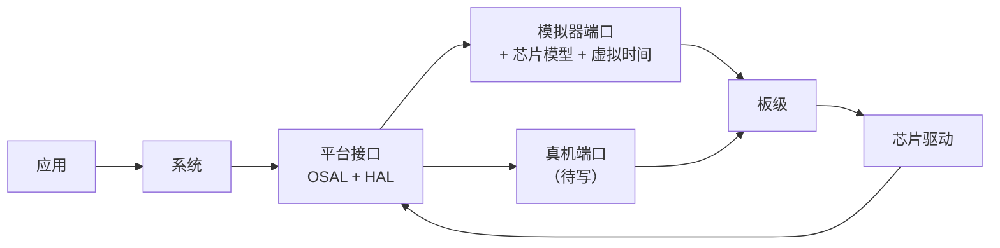

# ink（reader）

基于 [CloudZao Metalio E-Ink4 Plus](https://github.com/CloudZao/Metalio-E-INK4-Plus) 的墨水屏设备上，自研一套 AI 原生的系统，供本人和孩子使用：阅读、听书、学习、日常工具，以及短信和电话。暂称“家庭 AI 手机”。项目建立于 2026-10-26，仓库 [Gidean-zcx/ink](https://github.com/Gidean-zcx/ink)。

两个核心目标（[G-001、G-002](docs/requirements.md)）：把刷消遣 app 的时间变成获取高价值信息、增长知识和能力的时间；系统级原生 AI，系统和应用的所有行为、数据和页面都能被 AI 操作和读取。

## 现状（2026-11-05）

- **硬件**：整机已到货。第 0 步（只读识别与整片备份）和第 1 步（测量固件跑校准内核，测完复原）完成，见[实机记录](docs/hardware/README.md)。自研系统还没有在实机上跑过。
- **自研系统**：主页、书架与阅读器、语音 AI、动作与策略、电源与待机、4G 切卡与短信电话的驱动，以及系统服务（数据、文件、时间、通知、确认卡、文字输入、音频、成员和密码、升级），已在模拟器上实现并按预算测试。**还没有在真机上跑过。**
- **系统界面**：设计稿和[规范](docs/product/system-ui-spec.md)已有，代码里还是占位外观。
- **家庭中枢（服务器）**：[设计 v0.8](docs/hub/hub-architecture.md) 已有；第 1 步的骨架在 `hub/`，只用假厂商和合成数据在本机跑过，模拟器能连上它走通一轮语音和一次工具调用。
- **模拟器**：把系统编译成电脑程序，跑在按 E-Ink4 Plus 建模的虚拟设备上（双核、时间、内存和整块板的芯片都按官方硬件建模）；有命令行（场景测试）和桌面窗口（类似 Android Studio 的模拟器）两种用法。哪些部件与官方一致、哪些只是估计，见[硬件对照](docs/research/simulator/hardware-parity.md)。
- **测试**：91 项，GitHub Actions 在 Linux 和 macOS 上每次推送都跑。
- **审计**：2026-11-03 用 Codex 对全系统与模拟器做了审计，之后按复审结果继续修，每轮的问题与处理见[审计记录](docs/audits/README.md)。

## 快速开始

```bash
cmake -S . -B build && cmake --build build -j8 && ctest --test-dir build --output-on-failure
```

需要能访问 GitHub（拉取 LVGL；没装 SDL2 时还会拉取 SDL2 和 Dear ImGui），以及 Noto Sans CJK 字体和带 Pillow 的 Python 3（Debian/Ubuntu：`fonts-noto-cjk`、`python3-pil`、`libsdl2-dev`；macOS 的做法见 [CI 配置](.github/workflows/sim.yml)）。详见[项目全貌 §11](docs/background.md)。

- 桌面模拟器：`./build/ink-sim-gui`，用法见[平台与模拟器 §3.1](docs/system/platform-and-simulator.md)。
- 跑一个场景：`./build/ink-sim --profile simulator/profiles/metalio-plus.json --script tests/scenarios/home_basic.script --assets build/assets --content build/test-content --out out/`。

## 仓库结构

```text
apps/                  应用（主页、阅读器）
system/                自研系统：boot/ 启动装配，services/ 系统服务，policy/ 动作与权限，ui/ text/ util/，include/ 系统接口
platform/include/ink/  平台接口：OSAL 与各 HAL（系统与端口之间的契约）
drivers/               芯片驱动（chips/）与 PQ-BN 直驱算法（display/）
boards/metalio_plus/   Plus 的接法：IO 扩展芯片、屏电源顺序、触摸坐标、浅睡的板级步骤
ports/sim/             模拟器端口：OSAL 与各 HAL 的模拟实现；真机端口 ports/esp32s31/ 待写
simulator/             模拟器：虚拟时间内核、内存池、芯片模型、环境、运行器、桌面窗口、设备档案
tests/                 自检、系统服务检查、场景与预算、测试内容
tools/                 字体生成、报告、指令级模拟器、上机工具
third_party/           固定版本的第三方代码
docs/                  需求、决策、调研、系统设计、实机记录、审计
```



应用、系统、平台接口、驱动和板级是真机与模拟器共用的同一份源码；两边只换端口。每层是一个独立的构建目标，系统和应用在构建上就引用不到驱动和模拟器。细节见[仓库结构](docs/system/repo-layout.md)和[模拟系统总览](docs/system/simulator-overview.md)。

## 文档导航

| 想知道 | 看这里 |
| --- | --- |
| **项目全貌、证据边界、构建与测试** | [项目全貌与背景](docs/background.md) |
| 最近做了什么、接下来做什么 | [接续记录](docs/project.md) |
| 整个流程怎么走、现在在哪一步 | [开发流程](docs/process.md) |
| 产品给谁用、首版做什么 | [产品定义 PRD](docs/product/prd.md)、[需求深读](docs/product/needs-analysis.md) |
| 需求与边界 | [需求](docs/requirements.md)、[想法记录](docs/ideas.md) |
| 每个功能做到什么程度算合格 | [系统需求 SRS](docs/system/srs.md) |
| 系统怎么分层、设备与服务器怎么分工 | [系统架构概要设计 v1.0](docs/system/system-architecture.md)（已确认）、[架构方案](docs/system/architecture.md)、[底座设计](docs/system/foundation.md)（可点选的[底座地图](https://claude.ai/artifact/KvJAr2ZS9MZNvHu9RqcZRz)，源文件 [docs/foundation-map.html](docs/foundation-map.html)） |
| **模拟器：怎么搭的、组件与接口、怎么平移到真机** | [模拟系统总览](docs/system/simulator-overview.md)、[平台与模拟器](docs/system/platform-and-simulator.md)、[硬件对照](docs/research/simulator/hardware-parity.md) |
| 代码放在哪、分几层 | [仓库结构](docs/system/repo-layout.md) |
| 系统界面长什么样、每个界面还缺什么 | [系统界面规范](docs/product/system-ui-spec.md)、[底层依赖](docs/system/ui-dependencies.md) |
| 系统服务怎么设计、验证到哪了 | [系统服务详细设计](docs/system/system-services-design.md) |
| 服务器（家庭中枢）怎么设计 | [家庭中枢概要设计](docs/hub/hub-architecture.md)、[设备协议](docs/hub/device-protocol.md) |
| 墨水屏刷新算法 | [刷新算法研究](docs/research/eink-refresh-algorithm.md)、[集成报告](docs/research/eink-refresh-integration.md) |
| 最大的技术风险和实机验证计划 | [风险与验证](docs/system/risks-and-spikes.md) |
| 需要用户拍板的事项与推荐 | [决策记录](docs/decisions/README.md)（可点选的[交互式决策板](https://claude.ai/artifact/RWnCX8AyAbyqArc7D9Wsft)，源文件 [docs/decision-board.html](docs/decision-board.html)） |
| 实机上机步骤与实测结果 | [实机记录](docs/hardware/README.md) |
| 外部审计与处理 | [审计记录](docs/audits/README.md) |
| 竞品、市场、硬件与技术调研 | [调研资料索引](docs/research/README.md)、[研究简报](docs/briefs/README.md)、[竞品交互资料库](docs/research/interaction-library/README.md) |
| 在用户电脑上用本机 Claude Code 接手 | [接手说明](docs/handoff/local-claude-code.md) |

## 协作方式

协作约定在 [AGENTS.md](AGENTS.md)：用中文交流；事实、推断、待验证分开标注；用户的需求与助手的建议分开记录。直接用自然语言提出想法即可，不用先写完整的需求文档。写设备、花钱、拆机、删除历史资料、对外发布等事项要用户明确同意。
