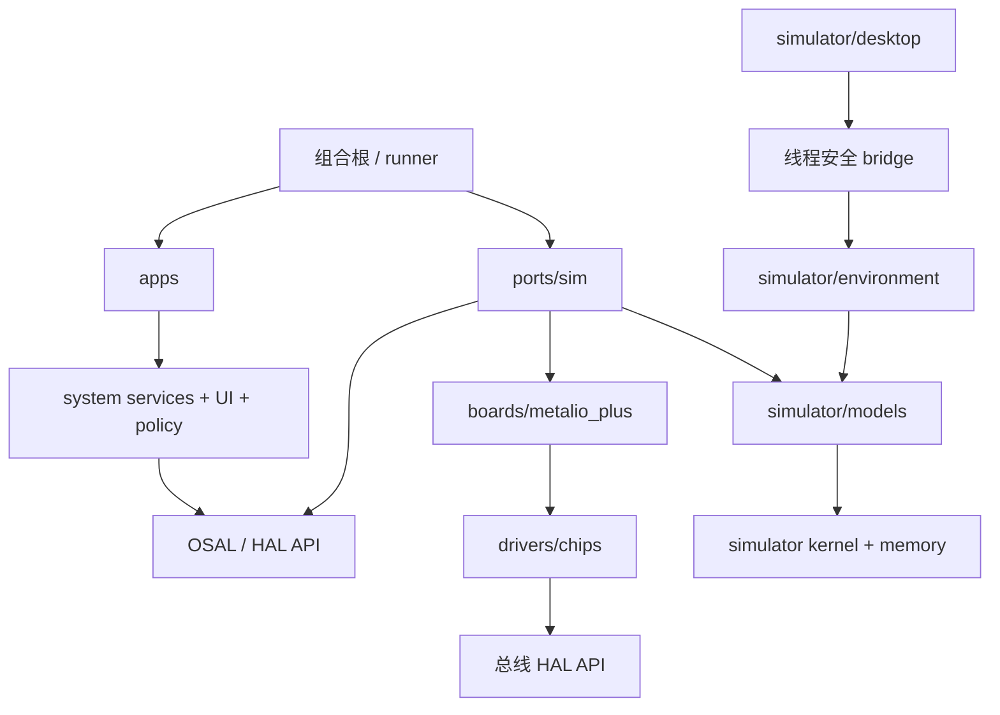

# 全系统与模拟器独立审计报告

日期：2026-11-03。审计对象：`3a435a59812b9d3d40fbe04358c9b17ef4eb15bf`（固定检出）；官方对照：`690a023c66862af103a3187464373ee7c5efcd14`。

## 一页结论

**有条件可行：当前系统纵切与模拟器可继续用于开发和回归，但“硬件 21 项都一致”和“驱动可原样迁移”的整体判断不成立。** 主要问题在于若干模型跳过硬件状态，测试因此无法证伪错误流程。系统本身也存在可复现的录音取消和缓存一致性缺陷。

共 **24 项新发现：严重 5、高 10、中 8、低 1**。“严重”依任务定义，包含让模拟器在关键接线、资源和时序结论上误导的情形；**没有进行实机故障或损坏验证**。

| 范围 | 总体判断 |
| --- | --- |
| A 系统与应用 | 正常纵切能运行；退出 AI 时采集清理、存储缓存及真实并发还有缺陷。 |
| B 平台接口 | 分层方向合理；销毁/回调生命周期和 PSRAM DMA 能力需要补齐。 |
| C 驱动 | 地址/主要接线有上游依据；TCA 状态与锁、摄像头完整初始化未达原样移植条件。 |
| D 模拟器内核 | 确定性和现有内核测试通过；内存账偏乐观，宿主归属表持续增长。 |
| E 硬件模型 | 最需要优先修正：失败 I2C 仍送键、断电仍采音/出图、休眠只改电流账、无屏电源仍报显示成功。 |
| F 桌面模拟器 | 基本交互已验证；重启描述符泄漏已复现，停止与媒体生命周期仍有并发风险。 |
| G 测试与 CI | 普通与 ASan/UBSan 各 **35/35 通过**；故障耦合、关闭时序和 macOS 源码 SDL 路径覆盖不足。 |
| H 文档 | 顶层证据边界基本准确；硬件“一致”总计夸大，部分实施状态过时。 |
| I 目录结构 | 可渐进重组；应同时让构建目标强制层间依赖，不能只搬目录。 |

优先处理建议：

1. 先修 **AUD2-001/002** 的用户可见正确性，以及 **AUD2-006/007** 的共享板级状态。
2. 在继续依赖模拟器作硬件验收前，修正 **AUD2-008/012/014/015/017**；不能用现有绿色测试证明这些路径正确。
3. 将本次复现变成有明确断言的回归，再按 I 节机械搬迁。目录重组与功能修复分批完成。

## 方法与证据边界

独立由主代理完成，没有调用子代理或外部模型，没有联网、访问设备、读取 `ink-hw/` 下 `upstream/` 之外的数据。没有改产品源码、原测试、profile 或既有文档，没有建分支、提交或推送。审计材料在本目录，构建/大文件在 `build-audit/` 与 `build-audit-asan/`。

- **【复现】**：实际在本机运行；均为模拟器或主机证据，不是实机。
- **【代码核查】**：固定提交的可定位控制流/数据流。
- **【文档核查】**：文字与代码、需求或测试结果对照。
- **【推断】**：可能的失效后果；没有把尚未运行的交错或真实设备行为写成实测。

报告源文件位置使用仓库路径与行号；`upstream@690a023:` 表示官方固定提交的路径。完整执行方法、日志索引见 [experiments/README.md](experiments/README.md)，结构化列表见 [findings.json](findings.json)。

旧审计去重：对照了 `docs/audits/README.md` 的 19 项处理。已知 F-1、F-3～F-11 不重新编号；本次正常回归未观察到旧已修复场景再次失败。AUD2-001 是“按住时关闭”的新取消路径，AUD2-002 是“成功替换后旧缓存”，AUD2-009 是新 NT26 编码器，均明确区别于旧项。没有重新完整复核旧审计所有实验，不能据此扩大“修复无回归”的范围。

## A. 系统与应用

已检查启动顺序、显示守卫/刷新队列、输入分发、阅读器加载/翻页/保存、AI 轮次、音频缓冲、中枢重连与功耗持有。35 项现有测试覆盖了正常纵切和此前若干回归；新发现如下。成员系统仍是内建演示家庭、确认卡未实现，这些在源码已明示，不作为“新增 bug”。当前资源准入、持久化回执、内容版本和工具调用幂等等已知缺口仍需跟踪。

### AUD2-001｜高｜按住 AI 键时关闭面板，录音不会随松键结束

**证据类型：**【复现】。**位置：**`system/ai/ai_service.c:122`；`system/ai/ai_service.c:418`；`system/audio/audio_service.c:483`；`tests/scenarios/ai_dismiss.script:1`。

【复现】3 s 按 AI 并保持 3 s、4 s 按 HOME、12 s 锁屏、65 s 结束。关闭组采集 **61965 ms**、休眠 **0 ms**；仅去掉 HOME 的对照组采集 **3000 ms**、休眠 **36279.986 ms**。两组退出码均 0。见 `experiments/ai_held_dismiss.script`、`experiments/ai_held_control.script` 和 `experiments/evidence-summary.json`。

【代码核查】dismiss 停止播放但未调用 `ink_audio_capture_end`；松键先执行 `if (!AI.open) return`。这是旧 AUD-006 修复后仍存在的另一条入口：旧回归在**松键后**关闭，本次在**松键前**关闭。没有把已修复的迟到 TTS 问题重新报告。

**影响：**录音和编码持续消耗资源，关闭界面、松键及锁屏均不能结束该次采集；对讲边界与用户预期不符。模拟中上传仍发生，是否到达真实服务器未验证。

**建议：**将采集会话的取消从 AI 面板可见性中分离；dismiss 必须结束或取消采集、清空该轮待发帧并释放电源持有。松键清理应幂等，不能被 !AI.open 提前返回跳过。

**复现/复核：**python3 docs/audits/2026-11-03-codex/experiments/run_probes.py ai_held_dismiss ai_held_control。

### AUD2-002｜高｜小文件被大文件替换后，存储服务仍返回旧缓存

**证据类型：**【复现】。**位置：**`system/storage/storage_service.c:100`；`system/storage/storage_service.c:180`；`system/storage/storage_service.c:365`。

【复现】先写 `OLD`（3 B），再写同路径的 1200 个 `N`；每次等队列清空。输出 `writes=0,0 pending=0 failed=0 durable_size=1200 read_n=3 first=4f4c44`，退出 0，见 `experiments/storage_cache.log`。

【代码核查】`cache_put` 对长度大于 1024 的数据直接返回，旧条目仍有效；分配新缓存失败也存在相同失效遗漏。本项不同于旧 AUD-003：本次两个持久化写入都成功。

**影响：**写入成功且作业已落盘，后续读取仍看见旧内容，直到缓存淘汰或重启；使用该内容继续写回可能覆盖新数据。实验确认读一致性错误，没有宣称已复现掉电丢失。

**建议：**写入任何新版本时先使旧缓存失效；超过缓存上限或缓存分配失败时也必须失效。为排队写入、预取和读缓存建立版本检查。

**复现/复核：**python3 docs/audits/2026-11-03-codex/experiments/run_probes.py storage_cache。

### AUD2-003｜高｜中枢连接状态跨任务裸读写，发送限额检查与入队不原子

**证据类型：**【代码核查】。**位置：**`system/net/hub_link.c:77`；`system/net/hub_link.c:309`；`system/net/hub_link.c:467`；`system/net/hub_link.c:475`。

【代码核查】`H.state` 由 hub 任务写，`ink_hub_online`/`enqueue_tx` 直接读；`H.demand_until` 由调用方写，hub 直接读；`low_power` 只用了 volatile。`enqueue_tx` 在 478 行检查容量，479 行解锁，直到 492–496 行才重新上锁追加，期间允许另一个生产者通过检查。

【推断】失效表现取决于真实并发时序；本次不声称已经在真机复现。当前 VTK 每次只运行一个主机任务线程，无法覆盖所有机器指令级交错。

**影响：**UI、音频、power 与 hub 任务之间没有完整同步；在真实双核执行中构成 C 数据竞争，64 位 demand_until 在 RV32 上还可能撕裂。多个生产者可以都通过 96 KiB 检查后超额入队。具体断连或超额峰值未在本次运行中复现。

**建议：**连接状态、需求截止时间统一由 hub 任务通过消息更新，或用明确定义的锁/原子快照；发送额度在同一锁区间预留并入队，失败回滚预留。

**复现/复核：**静态追踪 ink_hub_demand、ink_hub_online、enqueue_tx、hub_task 和 on_power；用真正并行的 OSAL 测试后端或目标双核压力测试验证，不以 VTK 顺序执行通过作为无竞争证据。

## B. 平台接口

OSAL 的任务优先级、tick 向上取整、PSRAM 栈限制，显示 HAL 的像素拷贝与可见完成、音频停止等待回调、AT 调用方串行化都有明确文字或实现。接口总体可以支撑继续搭建端口，但还不能仅按头文件实现一致的生命周期。system/apps 未发现直接包含 sim/vtk/pthread 或使用 libc 堆分配；`SIM_TRANSCRIPT` 仍是 system/ai 中的演示替身（37、346、430 行），建议在结构迁移时移到显式 demo/provider。

### AUD2-004｜中｜WebSocket 和计时器缺少可依赖的销毁、回调静默契约

**证据类型：**【代码核查】。**位置：**`platform/include/ink/hal_net.h:70`；`platform/include/ink/hal_net.h:82`；`ports/sim/hal_net_sim.c:887`；`ports/sim/hal_net_sim.c:941`；`ports/sim/hal_net_sim.c:1066`；`platform/include/ink/osal.h:163`；`ports/sim/osal_sim.c:688`。

【代码核查】`HAL_WS_CLOSED` 注释包含任一方主动关闭，但模拟器在 `close_req` 时抑制该回调；`hal_ws_free` 仅发关闭请求并释放 TLS 计账，没有等待 `task_done`。RX 分支在取出消息与调用回调之间有可让出执行权的成本计费，之后没有再检查关闭。计时器任务取出裸指针后解锁、计费、调用，而 delete 直接释放该对象。

【推断】当前 hub 使用长生命周期全局上下文，不能据此证明已发生 UAF；风险在移植或引入短生命周期调用者时更明显。相对地，音频 `capture_stop` 已用 `cb_lock` 等待回调结束，本次未将其误报。

**影响：**真机端口无法仅凭头文件判断释放 ctx 的时机、主动关闭是否应回调 CLOSED、能否从回调中关闭，以及计时器删除是否等待正在运行的回调。不同实现容易产生晚回调、死锁或悬空上下文。

**建议：**逐接口规定调用上下文、线程安全、对象与参数生命周期、关闭是否阻塞、回调内允许的操作；分开 request_close 与 join/free，或明确同步静默保证，并提供端口共享契约测试。

**复现/复核：**对照上述头文件与实现；特别检查 hal_ws_free 返回与网络任务继续执行之间的窗口，以及 timer_task 出队后删除计时器的窗口。本项未做动态 UAF 复现。

### AUD2-005｜中｜内存能力接口把 DMA 固定为内部 RAM，无法表达官方摄像头的 PSRAM DMA 缓冲

**证据类型：**【复现】。**位置：**`platform/include/ink/osal.h:62`；`sim/mem/pools.c:249`；`platform/include/ink/hal_camera.h:23`；`upstream@690a023:main/boards/common/camera/dvp_camera.cc:144`。

【复现】`OSAL_MEM_EXTERNAL | OSAL_MEM_DMA` 请求 64 B，输出 `returned_pool=0`（内部池），见 `experiments/memory.log`。

【代码核查】OSAL 声明 DMA 为 internal 的子集；分配器遇到 DMA 位即只尝试内部两个池。官方固定提交的 `dvp_camera.cc:144–145` 明确通过 `esp_cam_ctlr_alloc_buffer(..., MALLOC_CAP_SPIRAM | MALLOC_CAP_DMA)` 分配 640×480×2 缓冲。HAL 可以内部实现复制绕过，故不判定接口完全无法实现。

**影响：**新增摄像头端口不能直接复用当前能力组合；若端口另分配 DMA 帧再拷贝，600 KiB 级额外峰值和拷贝成本不会出现在当前模型中。尚未实现真机端口，因此这是移植接口缺口。

**建议：**约定 DMA 能力与内存位置的组合及对齐/缓存同步要求，或让 camera HAL 明确拥有传输缓冲并向调用方复制；模型与资源预算必须采用同一方案。无效能力组合应拒绝，不能静默忽略 EXTERNAL。

**复现/复核：**python3 docs/audits/2026-11-03-codex/experiments/build_probes.py；build-audit/audit-memory-probe。

## C. 驱动

按官方固定提交核对了板级引脚、地址与主要驱动流程：TCA P00–P05/P07、P12/P13/P14/P16/P17、FT6336U 盖板坐标、BH I2S slave、NT26 切卡顺序、RTC/电量计/充电芯片接口。NT26 切卡未强制整机重启，符合 R-044；失败回退完整策略尚不能视作已完成。没有对每颗芯片完整手册重新认证；下面涉及型号行为的结论以已读官方代码或本仓库模型的明确契约为依据。

### AUD2-006｜高｜TCA9555 写失败后保留新影子值，后续无关写入意外补发旧操作

**证据类型：**【复现】。**位置：**`drivers/tca9555/tca9555.c:24`；`drivers/board/metalio_board.c:31`。

【复现】使 io-expander 100% 超时，尝试开启马达，收到 -2；恢复总线后只开启功放。输出 `failed_motor_write=-2 motor_before=0 amp_write=0 motor_after=1`，见 `experiments/tca_shadow.log`。

【代码核查】`tca9555_set` 先修改 `t->out[port]`，再调用 I2C；失败不重同步。

**影响：**调用者已收到失败，但后续更改另一位可能开启马达、功放或改变电源脚；硬件状态和调用方认知不一致。没有进行真实硬件损伤实验。

**建议：**区分期望状态与已确认硬件状态；失败后读回/标记未知并显式恢复。不要在下一次无关 set 中悄悄携带失败事务；I2C 超时可能部分执行，简单回滚软件值也不足以替代读回。

**复现/复核：**python3 docs/audits/2026-11-03-codex/experiments/run_probes.py tca_shadow。

### AUD2-007｜高｜屏电源驱动绕过整板 TCA9555 锁

**证据类型：**【代码核查】。**位置：**`drivers/board/metalio_board.c:26`；`drivers/board/metalio_epd_power.c:9`；`ports/sim/hal_display_sim.c:431`；`ports/sim/hal_display_sim.c:451`；`ports/sim/hal_power_sim.c:136`；`ports/sim/hal_audio_sim.c:333`。

【代码核查】普通板级访问经 `g_lock`；显示 HAL 把同一 `metalio_ioexp()` 指针交给 `epd_power_t`，其 `pins()` 直接调用无锁 `tca9555_set`。I2C 总线逐次串行化不保护调用前的影子值读改写。

【推断】VTK 不等于真实 SMP，本次用代码路径确认竞争条件，未声称模拟器已展示丢位。

**影响：**屏电源与马达/功放共用 Port0 影子寄存器，但读改写不受同一锁保护。真实并行下存在丢更新及先后顺序反转风险，涉及高压轨开关。实际丢写与硬件后果未动态复现。

**建议：**所有端口位更新经过唯一的板级仲裁入口；把短事务读改写锁与整段长电源时序的资源租约分开，避免简单把几百毫秒延时全部放在总线锁中。

**复现/复核：**追踪 metalio_ioexp 返回的全局对象、epd_power 的 pins、metalio_board_set 的锁；检查当前调用点没有在 epd_power_on/off 外取得同一板锁。

### AUD2-008｜严重｜GC2145 驱动省略 VGA 窗口与完整初始化，模型却保证 VGA 出图

**证据类型：**【代码核查】。**位置：**`drivers/gc2145/gc2145.c:20`；`drivers/gc2145/gc2145.h:7`；`ports/sim/dev_camera.c:59`；`ports/sim/dev_camera.c:102`；`upstream@690a023:main/boards/common/camera/dvp_camera.cc:130`；`upstream@690a023:main/boards/common/camera/gc2145_vga_settings.h:695`。

【代码核查】当前 driver 仅三次软复位及 10 项短写序列；没有写 crop/window 0x90–0x98 等决定 VGA 的配置。官方 `Grab` 遍历整张表，表末设高度 0x01E0、宽度 0x0280；`Prepare` 还先建立 MCLK。模型只以 F2 非零标记 streaming，`hal_camera_info` 与 `capture` 固定 640×480 并直接填图，不检查窗口或格式。

头文件确实写了“真机端口应补完整表”，但 `gc2145_start` 又声明 Reset/VGA，而总览将该部件计为一致。这只能算不完整驱动与行为替身，不能作为原样移植通过的证据。

**影响：**现有“640×480 正确出图”的测试不能证明驱动能原样用于设备；摄像头初始化、接收和资源预算的关键结论存在乐观偏差。严重级针对关键模型误导，不代表本次实测了真机故障。

**建议：**在可移植驱动中采用有出处的完整寄存器序列；模型至少校验窗口、格式、时钟/流状态和帧完成条件；DVP/MCLK、DMA 与资源租约由 HAL 实施并计账。

**复现/复核：**比较 gc2145_start 的短序列与 upstream 固定提交的 kGc2145Vga，特别是窗口 0x90–0x98；现有 selftest-board-wiring 仍通过。

### AUD2-009｜中｜NT26 新增短信编码器接受非法 UTF-8 与不成对代理项

**证据类型：**【复现】。**位置：**`drivers/nt26/nt26.c:83`；`drivers/nt26/nt26.c:113`；`drivers/nt26/nt26.c:162`。

【复现】`D8000041` 返回成功并输出 `e29181`；孤立 `DC00` 输出非法 UTF-8 `edb080`；半个编码 `004` 被当作空串成功；过长编码 `C0 80` 被转换为 `0000`。见 `experiments/nt26_unicode.log`。

本项位于新 NT26 转换器，旧 AUD-010 修的是 `system/core/ink_json.c` 与文本 UTF-8 解码，本次未把旧修复误判为回归。

**影响：**短信或 AT 响应的畸形文本被静默变成其他字符、非法 UTF-8 或空串，影响展示和协议解析；本次没有复现越界读写。

**建议：**复用已严格校验的 UTF-8 解码，检查十六进制长度、每个字符和代理项配对；明确 UCS2 与 UTF-16 的差异以及非 BMP 字符处理策略。

**复现/复核：**python3 docs/audits/2026-11-03-codex/experiments/run_probes.py nt26_unicode。

## D. 模拟器内核与档案

普通和 sanitizer 测试均通过调度、优先级继承、tick 延时、双核 Flash 停顿、PSRAM 栈访问 Flash 的 death test、确定性比较以及 ISS 自检。profile 对多数成本/电流有来源或 ESTIMATE 标记；显示内部 50 KiB、送行优化、未校准 Opus/TLS 等仍是设计参数，不是整个固件已测结果。VTK 的单主机线程执行与成本注解是已披露的近似，不能推出无 SMP 数据竞争或真实 CPU/栈达标。

### AUD2-010｜高｜内存空闲量漏算分块头开销，零容量池仍凭空产生可用空间

**证据类型：**【复现】。**位置：**`sim/mem/pools.c:149`；`sim/mem/pools.c:195`；`sim/mem/pools.c:219`；`sim/mem/pools.c:334`。

【复现】在 65536 B 池分配 100 个 64 B 块，公布 free=59136 B，而遍历同一 TLSF 池得到 **58336 B**，多报 **800 B**；配置 DMA=0 时公布 total=1008 B。见 `experiments/memory_probe.c` 与 `experiments/memory.log`。

【代码核查】初始 usable 来自空闲块遍历，之后只扣 `tlsf_block_size`，没有扣分块头；`pool_init` 又把每个小区域提升到 1024 B。`largest_free` 是实时遍历值，本次未发现它存在同样的 800 B 误差。

**影响：**free/min_free 及合并的内部内存低水位偏乐观，资源门槛会使用错误余量；零容量或已被固定开销吃光的区域还能分配。没有据此推断当前默认场景已在真机 OOM。

**建议：**按 TLSF 实际空闲块之和或包含分裂元数据的增量核算 free/低水位；零可用容量应建立空池而非最小 1024 B。主机与目标分配器的头开销需要另行校准并标注。

**复现/复核：**python3 docs/audits/2026-11-03-codex/experiments/build_probes.py；build-audit/audit-memory-probe。

### AUD2-011｜中｜分配归属表按累计插入数扩容，反复分配释放导致主机内存增长

**证据类型：**【复现】。**位置：**`sim/mem/pools.c:63`；`sim/mem/pools.c:75`；`sim/mem/pools.c:104`。

【复现】100000 次 64 B 分配后立即释放，最后 live=0，AM capacity=131072、host_bytes=2097152 B；初始容量为 4096 项、65536 B。见 `experiments/memory.log`。

【代码核查】`am_put` 每次增加 `am_used`，`unattribute` 只写墓碑而不扣计数；`am_grow` 才重新统计。这与已知 F-10 的 VTK 任务槽累计上限是两类资源。

**影响：**模拟设备的 live allocation 已归零，宿主的归属哈希表仍随分配历史增长，长时间交互/压力测试消耗越来越多主机内存；这不属于目标 SRAM 泄漏。

**建议：**分别维护 live 与 tombstone 数量；复用墓碑时不要增加占用槽数，适时同容量重散列，再按实际存活量决定扩容。

**复现/复核：**build-audit/audit-memory-probe（编译说明见 experiments/README.md）。

## E. 硬件模型

已检查显示/电源、输入、TCA、RTC/加速度计、电量/充电、音频、摄像头、网络/AT、Flash/LittleFS 和 SD 模型。网络环境与系统 `hal_net_use` 的入口已分开，但系统/apps 还没有调用 `hal_net_use`：当前链路仍取 profile 的启动默认值，应记为系统选网策略待实现。脚本中枢、合成语音、测试图案属于允许的环境替身；下列问题是器件条件被跳过或驱动行为由环境直接代办。

### AUD2-012｜严重｜实体键绕过寄存器读值，GPIO2/RTC 中断链也有旁路

**证据类型：**【复现】。**位置：**`ports/sim/hal_input_sim.c:239`；`ports/sim/hal_input_sim.c:502`；`ports/sim/dev_tca9555.c:11`；`ports/sim/dev_tca9555.c:46`；`ports/sim/dev_rtc_accel.c:66`。

【复现】板初始化完成后把 io-expander 传输设为 100% 超时，再按 POWER；仍在 120.102 ms 后收到按下事件，`keys_delivered=1`，松开没有送达。见 `experiments/input_fault.log`。

【代码核查】驱动丢弃 `metalio_board_read` 的结果和 p1，改从环境层的 `IN.exp_pending` 队列送按键。TCA INT 明确只实现 Port1，Port0 P07 变化不参与；RTC `alarm_cb` 在拉 P16 外直接 `sim_power_wake(HAL_WAKE_RTC)`，不依赖 TCA 输入方向和 GPIO2 电平。后两条为静态核查，未做断线动态试验。

**影响：**总线读取失败或硬件接法/方向寄存器不正确，模型仍可能向系统报告有效按键或唤醒，削弱共享 GPIO2、错误恢复和睡眠唤醒的验证能力。

**建议：**环境只改变物理引脚，驱动必须从成功读取的寄存器推导状态与去抖；同时建模两端口 INT，并由实际电平与 MCU 唤醒配置产生 RTC 唤醒，不从器件直接调用系统唤醒。

**复现/复核：**python3 docs/audits/2026-11-03-codex/experiments/run_probes.py input_fault。

### AUD2-013｜高｜按住触摸时，电源和音量实体键被堵到松手

**证据类型：**【复现】。**位置：**`ports/sim/hal_input_sim.c:494`；`ports/sim/hal_input_sim.c:525`。

【复现】手指按下后保持约 2 s，期间 POWER 在 +200 ms 按下、+600 ms 松开。两个事件在手指松开后才送达，延迟分别 **1833.269 ms / 1433.270 ms**。见 `experiments/touch_blocks_power.log`。

【代码核查】触摸会话内层循环只排空 `IN.kn`（直接 GPIO 键），不处理 expander 的中断/去抖确认。旧 `keys_overlap` 覆盖两个触摸盖板键，本项是触摸与 TCA 实体键组合。

**影响：**手指持续停在屏幕或盖板键上时，POWER/VOL 事件延迟可随保持时间增长；与“按键仍及时送达”的注释和交互目标不符。

**建议：**触摸轮询每轮同时处理 exp_irq/exp_confirm，或拆成独立服务任务并共享合适的总线仲裁；给持续触摸期间实体键的最大延迟设置回归门槛。

**复现/复核：**python3 docs/audits/2026-11-03-codex/experiments/run_probes.py touch_blocks_power。

### AUD2-014｜严重｜休眠仅修改电流账，不真正停用已建模的电源与外设

**证据类型：**【复现】。**位置：**`ports/sim/hal_power_sim.c:298`；`ports/sim/hal_power_sim.c:331`；`ports/sim/hal_power_sim.c:363`；`drivers/board/metalio_epd_power.c:83`；`profiles/metalio-plus.json:287`。

【复现】先开启马达，再调用 `hal_power_sleep`，`keep_modem=false`。睡眠期间输出 `sleeping=1 bt_powered=1 modem_registered=1 motor=1 camera_power=1 load_ma=1.500`；醒来马达仍开。见 `experiments/sleep_rails.log`。这是直接 HAL 故障路径探针，不代表普通 UI 一定会触发同样的马达状态。

【代码核查】入口用固定延时代表 PMIC/SD/电源序列，然后把全部 consumer 暂时记为 off；退出再恢复账目，没有执行相应 P14/P05、PMIC sleep、加速度计停用等操作。即使电流参数明确标“估计”，状态与耗电脱节仍是模型缺陷。

**影响：**休眠电流、断电后外设恢复、P14 重新上电后音频模式重建等关键结论被绕过。即使脚仍使能，统计仍可显示最低休眠电流；这些数字不能作为接线与关闭流程已正确的证据。

**建议：**睡眠 HAL 执行真实驱动序列并保留必要资源租约，由引脚和器件状态决定耗电；拒绝仍有活动外设的休眠。将模型状态断言和电流估计分开测试。

**复现/复核：**python3 docs/audits/2026-11-03-codex/experiments/run_probes.py sleep_rails。

### AUD2-015｜严重｜I2S 音频模型不依赖 BH1098G 电源、模式和时钟

**证据类型：**【复现】。**位置：**`ports/sim/hal_audio_sim.c:148`；`ports/sim/hal_audio_sim.c:228`；`ports/sim/hal_audio_sim.c:286`；`ports/sim/dev_tca9555.c:89`；`platform/include/ink/hal_audio.h:9`。

【复现】P14 拉低后开始录音，在 500 ms 窗口仍返回成功并收到 **7920 samples**：`capture_start=0 bt_powered=0 samples=7920`，见 `experiments/audio_unpowered.log`。

【代码核查】RX/TX 由自身虚拟定时器推进，不查询 BH 电源/模式；官方固定提交 `config.h:142–151` 和 `bt_audio_codec.cc:68,93` 均是外部 BH 时钟驱动的 I2S slave。此处判断电气依赖，不声称已核实 BH 所有模式的完整语义。

**影响：**BH1098G 断电后，ESP 作为 I2S 从机仍被模型报告为持续收到音频；共享电源循环后的模式恢复、失钟/停流以及音频故障恢复测试会得到错误成功结论。

**建议：**将 RX/TX 传输推进绑定到 BH1098G 的电源、模式和外部时钟状态；失去时钟时停止 DMA 进度并走明确定义的超时/错误；系统或板级策略负责重新上电和恢复模式。

**复现/复核：**python3 docs/audits/2026-11-03-codex/experiments/run_probes.py audio_unpowered。

### AUD2-016｜高｜摄像头采集中断电仍返回成功，timeout 未覆盖完整调用

**证据类型：**【复现】。**位置：**`ports/sim/dev_camera.c:40`；`ports/sim/dev_camera.c:102`；`ports/sim/dev_tca9555.c:66`；`platform/include/ink/hal_camera.h:23`。

【复现】capture 开始 200 ms 后另一任务关闭 P05，结果仍是 `capture_rc=614400 elapsed_ms=630.572 powered=0`。`timeout_ms=600` 时仍成功、耗时 **631.257 ms**。见对应 `camera_cut.log` / `camera_timeout.log`。

【代码核查】仅下一次 I2C 访问时 `powered()` 才清 streaming；等待结束先检查旧 streaming 并生成图像，随后 stop 的 NACK 被忽略。超时只比较 9 帧固定 600 ms，不计 probe/start。

**影响：**采集被断电/复位打断时可能给出伪造成功帧，调用者无法验证恢复；超时计量遗漏初始化与总线开销。

**建议：**电源/复位边沿立即使传感器流失效；逐帧推进并检查完整帧条件，返回前校验状态；使用调用入口的绝对 deadline，并确保每条失败路径停止流和释放资源。

**复现/复核：**python3 docs/audits/2026-11-03-codex/experiments/run_probes.py camera_cut camera_timeout。

### AUD2-017｜严重｜屏电源重试全部失败后仍回调显示成功并改变模拟屏幕

**证据类型：**【复现】。**位置：**`ports/sim/hal_display_sim.c:445`；`ports/sim/hal_display_sim.c:466`；`ports/sim/hal_display_sim.c:628`；`ports/sim/hal_display_sim.c:694`；`platform/include/ink/hal_display.h:91`。

【复现】PMIC 传输 100% 失败，提交一块黑色区域后收到 `display_submit=1 wait_rc=0 callback_ok=1 panel_ready=0`，退出 0；日志同时有 power-up failed 和 unpowered waveform 警告，见 `experiments/display_fault.log`。

【代码核查】失败后仍无条件 `D.rails_on=true`，更新结果初始化 `ok=true` 并继续 `apply_area`。本次没有预算文件，因此退出 0 不代表现有 warnings=0 预算也会放行；缺陷是显示成功语义和物理图像状态错误。

**影响：**系统收到“物理稳定、可读”的成功结果，实际模型电源仍未就绪。警告不能代替失败回调，屏幕和延迟指标会给出虚假完成；无法验证上层刷新失败处理。

**建议：**power_up 返回状态并中止该请求；保持物理屏幕不变，以 ok=false 通知服务，系统决定重试或降级。安全模式应有可验证行为，不应仅出现在警告文字里。

**复现/复核：**python3 docs/audits/2026-11-03-codex/experiments/run_probes.py display_fault。

## F. 桌面模拟器

现有 gui-smoke 在 SDL dummy 中打开书架、书籍、翻页并产出截图，本次也查看了截图。帧/统计快照与音频环的主路径有互斥，未发现明确的 Gm/ext_m/K.m 锁顺序闭环。新增 headless 重启实验确认资源泄漏。宿主摄像头/麦克风只读源码，不打开硬件；Linux 媒体后端在本机不能运行。

### AUD2-018｜高｜GUI 停止请求与摄像头计数跨主机线程访问未同步

**证据类型：**【代码核查】。**位置：**`sim/vtk/vtk.c:85`；`sim/vtk/vtk.c:438`；`sim/vtk/vtk.c:732`；`ports/sim/sim_gui.c:257`；`ports/sim/sim_gui.c:344`；`ports/sim/dev_camera.c:117`。

【代码核查】`K.stop_req` 是普通 bool，写入发生在 `ext_m` 加锁之前，读端主要持 `K.m`；两把锁不构成该字段的一致保护。`CAM.captures` 同样非原子，GUI 无锁读取。

已检查并排除两处容易误报的地方：GUI 的 `g_sim_done` 已是 `std::atomic<bool>`；帧缓冲、图像副本和麦克风/扬声器环均经 Gm 复制，未发现这几条路径的明确锁顺序环。

**影响：**UI 线程写 stop_req，调度线程以另一把锁读取，属于 C 数据竞争；摄像头采集数也从 GUI 直接读设备模型变量。可能造成停止请求不可见或异常观测，具体失效未复现。

**建议：**停止位使用原子或一致的锁，或通过线程安全的外部事件通道投递；摄像头计数并入已有 Gm 保护的统计快照。以真正多线程的 TSAN/压力测试验证生命周期路径。

**复现/复核：**追踪 sim_gui_stop → vtk_stop 与 schedule_locked/realtime_wait_locked；对照 sim_gui_camera_captures 和模型写入。本次没有运行 TSAN，不能把 ASan/UBSan 全过当作无数据竞争。

### AUD2-019｜高｜Linux 摄像头未验证 mmap/缓冲边界，也忽略返回的行跨度

**证据类型：**【代码核查】。**位置：**`ports/sim/gui/host_camera_linux.c:26`；`ports/sim/gui/host_camera_linux.c:47`；`ports/sim/gui/host_camera_linux.c:89`；`ports/sim/gui/host_camera_linux.c:104`。

【代码核查】S_FMT 之后只取 width/height；转换按紧凑 `w*h*2` 读取。97 行 mmap 结果未与 MAP_FAILED 比较，98 行 QBUF 结果未处理，56 行直接索引/解引用；104–106 行失败路径只 return，109 行不检查 pthread_create。

**影响：**合法带行填充的 YUYV 格式会出现错行；mmap 失败等情况下可能解引用无效指针。部分失败路径仍泄漏映射/帧或误报工作中。当前宿主为 macOS，未在真实 Linux 摄像头上复现。

**建议：**验证查询/映射/入队/线程创建每一步，统一失败清理；按 bytesperline 转换，核对 index、bytesused 和映射长度；记录成功映射数量，close 时释放 frame 并复位状态。g_run 也应原子化或锁保护。

**复现/复核：**Linux 环境使用可控 V4L2 替身分别返回带 padding 的格式、MAP_FAILED、短帧和 pthread_create 失败。本次只作代码核查，不连接摄像头。

### AUD2-020｜中｜macOS 摄像头异步授权与关闭没有统一生命周期

**证据类型：**【代码核查】。**位置：**`ports/sim/gui/host_camera_mac.m:46`；`ports/sim/gui/host_camera_mac.m:73`；`ports/sim/gui/host_camera_mac.m:100`。

【代码核查】requestAccess completion 不检查任务是否仍有效，直接调用 start_session；close 仅对当时的 g_session stopRunning 并置 nil。start_session 完成后又赋值全局对象与状态，访问没有同一互斥/队列保证。

**影响：**授权完成回调可能在 close 之后再创建 session；g_session/g_status 在不同线程读写未统一串行化。帧内存本身有锁，但不能据此保证启动/停止安全。未触发真实权限弹窗或摄像头采集。

**建议：**用串行控制队列管理 session 和状态，加入关闭标志或 generation；close 先使待授权/启动操作失效，再停止会话、排空回调并清理帧状态。

**复现/复核：**用授权回调替身构造 open → close → granted 交错，并验证关闭后不启动设备。本次为静态可达路径，未做真实授权实验。

### AUD2-021｜中｜GUI exec 重启继承旧日志描述符

**证据类型：**【复现】。**位置：**`ports/sim/gui/gui_main.cpp:86`；`ports/sim/gui/gui_main.cpp:108`；`ports/sim/gui/gui_main.cpp:122`；`ports/sim/gui/gui_main.cpp:1173`。

【复现】SDL dummy、headless 模式下，在运行控制区点击“重启设备”，相同 PID 的启动次数 1/2/3/4 对应 **PIPE fd=4/6/8/10**，每次重启多 2 个。见 `experiments/gui-restart-results.json` 和 `gui-restart.log`。观察结束仅向该审计子进程发送 SIGTERM（子进程最终 exit=0）；没有打开电脑摄像头/麦克风。

【代码核查】capture 使用 pipe 和 dup，但不设 FD_CLOEXEC；restore 仅 dup2 回标准 fd；log_reader 退出不 close/delete，随后 execv 继承这些描述符。

**影响：**反复点击重启逐次积累文件描述符，最终可能不能打开文件、管道或外设。正常使用重启按钮即可触发，无需真实设备。

**建议：**为日志读端和备份描述符设置 close-on-exec；停止并回收日志线程，关闭 fd、释放 Pipe；处理 pipe/dup/pthread_create 失败。保留重启前 flush 和持久化确认。

**复现/复核：**python3 docs/audits/2026-11-03-codex/experiments/gui_restart_probe.py。

## G. 测试与 CI

测试并非全部只检查启动：selftest 检查调度/继承/资源/Flash/DMA/输入；场景对连续阅读保存、快速翻页、空书、迟到 TTS、工具策略、待机、PMIC 重试等设有预算；determinism 对比 metrics.json 和 final.png；GUI smoke 检查触摸与翻页。ASan/UBSan 也确实覆盖当前 35 项。以下构建缺陷已复现，覆盖缺口另列在后。

### AUD2-022｜中｜任务指定的离线 macOS 构建配置在 Objective-C 初始化顺序上失败

**证据类型：**【复现】。**位置：**`CMakeLists.txt:200`；`CMakeLists.txt:215`；`CMakeLists.txt:247`；`.github/workflows/sim.yml:14`。

【复现】原命令 exit=1，CMake 报 `CMAKE_OBJC_COMPILE_OBJECT` 等内部变量未设置；重复同样失败。使用审计目录内 `enable_objc.cmake`，通过 `-DCMAKE_PROJECT_ink_INCLUDE=.../enable_objc.cmake` 提前启用 OBJC 后，配置和 -Werror 构建成功。普通及 ASan/UBSan 各 35/35 通过。

【代码核查】源码 SDL2 在 215 行先进入子目录；顶层 OBJC 在 247 行才启用。结论仅覆盖本机已复现的工具链组合，不扩大成所有 macOS/CMake 版本必现。

**影响：**在本机 CMake 4.4.4、AppleClang 17、没有系统 SDL2 的条件下，完全按 TASK 配置无法生成构建系统。Linux CI 使用系统 SDL2，未覆盖这个路径。

**建议：**在顶层、SDL2 FetchContent 之前启用 APPLE 所需的 OBJC 语言；补 macOS 源码 SDL2 配置/构建验证，保留 Linux 测试。审计 workaround 只用于继续核查，不视作产品修复。

**复现/复核：**运行 TASK.md 第 4 节的原始 cmake 命令；见 experiments/configure.log。随后同一构建目录重复原命令仍失败，见 configure-second.log。

### 测试结果与覆盖缺口

| 实际执行 | 结果 | 证据 |
| --- | --- | --- |
| TASK 原始离线配置；重复同命令 | 两次 exit 1 | `configure.log`、`configure-second.log` |
| 审计 OBJC include + -Werror build | exit 0 | `configure-workaround.log`、`build.log` |
| 普通 CTest，-j8 / timeout 300 | 35/35，exit 0，11.98 s | `ctest.log` |
| ASan/UBSan 配置、构建、CTest | 35/35，exit 0，14.11 s | `asan-configure.log`、`asan-build.log`、`asan-ctest.log` |
| 10 个 HAL/服务审计模式 + 2 个 AI 场景 | 全部跑完；缺陷由输出证据判定 | `probe-results.json`、各模式日志 |
| TLSF 与归属表白盒探针 | exit 0；确认资源账差异 | `memory.log` |
| GUI 4 次启动/3 次 exec 重启 | PIPE 4→6→8→10 | `gui-restart-results.json` |

所有日志都在 [experiments/](experiments/)。审计探针用于观测：输出 exit 0 表示场景执行完成，**不表示问题不存在或应该保持该行为**。

优先补的测试应从硬件依赖和用户意图出发：

| 当前已测 | 尚缺的关键断言 |
| --- | --- |
| AI 松键后 HOME 阻止迟到 TTS | 按住时退出后麦克风停止、该轮数据不再入队、音频 hold 释放 |
| 普通存储与有限掉电/重启 | 缓存跨大小阈值、缓存分配失败、写满/读失败、每个落盘边界的断电矩阵 |
| 摄像头正常取图、开始前 P05 断电 | 完整初始化表、采集中断电/复位、格式错误、总 deadline、DMA 峰值 |
| TCA/共享复位、RTC 正常唤醒 | 失败读不能产生按键；P07 与 P16 的接线/配置错误必须影响 INT/唤醒 |
| 待机时间占比、电流门槛 | 外设引脚真实停用、P14 循环后音频模式恢复，不能只检查记账值 |
| 部分 PMIC 故障能重试恢复 | 重试耗尽时 ok=false、屏幕不变、上层可恢复 |
| GUI 正常启动/翻页/退出 | 重启 fd 数恒定，崩溃/启动中停止、权限回调晚到、Linux 媒体错误路径 |

预算解析已对缺少的**非 optional**指标报错，不能笼统说“没记录就通过”。`target_max/target_min` 只记录 SRS gap、不让 CI 失败，是文档已公开的设计，不列为新发现。确定性比较覆盖固定场景/种子，不能证明所有脚本和主机平台均确定。现有 CI 只跑 Linux；`s31-size.yml` 是手动运行的上游/基线尺寸工作流，不能证明本项目固件的完整资源余量。

## H. 文档

核对了 README、background、project 的最近记录、R-034/R-042–045、D-41–44、模拟系统总览、平台文档和硬件表。README 上半部的 35 项、16 MB PSRAM 和“系统未上真机”的边界与本地证据一致；没有将估计电流当实测续航。profile 的私有实机来源仅核对公开仓库中的引用/标记，未读取被禁止的私有原始数据。

### AUD2-023｜中｜硬件对照的“21 项都一致”与实现和状态记录不符

**证据类型：**【文档核查】。**位置：**`docs/research/simulator/hardware-parity.md:7`；`docs/research/simulator/hardware-parity.md:16`；`docs/research/simulator/hardware-parity.md:35`；`docs/decisions/README.md:104`；`docs/requirements.md:88`。

【文档核查】表格把“一致”定义为行为和参数都按官方，结尾总计 21 项一致，但相同表的第 4 行仍写“摄像头不做”，第 20 行已经有摄像头。D-41 第三步又重复整体一致结论。

【代码核查】前述实验证明电源/总线失效不能正确传到输出。当前 README 上半部准确列出 35 项测试与“系统未上真机”；下半部明确标 S0 原始说明，因此其旧状态只建议更醒目标注，未另立高等级问题。

**影响：**容易把已有模型或通过自检理解为驱动与硬件全部一致，并据此开始依赖错误资源/故障结论的详细框架设计；现行需求状态也无法可靠反映已完成内容。

**建议：**按每个部件分列接线、正常行为、故障/电源耦合、资源、上游比对、实机验证；把本次失真条目降为部分。更新 R-034 的实施状态；保留明确标为历史的 S0 文本，不删除历史判断。

**复现/复核：**对照本报告 AUD2-008、012、014–017 与硬件表；检查 R-034 仍写“网络与音频模型未做”，而相关源码与 AI 场景均已存在。

## I. 代码结构评估与建议的目标目录

当前已经有 apps / system / platform / drivers / ports / sim 的基本层次，方向可以保留。需要纠正的是**构建依赖与实现混放**。以下为审计建议，未执行迁移，不是把新目录自动升级成已确认架构。

### AUD2-024｜低｜构建目标与公开头文件未强制目录所表示的分层

**证据类型：**【代码核查】。**位置：**`CMakeLists.txt:55`；`CMakeLists.txt:97`；`CMakeLists.txt:121`；`CMakeLists.txt:142`；`ports/sim/sim.h:1`；`ports/sim/dev_camera.c:102`。

【代码核查】`ink_port_sim` 把通用驱动与宿主设施放在一个库，公开 `ports/sim` 和整个 `drivers`；`ink_system` 把 `system/display`、jsmn 与 LVGL 相关目录向消费者传播。`dev_camera.c` 同时实现器件状态机与 `hal_camera_capture`，无法独立检验驱动是否仅经硬件边界工作。详细迁移建议在最后一节。

**影响：**当前便于纵切演示，但为真机复用驱动、替换 UI、单测模型时，需要复制源清单或依赖整个模拟器。目录重命名本身不能解决模型与 HAL 混合、服务与应用混合的依赖。

**建议：**采用报告 I 节的目标目录与独立 CMake targets；先锁定行为基线，再机械搬迁，再缩小 PUBLIC include，最后分离混合实现。不要一次同时修 bug、改名和重写模型。

**复现/复核：**核对 ink_port_sim 同时编入芯片驱动、板级策略、HAL、脚本、metrics、hub 环境与 GUI bridge；ink_system 同时编入所有服务和两个 app。


### 建议目标目录

```text
ink/
├── CMakeLists.txt                 # 组合宿主目标；设备构建另用 ESP-IDF
├── cmake/                        # 依赖锁定、编译选项、测试注册
├── apps/
│   ├── home/
│   └── reader/
├── system/
│   ├── boot/                     # 服务装配与启动；不承担 app 实现
│   ├── services/                 # display/input/storage/power/audio/hub/ai
│   ├── policy/                   # actions/members/system_actions
│   ├── ui/                       # UI 任务、活动栈、LVGL 适配
│   ├── text/                     # 字体、断行、排版
│   ├── util/                     # 严格 JSON 等通用实现
│   └── include/ink/sys/          # 稳定系统接口，保留现有 include 命名
├── platform/
│   └── include/ink/              # OSAL、HAL、观测接口；不含模拟实现
├── drivers/
│   ├── display/pqbn/             # 可复用显示算法
│   └── chips/                    # tca9555/tps65185/ft6336u/.../gc2145/nt26
├── boards/
│   └── metalio_plus/             # 接线、共享资源仲裁、板级电源/触摸适配
├── ports/
│   ├── sim/
│   │   ├── osal/
│   │   └── hal/                  # 对接模型的端口，执行真实驱动流程
│   └── esp32s31/                 # 将来实现；本次不建议空壳冒充可用端口
├── simulator/
│   ├── kernel/vtk/
│   ├── memory/
│   ├── models/                   # bus/chips/board/net/audio/storage/display
│   ├── environment/              # scripted hub、信号、卡、声音/图像来源
│   ├── runtime/                  # runner、scenario、trace、metrics、profile loader
│   ├── desktop/                  # SDL/ImGui、bridge、host media backends
│   └── profiles/                 # 设备基线、设计变体与估计参数
├── tests/
│   ├── contracts/                # 跨端口共用的 HAL/OSAL 契约
│   ├── unit/                     # 纯函数、驱动寄存器事务
│   ├── integration/              # 真实系统服务组合
│   ├── simulator/                # 内核/模型/GUI 生命周期
│   ├── scenarios/                # 系统场景与预算
│   └── fixtures/                 # 正常/坏内容、hub 脚本与故障输入
├── tools/                        # fontgen、simreport、iss、bringup、hw-probe、s31-size
├── third_party/                  # 固定版本与许可证
├── docs/                         # 需求/决策/调研/审计；原记录保留
└── work/                         # 可丢弃分析；不把正式证据仅放这里
```

这里选择保留 `system/` 和现有 `ink/sys/*` 接口名，降低迁移范围；无需为整洁再统一改所有模块前缀。`ports/posix/` 当前未实现，不建立会误导使用者的“可运行端口”目录。若将来确有宿主原生端口，再独立增加。

### 现路径 → 新路径

| 现路径 | 建议路径 | 理由/处理方式 |
| --- | --- | --- |
| `apps/home`、`apps/reader` | 原位 | app 边界已清楚；从 ink_system 的源清单中拆出独立目标 |
| `system/main.c` | `system/boot/main.c` | 将服务与 app 装配集中在组合根 |
| `system/{display,input,storage,power,audio,net,ai}` | `system/services/{display,input,storage,power,audio,hub,ai}` | net 当前实现是 hub 协议服务；与底层网络 HAL 区分 |
| `system/core/{actions,members,system_actions}.c` | `system/policy/` | 明确是身份/动作权限，不是无边界的 core |
| `system/core/ink_json.c` | `system/util/ink_json.c` | 可脱离 UI/服务测试 |
| `system/ui`、`system/text`、`system/include` | 原位 | 先保留接口；LVGL 私有配置不向全部消费者传播 |
| `drivers/board/*` | `boards/metalio_plus/` | 芯片驱动与特定接线/共享电源策略分离 |
| `drivers/<chip>/` | `drivers/chips/<chip>/` | 每个驱动独立 target 与私有 include；NT26 AT 流程仍在系统侧使用的驱动中 |
| `drivers/epd/pqbn_v4.*` | `drivers/display/pqbn/` | 标明算法/直驱家族；保留版本来源和许可证 |
| `sim/vtk`、`sim/mem` | `simulator/kernel/vtk`、`simulator/memory` | 纯模拟执行/资源设施 |
| `sim/profile.*`、`profiles/` | `simulator/runtime/profile.*`、`simulator/profiles/` | 参数与加载器归模拟器；设备基线与设计变体用元数据标明 |
| `ports/sim/osal_sim.c` | `ports/sim/osal/osal_sim.c` | 对外实现 OSAL，向内依赖模拟内核 |
| `ports/sim/hal_*_sim.c` | `ports/sim/hal/`，其中器件/介质状态机拆到 `simulator/models/` | 先机械搬文件，再逐模块拆行为；禁止一次全拆 |
| `ports/sim/dev_*.c` | `simulator/models/chips/` 与 `models/board/` | 尽量只接收总线/引脚变化；摄像头文件中的 HAL 部分留在 port |
| `ports/sim/sim_hub.c` | `simulator/environment/hub.c` | 中枢是外部环境，不是设备系统 |
| `ports/sim/{sim_main,script,metrics,trace}.*` | `simulator/runtime/` | 运行/场景/观测设施 |
| `ports/sim/sim_gui.*`、`ports/sim/gui/` | `simulator/desktop/{bridge.*,gui/,media/}` | UI 与模拟线程桥接和宿主媒体生命周期集中管理 |
| `ports/sim/stb_impl.c` | `simulator/runtime/image_io.c` 或专用宿主适配目录 | 图像文件输出不是目标 HAL；依赖 third_party/stb |
| `ports/sim/sim.h` | 拆成 runtime/model/bridge 的私有头 | 不再向 system、apps、通用 drivers 暴露全模型内部 API |
| `tests/sim/selftest.c` | 渐进拆到 `tests/contracts/`、`tests/simulator/` | 当前大文件混 OSAL、板级和模组自检；先保留现测试名/预算 |
| `tests/content*` | `tests/fixtures/content*` | 明确是夹具；联动生成长书依赖 |
| `tools/`、`third_party/`、`docs/` | 原位 | ISS 是校准工具，不搬成产品 CPU 执行器；审计与历史研究路径保留 |

### 依赖与目标



该图表达编译/调用边界，图中的 API 由端口实现；不要因此创建 models 反向依赖 system 的循环。模型可能需要报告观测数据，但不得直接替系统完成按键判定、选网、休眠策略或驱动初始化。

建议构建目标至少分为 `ink_platform_api`（INTERFACE）、`ink_system_services`、`ink_ui`、各 app、各芯片 driver、`ink_board_metalio_plus`、`ink_sim_core`、`ink_sim_models`、`ink_sim_environment`、`ink_port_sim`、`ink_sim_runner`、`ink_sim_gui_bridge` 和桌面可执行文件。共享驱动不应只能通过链接整套 `ink_port_sim` 获得。对每个 target 仅公开它自己的接口目录，其余 include 使用 PRIVATE。

### 建议迁移顺序与验收

1. **固定基线。** 保留当前 35 项测试名、场景/profile 路径兼容入口、固定依赖版本和种子，存档 metrics 与图像摘要。先处理会改变结论的缺陷并补回归；行为修复与移动分别提交。
2. **先拆 targets，后移动。** 驱动、board、apps、services 不改函数逻辑，逐步脱离大库；缩小 PUBLIC include，确认单独链接驱动测试不需要 GUI/LVGL。
3. **机械搬迁。** 每批同步 CMake 源路径、generated header 的 DEPENDS、字体/长书生成、CLI 默认 profile/assets/content 路径、GUI 的 INK_SOURCE_DIR/INK_BINARY_DIR、ctest 输出位置与 CI artifact 路径。
4. **按子系统拆模型与 HAL。** 优先 camera/input/power，建立“只改引脚/总线数据就能观察结果”的契约；混合文件拆分后再做其他模型。
5. **检查链接与双构建。** 更新 README、background、架构/研究文档和脚本中的本地链接；历史报告保留旧提交与旧路径，必要时加路径对照，不改写历史证据。Linux/macOS、GUI on/off、普通/sanitizer 至少做相应构建；真机 target 后续另设编译/静态大小与栈检查。

迁移接受条件：没有新的 system/apps → simulator include、同一驱动只保留一份实现、没有 CMake 依赖环；在相同工具链与种子下，纯搬迁不改变现有功能输出与预算结论。文档中的目标目录始终与当前目录区分。

### 审计执行记录与未查范围

- **审计对象：** `3a435a59812b9d3d40fbe04358c9b17ef4eb15bf`；官方 `690a023c66862af103a3187464373ee7c5efcd14`。本机 macOS/arm64、AppleClang 17、CMake 4.4.4；使用 TASK 指定的已下载依赖。
- **实际命令：** `git rev-parse HEAD`、`git status --short`、`git diff`；`rg`/`rg --files`、`nl`/`sed`/`cat`；官方仓库 `git show <固定提交>:<路径>`/`ls-tree`；TASK 离线 cmake 配置、审计 OBJC include 配置、`cmake --build build-audit -j8`、`ctest --test-dir build-audit -j8 --timeout 300 --output-on-failure`；相同参数下 ASan/UBSan 构建与 CTest；本目录 probe 编译/运行、内存白盒检查、GUI 重启与 lsof 计数。完整参数和退出状态见 [实验说明](experiments/README.md) 与日志。
- **没有执行：** 真机编译/烧录/串口/上机测试、外部网络或真实 hub、短信/电话发送、宿主摄像头/麦克风采集、Linux V4L2 运行、TSAN、全芯片手册/电气时序认证、长时间寿命/磨损与穷举掉电测试。原因分别是本次只读且不接触设备、宿主平台限制、现有专项实验覆盖有界。源码审计与已有场景不能代替这些验证。
- **没有读取或变更：** 私有实机数据、在线决策板、远端 Issue/PR、用户的全局模型/代理配置。此次对象是固定离线提交；泛用协作约定中的同步/发布动作不属于本次只读审计。没有更改原源码、测试、profile、既有文档；没有提交、推送或建分支。
- **产物边界：** 仅新增本审计目录材料；构建目录保留以便复核。未生成或应用修复补丁。每个审计文件小于 1 MB，最终机械检查记录见 `experiments/validation.json`。

