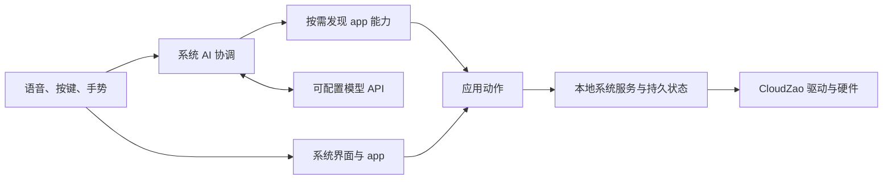

# 第一期简报：家庭 AI 手机的方向、原型与边界

日期：2026-10-26。阶段：想法整理、资料核查、产品原型与关键架构讨论。状态：供讨论；尚未形成用户认可的系统方案。

后续更新：用户已限定 E-Ink4 Plus；其 NT26 板级代码已进一步确认，下文相应修正。数据备份、账户及社区通信线索见 [第二期简报](/home/workspace/reader/docs/briefs/002-plus-connectivity-and-data.md)。

## 简报一：产品方向成立，但要拆开几个承诺

**总体判断：有条件可行。** 当前可概括为：在 CloudZao E-Ink4 Plus 上，为本人和子女打造可通过自然语言办事的个人设备。AI 贯穿学习、阅读听书、内容准备和日常工具；app 承担可以独立使用、可安装扩展的具体功能。

已经明确的边界：

- 必须沿用 CloudZao E-Ink4 Plus，具体版本和模组装配待核对。
- 软件产品设计重新构思，吸收上游原理与适用驱动；不把原有菜单和应用组织当作限制。
- AI 支持可配置 API，能够操作 app 并跨 app 完成任务；应用向 AI 渐进披露能力。
- 希望具备现代 UI、下拉状态栏、手势、语音与 AI 唤醒入口。
- Plus 具备相应 4G 硬件时，短信和通话是必须完成的能力；可根据硬件和模组资料评估开发，不以现成 app 为前提。
- 墨水屏 60fps、无残影是用户提出的目标，尚未通过验证。
- 基本方向经用户认可后才进入全系统设计。

完整清单见 [需求与边界](/home/workspace/reader/docs/requirements.md)。首版功能、Plus 具体版本、预算和续航仍未定；后续已补充儿童为 5–6 岁、可独立阅读、偏好听书，更新见 [第五期简报](/home/workspace/reader/docs/briefs/005-learning-news-ai-first.md)。

## 简报二：硬件与高刷的三条重要发现

### 1. 高刷视频有很接近的公开技术依据

找到 PaperBoyS3 的作者说明，与用户提到的 Game Boy 演示相近；无法确认是同一个 B 站视频。作者描述了 MCU 上逐像素追踪状态的 60Hz 驱动，游戏实际渲染约 30–60fps，并有跳帧。它为探索提供依据，但不是全屏清晰画面每 16.7ms 完全更新、或普遍无残影的证明。[作者资料](https://www.hackster.io/wenting-zhang/60fps-eink-gameboy-emulator-on-m5papers3-57e4e5)

### 2. CloudZao 两款墨水屏不能按同一种屏来考虑

E-Ink4 使用 SSD1677 SPI 路径，Plus 使用 EPDiy 并行路径。**后续用户已限定 Plus，普通 E-Ink4 仅作技术比较。** 代码确认显示链路存在；面板、主控与演示设备不同，不能原样移植。普通 E-Ink4 的 10 MHz SPI 配置甚至不足以每秒上传 60 次完整单色帧，这个估算不排除小区域更新。[硬件和固定代码依据](/home/workspace/reader/docs/research/cloudzao.md)、[估算及验证条件](/home/workspace/reader/docs/research/eink-high-refresh.md)

### 3. 通信判断修正：Plus 自己已有 NT26 接入路径

第一轮读到 Claw4 的 4G 与拨号代码，未追踪 Plus 板类构造，因而将通信重点放在 Claw4。后续在同一个固定提交确认 Plus 直接传入 NT26 控制引脚，并管理其供电与网络初始化；原先“墨水屏与蜂窝暂未汇聚”的判断不充分。[Plus 代码](https://github.com/CloudZao/Metalio-E-INK4-Plus/blob/ad8edf4150a688737c0d7c00cae4413079b262ef/main/boards/metalio-e-ink4-plus/metalio_e_ink4_plus_board.cc#L54)

当前按 Plus 研究短信和电话开发，继续确认具体模组功能、通话音频接线及待机接收。没有现成电话 app 不代表硬件不可行；已有网络驱动也不代表完整电话已验收。[详细修正和新发现](/home/workspace/reader/docs/research/eink4-plus-cellular.md)

## 简报三：产品原型应围绕三个完整任务

下列流程是助手提出的讨论稿。学习科目、时长和数量只是例子，不是用户新增要求。

| 用户说的话 | 设备应呈现的过程 | 何时才算完成 |
| --- | --- | --- |
| “我最近想学一点天文/概率/雅思相关知识。” | 少量必要澄清 → 找可用资料 → 整理学习内容与练习 → 导入对应 app → 开始一组学习 | 资料和练习已真实进入应用，能打开、学习并保存进度；找不到合适资料时如实说明。 |
| “我想看这本书，帮我放到书库；现在从这里读给我听。” | 查找可访问版本 → 获取/转换 → 入库 → 阅读或听读 | 本地内容实际可用，版本清楚；购买/借阅入口与已下载文件不能混淆。 |
| “继续听上次的故事。” | 确定成员和内容 → 找到持久断点 → 开始播放/朗读 | 恢复正确内容与位置；生成故事也有保存的版本，而非重新临时编一段。 |

这三条主线能帮助确定 AI、app、内容、语音和进度之间的关系。备忘录、新闻、音乐、闹钟与游戏再按相同能力约定讨论，不需要现在把所有 app 全部设计完。

### 候选界面骨架

| 入口 | 用户看到什么 | 墨水屏上的注意点 |
| --- | --- | --- |
| 首页 | 当前成员、继续上次、近期任务、学习与读听入口 | 优先明确下一步，避免持续动画占据屏幕。 |
| 全局 AI | 唤醒后的语音/文字交互、正在做什么、结果入口、取消 | 清楚区分听取、等待、执行和完成；不依赖持续逐字流动。 |
| 下拉状态栏 | 网络、电量、音量、播放/任务状态、常用设置 | 保留熟悉的手势；是否连续跟手、何时清理残影需实测。 |
| 学习页面 | 当前内容、作答、提示、解释和下一项 | 趣味与连续练习都可用一屏一任务表达。 |
| 书库与播放器 | 内容、下载状态、章节、进度、读听切换 | 听故事应尽量少看屏，保留容易找到的暂停/继续操作。 |
| 应用入口 | 已安装功能、安装状态、配置与卸载 | 安装后 AI 能发现能力；应用异常不能伪装成执行成功。 |

这些是低保真信息结构，不是已定视觉稿。不同屏幕尺寸和实际家庭使用方式可能改变布局。

## 简报四：先讨论能力边界，再决定技术栈

建议以“本地服务执行 + 可安装应用 + 系统 AI 协调”为关键架构方向：

此图只说明职责关系；AI 协调器放在设备还是远端、如何传输和调度仍待决定。

| 问题 | 建议方向 | 尚需决定 |
| --- | --- | --- |
| AI 怎样成为原生能力 | 全局入口、当前内容上下文、跨 app 动作、真实执行回执 | 模型/API 协议、端侧协调与远端协调的分工。 |
| 所有 app 怎样被操作 | 每个 app 提供可发现的能力、动作和状态；人和 AI 调用相同业务能力 | 接口约定、权限策略、第三方适配范围。 |
| 怎样渐进披露 | 简短目录 → 检索相关能力 → 加载动作详情 → 执行 → 按需读取结果详情 | 缓存、能力变更通知、描述格式。 |
| 怎样动态安装 | 明确代码应用和内容包的区别，验证运行时、版本及卸载 | 脚本/字节码/原生加载的取舍；不预选 Lua/Wasm/ELF。 |
| 怎样提高效率 | 设备负责稳定交互、媒体、进度与动作；较重的搜索/模型/转换按需要放远端 | 允许哪些外部服务；断网保留哪些功能。 |
| 怎样可靠续播 | 以内容标识、版本、成员和真实位置保存进度 | 共用设备方式、TTS 与原音频的对应、异常断电恢复。 |

这些方向有 [MCP 能力描述](https://modelcontextprotocol.io/specification/2025-11-25/server/tools)、[渐进披露](https://www.anthropic.com/research/code-execution-with-mcp)、[乐鑫加载器示例](https://github.com/espressif/esp-iot-solution/blob/master/examples/elf_loader/elf_embed_example/README.md)等参考，但不构成一套已验证的 MCU 操作系统。详细区分见 [平台调研](/home/workspace/reader/docs/research/ai-native-platform.md)。

## 竞品给出的启发

本轮按中文识字、儿童基础学习、语言情境、复习导入、考试练习、阅读 AI、儿童音频、墨水屏交互和手机形态九类整理了参考产品。[竞品对照与来源](/home/workspace/reader/docs/research/competitor-landscape.md)

最值得讨论的三个推断是：

1. 识字、故事和复习可以串起来，游戏化可以来自情境与选择，不必完全依赖高帧率动画。
2. 成人连续学习可以减少切换、一题接一题，并随时恢复；不必先决定为无限滚动。
3. 儿童和成人都可能需要趣味、专注和自主选择，应按能力与偏好调整，不只按年龄分成固定模式。

这些是产品假设；官方功能说明不能证明学习效果或本家庭偏好。

## 下一轮怎样继续

你可以继续直接提出零散想法。后续记录仍区分“明确需求 / 探索假设 / 助手建议”，保留发生改变的判断及理由。

接下来最影响方向的事项是 Plus 具体板卡版本及模组能力、子女年龄与共用方式，以及新增的数据恢复范围。无需现在一次回答完。可以先完善上述三条场景原型，再决定第一版边界与需要做的有限验证；未经用户认可，不进入完整系统设计。

本轮成果仅为文档与只读调研：固定提交抽查了驱动及通信路径，核对了官方资料并做了显示带宽估算。没有编译、刷机、性能实测或学习效果测试。
