# 家庭中枢概要设计 v0.1

状态：**待用户审核**。这一步只做设计和调研：没有写服务实现，没有买服务器，没有调用付费接口，没有碰设备。审核通过后按 §10 开发。

依据：用户的问题（[R-055、I-050](../requirements.md)）；用户随后提的语音输入（[R-056、D-65](https://github.com/Gidean-zcx/ink/blob/claude/system-layer/docs/decisions/README.md)，在分支 `claude/system-layer` 上，经主会话转来）；已定的决策（D-04、D-07、D-09、D-12、D-14、D-15、D-16、D-24、D-25、D-34、D-46、D-47、D-51～D-54，见[决策记录](../decisions/README.md)）；[系统架构 v1.0](../system/system-architecture.md)；[底座设计](../system/foundation.md) §5.7、§6.5、§8.1、§9、§10；[底层系统详细设计](../system/system-detailed-design.md) §3、§6、§8、§9；设备代码和模拟中枢（提交 `9b3c24a`）；[系统界面规范](../product/system-ui-spec.md)和设计稿；分支 `claude/system-services` 上的[系统服务详细设计](https://github.com/Gidean-zcx/ink/blob/claude/system-services/docs/system/system-services-design.md)（升级、成员、审视原则，还没合入 main）。调研和来源见[中枢调研](../research/hub-server-survey.md)，设备协议的逐条约定见[设备协议](device-protocol.md)。

证据标注：【实现】本仓库代码里查到的；【文档】对方官方资料；【估算】本文的估计，写了假设；【推断】没有直接证据的判断；【建议】助手的设计选择，用户没有要求过。**本文所有关于中枢的内容都还没有运行过。** 用户提的是问题，括号里带问号的候选（小智、代理、多账号、记忆、浏览器、重负载）不算需求；本文逐项给判断，由用户定。

## 0. 一页结论

**行不行：有依据可行。** 设备一侧的协议已经在模拟器里跑通，中枢要做的是把模拟中枢换成真服务。家庭规模下一台不带显卡的服务器就够【估算】；模型和语音按 D-07 的预算够用【估算】。没有实测过的是语音时延和内存，开发第一步就量（§10）。

**一句话**：中枢是软总线上的一个节点。服务器的每项功能都按设备同样的格式登记成“能力”，AI 也通过同一个目录调用服务器和设备的能力；有副作用的最终在设备屏幕上由人确认。整个服务是一个安装包，一条命令装好，手机扫一下设备就连上。

**八个关键设计**

1. **好装**：Docker Compose，一条命令，然后在网页向导里填模型密钥、家人和备份位置；升级前自动存快照，失败自动退回（§4）。
2. **部件少**：一个主进程管几乎所有事，浏览器渲染单独一个可选容器，转换这类重活临时起子进程；家庭规模不用 Redis、消息队列和 PostgreSQL（§3）。
3. **一家一个数据库文件**：隔离、备份、搬家、删除都简单。结构是家庭 → 成员 → 设备；只有成人有登录账号，孩子没有；设备属于家庭，不属于某个人（§5.4、§6.1）。
4. **配对和设计稿一样**：设备显示二维码，手机扫一下，Wi-Fi 和家庭账户都在手机上填；设备不需要域名和证书知识，连接靠设备记住中枢的公钥（§6）。
5. **能力总线**：`caps/list`、`tools/call`、`rt.open` 和二进制帧都继续用。服务器能力、设备能力、以后的外部能力节点都在一张目录里，按“本人、成员、儿童、费用、确认”过关（§7）。
6. **设备协议不推翻**：现有消息全部保留，只加握手里的身份、配对、成员切换、同步和块传输（§7.8、[设备协议](device-protocol.md)）。
7. **记忆按成员、看得见、删得掉**：分档案、事实、摘要三层，每条写明来源、是观察还是推断；AI 和用户用同样的能力查和删（§5.5）。
8. **费用有闸**：模型按角色路由，费用记到每个成员每一轮；到额度先提醒，再换便宜模型，最后停（§5.2）。

**语音输入**（后补，R-056）：中枢提供流式听写 `asr.stream`，只把声音变成文字还给输入框，不经过 AI，不写记忆；和语音对话共用识别厂商和账本（§5.3.1）。

**规格**（不查价格，用户自己看；数字是【估算】，§10 第一步实测）

| 档 | 能跑什么 | CPU | 内存 | 硬盘 | 带宽 | 显卡 |
| --- | --- | --- | --- | --- | --- | --- |
| 最小 | 语音对话、AI、记忆、备份同步、报纸、书籍转换；全部走模型和语音 API | 2 核 | 2 GB | 40 GB SSD | 3 Mbps | 不要 |
| **完整（建议买这档）** | 再加 1 路网页远程画面 | 2 核 | 4 GB | 60 GB SSD | 5 Mbps | 不要 |
| 宽裕 | 2～3 路网页同时开，本地语音识别，批量朗读和文字识别 | 4 核 | 8 GB | 100 GB SSD | 10 Mbps | 不要 |

都要固定公网 IPv4，系统 Debian 或 Ubuntu，x86-64 或 arm64。

**按量费用**【估算】：全家一天 50 轮对话，模型加语音约每月 **50～210 元**，主要看主模型（[调研 §10.3](../research/hub-server-survey.md)）。

**决策**：D-73～D-92 共 20 项（§11）。**要用户选的 6 项**：地域（D-74）、模型和语音厂商（D-78）、费用上限（D-79）、网页远程画面的排期和孩子能不能用（D-85）、异地备份放哪（D-87）、听写内容留不留（D-91）。其余按推荐暂定，都可逆，其中配对方式（D-81）和数据加密（D-86）建议看一眼。

## 1. 要求与约束

### 1.1 用户的问题（R-055）

1. 如何易于安装部署。
2. 应该具备哪些能力（可能类似小智服务端、AI 代理、LLM 服务、对接模型 API；维护多账号数据隔离？维护和更新每个用户的记忆？浏览器内核？还有更重的负载？）。
3. 如何易用地关联和连接设备。
4. 如何作为原子能力接入设备软总线。

随后（R-056）：

5. “输入法是否应该支持语音输入？同步给前端和后端设计”。主会话转来的要点：听写和 AI 对话分开，低延迟，按成员的词表，计入费用，留不留内容给用户决定，失败时有明确错误。

### 1.2 已定的事

| 约束 | 内容 | 来源 |
| --- | --- | --- |
| 薄设备、厚中枢 | 大模型、内容转换、多步编排都在中枢 | D-04 |
| 服务器 | 云服务器 VPS，购买前再确认规格和地域 | D-09 |
| 语言 | 自建 Python 中枢，开源服务端只作时延实验台 | D-14 |
| 模型与预算 | 质量优先：主力一线大模型，摘要和分类用便宜模型；约每月一两百元；中枢做路由和费用上限 | D-07 |
| 设备协议 | 自定信封 + JSON-RPC + MCP 工具结构；中枢对外再提供标准 MCP | D-12 |
| 连接 | 活跃时长连接，静止或待机时断开 | D-24 |
| 边界 | AI 决定做什么，设备策略关口决定能不能做，系统决定怎么做 | D-47 |
| 多设备 | 首版远端能力只有中枢的，多设备经中枢中转 | D-51 |
| 实时 | 免按键、可打断（R-047）；传输先用 WSS（D-54）；画面按区域编码、设备拉取（D-53） | |
| 一家人共用 | 全家共用一台设备，成人 PIN，孩子直接进入 | D-03、D-16 |
| AI 可见 | 所有页面对 AI 可见，凭据输入框掩码 | D-23、D-33 |
| 儿童通信 | 不限制，但外部副作用要在设备上确认 | D-25 |
| 保留期 | 转写 1 年（儿童 180 天），运行记录 180 天且不含正文；原始语音转写后删除；快照不落盘；记忆保留到删除 | D-26、D-34 |
| 书籍 | 中枢转换为扩展的 `.ebook`，设备断行分页 | D-15 |
| 地区 | 主要在中国大陆使用 | R-038 |
| 设备“不做” | 不做通用浏览器、无限内容流（设备上）；远程画面走中枢 | R-037、R-048 |
| 花钱和发布 | 买服务器、调付费接口、对外发布都要用户明确选择 | CLAUDE.md |

### 1.3 设备一侧的硬限制（真实中枢必须遵守）

这些是读设备代码查到的【实现】，开发时最容易踩：

| 限制 | 数值 | 位置 |
| --- | --- | --- |
| 中枢发给设备的**每条 JSON 不超过 128 个词法单元**，超了整条丢弃 | `INK_JSON_MAX_TOKENS` | `system/include/ink/sys/json.h:17` |
| 目录最多 32 项；但一条 `caps/list` 回答按三个字段算只放得下约 17 项（128 限制），现在设备不分页 | `DIR_MAX` | `system/policy/cap.c:159` |
| `ai.delta`、`ai.stt` 的文字每条不超过 511 字节 | `char text[512]` | `system/services/ai/ai_service.c:276` |
| 能力编号不超过 39 字节；实时会话的能力名不超过 23 字节，参数 JSON 不超过 239 字节 | `id[40]`、`cap[24]`、`INK_RT_PARAMS` | `cap.c:162`、`rt.c`、`rt.h` |
| 中枢发给设备的请求，`id` 必须是整数；请求号 `_meta.request_id` 是不超过 39 字节的字符串 | `RID_CAP` | `cap.c:127`、`hub_link.c:304` |
| 方法名不超过 31 字节 | `method[32]` | `hub_link.c:58` |
| **任何文本或二进制消息都会刷新设备的“最近活动”**，所以中枢不能发应用层保活，否则设备永远不会空闲断开（D-24）；保活只用 WebSocket 层的 ping | `H.last_activity` | `hub_link.c:271、438` |
| 空闲 60 秒断开，锁屏时安静了马上断开 | `IDLE_DISCONNECT_US` | `hub_link.c:32` |
| 重连退避 1、2、4…60 秒加抖动；`hello` 10 秒没回答算失败 | `enter_backoff` | `hub_link.c:237`、`:34` |
| 每条新连接上中枢都当作什么都不记得：设备重新登记还开着的会话，远程画面按白屏算差异 | `on_online` | `rt.c:113`、详细设计 §8.2 |
| 4G 走串口转以太网，约 1.6 Mbit/s | | `platform/include/ink/hal_net.h:8` |
| `ai.listen` 的回答必须在朗读帧和 `ai.tts.end` 之后；回答一到设备就关这一轮的会话 | | 详细设计 §6.5 |
| 朗读帧是 Opus 16 kHz、60 ms 一帧，10 字节帧头 | `INK_RT_HDR` | `rt.h` |

## 2. 参考：别人怎么做

| 参考 | 怎么做 | 借什么 | 不照搬什么 |
| --- | --- | --- | --- |
| [小智服务端](https://github.com/xinnan-tech/xiaozhi-esp32-server)（MIT，Python + Java + Vue） | 一条 WebSocket；流式识别 → 模型 → 流式朗读；各家厂商一个适配文件；最小安装一个容器，全模块四个【文档】 | 厂商适配代码；“最小安装”和“全模块”分开；打断时清空队列 | 按设备存记忆；没有策略关口和确认；它自己写明没过安全测评；全模块要 Java、数据库、Redis 四个部件 |
| [OpenClaw](https://github.com/openclaw/openclaw)（MIT） | 一个网关进程管会话和路由，手机电脑作为节点提供能力，记忆是人能读的文件【报道】 | 节点模型；记忆透明 | 面向单个使用者，没有儿童策略和低延时语音 |
| 主流系统的 AI 接入（Android AppFunctions、iOS App Intents、鸿蒙意图框架） | 应用声明动作，系统交给 AI（[系统架构 §2](../system/system-architecture.md)） | 服务器能力也声明成同样的结构 | — |
| VNC / RFB（RFC 6143） | 只发变化的矩形，客户端拉取 | 远程画面（设备一侧已按此实现） | — |

详细比较见[调研](../research/hub-server-survey.md)，结论在 §8。

## 3. 总体架构

### 3.1 全貌

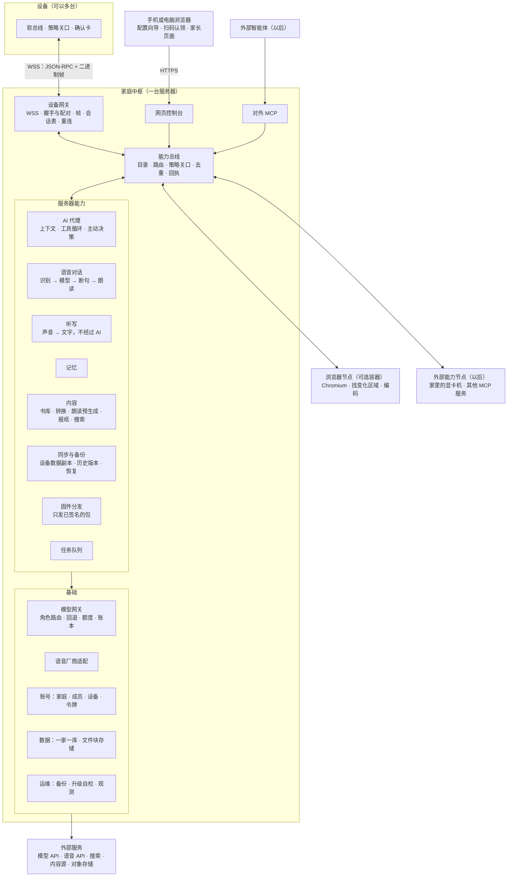

- 设备只和**设备网关**说话；网关把调用交给**能力总线**，不懂业务。
- 模块之间也经能力总线调用（AI 代理调 `memory.search` 和设备调它是同一条路），这样 AI 能碰到的范围不会比模块自己用的窄（G-002）。
- 基础部分不是能力：模型密钥、数据库、令牌都是内部机制，只通过能力暴露它们的结果。

### 3.2 部件和进程

【建议】能合就合，只有两种情况才拆：会拖慢语音的（CPU 密集），和不可信的（网页内容、用户传的文件）。

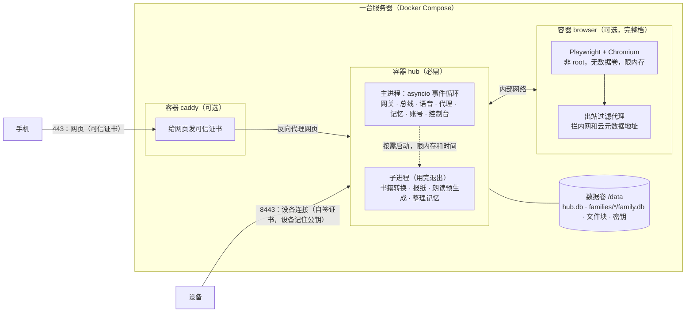

| 部件 | 必需吗 | 内容 | 资源【估算】 |
| --- | --- | --- | --- |
| `hub` 主进程 | 必需 | 除渲染和重活以外的一切 | 200～350 MB，语音时 CPU 很低 |
| `hub` 子进程 | 按需 | 转换、报纸、预生成；一次一个，限内存和时长 | 峰值 300～800 MB |
| `caddy` | 可选 | 只负责网页的证书；设备连接不经过它 | 30 MB |
| `browser` | 完整档 | 每路一个独立的 Chromium 进程组 | 每路约 1 GB（[调研 §6](../research/hub-server-survey.md)） |
| 操作系统和 Docker | — | | 约 400 MB |

**语音优先**：容器的 CPU 权重 `hub` 高于 `browser`；子进程降低优先级运行；主进程的事件循环里不做阻塞操作（测试里挂检查，超过 50 ms 报警）。

**为什么不用微服务和 Redis**：一个家庭同时最多几路会话，模块之间函数调用就够；每多一个常驻部件，用户就多一份内存、升级和排障负担。以后真要拆，能力总线已经是边界，把某个能力挪到另一台机器只是多注册一个节点（§7.1）。

### 3.3 架构审视：每个子系统给 AI 开放什么

按用户 2026-11-04 的要求（[架构审视](https://github.com/Gidean-zcx/ink/blob/claude/system-services/docs/process.md)），每个子系统列能力、状态、设置、事件、内部机制和 AI 能不能碰。能力的完整定义在 §7.3。

| 子系统 | AI 可调的能力 | AI 不可调（原因） | 状态 | 设置 | 事件 | 内部机制 |
| --- | --- | --- | --- | --- | --- | --- |
| 语音 | `asr.transcribe`、`tts.speak`；`voice.chat` 由设备打开 | `asr.stream`（听写是输入法的管道，只开放给应用；AI 碰输入框用设备的 `text.state`、`text.insert`，语音转文字用 `asr.transcribe`） | `voice.active` | `voice.tts_voice`、`voice.speed`、`asr.vocab`（按成员） | `voice.turn_done` | 断句、流控、打断、Opus、中间结果节流 |
| AI 代理 | `llm.ask`、`routine.add`、`routine.list`、`routine.remove`（定时任务，以后） | — | — | `ai.style`（按成员） | — | 提示词组装、工具循环、渐进披露 |
| 模型与费用 | `usage.today`、`usage.month`、`budget.status` | `budget.set`（系统级，要确认）；模型密钥（凭据，AI 永远拿不到） | `budget.level` | `model.routes`、`budget.*` | `budget.warning` | 回退、熔断、价格表 |
| 记忆 | `memory.search`、`memory.list`、`memory.add`、`memory.forget` | 别的成员的记忆（孩子的除外：成人家长可看） | — | `memory.auto`（按成员，默认开） | `memory.changed` | 提取、合并、向量 |
| 账号 | `family.members`、`device.list`、`device.status` | `device.revoke`、`member.remove`（系统级，要确认）；密码、令牌（凭据） | `device.online` | — | `device.online_changed` | 令牌存储、登录 |
| 同步备份 | `sync.status`、`backup.status`、`backup.now`、`restore.preview` | `restore.apply`（只能人在控制台做） | `backup.last_ok` | `backup.schedule` | `backup.failed` | restic、快照 |
| 内容 | `library.search`、`library.list`、`library.get`、`content.find`、`content.import`、`content.status` | 没有权利的内容来源（看 R-017 的条件） | — | `content.sources` | `content.ready` | 转换工具 |
| 报纸 | `news.today`、`news.item`、`news.prefs`、`news.generate` | — | — | `news.sources`、`news.time` | `news.ready` | 抓取、去重、排序 |
| 搜索 | `web.search`、`web.fetch`、`history.search` | — | — | `web.provider` | — | 分词、索引 |
| 远程画面 | `browser.read`、`browser.act`（有外部副作用的要确认）；`browser.session` 和设备的 `remote.open` | 密码框内容（掩码，D-33） | — | `browser.child_allowed` | — | 渲染、差异、编码 |
| 固件 | `firmware.latest` | 上传和签名（私钥离线，人操作） | — | — | `firmware.new` | 块传输 |
| 任务 | `job.list`、`job.status`、`job.cancel` | — | — | — | `job.done` | 调度、重试 |
| 运维 | `hub.health`、`trace.turn`（不含正文） | 升级、改配置（只能人用命令行或控制台） | `hub.version` | — | `hub.alert` | 日志、指标 |

结论：用户在控制台能看到的数据，AI 都有只读能力；能改的里面，只有凭据、系统级和“恢复数据”这类保留给人。这张表开发时做成自动检查（和设备一侧的 `integration-ai-surface` 同样的思路）：目录里每个能力要有标题、Schema、副作用等级，不给 AI 的要写原因。

**划分自查**：

- 每个能力只有一个提供者，模块之间不直接读对方的表（代码目录上互相不能 import 内部模块，CI 检查）。
- 界面（控制台）只调能力，不直接碰数据库。
- 设备网关不懂业务；模型网关不懂成员以外的业务概念。
- 没有“设备专用接口”和“AI 专用接口”两套：设备按钮、AI、控制台、外部 MCP 都经能力总线。

## 4. 安装和部署

目标【建议】：**会租一台云服务器、会复制一条命令，就能装好。**

### 4.1 流程

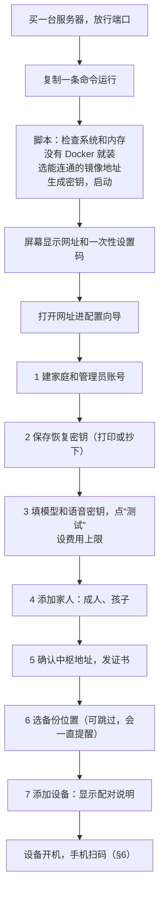

- **一条命令**：`curl -fsSL <地址>/install.sh | bash`。脚本内容公开，也可以先下载看一遍再运行。要给朋友用、放到公开地址才算对外发布，那一步等用户选择；只给自己用时，脚本和镜像可以放在用户自己的私有位置。
- **国内网络**【文档、报道】：Docker Hub 在国内不稳定，公开加速地址常变（[调研 §9](../research/hub-server-survey.md)）。所以发布时把镜像同时放到一个国内仓库（如阿里云容器镜像服务），脚本按连通性选。浏览器镜像要把 Chromium 和中文字体直接打进去，不在安装时再下载。
- **也提供命令行**：`inkhub setup --config file.yaml` 能不问问题装完。AI 也能照着做部署（G-002 在运维上的体现），密钥由用户填。
- **向导每一步都能重来**，也都有命令行等价物。

云服务器的安全组最容易漏放端口，到设备配对时才发现就晚了。所以向导给一个测试链接，指向设备端口上的 `/ping`：手机能打开（哪怕提示证书不受信任）就说明端口通了。

### 4.2 命令行和目录

```text
inkhub status                 看服务、版本、设备在线、最近备份、今天的费用
inkhub enable browser         打开完整档（Compose profile），disable 关掉
inkhub upgrade [--to 版本]    升级（见 §4.4）
inkhub rollback               退回上一个版本和快照
inkhub backup now | list | verify | restore <快照>
inkhub export <文件>          整机或一家导出，搬家用
inkhub import <文件>
inkhub doctor                 自查：端口、证书、时钟、磁盘、模型连通、备份

/opt/inkhub/compose.yaml      Compose 文件和版本号
/opt/inkhub/data/             全部数据（见 §5.4）
  hub.db                      实例级：家庭列表、账号、设备、令牌哈希、配对
  families/<id>/family.db     一家的全部结构化数据
  families/<id>/blobs/        书、朗读音频、用户文件（按内容哈希存）
  secrets/                    主密钥、中枢设备证书私钥（权限 600）
  backups/                    本机快照（最近 7 天）
```

### 4.3 规格

规格表在 §0。依据（全部【估算】，§10 第 1 步实测后改）：

| 项目 | 最小 | 完整 | 宽裕 |
| --- | --- | --- | --- |
| 系统 + Docker | 0.4 GB | 0.4 GB | 0.4 GB |
| `hub` 主进程 | 0.3 GB | 0.3 GB | 0.5 GB |
| 子进程（一次一个，峰值） | 0.8 GB | 0.8 GB | 1 GB |
| 浏览器 | — | 1 GB × 1 路 | 1 GB × 3 路 |
| 本地语音识别（可选） | — | — | 1 GB |
| 余量 | 0.5 GB | 1.5 GB | 2 GB |
| **合计** | **2 GB** | **4 GB** | **8 GB** |

- **带宽**：Opus 语音单向约 3.5 KB/秒（约 30 kbps），两路对话也不到 1 Mbps；书和音频下载受设备一侧限制（4G 约 1.6 Mbit/s）。3 Mbps 对一家够用，5 Mbps 给远程画面留余量（一屏约 50 KB）。
- **硬盘**：结构化数据一年估计不到 2 GB；朗读音频每小时约 7 MB；书籍几 GB。备份放别处。2 GB 内存建议另开 2 GB 交换空间。
- **显卡**：都不要。语音和模型走 API。真想本地跑模型，那台显卡机作为外部能力节点接入（§7.1），不改中枢。

### 4.4 升级和回滚

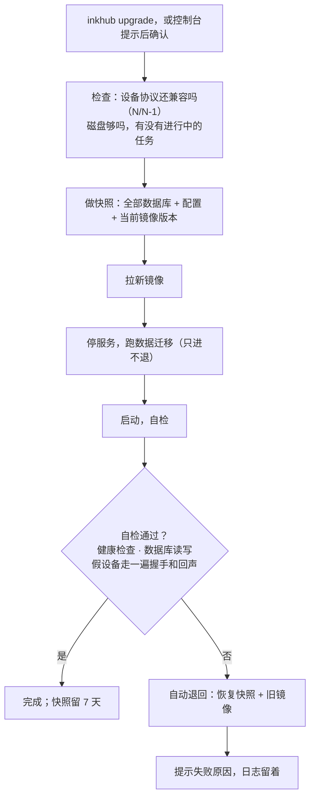

- 默认**手动升级**：控制台和 `inkhub status` 提示有新版本，不自动动（D-90）。家庭设备升级失败谁也不在旁边，宁可晚一点。
- 设备短暂断线无所谓：退避重连，离线功能照常（D-05）。
- 协议保持 N/N-1 兼容（底座设计 §10.3）：中枢同时支持当前和上一版设备协议，升级前先查家里设备的版本。
- 数据迁移只进不退，所以回滚靠快照，快照之后新写入的数据在回滚时丢失；设备的数据还在设备上，重新同步就回来。AI 记忆这类以中枢为准的数据，丢的是升级那几分钟（升级时服务本来就停了）。

### 4.5 备份和恢复

三层，从近到远【建议】：

| 层 | 内容 | 频率 | 防什么 |
| --- | --- | --- | --- |
| 设备一份、中枢一份 | 成员个人记录设备上有，中枢有副本和历史版本（底座设计 §5.1） | 实时到每日 | 设备丢失、刷机、误删（R-023） |
| 中枢本机快照 | `VACUUM INTO` 一致快照 + 文件块硬链接 | 每天，留 7 天 | 升级失败、程序错误 |
| 异地加密备份 | restic，客户端加密，推到对象存储或家里的机器 | 每天 | 服务器整个没了（底座设计 §9） |

- **恢复密钥**：向导第 2 步生成，用户自己保存。它能解开异地备份。丢了就只能靠别的副本，向导要讲清楚。
- **恢复演练**：`inkhub backup verify` 每月自动在临时目录恢复一次，打开数据库读几条，结果进 `backup.last_ok`，失败就提醒。备份不验证等于没有（调研里的 Syncthing 教训）。
- **搬家**：`inkhub export` 打包全部数据和中枢身份；新机器 `inkhub import` 后，设备看到的公钥不变。地址变了要把新地址先推给设备（§6.4 的 `urls`），或者一开始就用域名。

### 4.6 放在哪：VPS、NAS，没有公网 IP 怎么办

**我的看法：D-09 的 VPS 依然是对的默认，但安装包不绑死。** 设备在外面用 4G 也要连得上，VPS 天生就有公网 IP，什么都不用配；NAS 在家里，数据在自己手里，但多一层穿透，家庭宽带上行和停电也是问题。同一个 Compose 文件能在 x86 和 arm64 上跑，所以以后搬家代价小（D-73）。

| 放哪 | 能不能用 4G 连 | 要多做什么 | 判断 |
| --- | --- | --- | --- |
| **云服务器** | 能 | 放行端口 | 默认，首版只验证这一种 |
| NAS 或家里电脑 + 一台小 VPS 中转（frp） | 能 | 装 frp；TLS 在家里那端结束，VPS 只见密文 | 想把数据放家里时用 |
| NAS + 公网 IPv6 + 动态域名 | 不确定 | NT26 和蜂窝网上的 IPv6 没有验证，**信息不足** | 先不承诺 |
| Cloudflare Tunnel 这类 | 不合适 | 对方终结 TLS，设备固定公钥就失效；国内访问也不稳定【推断】 | 不用于设备 |
| Tailscale、ZeroTier | 不合适 | 设备上要跑客户端，ESP32 上没有现成可用的【推断】；电脑访问控制台可以用 | 不用于设备 |
| 只在家里（局域网） | 不能 | 什么都不用；只能在家用 | 开发时用；D-51 说局域网发现以后做 |

### 4.7 地域

D-09 留了“购买前再确认”。这件事关系到模型选择，所以提前说（D-74）：

| 地域 | 好处 | 代价 |
| --- | --- | --- |
| **中国大陆**（推荐） | 设备到服务器、服务器到国产模型都最近，语音延迟最低；家庭数据不出境 | 连不上海外模型；用域名要备案，只用 IP 是否完全不涉及要问服务商（[调研 §9](../research/hub-server-survey.md)）；所以设计上设备连接不依赖域名 |
| 香港 | 不用备案 | 晚高峰线路质量看运气；Claude、GPT 官方也不支持香港【文档、报道】，并不能换来它们 |
| 海外（日本、新加坡等） | 技术上能连所有模型 | 设备跨境连接的延迟和稳定性都差；Claude、GPT 官方不支持中国大陆使用，这个问题不因服务器在海外而消失，由用户自己判断 |

### 4.8 信任和证书

设备和网页分开处理（D-82）：

| 连接 | 做法 | 理由 |
| --- | --- | --- |
| 设备 ↔ 中枢（8443） | 中枢安装时生成自己的密钥和自签证书，**设备在配对时记住公钥的哈希**（固定），以后只认它 | 不要域名、不要备案；不依赖设备时钟（第一次开机时钟可能不对，普通证书校验会失败）；公共 CA 也骗不了它。底座设计 §8.1 已经写了“固定中枢证书” |
| 手机浏览器 ↔ 控制台（443） | 尽量用可信证书：有域名用域名，没有就用 Let's Encrypt 的 IP 证书（2026 起正式提供）；都不行才退回自签 | 手机扫码打开时不要弹安全警告，这是“好用”的一部分 |
| 中枢 ↔ 外部 API | 普通 TLS | |

换密钥：`hello` 的回答可以带下一把公钥（`pins`），两把并存一段时间再切，设备不用重新配对。

## 5. 应该具备哪些能力：逐项判断

### 5.1 一张总表

“放哪”的默认是中枢；写“设备”的是离线也要能用。“首版”指 D-01 的首个自用版本（阅读与听书 + 底座）。**这些都是建议**，用户不同意的可以改；没有哪一项被我判成不要。

| 能力 | 要不要 | 什么时候 | 放哪 | 理由 |
| --- | --- | --- | --- | --- |
| AI 代理和工具调用 | 要 | 首版，第 2 步 | 中枢编排，设备执行 | D-04、D-47 |
| 模型网关（各家 API、路由、费用上限） | 要 | 首版，第 2 步 | 中枢 | D-07；薄路由（§5.2） |
| 语音识别、朗读、低延迟语音对话 | 要 | 首版，第 2 步 | 中枢；唤醒词和打断在设备 | R-047，设备侧已实现 |
| 语音输入（听写） | 要 | 首版，第 2 步 | 中枢识别，设备显示和编辑；没网退回键盘 | R-056；墨水屏打字慢；不经过 AI（§5.3.1） |
| 听写的口语整理（去语气词） | 可选 | 以后，默认关 | 中枢 | 要调模型，多花钱多等一会儿 |
| 多账号和数据隔离 | 要 | 首版，第 3 步（数据结构第 1 步就按此建） | 中枢 | R-022、R-030 |
| 每个成员的记忆 | 要 | 首版，第 4 步 | 中枢 | 底座设计 §5.1；R-030 |
| 备份同步 | 要 | 首版，第 4 步 | 设备写日志，中枢存副本 | R-023 |
| 内容转换（书） | 要 | 首版，第 5 步 | 中枢 | D-15、R-017 |
| 朗读预生成和文字对齐 | 要 | 首版，第 5 步 | 中枢 | R-018、底座设计 §9 |
| 个人报纸 | 要 | 首版，第 5 步 | 中枢生成，设备显示 | R-020、R-031 |
| 搜索（联网、家庭历史） | 要 | 首版最小版，第 5 步 | 中枢 | R-016、R-017；AI 查历史走中枢副本 |
| 固件分发（只接受签名固件） | 要 | 首版，第 5 步 | 中枢只分发，签名私钥离线 | 系统服务设计的升级需求（那边也编成 R-056）、SR-SY-05 |
| 任务队列 | 要 | 第 1 步就有 | 中枢 | 底座设计 §5.6 |
| 可观测性和费用统计 | 要 | 第 1 步起逐步加 | 中枢 | D-07、SR 的时延指标 |
| 网页控制台（向导、认领、成员、费用） | 要 | 第 1、3 步 | 中枢 | 没有它装不起来 |
| 儿童内容过滤 | 要 | 首版，第 2 步 | 中枢 | SR-AI-03 |
| 浏览器内核和远程画面 | 要（R-048 已提） | **第 6 步，排期用户定（D-85）** | 中枢渲染，设备显示 | 设备侧已有；吃内存；孩子能不能用要定 |
| 视觉（看照片、拍题） | 要 | 第 5 步之后 | 中枢 | R-045 的摄像头有了用处 |
| 短信待办、通话纪要 | 要 | 按 R-024、R-025 的版本 | 中枢分析，设备确认 | 事件转发（§7.6）通了就能做 |
| 输入法智能联想 | 要 | 以后，默认关 | 中枢 | R-027；底座设计 §4.8 |
| 题库和资料收集 | 要 | 以后 | 中枢 | R-016 |
| 中枢下发声明式页面 | 要 | 以后 | 中枢生成，设备渲染 | D-08 第二阶段 |
| 对外标准 MCP | 要 | 以后，第 7 步 | 中枢 | D-12 |
| 多设备中转 | 要 | 以后，第 7 步 | 中枢 | D-51 |
| 字形和词库下发 | 要 | 随块传输顺带做 | 中枢分发 | SR-NF-05、D-70 |
| 主动决策（定时、事件触发） | 要 | 先做定时生成，事件触发以后 | 中枢决定，设备通知 | 系统架构 §6.4 |
| 声纹识别 | 待定 | 以后 | 中枢 | 只能作线索，不能授权（底座设计 §8） |
| 本地语音识别和本地模型 | 可选 | 以后 | 中枢或外部节点 | 省钱或隐私需要时；要内存或显卡 |
| 通用自动化（代用户操作第三方网站） | 待定 | 以后 | 中枢浏览器 | 风险高，用户没提 |

### 5.2 模型网关和费用（D-07）

**角色路由**：代码里不写模型名，只写角色。

| 角色 | 干什么 | 默认候选【建议，待实测】 |
| --- | --- | --- |
| `main` | 回答问题、编排、工具调用 | qwen3.7-plus 或 doubao-seed-2.1-pro |
| `deep` | 难的任务：报纸编排、学习资料 | qwen3.8-max、deepseek-v4-pro |
| `first` | 首句快模型（主模型慢时先出一句，底座设计 §6.5），默认关 | qwen3.7-flash |
| `fast` | 分类、摘要、记忆提取、儿童内容检查 | qwen3.7-flash、doubao-seed-2.0-mini |
| `vision` | 看图 | 有视觉能力的模型 |
| `embed` | 向量 | text-embedding-v4 |
| `asr` | 流式语音识别，语音对话和听写共用 | fun-asr-realtime、豆包流式识别 2.0 |
| `tts` | 朗读 | qwen3-tts-flash-realtime、豆包语音合成 2.0 |

配置放控制台，成员可以有不同路由（孩子用同一个模型，但系统提示和过滤不同）。

**只接两种线路格式**：OpenAI 兼容和 Anthropic 消息格式（国内几家都有前者）。对上层统一成流式事件：文字片段、工具调用片段、用量。

**回退**：429、5xx、超时就换该角色的下一个；连续失败熔断一会儿。对话进行中不换人，只在首个 token 之前回退。

**账本和额度**（D-79）：

- 每次调用记一行：家庭、成员、角色、厂商、模型、输入、缓存命中、输出、费用（用量 × 价格表）、这一轮的编号。语音识别和朗读也记（按秒、按字）。
- 价格表是配置，随版本更新，用户可改；真实账单以厂商为准，账本只是估计，控制台要这样写。
- 额度分家庭月度和成员每日。默认值【建议】：家庭 200 元/月，成人 15 元/天，孩子 5 元/天。
- 超了怎么办：80% 提醒家长；100% 主模型换成 `fast`，朗读照常；120% 只留本地快捷指令和已缓存内容，语音回答“今天的额度用完了，可以问爸爸妈妈”，听写返回明确错误，设备退回键盘（§5.3.1）。家长一键加额度。
- **省钱的办法**（底座设计 §9 已有）：稳定前缀和固定工具顺序提高缓存命中；回执里的 `say` 省第二次模型调用；翻页这类走本地快捷指令；报纸和故事的朗读在闲时预生成（DeepSeek 闲时半价，别家看批量接口）。

### 5.3 语音对话（R-047）

设备一侧已经按[详细设计 §6、§7](../system/system-detailed-design.md)实现。中枢要做一条**任何时候都能取消**的流水线。

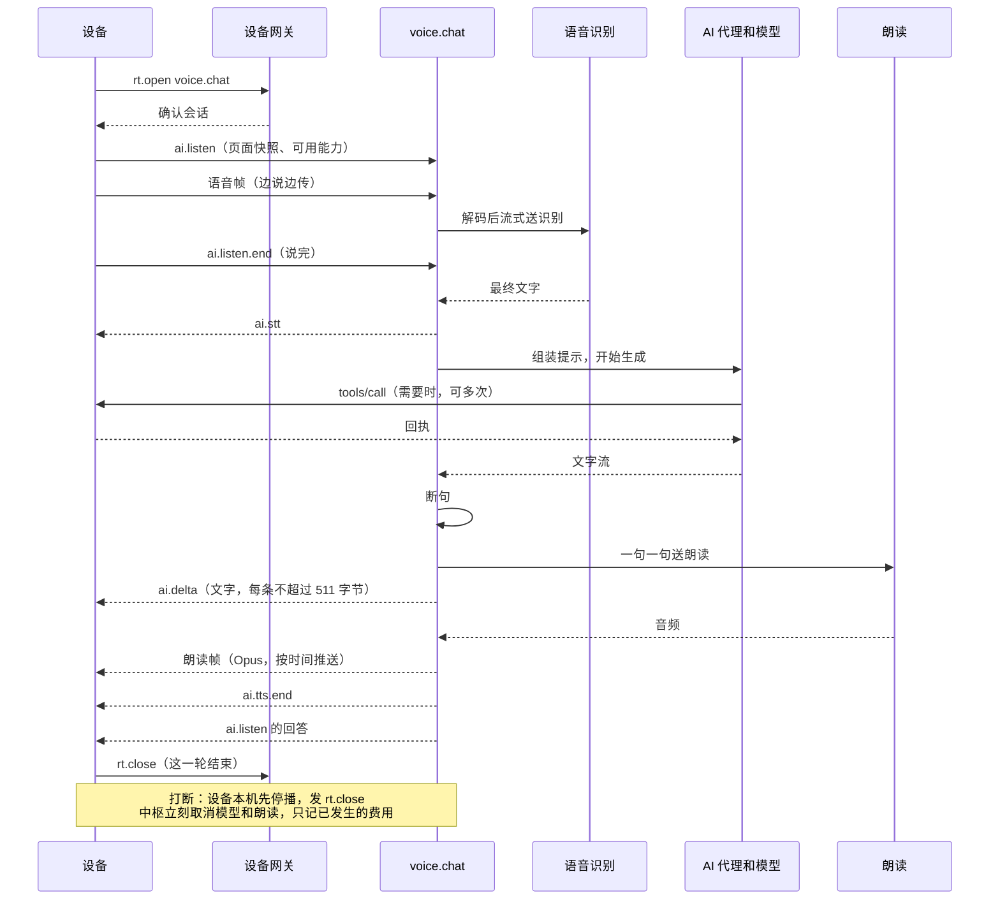

**时延预算**（目标来自 SR-UX-06，设备段来自模拟器，中枢段【估算】来自[协议调研 §5.2](../research/foundation/ai-native-protocols.md)）：

| 段 | 目标 |
| --- | --- |
| 设备上传收尾 | 约 30 ms（模拟器） |
| 识别出最终文字 | ≤ 300 ms |
| 模型首 token | 快模型 ≤ 900 ms，主模型 1～3 s（要实测） |
| 首句凑齐 | ≤ 300 ms |
| 朗读首包 | ≤ 350 ms |
| **说完到第一句文字上屏** | **≤ 3 s**（SR-UX-06a） |
| **说完到听到第一个音** | **≤ 4 s**（SR-UX-06b） |

主模型太慢就打开 `first` 角色：快模型先说一句，主模型接着说。这有“两个模型口径不一”的风险，默认关，实测后再定。

**几个具体规则**：

- **断句**：见到句末标点就送；第一句为了快，逗号也切（至少 8 个字）。
- **发送节奏**：朗读帧先发约 300 ms 预填，之后按约 2 倍速发，领先不超过 3 秒（数值要和设备的下行缓冲核对）。领先太多，打断时已发出去的白白浪费流量。
- **打断**：现在设备只发 `rt.close`，中枢据此取消。对话历史要截到用户实际听到的地方（协议调研 §5.3）：中枢按已发帧数减缓冲估一个位置；更准需要设备带上“放到第几帧”（[设备协议 §3.5](device-protocol.md)，可选）。已经执行的工具不回滚，改为提供撤销。
- **识别为空**（误唤醒、误打断）：直接回答 `{"done":true,"empty":true}`，不调模型。详细设计 §7.3 说的“识别为空就继续播”需要设备配合，先不做。
- **按成员切换**：设备切成员时发 `ink/member`，中枢结束当前 AI 会话，上下文不带过去（底座设计 §8）。
- **录音不存**：转写完即丢（D-26）；调试开关打开时存 7 天。
- **孩子**：专用系统提示；每句朗读前过一遍 `fast` 角色或厂商的内容检查（多 200～400 ms，只对孩子）；开放给模型的工具 = 儿童可用 ∩ 当前可用。

**厂商不写死**：识别和朗读各一个接口，每家一个适配文件（从小智服务端借）。还要有一个假厂商，给测试用（固定延迟、固定文字）。

#### 5.3.1 语音输入：听写（R-056）

用户问输入法是否应该支持语音输入。设备这边的做法在 D-65（`claude/system-layer`）：键盘上有话筒键，语音面板的固定小区域显示文字，说完才进输入框，之后还能改；停顿自动结束；没网时提示并退回键盘；密码框没有话筒；AI 键仍然只叫 AI。

中枢只做一件事：**把声音变成文字，还给输入框。**

| | 语音对话 `voice.chat` | 听写 `asr.stream` |
| --- | --- | --- |
| 用途 | 和 AI 说话 | 代替打字 |
| 经过 AI 代理和模型 | 经过 | **不经过** |
| 写入记忆和对话记录 | 写 | **不写** |
| 谁打开 | AI 键、唤醒词 | 输入框的话筒键（设备能力，按钮和 AI 共用） |
| 给设备什么 | 文字、朗读、工具调用 | 只有文字 |
| 识别厂商、账本、额度 | `asr` 角色 | **同一个** `asr` 角色 |

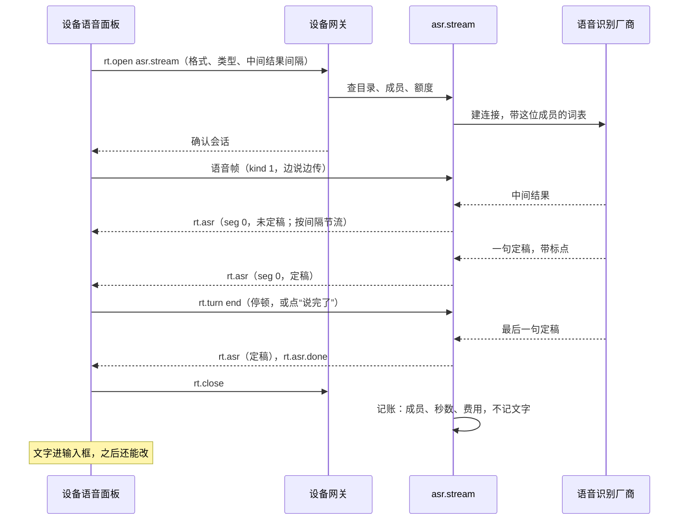

**低延迟**（目标【建议】，第 2 步实测）：

| 段 | 目标 | 说明 |
| --- | --- | --- |
| 打开面板到能说 | 连接已在就立刻能说，帧先缓存 | 设备点话筒时就预连（`ink_hub_demand`），中枢打开会话时就连厂商 |
| 开始说到第一个中间结果 | ≤ 1 s | 一篇不严谨的测试里流式识别首词 0.8～1 s（[协议调研 §1.5](../research/foundation/ai-native-protocols.md)） |
| 说完到最后一句定稿 | ≤ 500 ms | 厂商断句静音阈值可调，百炼默认 800 ms、范围 200～6000 ms【文档】；设备已经判定说完时，直接发结束 |

**设备按句显示，不用每个字都发**：墨水屏每刷一次都有代价，中间结果按设备给的 `interim_ms` 节流（默认 800 ms），只发最新的，文字没变就不发；`interim_ms = 0` 时只发定稿。定稿带标点和数字转写（厂商参数打开）。`kind` 是 `number` 时要求转成数字，打电话号码用。

**准确率：按成员的词表**。来源：设备同步来的联系人姓名、输入法的用户词频（`text.user_freq`）、控制台手填。每晚合并后建到厂商那边（百炼 `vocabulary_id`，fun-asr 最多 2000 词、paraformer 最多 500 词；豆包 `boosting_table_id`，每表 5000 词【文档】），会话打开时带上。词表要交给厂商，联系人姓名是别人的信息，所以**默认不放联系人，成员打开才放**（D-92）。

**费用**：和语音对话同一张账本、同一个额度，角色记 `asr`，用途记 `dictation`。每天听写 5 分钟约每月多 3 元【估算】。

**留不留内容**：听写的可能是短信、私信，和“问 AI 的话”不一样。

- 音频：无论如何不留，中枢不落盘。
- 文字：**等用户选（D-91）**。助手建议不留：中枢只在内存里过一遍，日志、追踪、账本都不含文字；文字进了输入框以后，由它所属的应用（短信、备忘）按自己的规则保存和同步，AI 也能经 `text.state` 和应用数据读到，所以不违反 G-002。代价是出了识别问题没有样本可查，也和 D-34“转写保留更长”的方向不同，所以请用户定。
- 不管选哪个，声音和文字都会经过语音厂商；厂商那边留不留要看它的条款，这次没查，选厂商时（D-78）要看。

**失败语义**：都先给明确错误再关会话，已经定稿的文字留在面板上，设备退回键盘。

| 情况 | 中枢发 | 设备显示（建议） |
| --- | --- | --- |
| 没连上中枢、断线 | 中枢取消厂商连接，不续传 | “现在连不上，用键盘吧” |
| 额度用完 | `rt.asr.error`，`code: budget` | “今天的额度用完了，用键盘吧” |
| 厂商出错、连不上（回退也失败） | `code: vendor` | “语音输入暂时用不了” |
| 这位成员不允许 | `code: not_allowed` | 话筒键不显示（目录里没有） |
| 说得太长（默认 120 秒） | 定稿后 `code: too_long` | “一次说不了这么长，接着点话筒说” |
| 5 秒没有新文字 | 自动结束；什么都没说时 `rt.asr.done`，`segs: 0` | “没听清” |
| 打开了但厂商迟迟没结果 | 超过 5 秒没有任何结果时 `code: timeout` | “识别超时，用键盘吧” |

额度不够时也是**先确认 `rt.open` 再发错误**：设备的 `open_reply` 不把错误码交给会话（【实现】`rt.c:129`），这样不用改设备就能说清原因。

**其他规则**：

- **一台设备同时一路**。第二路回 `not_allowed`。切成员时（`ink/member`）立刻结束。
- **密码框**：设备上没有话筒；中枢也拒绝 `kind: password`，防止出错时把密码发给厂商。
- **孩子**：可以用（D-25 不限制通信），不做内容过滤，因为它只是打字，不是 AI 在说话。家长可以在设置里关。
- **口语整理**（去掉“嗯”“那个”）：以后再做，默认关。它要调 `fast` 模型，费用和延迟都变，而且改了用户的原话；打开时走 `rt.asr` 之后另一步，不影响这条链。

### 5.4 账号、成员和数据隔离（R-022、R-030、D-16）

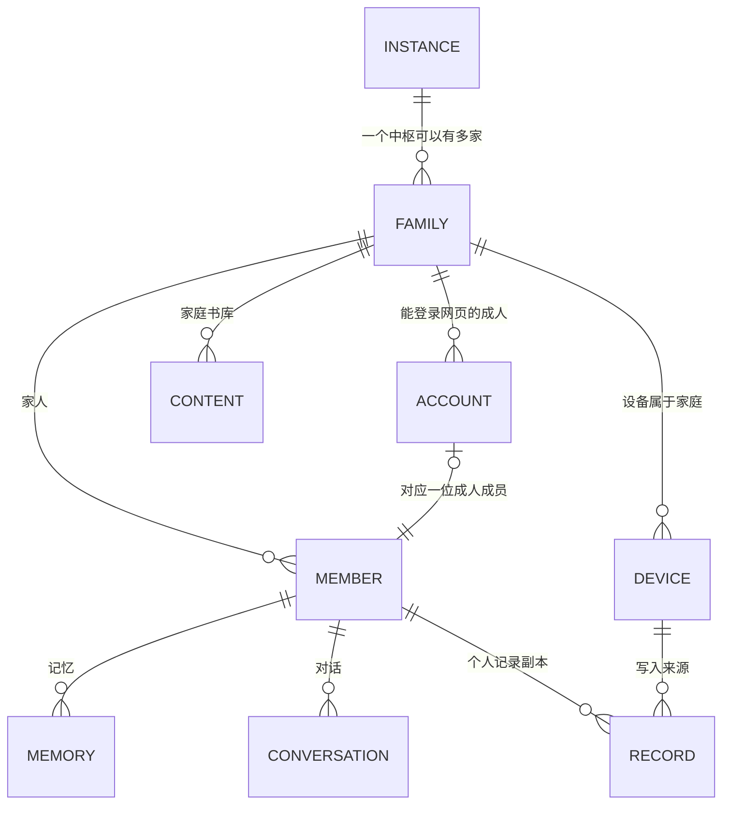

| 概念 | 含义 |
| --- | --- |
| 家庭 | 隔离的边界：数据、书库、预算、设备、成员都在一家内部 |
| 成员 | 一个人。成人或孩子。**孩子没有账号**（R-022：不要求儿童独立注册），由家长管理 |
| 账号 | 成人登录网页控制台的身份：用户名 + 密码（argon2id），以后可加通行密钥。不用手机号和短信（花钱） |
| 设备 | 属于家庭，不属于某个人（D-03：全家共用）。“现在是谁在用”随消息传 |
| PIN | 只在设备上，中枢不存（底座设计 §5.1）。忘了由成人在控制台发起重置，下次连接时设备清掉这位成员的 PIN |

**一个账号能做什么**：登录后管理本家庭（成人家长角色）。第二位成人（妈妈）用邀请链接建自己的账号；她的个人记录爸爸默认看不到，孩子的两个人都能看（底座设计 §8.1：家长可查看、导出、删除儿童记录）。

**朋友**（R-001、R-022）：同一个中枢上再建一家（`family`），用邀请链接；或者朋友自己装一个。两种都支持，因为隔离边界就是家庭。要明说的是：**服务器的管理员技术上看得到所有家庭的数据**，朋友要知道这一点；想彻底隔开就让朋友自己装。给朋友用之前，法规方面（生成式 AI 服务、个人信息）要另外看，本文不下结论。

**隔离怎么落实**【建议】（D-80、D-83）：

1. **一家一个 SQLite 文件**。跨家庭读不到不是靠 `WHERE`，是根本没打开那个文件。
2. **所有数据访问都要带 `Scope(family, member)`**。数据层只暴露按范围取数的接口，没有裸 SQL 入口；记忆、对话、记录表都以 `member_id` 为分区键（底座设计 §5.2）。
3. **能力调用带调用者**：`member`、`device`、`source`（设备按钮、AI、控制台、外部）。策略关口在进入能力之前检查。
4. **发给模型的内容只从 `Scope` 组装**。切换成员时，提示词里不会有上一位成员的东西。
5. **自动测试**：`tests/isolation` 用两家、每家三个成员灌数据，遍历目录里每个能力，查不到不该查的。任何新能力都要过这个测试。
6. **文件块也分家**：同一本书两家各存一份，不跨家去重。

### 5.5 记忆（维护和更新每个成员的记忆）

要回答的问题：要不要（要），放哪（中枢，设备不存，底座设计 §5.1），用什么（自己做，§8）。

**三层，加一个不算记忆的活动记录**：

| 层 | 内容 | 例子 | 上提示词吗 |
| --- | --- | --- | --- |
| 档案 | 这个人稳定的情况，很短 | 小满，6 岁，识字，喜欢恐龙，回答要简短 | 每轮（≤ 500 token） |
| 事实 | 一条一条的事，带来源 | “妈妈对花生过敏”（本人说的，3 月 2 日） | 按相关性取几条 |
| 摘要 | 每次对话、每天的摘要 | “上周读完《海底两万里》，问了很多潜艇的事” | 按相关性取 |
| 活动记录 | 设备同步来的事实：读到哪、复习了什么 | 不是记忆，用 `history.search` 查 | 需要时用工具查 |

**每条事实的字段**：`id`、`member_id`、`text`、`kind`（本人陈述 / 观察到 / 推断，底座设计 §5.2 要求分开）、`source`（哪轮对话、哪条记录）、`confidence`、`created_by`（人还是 AI）、`scope`（个人；或家庭共享，默认不开）、`valid_until`、`superseded_by`。

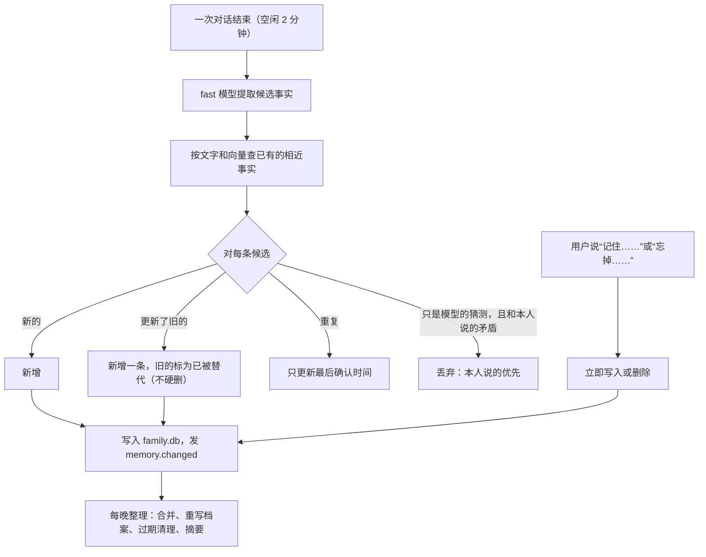

**规则**：

- **看得见、删得掉**：`memory.list` 给用户和 AI 同样的结果；控制台能看能改；“忘掉”是真删（连同被替代的旧版本和向量），删除进审计记录但不留内容。
- **按成员**：查询带 `member_id`；孩子的记忆家长能看；成人之间默认互相看不到。
- **孩子的特殊规则**：不提取推断类的事实（不给孩子贴标签）；可以在设置里关掉自动记忆；保留期同 D-34（记忆保留到删除，转写 180 天）。
- **内容不当指令**：记忆里的文字进提示词时标成“资料”，防止从网页、书里来的话被存成“用户偏好”后变成指令（底座设计 §8.1 的威胁模型）。只有本人陈述才能进档案。
- **检索**：FTS5（jieba 分词）+ 向量余弦（`embed` 角色），再按最近和类型加权。一家几万条以内，暴力比较够快【估算】，不用向量库。
- **费用**：每次提取一次便宜模型调用，每月不到 1 元【估算】。

接口写成 `MemoryStore`，以后效果不好可以换 mem0，上层不改。

### 5.6 内容：书、朗读、报纸、搜索

**统一成一个管线**，所有产物走作业框架（底座设计 §5.6：已请求 → 传输中 → 已到达 → 已登记 → 已索引 → 可打开 → 可离线）。AI、设备按钮、控制台都看同一个阶段字段。

| 内容 | 做法 |
| --- | --- |
| **书籍转换**（D-15） | 输入 EPUB、TXT、文字型 PDF；输出扩展的 `.ebook`（`EBOK`，4 KB 分块、zlib，[上游研究](../research/foundation/upstream-firmware.md)）。EPUB 自己解析（压缩包 + XHTML），PDF 用 pdfminer.six、pypdfium2；避开 AGPL 的 EbookLib 和 PyMuPDF。其他格式可选调 Pandoc、Calibre（命令行，不链接）。限内存限时，文件不可信 |
| **找书**（R-017） | `content.find` 查用户配置的来源（OPDS、自己的书库、合法来源）；“获取中 / 已就绪 / 找不到”如实返回（SR-RD-03）。任意书名都能免费拿到不是既定能力 |
| **朗读预生成**（R-018） | 书和报纸按句合成，同时保存句子和时间的对应，读听切换靠它；Ogg Opus 16 kHz（和 D-67 一致）；闲时跑，按字计费，开始前显示预计费用，超过设定值要确认 |
| **个人报纸**（R-020） | 定时：抓来源（RSS 等，用 trafilatura 取正文）→ 去重聚类 → 按成员的偏好和“防止兴趣固化”的规则排序 → `fast` 摘要 → `deep` 编排 → 结构化期号（固定条目表、有终点，底座设计 §5.2）→ 设备下载。**来源、篇幅、频率都是配置，用户没定**（[新闻研究](../research/personal-news.md)） |
| **联网搜索** | `web.search` 接厂商接口（配置项），`web.fetch` 取一页的正文。结果标成“资料”进提示词 |
| **家庭内搜索** | `history.search` 查这位成员的笔记、读过的内容、对话；`library.search` 查书库。走中枢副本，设备不用查询引擎（底座设计 §5.1） |

**给设备的路径**：书、音频、报纸都是一个内容对象加若干 rendition（底座设计 §5.2），经块传输下载（§6.6）。设备显示真实阶段。

### 5.7 浏览器和远程画面（R-048）

设备一侧的宿主、区域帧、配额、输入帧都已实现（[详细设计 §8](../system/system-detailed-design.md)）；模拟中枢是原型（`simulator/environment/sim_remote.c`）。真实中枢要把里面的“生成图片”换成真浏览器。

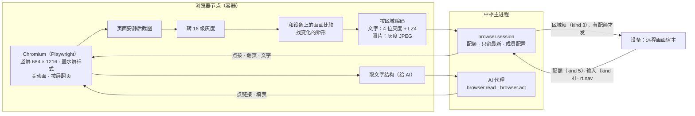

| 环节 | 做法 |
| --- | --- |
| 渲染 | 每路一个独立的 Chromium 上下文（按成员保存登录状态），字体带 Noto CJK。样式注入：高对比、关动画、`prefers-reduced-motion`；翻页键映射成按屏滚动。设备的 `w`、`h` 从 `rt.open` 参数来 |
| 什么时候截图 | 网络安静且 DOM 不变约 100 ms；墨水屏不需要视频流，不用 screencast【推断】 |
| 灰度 | 8 位转 16 级，`(v + 8) / 17`，和 `sim_remote.c` 一致，高半字节在前 |
| 编码（D-53） | 文字区 LZ4 块格式（设备是自写解码器，兼容公开格式）；照片区灰度基线 JPEG（S31 硬件解码，尺寸、采样要求要在实机核对）。照片区从 DOM 里 `img`、`video`、`canvas` 的位置来，加一个像素统计兜底 |
| 控流 | 没配额就合并变化、只留最新；一个单元最后一帧带 `F_LAST`；一个配额一个单元 |
| 重连 | 同设备同成员 5 分钟内重开，页面还在，但 `shown` 清成白屏（设备这样约定）；超过 5 分钟关 |
| AI | `browser.read` 给文字结构和带编号的链接；`browser.act` 让 AI 点和填；页面内容标成“资料”（R-039）。AI 提交表单、付款这类外部副作用走确认卡（§7.5） |
| 安全 | **这是攻击面最大的部件**：内容不可信。容器非 root、只读根文件系统、无数据卷；出站经过滤代理，拦内网、回环、云元数据地址，解析后再判断（防 DNS 重绑定）；禁下载、禁 `file://`；限内存，超了关这一路；登录状态由主进程加密保存，用时传入 |
| 孩子 | 默认不能用（D-85），家长可以开；底座设计 §8 把“从任意网址导入内容”列为儿童默认禁止，这里一致 |
| 费用 | 没有按量费用，只吃服务器内存。空闲 10 分钟自动关 |

**时延现状**：模拟器里整页换页约 1.3 s，主要花在墨水屏（详细设计 §13）。中枢这段（渲染 50～150 ms、编码 5～20 ms）【估算】不是瓶颈。

**和报纸、声明式页面的关系**：有结构的内容优先下发结构，由设备本机排版（更清楚、更省流量、能离线，系统架构 §9.5）；远程画面只用于没有结构可用的。

### 5.8 同步（R-023）

权威方沿用底座设计 §5.1：成员个人记录设备为准（首版一台），家庭内容和 AI 状态中枢为准。设备的数据存储已经给同步留了接口（`ink_db_changes`、`ink_db_ack`，系统服务详细设计 §3.2）。

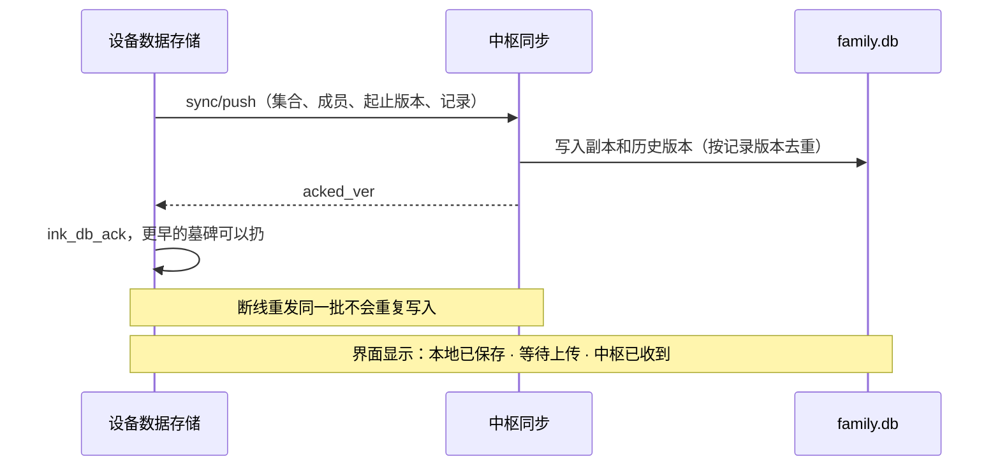

- **后台优先级**：有实时会话时让路（设备已实现）。按集合和成员分批。
- **文件**（照片、录音）走块上传（§6.6），可续传。
- **恢复**：登录 → 预览将覆盖、新增、冲突的对象 → 设备下载集合快照（块传输）→ 写入 → 内容按需重新下载。不重放已执行的外部动作，不补跑过期提醒（底座设计 §5.7）。验收：每位成员都能打开到正确的内容和位置，并列出没恢复的项目。
- **多设备**：记录已带 `device_id` 和版本（底座设计 §5.2），首版不做合并；D-51 第二阶段再定冲突规则。
- **保留期**：历史版本默认 90 天【建议】；转写 1 年（儿童 180 天），运行记录 180 天（D-34）。

### 5.9 固件分发

沿用系统服务详细设计 §12（那边的 R-056，和语音输入的 R-056 重号，合并时要改）：中枢只放包，不持有私钥，只分发 `.inkfw`。

- `update/check`：回答最新版本（按设备的 `hw`、`fw_code`，可分渠道：稳定、测试）。
- `update/fetch`：分块下载（统一到块传输，§6.6）。
- 上传：`inkhub firmware add <文件>`，中枢**校验签名后才收**（公钥在配置里），坏包一开始就挡住。
- 中枢不能让设备“从任意网址”升级（上游的安全缺陷，底座设计 §8.1）；`system.upgrade` AI 也调不了（设备规则）。
- 发布渠道：控制台显示每台设备的版本；由用户点“提示设备更新”。

### 5.10 任务队列和更重的负载

**队列**：一张 `jobs` 表（实例级）+ 主进程里一个调度循环。字段照底座设计 §5.6：阶段、幂等键、触发者（用户、AI、定时）、受影响对象、费用估计、可取消。跑法：网络型（调 API）在主进程协程里；CPU 型起子进程，限内存、限时、降优先级。重启后未完成的恢复。这比 Celery + Redis 少两个部件，家庭规模够用（D-83 附带）。

**重负载的归宿**：

| 负载 | 放哪 | 说明 |
| --- | --- | --- |
| 书籍转换、报纸、朗读预生成 | 子进程 | 闲时；一次一个 |
| 文字识别（扫描版 PDF）、看图 | 走模型 API | 按量，开始前估价 |
| 本地语音识别 | 可选（宽裕档） | sherpa-onnx + SenseVoice，CPU 能跑【文档】 |
| 第三方页面、复杂渲染、以后的云应用 | 浏览器节点 | 同一套远程画面 |
| 本地大模型、大算力 | **外部能力节点** | 家里的显卡机注册成节点（§7.1），服务器上不跑 |
| 游戏模拟器（R-015） | 以后单独看 | 用户说“走中枢页面、脚本运行时或单独验证”，这里不下结论 |

### 5.11 可观测性和费用统计

- **每一轮一条记录**（不含正文，保留 180 天，D-34）：说完 → 识别完成 → 首 token → 首句 → 朗读首包 → 首帧发出 → 回答结束；工具调用次数和耗时；费用。控制台画一张瀑布图，能看出哪段慢。
- **听写**：只记成员、时长、段数、各段耗时和费用，不含文字（D-91 选了留文字时除外）。
- **日志**：结构化，正文和令牌不进日志（有测试）。
- **指标**：`/metrics`（Prometheus 文本格式，默认只开内部）；不强制装 Prometheus，控制台自带最近 7 天的图。
- **设备的探针**：设备已有 `ai.*`、`hub.*` 探针。以后可以经 `ink/event` 或批量上传，和中枢这边按轮对齐（底座设计 §10）。
- **告警**：备份失败、额度将尽、磁盘快满、证书快过期、模型连不上，发到控制台，也经 `notify.post` 发到家长的设备（设备下次连接时）。
- **审计记录**：谁（人、AI、外部）调了什么系统级能力、确认结果。按成员可查，家长可看孩子的。

### 5.12 安全

沿用底座设计 §8.1 的威胁模型，中枢这边的做法：

| 风险 | 做法 |
| --- | --- |
| 中枢被攻破 | 固件私钥不在中枢；模型密钥用主密钥加密（主密钥在 `secrets/`，权限 600）；中枢能做的最坏的事也过不了设备的确认卡 |
| 设备令牌泄露 | 令牌只存哈希；控制台一键吊销；令牌权限只限这个家庭的设备通道，不能登录控制台、不能批量导出 |
| 未认证的连接 | 没握手之前只收小消息（4 KB）；按 IP 限流；10 秒不握手就断；配对请求有数量上限和有效期 |
| 控制台 | argon2id、失败限流、会话短期有效；向导的设置码一次性；管理接口默认只走 443 |
| 内容里的恶意指令 | 正文作为“资料”进提示词；模型没有绕过设备策略关口的能力；工具调用记录来源 |
| SSRF | 浏览器和 `web.fetch` 都经过滤代理 |
| 供应链 | 依赖锁版本和哈希（`uv.lock`）；不用 `latest`；LiteLLM 事件是前车之鉴 |
| 数据静态加密 | 底座设计 §8.1 写了“中枢数据加密存储”。这里改一下：**异地备份端到端加密，密钥类用主密钥加密，数据库文件本身首版不加密**。理由：服务要无人值守重启，解密密钥只能放在同一台机器，防不住拿到机器的人，只防硬盘快照外泄，代价是向量和全文检索更麻烦。D-86 请用户确认 |
| 孩子的数据 | 保留期短；家长可查、可导出、可删；模型厂商只收到当次需要的最小内容 |
| 听写内容 | 可能是短信、私信。不进 AI、不进记忆；音频不落盘，文字默认不留（D-91）；只经过语音厂商 |

## 6. 怎样容易地关联和连接设备

### 6.1 第一次配对：和设计稿对上

设计稿 `FirstBoot` 的字是“用手机扫一下，帮它连上网”“Wi-Fi 和家庭账户都在手机上填，不用在这里打字”，还有一个“没有手机？在这里输入 Wi-Fi”的按钮；底部三个点表示三步。

**难点**：自己装的中枢没有一个大家都知道的地址，设备屏幕上的二维码只能写设备已经知道的东西。所以设备得先知道中枢在哪。

**设备怎么知道中枢地址**（按优先顺序）：

| 来源 | 做法 | 适合 |
| --- | --- | --- |
| 固件预置 | 编译时写入默认中枢地址和公钥（用户自己编固件时从本地配置读，**不进公开仓库**） | 用户自己一家；朋友用用户的中枢 |
| TF 卡上的配对文件 | 控制台下载 `ink-pair.json`（地址、公钥、一次性码，可选 Wi-Fi），拷到卡上；带一次性码就不用再扫码认领；设备读完马上删掉（底座设计 §8.1：卡上不留凭据） | 不重编固件；没有手机时 |
| 手机页面里填 | 设备开热点时，手机页面上粘贴中枢地址或配对链接 | 朋友自己装的中枢 |
| 设备键盘输入 | “没有手机？”路径 | 兜底 |
| 设备摄像头扫中枢二维码 | 控制台显示二维码，设备拍 | 备选（D-81 方案 B），要验证摄像头对焦 |

**流程**：三步对应设计稿的三个点。

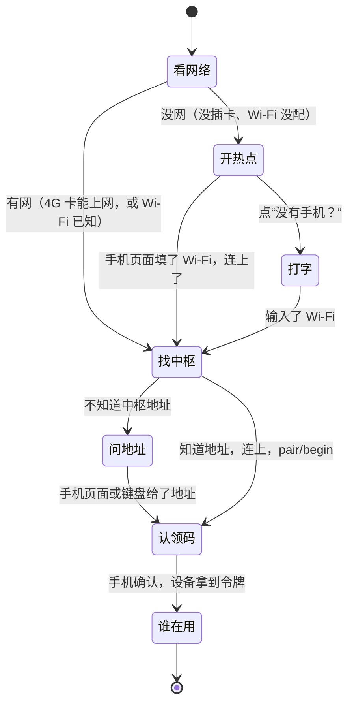

| 第几个点 | 屏幕显示 | 手机上发生什么 |
| --- | --- | --- |
| ● ○ ○（没网，或不知道中枢地址时才有） | 二维码 = 加入设备自己的热点（`WIFI:` 格式）；“用手机扫一下，帮它连上网” | 扫码加入热点，弹出设备自带的小页面：选 Wi-Fi、填密码；不知道中枢地址时再填地址。**Wi-Fi 密码只到设备，不经过中枢** |
| ○ ● ○ | 二维码 = 中枢上的认领网址；“用手机扫一下，加入家庭”；下面显示 8 位认领码，给电脑输入用 | 打开认领页 → 登录（或用邀请链接注册）→ “把这台设备加入【张家】？名字：爸爸的设备” → 确认 |
| ○ ○ ● | “谁在用？”（设计稿 `Members`） | 不用手机了 |

插了能上网的卡时，第一个点直接跳过，整个过程只扫一次。

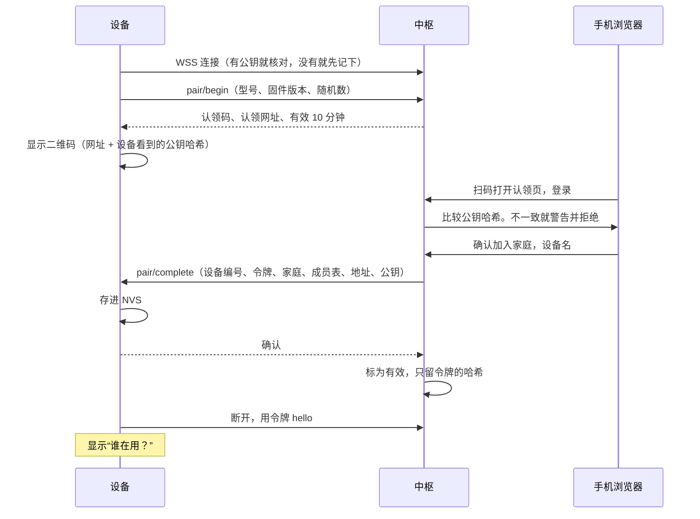

**为什么这样安全**【建议，审计时重点看】：

- 认领码只显示在设备屏幕上，能看到屏幕才能认领（证明人在设备旁边）。
- 公钥哈希走二维码到手机，再经手机的 HTTPS 到中枢比较：这条路中间人碰不到，所以第一次连接没有公钥时也能发现被替换。这要求控制台有可信证书（D-82）。
- 配对的所有消息都在设备出站的 WSS 上，设备不用开任何入站端口；热点只在配网时开。
- 认领码 8 位（字母数字去掉易混的），一次性，10 分钟过期，错误次数限流。

**要实机试的**：手机扫 `WIFI:` 码后弹页面的体验（iOS、安卓不同）；热点和 Wi-Fi 同时开时 S31 的内存；`lv_qrcode` 在墨水屏上的可扫性。设备一侧要做的列在 §13。

### 6.2 账号、成员和设备的关系

- 一个家庭可以有多台设备；每台一个令牌。
- 设备上的成员表来自中枢（`members_rev` 变了就拉）。第一次开机内置的 `owner`、`kid` 替身在配对后被真实成员替换。
- 在设备上加成员（设计稿 `Members` 有“添加成员”）：走 `member.add` 能力（系统级，确认），同步回中枢。
- PIN 第一次进成人空间时在设备上设。

### 6.3 令牌：发放、轮换、吊销

| 事情 | 做法 |
| --- | --- |
| 发放 | 认领成功时生成 256 位随机令牌，经 `pair/complete` 发给设备；中枢只存 SHA-256 |
| 存放 | 设备存 NVS，不写 TF 卡（底座设计 §8.1）。S31 没开 Flash 加密（硬性规则），设备丢了能读出来，所以靠吊销 |
| 使用 | 放在 `hello` 的参数里（在 TLS 里），不改 HAL、不加请求头 |
| 轮换 | `hello` 回答可带 `next_token`，设备存好后确认，确认前两个都有效；默认 90 天一次，首版可不开 |
| 吊销 | 控制台一键；在线的立刻断开；下次 `hello` 得到 `revoked` 错误，设备停止重连（现在是一直退避重试，要改），显示“已从家庭移除” |
| 令牌能做什么 | 只有这个家庭的设备通道；不能登录控制台；不能批量导出 |

### 6.4 换设备、解绑、丢失

| 情况 | 流程 |
| --- | --- |
| **换新设备** | 新设备走配对；认领页问“这是换机吗？”，选旧设备 → 进入恢复流程（§5.8）→ 旧设备令牌吊销 |
| **解绑（设备还在手边）** | 设备“恢复出厂设置”时，在线就告诉中枢解绑；中枢保留数据，等家长决定 |
| **解绑（控制台）** | “移除设备”：吊销。可选“移除并抹掉”：下次连接时设备收到 `wipe:true`，走 `system.factory_reset`（这是不可逆的，只有家长明确选了才带） |
| **丢失** | 一键吊销，防止继续用中枢。设备本地数据没有加密，拿到设备的人还是能读（已知限制，底座设计 §8.1），控制台要如实说 |
| **中枢搬家** | 见 §4.5。`hello` 回答里的 `urls` 能提前告诉设备备用地址 |
| **中枢坏了又重装** | 用恢复密钥从备份恢复，身份不变，设备无感；没有备份就要重新配对 |

### 6.5 局域网、公网、4G

| 连接 | 做法 |
| --- | --- |
| 公网（默认） | `wss://地址:8443/v1/device`（路径和现在 `system/boot/main.c:44` 一致）。设备出站，适合 NAT |
| 4G | 完全一样。设备出站，运营商 NAT 不用管；往返 50～200 ms【文档，协议调研 S21】。`hello` 带 `net` 字段，大文件默认等 Wi-Fi（流量要钱），远程画面照常 |
| 局域网直连（以后，D-51） | 中枢用 mDNS 广播，设备发现后比对公钥，连局域网地址，延迟更低。NAS 部署时才有意义 |
| 流量【估算】 | 语音一轮约 140 KB；全走 4G 一个月约 200 MB（50 轮/天）；一屏远程画面约 50 KB |

### 6.6 下载和上传走哪条路（D-89）

底座设计 §6.5 写的是“内容下载与批量同步走 HTTPS”。现在 HAL 只有 WebSocket，再开一条 HTTPS 意味着第二个 TLS 会话，占内部 RAM（内部 RAM 是最紧的资源，AI 场景最低余量 38 KiB，预算 32 KiB，[全貌 §10](../background.md)）。系统服务详细设计 §12.3 的固件下载已经用了二进制帧。

**建议都走现有的 WSS**：一条连接、一个 TLS，后台优先级，有实时会话时让路（设备已实现），设备按块拉取，可续传。块大小 16 KiB。4G 上 1.6 Mbit/s 够用：1 MB 的书约 5 秒。详细格式见[设备协议 §3.8](device-protocol.md)。

### 6.7 断线和重连

| 情况 | 设备（已实现） | 中枢要做的 |
| --- | --- | --- |
| 空闲 60 秒，或锁屏 | 断开（D-24） | 释放连接；要发给设备的放外发队列 |
| 切网（Wi-Fi ↔ 4G） | 旧连接作废，重连，重新登记会话 | 同一设备的新连接顶掉旧连接；语音这一轮作废（取消模型和朗读）；远程画面保留页面，按白屏算差异 |
| 说话时断线 | 这一轮作废并提示 | 取消，只记已发生的费用 |
| 工具调用途中断线 | 请求号去重，重发不重复执行 | 重发带同一个 `request_id`；设备调中枢的也按它去重（保留 10 分钟） |
| 中枢重启或升级 | 退避重连 1～60 秒 | 启动后尽快可用（目标 5 秒内）；任务恢复；不要求会话恢复 |
| 中枢长时间不可用 | 离线功能照常（D-05） | — |
| 令牌被吊销 | （要改）停止重连 | 返回 `revoked` |

**保活**：只用 WebSocket 层的 ping（25 秒一次），不发应用消息（§1.3）。

### 6.8 设备不在线时，中枢怎么找它（D-88）

设备按 D-24 平时不连。中枢要给设备东西时（报纸好了、家长改了规则、到点提醒）：

- **外发队列**：就是一串“等设备上线再发的 `tools/call`”，带请求号和过期时间。设备一 `hello`，中枢依次发，照常过设备的策略关口。不用新协议。外部副作用的不进队列。
- **什么时候能发到**：设备下次连接。所以要**设备按计划连一下**：比如每天早上报纸时间、充电时、从锁屏唤醒时（已有）。这要设备的时间服务加一个定时短连，和“锁屏省电”要权衡，估计每次几秒【估算，待 SP-10 实测】。
- **不做**：锁屏也保持长连接（耗电）；用短信唤醒（花钱）。这是推荐，D-88 给用户看。
- 闹钟和提醒在设备本地排程，不依赖中枢（系统服务详细设计 §5.4）。

## 7. 怎样作为原子能力接入软总线

### 7.1 节点：中枢是总线上的一个节点

系统架构 §5.1 的地址 `[节点/]能力` 在中枢这边同样成立：

| 节点 | 地址 | 例子 | 怎么连 |
| --- | --- | --- | --- |
| 中枢自己 | `hub/…` 或不写 | `memory.search` | 主进程内直接调用 |
| 设备 | `dev:<设备编号>/…` | `dev:爸爸的设备/reader.next_page` | 经设备网关，JSON-RPC |
| 浏览器节点 | 内部 | `browser.session` | 内部网络 |
| 外部能力节点（以后） | `ext:<名字>/…` | 家里显卡机上的本地模型，或任何 MCP 服务 | 中枢作 MCP 客户端，管理员手动添加并给每个工具定副作用等级（对方自称的等级不可信，MCP 规范也这么说） |

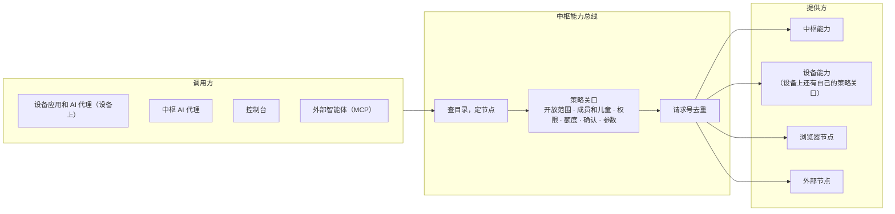

**执行端说了算**（系统架构 §5.5）：调设备能力时中枢这道只是过滤（比如不把孩子不能用的工具给模型），最终由设备的策略关口判断；调中枢能力时中枢是执行端。

### 7.2 能力的描述：和设备同一种格式

字段和设备的 `ink_cap_t`（详细设计 §2.1）一一对应，Python 里写成装饰器，**描述是唯一来源**，由它生成 `caps/list`、给模型的工具定义和对外 MCP。

```python
@capability(
    id="memory.search", version=1, form="call",
    title="查这位成员的记忆",
    input={"type": "object", "required": ["query"],
           "properties": {"query": {"type": "string", "maxLength": 200},
                          "limit": {"type": "integer", "minimum": 1, "maximum": 20}}},
    output={...},                  # JSON Schema，和 structuredContent 一致
    effect="read",                 # 只读 / 导航 / 本地可逆写 / 本地不可逆 / 外部副作用 / 系统
    child_ok=True,
    permission=None,
    qos="interactive", timeout_ms=3000, retry_ok=True,
    offline="fail",                # 给设备看：离线时失败 / 排队 / 换本地方案
    expose={"app", "ai", "remote"},
)
async def memory_search(call: Call, query: str, limit: int = 5) -> Receipt:
    rows = await call.scope.memory.search(query, limit)   # scope 带家庭和成员，取不到别人的
    return Receipt.done(result=rows, say=None)
```

回执用同一套状态（完成、部分完成、已排队、待确认、被拒绝、已过期、参数无效、失败、已取消、已撤销，底座设计 §6.4）。

### 7.3 服务器能力目录

**给设备的**（`caps/list`，设备应用要直接调的）：受 §1.3 的 128 词法单元限制，首批控制在 17 项以内。

| 能力 | 形态 | 给孩子 | 离线时 | 用途 |
| --- | --- | --- | --- | --- |
| `voice.chat` | 会话 | 可 | 失败 | 语音对话（已有） |
| `asr.stream` | 会话 | 可 | 失败（设备退回键盘） | 语音输入（R-056），只开放给应用 |
| `browser.session` | 会话 | 默认否 | 失败 | 远程画面（已有） |
| `asr.transcribe` | 调用 | 可 | 排队 | 语音备忘转文字（已在模拟目录） |
| `tts.speak` | 调用 | 可 | 换本地 | 朗读一段（已在模拟目录） |
| `llm.ask` | 调用 | 可 | 失败 | 应用自己问模型（已在模拟目录） |
| `library.search` | 调用 | 可 | 失败 | 搜书库 |
| `content.import` | 调用 | 否 | 排队 | 导入网址或文件 |
| `content.status` | 调用 | 可 | 失败 | 导入进度 |
| `news.today` | 调用 | 可（儿童版） | 失败 | 今天的报纸 |
| `memory.search` | 调用 | 可 | 失败 | |
| `memory.forget` | 调用 | 否 | 失败 | |
| `backup.status` | 调用 | 否 | 失败 | 设置里显示 |
| `job.status` | 调用 | 可 | 失败 | |
| `usage.today` | 调用 | 否 | 失败 | 今天花了多少 |

**只给 AI 的**（不进 `caps/list`，进工具目录）：`web.search`、`web.fetch`、`history.search`、`browser.read`、`browser.act`、`memory.add`、`memory.list`、`news.item`、`content.find`、`library.get`、`vision.describe`、`family.members`、`device.list`、`routine.*`。

这样分是因为：设备目录有上限，而大多数服务器能力是 AI 在中枢这边用的，不必经过设备。

**工具名**：模型接口要求工具名只有字母数字下划线和连字符，所以给模型时把 `.` 换成 `__`，设备的加前缀（`dev__reader__next_page`），调用时再换回来。顺序固定，提高缓存命中。

### 7.4 发现和调用

**发现**

| 方向 | 消息 | 现状 | 中枢要做 |
| --- | --- | --- | --- |
| 设备发现服务器能力 | 每次连上发 `caps/list`；中枢发 `caps/changed` 时重拉 | 【实现】`cap.c:883`，设备只读 `name`、`form` | 按成员和部署情况过滤（没装浏览器就不列 `browser.session`）；不超过 128 词法单元 |
| 中枢发现设备能力 | `tools/list` | 【实现】设备从能力表生成，上限 6 KiB；分页在系统服务分支上 | 按清单哈希缓存；`hello` 带 `manifest_hash` 后同一固件只拉一次 |
| AI 发现能力 | 每轮常驻：目录索引 + 当前应用和系统常用能力（≤15 个）；其余用 `find_capabilities`、`load_capabilities` | 【设计】底座设计 §6.5 | 工具集合保持稳定，快照里的 `actions` 说明此刻哪些有效 |

**设备调中枢能力**（【实现】`cap.c:560`）

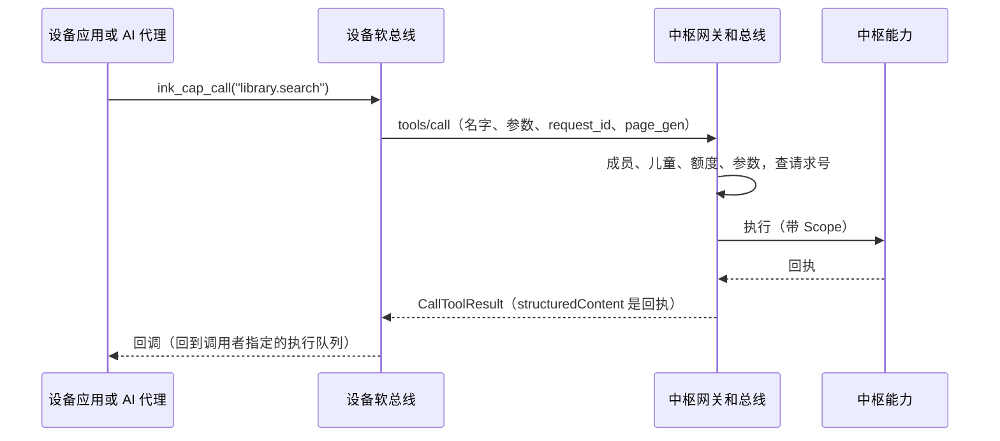

**中枢 AI 调设备能力**（【实现】`cap.c:810`）

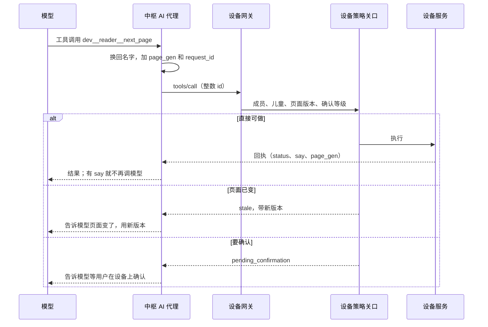

要注意一个不对称【实现】：设备调中枢时，回答要是 MCP 的 `CallToolResult`（回执在 `structuredContent` 里，`cap.c:532`）；中枢调设备时，设备回的是扁平回执（`status`、`say`…，`cap.c:724`）。**不用改设备**，中枢适配层统一转换；对外 MCP 时再包成标准形状。

### 7.5 权限和确认卡

**中枢的策略关口**（顺序照详细设计 §2.4，多一条额度）：能力存在且可用 → 开放范围 → 成员和儿童 → 权限 → **额度** → 确认 → 参数 Schema。

**三种确认**：

| 情况 | 流程 |
| --- | --- |
| AI 调设备上有外部副作用的能力（发短信） | 设备策略关口回“待确认”，弹确认卡（设计稿 `Confirm`），用户按下后设备执行；结果用 `confirm.result` 事件告诉中枢（系统服务详细设计 §7）。**中枢和 AI 都按不了确认** |
| AI 调中枢上有副作用的能力（`browser.act` 提交表单、`budget.set`） | 中枢回“待确认”，同时调设备的 `confirm.request`（新能力，只给中枢，不进模型工具表）让设备弹卡；用户确认的结果回来中枢才执行。卡上写明来源是中枢、要做什么 |
| 控制台操作 | 人已登录，网页上二次确认；孩子的事只有成人家长能做 |

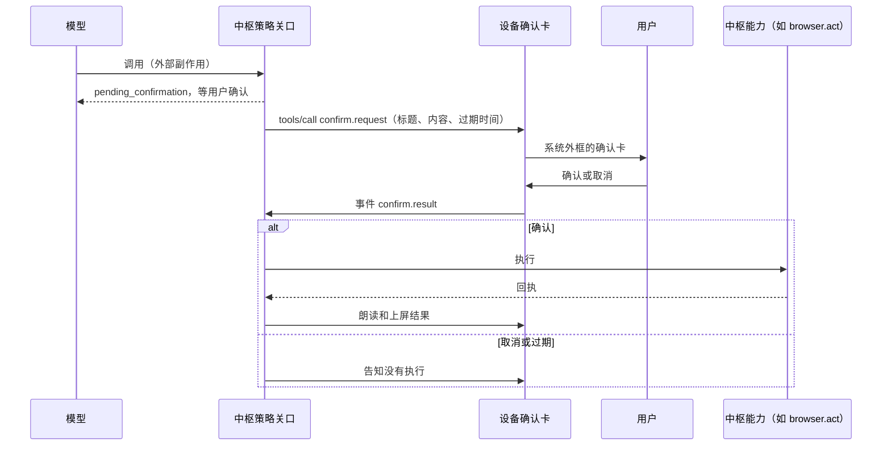

**设备离线时**：外部副作用的中枢能力不执行，回“被拒绝：需要设备在线确认”。AI 和定时任务都不能静默做有外部副作用的事（D-25、R-040）。

### 7.6 事件和状态

- **设备事件到中枢**：`ink/event`（带序号，中枢确认后设备才清）。设备已规划转发 `message.received`、`alarm.fired`、`confirm.result`、`app.state` 等（系统服务详细设计 §1.2 第 3 条）。中枢按成员存活动记录，也交给主动决策。
- **设备状态**：AI 上下文里带常用状态（`state.list`）；不订阅高频项。
- **中枢事件到设备**：`caps/changed`；其他走外发队列（§6.8）。
- **AI 主动决策**：定时任务和事件都先过一道“值不值得打扰”的 `fast` 判断，结果写成通知（`notify.post`），用户看得见、能撤销（系统架构 §6.4）。首版只做定时生成。

### 7.7 实时会话

沿用现有的 `rt.open`、`rt.close`、二进制帧（[详细设计 §6](../system/system-detailed-design.md)）。中枢的约定：

- 会话号由设备选，中枢照用。
- `rt.open` 里的能力名查目录；不允许就回错误（设备走 `on_closed`）。额度用完不拒绝语音会话，让它开起来，用语音告诉用户原因（否则用户只看到“出错了”）。
- 每路会话绑定到连接，连接断了会话就没了（设备会重新登记）。
- 发送优先级中枢这边也照设备的五档：语音 > 输入 > 画面 > 控制 > 后台。Python 里每条连接一个按优先级取的发送队列。
- 听写 `asr.stream` 也是一路实时会话：上行用语音帧，结果用 `rt.asr` 通知，说完用 `rt.turn`。不加帧类型，设备的 `rt.c` 不用改（[设备协议 §3.11](device-protocol.md)）。
- D-54 的 UDP 通道以后才加；中枢代码把帧的收发和传输分开，加的时候不动业务。

### 7.8 和现有实现的差异

完整约定在[设备协议](device-protocol.md)。这里只列一眼能看完的：

| 项目 | 现在 | 设计 | 谁改 | 为什么 |
| --- | --- | --- | --- | --- |
| `hello` | `{proto:1, device:<档案名>, member:"default"}`，无身份 | 加 `device`（真实编号）、`token`、`fw`、`manifest_hash`、`frame_v`、`member`、`net`；回答加 `now_ms`、`caps_rev`、`members_rev`、`pins`、`urls` | 设备 | 没有身份无法上线；其余 D-12 早已规定，代码还没做 |
| 配对 | 没有；地址写死 `wss://hub.local/v1/device` | 新增 `pair/begin`、`pair/complete` | 两边 | 系统服务设计里“配对”明确留给以后 |
| 连接 | `hal_ws_open(url, cb, ctx)` 没有证书参数 | HAL 加“固定公钥”选项 | 设备 | 底座设计 §8.1 |
| 成员 | 连接时写死 | 新增 `ink/member` 通知 | 设备 | D-03：切换成员要让中枢知道 |
| `caps/list` | 只读 `name`、`form` | 可选字段 `offline`、`timeout_ms`、`rev`，分页 | 设备可选 | 现有字段继续有效；超过 17 项才必须分页 |
| 打断 | 设计写 `rt.turn`，代码是 `rt.close` 加新会话 | 中枢按 `rt.close` 处理；可选带 `reason`、`heard_frames` | 设备可选 | 以实现为准，不必改回去 |
| 回执 | 两个方向形状不同 | 不改，中枢适配 | 中枢 | 省设备内存 |
| 下载上传 | 没有（设计写 HTTPS） | 新增帧 kind 6、7 和 `blob/*`，`update/fetch` 归到它 | 两边 | D-89：不开第二条 TLS |
| 同步 | 没有 | 新增 `sync/*` | 两边 | R-023 |
| 事件 | 没有 | 新增 `ink/event`（系统服务分支上在做） | 两边 | 系统服务 §1.2 |
| 确认 | 设备内部 | 新增 `confirm.request` | 两边 | 中枢能力也要确认 |
| 语音输入 | 没有 | 新增会话能力 `asr.stream`，通知 `rt.asr`、`rt.asr.done`、`rt.asr.error` | 两边，设备底层会话在做 | R-056；走现有的会话和语音帧 |

没有改动的：JSON-RPC 信封、`tools/*` 结构、`rt.open`、`rt.close`、10 字节帧头、语音帧和画面帧、配额帧、`ai.*` 通知。

### 7.9 对外 MCP（以后）

中枢用官方 Python SDK 提供 Streamable HTTP（规范 2026-07-28），把目录里 `expose` 含 `remote` 的能力翻译成标准工具。认证用每账号的令牌或 OAuth，身份绑定到一位成员，所有调用走同一个策略关口；外部智能体调外部副作用的能力，同样要设备上确认。设备永远不直接说标准 MCP（D-12）。

## 8. 自己写还是用现成

比较和来源见[调研](../research/hub-server-survey.md)。

| 部件 | 选择 | 许可证 | 理由 | 换的代价 |
| --- | --- | --- | --- | --- |
| 中枢主体 | **自写** | — | D-14；小智服务端缺成员、策略、确认、费用、同步、内容（调研 §1） | — |
| 语音厂商适配 | **借**小智服务端的代码 | MIT | 各家流式接口的细节现成 | 单文件 |
| 语音流水线 | **自写薄的** | — | 协议和打断都定了，只要一条可取消的链（D-76）；Pipecat（BSD-2）备选 | 小 |
| 代理循环 | **自写薄的** | — | 工具语义是自己的；通用框架不省事 | 小 |
| 模型网关 | **自写薄的** | — | 按角色和成员记账是自己的需求；兼容接口够用；LiteLLM、new-api 可作上游（D-77） | 改一个地址 |
| 记忆 | **自写** | — | 按成员、分观察和推断、儿童规则；mem0 默认依赖 OpenAI 和 Qdrant（D-84） | 换 `MemoryStore` 实现 |
| 浏览器 | **用** Playwright + Chromium | Apache-2.0、BSD | 成熟；Lightpanda 不渲染，Browserless 是 SSPL | — |
| 数据库 | **用** SQLite（FTS5） | 公有领域 | 一家一文件（D-83）；PostgreSQL 备选 | 数据层接口隔开，中等 |
| 向量 | **自写**暴力余弦（numpy） | — | 数据量小；sqlite-vec 还在 1.0 之前 | 小 |
| 任务队列 | **自写**一张表 | — | 作业语义是自己的；Huey（MIT）可用 | 小 |
| Web 框架 | **用** Starlette + uvicorn + websockets | BSD | 轻；控制台服务端渲染，加 htmx，不要前端构建 | — |
| MCP | **用**官方 Python SDK | MIT | D-12 | — |
| 备份 | **用** restic | BSD-2 | 客户端加密，支持 S3 兼容存储 | — |
| 网页证书 | **用** Caddy | Apache-2.0 | 自动发证 | — |
| 编解码 | **用** libopus 绑定、`lz4`、Pillow、numpy | BSD 等 | — | — |
| 内容转换 | **用** pdfminer.six、pypdfium2、trafilatura；可选 Pandoc、Calibre 命令行 | MIT 等；后两个 GPL 只调命令 | **避开 AGPL 的 EbookLib、PyMuPDF** | — |
| 穿透（NAS 时） | **用** frp | Apache-2.0 | 用户自己部署 | — |

**语言**：Python 3.12+ 和 asyncio（D-14）。模型、语音、文档转换的库都在这边；家庭规模下性能不是问题，CPU 重的放子进程和 C 扩展。没有发现要改 D-14 的理由。

## 9. 代码结构

单仓库（D-28），放在 `hub/`：

```text
hub/
  pyproject.toml  uv.lock
  ink_hub/
    gateway/      设备连接：WSS、握手、配对、帧收发、发送优先级、会话表
    bus/          能力描述、目录、路由、策略关口、回执、请求号去重
    agent/        上下文组装、工具循环、渐进披露、主动决策
    voice/        voice.chat：识别 → 模型 → 断句 → 朗读，取消；asr.stream：听写
    models/       模型网关：角色路由、回退、额度、账本，供应商适配
    speech/       语音识别和朗读的厂商适配（含假厂商）
    memory/       记忆
    accounts/     家庭、账号、成员、设备、令牌、邀请
    data/         数据库、迁移、Scope、文件块
    sync/         设备数据副本、历史版本、恢复
    content/      书库、转换、朗读预生成、报纸、搜索
    remote/       远程画面中转（设备帧 ↔ 浏览器节点）
    firmware/     升级包目录和分发
    jobs/         任务队列和定时
    ops/          备份、升级自检、观测
    console/      网页控制台：向导、认领、家长页面
    mcp/          对外 MCP（以后）
  browser_node/   独立容器：Playwright、差异、编码
  deploy/         compose.yaml、install.sh、inkhub 命令、Caddyfile
  tests/
    contract/     假设备：逐条核对设备协议（从 tests/scenarios/*.hub.json 取用例）
    isolation/    两家三成员，遍历所有能力
    latency/      假厂商固定延迟，量中枢自身耗时
    surface/      能力目录自查（§3.3）
```

## 10. 开发步骤和验收

每步都是能跑的一段。没有用户明确选择，不买服务器、不调付费接口；前两步全部用假厂商在本机跑。

| 步 | 做什么 | 验收 | 花钱吗 | 改设备吗 |
| --- | --- | --- | --- | --- |
| **1 骨架和契约** | 网关说现有协议（`hello` 第 1 版开发模式、`caps/list`、`tools/*`、`rt.*`、`ai.*`）；能力总线；假厂商；任务队列；Compose 和安装脚本；向导第一版 | 假设备测试全过；**模拟器真的连上真中枢跑通一轮语音和一次工具调用**（需要给模拟器加一个桥，把 `hal_ws` 接到真实 socket）；量主进程内存，校正 §4.3 | 否 | 只改模拟器的桥 |
| **2 语音纵切** | 接一家真实的模型和语音；断句、朗读、打断；听写 `asr.stream`；额度和账本；儿童过滤；瀑布图 | 说完到首字 ≤ 3 s、首音 ≤ 4 s；打断后 300 ms 内中枢停止发帧；听写第一个中间结果 ≤ 1 s、说完到定稿 ≤ 500 ms；听写后记忆、对话记录、日志里都查不到它的文字（测试查）；断线、没额度、厂商出错都有明确错误；费用记录和厂商账单差 10% 以内 | **是（D-78）**，很少 | 否（语音面板由设备底层会话做） |
| **3 账号和配对** | 家庭、成员、账号、令牌；认领页；D-82 的证书；隔离测试；`hello` 第 2 版 | 模拟器走完三步配对；吊销立刻生效；隔离测试遍历全部能力 | 服务器（D-74）或本机 | 设备一侧见 §13 |
| **4 记忆、同步、备份** | 记忆三层；`sync/*`；块传输；本机快照和 restic；恢复演练 | 刷机模拟：恢复后每位成员都回到正确位置（SR-DT-02）；“忘掉”后任何能力都查不到；每月演练跑通 | 异地存储（D-87） | 设备一侧见 §13 |
| **5 内容** | 书籍转换、朗读预生成、报纸、搜索、固件分发 | 一本 EPUB 从手机上传到设备上能读能听；一期报纸定时生成并下到设备；坏包传不上去 | 按量 | 少量 |
| **6 远程画面** | 浏览器节点；真实网页；`browser.read`、`browser.act`；安全加固 | 模拟器里打开真实网页、点链接；内网地址访问被拦；内存超限只关那一路；中枢段时延 ≤ 200 ms | 否 | 否 |
| **7 以后** | 对外 MCP、多设备中转、NAS 验证、局域网发现、朋友家庭 | 分别定 | | |

步骤 2、3 之后在真实设备上验证要用户同意（写设备），和设备主线的实机计划一起排。

**测试的中心是“假设备”**：一个 Python 客户端严格按[设备协议](device-protocol.md)说话，包括 128 词法单元的检查（超了就算中枢的错）；`tests/scenarios/*.hub.json` 里写好的流程可以直接当用例。这样中枢和设备两边都对着同一份约定。

**审计**：按项目惯例，每步用 Codex 审一轮，包括架构审视（§3.3）。

## 11. 决策

D-73～D-92，详情和状态在[决策记录](../decisions/README.md)。花钱的只能等用户选，其余按推荐暂定，都可逆。

| 编号 | 决策 | 推荐 | 状态 |
| --- | --- | --- | --- |
| D-73 | 支持哪些机器 | VPS 为主，同一个包能在 NAS 跑，首版只验证 VPS | 暂定 |
| D-74 | 服务器地域 | 中国大陆 | **待选** |
| D-75 | 安装方式 | Compose + 一条命令 + 网页向导 + 命令行 | 暂定 |
| D-76 | 语音流水线和代理循环 | 自写薄的，厂商适配借小智服务端 | 暂定 |
| D-77 | 模型网关 | 自写薄路由 | 暂定 |
| D-78 | 默认模型和语音厂商 | 百炼一个密钥起步，小规模对比后定主模型 | **待选** |
| D-79 | 费用上限 | 家庭 200 元/月，超了先降级再停 | **待选** |
| D-80 | 账号模型 | 家庭 → 成员 → 设备，孩子没账号，朋友是另一家 | 暂定 |
| D-81 | 第一次配对 | 手机扫码认领；没网时设备开热点；地址预置或手机填 | 暂定，建议看一眼 |
| D-82 | 连接怎么信任 | 设备连接固定公钥，网页用可信证书 | 暂定 |
| D-83 | 数据库 | SQLite 一家一库 | 暂定 |
| D-84 | 记忆 | 自写三层 | 暂定 |
| D-85 | 网页远程画面的排期和孩子 | 第 6 步做；孩子默认不能用，家长可开 | **待选** |
| D-86 | 数据加密 | 备份端到端加密，数据库文件首版不加密 | 暂定，建议看一眼 |
| D-87 | 异地备份放哪 | 另一家的对象存储 | **待选** |
| D-88 | 中枢怎么找锁屏的设备 | 外发队列 + 设备按计划短连 | 暂定 |
| D-89 | 下载上传走哪条路 | 都走现有 WSS | 暂定 |
| D-90 | 中枢怎么升级 | 手动，自动快照，失败自动退回 | 暂定 |
| D-91 | 听写内容留不留 | 音频和文字都不留 | **待选** |
| D-92 | 听写词表放不放联系人 | 默认不放，成员打开才放 | 暂定 |

## 12. 风险与要先验证的

| 风险 | 说明 | 怎么降低 |
| --- | --- | --- |
| 语音时延不达标 | 一线主模型首 token 可能 1～3 s，叠加起来接近上限 | 第 2 步就量；`first` 角色；流式上屏 |
| 内存估计偏乐观 | §4.3 全是估算 | 第 1 步量主进程，第 6 步量浏览器；容器限内存，超了只影响那一路 |
| 朗读费用超预期 | 书的预生成按字计费，一本 20 万字 | 开始前显示预计费用；闲时跑；缓存复用 |
| 模型效果不稳 | 孩子场景、工具调用准确率没有数据 | D-78 的小规模对比；固定一组用例 |
| 听写准确率和反馈节奏 | 中文人名、专有词容易错；墨水屏上中间结果刷得太勤会闪 | 词表；`interim_ms` 可调，实机定；说完之后还能在输入框里改（D-65） |
| 记忆提取出错 | 把别人的话、书里的话记成用户偏好 | 分来源；只有本人陈述进档案；用户看得见、能删 |
| 一家一库的扩展 | 几十家以上时连接和迁移会麻烦 | 家庭规模够用；数据层有接口，能换 PostgreSQL |
| 配对体验 | `WIFI:` 二维码在 iOS、安卓上的行为没有实测；热点模式占内存 | 实机试；键盘输入兜底 |
| 国内网络 | 镜像、依赖下载不稳定 | 国内仓库，浏览器打进镜像；离线安装包作备选 |
| 备案 | 用 IP 直连是否完全合规，没有查到权威说法 | 买服务器时问服务商；设计不依赖域名，两种都能走 |
| 浏览器被攻破 | 内容不可信 | 隔离容器，出站过滤，无数据卷；设备能力仍要过关口 |
| 协议漂移 | 中枢和设备分头改 | 假设备契约测试；协议文档是唯一约定 |
| 单点故障 | 一台服务器 | 离线功能在设备（D-05）；本机快照 + 异地备份 + 恢复演练 |

## 13. 交给设备一侧的事（本设计不改设备代码，由用户决定何时做）

| 事情 | 依赖 | 大致范围 |
| --- | --- | --- |
| 中枢地址和令牌的存放（替换 `main.c:44` 写死的地址） | 配对 | 新的小服务 + NVS |
| `hello` 第 2 版 | 配对 | `hub_link.c` 的 `send_hello`；吊销时停止重连 |
| 固定公钥 | D-82 | `hal_net.h` 加选项；模拟器和真机端口各实现 |
| 首次开机流程：二维码、状态机 | D-81 | 系统壳 + `lv_qrcode`；热点和小网页（新 HAL，只在配网时用） |
| `ink/member` | D-03 | `members` 服务发通知 |
| 成员表来自中枢 | R-030 | 系统服务 §11.2 已留口 |
| 块传输：帧 kind 6、7，`sid = 0` 的路由 | D-89 | `rt.c` 的 `on_binary`；和系统服务 §12.3 的 `update/fetch` 对齐 |
| `sync/*` 客户端 | R-023 | 基于 `ink_db_changes`、`ink_db_ack` |
| `confirm.request` 能力 | §7.5 | 确认卡服务（系统服务 §7） |
| 语音面板和 `asr.stream` 客户端 | R-056、D-65 | 设备底层会话做：`rt.asr` 的显示、断线退回键盘、听写时暂停唤醒词；打开面板也要是一个能力（按钮和 AI 同一条路）；模拟中枢加替身 |
| 模拟器的“真中枢桥” | §10 第 1 步 | `hal_ws` 接真实 socket，实时模式 |
| 可选：`rt.close` 带 `reason`、`heard_frames` | §5.3 | 让对话历史更准 |
| 可选：`caps/list` 读更多字段和分页 | §7.4 | 超过 17 项才必须 |
| 可选：设备按计划短连 | D-88 | 时间服务加定时 |

## 修订记录

- v0.1（2026-11-04）：初稿。用户中途说明服务器价格不用查，只要规格。同日补语音输入（R-056）：§5.3.1、`asr.stream`、D-91、D-92。

## 参考来源

查阅日期都是 2026-11-04，详见[中枢调研](../research/hub-server-survey.md)。设备一侧的引用都对应提交 `9b3c24a`。
