# 家庭中枢概要设计 v0.7

状态：**待用户审核**。这一步只做设计和调研：没有写服务实现，没有买服务器，没有调用付费接口，没有碰设备。审核通过后按 §10 开发。v0.2、v0.3 按 Codex 的两轮设计审查改过（[第一轮](../audits/2026-11-04-codex-hub-design/report.md)、[第二轮](../audits/2026-11-04-codex-hub-design-r2/report.md)，逐条处理见[审计记录](../audits/README.md)）。v0.4 写入用户选的 7 项决策（D-74、D-78、D-79、D-85、D-87、D-91、D-94）。v0.5 按用户的要求改成服务器只是运行时，数据放对象存储（D-101）。v0.6 补齐恢复的边界情况，并按用户的要求改成默认自动，确认卡只留给高风险（D-105）。v0.7 改恢复的顺序。

依据：用户的问题（[R-055、I-050](../requirements.md)）；用户随后提的语音输入（[R-056、D-65](https://github.com/Gidean-zcx/ink/blob/claude/system-layer/docs/decisions/README.md)，在分支 `claude/system-layer` 上，经主会话转来）；已定的决策（D-04、D-07、D-09、D-12、D-14、D-15、D-16、D-24、D-25、D-34、D-46、D-47、D-51～D-54，见[决策记录](../decisions/README.md)）；[系统架构 v1.0](../system/system-architecture.md)；[底座设计](../system/foundation.md) §5.7、§6.5、§8.1、§9、§10；[底层系统详细设计](../system/system-detailed-design.md) §3、§6、§8、§9；设备代码和模拟中枢（提交 `9b3c24a`）；[系统界面规范](../product/system-ui-spec.md)和设计稿；分支 `claude/system-services` 上的[系统服务详细设计](https://github.com/Gidean-zcx/ink/blob/claude/system-services/docs/system/system-services-design.md)（升级、成员、审视原则，还没合入 main）。调研和来源见[中枢调研](../research/hub-server-survey.md)，设备协议的逐条约定见[设备协议](device-protocol.md)。

证据标注：【实现】本仓库代码里查到的；【文档】对方官方资料；【估算】本文的估计，写了假设；【推断】没有直接证据的判断；【建议】助手的设计选择，用户没有要求过。**本文所有关于中枢的内容都还没有运行过。** 用户提的是问题，括号里带问号的候选（小智、代理、多账号、记忆、浏览器、重负载）不算需求；本文逐项给判断，由用户定。

## 0. 一页结论

**行不行：有依据可行，方向不用改。** 设备一侧的协议已经在模拟器里跑通，中枢要做的是把模拟中枢换成真服务。家庭规模下一台不带显卡的服务器就够【估算】；模型和语音按 D-07 的预算有条件够用【估算】。Codex 审查认为自建 Python 中枢、一个主进程、SQLite、一条连接的方向适合一个家庭；两轮查出的问题集中在身份信任、恢复一致性和两端协议，都已改进本文；第二轮认为可以开始第 1 步，两端约定随步骤定下来（§10）。没有实测过的是语音时延和内存；服务器放日本后语音更紧，开发前先量线路（§4.7、§10 第 0 步）。

**它是什么**：一个平时不用管的家庭服务，让一家人能问、能读、能听，换设备或服务器后还能接着用。

**技术上**：中枢是软总线上的一个节点。服务器的每项功能都按设备同样的格式登记成“能力”，AI 也通过同一个目录调用服务器和设备的能力；默认直接做，只有高风险才在设备屏幕上由人确认（§7.5）。整个服务是一个安装包，一条命令装好，向导带着走完四段（§4.1）。

**九个关键设计**

1. **好装**：Docker Compose，一条命令，然后向导带着走完四段：准备服务、保护家庭数据、接通模型和语音、连接设备；升级前自动存快照，失败自动退回（§4）。
2. **部件少**：一个主进程管几乎所有事；解析不可信文件的活放进一个没有家庭数据、不能联网的小容器；浏览器渲染单独一个可选容器；家庭规模不用 Redis、消息队列和 PostgreSQL（§3）。
3. **一家一个数据库文件**：隔离、备份、搬家、删除都简单。结构是家庭 → 成员 → 设备；只有成人有登录账号，孩子没有；设备属于家庭，不属于某个人（§5.4、§6.1）。
4. **配对和设计稿一样**：设备显示二维码，手机扫码（没网时先扫一次帮它连网，再扫一次加入家庭），Wi-Fi 和家庭账户都在手机上填，最后在设备上点一下确认。设备靠记住中枢的公钥来认人，公钥只从可信的路径来，不从第一次连接里学（§6）。
5. **能力总线**：`caps/list`、`tools/call`、`rt.open` 和二进制帧都继续用。服务器能力、设备能力、以后的外部能力节点都在一张目录里，按“本人、成员、儿童、费用、确认”过关（§7）。
6. **设备协议不推翻**：现有消息全部保留，只加握手里的身份、配对、成员切换、确认、同步和块传输（§7.8、[设备协议](device-protocol.md)）。
7. **记忆按成员、看得见、删得掉**：分档案、事实、摘要三层，每条写明来源、是观察还是推断；AI 和用户用同样的能力查和删；“忘掉”连派生内容一起清，恢复备份也不回来（§5.5）。
8. **费用有闸**：模型按角色路由，费用记到每个成员每一轮；到额度先提醒，再换便宜模型，最后停（§5.2）。
9. **服务器只是运行时**（D-101）：数据库在本地跑，默认每 5 分钟加密复制到对象存储；文件以对象存储为准，本地只缓存。服务器坏了换一台，一条命令恢复，成人核对一页就开放；能恢复到最后一次保存成功的时间，正常约每 5 分钟一次；IP 没变时设备不用动（§4.5）。

**语音输入**（后补，R-056）：中枢提供流式听写 `asr.stream`，只把声音变成文字还给输入框，不经过 AI，不写记忆；和语音对话共用识别厂商和账本（§5.3.1）。

**规格**（不查价格，用户自己看；数字是【估算】，§10 第一步实测）

| 档 | 能跑什么 | CPU | 内存 | 硬盘 | 带宽 | 显卡 |
| --- | --- | --- | --- | --- | --- | --- |
| 最小 | 语音对话、AI、记忆、备份同步、报纸、书籍转换；全部走模型和语音 API | 2 核 | 2 GB | 40 GB SSD | 3 Mbps | 不要 |
| **完整（首版至少要这档，D-85）** | 再加 1 路网页远程画面 | 2 核 | 4 GB | 40 GB SSD | 5 Mbps | 不要 |
| 宽裕 | 2～3 路网页同时开，本地语音识别，批量朗读和文字识别 | 4 核 | 8 GB | 60 GB SSD | 10 Mbps | 不要 |

都要固定公网 IPv4，系统 Debian 或 Ubuntu，x86-64 或 arm64。硬盘只放系统、数据库和缓存，文件在对象存储（§4.5）。

**按量费用**【估算】：全家一天 50 轮对话，按用户的方向（主模型 DeepSeek），语音用阿里约每月 **56～84 元**，用豆包约 **92～120 元**（朗读贵 3 倍）；范围的上下是 DeepSeek 工作日白天的忙时价。这个数对假设很敏感：真实输入翻倍、思考输出算钱、缓存不命中时，DeepSeek 忙时单主模型就能到约 237 元，所以有硬上限，第一周要看真实账本（[调研 §10.3](../research/hub-server-survey.md)）。对象存储另算，每月几元（§4.5）。

**决策**：D-73～D-94、D-101～D-105 共 27 项（§11）。**用户已选 12 项**（2026-11-04，5 项在摘要页，7 项在对话里）：服务器放海外，已有日本服务器（D-74）；模型和语音混搭，模型估计 DeepSeek，语音豆包或阿里（D-78）；全家 200 元/月，超了先降级（D-79）；网页远程画面首版一起做（D-85）；备份放另一家云的对象存储（D-87）；听写的文字留下来，按转写保留期（D-91）；孩子可以用网页远程画面，和成人一样（D-94）；服务器只是运行时，数据放对象存储（D-101）；先只用 IP，不买域名（D-102）；首版就做自动记忆（D-103）；AI 自动帮人点网页（D-104）；默认自动，确认卡只留给高风险（D-105）。其余按推荐暂定；其中配对方式（D-81）和“忘掉”删到哪（D-93）建议看一眼，数据加密（D-86）开发时可以暂定，**第一次写真实家庭数据之前必须确认**。

**这些选择带来的变化**：

- **语音更紧**：设备在大陆，服务器在日本，模型和语音在大陆，一轮要跨境好几次，每轮大约多 0.4～0.7 秒【估算】，晚高峰可能更多。所以开发前先量线路（§10 第 0 步），语音尽量不绕回国内（§4.7）。线路不行可以搬回大陆，设备不用重新配对。
- **首版要跑浏览器**：至少要完整档（2 核 4 GB）。用户的服务器约 2 核 4 GB、硬盘约 40 GB（用户记得的，第 0 步确认），都够（§4.3）。设备也要提前补翻页、长按和文字输入（§13）。第 6 步不再排最后，和第 4、5 步并行（§10）。
- **要管好几把密钥，还要看数据条款**：向导按厂商填，每把单独测试。DeepSeek 的条款没写清 API 内容会不会用于训练，孩子的对话也会发过去，选定前要看（§5.2）。
- **确认卡很少**：人亲口要求的事直接做，做完告诉结果；非高风险的设置也直接做。只有花钱、密码和证件、找不回来的删除、身份和权限、把家庭资料发出去才弹卡（§7.5）。代价是 AI 可能做错，事后才知道，所以有活动记录，人也能随时打断。
- **对象存储要先开好**：第一次写真实家庭数据之前必须配好，由用户开户（§4.5）。
- **先只用 IP**：不花钱。网页用 160 小时的 IP 证书，要能用 80 或 443（§4.8）。服务器突然没了、IP 又变了，要在设备上换地址（§6.4）。
- **听写文字留在中枢**：可能是短信、私信，存在日本服务器上，数据库文件首版不加密，所以第一次写真实家庭数据之前确认 D-86 时要知道这一点（§5.3.1）。

## 1. 要求与约束

### 1.1 用户的问题（R-055）

1. 如何易于安装部署。
2. 应该具备哪些能力（可能类似小智服务端、AI 代理、LLM 服务、对接模型 API；维护多账号数据隔离？维护和更新每个用户的记忆？浏览器内核？还有更重的负载？）。
3. 如何易用地关联和连接设备。
4. 如何作为原子能力接入设备软总线。

随后（R-056）：

5. “输入法是否应该支持语音输入？同步给前端和后端设计”。主会话转来的要点：听写和 AI 对话分开，低延迟，按成员的词表，计入费用，留不留内容给用户决定，失败时有明确错误。

### 1.2 已定的事

| 约束 | 内容 | 来源 |
| --- | --- | --- |
| 薄设备、厚中枢 | 大模型、内容转换、多步编排都在中枢 | D-04 |
| 服务器 | 云服务器 VPS，购买前再确认规格和地域 | D-09 |
| 语言 | 自建 Python 中枢，开源服务端只作时延实验台 | D-14 |
| 模型与预算 | 质量优先：主力一线大模型，摘要和分类用便宜模型；约每月一两百元；中枢做路由和费用上限 | D-07 |
| 设备协议 | 自定信封 + JSON-RPC + MCP 工具结构；中枢对外再提供标准 MCP | D-12 |
| 连接 | 活跃时长连接，静止或待机时断开 | D-24 |
| 边界 | AI 决定做什么，设备策略关口决定能不能做，系统决定怎么做 | D-47 |
| 多设备 | 首版远端能力只有中枢的，多设备经中枢中转 | D-51 |
| 实时 | 免按键、可打断（R-047）；传输先用 WSS（D-54）；画面按区域编码、设备拉取（D-53） | |
| 一家人共用 | 全家共用一台设备，成人 PIN，孩子直接进入 | D-03、D-16 |
| AI 可见 | 所有页面对 AI 可见，凭据输入框掩码 | D-23、D-33 |
| 儿童通信 | 不限制，但外部副作用要在设备上确认 | D-25 |
| 保留期 | 转写 1 年（儿童 180 天），运行记录 180 天且不含正文；原始语音转写后删除；快照不落盘；记忆保留到删除 | D-26、D-34 |
| 书籍 | 中枢转换为扩展的 `.ebook`，设备断行分页 | D-15 |
| 地区 | 主要在中国大陆使用 | R-038 |
| 服务器放哪 | 日本，用户已有一台，约 2 核 4 GB、硬盘约 40 GB（用户记得的）；用户说里面没有重要的东西，可以清理；线路还不知道 | D-74（用户选 C） |
| 模型和语音 | 混搭：模型估计 DeepSeek，语音豆包或阿里，小规模对比后定 | D-78（用户选 C） |
| 费用上限 | 全家 200 元/月软上限，硬上限 240 元，超了先降级 | D-79（用户选 A） |
| 网页远程画面 | 进首版 | D-85（用户选 B） |
| 数据放哪 | 服务器只是运行时；数据库复制到对象存储，文件以对象存储为准；用另一家云，哪家开户时定 | D-87（用户选 A）、D-101（用户的要求） |
| 连接地址 | 先只用 IP，不买域名 | D-102（用户选 B） |
| 确认卡 | 默认自动，只留给高风险；人亲口要求的短信、电话、网页操作都直接做 | D-104、D-105（用户的要求），改了 D-25、R-040 里“外部副作用都要确认” |
| 听写内容 | 定稿文字按转写保留期留：1 年，孩子 180 天；音频不留 | D-91（用户说可留，按 B 记） |
| 孩子用网页远程画面 | 和成人一样，家长可以在设置里关 | D-94（用户选 B） |
| 设备“不做” | 不做通用浏览器、无限内容流（设备上）；远程画面走中枢 | R-037、R-048 |
| 花钱和发布 | 买服务器、调付费接口、对外发布都要用户明确选择 | CLAUDE.md |

### 1.3 设备一侧的硬限制（真实中枢必须遵守）

这些是读设备代码查到的【实现】，Codex 审查又逐条核对过。位置都对应提交 `9b3c24a`；“分支”指 `claude/system-services`（提交 `a81c1b8`），还没合入 main。

| 限制 | 数值 | 位置 |
| --- | --- | --- |
| 中枢发给设备的**每条 JSON 不超过 128 个词法单元**，超了整条丢弃 | `INK_JSON_MAX_TOKENS` | `system/include/ink/sys/json.h:17` |
| 目录最多 32 项；一条 `caps/list` 回答，每项 `name`、`title`、`form` 三个字段时**恰好**放得下 17 项，多一个字段就超（Codex 用生产解析器实测）。设备现在只读第一页 | `DIR_MAX` | `system/policy/cap.c:159`、`:853` |
| `ai.delta`、`ai.stt` 每条不超过 511 字节；**一轮回答总共 2048 字节**；`ai.stt` 是替换不是追加，拆成多条只留最后一条 | `char text[512]`、`ANSWER_CAP` | `system/services/ai/ai_service.c:276`、`:40` |
| **一轮语音 45 秒**，从设备创建请求算起，没联网、连接中都在计时；回答必须在朗读帧和 `ai.tts.end` 之后，一到设备就关这一轮的会话 | `ASK_TIMEOUT_US` | `ai_service.c:41`、`hub_link.c:397`、详细设计 §6.5 |
| 下行缓冲总共 512 帧（30.72 秒，是总量不是空闲量），满了新帧被丢弃，调用方不看返回值；预缓冲 3 帧（180 ms）；`finish` 让已收到的继续放完，`abort` 才清队列；朗读帧是 Opus 16 kHz、60 ms 一帧，10 字节帧头 | `JB_MAX`、`JB_PREBUFFER`、`INK_RT_HDR` | `system/services/audio/audio_service.c:56`、`:57`、`:754`、`ai_service.c:319`、`rt.h` |
| `ai.ask` 回答里的文字被忽略，文字只能走 `ai.delta` | | `ai_service.c:324` |
| 设备不等 `rt.open` 回答就发 `ai.listen`，只有语音帧等确认；中枢要允许这个次序 | | `ai_service.c:528` |
| `tools/list` 是**当前视图**：只列当前页面上、当前成员能用、开放给 AI 的能力，不是全部定义 | `listed()` | `system/policy/cap.c:666` |
| `ai.listen` 的 `actions` 放在 768 字节的缓冲里，**放不下就变成空数组**。Codex 用生产函数实测：系统服务分支上 53 个全局能力名要 780 字节 | `char ids[768]` | `ai_service.c:480` |
| 所有入站 `tools/call` 都按 AI 来源处理 | `.src = INK_SRC_AI` | `cap.c:802` |
| 能力编号不超过 39 字节；实时会话的能力名不超过 23 字节，参数 JSON 不超过 239 字节 | `id[40]`、`cap[24]`、`INK_RT_PARAMS` | `cap.c:162`、`rt.c`、`rt.h` |
| 中枢发给设备的请求，`id` 必须是整数；请求号 `_meta.request_id` 是不超过 39 字节的字符串 | `RID_CAP` | `cap.c:127`、`hub_link.c:304` |
| 方法名：设备发送上限 31 字节、接收上限 39 字节；协议统一限 31 | `method[32]`、`method[40]` | `hub_link.c:58`、`:299` |
| 合法 JSON 和二进制消息都会刷新设备的“最近活动”，所以中枢不能发应用层保活，否则设备不会空闲断开（D-24）；保活只用 WebSocket 层的 ping | `H.last_activity` | `hub_link.c:271`、`:438` |
| 空闲 60 秒断开；锁屏时没有待完成的请求和会话就马上断开 | `IDLE_DISCONNECT_US` | `hub_link.c:32`、`:474` |
| 重连退避 1、2、4…60 秒加抖动；`hello` 10 秒没回答算失败；**任何 `hello` 错误都一直退避重试**，只有 ONLINE 才能发通知 | `enter_backoff`、`enqueue_tx` | `hub_link.c:237`、`:34`、`:577` |
| 地址最长 127 字节 | `H.url[128]` | `hub_link.c:86` |
| 每条新连接上中枢都当作什么都不记得：设备重新登记还开着的会话，且不先通知拥有者；远程画面按白屏算差异 | `on_online` | `rt.c:113`、详细设计 §8.2 |
| 二进制帧必须属于一个会话，`sid = 0` 的被丢弃；发送优先级按帧类型，没列的算画面 | `on_binary`、`class_of` | `rt.c:57`、`:199` |
| `ink_hub_on_online` main 上 2 个都用了，分支上放宽到 4 个 | | `hub_link.c:565` |
| 远程画面现在只实现了点按，没有翻页、长按、提交文字；`params` 不带 `dpi` | | `system/apps/remote/remote.c:424`、`:314` |
| 阅读器只读 `.txt`，整本读入，最大 2 MiB | `MAX_BOOK_BYTES` | `apps/reader/reader.c:27` |
| 模拟器的语音和 JPEG 都是替身格式；网络模型直接调 `sim_hub_receive`，没有真实 socket | | `ports/sim/hal/hal_codec_sim.c:30`、`hal_jpeg_sim.c:13`、`hal_net_sim.c:931` |
| 4G 约 1.6 Mbit/s：这是模型和预算的口径，实际吞吐要测 | | `platform/include/ink/hal_net.h:8` |

## 2. 参考：别人怎么做

| 参考 | 怎么做 | 借什么 | 不照搬什么 |
| --- | --- | --- | --- |
| [小智服务端](https://github.com/xinnan-tech/xiaozhi-esp32-server)（MIT，Python + Java + Vue） | 一条 WebSocket；流式识别 → 模型 → 流式朗读；各家厂商一个适配文件；最小安装一个容器，全模块四个【文档】 | 厂商适配代码；“最小安装”和“全模块”分开；打断时清空队列 | 按设备存记忆；没有策略关口和确认；它自己写明没过安全测评；全模块要 Java、数据库、Redis 四个部件 |
| [OpenClaw](https://github.com/openclaw/openclaw)（MIT） | 一个网关进程管会话和路由，手机电脑作为节点提供能力，记忆是人能读的文件【报道】 | 节点模型；记忆透明 | 面向单个使用者，没有儿童策略和低延时语音 |
| 主流系统的 AI 接入（Android AppFunctions、iOS App Intents、鸿蒙意图框架） | 应用声明动作，系统交给 AI（[系统架构 §2](../system/system-architecture.md)） | 服务器能力也声明成同样的结构 | — |
| VNC / RFB（RFC 6143） | 只发变化的矩形，客户端拉取 | 远程画面（设备一侧已按此实现） | — |

详细比较见[调研](../research/hub-server-survey.md)，结论在 §8。

## 3. 总体架构

### 3.1 全貌

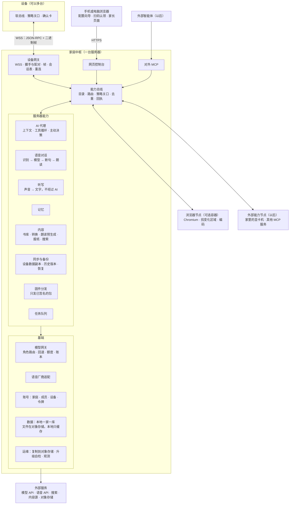

- 设备只和**设备网关**说话；网关把调用交给**能力总线**，不懂业务。
- 模块之间也经能力总线调用（AI 代理调 `memory.search` 和设备调它是同一条路），这样 AI 能碰到的范围不会比模块自己用的窄（G-002）。
- 基础部分不是能力：模型密钥、数据库、令牌都是内部机制，只通过能力暴露它们的结果。

### 3.2 部件和进程

【建议】能合就合，只有两种情况才拆：会拖慢语音的（CPU 密集），和不可信的（网页内容、用户传的文件）。

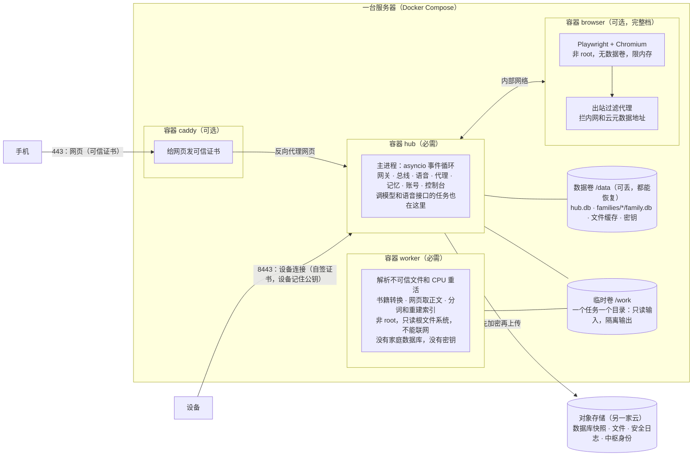

| 部件 | 必需吗 | 内容 | 资源【估算】 |
| --- | --- | --- | --- |
| `hub` 主进程 | 必需 | 除渲染和不可信解析以外的一切 | 200～350 MB，语音时 CPU 很低 |
| `worker` | 必需 | 不可信解析和 CPU 重活；一次一个，限内存和时长。主进程校验产物的格式、大小和哈希后才入库 | 空闲约 50 MB，峰值 300～800 MB |
| `caddy` | 可选 | 只负责网页的证书；设备连接不经过它 | 30 MB |
| `browser` | 完整档 | 每路一个独立的 Chromium 进程组 | 每路约 1 GB（[调研 §6](../research/hub-server-survey.md)） |
| 复制任务（restic） | 配了对象存储时 | 有改动才跑，放低优先级，不抢语音 | 运行时约 100～200 MB |
| 操作系统和 Docker | — | | 约 400 MB |

**语音优先**：容器的 CPU 权重 `hub` 最高。主进程的事件循环里不做阻塞操作：SQLite 大查询和 `VACUUM`、向量比较、Opus 转码都放线程或 `worker`；每路会话的队列有上限，满了就丢可丢的（画面）或取消（语音这一轮）。测试里挂事件循环延迟检查，超过 50 ms 报警，但这只是发现问题的手段，不是调度保证。

**为什么不用微服务和 Redis**：一个家庭同时最多几路会话，模块之间函数调用就够；每多一个常驻部件，用户就多一份内存、升级和排障负担。以后真要拆，能力总线已经是边界，把某个能力挪到另一台机器只是多注册一个节点（§7.1）。

### 3.3 架构审视：每个子系统给 AI 开放什么

按用户 2026-11-04 的要求（[架构审视](https://github.com/Gidean-zcx/ink/blob/claude/system-services/docs/process.md)），每个子系统列能力、状态、设置、事件、内部机制和 AI 能不能碰。能力的完整定义在 §7.3。

**规则（v0.2 改正，D-105 再改）**：用户能做的事，AI 都能做，走同一个能力；默认直接做，只有高风险才要人确认（§7.5）。AI 不能碰的只有四类：**凭据的值**（密钥、密码、令牌）、**确认按钮本身**、**固件签名**、**发起升级**（设备规则，底座设计 §6.2）。第一版把系统操作都排除在 AI 之外是错的。

| 子系统 | AI 可调的能力 | 高风险，要人确认才生效 | AI 不可调（原因） | 状态 | 设置 | 事件 | 内部机制 |
| --- | --- | --- | --- | --- | --- | --- | --- |
| 语音 | `asr.transcribe`、`tts.speak`；`dictation.list`、`dictation.delete`（听写记录，D-91）；`voice.chat` 由设备打开 | — | `asr.stream`（听写是输入法的管道，只开放给应用；AI 碰输入框用设备的 `text.state`、`text.insert`，要听写用设备的 `text.voice_start`，语音转文字用 `asr.transcribe`）；别的成员的听写记录（孩子的除外：成人家长可看） | `voice.active` | `voice.tts_voice`、`voice.speed`、`asr.vocab`（按成员）、`dictation.keep_days` | `voice.turn_done` | 断句、流控、打断、Opus、中间结果节流 |
| AI 代理 | `llm.ask`、`routine.add`、`routine.list`、`routine.remove`（定时任务，以后） | — | — | — | `ai.style`（按成员） | — | 提示词组装、工具循环、渐进披露 |
| 模型与费用 | `usage.today`、`usage.month`、`budget.status`、`model.routes.get` | `budget.set`、`model.routes.set` | 模型密钥的值 | `budget.level` | `model.routes`、`budget.*` | `budget.warning` | 回退、熔断、价格表、预留 |
| 记忆 | `memory.search`、`memory.list`、`memory.add`、`memory.update`、`memory.forget` | — | 别的成员的记忆（孩子的除外：成人家长可看） | — | `memory.auto`（按成员，默认开） | `memory.changed` | 提取、合并、向量 |
| 账号 | `family.members`、`device.list`、`device.status` | `device.revoke`、`member.add`、`member.remove` | 密码、令牌 | `device.online` | — | `device.online_changed` | 令牌存储、登录 |
| 同步备份 | `sync.status`、`backup.status`、`backup.now`、`restore.preview` | `restore.apply`（先给预览，确认卡写明影响） | 恢复密钥的值 | `backup.last_ok` | `backup.schedule` | `backup.failed` | restic、快照 |
| 内容 | `library.search`、`library.list`、`library.get`、`content.find`、`content.import`、`content.status` | 预计费用超过设定值的预生成 | 没有权利的内容来源（看 R-017 的条件） | — | `content.sources` | `content.ready` | 转换工具 |
| 报纸 | `news.today`、`news.item`、`news.prefs`、`news.sources`、`news.generate` | — | — | — | `news.sources`、`news.time` | `news.ready` | 抓取、去重、排序 |
| 搜索 | `web.search`、`web.fetch`、`history.search`（只查这位成员的） | — | — | — | `web.provider` | — | 分词、索引 |
| 远程画面 | `browser.read`；`browser.act`（翻页、点、填、提交）；`browser.session` 和设备的 `remote.open` | `browser.act` 碰到花钱、密码和证件、别的网站、家庭资料时（§5.7） | 密码框内容（掩码，D-33） | — | `browser.child_allowed` | — | 渲染、差异、编码 |
| 固件 | `firmware.latest` | — | 上传和签名（私钥离线，人操作）；发起升级 | — | — | `firmware.new` | 块传输 |
| 任务 | `job.list`、`job.status`、`job.cancel` | — | — | — | — | `job.done` | 调度、重试 |
| 运维 | `hub.health`、`hub.settings.get`、`trace.turn`（不含正文，只看这位成员的） | `hub.settings.set` 里的高风险项（模型厂商、备份位置） | 升级中枢（只能人用命令行或控制台，D-90） | `hub.version` | — | `hub.alert` | 日志、指标 |

结论：用户在控制台能看到的数据，AI 都有只读能力；能改的，AI 都能做，只有高风险要人确认。这张表开发时做成自动检查（和设备一侧的 `integration-ai-surface` 同样的思路）：目录里每个能力要有标题、Schema、副作用等级，不给 AI 的要写原因。

**划分自查**：

- 每个能力只有一个提供者，模块之间不直接读对方的表（代码目录上互相不能 import 内部模块，CI 检查）。
- 界面（控制台）只调能力，不直接碰数据库。
- 设备网关不懂业务；模型网关不懂成员以外的业务概念。
- 没有“设备专用接口”和“AI 专用接口”两套：设备按钮、AI、控制台、外部 MCP 都经能力总线。

## 4. 安装和部署

目标【建议】：**会租一台云服务器、会复制一条命令，就能装好。**

### 4.1 流程

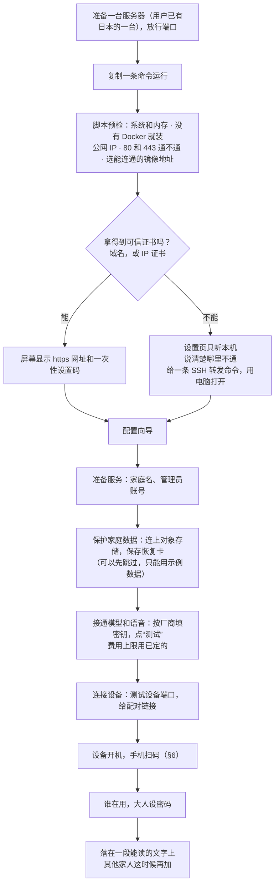

**开始之前要准备**（[产品审查 JOBS-HUB-001](../audits/2026-11-04-codex-hub-jobs/report.md)，不藏在“填几项”里）：一台服务器（用户已有）；对象存储账号和一把访问密钥（用户开户）；模型和语音服务的密钥（至少两家，用户开户）；家里的 Wi-Fi 名字和密码。按“已有服务器、设备没有预置地址、用 Wi-Fi、两家厂商”这条路算，一共约 12 组任务，不是三次点击。向导能存进度，中途退出下次接着走。

- **两种模式**：跳过对象存储时是**示例模式**，只能用示例数据。配好对象存储、确认 D-86、演练过一次恢复，才进入真实使用。控制台明确显示现在是哪种。模式记在服务端，页面和接口都看它：示例模式下不开放设备的数据同步和文件上传（`sync/*`、`blob/put`）。
- **第二次扫码前要切回能上网的网络**：手机扫第一个码连上了设备的 Wi-Fi，设备连上网后，手机页面提示“切回你平时的网络，再扫设备上的新二维码”。
- **先有可信连接，再碰秘密**（审查 HUB-013）：没有可信 HTTPS 或本机通道之前，不显示恢复密钥，不收模型密钥，不开放无公钥配对。证书拿不到就走 SSH 转发，不让用户在证书警告页上填密钥。
- **一条命令**：`curl -fsSL <地址>/install.sh | bash`。脚本内容公开，也可以先下载看一遍再运行。要给朋友用、放到公开地址才算对外发布，那一步等用户选择；只给自己用时，脚本和镜像可以放在用户自己的私有位置。
- **已有的服务器可能还跑着别的东西**（用户说日本服务器上没有重要的东西，可以清理；预检照样要查）：预检要查 80、443、8443 有没有被占用。被占用时不抢端口、不动已有服务，给出选择：换设备端口，或者接到已有的反向代理后面。IP 证书只能用 80 或 443 验证（[调研 §9](../research/hub-server-survey.md)），两个都用不了时走域名或 SSH 转发。
- **镜像**：服务器在日本时直接拉官方仓库。浏览器镜像要把 Chromium 和中文字体直接打进去，不在安装时再下载。以后搬回大陆才需要国内仓库和离线安装包：Docker Hub 在国内不稳定，公开加速地址常变【报道】。
- **也提供命令行**：`inkhub setup --config file.yaml` 能不问问题装完。AI 也能照着做部署（G-002 在运维上的体现），密钥由用户填。
- **向导每一步都能重来**，也都有命令行等价物。
- **诊断要具体**：没有公网 IP、安全组没放行、本机防火墙挡住、DNS 配错、证书续签失败，都给具体提示和怎么恢复。云服务器的安全组最容易漏放端口：80、443 在申请证书时就能试出来；设备端口 8443 由向导给一个测试链接，指向 `/ping`，手机能打开（哪怕提示证书不受信任）就说明通了。

### 4.2 命令行和目录

```text
inkhub status                 看服务、版本、设备在线、最近备份、今天的费用
inkhub enable browser         打开完整档（Compose profile），disable 关掉
inkhub upgrade [--to 版本]    升级（见 §4.4）
inkhub rollback               退回上一个版本和快照
inkhub backup now | list | verify | restore <快照>
inkhub restore                在新服务器上用恢复卡恢复全部（见 §4.5）
inkhub handover               计划内搬家：把新地址推给设备，传完最后一份，停止服务（见 §4.5）
inkhub pair-link              打印配对链接（地址 + 公钥），也能写成 TF 卡配对文件
inkhub export <文件>          整机或一家导出，搬家用
inkhub import <文件>
inkhub doctor                 自查：端口、证书、时钟、磁盘、模型连通、备份

/opt/inkhub/compose.yaml      Compose 文件和版本号
/opt/inkhub/data/             全部数据（见 §5.4）
  hub.db                      实例级：家庭列表、账号、设备、令牌哈希、配对
  families/<id>/family.db     一家的全部结构化数据
  families/<id>/blobs/        文件缓存（按内容哈希存，原件在对象存储）
  secrets/                    主密钥、中枢设备证书私钥（权限 600）
  backups/                    本机快照（升级前一份，最近 2 份）
```

### 4.3 规格

规格表在 §0。**用户选了首版做远程画面（D-85），所以至少要完整档**；用户的日本服务器约 2 核 4 GB、硬盘约 40 GB（用户记得的，第 0 步确认），都够（文件放对象存储，下面）。依据（全部【估算】，§10 第 1 步实测后改）：

| 项目 | 最小 | 完整 | 宽裕 |
| --- | --- | --- | --- |
| 系统 + Docker | 0.4 GB | 0.4 GB | 0.4 GB |
| `hub` 主进程 | 0.3 GB | 0.3 GB | 0.5 GB |
| `worker`（一次一个，峰值） | 0.8 GB | 0.8 GB | 1 GB |
| 浏览器 | — | 1 GB × 1 路 | 1 GB × 3 路 |
| 本地语音识别（可选） | — | — | 1 GB |
| 余量 | 0.5 GB | 1.5 GB | 2 GB |
| **合计** | **2 GB** | **4 GB** | **8 GB** |

- **带宽**：Opus 语音单向约 3.5 KB/秒（约 30 kbps，含帧头），两路对话也不到 1 Mbps；书和音频下载受设备一侧限制。3 Mbps 对一家够用，5 Mbps 给远程画面留余量（一屏约 50 KB）。海外服务器标的带宽不等于回国带宽，第 0 步要量。
- **硬盘**：只放系统、镜像、数据库和缓存，文件都在对象存储（§4.5）。40 GB 的算法【估算】：系统和 Docker 约 5 GB，镜像约 6 GB（留着上一版才能回退），数据库一年不到 2 GB，本机快照约 3 GB，浏览器缓存和 `/work` 临时文件约 3 GB，合计约 19 GB，剩下的给文件缓存（默认上限 15 GB，满了清最久没用的）。到 80% 提醒。没配对象存储时文件都在本地，就要按 60 GB 起算（朗读音频每小时 7～11 MB，书几 GB，照片和录音另算）。
- **内存**：2 GB 建议另开 2 GB 交换空间，这只能避免被系统杀掉，不能保证语音不卡。第 1 步要量主进程常驻内存、`worker` 峰值和事件循环延迟，第 6 步量 Chromium 峰值。
- **显卡**：都不要。语音和模型走 API。真想本地跑模型，那台显卡机作为外部能力节点接入（§7.1），不改中枢。
- **架构**：x86-64 和 arm64 是两份要分别构建和验证的镜像。首版只验证 x86-64 的云服务器。

### 4.4 升级和回滚

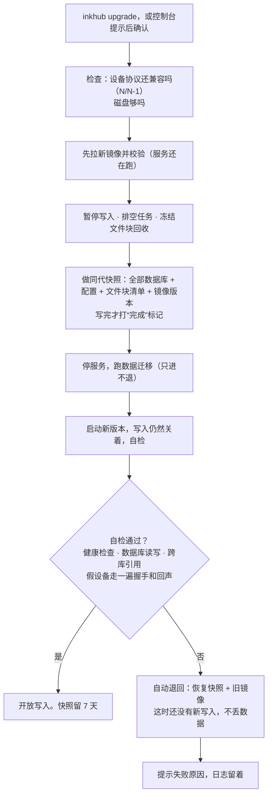

- 默认**手动升级**：控制台和 `inkhub status` 提示有新版本，不自动动（D-90）。家庭设备升级失败谁也不在旁边，宁可晚一点。
- **自动退回只到开放写入之前**（审查 HUB-009）。开放写入之后发现问题，`inkhub rollback` 是人来决定的恢复：写明会丢掉哪段时间的中枢数据，设备上的记录重新同步回来，AI 记忆这类以中枢为准的数据就丢那一段。
- **有些事不能跟着回滚倒退**：设备吊销、成员删除、“忘掉”。这些记进安全日志，恢复后重放（§4.5）。
- 设备短暂断线无所谓：退避重连，离线功能照常（D-05）。
- 协议保持 N/N-1 兼容（底座设计 §10.3）：中枢同时支持当前和上一版设备协议，升级前先查家里设备的版本。

### 4.5 数据和备份：服务器只是运行时

**用户的要求（D-101）**：数据和数据库备份存对象存储，服务器只是一个运行时的东西。所以：**服务器可以随时换，要长期保存的东西都在对象存储里。** 服务器坏了，换一台，一条命令恢复。

**数据库不能直接放在对象存储上跑**：SQLite 官方不建议跨网络运行，WAL 模式在网络文件系统上不能用【文档，[调研 §9](../research/hub-server-survey.md)】，对象存储也没有文件锁。所以数据库在服务器本地运行，改动再复制上去。

| 东西 | 运行时在哪 | 长期保存在哪 | 服务器突然没了，丢多少 |
| --- | --- | --- | --- |
| 数据库（`hub.db`、各家 `family.db`） | 本地硬盘 | 同代快照，restic 加密上传；有改动才做，默认 5 分钟一次【建议】 | 丢到最近一次上传完成的快照为止：通常不超过 5 分钟，断网时会更多，控制台提示。丢的是以中枢为准的数据（AI 记忆、对话、账本）；设备上的记录连上后对账补回（§5.8） |
| 吊销、成员删除、“忘掉” | 本地日志 | 安全日志，马上写（下面） | 写上去之前的那几条，控制台一直提示 |
| 文件（书、朗读音频、报纸、照片、录音） | 只是缓存，满了清最久没用的；没备份好的不清，空间不够就拒绝新任务 | 加密后一个文件一个对象；内容和它的目录记录都进了对象存储才算备份好（下面） | 备份好的不丢；还没好的，设备上有原件 |
| 中枢身份（设备记住的公钥、主密钥） | `secrets/` | 用恢复密钥加密后存一份 | 不丢。公钥不变，设备不用重新配对 |
| 恢复卡 | 不放服务器 | 用户自己保存 | — |

成员个人记录设备上还有一份（底座设计 §5.1）。所以防的是三件事：设备丢了或刷机，靠中枢（R-023）；服务器没了，靠对象存储；升级失败或程序错误，靠本机快照。

**恢复卡**【建议】：向导“保护家庭数据”这一段生成，用户打印或存进密码管理器，**保存后要读回来检查一次**（JOBS-HUB-006）。上面写对象存储的地址和访问密钥、恢复密钥。换服务器只要这张卡。它能解开全部数据，不要拍照发到聊天里；丢了就只能靠设备上的记录，向导要讲清楚。恢复入口只有一个“恢复家庭数据”，系统自己选快照；`inkhub backup restore`、`rollback` 是维护操作，写明会丢哪段时间。

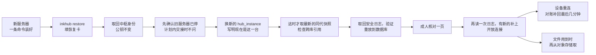

**同时只能有一台**（审查 HUB4-001）。只在上传前查一下挡不住：旧服务器可能连不上对象存储，却还连得上设备，继续服务已经吊销的设备。首版用最简单也讲得清的规则：**新机器开放之前，旧机器必须已经停了。**

- **计划内搬家**（旧机器还能登录）：在旧机器上 `inkhub handover`：先停止接受写入，排空任务，把新地址推给在线的设备，传完最后一份快照和安全日志，不再自动启动，在对象存储里写明“已交接”，连同这台的 `hub_instance` 和最后的快照、日志位置。新机器看到“已交接”就不再问，取到的快照和日志不能比这个位置旧。
- **意外**（旧机器连不上）：恢复一开始就问：“旧服务器可能还开着吗？请到服务商那里把它关机或删除，再继续。”**人确认之前不取最终的快照和日志**（审查 HUB5-001）：先读后停的话，旧机器在这中间传上去的吊销和“忘掉”就漏了。
- **旧机器后来又活了**：人确认之后，新机器马上在对象存储里写明现在是哪一台（`hub_instance`），然后才取快照和日志，开放连接前再读一次日志。旧机器每次启动、每次上传、每隔几分钟都查一下是不是自己，不是就立刻断开所有设备、停止服务，提示已被取代。启动时连不上对象存储就先不开放，一直重试，成人可以 `inkhub start --force`。

这条靠人确认，不是自动证明。人确认错了，旧机器又恰好连不上对象存储，它还会继续服务，首版接受这个风险（§12）。以后要全自动接管，再做带期限的所有权（条件写入），不是所有 S3 兼容存储都支持。

**换了服务器，设备怎么找到**：公钥不变，地址要能跟着走。用户先只用 IP（D-102）：旧机器还在，可以把新地址推给设备（`hello` 回答的 `urls`）；旧机器突然没了、IP 又变了，就要在设备上换中枢地址（§6.4）。换服务器时能把 IP 留下，设备就不用动【推断，看服务商】。以后想买域名随时能加：`urls` 把域名推给设备，不用重新配对。

**为什么是 5 分钟，不是每次改动**【建议】：能做到几秒一次的 Litestream（Apache-2.0，v0.5.18）现行版本不支持客户端加密，只有存储方那边的加密（SSE-C、SSE-KMS）【文档】，和“存放的地方看不到内容”（D-86）冲突；它也不保证 `hub.db` 和 `family.db` 是同一时刻。restic 只用一个工具，能端到端加密，加上同代快照又能跨库一致。代价是多丢几分钟，这几分钟里丢的只有 AI 的部分记忆和对话。第 4 步量真实的停顿和流量后再定这个数；Litestream 恢复客户端加密后可以再看。5 分钟是间隔，不是保证：能恢复到的是最近一次上传完成的快照，上传要花时间，断网时更久。控制台显示这个时间。

**同代快照**（审查 HUB-009）：逐个 `VACUUM INTO` 只保证每个库自己一致，`hub.db` 里的成员和 `family.db` 里的记录可能不是同一时刻。所以先短暂暂停写入（写入在主进程里排队，语音不等它；库小时停不到一秒【估算，第 4 步量】，库变大就拉长间隔），排空正在写的任务，冻结文件块回收，再对全部数据库做快照，写一份清单（各库哈希、文件块列表、版本），最后才打完成标记。restic 完整成功（退出码 0）、清单对得上才算完成，没有完成标记的快照不能用。

**给用户看的说法**（JOBS-HUB-004）：分开三件事：服务器收到了、云端已保存、这份备份通过了恢复检查。控制台首页平时只显示“云端已保存至［时间］”；有缺口才提示“还有资料没保存到云端，正在重试；这时更换服务器可能丢失这些资料”。“设备不用重新配对”的条件也写在恢复入口：IP 没保住要给设备新地址，最后几分钟才配对的要重配。

**留多久**【建议】：对象存储里最近 2 天每 5 分钟一份，之后每天一份留 30 天。本机只留升级前那一份和最近 2 份，用来快速回退。

**文件**：内容哈希相同只存一份（同一家内），对象名是哈希的 HMAC，存储方看不出内容。用户删除的文件，对象存储里马上删；旧快照里只剩编号，恢复后显示“已删除”。没人引用的文件过了快照保留期才清。设备不直接连对象存储，下载和上传都还走现有连接（D-89）；中枢先看本地缓存，没有就取回来。

**什么时候算备份好**（审查 HUB4-002）：只传上内容不够。这个文件属于谁、在哪个目录，都在数据库里；数据库还没上传时服务器丢了，恢复后就找不到它，最后还可能被当成没人要的清掉。所以 `blob/status` 要等**内容和包含它目录记录的那份完整快照都上传成功**才回 `durable:true`，最多晚几分钟。中枢回答“收到了”不等于“备份好了”，设备要删本地原件之前要查它（[设备协议 §3.8](device-protocol.md)）。恢复时看快照里还没确认的文件：对象存储里有就补记，没有就标成“要重传”，中枢自己生成的（朗读、转换）重新生成。恢复后 30 天内不清“没人引用”的对象，等目录稳定。设备重传同样的内容时直接复用已有对象。

**对象存储要注意**：

- **放哪**：另一家云（D-87），离服务器近的地域。只有服务器和它说话。要求只有一条：S3 兼容。
- **防删**：服务器被黑时，对方拿着访问密钥能把备份一起删。密钥只给这一个桶；能开对象锁或版本保留就开【建议】。
- **连不上时**：中枢照常运行，记下没传的，恢复后补传。控制台显示数据最后一次进对象存储的时间，超过 1 小时提醒。
- **费用**【估算】：第一年数据库和文件加起来约 20 GB，每月几元。Cloudflare R2 标价 $0.015/GB·月，不收流出费，有 10 GB 免费额度；阿里云 OSS 国内约 0.09 元/GB·月，另收流出费，东京的价格没查到（[调研 §9](../research/hub-server-survey.md)）。每 5 分钟的上传约每月 3 万次写请求。照片和录音多了按量加。
- **跳过时**：向导可以先跳过（开发、试用），那时文件和数据库都只在这台服务器上，它就不能丢了，所以一直提醒。**第一次写真实家庭数据之前必须配好。**

**恢复演练**：`inkhub backup verify` 每月自动在临时目录恢复一次，检查跨库引用、成员和对象、文件块是否齐全，再用一台假设备走一遍同步对账，结果进 `backup.last_ok`，失败就提醒。备份不验证等于没有。

**恢复之后**：中枢生成新的 `hub_instance`（§5.8），设备下次连接时发现变了，走全量对账，不让已删除的东西复活。最后几分钟里配对的设备要重新配对。首版不轮换令牌（§6.3），其余设备不受影响。

**安全日志**（审查 HUB2-003、HUB3-001）：设备吊销、成员删除、“忘掉”不能跟着恢复倒退，而且**整台服务器丢了也要在**，只放本机不够。

- 每条记录带序号、哈希链和备份密钥加密，只记编号和判断用的最少信息，**不记被忘掉的内容**（§5.5）。本机立刻生效，同时单独写到对象存储（小对象，不等下一次快照），**写成功才告诉用户“已完成”**。
- 对象存储连不上时，界面只说“本机已生效，异地还没写上”，后台重试。**只有写上去的才承诺恢复后还有效**；这段时间服务器整个丢了，这几条就丢了，这是做不到的部分，要如实说。
- **哈希链证明不了末尾有没有丢**：异地有第 1～N 条，链是对的，本机的第 N+1 条可能根本没传上去。所以**每次恢复都有一步人工核对**：重放完之后中枢先不开放设备连接，控制台显示一页（JOBS-HUB-003）。时间不写日志序号；“最后记录”的时间快照时顺带写，没改动也每小时写一次。记不清就先不开放，接着查；系统不自动撤销设备，也不替人判断。AI 按不了这一页。按下之后再读一次日志，有新的就补上，再开放连接。

  > **恢复后，先确认哪些设备还能使用。**
  > 已恢复到：［时间］。云端最后记录移除设备和“忘掉”：［时间］。此后的操作可能没有保存，系统不能判断缺没缺。
  > ［设备和家人名单，能就地移除］　［如有遗漏，重新指定要忘掉的内容］
  > **核对完成，恢复使用**　／　先不开放，继续核对

- **取不到或验证不了**（比如跳过了对象存储）：所有设备令牌作废，要重新配对；同时明确告诉用户：“忘掉”的内容可能回来，要重新确认。
- 演练包括：最后一次快照之后才发生、已写上对象存储的吊销和“忘掉”，整机丢失后恢复仍然有效；日志完全没有；日志能读也验得过，但末尾没上传（核对页要显示出差距）。

**搬家**：有对象存储时，搬家就是恢复：先在旧机器上 `inkhub handover`，再在新服务器上 `inkhub restore`。没配对象存储时用 `inkhub export`、`inkhub import` 打包全部数据和中枢身份。

### 4.6 放在哪：VPS、NAS，没有公网 IP 怎么办

**我的看法：D-09 的 VPS 依然是对的默认，但安装包不绑死。** 设备在外面用 4G 也要连得上，买一台带固定公网 IPv4 的云服务器、放行端口就行；NAS 在家里，数据在自己手里，但多一层穿透，家庭宽带上行和停电也是问题。同一个 Compose 文件能在 x86 和 arm64 上跑，前提是两种镜像都构建和验证过，所以以后搬家代价小（D-73）。

| 放哪 | 能不能用 4G 连 | 要多做什么 | 判断 |
| --- | --- | --- | --- |
| **云服务器** | 能 | 要有公网 IPv4，放行端口 | 默认，首版只验证这一种 |
| NAS 或家里电脑 + 一台小 VPS 中转（frp） | 能 | 装 frp；TLS 在家里那端结束，VPS 只见密文 | 想把数据放家里时用 |
| NAS + 公网 IPv6 + 动态域名 | 不确定 | NT26 和蜂窝网上的 IPv6 没有验证，**信息不足** | 先不承诺 |
| Cloudflare Tunnel 这类 | 不合适 | 对方终结 TLS，设备固定公钥就失效；国内访问也不稳定【推断】 | 不用于设备 |
| Tailscale、ZeroTier | 不合适 | 设备上要跑客户端，ESP32 上没有现成可用的【推断】；电脑访问控制台可以用 | 不用于设备 |
| 只在家里（局域网） | 不能 | 什么都不用；只能在家用 | 开发时用；D-51 说局域网发现以后做 |

### 4.7 地域

**用户选了海外（D-74 方案 C），已有一台日本服务器。** 设备在中国大陆用（R-038），模型和语音估计用国内厂商（D-78），所以一轮语音要跨境好几次：

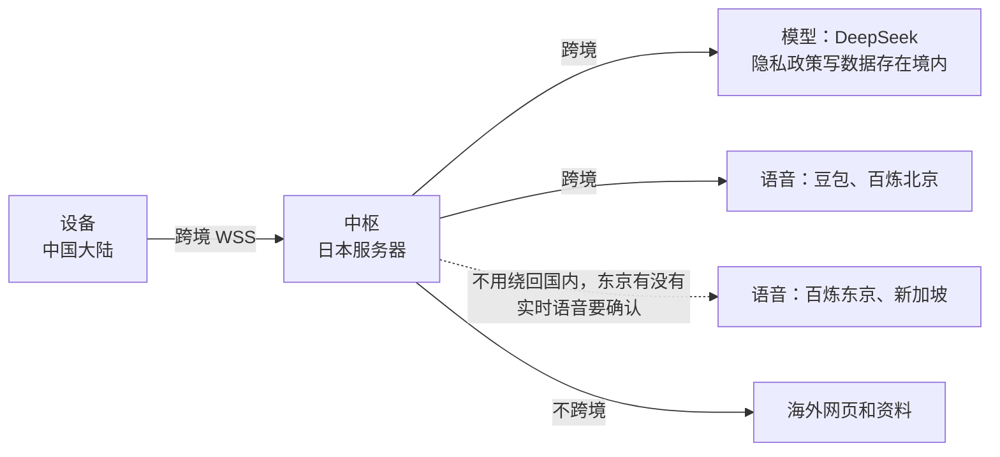

| 方面 | 放日本之后 | 证据 |
| --- | --- | --- |
| 语音时延 | 每轮大约多 0.4～0.7 秒，晚高峰可能更多（§5.3） | 【估算，第 0 步实测】 |
| 线路稳定 | 设备到日本的长连接可能被限速或丢包；晚高峰最差，正好是一家人用得多的时候；家里宽带、手机 4G、不同运营商差别大 | 【推断，第 0 步实测】 |
| 数据放在哪 | 家庭数据存在日本服务器，语音和对话内容再发给国内厂商。放大陆时“数据不出境”的好处没有了 | 这个选择的直接结果 |
| 备案 | 不涉及 | 【文档】阿里云口径：看域名是否解析到内地服务器（[调研 §9](../research/hub-server-survey.md)） |
| 证书和镜像 | Let's Encrypt 的 IP 证书、官方镜像仓库都不用绕路 | 【推断，第 3 步验证】 |
| 网页和抓取 | 出口是日本 IP：海外网站直接能开；国内网站可能要额外验证，或者限制内容（§5.7）；报纸的国内来源可能抓不到 | 【推断】 |
| 时间 | 服务器不在家庭时区。定时任务、提醒、报纸都按家庭时区（默认 Asia/Shanghai），不看服务器时区；DeepSeek 的忙闲时按厂商的规则（北京时间和中国法定节假日）算 | 【建议】、【文档】 |

Claude、GPT 官方不支持从中国大陆使用，这一点不因服务器在海外而改变；用户的方向是 DeepSeek，这件事现在不用管。

**语音不绕回国内**【文档，2026-11-04 查，[调研 §9](../research/hub-server-survey.md)】：百炼有北京、新加坡、法兰克福、东京、香港、弗吉尼亚六个地域，每个地域的密钥、地址和模型列表互相独立，请求数据存在所选地域。实时语音合成的指南只列了新加坡和北京，价格页东京部分只看到文本模型，**东京有没有实时语音没查到，要在控制台确认**。官方把接入地域和服务部署范围分开（东京可选全球或日本范围），所以“不绕回国内”只是待测的路线，不能从存储地域直接推出。新加坡的价格和北京接近（[调研 §10.2](../research/hub-server-survey.md)）；东京到新加坡的探针平均 65～74 ms，也很稳，上海到东京是 132～293 ms（WonderNetwork，都只是一对探针）。豆包语音的官方文档只给了 `openspeech.bytedance.com`，海外接入没查到。

**线路不行怎么办**，从小到大：语音换不绕回国内的地域 → 打开 `first` 角色（§5.3）→ 换线路更好的服务器 → 搬回大陆。搬家走 §4.5（`inkhub handover`、`inkhub restore`），公钥不变，设备不用重新配对；旧机器还在时，`hello` 回答的 `urls` 把新地址告诉设备。所以这个选择可逆，只是费事。

**先量再开发**：§10 第 0 步，不花钱。

### 4.8 信任和证书

设备和网页分开处理（D-82）：

| 连接 | 做法 | 理由 |
| --- | --- | --- |
| 设备 ↔ 中枢（8443） | 中枢安装时生成自己的密钥和自签证书，**设备记住公钥的哈希**（固定），以后只认它。公钥从可信路径来（§6.1），不从第一次连接里学 | 不要域名、不要备案；不依赖设备时钟（第一次开机时钟可能不对，普通证书校验会失败）；公共 CA 也骗不了它。底座设计 §8.1 已经写了“固定中枢证书” |
| 手机浏览器 ↔ 控制台（443） | 用可信证书：用户先只用 IP（D-102），所以用 Let's Encrypt 的 IP 证书（2026 起正式提供，160 小时有效，要自动续期）；以后有域名就用域名。Caddy 默认给 IP 用本地 CA，要明确配置 ACME 才是公信证书，第 3 步在真服务器上验证 | 手机扫码打开时不要弹安全警告；认领页的公钥比对也靠它（§6.1） |
| 没有可信证书时 | **不静默退回自签**。设置走 SSH 转发，配对只能用带公钥的路径（配对文件、配对链接） | 否则手机上的认领页证明不了什么 |
| 中枢 ↔ 外部 API | 普通 TLS | |

换密钥：`hello` 的回答可以带下一把公钥（`pins`），两把并存一段时间再切，设备不用重新配对。

### 4.9 控制台：平时不用管

一家人平时不用看它，它不是运行监视器（JOBS-HUB-007）。

| 谁 | 平时碰到什么 | 出事时碰到什么 |
| --- | --- | --- |
| 安装者（管理员） | 首页四件事：现在能用什么、云端保存到什么时候、本月费用、待处理事项。偶尔加家人、设备、书，确认升级 | 一条具体的待处理事项和入口 |
| 其他大人 | 自己的内容、记忆、听写记录；管理孩子 | 自己这件事的结果和下一步 |
| 孩子 | 不碰控制台 | “可以继续读书”“请家长看看”，不解释厂商、端口和备份 |

模型角色、价格表、瀑布图、详细诊断都放“高级维护”。断网时设备说“现在连不上 AI，已下载的书和音频还能用”，主要动作是“继续阅读”，自动重连不反复打断读书。

## 5. 应该具备哪些能力：逐项判断

### 5.1 一张总表

“放哪”的默认是中枢；写“设备”的是离线也要能用。“首版”指 D-01 的首个自用版本（阅读与听书 + 底座）。**这些都是建议**，用户不同意的可以改；没有哪一项被我判成不要。

| 能力 | 要不要 | 什么时候 | 放哪 | 理由 |
| --- | --- | --- | --- | --- |
| AI 代理和工具调用 | 要 | 首版，第 2 步 | 中枢编排，设备执行 | D-04、D-47 |
| 模型网关（各家 API、路由、费用上限） | 要 | 首版，第 2 步 | 中枢 | D-07；薄路由（§5.2） |
| 语音识别、朗读、低延迟语音对话 | 要 | 首版，第 2 步 | 中枢；唤醒词和打断在设备 | R-047，设备侧已实现 |
| 语音输入（听写） | 要 | 首版，第 2 步 | 中枢识别，设备显示和编辑；没网退回键盘 | R-056；墨水屏打字慢；不经过 AI（§5.3.1） |
| 听写的口语整理（去语气词） | 可选 | 以后，默认关 | 中枢 | 要调模型，多花钱多等一会儿 |
| 多账号和数据隔离 | 要 | 首版，第 3 步（数据结构第 1 步就按此建） | 中枢 | R-022、R-030 |
| 每个成员的记忆 | 要 | 首版，第 4 步 | 中枢 | 底座设计 §5.1；R-030 |
| 备份同步 | 要 | 首版，第 4 步 | 设备写日志，中枢存副本 | R-023 |
| 内容转换（书） | 要 | 首版，第 5 步 | 中枢 | D-15、R-017 |
| 朗读预生成和文字对齐 | 要 | 首版，第 5 步 | 中枢 | R-018、底座设计 §9 |
| 个人报纸 | 要 | 首版，第 5 步 | 中枢生成，设备显示 | R-020、R-031 |
| 儿童新闻和百科 | 要 | 第 5 步之后，形式用户没定 | 中枢生成，设备显示 | R-028；不只是报纸的儿童版，要有自己的最小交付和验收 |
| 搜索（联网、家庭历史） | 要 | 首版最小版，第 5 步 | 中枢 | R-016、R-017；AI 查历史走中枢副本 |
| 固件分发（只接受签名固件） | 要 | 首版，第 5 步 | 中枢只分发，签名私钥离线 | 系统服务设计的升级需求（那边也编成 R-056）、SR-SY-05 |
| 任务队列 | 要 | 第 1 步就有 | 中枢 | 底座设计 §5.6 |
| 可观测性和费用统计 | 要 | 第 1 步起逐步加 | 中枢 | D-07、SR 的时延指标 |
| 网页控制台（向导、认领、成员、费用） | 要 | 第 1、3 步 | 中枢 | 没有它装不起来 |
| 儿童内容过滤 | 要 | 首版，第 2 步 | 中枢 | SR-AI-03 |
| 浏览器内核和远程画面 | 要（R-048 已提） | **首版，第 6 步，和第 4、5 步并行（用户选了 D-85 B）** | 中枢渲染，设备显示 | 设备侧有宿主，输入只有点按；吃内存；孩子能不能用要定（D-94） |
| 视觉（看照片、拍题） | 要 | 第 5 步之后 | 中枢 | R-045 的摄像头有了用处 |
| 短信待办、通话纪要 | 要 | 按 R-024、R-025 的版本 | 中枢分析，设备确认 | 事件转发（§7.6）通了就能做 |
| 输入法智能联想 | 要 | 以后，默认关 | 中枢 | R-027；底座设计 §4.8 |
| 题库和资料收集 | 要 | 以后 | 中枢 | R-016 |
| 中枢下发声明式页面 | 要 | 以后 | 中枢生成，设备渲染 | D-08 第二阶段 |
| 对外标准 MCP | 要 | 以后，第 7 步 | 中枢 | D-12 |
| 多设备中转 | 要 | 以后，第 7 步 | 中枢 | D-51 |
| 字形和词库下发 | 要 | 随块传输顺带做 | 中枢分发 | SR-NF-05、D-70 |
| 主动决策（定时、事件触发） | 要 | 先做定时生成，事件触发以后 | 中枢决定，设备通知 | 系统架构 §6.4 |
| 声纹识别 | 待定 | 以后 | 中枢 | 只能作线索，不能授权（底座设计 §8） |
| 本地语音识别和本地模型 | 可选 | 以后 | 中枢或外部节点 | 省钱或隐私需要时；要内存或显卡 |
| 通用自动化（代用户操作第三方网站） | 待定 | 以后 | 中枢浏览器 | 风险高，用户没提 |

### 5.2 模型网关和费用（D-07）

**角色路由**：代码里不写模型名，只写角色。

| 角色 | 干什么 | 默认候选【建议，待实测】 |
| --- | --- | --- |
| `main` | 回答问题、编排、工具调用 | **deepseek-v4-pro（用户的方向，D-78）**；对比用 qwen3.7-plus、doubao-seed-2.1-pro |
| `deep` | 难的任务：报纸编排、学习资料 | deepseek-v4-pro；对比用 qwen3.8-max |
| `first` | 首句快模型（主模型慢时先出一句，底座设计 §6.5），默认关 | 和语音同一家的快模型；放日本后可能要打开（§5.3） |
| `fast` | 分类、摘要、记忆提取、儿童内容检查 | 和语音同一家：qwen3.7-flash 或 doubao-seed-2.0-mini；deepseek-flash 的输入贵约 5 倍 |
| `vision` | 看图 | 有视觉能力的模型 |
| `embed` | 向量 | text-embedding-v4 |
| `asr` | 流式语音识别，语音对话和听写共用 | 豆包流式识别 2.0 或百炼 fun-asr-realtime（用户的方向）；百炼可以选国外的地域（§4.7） |
| `tts` | 朗读 | 豆包语音合成 2.0（3 元/万字）或百炼 qwen3-tts-flash-realtime（1 元/万字） |

配置放控制台，成员可以有不同路由（孩子默认用同一个模型，但系统提示和过滤不同；需要时可以单独走另一家）。

**混搭（D-78 方案 C）**：向导按厂商填密钥（同一家只填一次），系统按验证过的配置分配角色，每把单独测试，账本按厂商分开。语音先试阿里【建议】：朗读只要豆包的三分之一，还有国外的地域可选，不用绕回国内；豆包只查到大陆地址。声音好不好要听了才知道，小规模对比时一起听。

**选 DeepSeek 之前要看的**【文档，2026-11-04 查】：隐私政策（2026-02-10）写境内运营收集的个人信息存在中国境内；输入输出可能经加密和去标识后用于训练，关闭入口写的是账号设置里的“数据用于优化体验”，有没有覆盖 API 没写；开放平台条款（2026-04-22）没写 API 内容是否用于训练，也没写保留多久；隐私政策还写不主动收集 14 岁以下儿童的个人信息。**孩子的对话也会发过去**，这一点要用户知道，开通前在控制台确认或问厂商。其他家的条款这次没查，定下用哪家语音时一起看（[调研 §9](../research/hub-server-survey.md)）。

**线路格式不等于语义**（审查 HUB-020）：OpenAI 兼容和 Anthropic 消息两种格式能接大多数厂商，但各家的语义不一样。比如 DeepSeek 官方要求带工具的思考模式必须把 `reasoning_content` 原样回传，否则报错【文档】。所以：

- 一轮之内保存厂商的**原始消息**，要回传的字段原样带回；统一的流式事件（文字片段、工具调用片段、用量、结束原因）只给上层用。
- 工具调用按 `index` 和 `id` 拼完整，校验 JSON 和 Schema 之后才执行；并行工具按顺序执行。
- 每个批准的模型有一张能力表（工具、并行、思考模式、缓存），用录制的流做契约测试。**换模型不是只改配置**，要先过这张表。首版先接一家、一个模式。

**回退**：429、5xx、超时就换该角色的下一个；连续失败熔断一会儿。只有还没输出、也没执行工具时才回退。

**账本和额度**（D-79，审查 HUB-019）：

- 每次调用记一行：家庭、成员、角色、用途（对话、听写…）、厂商、模型、输入、缓存命中、输出（含思考）、费用（用量 × 当时的价格版本）、这一轮的编号。语音识别和朗读也记（按秒、按字）。
- 价格表是配置，随版本更新，用户可改；真实账单以厂商为准，账本只是估计，控制台要这样写。
- **先预留再调用**：按这次调用的上限（最大输出、音频时长、字数）在家庭和成员额度上原子预留，完成后按实际结算；网络超时后不知道算没算钱的，先留着，等对账。这样多路同时用也不会一起冲过线。
- **每轮有上限**：最多 8 次工具调用，重试 1 次，输入和输出 token 有上限。后台预生成走同一个关口，开始前显示预计费用。
- 额度分家庭月度和成员每日。默认值【建议】：家庭 200 元/月，成人 15 元/天，孩子 5 元/天。
- **200 元是软上限，硬上限是 240 元**（要跟用户说清楚）：160 元提醒家长；200 元主模型换成 `fast`，朗读照常；240 元只留本地快捷指令和已缓存内容，听写返回明确错误，设备退回键盘（§5.3.1）。家长一键加额度，写明加多少、对哪个周期生效。
- **提示按原因说，说金额和恢复时间**（JOBS-HUB-002）。原来统一说“今天的额度用完了”，月额度用完时会误导。日期和时间按实际周期和家庭时区填。账本是估算，对象存储和服务器的费用另算：

| 情况 | 给谁 | 说什么 | 主要动作 |
| --- | --- | --- | --- |
| 全家本月到 160 元 | 大人 | “本月模型和语音预计已用 160 元，到 200 元会换成更便宜的回答服务。” | 查看费用 |
| 全家本月到 200 元 | 大人 | “已切换较便宜的回答服务，朗读照常；到 240 元暂停付费功能。” | 查看费用 |
| 全家本月到 240 元 | 大人 | “全家本月的 AI 额度已用完，［日期］恢复。已下载的书和音频还能用。” | 查看费用 |
| 同上 | 孩子 | “这个月的 AI 用完了，［日期］恢复。可以继续读书，也可以请家长看看。” | 继续读书 |
| 本人今天到上限 | 本人 | “你今天的 AI 额度已用完，［时间］恢复。可以继续看已下载的内容。” | 继续读书 |

- **省钱的办法**（底座设计 §9 已有）：稳定前缀和固定工具顺序提高缓存命中；回执里的 `say` 省第二次模型调用；翻页这类走本地快捷指令；报纸和故事的朗读在闲时预生成。
- **第一周看真实账本**：费用估算对假设很敏感（[调研 §10.3](../research/hub-server-survey.md)），上线后用一周的真实用量重新估。

### 5.3 语音对话（R-047）

设备一侧已经按[详细设计 §6、§7](../system/system-detailed-design.md)实现。中枢要做一条**任何时候都能取消**的流水线：取消要贯穿模型请求、语音识别、朗读、工具任务和发送队列，所有迟到的输出按“连接、会话、这一轮”的代次丢弃。

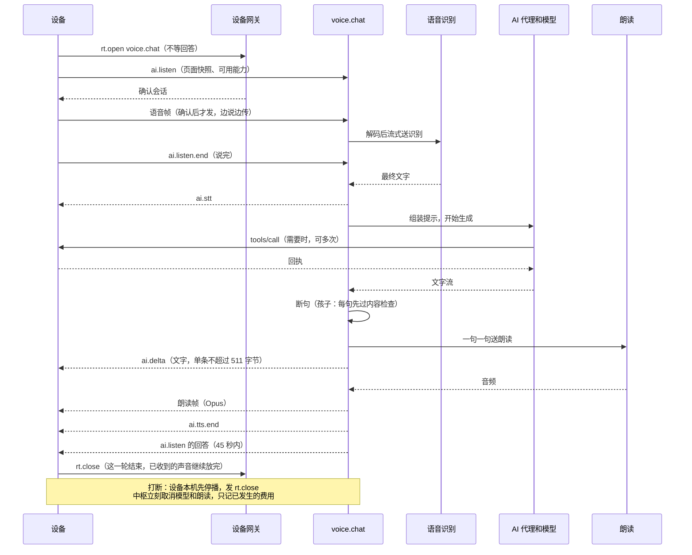

**时延预算**（审查 HUB-024 改正）。目标来自 SR-UX-06；设备段来自模拟器和代码；中枢段【估算】来自[协议调研 §5.2](../research/foundation/ai-native-protocols.md)。

| 段 | 第一句文字 | 第一个音 |
| --- | --- | --- |
| 设备上传收尾 | 30 ms | 30 ms |
| 跨境：设备和中枢一来一回（按 200 ms，D-74） | 200 ms | 200 ms |
| 识别出最终文字 | 300 ms | 300 ms |
| 跨境：中枢到识别厂商（按 150 ms） | 150 ms | 150 ms |
| 模型首 token（在日本服务器上量，已含这段跨境） | **X** | **X** |
| 首句凑齐 | 300 ms | 300 ms |
| 朗读首包（含一段跨境） | — | 500 ms |
| 设备预缓冲 | — | 180 ms |
| 孩子的内容检查（只对孩子，含一段跨境） | 450 ms | 450 ms |
| **目标** | **≤ 3 s**（SR-UX-06a） | **≤ 4 s**（SR-UX-06b） |

倒推：在**日本服务器上量到的模型首 token**，成人要 ≤ 2.0 秒（3 − 0.98），孩子要 ≤ 1.5 秒（3 − 1.43 = 1.57，第一句文字最紧，留一点余量）。量的是**第一个能显示的回答 token**，不是思考内容、心跳或连接成功（DeepSeek 的思考模式默认开）。这还没算免按键“确认说完”的等待（0.3～0.6 s）和冷连接（再多约 0.8 秒：TCP、TLS、`hello` 共约 4 个往返）。之前写的“主模型 1～3 秒”达不到目标。

**跨境这几行都是【估算】**：WonderNetwork 上海到东京的探针最近两周平均 132～293 ms（2026-11-04 查，只是一对探针），商家文章写 45～70 ms；用户的线路要自己量。服务器放大陆时这几段合计约 0.1 秒，放日本每轮大约多 0.4～0.7 秒，晚高峰可能更多。第 0 步（§10）量完替换这张表。所以：

- 模型首 token（成人 ≤ 2 秒、孩子 ≤ 1.5 秒）是选主模型的硬指标，D-78 的小规模对比要在日本服务器上量。
- **中枢到厂商的连接常驻复用**：每次新握手要多 2～3 个往返（约 0.3～0.45 秒）。
- 语音尽量选不用绕回国内的地域，识别和朗读这两段能省一部分（§4.7，要量）。
- 达不到就打开 `first` 角色：快模型先说一句，主模型接着说。这有“两个模型口径不一”的风险，默认关，实测后再定。
- 还不够就换线路或搬回大陆（§4.7）。
- **验收要量到设备末端**：人停说、设备发结束、中枢收到、文字上屏、第一个样本播出；分成人和孩子、冷连接和热连接、有无工具，给 p50 和 p95。只量“中枢发出第一帧”不算数。

**一轮的边界**（审查 HUB-006）。设备限制一轮 45 秒（从设备创建请求算）、回答总共 2048 字节，这是硬约束：

| 情况 | 做法 |
| --- | --- |
| 普通回答 | 系统提示要求口语回答控制在 120～150 字；文字总量 ≤ 1.8 KB（留余量），超了就截断并说“完整内容我放到……了” |
| 发送节奏（审查 HUB2-009 改正） | 朗读帧先发约 300 ms 预填，之后**按实时发，领先不超过 3 秒**，不突发。缓冲 512 帧是总量，队列里已有多少中枢不知道，突发可能溢出，溢出的帧被设备丢弃。播放被打断（来电）时领先会变大，设备发现推不进去就结束这一路朗读，提示声音没放完（§13），不默默丢帧 |
| 还剩多少时间 | 45 秒从设备创建请求算起，中枢不知道设备连接花了多久。设备发 `ai.listen` 时带 `budget_ms`（实际发送时还剩多少，设备要加）；没有这个字段时按 30 秒算。中枢再留 3 秒余量。**按剩余时间决定合成多少**：只合成截止前能按实时发完的句子，到了句子边界就停，没发完的不硬塞，回答文字里说明后面的放到了哪 |
| 以后放宽（设备要改） | 把设备的 45 秒改成“没有活动才超时”，中枢每发一条都算活动，再设一个总上限（比如 120 秒）。这样长回答不用这么紧 |
| 说得很长 | 说话时间也算在里面；录音最长 30 秒，设备到时结束这一轮（设备要加），中枢按已收到的回答 |
| 长任务（总结一本书） | 不占这一轮：马上回一句“好，我来做，好了告诉你”，建作业返回 `job` 编号；完成后发通知，内容存成对象 |
| 长朗读（读一章） | 不走这一轮的朗读帧：生成音频文件，调设备的 `media.play`（系统服务 §10.2） |
| 要等人确认 | 不等：回“等你在屏幕上确认”就结束这一轮。确认结果以事件到达后，作为新的动作执行，结果用通知说（§7.5） |
| `ai.stt` | 只发一条，超长就截短显示；完整文字留在中枢用 |

**几个具体规则**：

- **断句**：见到句末标点就送；第一句为了快，逗号也切（至少 8 个字）。
- **打断**：现在设备只发 `rt.close`，中枢据此取消。对话历史要截到用户实际听到的地方（协议调研 §5.3）：中枢按已发帧数减缓冲估一个位置，只是估计；更准需要设备带上“放到第几帧”（[设备协议 §3.5](device-protocol.md)，可选）。已经执行的工具不回滚，如实告诉用户，能撤销的提供撤销。
- **识别为空**（误唤醒、误打断）：直接回答 `{"done":true,"empty":true}`，不调模型。详细设计 §7.3 说的“识别为空就继续播”需要设备配合，先不做，验收时列为例外。
- **按成员切换**：设备切成员时发 `ink/member`，中枢结束这位成员的全部会话和任务输出（§5.4）。
- **录音不存**：转写完即丢（D-26）；调试开关打开时存 7 天。
- **孩子**：专用系统提示；**文字和朗读都先过内容检查才发**，不能文字先上屏；开放给模型的工具 = 儿童可用 ∩ 当前可用。

**厂商不写死**：识别和朗读各一个接口，每家一个适配文件（从小智服务端借）。还要有一个假厂商，给测试用（固定延迟、固定文字）。

#### 5.3.1 语音输入：听写（R-056）

用户问输入法是否应该支持语音输入。设备这边的做法在 D-65（`claude/system-layer`）：键盘上有话筒键，语音面板的固定小区域显示文字，说完才进输入框，之后还能改；停顿自动结束；没网时提示并退回键盘；密码框没有话筒；AI 键仍然只叫 AI。

中枢只做一件事：**把声音变成文字，还给输入框。**

| | 语音对话 `voice.chat` | 听写 `asr.stream` |
| --- | --- | --- |
| 用途 | 和 AI 说话 | 代替打字 |
| 经过 AI 代理和模型 | 经过 | **不经过** |
| 写入记忆和对话记录 | 写 | **不写**（定稿文字另存听写记录，D-91） |
| 谁打开 | AI 键、唤醒词 | 输入框的话筒键，设备能力 `text.voice_start`，按钮和 AI 共用；AI 调时人亲口要求就直接开（D-105，设备现在还是弹卡，§13） |
| 给设备什么 | 文字、朗读、工具调用 | 只有文字 |
| 识别厂商、账本、额度 | `asr` 角色 | **同一个** `asr` 角色 |


**低延迟**（目标【建议】，第 2 步实测）：

| 段 | 目标 | 说明 |
| --- | --- | --- |
| 打开面板到能说 | 连接已在就立刻能说，帧先缓存 | 设备点话筒时就预连（`ink_hub_demand`），中枢打开会话时就连厂商 |
| 开始说到第一个中间结果 | ≤ 1 s | 一篇不严谨的测试里流式识别首词 0.8～1 s（[协议调研 §1.5](../research/foundation/ai-native-protocols.md)） |
| 说完到最后一句定稿 | ≤ 500 ms（服务器在日本时网络就要用掉约 350 ms，第 0 步量完再定这个数） | 厂商断句静音阈值可调，百炼默认 800 ms、范围 200～6000 ms【文档】；设备已经判定说完时，直接发结束 |

**设备按句显示，不用每个字都发**：墨水屏每刷一次都有代价，中间结果按设备给的 `interim_ms` 节流（默认 800 ms），只发最新的，文字没变就不发；`interim_ms = 0` 时只发定稿。定稿带标点和数字转写（厂商参数打开）。`kind` 是 `number` 时要求转成数字，打电话号码用。

**准确率：按成员的词表**。来源：设备同步来的联系人姓名、输入法的用户词频（`text.user_freq`）、控制台手填。每晚合并后建到厂商那边（百炼 `vocabulary_id`，fun-asr 最多 2000 词、paraformer 最多 500 词；豆包 `boosting_table_id`，每表 5000 词【文档】），会话打开时带上。词表要交给厂商，联系人姓名是别人的信息，所以**默认不放联系人，成员打开才放**（D-92）。成员之间不共用；成员删除或关闭时，厂商那边的词表也删。

**费用**：和语音对话同一张账本、同一个额度，角色记 `asr`，用途记 `dictation`。每天听写 5 分钟约每月多 3 元【估算】。

**留不留内容**（用户选了 D-91：“听写内容可留”，按方案 B 记）：听写的可能是短信、私信，和“问 AI 的话”不一样，所以单独一类。

- **音频**：不留，中枢不落盘。
- **文字**：定稿的文字存成**听写记录**，按转写保留期：1 年，孩子 180 天（D-34）。只存 `rt.asr.done` 正常结束的，中途取消的不存。存的是识别结果，用户之后在输入框里改过的不会回来。
- **和 AI 的关系不变**：听写时不经过 AI，不进记忆和对话记录，不用于提取，不进提示词，`history.search` 也不查它。运行日志、追踪、账本都不含文字。
- **看得见、删得掉**：`dictation.list`、`dictation.delete` 按 `Scope`，本人能查能删；孩子的家长能看（和记忆同一条规则）；成人之间互相看不到。AI 只在用户开口要查时才调（“我昨天听写的那句话是什么”）。“忘掉”选了“连原话一起删”时也删这里的。`dictation.keep_days` 能改短。
- **代价**：中枢上多了一份可能是短信、私信的文字。异地备份是加密的，数据库文件首版不加密（D-86），第一次写真实家庭数据之前确认 D-86 时要知道这一点。
- 声音和文字都会经过语音厂商；**中枢不留不等于厂商不留**，厂商那边要看它的条款，这次没查，选厂商时（D-78）要看。

**结束和失败**（审查 HUB-007 改正）。“5 秒没有新文字”不能当作说完：只要定稿时、长句末尾才出结果时，用户可能还在说。所以分开四件事：

| 情况 | 谁判断 | 结果 |
| --- | --- | --- |
| 用户说完 | **设备**的语音检测，或点“说完了” → `rt.turn end` | 正常结束 |
| 设备不再发音频 | 中枢：3 秒没收到语音帧 | 按说完处理（设备可能出了问题） |
| 厂商没反应 | 中枢：连续收到语音 10 秒，厂商既没结果也没状态 | `code: timeout` |
| 一路太长 | 中枢：总时长 120 秒 | 定稿后 `code: too_long` |

其他错误都先给明确原因再关会话，已经定稿的文字留在面板上，设备退回键盘。主要动作是“使用这些文字”：进入原来的输入位置接着编辑，不清空已有内容，不自动重传声音（JOBS-HUB-009）：

| 情况 | 中枢发 | 设备显示（建议） |
| --- | --- | --- |
| 没连上中枢、断线 | 中枢取消厂商连接，不续传 | “现在连不上，用键盘吧” |
| 额度用完 | `rt.asr.error`，`code: budget` | 按 §5.2 的原因说，退回键盘 |
| 厂商出错、连不上（回退也失败） | `code: vendor` | “语音输入暂时用不了，可以先用键盘” |
| 厂商没反应 | `code: timeout` | “后面一段没有识别出来” |
| 一路太长 | `code: too_long` | “这段已经很长了，先用这些文字，再接着说” |
| 这位成员不允许 | `code: not_allowed` | 话筒键不显示（目录里没有） |
| 什么都没说 | `rt.asr.done`，`segs: 0` | “还没听到声音” |

额度不够时也是**先确认 `rt.open` 再发错误**：设备的 `open_reply` 不把错误码交给会话（【实现】`rt.c:129`），这样不用改 `rt.c` 就能说清原因。

**设备这边**已经按[设备协议 §3.11](device-protocol.md) 做完（`claude/system-services` 提交 `23d8a74`，还没合入）：能力 `text.voice_start`、`text.voice_finish`、`text.voice_cancel`，状态 `text.voice`（idle、connecting、listening、finishing），事件 `text.voice_ended {how, why}`，`text.state` 里带 `voice`、`voice_possible`；模拟中枢有 `asr.stream` 替身。当时的前提是：麦克风同一时间只有一个拥有者（`audio_service.c:679`），听写要定义和 AI 键、唤醒词、来电、录音、锁屏的抢占关系，等采集结束的回调后才交接；断线时要主动关会话，因为 `on_online` 会自动重新登记，而且不先通知拥有者。

**其他规则**：

- **一台设备同时一路**。第二路回 `not_allowed`。切成员时（`ink/member`）立刻结束。
- **空会话**：设备没连上时发出的 `rt.open`，重连后请求仍会发出，随后马上 `rt.close`（`open_reply` 的既有行为）。中枢会看到一个没有语音帧的会话：按取消处理，不算错误，不计费，不留听写记录，已经连上的厂商连接直接断开。
- **密码框**：设备上没有话筒；中枢也拒绝 `kind: password`，防止出错时把密码发给厂商。
- **孩子**：可以用（D-25 不限制通信），不做内容过滤，因为它只是打字，不是 AI 在说话。家长可以在设置里关。
- **口语整理**（去掉“嗯”“那个”）：以后再做，默认关。它要调 `fast` 模型，费用和延迟都变，而且改了用户的原话；打开时走 `rt.asr` 之后另一步，不影响这条链。

### 5.4 账号、成员和数据隔离（R-022、R-030、D-16）

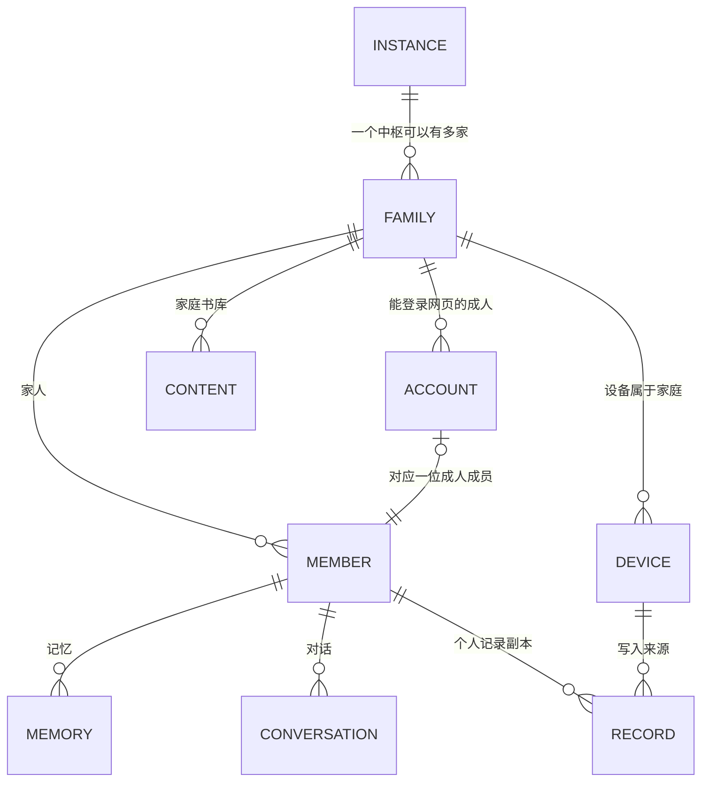

| 概念 | 含义 |
| --- | --- |
| 家庭 | 隔离的边界：数据、书库、预算、设备、成员都在一家内部 |
| 成员 | 一个人。成人或孩子。**孩子没有账号**（R-022：不要求儿童独立注册），由家长管理 |
| 账号 | 成人登录网页控制台的身份：用户名 + 密码（argon2id），以后可加通行密钥。不用手机号和短信（花钱） |
| 设备 | 属于家庭，不属于某个人（D-03：全家共用）。“现在是谁在用”随连接和消息传 |
| PIN | 只在设备上，中枢不存（底座设计 §5.1）。忘了由成人登录控制台发起重置，下次连接时设备清掉这位成员的 PIN，要重新设 |

**一个账号能做什么**：登录后管理本家庭（成人家长角色）。第二位成人（妈妈）用邀请链接建自己的账号；她的个人记录爸爸默认看不到，孩子的两个人都能看（底座设计 §8.1：家长可查看、导出、删除儿童记录）。

**朋友**（R-001、R-022）：同一个中枢上再建一家（`family`），用邀请链接；或者朋友自己装一个。两种都支持，因为隔离边界就是家庭。要明说的是：**服务器的管理员技术上看得到所有家庭的数据**，朋友要知道这一点；想彻底隔开就让朋友自己装。给朋友用之前，法规方面（生成式 AI 服务、个人信息）要另外看，本文不下结论。

**隔离怎么落实**【建议】（D-80、D-83）：

1. **一家一个 SQLite 文件**。跨家庭读不到不是靠 `WHERE`，是根本没打开那个文件。但这防不了同一家成员之间，也防不了主进程自己出错，所以 `Scope` 不能省。
2. **所有数据访问都要带 `Scope`**：家庭、发起者（`actor`，哪位成员或哪个账号）、目标成员、权限版本。`Scope` 由已认证的连接生成，不信消息里自报的。数据层只暴露按范围取数的接口，没有裸 SQL 入口；记忆、对话、记录表都以 `member_id` 为分区键（底座设计 §5.2）。
3. **能力调用带调用者**：`scope`、`device`、`source`（设备按钮、AI、控制台、外部）。策略关口在进入能力之前检查。
4. **发给模型的内容只从 `Scope` 组装**。
5. **文件块按对象授权**：同一本书两家各存一份，不跨家去重；`blob/fetch` 按“这位成员能不能看这个对象”判断，内容哈希不是授权凭据。
6. **自动测试**：`tests/isolation` 用两家、每家三个成员灌数据，遍历目录里每个能力，查不到不该查的。任何新能力都要过这个测试。

**共用一台设备时，异步输出也要隔离**（审查 HUB-011）。两家的静态隔离不够：成人发起的任务可能在孩子用的时候完成。

- **成员代次**：设备每次切成员、解锁、闲置退回都给 `member_epoch` 加一，经 `ink/member` 告诉中枢。`member_epoch` 也放在 `hello` 里。
- **两类输出分开**（审查 HUB2-008。“旧代次一律丢弃”和“留着等他回来”是冲突的）：
  - **实时输出**（这一轮的文字和朗读帧、听写结果、远程画面、确认卡）：属于当时的代次，切换后作废。设备切换时关掉所有实时会话，**用 `abort` 清掉已排队的声音**（`finish` 会让它接着放），作废确认卡（系统服务 §7 已有）；中枢取消这些会话，丢弃还没发出的。
  - **持久结果**（作业完成、外发通知）：记着发起时的 `Scope` 和接收人 `audience`，**不绑定代次**。发送时才取当前代次：当前成员就是接收人、成人已解锁，并且重新检查他现在还有权限（没被删除、权限没变），才生成一次交付。不是就**留着不发**，等他回来（敏感结果不给孩子看）。
- **只有不产生副作用的进外发队列**：通知这类只是显示。有副作用的动作不重放：代次变了就作废，要做得重新发起。
- **设备也查**：中枢发给设备的 `tools/call`、`confirm/request` 带 `_meta.member` 和 `_meta.epoch`（交付时的代次），和当前不一致时设备拒绝（`stale`），中枢留着等下次。
- **测试**：成人 → 孩子、成人 → 另一位成人、A → 孩子 → A 再解锁（结果要能送到，旧命令不能执行）、重连、迟到结果、切换时正在放的声音。

### 5.5 记忆（维护和更新每个成员的记忆）

要回答的问题：要不要（要），放哪（中枢，设备不存，底座设计 §5.1），用什么（自己做，§8）。

**三层，加一个不算记忆的活动记录**：

| 层 | 内容 | 例子 | 上提示词吗 |
| --- | --- | --- | --- |
| 档案 | 这个人稳定的情况，很短 | 小满，6 岁，识字，喜欢恐龙，回答要简短 | 每轮（≤ 500 token） |
| 事实 | 一条一条的事，带来源 | “妈妈对花生过敏”（本人说的，3 月 2 日） | 按相关性取几条 |
| 摘要 | 每次对话、每天的摘要 | “上周读完《海底两万里》，问了很多潜艇的事” | 按相关性取 |
| 活动记录 | 设备同步来的事实：读到哪、复习了什么 | 不是记忆，用 `history.search` 查 | 需要时用工具查 |

**每条事实的字段**：`id`、`member_id`、`text`、`kind`（本人陈述 / 观察到 / 推断，底座设计 §5.2 要求分开）、`sources`（哪几轮对话、哪条记录）、`confidence`、`created_by`（人还是 AI）、`scope`（个人；或家庭共享，默认不开）、`valid_until`、`superseded_by`。摘要和档案也记下用了哪些事实和来源，这样才能在删除时找到。

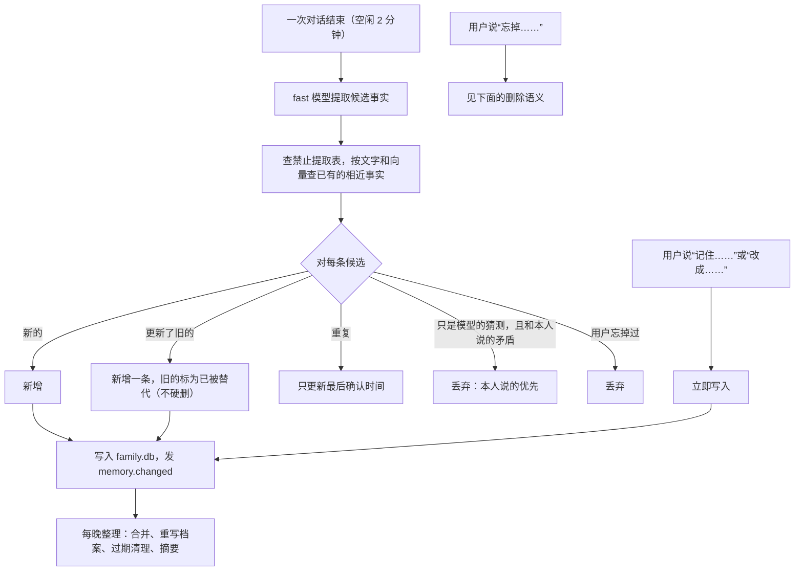

**“忘掉”要真的忘**（审查 HUB-014）。只删记忆表不够：一年保留的转写、已经生成的摘要、还在排队的提取任务、旧备份都会把它带回来。

1. 删这条事实、它被替代的旧版本和向量。
2. 依赖它的摘要和档案标脏，重新生成，不再包含它。
3. 取消相关来源还在排队的提取任务。
4. 写一条**禁止提取记录**（只存判断用的最少信息，不存原文），以后提取和重建都跳过。
5. 写进安全日志（§4.5），恢复备份后重放一遍，整台服务器丢了也不例外。
6. 原始转写：按 D-34 留到期，但标记不再用于提取；界面提供“连原话一起删”（D-93 请用户看一眼），听写记录也一起删。旧备份里的会随备份过期，这一点要如实告诉用户。

**说清楚结果**（JOBS-HUB-008）：“忘掉”容易被理解成连原话也删了。卡上写：“**不再记住“［这件事］”**。AI 不再把它当作你的情况。相关原话仍保留到原定期限。可选：连相关原话一起删除。”完成后分别说记忆、原话、云端记录各是什么状态，旧备份按期限清理的限制也要看得到。

**首版就做自动记忆**（用户选了 D-103 方案 B）：上面的自动提取和每晚整理都进首版。产品审查提议过先手动，用户没有采纳；它担心的记错，靠来源分类、本人陈述优先和下面的“看得见、改得了、删得掉”来兜。

**规则**：

- **看得见、改得了、删得掉**：`memory.list` 给用户和 AI 同样的结果；控制台能看能改。列表只给内容、来源和修改、忘掉入口，不让人维护三层和置信度。
- **按成员**：查询带 `Scope`；孩子的记忆家长能看；成人之间默认互相看不到。
- **孩子的特殊规则**：不提取推断类的事实（不给孩子贴标签）；可以在设置里关掉自动记忆；保留期同 D-34（记忆保留到删除，转写 180 天）。
- **内容不当指令**：记忆里的文字进提示词时标成“资料”，防止从网页、书里来的话被存成“用户偏好”后变成指令（底座设计 §8.1 的威胁模型）。只有本人陈述才能进档案。
- **检索**：FTS5（jieba 分词）+ 向量余弦（`embed` 角色），再按最近和类型加权。一家几万条以内应该够快，没测过【估算】，放线程里跑，第 4 步量；不够再加 sqlite-vec。
- **费用**：每次提取一次便宜模型调用，每月不到 1 元【估算】。

接口写成 `MemoryStore`，以后效果不好可以换 mem0，上层不改。

### 5.6 内容：书、朗读、报纸、搜索

**统一成一个管线**，所有产物走作业框架（底座设计 §5.6：已请求 → 传输中 → 已到达 → 已登记 → 已索引 → 可打开 → 可离线）。AI、设备按钮、控制台都看同一个阶段字段。

| 内容 | 做法 |
| --- | --- |
| **书籍转换**（D-15） | 输入 EPUB、TXT、文字型 PDF，都**不可信**，在 `worker` 里解析：不能联网，只映射这个任务的输入和输出目录，限解压总量、路径、页数和外部引用（审查 HUB-015）。EPUB 自己解析（压缩包 + XHTML），PDF 用 pdfminer.six、pypdfium2；避开 AGPL 的 EbookLib 和 PyMuPDF。其他格式可选调 Pandoc、Calibre（命令行，不链接）。主进程校验产物后才入库 |
| **找书**（R-017） | `content.find` 查用户配置的来源（OPDS、自己的书库、合法来源）；“获取中 / 已就绪 / 找不到”如实返回（SR-RD-03）。任意书名都能免费拿到不是既定能力 |
| **朗读预生成**（R-018） | 书和报纸按句合成，同时保存句子和时间的对应，读听切换靠它；Ogg Opus 16 kHz（和 D-67 一致）；闲时跑，按字计费，开始前显示预计费用，超过设定值要确认。按输入哈希 + 参数 + 版本复用，不重复花钱 |
| **个人报纸**（R-020） | 定时：抓来源（RSS 等，抓取经过滤代理，取正文在 `worker`）→ 去重聚类 → 按成员的偏好和“防止兴趣固化”的规则排序 → `fast` 摘要 → `deep` 编排 → 结构化期号（固定条目表、有终点，底座设计 §5.2）→ 设备下载。来源失效要写明缺了什么。**来源、篇幅、频率都是配置，用户没定**（[新闻研究](../research/personal-news.md)） |
| **儿童新闻和百科**（R-028） | 不只是报纸的儿童版。首版至少有一个儿童发现栏目的最小交付和自己的验收样本；形式用户没定，排在第 5 步之后单独定 |
| **联网搜索** | `web.search` 接厂商接口（配置项），`web.fetch` 取一页的正文（经过滤代理，限重定向和大小）。网址只能来自用户的话、搜索结果和已取页面上的链接，模型自己拼的不行，防止网页骗 AI 把家里的信息带出去。结果标成“资料”进提示词 |
| **家庭内搜索** | `history.search` 查这位成员的笔记、读过的内容、对话；`library.search` 查书库。走中枢副本，设备不用查询引擎（底座设计 §5.1） |

**内容包：设备读得懂才算数**（审查 HUB-016）。现在阅读器只读 `.txt`，最大 2 MiB，上游有 `.ebook` 格式不等于本项目能读。所以第 5 步第一件事是两边一起冻结内容包 v1，写成 `docs/hub/content-package.md`，带解码样本，至少包括：

- 内容编号和修订号；规范化后的文本，4 KB 分块压缩（沿用上游 `EBOK` 的做法，[上游研究](../research/foundation/upstream-firmware.md)）；块索引。
- 章、段、字符偏移的定位（底座设计 §5.2 的定位器）；内容重新生成时位置怎么迁移。
- 媒体清单；句子和时间的对应（读听切换用）。

可以先用 TXT 加版本化的音频索引跑通纵切，再扩到 EPUB、PDF。**阅读器和离线播放器的改造是第 5 步的硬依赖**（§13）。验收看设备：离线打开、读到正确位置、读听切换、半下载和断电后能恢复。

**给设备的路径**：书、音频、报纸都是一个内容对象加若干 rendition（底座设计 §5.2），经块传输下载（§6.6）。设备显示真实阶段。

### 5.7 浏览器和远程画面（R-048）

设备一侧的宿主、区域帧、配额已实现，输入只有点按（[详细设计 §8](../system/system-detailed-design.md)）；模拟中枢是原型（`simulator/environment/sim_remote.c`）。真实中枢要把里面的“生成图片”换成真浏览器。

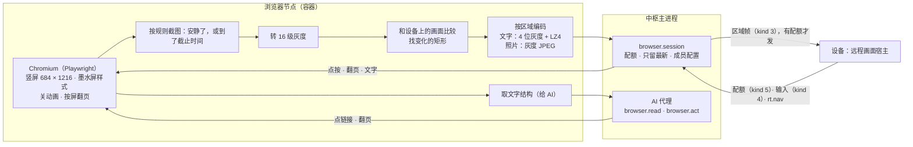

| 环节 | 做法 |
| --- | --- |
| 渲染 | 每路一个独立的 Chromium 上下文（按成员保存登录状态），字体带 Noto CJK。样式注入：高对比、关动画、`prefers-reduced-motion`；翻页键映射成按屏滚动。设备的 `w`、`h` 从 `rt.open` 参数来 |
| 什么时候截图（审查 HUB-018） | 输入或跳转后开始计时：网络安静、连续两次采样像素不变就截；**有截止时间**（第一屏 1.5 秒，点按后 800 ms），到点先发一版，之后再补。轮播、推送这种一直在变的页面，最多每 2 秒一版，还要有配额。比像素，不比 DOM，DOM 不变也可能在变（canvas）。墨水屏不需要视频流，不用 screencast【推断】 |
| 灰度 | 8 位转 16 级，`(v + 8) / 17`，和 `sim_remote.c` 一致，高半字节在前 |
| 编码（D-53） | 文字区 LZ4 块格式（设备是自写解码器，兼容公开格式）；照片区灰度基线 JPEG（S31 硬件解码，尺寸、采样要求要在实机核对）。照片区从 DOM 里 `img`、`video`、`canvas` 的位置来，加一个像素统计兜底 |
| 控流 | 没配额就合并变化、只留最新；一个单元最后一帧带 `F_LAST`；一个配额一个单元。**传到一半的单元不能被更新的内容打断**，否则设备的画布已经改了一半。设备收不下区域时重新建立白屏基准 |
| 重连 | 同设备同成员 5 分钟内重开，页面还在，但 `shown` 清成白屏（设备这样约定）；超过 5 分钟关 |
| 输入 | 设备现在只有点按。翻页、长按、提交文字（输入法）要设备补，第 6 步一起做，所以第 6 步**要改设备** |
| AI（用户选了 D-104、D-105） | `browser.read` 给文字结构和带编号的链接。**人要求的事，AI 在这个网站上自动点、填、提交**，不弹卡。只有这些弹卡或让人自己来：花钱（支付页、下单、充值）；密码、验证码、银行卡、证件号；要跳到别的网站；把用户这句话没提到的家庭资料填进去。判断靠输入框类型、网站和按钮文字、模型自查，**不可能全对**：普通链接也能有副作用，网址本身也可能带权限（审查 HUB2-010、HUB3-003）。这个风险用户接受，所以每一步都进活动记录（§7.5），人随时能打断。AI 自己想做、不是人要求的事，不自动点。以后可以给审核过的站点做适配器。<br>页面内容标成“资料”（R-039） |
| 安全 | **这是风险最大的部件**：内容不可信。容器非 root、只读根文件系统、无数据卷；只能经过滤代理出站，容器网络本身不能直连外网；代理拦内网、回环、云元数据地址（含 IPv6），每次跳转和解析后都判断；禁下载、禁 `file://`；限内存，超了关这一路；登录状态由主进程加密保存，用时传入 |
| 出口 | 服务器在日本，网站看到的是日本 IP：海外网站直接能开；国内网站可能要额外验证，或者限制内容（登录、视频、银行）【推断，第 6 步试】 |
| 孩子 | **和成人一样（用户选了 D-94 方案 B）**。`browser.child_allowed` 默认开，家长可以在设置里关。每个成员有自己的上下文和登录状态。这里只放开浏览：网页内容本身不过滤，儿童内容过滤只管 AI 说的话；已登录上下文里 AI 的点击照样要确认；儿童时长限制（底座设计）也算这里。把网址内容导入书库（`content.import`）对孩子仍然默认禁止（底座设计 §8），这里没有改；D-25 的通信不限制继续有效，网页不是通信 |
| 费用 | 没有按量费用，只吃服务器内存。空闲 10 分钟自动关 |

**时延现状**：模拟器里整页换页约 1.3 s，主要花在墨水屏（详细设计 §13）。中枢这段（渲染 50～150 ms、编码 5～20 ms）【估算】不是瓶颈。

**和报纸、声明式页面的关系**：有结构的内容优先下发结构，由设备本机排版（更清楚、更省流量、能离线，系统架构 §9.5）；远程画面只用于没有结构可用的。

### 5.8 同步（R-023）

权威方沿用底座设计 §5.1：成员个人记录设备为准（首版一台），家庭内容和 AI 状态中枢为准。设备的数据存储已经给同步留了接口（`ink_db_changes`、`ink_db_ack`，系统服务详细设计 §3.2）。

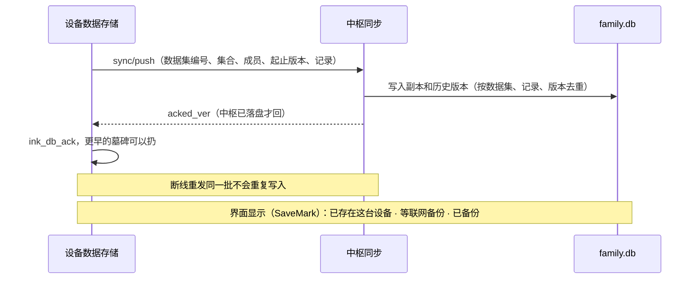

界面上的“已备份”指设备和中枢各有一份；云端保存到什么时候看控制台（§4.5）。

**只靠版本号和 ACK 不够**（审查 HUB-010、HUB2-004）。设备 ACK 之后就扔墓碑；每个集合最多留 256 条墓碑，老的会被挤掉。中枢恢复了删除之前的备份，已删除的东西会复活；设备恢复旧快照后版本号重用，新编辑会被当成重复丢掉。

**两个随机编号，不做加一**（从备份恢复后加一会重复：同一份备份恢复两次都得到同一个数）：

| 编号 | 谁生成 | 什么时候换 | 用途 |
| --- | --- | --- | --- |
| `hub_instance` | 中枢，128 位随机 | 每次从备份恢复、导入时都生成新的；**不进快照的回退范围** | `hello` 回答里带。设备记下每个数据集上次同步的 `hub_instance`，不一样就说明中枢回退过，走全量对账 |
| `dataset` | 设备，64 位随机 | “设备 × 集合 × 成员”第一次建立、恢复、安装快照时生成 | 去重键 `dataset + 记录 + 版本`。版本号重用也不会撞。中枢拒绝已被替换的旧 `dataset` 的推送 |

**增量同步**：`sync/push` 带起止版本，接不上就回 `sync_gap`。墓碑被挤掉时设备在 `sync/status` 里报 `history_gap`，也走全量对账。

**设备来对账时，中枢怎么判断**（审查 HUB3-002）。关键是：**中枢不认识的数据集，不能拿来判断“删除”**。否则刚刷机的空设备会把中枢上的记录全部当成已删除。旧的 `hub_instance` 只说明发生过恢复或搬家，证明不了谁更新：中枢搬过家、设备又从旧备份恢复时，设备手里才是旧数据。

| 设备报上来的情况（从上往下，命中就停） | 中枢怎么做 |
| --- | --- |
| 用户刚看过预览，对这个数据集做了决定 | 按决定：对账（用设备的）或装快照（用中枢的）。决定只管这一次；数据不完整时只能选用中枢的 |
| `complete` 为假 | 不能对账。等用户看预览，通常是装中枢的快照 |
| 数据集认识，`hub_instance` 一样，没有 `history_gap` | 接着增量 |
| 数据集认识，但 `hub_instance` 不一样（中枢恢复过）或有 `history_gap` | 对账，缺项按删除 |
| 不认识，带着没用过的恢复令牌（`restore_token`） | 它成为当前数据集，旧的和令牌都作废。没有 `history_gap` 就接着增量，有就对账 |
| 不认识，中枢这边没有数据 | 第一次建立，接着增量 |
| 不认识，其他情况 | **什么都不动**。设备照常本地用，这个数据集先不同步，等用户看预览后决定：用设备的（缺项移到历史），还是用中枢的（装快照） |

中枢恢复后忘了某个数据集的情况很少：快照通常只旧几分钟（§4.5），只有这几分钟里新建的数据集才会走预览。

**恢复令牌**（审查 HUB4-003）：用户在预览里选了“用中枢的”，中枢发快照时带一个一次性令牌，绑定这个“设备 × 集合 × 成员”、这份快照和当时中枢副本的版本。设备装好、生成新的 `dataset` 后带它来报到；中枢确认副本从发令牌之后没变过，就把它记成当前数据集，`acked_ver` 等于快照的版本。通常不用对账；装好之后断过网、删得太多、墓碑被挤掉（`history_gap`）时走一次对账（审查 HUB5-002）。令牌还绑定当时的 `hub_instance`，中枢恢复过就作废，走预览。令牌用过就失效，同一个 `dataset` 重试返回同样结果；拿旧快照再恢复一次就没有令牌了，走预览。“最新发出的快照”不能当凭据：它可能已经比现行数据旧。

**全量对账**（审查 HUB2-005）。只发一份编号清单不够：清单对应哪个时间点、缺的正文怎么补、什么时候算完，都要定。设备为准的数据，走一次**对账会话**：

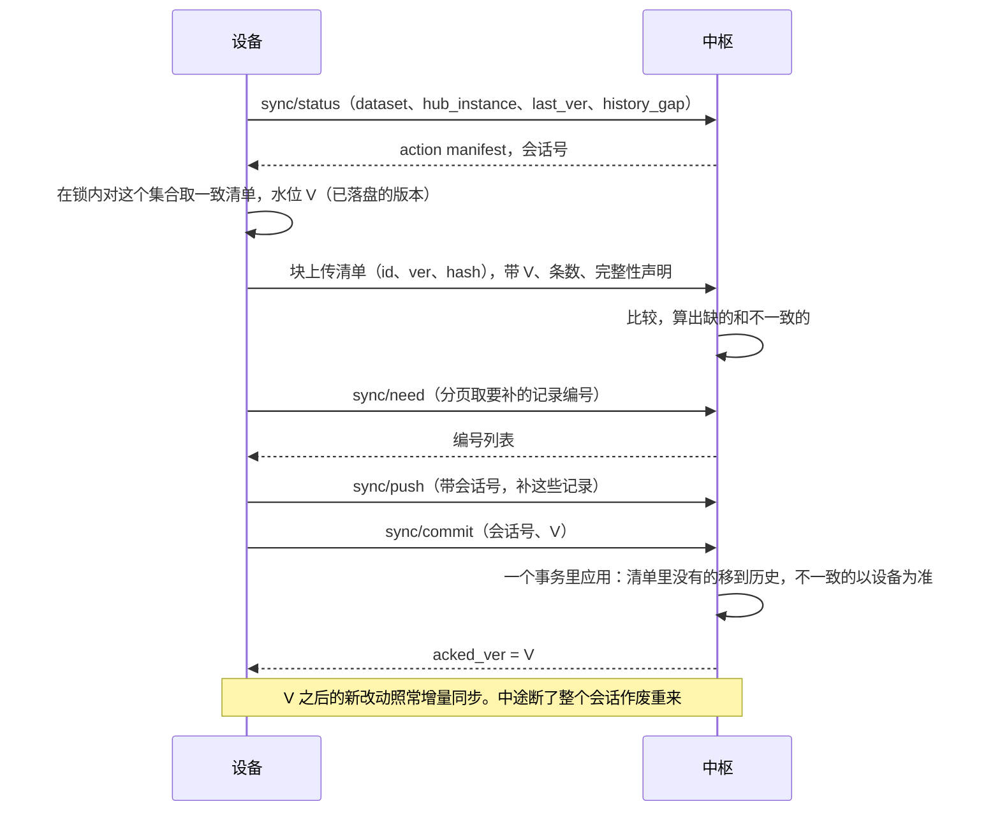

- **清单一致**：清单要对应已落盘的版本 V。打开的集合整份在 PSRAM 里（D-66），但内存里接受了、还没落盘的不能算进去（`ink_db_durable_ver`），所以只在遍历外面加锁不够，要设备新增接口（§13）。
- **只确认 V**：上传期间的新编辑版本大于 V，提交后再增量同步，不会被吞。对账期间这个数据集不发增量。要补的记录如果已经又改了，就发当前版本（比 V 新），已经删了就发墓碑，之后增量重发时会被去重。
- **完整性要能证明**：缺项会被当成删除，所以设备要声明这个数据集是完整的。数据集元数据里记 `complete`：正常建立、或快照安装成功才为真；数据文件损坏、卡被换过就为假。不完整的数据集不能用来对账，要走恢复。不能只靠“是不是刚刷机”判断。
- **一个事务**：没提交之前中枢什么都不变；缺项移到历史（可找回），不是硬删。重发同一个提交返回同样的结果。

**恢复到设备**：`sync/snapshot` 给一个快照（带快照号、恢复令牌、schema、哈希、`next_id`、`last_ver`），设备下载校验后**原子安装**，失败退回原状，继续用旧的。安装成功后设备生成新的 `dataset`，带恢复令牌报到。这要设备数据存储新增接口（§13），现有的 `ink_db_put` 不能保留编号和版本。

**中枢为准的数据**（成员表、能力目录、内容目录）：修订号只在同一个 `hub_instance` 内比较。中枢恢复后修订号可能倒退又涨回同一个数，内容却不一样，所以 `hub_instance` 变了设备就整份重新取。

其他：

- **后台优先级**：有实时会话时让路（设备已实现）。按集合和成员分批。
- **文件**（照片、录音）走块上传（§6.6），可续传。
- **恢复流程**：登录 → 预览将覆盖、新增、冲突的对象 → 设备下载快照 → 原子安装 → 内容按需重新下载。不重放已执行的外部动作，不补跑过期提醒（底座设计 §5.7）。验收：每位成员都能打开到正确的内容和位置，并列出没恢复的项目；还要测 ACK 后中枢回滚、同一份备份恢复两次、设备重复恢复旧快照、迟到的 ACK、超过 256 次删除、对账中途编辑、断电和重试。
- **多设备**：记录已带 `device_id` 和版本（底座设计 §5.2），首版不做合并；D-51 第二阶段再定冲突规则。
- **保留期**：历史版本默认 90 天【建议】；转写和听写记录 1 年（儿童 180 天），运行记录 180 天（D-34、D-91）。

### 5.9 固件分发

沿用系统服务详细设计 §12（那边的 R-056，和语音输入的 R-056 重号，合并时要改）：中枢只放包，不持有私钥，只分发 `.inkfw`。

- `update/check`：回答最新版本（按设备的 `hw`、`fw_code`，可分渠道：稳定、测试），带这个包的不可变编号和哈希。
- 下载：统一到块传输（§6.6）。**整个下载过程固定这个包**，不能每块都问“最新的”，否则续传会混包。
- 上传：`inkhub firmware add <文件>`，中枢**校验签名后才收**（公钥在配置里），坏包一开始就挡住。模拟器的替身签名不能证明生产签名正确，要有真实签名的测试。
- 中枢不能让设备“从任意网址”升级（上游的安全缺陷，底座设计 §8.1）；`system.upgrade` AI 也调不了（设备规则）。
- 发布渠道：控制台显示每台设备的版本；由用户点“提示设备更新”。

### 5.10 任务队列和更重的负载

**队列**：一张 `jobs` 表（实例级）+ 主进程里一个调度循环。字段照底座设计 §5.6：阶段、幂等键、触发者（用户、AI、定时）、`scope`、受影响对象、费用预留、可取消。跑法：网络型（调 API）在主进程协程里；CPU 型和不可信解析交给 `worker`，限内存、限时。这比 Celery + Redis 少两个部件，家庭规模够用（D-83 附带）。

**重启后怎么办**（审查 HUB-022）：“恢复未完成的”要分清状态。

| 状态 | 重启后 |
| --- | --- |
| 排队中 | 接着排 |
| 运行中（带尝试次数和租约） | 没有副作用的重跑；内容类按输入哈希复用已有产物 |
| 已发出外部请求，结果不明 | 标 `unknown`，**不自动重试**，对账或提示用户 |
| 取消中 | 完成取消；费用和产物按实际处理 |

- 去重不靠“十分钟窗口”：持久的作业和外发按幂等键存结果；十分钟窗口只用于普通重发。
- 厂商支持幂等键就传。
- 外发队列是持久的，有过期时间（§6.8）。
- 成员被删除或权限变了，还没跑的任务重新检查。

**重负载的归宿**：

| 负载 | 放哪 | 说明 |
| --- | --- | --- |
| 书籍转换、网页取正文 | `worker` | 不可信输入；一次一个 |
| 报纸、朗读预生成 | 主进程协程（调 API） | 闲时；有费用预留 |
| 文字识别（扫描版 PDF）、看图 | 走模型 API | 按量，开始前估价 |
| 本地语音识别 | 可选（宽裕档） | sherpa-onnx + SenseVoice，CPU 能跑【文档】 |
| 第三方页面、复杂渲染、以后的云应用 | 浏览器节点 | 同一套远程画面 |
| 本地大模型、大算力 | **外部能力节点** | 家里的显卡机注册成节点（§7.1），服务器上不跑 |
| 游戏模拟器（R-015） | 以后单独看 | 用户说“走中枢页面、脚本运行时或单独验证”，这里不下结论 |

### 5.11 可观测性和费用统计

- **每一轮一条记录**（不含正文，保留 180 天，D-34）：说完 → 识别完成 → 首 token → 首句 → 朗读首包 → 首帧发出 → 回答结束；工具调用次数和耗时；费用。控制台画一张瀑布图，能看出哪段慢。
- **设备末端不能等以后**（审查 HUB-024）：文字上屏、第一个样本播出的时间点要在第 2 步接进来（设备已有 `ai.*` 探针，经 `device/event` 或批量上传，和中枢这边按轮对齐），否则时延验收没有依据。
- **听写**：运行记录只有成员、时长、段数、各段耗时和费用，不含文字；文字只在听写记录里（§5.3.1）。
- **日志**：结构化，正文和令牌不进日志，包括 HTTP 和 WebSocket 访问日志、异常堆栈、第三方 SDK（有测试）。
- **指标**：`/metrics`（Prometheus 文本格式，默认只开内部）；不强制装 Prometheus，控制台自带最近 7 天的图。
- **告警**：备份失败、额度将尽、磁盘快满、证书快过期或续期失败、模型连不上，发到控制台，也经 `notify.post` 发到家长的设备（设备下次连接时）。
- **审计记录**：谁（人、AI、外部）调了什么系统级能力、确认结果。按成员可查，家长可看孩子的；另一位成人的活动明细默认看不到，管理视图只看汇总。

### 5.12 安全

沿用底座设计 §8.1 的威胁模型，中枢这边的做法：

| 风险 | 做法 |
| --- | --- |
| 中枢被攻破 | 固件私钥不在中枢；模型密钥用主密钥加密（主密钥在 `secrets/`，权限 600）；设备只凭 `_meta.asked` 就会做普通的对外动作（D-105），所以中枢被攻破时能冒充人发短信；高风险的能力过不了设备的确认卡 |
| 设备令牌泄露 | 令牌只存哈希；控制台一键吊销；令牌权限只限这个家庭的设备通道，不能登录控制台、不能批量导出 |
| 未认证的连接 | 没握手之前只收小消息（4 KB）；按 IP 限流；10 秒内要 `hello` 或 `pair/begin`；配对请求有数量上限和有效期 |
| 控制台 | argon2id、失败限流、会话短期有效；向导的设置码一次性；没有可信连接前不碰秘密（§4.1）；管理接口默认只走 443 |
| 内容里的恶意指令 | 正文作为“资料”进提示词；模型没有绕过设备策略关口的能力；工具调用记录来源 |
| 不可信文件 | 在 `worker` 里解析，没有家庭数据和密钥，不能联网（§5.6） |
| 不可信网页 | 隔离容器，只能经过滤代理出站（§5.7）；`web.fetch` 同样过滤 |
| 供应链 | 依赖锁版本和哈希（`uv.lock`）；不用 `latest`；LiteLLM 事件是前车之鉴 |
| 数据静态加密 | 底座设计 §8.1 写了“中枢数据加密存储”。这里改一下（D-86）：**异地备份端到端加密，密钥类用主密钥加密，数据库文件本身首版不加密**。各方案防的东西不同：A 防备份泄露；SQLCipher 另防硬盘快照外泄，但服务要无人值守重启，密钥也在这台机器上，防不住拿到机器的人；整盘加密重启要人输密码。**开发用合成数据可以按 A 走；第一次写真实家庭数据之前，必须请用户明确确认**，因为明文写进磁盘快照和备份之后收不回来 |
| 孩子的数据 | 保留期短；家长可查、可导出、可删；模型厂商只收到当次需要的最小内容 |
| 听写内容 | 可能是短信、私信。听写时不进 AI、不进记忆；音频不落盘；定稿文字存听写记录，1 年，孩子 180 天（D-91）；异地备份加密，数据库文件首版不加密（D-86）；经过语音厂商 |

## 6. 怎样容易地关联和连接设备

### 6.1 第一次配对：和设计稿对上

设计稿和流程见[界面规范 §7.1](https://github.com/Gidean-zcx/ink/blob/claude/system-layer/docs/product/system-ui-spec.md)（`claude/system-layer` 提交 `88ac961`）。`FirstBoot` 的字是“用手机设置这台设备 / 连接网络，选好谁来用”，下面一行“在设备上设置”；三个点：连网、加入家庭、谁在用。

**用户看到的词**（界面规范第 0 节，暂定）：手机页面、控制台和设备用同一套词。本文和协议继续用内部术语。

| 本文和协议 | 用户看到的 |
| --- | --- |
| 中枢 | 家庭服务器 |
| 认领；认领码、核对码 | 加入这个家庭；加入码、确认码 |
| PIN | 密码 |
| 成员、成人 | 家人、大人 |
| TF 卡 | 存储卡 |
| 远程画面 | 网页 |
| 吊销 | 从家庭移除 |
| 恢复出厂设置 | 清空这台设备 |
| 对象存储 | 云端资料库（安装处写明服务名和要填什么） |
| 同代快照 | 一份完整备份 |
| 恢复密钥 | 打开备份的密钥 |
| 软上限、硬上限 | 到 200 元换便宜服务，到 240 元暂停付费功能 |

**设备要知道三件事，互相独立**：有没有网；中枢地址；中枢的公钥（信任锚）。自己装的中枢没有一个大家都知道的地址，设备屏幕上的二维码只能写设备已经知道的东西。

**这三样从哪来**：

| 来源 | 给什么 | 适合 |
| --- | --- | --- |
| 固件预置 | 地址 + 公钥 | 用户自己一家；朋友用用户的中枢。编译时从本地配置读，**不进公开仓库** |
| TF 卡上的配对文件 | 地址 + 公钥 + 一次性码，可选 Wi-Fi。控制台下载 `ink-pair.json`，拷到卡上。带一次性码就不用再扫码认领；码只能用一次，24 小时过期。设备读完就删，但闪存上可能有残留，所以不放长期凭据 | 不重编固件；没有手机时 |
| 配对链接 | 地址 + 公钥。控制台或 `inkhub pair-link` 给出，在手机页面上粘贴 | 朋友自己装的中枢 |
| 只给地址（手机页面或设备键盘） | 只有地址，**没有公钥** | 只有这个地址上的控制台有可信证书时才行（下面第 3 条） |
| 设备摄像头扫码 | 地址 + 公钥 | 备选（D-81 方案 B），要验证摄像头对焦 |

**流程**：

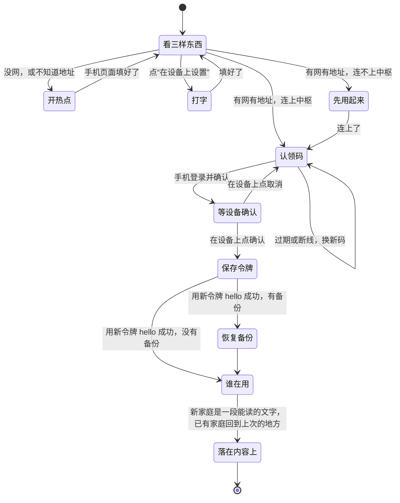

| 第几个点 | 屏幕显示 | 手机上发生什么 |
| --- | --- | --- |
| ● ○ ○ `FirstBoot`（没网，或不知道中枢地址时才有） | 二维码 = 加入设备自己的热点（`WIFI:` 格式）；“用手机设置这台设备 / 连接网络，选好谁来用”；下面一行“在设备上设置”（`BootWifi` → `BootWifiPass` → `BootJoining`，失败 `BootJoinFail`） | 扫码加入热点，弹出设备自带的小页面：选 Wi-Fi、填密码；不知道中枢地址时再粘贴配对链接。**Wi-Fi 密码只到设备，不经过中枢** |
| ○ ● ○ `BootClaim` | 二维码 = 认领网址（带公钥哈希），扫码加入家庭；码 10 分钟自动换；点“用电脑加入”才露出 8 位加入码和 12 位确认码 | 打开认领页 → 登录（或用邀请链接注册）→ “把这台设备加入【张家】？名字：爸爸的设备” → 确认 |
| 同上 `BootNoHub` | 连不上中枢也能先用起来：读卡里的书、记备忘；连上后接着加入 | 不用手机 |
| 同上 `BootConfirm` | “加入【张家】？由 爸爸 发起”，确认、取消 | 等设备上确认 |
| 同上 `BootRestore` | 有备份时恢复（§5.8） | 不用手机 |
| ○ ○ ● `Members` | “谁在用？”；大人第一次进来设密码（`PinSet`，§6.2） | 不用手机了 |
| `BootHello` | 设置完落在一段能读的文字上，试一次按住 AI 键问；已有家庭回到上次的地方（界面规范 §7.1，建议） | 不用手机 |

插了能上网的卡、又已知中枢地址时，第一个点直接跳过，整个过程只扫一次。

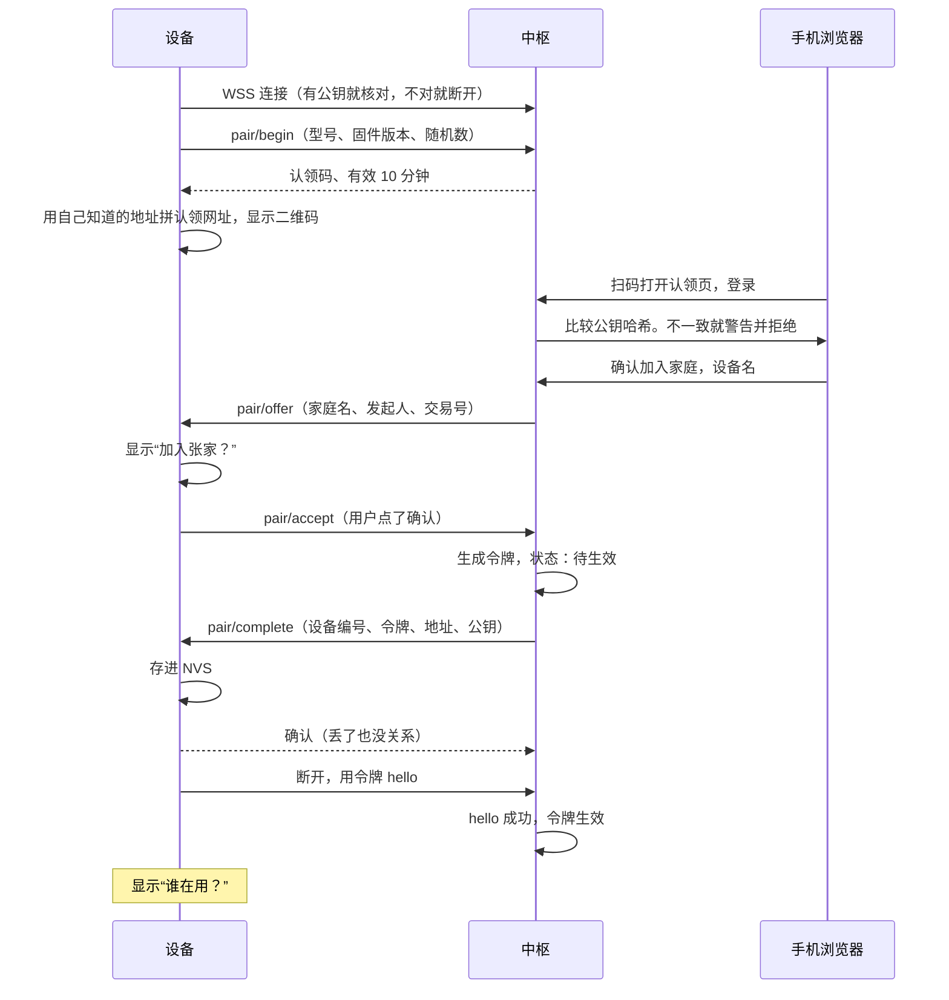

**安全规则**（审查 HUB-008 改正。第一版让中枢回认领网址，第一次连接被替换时，对方可以用自己的可信网站自己证明自己，这是错的）：

1. **有公钥就核对**，不对就拒绝。这是推荐路径（固件预置、配对文件、配对链接）。
2. **认领网址由设备拼**，用它自己已知的地址，不用中枢回的内容。第一次连接被人替换时，对方改不了手机要打开的网站。
3. **只有地址、没有公钥时**：手机打开的是用户自己给的地址，浏览器用公共证书验证；页面比较二维码里的公钥哈希和中枢自己的公钥，不一致就拒绝。**这要求控制台有可信证书。** 浏览器弹证书警告就说明这条路不成立，页面和设备都提示改用配对链接。
3a. **电脑输入也要核对公钥**（审查 HUB2-001）：只输 8 位认领码不够，中间人可以转发真实的认领码，自己拿走令牌。所以设备点“用电脑加入”时同时显示**核对码**（设备看到的公钥哈希，12 位），电脑上认领码和核对码都要填，**由页面比对，不靠人看两边一样不一样**：人看容易一眼带过。**控制台一律要这一步**，不看设备说自己有没有固定公钥，因为这句话也可能被改。
4. **设备上最后确认**：显示家庭名和发起人，人按了才保存令牌。防别人抢先扫码，也让人看一眼加入的是不是自己家。认领是原子的，只有第一个能成功。
5. 认领码 8 位（字母数字去掉易混的），一次性，10 分钟过期，错误次数限流。
6. 配对的所有消息都在设备出站的 WSS 上，设备不用开任何入站端口；热点只在配网时开，有随机密码。

**流程闭合**（审查 HUB-012）。设备连接要有状态：未配对 → 配对中 → 提交中 → 已绑定 → 已吊销。

- 配对中的连接不受“10 秒不握手就断”限制（`pair/begin` 之后可以等 10 分钟），用 WebSocket ping 保活；断了用同一个随机数重连，拿回同一个认领码。
- **令牌丢不了**：`pair/complete` 的确认丢了，设备照样用令牌 `hello`，中枢以第一次成功的 `hello` 作为生效。设备没收到 `pair/complete`，重连时带上交易号，中枢重发。
- **存好令牌后断电很久也能恢复**（审查 HUB2-002）：设备持久记下“提交中”和交易号，第一次 `hello` 成功才改成“已绑定”。待生效的令牌留 7 天（不是 10 分钟），过期后中枢对它回 `pending_token_expired`。设备在“提交中”收到这个错误就清掉，回到未配对，重新认领；在“已绑定”状态下收到 `auth_invalid` 不清掉已有身份，只提示。
- 现有 `hub_link` 一连上就发 `hello`，只有 ONLINE 才能发消息，所以设备要加配对状态（§13），只改 `send_hello` 不够。

**要实机试的**：手机扫 `WIFI:` 码后弹页面的体验（iOS、安卓不同）；热点和 Wi-Fi 同时开时 S31 的内存；`lv_qrcode` 在墨水屏上的可扫性。设备一侧要做的列在 §13。

### 6.2 账号、成员和设备的关系

- 一个家庭可以有多台设备；每台一个令牌。
- 设备上的成员表来自中枢（`members_rev` 或 `hub_instance` 变了就拉）。第一次开机内置的 `owner`、`kid` 替身在配对后被真实成员替换。连不上中枢时先用起来（`BootNoHub`）写下的备忘属于替身，加入家庭时要归到真实的人：归发起加入的大人，`BootConfirm` 上写明（界面规范 §7.1），按新的数据集同步（§5.8）。
- 在设备上加成员（设计稿 `Members` 有“添加成员”）：走 `member.add` 能力（系统级，确认），同步回中枢。
- PIN 第一次进成人空间时在设备上设。

### 6.3 令牌：发放、轮换、吊销

| 事情 | 做法 |
| --- | --- |
| 发放 | 设备确认后生成 256 位随机令牌，经 `pair/complete` 发给设备；中枢只存 SHA-256；第一次 `hello` 成功才生效，7 天没生效就作废（§6.1） |
| 存放 | 设备存 NVS，不写 TF 卡（底座设计 §8.1）。S31 没开 Flash 加密（硬性规则），设备丢了能读出来，所以靠吊销 |
| 使用 | 放在 `hello` 的参数里（在 TLS 里），不改 HAL、不加请求头 |
| 轮换 | **首版不轮换**（审查 HUB4-004）：轮换后设备扔了旧令牌，而中枢恢复的快照只认旧令牌，双方就没有共同的令牌了。令牌泄露时用吊销。以后要做：`hello` 回答带 `next_token`，设备存好后确认；旧令牌要等中枢确认“新令牌已进对象存储”才扔 |
| 吊销 | 控制台一键；写进安全日志（§4.5）；在线的立刻断开；下次 `hello` 得到 `revoked` 错误，设备停止重连（现在是一直退避重试，要改），显示“已从家庭移除” |
| 令牌能做什么 | 只有这个家庭的设备通道；不能登录控制台；不能批量导出 |

### 6.4 换设备、解绑、丢失

| 情况 | 流程 |
| --- | --- |
| **换新设备** | 新设备走配对；认领页问“这是换机吗？”，选旧设备 → 进入恢复流程（§5.8）→ **新设备恢复并确认之后**才吊销旧设备 |
| **解绑（设备还在手边）** | 设备“恢复出厂设置”时，在线就告诉中枢解绑；中枢保留数据，等家长决定 |
| **解绑（控制台）** | “移除设备”：吊销。可选“移除并抹掉”：要再输一次密码；下次连接时设备收到 `wipe:true`，走 `system.factory_reset`（这是不可逆的，只有家长明确选了才带） |
| **丢失** | 一键吊销，防止继续用中枢。设备本地数据没有加密，拿到设备的人还是能读（已知限制，底座设计 §8.1），控制台要如实说 |
| **中枢搬家** | 见 §4.5。旧机器在时用 `hello` 回答里的 `urls` 告诉设备；旧机器突然没了要重新给地址 |
| **中枢坏了又重装** | 用恢复卡恢复，身份不变；地址没变设备无感；没配对象存储就要重新配对 |
| **中枢的 IP 变了**（用户先只用 IP，D-102） | 设备一直连不上时，设置里有“换中枢地址”：手机页面粘贴配对链接，或者 TF 卡放配对文件。**只有公钥和设备记住的一样才接受**，令牌、成员和数据都不动，不算重新配对。公钥不一样就是另一台中枢，要走完整的配对 |

### 6.5 局域网、公网、4G

| 连接 | 做法 |
| --- | --- |
| 公网（默认） | `wss://地址:8443/v1/device`（路径和现在 `system/boot/main.c:44` 一致）。设备出站，适合 NAT |
| 4G | 完全一样。设备出站，运营商 NAT 不用管；往返 50～200 ms【文档，协议调研 S21】，服务器在日本时再加跨境（§4.7）。`hello` 带 `net` 字段，大文件默认等 Wi-Fi（流量要钱），远程画面照常 |
| 局域网直连（以后，D-51） | 中枢用 mDNS 广播，设备发现后比对公钥，连局域网地址，延迟更低。NAS 部署时才有意义 |
| 流量【估算】 | 语音一轮约 140 KB；全走 4G 一个月约 200 MB（50 轮/天）；一屏远程画面约 50 KB |

### 6.6 下载和上传走哪条路（D-89）

底座设计 §6.5 写的是“内容下载与批量同步走 HTTPS”。现在 HAL 只有 WebSocket，再开一条 HTTPS 意味着第二个 TLS 会话，占内部 RAM（内部 RAM 是最紧的资源，AI 场景最低余量 38 KiB，预算 32 KiB，[全貌 §10](../background.md)）。系统服务详细设计 §12.3 的固件下载已经用了二进制帧。

**建议都走现有的 WSS**：一条连接、一个 TLS，后台优先级，有实时会话时让路（设备已实现），设备按段拉取，可续传。一段 64 KiB，分成 4 帧发，设备写完这一段才要下一段。

中枢读文件先看本地缓存，没有就从对象存储取回来（§4.5），设备感觉不到。

吞吐【估算，审查 HUB-021 改正】：按模型的 1.6 Mbit/s，1 MB 净传输 5.2 秒，再加 16 个往返（RTT 50～200 ms）共 6～8.4 秒。如果每 16 KiB 一个往返（第一版的写法）要 8.4～18 秒。实际只会更慢，要实测。代价：一条连接上大下载的帧会排在语音帧前面的只有已发出去的那一帧，所以帧不能太大。详细格式见[设备协议 §3.8](device-protocol.md)。

### 6.7 断线和重连

| 情况 | 设备（已实现） | 中枢要做的 |
| --- | --- | --- |
| 空闲 60 秒，或锁屏 | 断开（D-24） | 释放连接；要发给设备的放外发队列 |
| 切网（Wi-Fi ↔ 4G） | 旧连接作废，重连，重新登记会话 | 同一设备的新连接顶掉旧连接；语音这一轮作废（取消模型和朗读）；远程画面保留页面，按白屏算差异 |
| 说话时断线 | 这一轮作废并提示 | 取消，只记已发生的费用 |
| 工具调用途中断线 | 请求号去重，重发不重复执行 | 重发带同一个 `request_id`；设备调中枢的也按它去重（保留 10 分钟） |
| 中枢重启或升级 | 退避重连 1～60 秒 | 启动后尽快可用（目标 5 秒内）；任务恢复；不要求会话恢复 |
| 中枢长时间不可用 | 离线功能照常（D-05） | — |
| 令牌被吊销 | （要改）停止重连 | 返回 `revoked` |

**保活**：只用 WebSocket 层的 ping（25 秒一次），不发应用消息（§1.3）。

### 6.8 设备不在线时，中枢怎么找它（D-88）

设备按 D-24 平时不连。中枢要给设备东西时（报纸好了、家长改了规则、到点提醒）：

- **外发队列**：就是一串“等设备上线再发的 `tools/call`”，持久保存，带请求号、过期时间和 `audience`（给哪位成员）。设备一 `hello`，中枢依次发，照常过设备的策略关口；不是目标成员在用时留着不发（§5.4）。不用新协议。外部副作用的不进队列。
- **什么时候能发到**：设备下次连接。所以**要准时就要设备按计划连一下**：比如每天早上报纸时间、充电时、从锁屏唤醒时（已有）。这要设备的时间服务加一个定时短连，和“锁屏省电”要权衡，估计每次几秒【估算，待 SP-10 实测】。不做定时短连的话，只能承诺“下次打开时到”，报纸定时送达做不到。
- **不做**：锁屏也保持长连接（耗电）；用短信唤醒（花钱）。这是推荐，D-88 给用户看。
- 闹钟和提醒在设备本地排程，不依赖中枢（系统服务详细设计 §5.4）。

## 7. 怎样作为原子能力接入软总线

### 7.1 节点：中枢是总线上的一个节点

系统架构 §5.1 的地址 `[节点/]能力` 在中枢这边同样成立：

| 节点 | 地址 | 例子 | 怎么连 |
| --- | --- | --- | --- |
| 中枢自己 | `hub/…` 或不写 | `memory.search` | 主进程内直接调用 |
| 设备 | `dev:<设备编号>/…` | `dev:爸爸的设备/reader.next_page` | 经设备网关，JSON-RPC |
| 浏览器节点 | 内部 | `browser.session` | 内部网络 |
| 外部能力节点（以后） | `ext:<名字>/…` | 家里显卡机上的本地模型，或任何 MCP 服务 | 中枢作 MCP 客户端，管理员手动添加并给每个工具定副作用等级（对方自称的等级不可信，MCP 规范也这么说） |

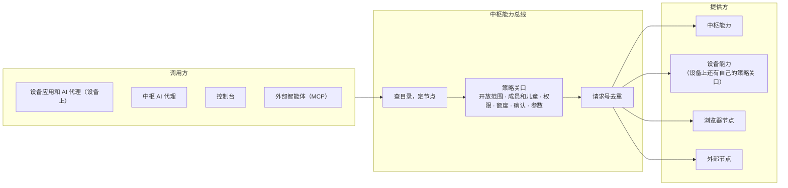

**执行端说了算**（系统架构 §5.5）：调设备能力时中枢这道只是过滤（比如不把孩子不能用的工具给模型），最终由设备的策略关口判断；调中枢能力时中枢是执行端。

### 7.2 能力的描述：和设备同一种格式

字段和设备的 `ink_cap_t`（详细设计 §2.1）一一对应，Python 里写成装饰器，**描述是唯一来源**，由它生成 `caps/list`、给模型的工具定义和对外 MCP。

```python
@capability(
    id="memory.search", version=1, form="call",
    title="查这位成员的记忆",
    input={"type": "object", "required": ["query"],
           "properties": {"query": {"type": "string", "maxLength": 200},
                          "limit": {"type": "integer", "minimum": 1, "maximum": 20}}},
    output={...},                  # JSON Schema，和 structuredContent 一致
    effect="read",                 # 只读 / 导航 / 本地可逆写 / 本地不可逆 / 外部副作用 / 系统
    child_ok=True,
    permission=None,
    qos="interactive", timeout_ms=3000, retry_ok=True,
    offline="fail",                # 给设备看：离线时失败 / 排队 / 换本地方案
    expose={"app", "ai", "remote"},
)
async def memory_search(call: Call, query: str, limit: int = 5) -> Receipt:
    rows = await call.scope.memory.search(query, limit)   # scope 带家庭和成员，取不到别人的
    return Receipt.done(result=rows, say=None)
```

回执用同一套状态（完成、部分完成、已排队、待确认、被拒绝、已过期、参数无效、失败、已取消、已撤销，底座设计 §6.4）。

### 7.3 服务器能力目录

**给设备的**（`caps/list`，设备应用要直接调的）：受 128 词法单元限制（§1.3），中枢**按序列化后的实际词法单元切页**，每页不超过 110，留余量。现在的设备只读第一页，所以最要紧的排前面，默认只发 `name` 和非默认的 `form`。

| 能力 | 形态 | 给孩子 | 离线时 | 用途 |
| --- | --- | --- | --- | --- |
| `voice.chat` | 会话 | 可 | 失败 | 语音对话（已有） |
| `asr.stream` | 会话 | 可 | 失败（设备退回键盘） | 语音输入（R-056），只开放给应用 |
| `browser.session` | 会话 | 可（D-94，家长可关） | 失败 | 远程画面（已有） |
| `asr.transcribe` | 调用 | 可 | 排队 | 语音备忘转文字（已在模拟目录） |
| `tts.speak` | 调用 | 可 | 换本地 | 朗读一段（已在模拟目录） |
| `llm.ask` | 调用 | 可 | 失败 | 应用自己问模型（已在模拟目录） |
| `library.search` | 调用 | 可 | 失败 | 搜书库 |
| `content.import` | 调用 | 否 | 排队 | 导入网址或文件 |
| `content.status` | 调用 | 可 | 失败 | 导入进度 |
| `news.today` | 调用 | 可（儿童版） | 失败 | 今天的报纸 |
| `memory.search` | 调用 | 可 | 失败 | |
| `memory.forget` | 调用 | 否 | 失败 | |
| `backup.status` | 调用 | 否 | 失败 | 设置里显示 |
| `job.status` | 调用 | 可 | 失败 | |
| `usage.today` | 调用 | 否 | 失败 | 今天花了多少 |

**只给 AI 的**（不进 `caps/list`，进工具目录）：`web.search`、`web.fetch`、`history.search`、`dictation.list`、`dictation.delete`、`browser.read`、`browser.act`、`memory.add`、`memory.list`、`memory.update`、`news.item`、`content.find`、`library.get`、`vision.describe`、`family.members`、`device.list`、`routine.*`，以及 §3.3 里要成人确认的那些。

这样分是因为：设备目录有上限，而大多数服务器能力是 AI 在中枢这边用的，不必经过设备。

**工具名**：模型接口要求工具名只有字母数字下划线和连字符，所以给模型时把 `.` 换成 `__`，设备的加前缀（`dev__reader__next_page`），调用时再换回来。顺序固定，提高缓存命中。

### 7.4 发现和调用

**发现**（审查 HUB-002 改正。`tools/list` 是当前页面、当前成员的视图，按固件版本缓存整张清单是错的：在主页拉的没有阅读器的工具，孩子身份拉的不全）

| 方向 | 消息 | 现状 | 中枢要做 |
| --- | --- | --- | --- |
| 设备发现服务器能力 | 每次连上发 `caps/list`；中枢发 `caps/changed` 时重拉 | 【实现】`cap.c:883`，设备只读 `name`、`form` | 按成员和部署情况过滤（没装浏览器就不列 `browser.session`）；按词法单元切页 |
| 中枢知道设备能力的**定义** | `tools/list` | 【实现】设备从能力表生成，只列当前可用的；分页在系统服务分支上 | **按“固件 + 能力名 + 版本”累积一本字典**。定义不随页面变，变的只是可用不可用 |
| 中枢知道此刻**能用什么** | `ai.listen` 的 `page.actions`；不可靠时用 `tools/list` | 【实现】每轮都带，但**放不下时是空数组**（审查 HUB2-006） | `actions` 不是空的，就用它 ∩ 成员规则；**空数组当作“不知道”，不是“没有”**，当场拉 `tools/list` 当前视图（分页）来定。这时用户还在说话，趁这个时间拉，不影响第一句回答。现有设备也不会丢工具，只是多几个来回。设备可以改进：`actions` 只列绑定当前页面的，全局能力不必每轮带；放不下时带 `actions_more:true`（§13） |
| 这一轮里页面变了 | 回执的 `page_gen` | 【实现】 | 工具调用让页面变了，下一步之前重新确定可用集合 |
| AI 发现能力 | 每轮常驻：目录索引 + 当前应用和系统常用能力（≤15 个）；其余用 `find_capabilities`、`load_capabilities` | 【设计】底座设计 §6.5；系统服务分支有 `caps.domains`、`caps.find` | 工具集合保持稳定，快照里的 `actions` 说明此刻哪些有效 |

**设备调中枢能力**（【实现】`cap.c:560`）

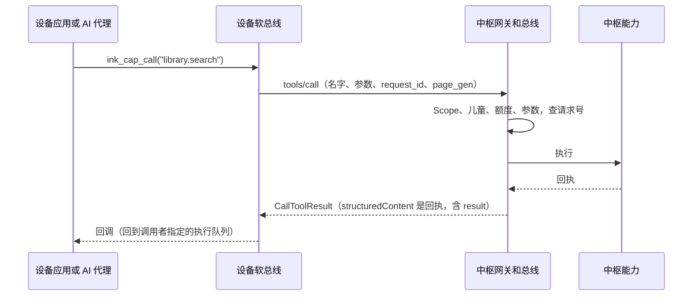

**中枢 AI 调设备能力**（【实现】`cap.c:810`）

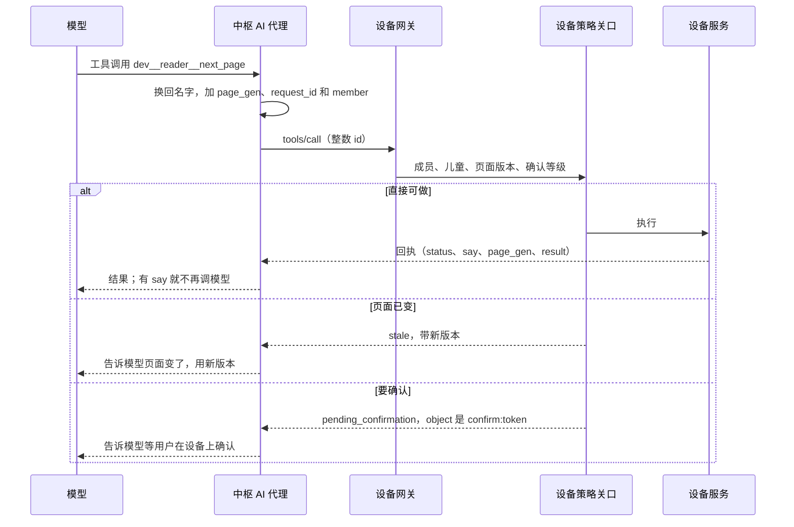

**回执的形状**（审查 HUB-001 改正）：

- 设备调中枢时，回答是 MCP 的 `CallToolResult`（回执在 `structuredContent` 里，`cap.c:532`）；中枢调设备时，设备回扁平回执（`cap.c:724`）。**这个不对称不用改**，中枢适配层统一转换。
- **查询类的结果**：main 上的 `remote_reply` 不保留 `result`，查到的列表和数字到不了应用。系统服务分支已经改了（`structuredContent.result`，那边的 `cap.c:590`），要等它合入。
- `result` 仍受 128 词法单元限制。所以中枢的查询能力要分页（`cursor`、`nextCursor`），一页放得下；大结果给对象编号，用块传输取（§6.6）。结果只在回调期间有效（系统服务 §1.2）。

### 7.5 权限和确认卡

**默认自动，确认卡只留给高风险**（D-105）。用户原话：“自动帮我点吧 设计上尽量少一些确认卡 非高风险的系统设置都自动完成 非设置类的应该都能自动完成”。这改了 D-25、R-040 和底座设计 §6.2 里“外部副作用都要确认”“改系统设置要确认”的部分。

| 情况 | 怎么办 |
| --- | --- |
| 读、导航、记备忘这类 | 直接做（本来如此） |
| 人亲口要求的事：发短信、打电话、分享、在网页上点和填 | **直接做**，做完就地说结果（“已发送给妈妈：……”） |
| 非高风险的设置：亮度、音量、网络、通知、字体、报纸时间…… | **直接做**，能撤销 |
| 高风险（下面） | 弹确认卡，人按了才做 |
| 不是人要求的对外动作：AI 自己想做的、网页或收到的消息里写的 | 不自动做，变成建议或确认卡。用户明确设好的定时任务算要求过 |

**什么算高风险**【建议，用户可以改】：

- **花钱**：付款、下单、充值、加 AI 额度。
- **密码和证件**：把密码、验证码、银行卡、证件号填进网页；改家人的密码。
- **找不回来的删除**：清空设备、删除家人、批量删除、连原话一起删。单条能撤销的不算。
- **身份和权限**：移除设备、加入或退出家庭、增删家人、改孩子的规则、恢复备份、换模型厂商。
- **把家庭资料发出去**：用户这句话没提到的记忆、备忘、联系人、听写记录，发给别人或填进网页。
- 发起升级还是 AI 碰不到（底座设计 §6.2）。

孩子：系统设置本来就不开放（底座设计 §6.2）；花钱、身份和权限要大人的密码；其他和成人一样（D-25、D-94）。

**“人亲口要求”怎么判断，模型说了不算**：

- 这一轮是人开口或打字发起的，不是定时任务或 AI 主动。人要求的事变成后台作业时，作业记着是谁要求的，接着算。
- 对外动作的对象（收件人、号码）要能在人这句话里找到：中枢拿转写文字和联系人比对，不听模型的。找不到或有两个同名，就问一句，或者弹卡。这样网页骗不了 AI 发给别人，听错了也多一道拦。
- “把家庭资料发出去”也不听模型的：看这一轮读过哪些私人资料（记忆、备忘、联系人、听写记录），要发的内容里有没有这些文字，用户这句话有没有提到。
- 过关的调用，中枢策略代码填 `_meta.asked:true`，模型碰不到。设备没见到这个标记的对外动作照弹卡；高风险的能力（设备上是 `ask_by_hand`）不管有没有标记都弹。

**发出去收不回的，留几秒**【建议】：发短信、打电话、分享，屏幕和语音先说“3 秒后发给妈妈：……”，不用按就发，说“取消”或点撤销就不发。免按键时电视里的话也可能触发 AI，听错了也来得及拦，这不算确认卡。

**界面**（`claude/system-layer` 提交 `88ac961`）：确认卡收窄成 `ConfirmWeb`（花钱）、`ConfirmSecret`（密码和证件）、`ConfirmDelete`（找不回来的删除）、`ConfirmParent` 和 `ConfirmSetting`（身份和权限）、`Confirm`（把没提到的资料发出去）、`ConfirmCall`（不是人要求的对外动作）；对象不清楚时先问一句，写在 `AiReceipts`；活动记录是 `AiLog`。

**做了什么查得到**：每个自动做的对外动作和设置改动都记进活动记录（`activity.list`，按成员，设备和控制台都能看，保留期和转写一样）；能撤销的给撤销；人开口就能打断。这是少弹卡的代价：**AI 可能做错，事后才知道**，比如听错了内容，或者网页骗它点了同一网站上的按钮。Codex 第二、三轮指出过这个风险（HUB2-010、HUB3-003），用户接受。

**中枢的策略关口**（顺序照详细设计 §2.4，多一条额度）：能力存在且可用 → 开放范围 → `Scope`（成员、儿童、权限） → **额度预留** → 确认 → 参数 Schema。

**三种确认**：

| 情况 | 流程 |
| --- | --- |
| AI 调设备上的高风险能力，或者没有 `_meta.asked` 的对外动作 | 设备策略关口回“待确认”，弹确认卡（设计稿 `Confirm`），用户按下后设备再查一遍才执行；结果用 `confirm.result` 事件告诉中枢（系统服务 §7，字段 `token`、`cap`、`decision`、`status`、`say`…）。**中枢和 AI 都按不了确认** |
| AI 调中枢上的高风险能力（`budget.set`、支付页上的点击） | 中枢回“待确认”，同时用**专门的方法** `confirm/request` 让设备弹卡。结果回来中枢重新校验才执行 |
| 控制台操作 | 人已登录，网页上二次确认；孩子的事只有成人家长能做 |

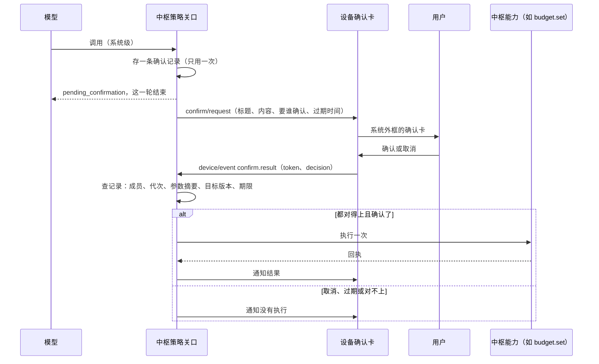

**确认记录绑定什么**（审查 HUB-005。只传标题和正文、等一个 true，换了人或网页变了也会执行）：家庭、目标成员、成员代次、能力、**参数的规范化摘要**、目标版本（比如网页的地址和版本）、过期时间。执行前逐项重新校验，重复的事件不再执行，断线、换人、过期都作废。卡片上显示的内容和摘要来自同一份参数。

**模型够不着确认**：

- `confirm/request` 不是 `tools/call`，是单独的 JSON-RPC 方法，只有中枢策略关口的代码能发，模型工具表里没有，设备的 `tools/call` 路径上也调不到。因为现在所有入站 `tools/call` 都按 AI 来源处理，不能靠消息里自报来源来区分。
- 设备的 `confirm.accept`、`confirm.reject` 不开放给 AI 和远端（系统服务 §7）。

**事件丢了怎么办**（审查 HUB2-007 改正）：设备只留最近 8 条事件，确认结果可能被挤掉。`confirm.list` 只列还在等的，**不在了不等于没执行**：短信可能已经发了，告诉用户“没发”，他再发一次就发了两条。所以：

- `token` 要跨重启不复用，绑定成员和参数摘要（现在的计数器只在内存里）。设备保留最近的确认结果（按 `token`，至少 16 条，要落盘，收到 `device/event_ack` 才能清），新增只读能力 `confirm.status`：还在等、人已确认、已执行（带回执）、执行失败、已取消、已过期、已换人。**开始执行之前先落盘一个“执行中”**。
- 查不到，或者记着“执行中”却没有结果（中途断电）：结果就是 **`unknown`**。告诉用户“不确定做了没有，请看一下”，**不自动重试**。
- 中枢能力（`budget.set` 这类）只由中枢执行，中枢自己知道做没做。事件丢了就查 `confirm.status`：人确认过、确认记录也还有效，就执行；已经作废，就如实说没有执行。

**确认卡说什么**（JOBS-HUB-005）：按钮写具体动作（“发送给妈妈”“在［网站］提交这段文字”），不只写“确认”。写不清对象和内容的，让用户自己操作。墨水屏不做每秒倒计时，写明期限和过期后怎样。结果也要给下一步：

| 情况 | 显示 | 主要动作 |
| --- | --- | --- |
| 60 秒过期，能确定没有执行 | “这次没有发送。确认已过期。” | 重新核对，生成新的确认 |
| 页面变了，旧授权作废 | “网页已变化，这次操作没有执行。” | 回到当前网页重新核对 |
| 已确认，但结果查不到（`unknown`） | “还不能确定是否发送，请先查看这条消息。” | 打开对应的记录；不提供默认重试 |
| 设备不在线，动作没执行 | “这件事还没做。请在设备上打开并确认。” | 在设备上继续 |
| 确实完成 | “已发送给［对象］：［内容摘要］。” | 返回原来的事 |

**一轮不等确认**：确认最长等 60 秒，一轮只有 45 秒，所以回“等你确认”就结束这一轮（§5.3）。

**设备离线时**：高风险的中枢能力不执行，回“被拒绝：需要设备在线确认”。不是人要求的对外动作不做（§7.5 开头）。

### 7.6 事件和状态

- **设备事件到中枢**：系统服务分支已经实现了 `device/event`（`{event, at_s, args}`，断网时留最近 8 条，连上再发，`cap.c:745`），本文统一用这个名字。还缺序号和启动代次：没有它们，中枢发现不了事件被挤掉，所以要加（[设备协议 §3.6](device-protocol.md)）。重要的状态不能只靠事件，要能查（`confirm.status`、`state.list`）。中枢按成员存活动记录，也交给主动决策。
- **设备状态**：AI 上下文里带常用状态（`state.list`）；不订阅高频项。
- **中枢事件到设备**：`caps/changed`；其他走外发队列（§6.8）。
- **AI 主动决策**：定时任务和事件都先过一道“值不值得打扰”的 `fast` 判断，结果写成通知（`notify.post`），用户看得见、能撤销（系统架构 §6.4）。首版只做定时生成。

### 7.7 实时会话

沿用现有的 `rt.open`、`rt.close`、二进制帧（[详细设计 §6](../system/system-detailed-design.md)）。中枢的约定：

- 会话号由设备选，中枢照用。
- `rt.open` 里的能力名查目录；不允许就回错误（设备走 `on_closed`）。额度用完不拒绝语音会话，让它开起来，用语音告诉用户原因（否则用户只看到“出错了”）。
- 每路会话绑定到连接，连接断了会话就没了（设备会重新登记）。
- 发送优先级中枢这边也照设备的五档：语音 > 输入 > 画面 > 控制 > 后台。Python 里每条连接一个按优先级取的发送队列。
- 听写 `asr.stream` 也是一路实时会话：上行用语音帧，结果用 `rt.asr` 通知，说完用 `rt.turn`。不加帧类型，设备的 `rt.c` 不用改（[设备协议 §3.11](device-protocol.md)）。
- D-54 的 UDP 通道以后才加；中枢代码把帧的收发和传输分开，加的时候不动业务。

### 7.8 和现有实现的差异

完整约定在[设备协议](device-protocol.md)。这里只列一眼能看完的。**第一版说“设备不用改”的地方大多说得太轻了**，这张表是改过的。

| 项目 | 现在 | 设计 | 谁改 | 为什么 |
| --- | --- | --- | --- | --- |
| `hello` | `{proto:1, device:<档案名>, member:"default"}`，无身份 | 加 `device`（真实编号）、`token`、`fw`、`manifest_hash`、`frame_v`、`member`、`member_epoch`、`net`；回答加 `now_ms`、`hub_instance`、`caps_rev`、`members_rev`、`pins`、`urls`；错误要分类，`revoked` 时停止重连 | 设备 | 没有身份无法上线；其余 D-12 早已规定，代码还没做 |
| 配对 | 没有；地址写死 `wss://hub.local/v1/device` | 新增 `pair/*`，设备连接加配对状态（持久）；显示核对码 | 两边 | 系统服务设计里“配对”明确留给以后 |
| 连接 | `hal_ws_open(url, cb, ctx)` 没有证书参数 | HAL 加“固定公钥”选项 | 设备 | 底座设计 §8.1 |
| 成员 | 连接时写死 | 新增 `ink/member`（带代次）、`members/list`；`tools/call` 带 `_meta.member`、`_meta.epoch`；切换时 `abort` 声音 | 两边 | D-03：切换成员要让中枢知道，旧输出要隔离 |
| `caps/list` | 只读 `name`、`form`，只读第一页 | 按词法单元切页；新字段可省；设备读完全部页才替换目录 | 设备（超过一页或要新字段时） | 128 词法单元 |
| `tools/list`、`actions` | 当前视图；`actions` 放不下时是空数组 | 中枢按能力名累积字典；`actions` 空就查 `tools/list`；设备可改进 `actions` | 中枢必须，设备可选 | 定义和可用分开，空不等于没有 |
| 回执 | 两个方向形状不同；main 上丢 `result` | 形状不改；`result` 要系统服务分支合入；结果分页 | 分支已做 | 查询能力要有结果 |
| 打断 | 设计写 `rt.turn`，代码是 `rt.close` 加新会话 | 中枢按 `rt.close` 处理；可选带 `reason`、`heard_frames` | 设备可选 | 以实现为准，不必改回去 |
| 一轮的边界 | 45 秒、2048 字节 | 长回答、长任务、等确认都移出一轮；`ai.listen` 带 `budget_ms`；录音 30 秒封顶；以后改成没有活动才超时 | 中枢，设备要加字段 | 这是硬约束 |
| 下载上传 | 没有（设计写 HTTPS） | 新增帧 kind 6、7（`sid = 0`）和 `blob/*`，`update/fetch` 归到它 | 两边：`on_binary` 路由、`class_of` 分类 | D-89：不开第二条 TLS |
| 同步 | 没有 | 新增 `sync/*`，带 `dataset`、`hub_instance`，对账会话；设备数据存储要加取一致清单和原子安装快照 | 两边 | R-023 |
| 事件 | 分支上有 `device/event`，没有序号 | 加 `seq`、`boot` | 设备 | 发现事件丢失 |
| 确认 | 设备内部 | 新增 `confirm/request`、`confirm.status`，设备保留确认结果 | 两边 | 中枢能力也要确认；事件丢了要查得到 |
| 语音输入 | 没有 | 新增会话能力 `asr.stream`，通知 `rt.asr`、`rt.asr.done`、`rt.asr.error` | 两边，设备底层会话在做 | R-056；走现有的会话和语音帧 |
| 真中枢联调 | 模拟器没有真实网络，媒体是替身 | 加网络桥和真媒体模式 | 模拟器 | 第 1、2、6 步验收的前提 |

没有改动的：JSON-RPC 信封、`tools/*` 结构、`rt.open`、`rt.close`、10 字节帧头、语音帧和画面帧、配额帧、`ai.*` 通知。

### 7.9 对外 MCP（以后）

中枢用官方 Python SDK 提供 Streamable HTTP（规范 2026-07-28），把目录里 `expose` 含 `remote` 的能力翻译成标准工具。认证用每账号的令牌或 OAuth，身份绑定到一位成员，所有调用走同一个策略关口；外部智能体调外部副作用的能力，同样要设备上确认。设备永远不直接说标准 MCP（D-12）。

## 8. 自己写还是用现成

比较和来源见[调研](../research/hub-server-survey.md)。

| 部件 | 选择 | 许可证 | 理由 | 换的代价 |
| --- | --- | --- | --- | --- |
| 中枢主体 | **自写** | — | D-14；小智服务端缺成员、策略、确认、费用、同步、内容（调研 §1） | — |
| 语音厂商适配 | **借**小智服务端的代码 | MIT | 各家流式接口的细节现成 | 单文件 |
| 语音流水线 | **自写薄的** | — | 协议和打断都定了，只要一条可取消的链（D-76）；Pipecat（BSD-2）备选 | 小 |
| 代理循环 | **自写薄的** | — | 工具语义是自己的；通用框架不省事 | 小 |
| 模型网关 | **自写薄的** | — | 按角色和成员记账是自己的需求；保留厂商原始字段，每个模型一张能力表（§5.2）；LiteLLM、new-api 可作上游（D-77） | 改一个地址，但要过能力表 |
| 记忆 | **自写** | — | 按成员、分观察和推断、儿童规则；mem0 默认依赖 OpenAI 和 Qdrant（D-84） | 换 `MemoryStore` 实现 |
| 浏览器 | **用** Playwright + Chromium | Apache-2.0、BSD | 成熟；Lightpanda 不渲染，Browserless 是 SSPL | — |
| 数据库 | **用** SQLite（FTS5） | 公有领域 | 一家一文件（D-83）；PostgreSQL 备选 | 数据层接口隔开，中等 |
| 向量 | **自写**暴力余弦（numpy） | — | 数据量小；sqlite-vec 还在 1.0 之前 | 小 |
| 任务队列 | **自写**一张表 | — | 作业语义是自己的；Huey（MIT）可用 | 小 |
| Web 框架 | **用** Starlette + uvicorn + websockets | BSD | 轻；控制台服务端渲染，加 htmx，不要前端构建 | — |
| MCP | **用**官方 Python SDK | MIT | D-12 | — |
| 备份 | **用** restic | BSD-2 | 客户端加密，支持 S3 兼容存储 | 持续复制不用 Litestream：现行版本不支持客户端加密（§4.5） |
| 网页证书 | **用** Caddy | Apache-2.0 | 自动发证 | — |
| 编解码 | **用** libopus 绑定、`lz4`、Pillow、numpy | BSD 等 | — | — |
| 内容转换 | **用** pdfminer.six、pypdfium2、trafilatura；可选 Pandoc、Calibre 命令行 | MIT 等；后两个 GPL 只调命令 | **避开 AGPL 的 EbookLib、PyMuPDF** | — |
| 穿透（NAS 时） | **用** frp | Apache-2.0 | 用户自己部署 | — |

**语言**：Python 3.12+ 和 asyncio（D-14）。模型、语音、文档转换的库都在这边；家庭规模下性能不是问题，CPU 重的放 `worker` 容器、线程和 C 扩展。没有发现要改 D-14 的理由。

## 9. 代码结构

单仓库（D-28），放在 `hub/`：

```text
hub/
  pyproject.toml  uv.lock
  ink_hub/
    gateway/      设备连接：WSS、握手、配对、帧收发、发送优先级、会话表
    bus/          能力描述、目录、路由、策略关口、回执、请求号去重
    agent/        上下文组装、工具循环、渐进披露、主动决策
    voice/        voice.chat：识别 → 模型 → 断句 → 朗读，取消；asr.stream：听写
    models/       模型网关：角色路由、回退、额度、账本，供应商适配
    speech/       语音识别和朗读的厂商适配（含假厂商）
    memory/       记忆
    accounts/     家庭、账号、成员、设备、令牌、邀请
    data/         数据库、迁移、Scope、文件块
    sync/         设备数据副本、历史版本、恢复
    content/      书库、转换、朗读预生成、报纸、搜索
    remote/       远程画面中转（设备帧 ↔ 浏览器节点）
    firmware/     升级包目录和分发
    jobs/         任务队列和定时
    ops/          备份、升级自检、观测
    console/      网页控制台：向导、认领、家长页面
    mcp/          对外 MCP（以后）
  worker/         独立容器：解析不可信文件和 CPU 重活，没有家庭数据和密钥
  browser_node/   独立容器：Playwright、差异、编码
  deploy/         compose.yaml、install.sh、inkhub 命令、Caddyfile
  tests/
    contract/     假设备：逐条核对设备协议（意图来自 tests/scenarios/*.hub.json，转成真实消息序列）
    isolation/    两家三成员，遍历所有能力，加异步输出交错
    recovery/     快照中途崩溃、ACK 后回滚、墓碑被挤掉、版本重用、忘掉后恢复备份
    latency/      假厂商固定延迟，量中枢自身耗时
    surface/      能力目录自查（§3.3）
```

## 10. 开发步骤和验收

每步都是能跑的一段。没有用户明确选择，不买服务器、不调付费接口；**第 2 步的前半段和第 1 步全部用假厂商在本机跑，不花钱**。**第 6 步不再排最后**（用户选了 D-85 B）：第 3 步之后，第 4、5、6 步并行，都完成才算首版。第 6 步依赖第 3 步的账号和 `Scope`，登录状态进备份依赖第 4 步，设备要先补翻页、长按和文字输入（§13）。

| 步 | 做什么 | 验收 | 花钱吗 | 改设备吗 |
| --- | --- | --- | --- | --- |
| **0 量线路** | 在用户的日本服务器上量：① 家里宽带、手机 4G 和服务器之间，用合成的 60 ms 语音帧走 WSS 双向重放，记录送达间隔的 p50、p95、p99、最长停顿、重连耗时，白天和晚高峰各一次，再和大文件同时跑一次；② 服务器到 DeepSeek、豆包语音、百炼（北京、东京、新加坡）的 DNS、建连和 TLS 耗时；③ 规格、CPU 架构、回国带宽、80、443、8443 有没有被占用 | 用真实数字替换 §5.3 的跨境估算，**筛掉明显不合适的线路**，定语音先试哪家、要不要换线路；到控制台确认百炼东京有没有实时语音。真实语音达不达标要到第 2b 步才知道 | 否（不用密钥、不调模型） | 否 |
| **1 骨架和契约** | 网关说现有协议（`hello` 第 1 版开发模式、`caps/list`、`tools/*`、`rt.*`、`ai.*`）；能力总线；**`Scope` 和成员代次的框架**（用合成数据）；假厂商；任务队列；`worker` 容器；Compose、安装脚本、预检、可信入口；向导第一版；**模拟器的真中枢桥** | 假设备契约测试全过，包括 128 词法单元、乱序、超限、错误，并和生产 C 解析器交叉验证；**用实际规模的能力表测**（`actions` 溢出成空数组时工具不丢）；模拟器以 1× 实时、替身媒体连上真中枢，跑通一轮语音的控制流和一次工具调用；量主进程内存和事件循环延迟，校正 §4.3 | 否 | 只改模拟器 |
| **2a 语音（假厂商）** | 断句、朗读、取消矩阵、打断；一轮的边界（`budget_ms`、2048 字节、长回答、等确认）；听写 `asr.stream`；额度预留和账本；儿童过滤；瀑布图；设备末端计时 | 取消后 300 ms 内中枢停止发帧；长录音、长回答、冷连接、播放暂停、慢链路、等待确认、只要定稿的听写、成员切换（含 A → 孩子 → A）、断线都按设计；人亲口要求的短信留 3 秒撤销后直接发，收件人不在这句话里就问或弹卡，高风险照弹；确认后事件丢失给 `unknown` 不重试；听写后记忆、对话记录、运行日志里都查不到它的文字，听写记录里查得到、能删、到期自动删，中途取消的不存；费用预留不超线 | 否 | 语音面板由设备底层会话做；计时回报；`budget_ms`；`confirm.status` |
| **2b 语音（真厂商）** | D-78 定下具体厂商，用户同意花这笔钱后接一家；在日本服务器上做小规模模型对比；模拟器加真 Opus 模式（真实音频）；能力表和录制流 | 说完到首字 ≤ 3 s、首音 ≤ 4 s（量到设备末端，分成人和孩子、冷热连接、有无工具、白天和晚高峰，p50 和 p95）；模型首 token 成人 ≤ 2 s、孩子 ≤ 1.5 s；听写第一个中间结果 ≤ 1 s、说完到定稿 ≤ 500 ms（第 0 步量完再定）；费用记录和厂商账单差 10% 以内 | **是（D-78）**，很少 | 模拟器 |
| **3 账号和配对** | 家庭、成员、账号、令牌；认领页和配对状态机；可信证书（D-82）；隔离测试；`hello` 第 2 版 | 模拟器走完配对，每一步掉线、确认丢失、重启都能恢复，包括存好令牌后断电超过期限；第一次连接被替换、转发真实认领码但替换公钥的测试都被拒绝；吊销立刻生效；隔离测试遍历全部能力，并包括异步输出交错 | 用户的日本服务器（已有）或本机 | 设备一侧见 §13 |
| **4 记忆、同步、备份** | 记忆三层和删除语义；`sync/*`、随机编号和对账会话；安全日志；块传输；对象存储（数据库快照、文件、中枢身份、恢复卡）；同代快照和 restic；恢复演练 | 刷机模拟：恢复后每位成员都回到正确位置（SR-DT-02）；刷过机的空设备不会让中枢的记录被当成删除；ACK 后中枢回滚、同一份备份恢复两次、超过 256 次删除、对账中途编辑、断电、版本重用都不丢不复活；两端先后恢复、中枢搬家后设备回旧备份、拿旧快照再恢复一次都走预览，不自动删；装好快照后断网又删掉 256 条以上，报到时走对账；旧服务器没停就恢复会被核对页拦住，活过来后自己停止服务；确认备份好的文件，整机丢失后都找得回；快照中途崩溃不可用；“忘掉”后任何能力都查不到，重新提取和恢复备份也不回来；**整机丢失后，新服务器一条命令恢复：公钥不变，设备不用重新配对，丢到最近一次上传完成的快照为止，文件用到时自动取回；已写上对象存储的吊销和“忘掉”仍然有效，包括旧服务器停下之前才传上去的**；对象存储断开时照常运行，恢复后补传；每月演练跑通 | 对象存储（D-87） | 设备一侧见 §13 |
| **5 内容** | 先和设备一起冻结内容包 v1；书籍转换、朗读预生成、报纸、搜索、固件分发 | 一本 EPUB 从手机上传到设备上，**离线**能读能听，读到正确位置；坏文件、压缩炸弹被挡住；一期报纸定时生成并下到设备；坏固件包传不上去 | 按量 | **要改**：阅读器、播放器（§13） |
| **6 远程画面（首版，和 4、5 并行）** | 浏览器节点；真实网页；`browser.read`、`browser.act`（默认自动，花钱、密码和证件、别的网站、家庭资料要确认）；安全加固 | 模拟器加真 JPEG 模式，打开真实网页、点链接、翻页、提交文字；一直在变的页面也能按时出图；内网地址访问被拦；AI 自动点和填；支付页、密码框、跳到别的网站会弹卡；每一步都进活动记录；内存超限只关那一路；中枢段时延 ≤ 200 ms | 否 | **要改**：翻页、长按、文字输入（§13） |
| **7 以后** | 对外 MCP、多设备中转、NAS 验证、局域网发现、朋友家庭、儿童百科 | 分别定 | | |

步骤 2、3 之后在真实设备上验证要用户同意（写设备），和设备主线的实机计划一起排。

**给用户看的三个阶段**（JOBS-HUB-012）。开发步骤不变，但对用户只说这三种状态，不把“接通一轮语音”说成能交给孩子：

| 阶段 | 说明什么 | 还不能说明什么 |
| --- | --- | --- |
| 示例演示 | 模拟器和中枢的流程能衔接，示例数据能试 | 真实语音体验；不能装入真实家庭资料 |
| 大人真实试用 | 费用和数据的决定做了，对象存储配好，演练过一次恢复，用真实服务完成读、听、问 | 孩子能独立用；首版整套完成 |
| 家庭可用 | 在用户同意的真实设备上，首版功能（含网页）走通下面五条 | — |

五条任务走查：安装者独自配好设备；换成孩子后接着读和听；额度用完还能用本地内容；服务器丢了能恢复；确认超时知道下一步。

**第一次写真实家庭数据之前**：用户要确认 D-86，对象存储要配好并演练过一次恢复。网页的登录状态也算家庭数据。

**两端约定什么时候定**（Codex 第二、三轮给的顺序，做法都已写在本文）：第 1 步验收前定系统服务分支的分页和 `result` 的合入基线、能力可用集合（§7.4）、确认记录的持久身份（§7.5）、实时输出和持久结果（§5.4）、`budget_ms`（§5.3）；第 2a 步验收前定发送预算和播放暂停（§5.3）；第 3 步之前定公钥核对和配对状态（§6.1）；第 4 步之前定安全日志、接管规则、`blob/status`、恢复卡和身份包的格式（§4.5）和同步、恢复令牌（§5.8）；第 6 步让 AI 操作浏览器之前定 §5.7。第 1 步本身可以先开始。

**测试的中心是“假设备”**：一个 Python 客户端严格按[设备协议](device-protocol.md)说话，包括 128 词法单元的检查（超了就算中枢的错）。`tests/scenarios/*.hub.json` 是模拟中枢的规则，不是完整的线协议记录（握手、`rt.open`、音频都在 `sim_hub.c` 里），可以复用它们的意图和断言，但要转成真实消息序列，再加乱序、超限和错误。这样中枢和设备两边都对着同一份约定。

**模拟器桥的做法**（审查 HUB-017）：`hal_net_sim` 现在直接调 `sim_hub_receive`。桥用一个专门的网络线程，经虚拟时间内核的外部注入入口回到模拟世界，不能在模拟任务里用阻塞的系统网络；连真中枢时固定 1× 实时（已有 `--realtime`），连接关闭后迟到的回调按代次丢弃。**媒体分两种模式**：替身模式保留原来的确定性预算；真媒体模式用真的 Opus 和 JPEG，能听能看。假设备和假厂商都通过，不能说明真语音能用。

**审计**：按项目惯例，每步用 Codex 审一轮，包括架构审视（§3.3）。

## 11. 决策

D-73～D-94、D-101～D-105，详情和状态在[决策记录](../decisions/README.md)。用户 2026-11-04 选了 12 项（5 项在摘要页，7 项在对话里），其余按推荐暂定。对用户怎么分层见决策记录。

| 编号 | 决策 | 推荐或用户的选择 | 状态 |
| --- | --- | --- | --- |
| D-73 | 支持哪些机器 | VPS 为主，同一个包能在 NAS 跑，首版只验证 VPS | 暂定 |
| D-74 | 服务器地域 | **用户选 C**：海外，已有日本服务器（推荐是中国大陆） | **已定** |
| D-75 | 安装方式 | Compose + 一条命令 + 网页向导 + 命令行，先有可信连接再碰秘密 | 暂定 |
| D-76 | 语音流水线和代理循环 | 自写薄的，厂商适配借小智服务端 | 暂定 |
| D-77 | 模型网关 | 自写薄路由，保留厂商原始字段 | 暂定 |
| D-78 | 默认模型和语音厂商 | **用户选 C**：混搭。模型估计 DeepSeek，语音豆包或阿里（推荐是百炼一个密钥） | **已定方向**，具体厂商小规模对比后定 |
| D-79 | 费用上限 | **用户选 A**：家庭 200 元/月软上限、240 元硬上限，超了先降级再停 | **已定** |
| D-80 | 账号模型 | 家庭 → 成员 → 设备，孩子没账号，朋友是另一家 | 暂定 |
| D-81 | 第一次配对 | 手机扫码认领，设备上最后确认；公钥走可信路径 | 暂定，建议看一眼 |
| D-82 | 连接怎么信任 | 设备连接固定公钥，网页用可信证书，不静默退回自签 | 暂定 |
| D-83 | 数据库 | SQLite 一家一库 | 暂定 |
| D-84 | 记忆 | 自写三层 | 暂定 |
| D-85 | 网页远程画面的排期 | **用户选 B**：首版一起做（推荐是排在最后） | **已定**，选时页面有一句不准确，见决策记录 |
| D-86 | 数据加密 | 备份端到端加密，数据库文件首版不加密 | 暂定，**写真实数据前必须确认** |
| D-87 | 数据和备份放哪 | **用户选 A**：另一家云的对象存储，哪家开户时定 | **已定** |
| D-88 | 中枢怎么找锁屏的设备 | 外发队列 + 设备按计划短连 | 暂定 |
| D-89 | 下载上传走哪条路 | 都走现有 WSS | 暂定 |
| D-90 | 中枢怎么升级 | 手动，同代快照，开放写入前失败自动退回 | 暂定 |
| D-91 | 听写内容留不留 | **用户说可留，按 B 记**：文字按转写保留期，音频不留（推荐是都不留） | **已定** |
| D-92 | 听写词表放不放联系人 | 默认不放，成员打开才放 | 暂定 |
| D-93 | “忘掉”删到哪 | 记忆和派生内容都删，原话留到期但不再用，可选一起删 | 暂定，建议看一眼 |
| D-94 | 孩子能不能用网页远程画面 | **用户选 B**：和成人一样，家长可关（推荐是默认不能） | **已定** |
| D-101 | 服务器是什么角色 | **用户的要求**：只是运行时，数据放对象存储。数据库每 5 分钟、用 restic 是助手的做法 | **已定** |
| D-102 | 设备和网页连什么地址 | **用户选 B**：先只用 IP（推荐是买域名） | **已定**，以后可以加域名 |
| D-103 | 首版要不要自动记忆 | **用户选 B**：按原设计自动（推荐是先手动） | **已定** |
| D-104 | 首版 AI 要不要替人点网页 | **用户说**“自动帮我点吧”：自动点，不逐次确认（推荐是每次确认） | **已定** |
| D-105 | 确认卡留给什么 | **用户的要求**：默认自动，只留给高风险。高风险清单是助手的建议 | **已定**，清单请用户看一眼 |

## 12. 风险与要先验证的

| 风险 | 说明 | 怎么降低 |
| --- | --- | --- |
| 语音时延不达标 | 服务器在日本，一轮要跨境好几次，每轮多约 0.4～0.7 秒；模型首 token 成人要 ≤ 2 s、孩子 ≤ 1.5 s，一线主模型可能更慢 | 第 0 步量线路；第 2 步量到设备末端；`first` 角色；语音选不绕回国内的地域；实在不行搬回大陆（§4.7） |
| 跨境线路 | 设备到日本的长连接可能被限速、丢包；晚高峰最差，正好是一家人用得多的时候；家里宽带、手机 4G、不同运营商差别大【推断】 | 第 0 步白天和晚高峰各量一次；不行就换线路或搬回大陆 |
| 用户的服务器 | 约 2 核 4 GB、40 GB 是用户记得的，线路还不知道 | 第 0 步查；硬盘到 80% 提醒（§4.3）；预检不抢端口（§4.1） |
| AI 自动做错 | 少弹卡的代价：听错内容、被网页带偏，事后才知道 | 用户接受（D-105）；对象要在人这句话里；高风险才弹卡；活动记录和撤销；人能打断 |
| 两台同时在跑 | 恢复时靠人确认旧服务器已停。确认错了，旧机器又恰好连不上对象存储，它会继续服务 | 首版接受；旧机器一连上对象存储就自己停；以后做带期限的所有权（§4.5） |
| 对象存储 | 服务器被黑时，对方拿着访问密钥能删备份；存储方自己也可能出问题；有没有 S3 兼容的坑要试 | 密钥只给这一个桶；能开防删就开；另一家云；每月恢复演练；第 4 步在选定的那家上跑通 |
| 内存估计偏乐观 | §4.3 全是估算 | 第 1 步量主进程，第 6 步量浏览器；容器限内存，超了只影响那一路 |
| 费用估算偏低 | 真实输入、思考输出、缓存命中都可能比假设差；最差的假设下主模型部分能到 180～240 元（[调研 §10.3](../research/hub-server-survey.md)） | 预留和硬上限；第一周看真实账本 |
| 朗读费用超预期 | 书的预生成按字计费，一本 20 万字 | 开始前显示预计费用；闲时跑；缓存复用 |
| 模型效果不稳 | 孩子场景、工具调用准确率没有数据；各家工具语义不同 | D-78 的小规模对比；固定一组用例；能力表 |
| 听写准确率和反馈节奏 | 中文人名、专有词容易错；墨水屏上中间结果刷得太勤会闪 | 词表；`interim_ms` 可调，实机定；说完之后还能在输入框里改（D-65） |
| 记忆提取出错 | 把别人的话、书里的话记成用户偏好 | 分来源；只有本人陈述进档案；用户看得见、能改、能删 |
| 内容包跨端 | 设备现在只读 TXT；排版、定位、音频对齐要两边一致 | 先冻结内容包 v1 和样本；先跑 TXT 纵切 |
| 恢复没验证过 | 跨库一致、对账会话、安全日志、对象存储都是设计，没跑过 | 第 4 步的反例测试；每月演练；每次恢复人工核对一页 |
| 一家一库的扩展 | 几十家以上时连接和迁移会麻烦 | 家庭规模够用；数据层有接口，能换 PostgreSQL |
| 配对体验 | `WIFI:` 二维码在 iOS、安卓上的行为没有实测；热点模式占内存 | 实机试；键盘输入和配对文件兜底 |
| 证书 | IP 证书只能用 80 或 443 验证，用户服务器上这两个端口能不能用还不知道 | 第 0 步查，第 3 步在真服务器上试；失败走域名、SSH 转发和配对文件 |
| 备案 | 服务器在日本不涉及（阿里云口径：看域名是否解析到内地服务器）；以后搬回大陆才要再看 | 设计不依赖域名，两种都能走 |
| 浏览器和文件解析出事 | 内容不可信 | 隔离容器，出站过滤，无数据卷；设备能力仍要过关口 |
| 协议漂移 | 中枢和设备分头改 | 假设备契约测试；协议文档是唯一约定 |
| 设备要配合的越来越多 | `budget_ms`、`confirm.status`、`dataset` 都要设备一侧做，排期不在本设计手里（§13） | 中枢先按没有这些字段也能工作来写：没有 `budget_ms` 按 30 秒，`actions` 空当不知道，没有 `confirm.status` 就一律 `unknown`。同步没有设备配合做不了，第 4 步前要排好 |
| 单点故障 | 一台服务器 | 服务器只是运行时，换一台一条命令恢复（§4.5）；离线功能在设备（D-05）；恢复演练 |

## 13. 交给设备一侧的事（本设计不改设备代码，由用户决定何时做）

| 事情 | 依赖 | 大致范围 |
| --- | --- | --- |
| 中枢地址、公钥和令牌的存放（替换 `main.c:44` 写死的地址，地址长度） | 配对 | 新的小服务 + NVS |
| 已绑定的设备换中枢地址：手机页面或 TF 卡配对文件，公钥相同才接受，身份不动 | D-102、§6.4 | 系统壳 + 上面那个小服务 |
| 设备连接加配对状态：未配对、配对中、提交中、已绑定、已吊销，**持久保存** | §6.1 | `hub_link.c`：不再一连上就 `hello`；未 ONLINE 也能发配对消息；提交中收到 `pending_token_expired` 回到未配对 |
| `hello` 第 2 版，错误分类 | 配对 | `send_hello`；`revoked` 时停止重连 |
| 固定公钥 | D-82 | `hal_net.h` 加选项；模拟器和真机端口各实现 |
| 首次开机流程：二维码、认领码和核对码、状态机、设备上确认；页面见界面规范 §7.1（`BootClaim`、`BootConfirm`、`BootNoHub`、`BootRestore`、`BootHello`、`BootRevoked`） | D-81 | 系统壳 + `lv_qrcode`；热点和小网页（新 HAL，只在配网时用）；TF 配对文件；能取到 TLS 对端公钥 |
| `ink/member`、成员代次、`_meta.member` 和 `_meta.epoch` 检查 | §5.4 | `members` 服务、策略关口；切成员时关所有实时会话，`abort` 已排队的声音 |
| 成员表来自中枢 | R-030 | 系统服务 §11.2 已留口；分页替换 |
| 远端回执保留 `result` | §7.4 | 系统服务分支已做，等合入 |
| `caps/list` 读完全部页再替换目录，读可选字段 | §7.3 | `dir_reply` |
| `ai.listen` 的 `actions`：放不下时报 `actions_more`，不要变成空数组；只列绑定当前页面的 | §7.4 | `ink_cap_ids_json`。可选，中枢已能处理空数组，只是慢一点 |
| 一轮的时间：`ai.listen` 带 `budget_ms`；录音 30 秒封顶；下行推不进去要处理；以后改成没有活动才超时 | §5.3 | `ai_service.c`、`hub_link.c` |
| 块传输：帧 kind 6、7，`sid = 0` 的路由和发送分类（后台优先级）；删本地原件前查 `blob/status` | D-89、D-101 | `rt.c` 的 `on_binary`、`class_of`；唯一的二进制接收者要能分发；和系统服务 §12.3 对齐 |
| `sync/*` 客户端；数据集元数据（`dataset`、`complete`、上次的 `hub_instance`、`restore_token`）；取已落盘版本 V 对应的一致清单；原子安装快照（保留编号和版本）；墓碑被挤掉时报 `history_gap` | §5.8 | 基于 `ink_db_changes`、`ink_db_ack`；数据存储新增接口 |
| 确认规则改成默认自动（D-105）：`confirm_for` 看 `_meta.asked` 和 `ask_by_hand`；高风险能力打上 `ask_by_hand`；`text.voice_start` 这类不再一律弹卡；发短信、打电话、分享留 3 秒撤销；自动做的动作进活动记录；底座设计 §6.2 同步 | §7.5 | `system/policy/cap.c`、能力表。用户定何时做 |
| `confirm/request` 方法；`token` 跨重启不复用；确认结果落盘保留，`confirm.status` 能力 | §7.5 | 确认卡服务（系统服务 §7）；`ink_hub_on_request` 加前缀 |
| `device/event` 加 `seq`、`boot` | §7.6 | 分支上的 `cap.c:745` |
| 语音面板和 `asr.stream` 客户端 | R-056、D-65 | **已做**（`claude/system-services` 提交 `23d8a74`，还没合入）。范围是：`rt.asr` 的显示、断线主动关会话并退回键盘、麦克风抢占和交接、听写时暂停唤醒词；打开面板也要是一个能力（按钮和 AI 同一条路）；模拟中枢加替身 |
| 内容包：阅读器分块读取、定位、离线播放器和句子对齐 | §5.6 | **第 5 步的硬依赖**。现在只读 2 MiB 以内的 TXT |
| 远程画面补翻页、长按、提交文字 | §5.7 | **第 6 步的硬依赖**。现在只有点按。用户选了首版做（D-85），要提前排 |
| 模拟器：真中枢桥；真 Opus 和真 JPEG 模式 | §10 | 第 1、2、6 步的前提 |
| 设备末端计时回报（文字上屏、第一个样本播出） | §5.11 | 第 2 步时延验收的前提 |
| 可选：`rt.close` 带 `reason`、`heard_frames` | §5.3 | 让对话历史更准 |
| 可选：设备按计划短连 | D-88 | 时间服务加定时。要报纸定时到就不是可选 |

## 修订记录

- v0.1（2026-11-04）：初稿。用户中途说明服务器价格不用查，只要规格。同日补语音输入（R-056）：§5.3.1、`asr.stream`、D-91、D-92。
- v0.2（2026-11-04）：按 Codex 的全面设计审查修改（[报告](../audits/2026-11-04-codex-hub-design/report.md)，严重 3、高 12、中 9、低 1，逐条处理见[审计记录](../audits/README.md)）。主要改动：配对的信任锚和两阶段提交（§6.1）；同代快照和升级顺序（§4.4、§4.5）；同步的数据代次和全量对账（§5.8）；确认记录绑定和专门的确认方法（§7.5）；成员代次和异步输出隔离（§5.4）；一轮的边界和时延倒推（§5.3）；能力定义和可用集合分开（§7.4）；AI 能发起系统操作、人来确认（§3.3）；先有可信连接再碰秘密（§4.1）；“忘掉”的删除语义（§5.5）；`worker` 容器（§3.2）；内容包（§5.6）；模拟器的桥和真媒体（§10）；费用预留（§5.2）。新增 D-93、D-94，D-85 拆开。
- v0.3（2026-11-04）：按 Codex 第二轮复核修改（[报告](../audits/2026-11-04-codex-hub-design-r2/report.md)，新问题严重 3、高 7）。电脑认领也要核对公钥（§6.1）；存好令牌后断电很久能恢复（§6.1）；安全日志单独写到异地（§4.5）；`hub_instance` 和 `dataset` 用随机编号，全量对账改成会话（§5.8）；`actions` 空数组当作不知道（§7.4）；确认结果可查，查不到就是 `unknown`（§7.5）；实时输出和持久结果分开（§5.4）；不突发，`budget_ms`（§5.3）；已登录上下文里 AI 的点击都要确认（§5.7）。
- v0.4（2026-11-04）：写入用户在摘要页选的 5 项（D-74 海外、已有日本服务器；D-78 混搭；D-79；D-85 首版做远程画面；D-87）。这些选择是用户在 v0.1 的页面上点的，助手做完两轮审查才读到。§4.7 改成日本服务器的具体影响；§5.3 时延表加跨境；§10 加第 0 步量线路，第 6 步和第 4、5 步并行；§5.2 按用户的方向改候选，加 DeepSeek 数据条款；§4.1 预检不动已有服务。同日写入用户在对话里的回答：D-91 按 B 记（§5.3.1 改成留文字，新增 `dictation.list`、`dictation.delete`）、D-94 B（§5.7）、服务器约 2 核 4 GB、硬盘约 40 GB（§4.3）。
- v0.5（2026-11-04）：用户要求数据和数据库备份存对象存储，服务器只是运行时（D-101）。§4.5 整节重写：数据库本地跑、默认每 5 分钟加密复制，文件以对象存储为准、本地只缓存，恢复卡，换服务器一条命令恢复；新增 D-102（域名）；完整档硬盘从 60 GB 降到 40 GB；向导先配对象存储；同时只能有一台；用户选 D-102 B（先只用 IP），§6.4 加换中枢地址。§6.1 同步设计稿的首次开机（`claude/system-layer` 提交 `de84e3c`）和用户看到的词。这一版里新加的两个决策因为和界面那边撞号，从 D-98、D-99 改成了 D-101、D-102。同时按 Codex 第三轮修改（[报告](../audits/2026-11-04-codex-hub-design-r3/report.md)，新问题严重 1、高 2）：恢复时人工核对一页，安全日志写上去才算完成（§4.5）；中枢不认识的数据集一律先看预览（§5.8）；AI 在网页上的点击一律要确认，去掉匿名上下文的例外（§5.7）；只合成来得及发完的句子（§5.3）。
- v0.6（2026-11-04）：按 Codex 第四轮修改（[报告](../audits/2026-11-04-codex-hub-design-r4/report.md)，新问题严重 2、高 2，都在恢复这部分）：新机器开放前旧机器必须已停，`inkhub handover`（§4.5）；文件连同目录记录都上传才算备份好（§4.5）；一次性恢复令牌（§5.8）；首版不轮换令牌（§6.3）；5 分钟是间隔，不是保证。同时按[产品审查](../audits/2026-11-04-codex-hub-jobs/report.md)修改：§4.1 写明要准备什么和两种模式；§4.5 恢复核对页和给用户的说法；新增 §4.9；§5.2 额度提示按原因说；§5.3.1、§5.5、§7.5 的提示和下一步；§10 三个阶段和五条走查；新增 D-103、D-104。用户随后要求尽量少确认卡：D-105，§7.5 改成默认自动，确认卡只留给高风险，§5.7 AI 自动点网页。
- v0.7（2026-11-04）：按 Codex 第五轮修改（[报告](../audits/2026-11-04-codex-hub-design-r5/report.md)，新问题严重 1、高 1）：恢复时先确认旧服务器已停、写明现在是这一台，才取最终的快照和日志，开放前再读一次日志（§4.5）；恢复令牌碰到 `history_gap` 要对账，并绑定 `hub_instance`（§5.8）；示例模式由服务端检查（§4.1）。助手自查 D-105 后加了对外动作留 3 秒撤销，和家庭资料外发的判断方法（§7.5）。

## 参考来源

查阅日期都是 2026-11-04，详见[中枢调研](../research/hub-server-survey.md)。设备一侧的引用都对应提交 `9b3c24a`。
