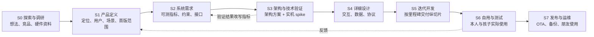

# 产品开发流程与当前位置

建立日期：2026-11-01。用户要求把仓库从“零散想法与竞品调研”推进到“需求 → 系统需求 → 产品设计 → 开发 → 可用产品”的完整过程，并由助手主动推进：确定的事情直接梳理，不确定的事情给出多个方案和推荐供用户选择，而不是把问题直接抛回。本文件是这套流程的唯一说明，也是“现在走到哪一步”的看板。

## 一张图看全流程

真实开发不是严格瀑布：S2 的指标要靠 S3 实机验证校准；S6 自用会反过来改 S1 的范围。但每个阶段有一个明确的**阶段门**——满足条件才把下一阶段当作主线，前一阶段的文档继续可改。

## 各阶段：做什么、产出什么、何时算过关

| 阶段 | 回答的问题 | 主要产出（仓库位置） | 阶段门（过关条件） | 状态 |
| --- | --- | --- | --- | --- |
| S0 探索与调研 | 有哪些想法？市场上别人怎么做？硬件能做到什么？ | [想法](ideas.md)、[需求池](requirements.md)、[研究](research/)、[简报](briefs/README.md) | 核心目标明确；硬件锁定；关键可行性有初判 | **已完成**（2026-10-26～31）。资料冻结为参考库，按需查阅，不再作为主线扩充 |
| S1 产品定义 | 给谁用、解决什么、首版做什么不做什么、怎么算成功 | [产品定义 PRD](product/prd.md) | 用户确认定位、首版范围（MVP）和成功标准 | **进行中**：v0.1 草案已写，待选首版方案 D-01 |
| S2 系统需求 | 每个功能“做到什么程度算合格”，用可测数字表达 | [系统需求 SRS](system/srs.md) | 首版功能都有可验收的系统需求；指标标明“建议值/实测校准值” | **进行中**：v0.1 草案，指标为待实机校准的建议值 |
| S3 架构与技术验证 | 系统怎么分层？最大的技术风险能不能被消掉？ | [架构方案](system/architecture.md)、[风险与验证计划](system/risks-and-spikes.md)、[决策记录](decisions/README.md) | 关键架构决策已定；高风险 spike 通过或有替代方案 | **已开始**：方案对比完成；spike 需要实物板卡（D-00） |
| S4 详细设计 | 页面长什么样、怎么操作、数据怎么存、app 与 AI 怎么对接 | `docs/design/`（交互稿、数据模型、能力协议） | 首个里程碑涉及的页面和接口有可实现的设计 | 未开始 |
| S5 迭代开发 | 按里程碑把功能做出来 | 固件/服务端代码仓（位置待 D-09） | 每个里程碑可演示、可自用 | 未开始 |
| S6 自用与测试 | 真实使用中好不好用、是否达到目标 | 测试记录、使用日志、问题清单 | 达到 S1 成功标准的首版门槛 | 未开始 |
| S7 发布与运维 | 怎么升级、备份、给朋友用 | OTA、服务器部署、使用说明 | 可稳定升级与恢复 | 未开始 |

## 现在的主线（2026-11-01）

1. **S1 收敛首版范围**：需求池里已有 29 条明确要求，全部同时做在一块 ESP32-S31 单片机上不现实，必须分版本。PRD 给出 A/B/C 三种首版方案，推荐 A（AI 阅读与听书 + 平台底座）。
2. **S2 把要求变成可测指标**：先给建议值，S3 实测后改成校准值。
3. **S3 并行准备技术验证**：架构方案已对比并给出推荐；最先要知道的是用户手上是否已有 Plus 实物及其版本（D-00），因为所有 spike 都要在实物上跑。

## 协作方式（用户 2026-11-01 指示）

- **确定的直接做**：整理、对比、起草、修文档、做原型，不等确认。
- **不确定的给方案**：每个待决事项至少给 2 个方案、各自代价和推荐，集中放在[决策记录](decisions/README.md)和交互式决策板上，尽量可视化、可点选。
- **不停下来等**：用户没空时，按推荐方案标为“暂定”继续推进，只对**可逆**的决定这样做；不可逆或花钱的事（采购、改硬件、删除历史数据、对外发布）必须等用户明确选择。
- **用户的明确要求、用户的想法、助手建议**仍按 [AGENTS.md](../AGENTS.md) 分开记录；暂定方案不会自动升级为用户需求。

## 可追溯链

每个功能都能从目标追到验收：

`G（核心目标）→ R（用户明确要求，requirements.md）→ F（产品功能，prd.md）→ SR（系统需求，srs.md）→ SP / 测试（验证与验收）`

决策用 `D-xx` 编号，记录在 [decisions/README.md](decisions/README.md)；改了决定保留原因。
