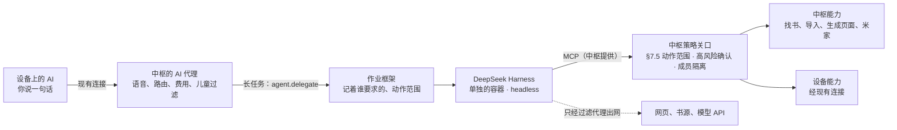

# 中枢上跑 DeepSeek Harness：能不能、怎么接、能做到哪

查阅日期：2026-11-12。用户的问题（I-064）：能不能在中枢部署 DeepSeek Harness，把设备和中枢的能力都交给它；然后设备上的 AI 可以下发这样的事：帮我找某本书的 PDF 导入设备，开发一个功能的应用装到设备上，连接米家的智能中心。

这是调研，没有安装或运行 DeepSeek Harness，也没有接米家账号。证据标注：【文档】官方资料；【实现】仓库代码或提交说明里看得到；【估算】写明假设；【建议】助手的设计选择。

## 1. 结论

**能接，但建议让它做“后台长任务的执行者”，不替换中枢自己的 AI。**

| 问题 | 结论 |
| --- | --- |
| 能部署吗 | 能。它开源（MIT）、能脱离界面跑（headless），也能当 MCP 客户端接外部工具【文档】【实现】。放在中枢上一个单独的容器里 |
| 把设备和中枢的能力交给它 | 能。中枢本来要对外提供 MCP（概要设计 §7.9），提前做出来，它就能用同一份能力目录。但它调的每一步都要过中枢的策略关口：§7.5 的动作范围、高风险确认、成员隔离照旧，它自己的审批界面不算数 |
| 语音对话也交给它吗 | 不建议。它是开发者预览版，自己写着没做过安全审计、会有不兼容的改动【文档】；语音要求第一句文字 3 秒内，中枢的路由、费用闸、儿童过滤都在自己的代理里 |
| 找书的 PDF 导入设备 | 能做，限合法来源：你自己的书库、公版书、你买过且能导出的、你配置的书源。不去盗版站抓（R-017 的条件） |
| 开发一个应用装到设备 | 能做“页面应用”：它写的是受限的页面描述（D-111 已定 AI 生成的页面用这种），中枢校验后装到设备，几分钟的事。要改固件的原生应用，它能写代码、出安装包，但装到设备要人来按（发起升级 AI 碰不到） |
| 连米家智能中心 | 能，走小米官方的 Home Assistant 集成。但中枢在日本服务器上，不在家里的局域网，用不了米家中枢网关的本地控制，只能走小米云；想本地控制要在家里放一台常开的小设备 |

**用户已定**（2026-11-12，“都按推荐推进”）：D-132、D-133、D-134 都选 A（第 7 节）。按 D-131，这些要等系统壳和现有应用成熟后再做；开发期中枢先跑在 Mac 上，日本服务器仍是正式部署的地方，推荐不变。

## 2. DeepSeek Harness 是什么

| 项目 | 内容 | 依据 |
| --- | --- | --- |
| 是什么 | DeepSeek 官方开源的智能体框架（命令 `dsh`），类似 Claude Code 这类编码智能体的“外壳”：智能体循环、命令行和文件工具、子智能体、待办、会话记录、上下文压缩 | 【文档】[仓库 README](https://github.com/deepseek-ai/deepseek-harness)；[The New Stack](https://thenewstack.io/deepseek-harness-open-source-plugins/) |
| 架构 | “一切都是插件”：模型适配、工具注册、会话记录、智能体循环本身都可以换，建在 Cordis 插件内核上 | 【文档】README |
| 许可和活跃度 | MIT，TypeScript / Node.js；2026-08-13 建仓库，查的时候约 27.9 万星，最近一次推送 2026-11-11 | 【文档】GitHub API，2026-11-12 |
| 版本 | 还是预发布：`dsh-v0.2.2-rc.2`（2026-11-11）。README 写明“开发者预览，会有不兼容的改动” | 【文档】GitHub Releases |
| 安全 | SAFETY.md：没做过安全审计，不能当作安全或可上生产；它会执行模型生成的代码和命令；沙箱和审批只能降低风险，不能保证隔离；建议放在一次性的虚拟机或容器里，只给最少的权限 | 【文档】[SAFETY.md](https://github.com/deepseek-ai/deepseek-harness/blob/main/SAFETY.md) |
| 能接外部工具 | 有 MCP 客户端插件（官方 TypeScript SDK，stdio 和 Streamable HTTP），每个 MCP 服务器是一个插件实例；只做客户端，不做服务器 | 【实现】仓库的设计记录 `mcp-client-plugin`（2026-07-07，已实现） |
| 能后台跑 | `headless` 入口：不开端口，跑完一个任务把结果写到标准输出，退出码表示成败 | 【实现】设计记录 `headless-direct-core-entry-point`（已实现） |
| 有沙箱 | 子进程默认在受限的文件沙箱里跑，被拒绝时可以申请升级；按会话设模式 | 【实现】设计记录 `sandbox`（已实现） |
| 模型 | 自带 DeepSeek 的 API 密钥、账号、联网搜索插件；模型适配本身也是插件 | 【实现】仓库的 `packages/llm/`、`packages/web/` |

## 3. 怎么放进中枢

- **中枢的 AI 代理还管说话**：一轮语音要在 45 秒里完成，第一句文字 3 秒内。找书、写应用这种要几分钟的事，它交给作业框架（概要设计 §5.10），作业再交给 DeepSeek Harness，做完用通知告诉你，`AiLog` 里看得到每一步。
- **单独的容器**：和处理不可信文件的 `worker` 一样，非 root，没有家庭数据库，没有密钥文件；只能经过滤代理出网。它要的模型密钥由中枢的模型网关代发，账本照常记到这位家人头上（D-79 的额度照常管）。
- **能力经 MCP 给它，过中枢的关口**：中枢提前做 §7.9 的对外 MCP。给它的连接带着这次作业的动作范围（§7.5）：你说的是“找这本书导入设备”，它就只能搜索、下载、导入、发到设备，不能顺手发短信。高风险照弹确认卡；记忆、听写记录这些私人资料不在它的工具表里，除非你点名。
- **它自己的审批不算数**：DeepSeek Harness 有自己的审批界面，但在这里没人看。所有动作以中枢的策略关口为准。

**资源**【估算】：Node 进程常驻约 300～600 MB，跑任务时更多；4 GB 的服务器加上浏览器（约 1 GB）还够，再加上家里设备的 Home Assistant（约 300～500 MB）就紧了。第 1 步量了主进程以后再定。

## 4. 三个例子能做到哪

| 你说的 | 怎么做 | 能不能 | 卡在哪 |
| --- | --- | --- | --- |
| “帮我找《××》的 PDF 导入设备” | 它在你配置的书源里搜（你自己的书库、公版书站、OPDS 书源、你买过能导出的），下载，交给 `worker` 安全解析，转成设备能读的内容包（概要设计 §5.6），经现有连接下到设备。D-105 下这是你亲口要求的，直接做，做完告诉你在书架哪里 | **能**，第 5 步内容管线做完以后 | 只用合法来源：找不到就说“找不到，可以试试这些地方买”，不去盗版站。要付钱的书弹确认卡（花钱）。阅读器现在只读 TXT，PDF 要等内容包 v1 |
| “帮我做一个记账的小应用装到设备上” | 它写一份页面描述（应用框架设计 §5.2 的受限格式：页面、输入、按钮，数据只在这个应用自己的地方），中枢校验版本、控件目录、权限，再装到设备 | **能做页面应用** | 页面应用只能用系统给的控件和能力，不能写任意代码。要更多就是原生应用：它能在代码仓库里写、跑测试、出签名的安装包，但装到设备是“发起升级”，AI 碰不到，要你按（底座设计 §6.2）。D-08 第三阶段的脚本应用还在量 Lua、MicroQuickJS |
| “连上米家，晚上帮我关灯” | 中枢上跑 Home Assistant + 小米官方集成，Home Assistant 自带 MCP 服务器，把它当成一个外部能力节点（`ext:home/…`，概要设计 §7.1）。AI 关灯、开空调、看温度都经这个节点 | **能**，走小米云 | 中枢在日本，不在你家局域网，米家中枢网关的本地控制用不了（第 5 节）。门锁、燃气这类建议算高风险（D-134） |

## 5. 米家：三条路

| 路 | 怎么接 | 好处 | 代价 | 依据 |
| --- | --- | --- | --- | --- |
| **A 中枢上跑 Home Assistant，走小米云** | Home Assistant 装小米官方集成（OAuth 登录米家账号，不用抓 token），再开 Home Assistant 的 MCP 服务器给中枢 | 不用买东西；官方集成，2.2 万星，最近版本 v0.5.0（2026-09-28） | 走小米云，比本地慢，小米云不通就控制不了；中枢多一个容器 | 【文档】[小米官方集成](https://github.com/XiaoMi/ha_xiaomi_home)、[Home Assistant MCP 服务器](https://www.home-assistant.io/integrations/mcp_server/) |
| **B 家里放一台常开的小设备跑 Home Assistant** | 树莓派、NAS、旧电脑都行，和米家中枢网关在同一个局域网，走本地控制；它作为外部能力节点连到中枢 | 快，外网断了家里还能控制；门锁这类东西不经过国外服务器 | 要一台常开的设备（花钱或用旧的） | 【文档】官方集成：本地模式要米家中枢网关（固件 3.3.0_0023 起）或带中枢功能的设备，而且 Home Assistant 要在同一个局域网 |
| **C 社区的米家 MCP，直接登录米家账号** | 几个第三方项目 | 最简单 | 都基于非官方接口，维护参差不齐，账号风险 | 【文档】[社区项目列表](https://glama.ai/mcp/servers/javen-yan/miot-mcp)；没查到小米官方的米家 MCP |

**许可**：小米官方集成的许可只允许非商业使用【文档】。你一家自己用没问题；以后要给别人卖或交付，就不能用它。

**推荐 A 起步**：不用买东西，先把“AI 能控制家里的设备”跑通；觉得慢或者想本地控制，再加 B，中枢那边不用改，只是外部能力节点换了地方。

## 6. 风险

| 风险 | 说明 | 怎么降低 |
| --- | --- | --- |
| 它还是预览版 | 会有不兼容的改动，没做过安全审计【文档】 | 固定版本，不自动升级；只当可换的执行者，接口是 MCP 和作业，换掉它中枢不用改 |
| 它会执行模型写的代码 | 写应用、处理文件时会跑命令 | 单独容器、没有家庭数据、只经过滤代理出网；产物（页面描述、安装包）由中枢校验后才用 |
| 被网页带偏 | 找书时读网页，网页里的话可能让它做别的事 | 动作范围在派活时就定好（§7.5），它只能在范围里做；高风险照弹卡 |
| 米家走国外服务器 | 控制指令经日本服务器到小米云 | 门锁、燃气、摄像头算高风险（D-134）；想不经过国外就走 B |
| 费用 | 长任务调很多次模型 | 照常记账、受 D-79 的额度管；派活前说大概要花多少 |

## 7. 决策（用户 2026-11-12 都选 A）

| 编号 | 决策 | 选项 | 推荐 |
| --- | --- | --- | --- |
| D-132 | DeepSeek Harness 在中枢里做什么 | **A** 后台长任务的执行者：找书、写页面应用、整理资料这些几分钟的事，中枢的 AI 代理派给它；**B** 换掉中枢自己的 AI 代理，语音也走它；**C** 先不接 | A |
| D-133 | 米家怎么接 | **A** 中枢上跑 Home Assistant，走小米云；**B** 家里放一台常开的小设备跑 Home Assistant，走本地；**C** 社区的米家 MCP | A 起步，以后可加 B |
| D-134 | 家里的设备哪些算高风险（补 D-105 的清单） | **A** 门锁、燃气、监控摄像头、离家布防算高风险，要确认；灯、空调、窗帘、音箱直接做；**B** 全部直接做；**C** 全部要确认 | A |

## 8. 对现有设计的影响（定了再改）

- 概要设计 §7.9 的对外 MCP 从“以后”提前，给 DeepSeek Harness 和 Home Assistant 用；连接带作业的动作范围。
- 新增能力 `agent.delegate`（派长任务）、`app.install`（装页面应用）；`ext:home/…` 节点。
- §4.3 的规格：同时跑浏览器、DeepSeek Harness、Home Assistant 时，4 GB 偏紧【估算】。
- §10 的步骤：DeepSeek Harness 接在第 5 步（内容管线）之后；米家可以单独一步，不依赖别的。

## 来源

查阅日期都是 2026-11-12。

- [deepseek-ai/deepseek-harness](https://github.com/deepseek-ai/deepseek-harness)：README、SAFETY.md、Releases，仓库里的设计记录 `.agents/notes/archived/`（MCP 客户端、headless、沙箱）
- [The New Stack：DeepSeek open sources an agent harness where everything is a plugin](https://thenewstack.io/deepseek-harness-open-source-plugins/)
- [DataCamp：DeepSeek Harness Tutorial](https://www.datacamp.com/tutorial/deepseek-harness)
- [XiaoMi/ha_xiaomi_home](https://github.com/XiaoMi/ha_xiaomi_home)：README（本地模式、许可）、Releases
- [Home Assistant：Model Context Protocol Server](https://www.home-assistant.io/integrations/mcp_server/)
- [IT 之家：小米路由器 BE6500 Pro 支持官方集成本地控制](https://www.ithome.com/0/826/055.htm)
- [社区米家 MCP 示例：miot-mcp](https://glama.ai/mcp/servers/javen-yan/miot-mcp)、[HA + 小米官方集成接 MCP 的教程](https://github.com/AZHi-xinxin/xiaomi-ha-mcp-tutorial)
