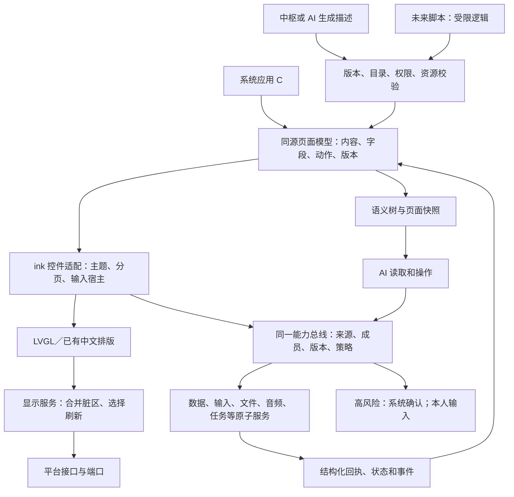

# 应用框架设计建议

日期：2026-11-05；代码基线：`2163603`。这是研究和待选设计，不是新需求、已选决定或产品实现。不改 D-08、D-10，也不修改现有规范来迁就代码。外部事实的链接、版本和查阅日期集中在[来源表](../research/app-framework-survey.md#1-来源索引)，文内 S 编号链接官方来源，完整范围见该表，查阅日期均为 **2026-11-05**。

证据：【文档】现行规范或上游说明；【实现】核查代码所得；【实测】本次命令结果；【估算】明确假设的计算或判断。没有标成实测的速度和空间判断，都不表示在设备上跑过。这里的“首版／以后／不做”均为组件实现顺序建议，不取消用户已定功能；本轮只写设计。

## 0. 一页结论

**【建议：有条件可行】做一套薄的应用框架：系统负责控件、输入和权限，应用负责内容与业务；底层继续使用 LVGL。** 条件是所有页面共用输入会话和能力表、页面有资源上限，且通过后续 S31 实测。主要限制是内部内存紧、墨水屏刷新慢，不能把手机上的整套系统搬来。

| 用户的问题 | 推荐回答 | 为什么 |
| --- | --- | --- |
| 文本框、按钮这些该不该做？ | 要做成统一的系统组件。应用直接选“按钮”“密码框”“列表”，不用每个应用重新画 | 统一字体、触控区、刷新、键盘、无障碍式语义和 AI 操作；组件清单见第 2 节 |
| 是复用 LVGL 还是自己写？ | 复用对象、标签、布局、按钮、图片等基础；外面包一层 `ink_` 接口。中文阅读排版继续走已有排版引擎 | 避免重造绘图库；LVGL 默认滚动、动画、键盘策略不能直接当墨水屏规则（[S01]、[S02]） |
| 应用用什么语言？ | 系统应用先用 C；中枢或 AI 生成的页面用受限页面描述；第三方脚本保持 D-08 路线，先量再选 | 首版沿用已运行的代码；生成页面不用给模型任意代码执行权；以后不必重写底层 |
| TypeScript 式、安卓式，还是各应用独立设置？ | 开发体验借鉴“声明界面＋调用系统能力”。以后可在电脑上用 TS 写工具或转译，设备不运行 TS 编译器；不承诺 APK，也不让应用各自挑键盘和权限机制 | 语言与系统架构是两回事。TS 不要求浏览器；APK 依赖完整 Android 平台（[S13]、[S21]） |
| 什么时候弹输入法？ | 人点可编辑文字框、明确进入写作页时才开；AI 代填普通字段可不弹。日期、单选、开关不弹；数字用数字键盘；密码只给本人输入 | 字段声明“要填什么”，系统选择合适输入方式；语音和打字写进同一份草稿 |
| 弹出后页面怎么办？ | 固定下方键盘区，普通短字段放到上方可见区；长文使用 `ImeLong` 式专用编辑页，分页。只在进入时调整一次，键入时不让整页跟着移动 | 少刷屏，保留光标、草稿和返回位置。搜索和短信按已有设计预留键盘，不再加一层弹窗 |
| 哪种最 AI first？ | 人看的组件和 AI 的语义树来自同一份页面模型；按钮和 AI 都调用同一个已登记能力；密码和人的确认不交给 AI | C、JS、Lua 都能做到或做坏。关键是结构、权限和回执，不是语言名字 |

**【建议】本轮可以据此拆任务；先不选脚本赢家、不引入商业运行时。** 先做公共组件和输入适配，再接系统应用。三个候选实测用“无脚本声明式、Lua、MicroQuickJS”；其余保留为有依据的比较对象。首版内置应用不等这个实验。

## 1. 现状：已有基础，尚不是完整应用 SDK

以下均为【实现】，行号针对基线；“UI 副本”是任务书指定的只读副本，开工提交为 `d136a3a`，不算本分支已合入的成果。

| 范围 | 已经有 | 缺什么或边界 | 代码证据 |
| --- | --- | --- | --- |
| 图形基础 | 固定 LVGL v9.5.0，独立构建目标；LVGL 分配走系统外部内存 | 不能把上游所有控件当作已封装 SDK | [构建](../../CMakeLists.txt#L141)、[分配桥](../../system/ui/lv_mem_osal.c#L1) |
| 页面和浮层 | 页面栈、统一 UI 任务、浮层输入和快照回调、刷新提示 | 没有通用字段避让协议、自动语义树；快照靠每页手写 | [页面快照](../../system/ui/ui_task.c#L290)、[入栈](../../system/ui/ui_task.c#L395)、[浮层移除](../../system/ui/ui_task.c#L483) |
| 应用目录 | 注册、前后台、冻结、保存／恢复、权限清单、服务卡片 | 保存状态最多 1024 字节，不等于可存整篇草稿；还没有可安装包加载器 | [应用协议](../../system/include/ink/sys/appreg.h#L22)、[卡片能力](../../system/ui/app_registry.c#L475) |
| 文本字段 | 焦点、组合串、候选、选区、撤销，密码掩码；大缓冲在外部内存 | 字段外观仍占位、横向取光标附近文字，未实现长文分页；无日期等字段语义 | [字段](../../system/ui/textfield.c#L24)、[创建](../../system/ui/textfield.c#L216)、[输入配置](../../system/include/ink/sys/textinput.h#L19) |
| 键盘和听写 | 系统键盘、数字／电话模式、普通文字候选、听写面板 | 基线键盘直接盖底部，页面不自动适配；没有全套设计稿外观 | [键盘建页](../../system/ui/shell/keyboard.c#L124)、[类型选择](../../system/ui/shell/keyboard.c#L289) |
| AI 编辑 | `text.state/insert/submit/select/undo/redo`，密码拒绝代填；成员剪贴板 | 焦点式调用仍需补字段身份和会话版本；AI 看不见没有快照回调的页 | [文本能力](../../system/services/text/text_caps.c#L17)、[拒绝秘密字段](../../system/services/text/text_caps.c#L62) |
| 能力策略 | 统一调用、成员、应用权限、页面版本、结构化回执 | `confirm_for` 仍按外部／系统副作用默认确认，与 D-105 有差异；本任务不修 | [策略](../../system/policy/cap.c#L78)、[检查](../../system/policy/cap.c#L100) |
| 现有应用 | 主页示例、原生阅读、远程画面 | 远程快照还是摘要，不能读出网页字段；不具备 A2UI 通用渲染器 | [主页](../../apps/home/home.c#L1)、[阅读快照](../../apps/reader/reader.c#L506)、[网页快照](../../system/apps/remote/remote.c#L569) |
| UI 副本进展 | 主题、字号字重、图标、卡片、胶囊、圆按钮、开关、滑杆、分段、列表行、面板、分页；键盘已接能力与快照 | 组件仍接 LVGL 事件回调，不自动生成通用语义树；不得在这里另造同名组件 | 只读副本 `system/ui/theme.c:138–267`、`system/ui/ink/ui_theme.h:42–64`、`system/ui/shell/keyboard.c:117–127` |

【文档】[底座 §4.8、§5.7、§6.6](foundation.md) 已要求统一输入会话、编辑与保存状态、A2UI v0.9 自定义目录；[服务设计 §9](system-services-design.md#9-文本输入和剪贴板) 说明已有服务。设计和实现的差距不能靠另开一套输入法弥补。页面参数与权限名单是框架契约；本地 C 应用在同一地址空间，清单检查不是内存隔离。

## 2. 控件清单

### 2.1 对照范围和共用规则

【文档】种类对照 LVGL（[S01]）、Android Material（[S21]）、iOS HIG（[S23]）、完整 ArkUI（[S15]），再看 Pebble 菜单和图层（[S17]）、Flipper GUI（[S19]）、Zepp 控件（[S16]）。这是功能分类对照，不承诺兼容这些 API；完整 ArkUI 不等于鸿蒙轻量 JS UI。

| 控件组 | LVGL 对应 | Android 对应 | iOS 对应 | ArkUI 对应 | 小设备借鉴 |
| --- | --- | --- | --- | --- | --- |
| 文字和段落 | Label / 自绘 | Text | Text / Label | Text / Span | Pebble TextLayer |
| 按钮和图标按钮 | Button＋Image | Button / IconButton | Button | Button | Zepp BUTTON |
| 单行、多行和搜索 | TextArea；系统键盘 | TextField / SearchBar | TextField / TextEditor / Search | TextInput / TextArea / Search | Flipper 独立文字输入视图 |
| 勾选、单选、开关 | Checkbox / Switch；组合单选 | Checkbox / RadioButton / Switch | Toggle / Picker | Checkbox / Radio / Toggle | 菜单里显示真实选中值 |
| 滑杆、分段、选择 | Slider / ButtonMatrix / Roller / Dropdown | Slider / SegmentedButton / Picker | Slider / Segmented control / Picker | Slider / Select / TextPicker | 只点档位，不连续动画 |
| 列表、网格、表格 | List / Flex / Grid / Table | Lazy 列表网格／组合表格 | List / Grid；表格按平台组合 | List / Grid / GridRow | Pebble MenuLayer；不照搬手机滚动 |
| 导航和页签 | TabView / TileView＋组合 | Tabs / Navigation | Tab bar / Navigation | Tabs / Navigation | 页面栈＋实体返回 |
| 对话框、面板、菜单 | MsgBox / Menu＋组合 | Dialog / BottomSheet / Menu | Alert / Sheet / Menu | Dialog / Sheet / Menu | 系统独占输入与退出路径 |
| 进度、图片、角标 | Bar / Arc / Image＋Label | Progress / Image / Badge | ProgressView / Image / Badge | Progress / Image / Badge | 分阶段更新、常驻状态静止 |

下表“现状”缩写：**基**＝本基线有基础但未验收设计外观；**副**＝只读 UI 副本有包装；**缺**＝没找到统一组件。优先级全部为【建议】。每项的语义还须带成员、页面版本、可用状态；装饰不伪装成可点按钮。

### 2.2 逐项清单

| 控件 | 现状 | LVGL 复用／自包 | 墨水屏改法 | 给 AI 的语义 | 建议顺序及设计稿依据 |
| --- | --- | --- | --- | --- | --- |
| 文字、标签、标题 | 基／副 | Label＋主题包装 | 字号行高依规范；不跑马灯 | text、role、对象引用 | 首版；Foundation、TopBar |
| 段落、长正文 | 基阅读排版 | 复用排版引擎，短说明用 Label | 整行分页、无惯性滚动 | 文本区间、页码、选区 | 首版；AiLong、StressThread |
| 普通按钮、胶囊 | 基／副 | Button 包装 | 默认结果即反馈；等待才反色 | action、label、enabled | 首版；Components |
| 图标按钮、圆按钮 | 基／副 | Button＋Image | 统一热区、按下态不动几何 | 有动作名，不能只给图标名 | 首版；IconSheet、Camera |
| 单行文字框 | 基 | 对象＋Label，继续接输入服务 | 不闪光标；只刷文字区 | field id、类型、值、校验 | 首版；RemoteAddress |
| 多行输入 | 基服务／缺版式 | 同一编辑模型＋分页包装 | 不生成超高大 Label | 草稿引用、光标、页码 | 首版；ImeLong、MemoEdit |
| 搜索框 | 缺统一／副页面 | 单行框组合 | 字固定，结果分批分页 | query、搜索范围、结果版本 | 首版；Search、Sms |
| 数字输入 | 基键盘 | 系统数字键盘＋校验器 | 点按只刷数字和输入行 | 数值、范围、单位 | 首版；Phone、SetKid |
| 电话输入 | 基类型 | 数字键盘变体 | 保留＋、＊、＃等合法字符 | 电话／联系人对象，不自动拨号 | 首版；Phone、SmsCompose |
| 密码、PIN、验证码 | 基／副 | 系统安全输入，PIN 复用 pinpad | 黑白键；不闪字符、不听写 | hidden、是否可编辑；无值和真实长度 | 首版；Pin、PinSet、ImePassword |
| 勾选、清单项 | 缺统一 | Checkbox 或按钮包装 | 仅旧新状态小区 | checked、item id、toggle 能力 | 首版；MemoChecklist、FileActions |
| 单选行 | 缺统一 | 列表＋选中标记 | 整行可点，标记局刷 | options、selected id | 首版；FileMove、SetSound |
| 开关 | 副 | 可复用 Switch 状态，外观包层 | 取消滑移动画，纯黑白 | setting id、布尔值、set 能力 | 首版；Toggle、TodayEdit |
| 滑杆 | 副 | Slider 或现有分档条包装 | 点档、松手提交，不逐像素拖刷 | range、step、单位、成员上限 | 首版；Slider、Control、SetDisplay |
| 加减档位器 | 缺 | Button＋静态档位条 | 不增加独立刷新定时器 | increment/decrement、当前值 | 首版复用；Stepper（不取代已定滑杆） |
| 分段选择 | 副 | ButtonMatrix／胶囊组合 | 一次切状态，无滑动指示动画 | enum 值和每项动作 | 首版；Seg、SetNetwork、Memo |
| 日期选择器 | 缺 | Calendar 数据或分页网格包装 | 点月／日，不转滚轮 | 日期、时区、允许范围 | 首版；Calendar 的编辑入口待补稿 |
| 时间选择器 | 缺 | 分栏数字＋加减／数字键盘 | 无飞转滚轮，设定后再提交 | 时分、时区、重复规则 | 首版；Clock、SetKid 编辑待补稿 |
| 数字／枚举选择器 | 缺 | Dropdown 数据，包装成分页列表 | 不用小下拉框挤在原页 | enum、当前项、范围 | 首版；字体、铃声、闲置时长 |
| 列表、分组和两行行 | 副 | List / Flex＋主题行 | 一屏一页，稳定行高 | 总数、游标、行对象、动作 | 首版；Group、StressFiles |
| 网格 | 基主页／副 | Grid 布局＋可见项池 | 不给每项开动画，不常驻整库 | 顺序、对象、选中项 | 首版；Apps、Gallery |
| 数据表格 | 缺 | Table＋分页列选择包装 | 不做横纵惯性滚动；可退为记录卡 | 行列名、值、对象版本 | 以后通用组件；首版已有日历网格照做 |
| 页签 | 副用分段表达 | 包装 TabView 状态或分段 | 直接换内容，不滑屏 | 当前页签、可切目标 | 首版；Phone、Clock |
| 分页器、指示点 | 副 | Button＋Label | 端点禁用；主页点只指示不可点 | 当前页、总页／未知、前后能力 | 首版；PageBar、Main |
| 对话框、确认卡 | 基／副 | 系统不透明面板，非应用自造确认 | 清楚实线；外面不铺遮罩 | 事务对象、到期时间、状态；确认仅人 | 首版；Confirm 系列 |
| 底部面板 | 基／副 | 系统浮层容器 | 无进入动画；关闭只恢复覆盖区 | overlay id、遮挡范围、关闭动作 | 首版；Ai、PowerMenu |
| 提示、错误、撤销 | 基局部／副 | Label＋图标＋动作组合 | 就地换文案，不消失式横幅 | 原因、可恢复动作、undo token | 首版；Notice、MemoUndo、StateKit |
| 进度条 | 基服务／缺通用 | Bar 包装 | 分阶段／节流，不假进度 | job id、真实阶段、比例可未知 | 首版；Tasks、Update |
| 圆环／容量分段 | 缺统一 | Arc / Bar 自绘组合 | 不自转，数值变化才更新 | 百分比／容量单位、来源 | 首版；Charging、Files、SetStorage |
| 分步进度 | 缺 | Label＋线＋状态图标 | 状态变化更新，等待点静止 | 阶段列表、当前阶段、错误 | 首版；Stages、ImportJob、RestoreRun |
| 图片、缩略图 | 基远程画布／缺媒体链 | Image＋系统解码／抖动 | 预处理灰阶、限尺寸缓存 | 媒体引用、版本、说明 | 首版；Photo、Wallpaper（依赖 file-index） |
| 头像 | 副字头像 | 图片或首字 Label＋圆形 | 静态，不轮播 | 成员引用、显示名；不凭头像授权 | 首版；Members、PhoneContacts |
| 角标、未读数 | 缺统一 | 小 Label＋形状 | 数值变化更新；锁屏按规则遮蔽 | unread_count、对象引用 | 首版；StatusBar、Sms |
| 卡片、服务卡片 | 基服务／副外观 | 容器＋已封装子组件 | 数据变更节流，无独立心跳 | 标题、值、版本、主能力 | 首版；Today、Components |
| 活动卡、通话返回条 | 基后台状态／副外观 | 系统组合组件 | 一件最重要活动；不跳秒 | activity/job id、暂停／回到能力 | 首版；ActivityCard、MainInCall |
| 空状态、不可用状态 | 缺统一／副提示 | 图标＋说明＋唯一恢复动作 | 无闪烁 loading，不虚构成功 | empty/unavailable/error、原因 | 首版；StateKit、SearchEmpty |
| 菜单、长按菜单 | 基文字／副壳 | Menu 数据＋系统面板 | 只画菜单区，关闭恢复 | 菜单项＝能力，不传任意回调 | 首版；IconMenu、FileActions、ImeEdit |
| 状态栏、麦克风指示 | 基状态／副 | 系统组合组件 | 时钟按规范；麦克风状态真实 | 系统状态、录音归属；锁屏脱敏 | 首版；StatusBar、PartsNew |
| 顶栏、Dock、分隔线 | 基／副 | 布局＋Button＋Line | 页面翻页不重画未变化 Dock | 导航目标；装饰线不导出动作 | 首版；TopBar、Apps、Group |
| 保存回执 | 基本地状态／缺备份 | Label＋图标组合 | 只报真实阶段，失败原位显示 | local_durable／pending／hub_received | 首版；SaveMark、MemoSaveFail |
| 对话气泡、引用块 | 缺统一 | Label＋卡片组合 | 长消息分页，不半行切断 | 消息 id、说话人、出处、版本 | 首版；SmsThread、AiHome、StressThread |
| 播放条、录音面板 | 基音频／缺统一 | Button＋Bar＋Label | 时长到分钟；无跳动频谱 | 媒体对象、播放位置、焦点状态 | 首版；MemoDetail、MemoRecord |
| 二维码、加入步骤 | 缺统一 | LVGL QR 原语或系统生成图片 | 静止，实际码更新才刷 | 用途／状态；令牌和加入秘密不导出 | 首版；FirstBoot、BootClaim、Transfer |
| 文字选区、编辑工具条 | 基／副部分 | 现有编辑会话＋按钮 | 点光标、长按词、箭头微调 | 非秘密文本选区、撤销状态 | 首版；ImeEdit、阅读选词 |
| 组合串、候选区、符号页、话筒 | 基／副部分 | 系统输入组件，不用 LVGL 默认键盘接管会话 | 固定区域，候选翻页，听写不改高度 | 非秘密组合和候选、输入状态 | 首版；Keyboard、Ime 系列 |
| 连续动画、跑马灯、拖动滚轮 | LVGL 上游有 | 不开放到设备应用目录 | 与当前无动画和分页规范冲突 | 无可调用项 | 不做此种表现；相同功能用上面的静态控件 |

【实测】[调研 §3](../research/app-framework-survey.md#3-设计稿和本地代码取样) 列出全部 177 个 PNG 和清单摘要。上述清单额外覆盖了容易漏的 `Stepper`、`StateKit`、`PartsNew`、二维码、对话气泡、保存标记和分步状态。`Camera` 的取景是专用受预算控制的媒体区域，不能泛化为任意页面的高刷画布。

【文档差异】底座 §6.6 曾把滑杆、Tabs、弹窗从声明式目录中排除；现行界面规范与设计图有这些控件。**建议重议的是“是否让受限声明式目录也使用它们”**，不是重新决定系统页面需不需要。未选前，系统原生控件照规范做；声明式页用安全基础目录，需要确认时请求系统面板，不自行冒充确认卡。

## 3. 应用模型和语言对比

### 3.1 先分清三件事

【建议】“用什么语言写”“页面由谁画”“谁有权限做事”分开选择。这里的运行时是解释脚本的小程序；声明式页面只是文字、控件、数据绑定和动作编号，不是任意代码；中枢渲染则由服务器排好或画好，设备接收结果。

所有候选都接同一套本地控件、输入和能力桥。**不允许各应用自带键盘、成员系统或新的硬件调用通道。** 下表的性能比较是【估算】与证据缺口，不是跑分。S31 的 Flash 增量、内部 RAM、PSRAM、启动和建页时间均无本次实测；[调研 §2](../research/app-framework-survey.md#2-能比较和不能比较的资源数字) 另列上游数字及测试条件。

| 方案 | Flash | 运行内存 | 启动、建页 | S31 RISC-V 支持证据 | 来源 |
| --- | --- | --- | --- | --- | --- |
| C＋LVGL 编进固件 | 共享现有引擎；每应用增量没查到 | 无额外 VM；控件、业务和栈仍占空间 | 直接建对象；S31 耗时没查到 | 本工程已有 C 模拟器；本任务未跑 S31 固件；不能据桌面成功宣称设备成功 | [S01]、[S03]；本地第 1 节 |
| 受限声明式＋原生能力 | 解析器、校验器、组件映射增量没查到 | 页面数据＋控件；可只建当前页 | 要解析和校验；本设备时间没查到 | 继续用现有 C/LVGL 平台；A2UI-lite 没有本项目 S31 端口验证 | [S04]；底座 §6.6 |
| LVGL XML | 运行时 XML 引擎增量没查到 | XML、绑定和控件峰值没查到 | 要解析；不把导出静态 C 算成动态加载 | 与平台 C 端口相关；本设备动态 XML 未测 | [S01]、[S02] |
| Lua | VM 和能力桥增量没查到 | 独立分配器可计账；实际堆／栈没查到 | 可预处理脚本，仍有解释和 GC；时延没查到 | C 嵌入接口是依据；可移植性属推断，非 S31 适配证明 | [S05] |
| Berry | 不使用 ARM 的最小内核数当 S31 数 | 常量只读可减初始堆；完整 UI 堆没查到 | 解释与 GC；本设备耗时没查到 | 未确认官方 S31 端口；需先交叉编译 | [S06] |
| MicroPython | 整个 ESP32 固件大小不能当嵌入增量；没查到 | Python 对象、GC、桥接与控制栈都要计账；没查到 | 源码／预编译模块路径不同；没查到 | 文档明确列 C3/C6，不足以确认 S31 | [S07] |
| JS：Moddable XS＋Piu | 是另一套 UI 栈，不能只算 XS；没查到 | JS 堆、Piu/Commodetto 和输入桥；没查到 | 有预编译工具与调试；S31 建页没查到 | 文档列 C3/C6/H2；S31 适配本次未确认 | [S08] |
| JS：QuickJS | 不拿 x86 hello 的体积替代 S31；没查到 | 可设置运行时堆和栈上限；实际峰值没查到 | 官方桌面生命周期数不等于本设备建页 | C 引擎的可移植性是线索，S31 集成未验证 | [S09] |
| JS：JerryScript | 配置和 snapshot 会改变代码大小；没查到 | 小设备目标数字不含 UI；没查到 | 预编译 snapshot；S31 GC／启动没查到 | 未确认 S31 专用端口；需移植系统接口 | [S10] |
| JS：MicroQuickJS | 紧凑解释器；ARM ROM 数不能替代 S31 | 有小内存运行例子；本项目桥和峰值没查到 | ROM 常量减少初始化；S31 时间没查到 | 32 位表示支持是线索，仍须在 S31 工具链验证 | [S11] |
| TS 源码→上述 JS 子集 | TS 编译器留电脑；设备装所选 JS 引擎 | 设备成本由生成的 JS 决定 | 转译／校验留电脑；不能假定所有 TS 库能跑子集 | 由目标引擎决定；DOM、Node API 不自动存在 | [S13]、[S09]～[S11] |
| Wasm：WAMR 解释器 | 核心、验证、libc 与桥增量没查到 | 线性内存、执行栈、宿主桥全部计；没查到 | 加载验证和实例化；本设备没查到 | 明确有 RISCV32，C3 示例；S31 ABI、IDF 和端口需验 | [S12] |
| 中枢渲染 | 本地接收／解码／缓存增量没查到 | 缓冲和状态缓存；不能当成“零内存” | 要等网络和服务器，离线首开无保证 | 设备只接收描述或像素；现有远程功能只验证模拟器 | 本地 remote；[S04] |

| 方案 | 隔离与权限、单独更新 | 调试与模拟器 | 墨水屏控制 | 许可边界 | AI 能读、操作、生成吗？ |
| --- | --- | --- | --- | --- | --- |
| C＋LVGL | 同地址空间，无第三方内存隔离；随签名固件更新 | 复用现有 C 调试和确定性测试 | 最直接，仍须交系统调度 | LVGL MIT；Brookesia 旧组件 Apache-2.0，作参考不整套搬入 | 可生成源码，但必须开发审核和编译；读与操作靠同源语义与能力 |
| 受限声明式 | 无任意代码；按成员和权限校验；可独立更新描述和数据 | JSON/schema 错误、语义树、截图和回放 | 固定组件及分页，只让系统提交脏区 | 自定义协议实现不等于复制上游；A2UI Apache-2.0 | 最适合生成；结构直接可读，动作由设备解析并校验 |
| LVGL XML | 结构不是权限系统；可单独换 XML，但回调仍是原生代码 | 上游工具可辅助；本项目要接模拟器 | 仍需封装，不能开放任意动画／回调 | 核心 MIT；9.5 运行时 XML 商业许可未采购 | 可生成布局，但 XML 树本身缺成员、秘密和能力语义 |
| Lua | 单 VM 分配器和受限模块属于软件边界；不能裸开 io/os/debug 或 C 动态模块；脚本可独立换 | 命令行、hook、宿主测试；确定性和资源计费需接入 | 只调用声明式控件桥，不直接画屏 | MIT | 可生成脚本；从脚本推断可见页不可靠，仍须语义模型 |
| Berry | 同样需要受限 FFI、配额和执行中断；可独立换脚本 | 语言工具链可用；本项目模拟器桥未有 | 只经系统组件 | MIT | 可读代码、能生成但模型熟悉度本任务未测；仍需描述与能力 |
| MicroPython | 默认硬件／文件模块不是沙箱；仅白名单嵌入；可独立换模块 | REPL 对开发方便；部署时不暴露特权 REPL | 不能逐像素循环驱动显示 | MIT；所选扩展另查 | 可生成；不能直接把 Python 对象反射当安全快照 |
| XS＋Piu | mods 提供代码更新路径；不等于本项目成员隔离 | xsbug、PC 模拟是优点；重接显示／输入成本高 | Piu 自有绘制链要另接脏区，不继续享用现有 LVGL 组件 | 现行 SDK 含 GPL/LGPL／商业选项；当前规则下不引入，仅比较 | JS 易表达页面；Piu 对象仍需转语义和能力 |
| QuickJS | 内存／栈限制和中断回调；不导出系统模块；代码可更新 | CLI、可嵌入测试；本项目无专用 SDK | 经同一桥，不能开放原始 LVGL 指针 | MIT | 可以生成 JS；引擎没有页面语义，需另建 |
| JerryScript | 堆配置、异常和受限模块仍需宿主监督；snapshot 更新须匹配版本 | 现有工具可作起点，模拟时钟／桥需接 | 同上 | Apache-2.0 | 可以生成受支持 JS；快照仍由页面模型导出 |
| MicroQuickJS | 子集减少接口面；仍须验证中断、内存峰值和全部宿主调用；可换受限脚本 | CLI 和内存统计；完整调试体验需验证 | 同上 | MIT | 可生成，但很多现代 JS 写法不支持；必须带 schema 和子集检查 |
| TS→JS | 权限仍由引擎＋能力桥提供，类型检查不是权限检查 | 电脑类型检查、source map 是否可用另验 | 由同一系统桥控制 | TS 工具与依赖逐项审查，不捆绑整个 Web 生态 | 有类型更容易生成合法描述；不替代设备校验 |
| WAMR | 校验、线性内存和受限 imports；宿主函数仍可破坏边界；模块可单独更新 | 主机 runner、源码调试支持，接现有模拟器需要工作 | 只导出语义控件／能力，不导出像素和任意地址 | Apache-2.0 WITH LLVM-exception | 字节码不适合让 AI 读；同时提供源码、manifest 和页面语义才可用 |
| 中枢渲染 | 服务器和设备各校验；下发更新容易，服务权限不能下放 | 中枢日志＋设备协议回放，必须能重放断网 | 描述型可本地选脏区；像素型难知道输入和刷新语义 | 取决于服务／浏览器／素材，没统一许可结论 | 描述型好；纯截图需另带结构化文本和对象编号，否则不能可靠填写 |

上述接口和许可事实据 [S01]～[S16]，查阅日均 2026-11-05；“如何用于本项目”是【建议】。各语言的内存安全都不能代替成员授权。WAMR 本轮只评解释器；AOT/JIT 会执行生成的机器码，涉及 R-037 的边界，本建议不为第三方开启。

### 3.2 从已有小设备借鉴什么

| 对象 | 上游做法【文档，查阅日 2026-11-05】 | 给本项目的建议 |
| --- | --- | --- |
| ESP-Brookesia（[S03]） | 服务、应用生命周期、原生及多运行时；master 已列 S31 和 PC 模拟 | 借鉴服务边界；已有系统不整体换成它，也不升级 IDF 来追 master |
| Vela 快应用（[S14]） | 类 Web 页面、清单、系统接口与路由 | 学习“页面描述＋受控原生能力”，不承诺兼容其应用包 |
| 鸿蒙轻量 JS UI／完整 ArkUI（[S15]） | 轻量 JS 桥与完整系统组件是不同范围 | 可以像声明式框架一样写页面，但不把完整 ArkTS 当作 S31 运行时 |
| Zepp OS（[S16]） | JS 调用系统控件，清单声明权限 | 控件和原子能力在设备，脚本只组合；不照搬运动手表刷新方式 |
| Pebble（[S17]） | Window、Layer、文字、菜单与实体键交互 | 少量稳定原语也可组成丰富应用；不能把其原生应用隔离当本项目已有 |
| Garmin Connect IQ（[S18]） | Monkey C、设备目标和权限清单、系统 UI 约束 | 借鉴 manifest 与资源准入；不引入专有 VM，也不照抄其设备内存指标 |
| Flipper Zero（[S19]） | 原生 FAP/ELF 与 JS GUI、系统文字输入 | 借鉴系统提供输入页；FAP 违反 R-037，GPL 固件代码不复制 |
| Playdate（[S20]） | Lua/C 混用，SDK 有模拟器与性能工具 | 设备可以同时有原生和脚本入口；借鉴开发闭环，不移植专有 SDK |

### 3.3 为什么不走完整安卓式

【文档】Android 的平台包括 Linux、ART、原生系统库、应用进程与上层框架（[S21]，2026-11-05）。【判断：当前约束下不建议】任务给定的 MCU 内存和现有系统端口不具备这套运行环境；本次也没有同配置 Android 体积或启动数据，不能编造“最少需要多少 GB”。RISC-V 指令集相同更不代表 APK 可运行。

【建议】保留安卓式中有价值的部分：清单、生命周期、系统输入法、页面恢复、权限和统一控件。**系统应用用 C；中枢／AI 内容用描述；未来第三方先受限声明式，再按 SP-08 选择脚本。** “独立安装”应指数据包／脚本包可更新，不等于允许加载任意本机二进制。

### 3.4 单页原型补充（2026-11-05）

【实测H】本轮在 macOS 15.7.9 / arm64、clang 17、`-O2`，按任务书选 C＋LVGL、受限 JSON、Lua 5.4.8，共用相同控件／能力桥。三种入口都真正在无窗口模拟器生成相同页面，AI 读同源快照；具体环境、计数边界、截图与复现命令见[单页实测](../research/app-framework-spike.md)。下表数字均为【实测H】，不把页面载荷字符当 token、提示词总量或生成成功率。

| 入口 | 页面输入行数 | 新增 C 行数（含共同桥／测量，排除上游） | AI 写页面字符 | AI 读快照字符 |
| --- | --- | --- | --- | --- |
| C＋LVGL | 20 | 366 | 672 | 525 |
| 受限 JSON | 17 | 391 | 443 | 525 |
| Lua | 14 | 462 | 278 | 525 |

【实测环境检查】ESP-IDF v6.1 的 Python 环境缺失，目标 Flash／静态 RAM 均没测；第 3.1 节的 S31 缺口仍成立。Lua 有脚本与资源约束成本，JSON 是本项目的窄原型，未实现 A2UI 兼容；本轮没有量 MicroQuickJS，不改变 D-08／D-10，不据此选择产品运行时。

## 4. 输入和应用适配

### 4.1 按字段语义选择输入

【建议】页面声明类型、输入动作、校验、是否秘密、草稿对象、返回位置。系统在 UI 任务内获得焦点、建立会话；同一时刻只有一个会话。阅读或看列表时不主动弹键盘；AI 不得仅因读到一个框就让它获得焦点。

| 字段语义 | 何时打开／用什么 | 语音和 AI | 规则与例子 |
| --- | --- | --- | --- |
| 普通短文字、姓名、文件夹名 | 人点框→拼音／英文键盘 | 普通字段可听写和代填 | 单行，校验后“下一项”或“完成”；名字不当身份授权 |
| 长文、备忘、清单项 | 写作入口→专用编辑页＋统一键盘 | 可听写、AI 修改；各成一个可撤销编辑 | 分页，按成员存草稿；不把整文塞进导航状态 |
| 搜索 | 点搜索入口即进入预留键盘页 | 可听写；AI 调搜索能力可不弹键盘 | 候选未提交不搜；结果请求带 query 版本；全局搜索只找应用和设置（规范 §7.13） |
| URL、网络名等精确文本 | 点框→英文／符号键盘 | URL 可先语音转成草稿再检验；隐藏网络名可打字 | 不自动补造成访问的链接；“打开”单独走网页能力 |
| 一般数字、数量 | 点框→数字键盘 | 普通数字可代填；语音结果先做范围检查 | 范围、精度、单位由字段给出，不能从 label 猜 |
| 电话、短信收件人 | 拨号页直接数字键；或点联系人选择器 | 人要求时 AI 用联系人／电话能力 | 不把电话当任意数字；选择联系人不必开字母键盘；重名先消歧 |
| Wi-Fi 密码 | 点框→无候选英文／符号键盘 | 不听写、不学词、不代填、不导出 | 本人可点“显示”；给 AI 的快照仍无明文 |
| 成人 PIN、新设／修改 PIN | 系统安全数字面板，非通用输入页 | 只收本人触摸／实体键 | 错误／等待／忘记密码沿安全流程；AI 键不能注入数字 |
| 网页密码、验证码、证件号 | 进入专用秘密字段，按字符集给键盘 | 不给 AI 内容；不允许 AI 代输密码或确认 | 与 `ConfirmSecret` 的设计张力见 §4.5；未选前从严交本人填 |
| 日期 | 日期选择器／月历 | AI 可填明确日期，缺信息不编 | 不弹字母键盘；当地日期和保存时区明确 |
| 时间、重复、禁用时段 | 时分数字选择＋重复选项 | 非高风险可按本人要求填；儿童规则修改走高风险策略 | 不转连续滚轮；跨日、时区和结束时间校验 |
| 单选、枚举、联系人、文件 | 分页选择器 | 同一选择能力；AI 只看到有权限对象 | 不弹键盘；有“搜索”才显式进入搜索框 |
| 勾选、开关、分段、档位 | 原控件直接更改 | 同一能力路径 | 不弹键盘、不自动弹确认；风险由业务动作决定 |
| 录音备忘 | 录音面板 | AI 可请求受控录音能力 | 是音频对象，不假装成离线听写；无网保存录音后待整理 |
| 文件路径、加入码、传输授权码 | 文件用选择器；码主要显示给手机／电脑输入 | 令牌、配对秘密不进快照 | 不因为屏上出现数字就给设备弹数字键盘 |

【文档】R-056／D-65 规定听写；[服务设计 §9.5](system-services-design.md#95-语音输入听写r-056d-65) 说明设备靠中枢识别，本地不是通用听写引擎。没网显示还能打字，不承诺离线语音转文字。密码始终没有话筒。

### 4.2 所有输入页面的覆盖表

【实现／文档核对】以实际 PNG、规范 §4、§7、§10、§12 为输入来源；以下“待补稿”只规定字段接入规则，不替用户设计新页面。纯展示状态也列出，以免把加入码或进度页误判为文本输入。

| 页面或流程 | 字段／输入类型 | 页面适配、提交与回退 |
| --- | --- | --- |
| `BootWifi`、`BootWifiPass`、`SetNetwork`、`ImePassword` | 网络选择、其他网络名称、Wi-Fi 密码 | 选择不弹；密码页顶部显示字段，底部安全键盘；“连接”才发请求，失败保留本人输入直到离页／锁定 |
| `FirstBoot`、`BootClaim`、`BootConfirm`、`BootRestore` | 扫码、显示码、本人选择 | 默认无设备文字键盘；电脑输入两种码；显示码不导出秘密 |
| `Members`、`MembersBack`、`MemberSwitch`、`Pin`、`PinWrong`、`PinWait`、`PinForgot`、`PinSet` | 选人、PIN、错误限速、新密码 | 数字面板／等待态；验证后回原请求；`PinForgot` 在手机重置，不在设备加账号密码框 |
| `SetMembers`、`FactoryReset`、`Restore`、`UpdateReady`、`ConfirmParent` | 加家人／改密码入口、成人验证 | 普通姓名用短文；身份动作由系统安全面板核验，不能由生成页伪造 |
| `Search`、`SearchEmpty`、`Apps`、`KidApps`、`Settings` | 应用／设置搜索 | 单行搜索＋固定键盘；有焦点时才显示，清空结果后仍可改词；按成员过滤 |
| `AiAsk`、`AiHome`、`ImportFind` | 问句、追问、找书请求 | 普通或多行会话；“发送”提交问句；AI 键仍是问 AI，键盘话筒才是听写 |
| `AiListen`、`AiListenTap`、`AiThink`、`AiLong`、`AiSpeak` | AI 语音入口和回答，不是听写字段 | 不自动打开文字键盘；要文字问句时显式进 `AiAsk`；长回答分页 |
| `ImePinyin`、`ImeCandidates`、`ImeSymbols`、`Keyboard` | 拼音、候选、符号模式 | 同一草稿／焦点，模式切换不另起会话；候选区翻页只刷那块 |
| `ImeEdit`、`ImeLong` | 选区、长文、翻页、撤销 | 固定上方文本视口，光标在当前文字页；退出回原页／原字段／原位置 |
| `ImeAi`、`SetVoice` 的打字联想开关 | AI 联想、叫名字、模式／枚举 | 联想仅普通字段、按成员设置且可撤销；叫名字先用允许列表，若将来自定义文字仍接同一服务 |
| `ImeVoice`、`ImeVoiceStates` | 连接、在听、整理、失败、来电中断 | 键盘区高度不变；临时识别稿只在面板，说完或中断保留最终片段；用户可“用键盘” |
| `Memo`、`MemoEdit`、`MemoDetail`、`MemoChecklist`、`MemoSaveFail` | 搜备忘、正文、标题／清单项 | 搜索范围限备忘；写作到编辑页、自动存真实草稿；返回不丢字；保存失败仍持有文本 |
| `MemoRecord`、`MemoPending` | 录音／待整理 | 不弹键盘；编辑识别稿时才进文字会话；无网录音不冒充听写 |
| `Phone`、`PhoneContacts`、`PhoneRecents`、`PhoneCall`、`PhoneIncoming` | 拨号数字、联系人选择、通话 DTMF | 拨号／DTMF 是业务数字面板，不开拼音；联系人新建编辑未画，姓名／号码接相应类型 |
| `Sms`、`SmsThread`、`SmsCompose`、`StressThread`、通知“回复” | 会话搜索、收件人、正文 | 点回复进入同一编辑会话；“下一项”从收件人到正文；“发送”走短信能力，字符／字节上限按真实服务而非画稿数字 |
| `Upcoming`、`Calendar`、`Clock`、提醒入口 | 事项文字、日期／时间／重复 | 文字可听写；时日用选择器；缺时间不自动编；编辑页尚待补稿，返回回原选中日期／列表位置 |
| `SetKid` | 每日时长、禁用时段、音量上限、规则开关 | 数字／时间／枚举，不用字母键盘；改变儿童规则的确认由策略处理 |
| `SetDisplay`、`SetSound`、`SetBluetooth`、`Wallpaper`、`TodayEdit`、`Records` | 滑杆、选项、设备／图片、卡片、成员过滤 | 选择不弹；未来蓝牙重命名／配对码需按普通／秘密类型补稿；不推定已有设计 |
| `Files`、`FileList`、`FileActions`、`FileMove`、`FilePicker`、`StressFiles` | 选文件、多选、目的地、“新建文件夹”名称 | 选择无需键盘；名称进入短文输入页；按对象编号返回，不依赖易变化的文件名 |
| `Transfer`、`TransferLive`、`TransferUsbBusy`、`TransferUsbOn` | 显示地址、一次性码、授权选择 | 码在另一端输入，设备不弹键盘；USB 先走成人授权，结束回原目录 |
| `RemoteAddress`、`RemoteType`、`Remote` | URL、网页当前字段 | 先取远程字段编号／类型／版本；本地编辑，点“完成”再发文字；翻页不能偷换提交目标 |
| `ConfirmSecret`、`ConfirmWeb`、`Confirm`、`ConfirmCall`、`ConfirmSetting`、`ConfirmDelete`、`StressConfirm` | 本人确认／取消；秘密字段例外 | 不给 AI 可执行的确认入口；长卡翻完才可确认；秘密内容不从卡片快照反泄漏 |
| `SetPrivacy`、`SetStorage`、`Backup`、`RestoreRun`、`UpdateInstall`、`Tasks`、`SaveMark`、`Stages` | 状态、选择、进度 | 没有文字字段不弹键盘；“恢复”“安装”走原动作与安全验证，不把进度文案当输入 |
| `Camera`、`Gallery`、`Photo` | 拍照／图片选择、问这张图 | 无文字键盘；扫码后只显示真实结果，不自动打开不可信指令；未来图片改名按短文类型补稿 |

### 4.3 键盘出现后的四种方案

【文档】Android 的 `windowSoftInputMode` 区分缩小可用区和移动窗口，输入法也可全屏提取编辑（[S22]）；iOS 提供字段输入特征和键盘占位布局 guide（[S23]）。这些只是机制参考，不能把 LCD 动画和滚动跟随直接搬来。其他墨水屏设备只找到 BOOX 的默认键盘设置（[S24]），**没查到**可复核的避让和刷新时延实现。

【估算】按[界面规范 §5](../product/system-ui-spec.md#5-给实现的提醒) 的区域、波形类别评估，不把相数换算成未经测量的毫秒：

| 方法 | 会变哪些区域 | 刷新代价和问题 | 推荐 |
| --- | --- | --- | --- |
| 上推整页（pan） | 全页内容位置改变；关闭时再移回 | 变化像素多、难稳定保留上下文；灰阶背景不能强行 DU | 不作默认；只允许一次将短字段定位到安全区 |
| 缩小内容区（resize） | 内容重排、页边界变化 | 长表单／正文可能整片重新分页；每个键都重排最糟 | 为搜索和短信预留固定区域；只在进入／退出时调整一次 |
| 直接盖住（overlay） | 键盘矩形；关闭恢复底图 | 区域最少，但可能盖住焦点、错误或提交键 | 只有字段已在可见区才使用；遮住焦点就切专用输入页 |
| 专用编辑页（extract） | 进入／退出各换内容区；键入只改文本和候选 | 多一次换页，换来固定布局、长文分页与可恢复状态 | 长文、长表单、低位字段默认；沿用 Ime 系列版式 |

【建议】统一键盘区域，听写和候选扩展不改变区域外的布局。键入只合并最新显示状态，**每个输入事件仍完整处理**；候选、组合串和输入行更新不重画整块键盘。旧新像素都是纯黑白才给快刷；有灰阶按规范走文字／灰阶刷新，浮层按模态成本算。关闭只恢复覆盖区，重新从状态渲染或借用系统缓冲，不给每个框分配一张全屏底图。“先黑白、再补灰”仍是未验证的系统机制，不把它当现成收益。

### 4.4 完整的输入和打断契约

【建议】长表单以“字段顺序＋可编辑条件”为导航；“下一项”先校验、提交组合串到草稿，再转下一个可编辑字段；它不发送短信或保存网络。正文里的回车可以换行，“完成”与“发送”分开配置。最后一项的“完成”只结束本地编辑；有外部动作必须调用相应能力并显示真实回执。

- **返回／关闭**：有组合串先以“尚未选词”的状态保留，不冒充已确认正文；收起键盘回原字段，第二次返回退页面。普通草稿保留，离页前交数据服务；秘密字段不持久化、不进撤销历史。关闭不取消后台业务；确认卡的返回／HOME 则按规范取消。
- **位置恢复**：保存成员、应用、页面／对象编号、对象版本、文字页与光标／选区、原列表游标；导航只存草稿引用。行号或文件名不当稳定身份。目标已删除或无权时退到有说明的上一级，不恢复错误对象。
- **来电／闹钟**：系统先收走输入权和麦克风，让输入面板失焦暂停；普通会话保留已确认片段和草稿，通话声不进听写。回来同成员、同对象时重建面板并显示“接着说”，不自动重开麦克风；确认卡按规范保留／检查过期。低电量先留草稿再交打断页。
- **实体键**：键盘和文字选择优先接自己的触摸；HOME／返回先收浮层；上一页／下一页在长编辑页只翻文字页，不翻背景应用；AI 键仍唤 AI，不能作为听写提交或密码按键；音量仍调音量。来电电源静音、闹钟电源稍后再响按规范执行。
- **锁屏／换人**：秘密会话立即清空；普通草稿先按旧成员保存或保持为旧成员待存状态。结束输入、撤销旧会话句柄、清剪贴板和 AI 上下文；新成员不能收到旧识别片段／回调。存不上只报告真实状态，不能把旧草稿交给新成员。
- **AI 代填**：用字段／会话身份、成员和版本校验后写普通字段，不模拟坐标或键码；一次代填是一笔可撤销编辑。AI 的“提交”须重新经过字段校验及原业务策略，不能靠 `text.submit` 绕过发送／支付／权限检查。`asked` 来源由可信会话链证明，不接受页面描述自己声称“本人要求”。

### 4.5 和已有规范有差异或尚未确定的地方

| 项目 | 已有要求 | 本文处理，非擅自改规范 |
| --- | --- | --- |
| 秘密代填 | 规范 `ConfirmSecret` 允许确认后填密码／验证码／证件；本节任务和当前密码能力要求本人输入 | 保守建议保持本人填，列候选 4；允许未来引入安全凭据代理也必须单独决定、不能经模型明文 |
| AI 联想 | 底座 R-027 指向以后，设计已有 `ImeAi` 和开关；当前服务没实现 | 组件保留语义和入口，不把画稿说成已实现；不得把普通听写等同 LLM 联想 |
| 长表单／低位字段 | Ime 系列已画固定上方编辑区，未规定所有表单怎样进入 | 建议采用同一专用编辑页；这是补充适配合同，按候选 3 待选，不推翻已有 Ime 布局 |
| 全局搜索 | 依赖表／backlog 曾含联系人；规范 §7.13 限应用和设置 | 本文按规范做全局范围；联系人、短信、备忘各有应用内搜索，扩大全局范围另议 |
| 自动确认 | D-105 默认自动；`cap.c` 与旧底座仍默认多类动作确认 | 新设计按 D-105；既有代码差距交既定服务任务，不在此放宽策略或删测试 |

## 5. AI first：人和 AI 使用同一份页面模型

### 5.1 语义树和能力清单

【建议】每个页面模型含稳定节点编号、角色、中文标签、当前值／状态、可操作能力、对象引用和版本。界面适配器用它创建 LVGL 对象，快照导出器从它读语义；二者不各写一份业务逻辑。原生 C 页面和动态描述都进同一模型，不能只给动态页语义。显示翻页只改变可见范围，AI 可按需读同成员的其他页，不因分页丢失对象身份。

一份快照还需说明：当前成员空间是否开放、页面与输入会话版本、可见区、焦点字段、系统浮层和打断状态。密码／PIN／凭据节点只给“秘密字段、可由本人输入”，不含值、真实长度、组合串、选区、日志或可回读的秘密引用。大人验证前不给页面内容；孩子只读自己的数据。照片、文件和网页给对象引用及版本，不能只给屏幕坐标。

按钮动作绑定能力编号和参数模板。人点和 AI 调用都交同一总线，校验成员、权限、对象版本、输入会话、业务风险，返回完成／失败／进行中／状态已变等真实结果。能力清单列参数、成员范围、读写效果、是否只能本人、可撤销条件；快照只列当前有效的操作。快照／动作清单放不下必须分页、给 `truncated` 和续读句柄或明确失败，不能退成空数组，误导模型“没有动作”。

### 5.2 生成页面的权限边界

【文档】A2UI 的目录可约束允许生成的组件（[S04]，2026-11-05）。【建议】进一步实施下列设备侧边界，不能相信服务器或模型已经校验：

1. 先校验协议版本、组件白名单、节点数量、树深、字符串／图片大小、引用完整性和循环；再在暂存区建页面，成功后整体替换。错误继续显示旧页，给真实错误，不显示半页成功。
2. 生成内容不能指定当前成员、伪造触摸来源、扩大 manifest 权限、创建高层系统浮层、写确认卡样式或注册新原生能力。声明某动作只是在申请使用；设备将其与应用许可、成员策略和当前可用能力取交集。
3. 外部正文、网页和模型产出的文本都当数据。生成页不能借按钮参数读取另一个成员、访问任意文件或 URL、要求模型代输密码；图片和文件用受控引用。宿主桥不导出 HAL、OSAL、裸 LVGL 指针或任意 FFI。
4. 风险由实际能力决定，不由按钮文案决定。人要求的普通动作按 D-105 直接做并留回执；高风险调用系统确认服务；最终确认只接本人设备输入。确认事务绑定成员、对象和参数版本，生成页没有确认能力。
5. AI 代填非秘密字段不必亮出键盘，但要绑定字段身份和版本；最终动作不在当前页或会话已换人就拒绝。离开页面的旧回调和中枢响应不能作用到新会话。

【建议】脚本方案只能增加受限逻辑，不改变这条路径。C 也不能靠 UI 事件直接改服务状态。纯图片渲染缺结构，需中枢另给文本和字段模型；无法取得时如实说 AI 看不懂／不能填，不能靠截图“猜一个可提交的字段”。

### 5.3 模块边界审视（R-061）

以下能力名除已存在的 `text.*`、`app.*` 外均为**接口建议**，不是已注册清单。设置和状态不是另一条写入口。

| 模块 | 原子能力 | 状态 | 设置 | 事件 | 内部机制 | AI 范围 |
| --- | --- | --- | --- | --- | --- | --- |
| 应用与导航 | 打开、关闭、回到对象、前后页 | 前台、恢复位置、当前对象 | 主页卡片选择 | app.state、page.changed | 页面栈、控件生命周期 | 普通导航可调；不能指定另一身份 |
| 页面模型与控件 | 读取快照、执行节点已有动作 | 值、焦点、有效动作、对象版本 | 主题／字号沿现有设置能力 | view.changed、field.validation | LVGL 布局、分配、脏区合并 | 读语义、调能力；无原始内存／绘图入口 |
| 输入会话 | text.insert/select/undo/redo/submit、受控 focus | 类型、草稿、光标、听写状态 | 输入偏好、联想按成员 | input.changed、input.ended | 拼音查词、会话句柄、候选缓存 | 普通字段；秘密输入和本人验证拒绝 |
| 草稿与数据 | 读／改草稿、查询保存回执 | 本地已保存、待上传、中枢已收 | 备份策略由数据服务负责 | draft.saved、draft.failed | 合并写、原子持久化 | 仅当前成员；秘密不落普通草稿 |
| 卡片与任务 | app.cards、打开／暂停／取消对应作业 | 活动、阶段、可撤销状态 | 卡片订阅和显示选择 | app.cards_rev、job.changed | 更新节流、可见项池 | 同一份数据与动作；不伪造进度 |
| 权限和确认 | 请求原业务、读本人事务状态 | 可用／待确认／过期／已完成 | 高风险规则归系统策略 | action.done、confirm.result | 身份校验、去重、参数绑定 | AI 可请求／撤回自己发起的；不能确认或输密码 |
| 显示和资源 | 用户“刷新屏幕”能力 | 忙、内存压力、拒绝原因 | 沿用系统显示设置 | pressure、render.completed | 波形、DMA、配额、回收 | 可读诊断；不直接选 DMA／调波形／分配无限内存 |

## 6. 推荐方案

### 6.1 分层图



【建议】框架的公共头仍经应用层 `ink/sys/` 边界导出；应用不能引用模拟器头、板级或硬件接口。C 页可使用同样的组件构建器，不允许绕开能力表改变服务状态；原生组件内部仍可用 LVGL。所有 LVGL 访问在 UI 任务，能力回调只做有界工作，IO 交现有执行队列。不为每个应用、控件或脚本新增常驻任务。

### 6.2 接口草图

下例是**本项目内部页面模型示意，不是可直接发送的 A2UI v0.9 报文，也不是已实现 API**。传输仍按底座既定 v0.9 的创建／组件更新／数据更新／删除消息适配到此模型，不能发一个相似 JSON 就宣称协议兼容。节点数量等示例值不是新的产品预算。

```json
{
  "page_id": "example-note-editor",
  "object_ref": "example:note-a",
  "object_rev": 7,
  "fields": [
    {
      "id": "body",
      "role": "textbox",
      "label": "备忘",
      "input_kind": "multiline",
      "draft_ref": "example:draft-a",
      "enter": "done",
      "secret": false
    }
  ],
  "actions": [
    {"id": "done", "label": "完成", "capability": "text.submit"}
  ]
}
```

【建议】成员身份、应用权限、动作来源由系统可信信封注入，不从上述未可信描述取。系统将 `body` 绑定到当前编辑会话；`text.submit` 只完成编辑，业务保存以数据服务回执为准。传输版本、组件目录版本和草稿对象版本分别校验；同名新页面不能复用旧 session。

```c
/* Proposed interface shapes; not implemented in this task. */
typedef struct {
    const char *field_id;
    const char *draft_ref;
    ink_text_cfg_t text;
    bool multiline;
} ink_field_spec_t;

/* Bind a field to the trusted current page and member. UI task only. */
int ink_field_attach(const ink_field_spec_t *spec);
/* Report the safe content rectangle and restore anchor to the page host. */
void ink_input_viewport_changed(int x, int y, int width, int height);
```

实际契约还须带 session、页面／对象版本和返回锚点；上面不把 C 指针变成模型可传的“句柄”。输入法逻辑继续复用 `ink_text_focus`，外面只补语义、页面宿主和草稿引用，不再做第二个文本状态机。`INK_APP_STATE_MAX` 仍只放导航和草稿引用，正文由数据服务按成员存。

### 6.3 与已定决定的关系

- **D-08 保持**：内置→声明式→脚本；先统一页面模型和能力桥。脚本候选只是测量顺序，不把“以后视结果”改为取消动态应用。
- **D-10 保持**：LVGL 9＋墨水屏适配；不换 Piu、不引入浏览器、不购买 XML。商业 XML 若用户将来明确选择，再作为单独采购与移植任务。
- **D-28、D-29、D-30 保持**：C11 项目、已有中文排版、UI 大对象放 PSRAM；不把控件包装误当全新渲染引擎。
- **R-037 保持**：不执行第三方原生代码；第三方数据包不能夹 ELF、动态 C 模块、Wasm AOT 或原生扩展。
- **R-056／D-65、R-061、D-105 保持**：统一听写、软总线和原子能力、默认自动；UI 的确认与密码规则不得交应用决定。
- **需要重议**：只限底座 §6.6 的声明式目录排除项和秘密代填矛盾，列第 7 节；本任务不修改合同文档。

### 6.4 内存和性能预估

【文档】以任务书硬件约束为边界：S31、RISC-V、320 MHz、内部 RAM 约 512 KB、PSRAM／Flash 各 16 MB，屏幕 684×1216、16 灰阶。这些是任务输入，不是本次硬件检测；可用余量仍待 SP-03。字库另走 SP-05，不能从 Flash 总量扣一个猜测的运行时后宣布“装得下”。

| 估算项 | 假设、算式和结果【估算】 | 实际边界 |
| --- | --- | --- |
| 同源模型 | 假设当前页 96 节点、每节点 160 字节，64 动作绑定各 32 字节，文本池 8 KiB：合计 25 KiB PSRAM | 这是一个测量负载，不是承诺的上限；LVGL 对象、分配器碎片、图片和 parser 峰值另量 |
| 编辑缓冲 | 现有输入上限 4 KiB（`textinput.h:26`），若 16 次整段撤销都按满段算，正文历史约 64 KiB，另有当前值和元数据 | 现有服务的量级，非新增已测预算；长文要分页存储／有限窗口，不能线性增加撤销副本 |
| 一张全屏 4bpp 图 | `684 × 1216 ÷ 2 = 415872` 字节，约 406.125 KiB | 每个字段若备份整屏就很浪费；共享显示底图、局部恢复，不常驻新全屏图 |
| 新增内部 RAM | 建议只留少量句柄／队列项，目标新增常驻不超过 1 KiB；模型和解析缓冲放 PSRAM | 是待测设计目标，不放宽现有预算；超出则停止引入并裁剪，不能拿 16 MB PSRAM 抵内部 RAM |
| VM 与 Flash | 原先没有本机同配置数字；新增宿主单页结果见 §6.5，S31 Flash 仍没测 | 不给“Lua 一定够”“JS 一定慢”这样的承诺；记录链接图差分、GC 峰值与最大连续空闲块 |
| 启动与建页 | 无脚本减少解释器初始化，模型构造仍有代价；没查到 S31 时间 | 分别量解析、建页、首个反馈、稳定可读与业务完成；桌面墙钟不是屏幕响应 |

【建议】内部 RAM 保留给现有硬件实时路径；解析用有上限的暂存区，失败能释放，生成页面只实例化当前页，后台只保留可恢复模型。Flash 写入走既有守卫和合并写，不能每按一个字就直接擦写，也不能以“放在 PSRAM”忽略 RK-19 缓存关闭期间的访问限制。未测前不设新的性能合格数字、不调整既有测试预算。

### 6.5 单页原型的内存和软件时间（2026-11-09 补测）

【实测】在基线 `96887c78` 补 MicroQuickJS，并重跑四种入口；macOS 15.7.9 / arm64、clang 17、`-O2`，沿用 §3.4 的同一页面与 Plus 模拟池，对象尺寸仍是宿主 64 位。下表内存为整轮堆高水位，包含共享系统、输入服务与测试任务，不是某应用独占空间；VM 标签为实际池分配，独立峰值不能相加。时间为五次 `--cpu measured:1` 的中位数，由宿主 CPU ×1 加调度／固定时间成本得到，未经 S31 标定。原 2026-11-05 三候选数字保留在[历史实测](../research/app-framework-spike.md)。

| 入口 | 整轮内部 RAM / PSRAM 峰值（字节） | VM 内部 / PSRAM 标签峰值（字节） | 初始化 / 建页 / 开关回调（微秒） |
| --- | --- | --- | --- |
| C＋LVGL | 112008 / 3088560 | 0 / 0 | 1 / 1147 / 234 |
| 受限 JSON | 112008 / 3096768 | 0 / 0 | 1 / 1146 / 246 |
| Lua 5.4.8 | 112008 / 3096768 | 0 / 10888 | 29 / 1158 / 236 |
| MicroQuickJS `4119f681` | 112008 / 3101912 | 0 / 131072 | 11 / 1161 / 237 |

以上均为【实测】主机数字；完整五次样本、模型／源码暂存区与 LVGL 分项见[测量 JSON](../tasks/script-s31/host-measurements.json)。MicroQuickJS 是固定 128 KiB PSRAM arena 的分配量，未量 arena 内部活跃字节；Lua 的分配器请求峰值为 9452 字节，标签峰值另含分配开销。C／JSON 没有额外 VM，初始化入口接近计时开销。建页不含首屏绘制／波形，开关回调不含输入排队／屏幕反馈；这些结果不替代 SP-08 或真机资源验收。

【实现】MicroQuickJS 锁定上游提交 `4119f6819ccb5bae2d21a18a106e89522d18ad45`，归档与解压源码逐文件核对，MIT 许可见[第三方记录](../../tools/appfw-spike/THIRD_PARTY.md)。只开放同一建页模型及 `spike.set` 桥，不接浏览器／Node／文件／时钟／计时器，不加载外部字节码。沿上游接近 ES5 的 stricter 子集；每次入口第二次中断轮询停止，固定 arena 限制内存；离页释放 context 和 arena。【实测】四候选每轮 21 项共同检查、两轮完整指标确定性比较和相同截图通过；MicroQuickJS 另通过隐藏宿主接口、循环中断、内存超限、非法行号／类型、稀疏数组拒绝及异常后继续执行七项检查。移除中断回调后循环超时，恢复后通过。此处只测单页，不宣称完成沙箱安全审计；普通／内存检查结论见[本轮报告](../tasks/script-s31/REPORT.md)。

【实测】S31 静态增量使用 ESP-IDF v6.1、RISC-V GCC 15.2.0、默认端口配置与 `-O2`；四个显式测量配置保留同一页面生命周期、触摸入口、能力桥和各自源码载荷，不包含模拟器测试任务。`idf.py size` 的默认固件为 Flash 1148400、内部 DIRAM 82958、PSRAM 静态 BSS 382152 字节；下表为相对它的字节增量，由尺寸 JSON 与链接图 raw 差分交叉核对。

| 入口 | Flash 静态增量（字节） | 内部 DIRAM 静态增量（字节） | PSRAM 静态增量（字节） |
| --- | --- | --- | --- |
| C＋LVGL | +3486 | +80 | 0 |
| 受限 JSON | +3844 | +80 | 0 |
| Lua 5.4.8 | +95060 | +104 | 0 |
| MicroQuickJS `4119f681` | +138806 | +112 | 0 |

【实测】默认 `ports/esp32s31/build.sh` 前后均通过，镜像 1212288 字节且 SHA-256 相同，链接图逐字相同；默认固件未增加解释器。表内 PSRAM 是静态区，运行时堆、VM arena、任务栈与字体资源另计；Flash 是 IDF 的 Flash 分类而非镜像文件字节数。绝对值和分节值见 [S31 测量 JSON](../tasks/script-s31/s31-measurements.json)，复现命令为 `bash tools/appfw-spike/s31.sh`（macOS 加 `taskpolicy -c utility`）。以上只是编译链接数字，没有设备端动态内存或时间实测；不选择脚本赢家，不进入出厂固件。

## 7. 用户已定：五项全按推荐（D-111，2026-11-08）

下表留作选项记录。用户选了“全按推荐先做”，五项都取 A，问的时候说明了都能改回。

| 编号 | 选项 | 推荐与代价 | 能不能改回来 |
| --- | --- | --- | --- |
| 候选 1：应用怎么写 | A 系统 C＋生成页面描述＋以后受限脚本；B 全部 C；C 现在统一 JS／TS | 推荐 A，保留 D-08。多一个描述适配层，但现有应用可继续；B 新内容常要发固件，C 现在需换更多基础 | 可以，能力桥和页面模型相同；本次只定建议不装引擎 |
| 候选 2：生成页能用哪些控件 | A 扩展到必要输入、分段、滑杆，确认仍只请求系统；B 严守旧基础目录 | 推荐 A，但属于重议底座 §6.6；多写 catalog 和验证规则。未选前按 B 的已允许组件传输，系统原生页不受此限制 | 可通过目录版本兼容旧页，不覆盖旧版本 |
| 候选 3：输入避让 | A 短框固定区＋长文／表单专用编辑；B 所有页面自动上推／重排 | 推荐 A，符合 Ime 版式、刷新更可控；代价是部分字段多一次进入编辑页 | 能，输入宿主策略可换，草稿与能力不变 |
| 候选 4：秘密代填 | A 密码／验证码／证件由本人填；B 允许确认后的受控凭据代理 | 现阶段推荐 A，遵守本节密码约束；B 需另定不会经模型明文的凭据方案，与现有 `ConfirmSecret` 核清边界 | 代码路径可改；已经泄露的秘密找不回，因此本次只记录、不试 B |
| 候选 5：第三方脚本先量什么 | A 无脚本描述＋Lua＋MicroQuickJS；B 先完整 JS SDK；C 先 WAMR | 推荐 A，有资源对照且避免整套 UI 替换；需做子集和桥测试。B 许可／集成工作大；C 多字节码工具和线性内存成本 | 能，未选引擎、未开放脚本包，数据与页面格式不绑定 VM |

## 8. 实测计划：下一任务量三个候选

【建议】只做有界原型，不开发具体应用。**候选 A** 无脚本受限声明式，**候选 B** Lua 5.4.8＋同一组件桥，**候选 C** MicroQuickJS 固定提交＋同一桥。原生 C 同样页面是对照基准，不算另一个产品候选。先在电脑验证机制与完整回放；模拟任务使用虚拟时钟，宿主分配、文件与输出沿用 `vtk_host_call`、`sim_host_malloc` 等桥接，不读宿主时间；S31 端只做编译、链接和静态检查；涉及刷机的步骤另等用户授权，本任务不碰设备。

| 先量什么 | 方法与证据 | 接受与淘汰条件 |
| --- | --- | --- |
| 同样页面的总资源 | 固定编译器、优化、字库、图片；运行同一表单、长列表、长文本；记录固件 `.text/.rodata/.bss` 增量、内部 RAM 与 PSRAM 峰值、栈、最大连续空闲块、GC 最大停顿 | 不放宽原预算；SP-08 既有目标为单应用运行内存 ≤200 KB（PSRAM 为主）、启动 ≤500 ms，须明确包含 VM 和桥，不把共享内存藏账；数字若定义不足，先分别记录再判 |
| 启动、建页和刷新 | 冷开／热开、键盘开闭、候选页、听写切换、输入后回原位；分别记解析、构造、接收输入、首反馈、稳定可读、业务落盘、脏区面积和刷新次数 | 同一动作生成同一状态／语义；不丢键、不按字移动整页；桌面结果只代表软件路径，不能换算光学时延 |
| 失控和越权是否收得住 | 无限循环、内存耗尽、过深树／循环引用、无效 UTF-8、超长输入、坏字节码、换人后的旧回调、秘密字段、未授权动作；断网、来电、保存失败 | VM 必须能被有界中断并释放；无触摸伪造、无跨成员、无秘密泄露；界面与 AI 操作结果一致；失败保留旧页和已存草稿 |

【建议】资源失败要有反向对照：撤掉配额／版本检查后反例确实失败，再恢复检查通过；后续实现测试不删断言、不加等待掩盖问题。本轮无产品代码修复，因此不伪造“撤掉修复”的实验。

**只有真机能回答**：内部 RAM 的真实余量、PSRAM／Flash 缓存停顿、DMA 与音频并发、GC 干扰、屏幕残影和稳定可读时间、触控热区与中文输入可用性、供电与耗电。模拟器预算、桌面 ASan 和 RISC-V 编译都不能替代这些结果。SP-05 字库、SP-08 VM、RK-04 内存和 RK-19 Flash 冲突共同决定是否准入；一个 hello 成功不代表完整输入页成功。

## 9. 落地拆分：给 backlog 的修改建议

本节只说明[backlog](../tasks/backlog.md) 应怎样拆，**本任务不修改它**。每行按约一小时的有界任务规划；跨依赖就先交接口／反例，不能一小时承诺完整系统。验收沿总规则：同一能力路径、页面快照、成员隔离、现有全量及内存测试、不提高预算；页面实现再用设计对照工具。阅读、听、报纸、单词的具体应用仍不开发。

| 建议任务 | 对 backlog 的调整 | 一小时左右的交付边界与验收 | 前置 |
| --- | --- | --- | --- |
| F1 控件语义合同 | 从 app-framework-2 提前 | 字段、动作、对象与版本接口；测试中最小 C 页同时导出快照，秘密字段反例；复用 UI 副本主题，不重复绘图库 | UI 副本合入后核验接口 |
| F2 短字段输入宿主 | 将 app-framework-2 的恢复与输入拆开 | 搜索／URL 短框、固定键盘矩形、焦点可见、返回位置；AI 代填与人输入结果一致，换人旧会话拒绝 | F1、现有 text 服务 |
| F3 长文本和草稿合同 | 对接 text-long，避免两个任务各存一份 | 一个可分页的测试编辑页、草稿引用、断电恢复；先补字节／字符索引反例，不在此实现完整备忘应用 | 数据服务、text-long |
| F4 列表、网格和分页 | 从 app-framework-2 单列 | 可见项复用、稳定对象编号、末页／空页；返回原选中项；快照有分页和截断说明 | F1、文件稳定 id 接口 |
| F5 服务卡片 | app-framework-1 第一小节 | Today 与 AI 共读 app.cards，成员过滤、可见时更新节流、同一打开能力；不重做应用注册 | F1、应用目录 |
| F6 活动和任务 | 将 app-framework-1 活动卡／Tasks 独立 | 统一 activity/job 数据、取消和返回；只显示服务有的真实阶段，Main／Control／Lock 共用 | 作业状态接口、系统壳 |
| F7 搜索 | 将 app-framework-1 搜索独立 | 先按规范搜应用／设置；游标、查询版本、成员和回到结果位置；其他范围留应用内 | F1、F4 |
| F8 主页编辑和菜单 | app-framework-1 余项 | IconMenu、TodayEdit 只组装现有卡片／能力；顺序和显示设置按成员保存 | F5、系统壳 |
| F9 文件选择器 | app-framework-2 独立小节 | FilePicker、类型／权限／可读状态、分页返回；只选对象不裸传路径 | F4、file-index |
| F10 描述加载原型 | app-framework-2 后增加有界原型项 | 一个测试页的 schema、资源上限、原子替换与失败保旧页；不声称完整 A2UI 兼容 | F1、F4 |
| F11 Lua 原型 | 候选测量单列，不塞系统应用 | 同一测试页、分配器、执行中断和能力白名单；给链接图与峰值记录 | F10、SP-08 计量合同 |
| F12 MicroQuickJS 原型 | 与 F11 顺序运行 | 同负载与同数据，记录子集限制、执行中断和退出清理；不接浏览器／Node 库 | F10、同一计量合同 |
| F13 应用写法说明 | app-framework-2 最后再写 app-framework.md | 依据已实现接口写最小示例、能力／快照／输入／恢复约定，测试中的示例可运行；不从本草图生成假 SDK | F1～F4 的真实接口 |

系统应用各节的接入边界建议如下；仍按原任务范围逐节做，不合成一次大改：

| backlog 节 | 应补的框架约定 | 不应夹带的工作 |
| --- | --- | --- |
| settings-all | 枚举、开关、档位、时间选择、成员安全验证；未补稿的编辑入口先明确 | 不在设置页另写权限策略或蓝牙驱动 |
| ai-pages | 问句字段、长答分页、语义出处、回执、系统确认；秘密快照反例 | 不改变默认自动的已定规则 |
| boot-flow | 网络选择／安全密码、显示码与另一端输入的区别、失败返回 | 不把配对码当普通可读 AI 文本；依赖 pairing |
| kid-member | 系统 PIN、换人清会话、原位置恢复；时限依 D-95 相关任务 | 不由生成页充当成人验证 |
| power-update-pages | 真实进度／保存状态、本人发起升级、恢复确认 | 不在 UI 声称尚未接通的服务器已收到备份 |
| phone-sms | 电话／DTMF 数字面板、收件人消歧、正文／发送分开、应用内搜索 | 不打真电话、不按设计示例字数扩大后端上限 |
| memo-calendar-clock | 长草稿、清单、录音对象、日期时间／重复选择、回到原日期 | 不把录音当离线听写、不替用户编时间 |
| files-app | 系统选择器、稳定对象和多选、名字编辑、传输码不导出 | 不在 UI 自建文件权限或无线授权服务 |
| camera-gallery | 媒体引用、缩略图／图片语义、扫码结果分级 | 不绕过相机资源准入、不自动执行二维码内容 |
| remote-app | 远程字段 id／类型／版本、本地编辑后提交、断线回原位 | 不只发坐标、不让旧网页会话收到新输入 |

【建议】先完成系统层任务要求的能力表、text-long、file-index 等前置，再逐项接框架与系统应用；不要为了展示页面先造一份影子数据或影子服务。独立第三方更新还需 manifest、包来源校验、权限批准、兼容版本、原子安装与回滚，另拆任务，不宣称本方案草图已提供应用商店。

<!-- Source references: all accessed 2026-11-05; versions and limitations are in the survey. -->
[S01]: https://lvgl.io/docs/open/9.5/widgets/index.html "查阅 2026-11-05；版本与证据范围见调研来源表"
[S02]: https://lvgl.io/docs/open/introduction/license "查阅 2026-11-05；版本与证据范围见调研来源表"
[S03]: https://github.com/espressif/esp-brookesia/blob/master/README.md "查阅 2026-11-05；版本与证据范围见调研来源表"
[S04]: https://a2ui.org/specification/v0.9-a2ui/ "查阅 2026-11-05；版本与证据范围见调研来源表"
[S05]: https://github.com/lua/lua/blob/v5.4.8/lua.h "查阅 2026-11-05；版本与证据范围见调研来源表"
[S06]: https://github.com/berry-lang/berry/blob/master/README.md "查阅 2026-11-05；版本与证据范围见调研来源表"
[S07]: https://github.com/micropython/micropython/blob/master/README.md "查阅 2026-11-05；版本与证据范围见调研来源表"
[S08]: https://github.com/Moddable-OpenSource/moddable/blob/public/readme.md "查阅 2026-11-05；版本与证据范围见调研来源表"
[S09]: https://bellard.org/quickjs/quickjs.html "查阅 2026-11-05；版本与证据范围见调研来源表"
[S10]: https://github.com/jerryscript-project/jerryscript/blob/master/README.md "查阅 2026-11-05；版本与证据范围见调研来源表"
[S11]: https://github.com/bellard/mquickjs/blob/main/README.md "查阅 2026-11-05；版本与证据范围见调研来源表"
[S12]: https://github.com/bytecodealliance/wasm-micro-runtime/blob/main/README.md "查阅 2026-11-05；版本与证据范围见调研来源表"
[S13]: https://www.typescriptlang.org/docs/handbook/typescript-in-5-minutes.html "查阅 2026-11-05；版本与证据范围见调研来源表"
[S14]: https://iot.mi.com/vela/quickapp/ "查阅 2026-11-05；版本与证据范围见调研来源表"
[S15]: https://github.com/openharmony/ace_engine_lite/blob/master/README.md "查阅 2026-11-05；版本与证据范围见调研来源表"
[S16]: https://docs.zepp.com/docs/reference/device-app-api/newAPI/ui/widget/BUTTON/ "查阅 2026-11-05；版本与证据范围见调研来源表"
[S17]: https://developer.rebble.io/developer.getpebble.com/guides/user-interfaces/layers/index.html "查阅 2026-11-05；版本与证据范围见调研来源表"
[S18]: https://developer.garmin.com/connect-iq/core-topics/ "查阅 2026-11-05；版本与证据范围见调研来源表"
[S19]: https://developer.flipper.net/flipperzero/doxygen/applications.html "查阅 2026-11-05；版本与证据范围见调研来源表"
[S20]: https://play.date/dev/ "查阅 2026-11-05；版本与证据范围见调研来源表"
[S21]: https://developer.android.com/develop/ui/compose/components "查阅 2026-11-05；版本与证据范围见调研来源表"
[S22]: https://developer.android.com/guide/topics/manifest/activity-element#windowSoftInputMode "查阅 2026-11-05；版本与证据范围见调研来源表"
[S23]: https://developer.apple.com/design/human-interface-guidelines/selection-and-input "查阅 2026-11-05；版本与证据范围见调研来源表"
[S24]: https://booxsupport.zendesk.com/hc/en-us/articles/8569189574932-Language-and-Server "查阅 2026-11-05；版本与证据范围见调研来源表"
