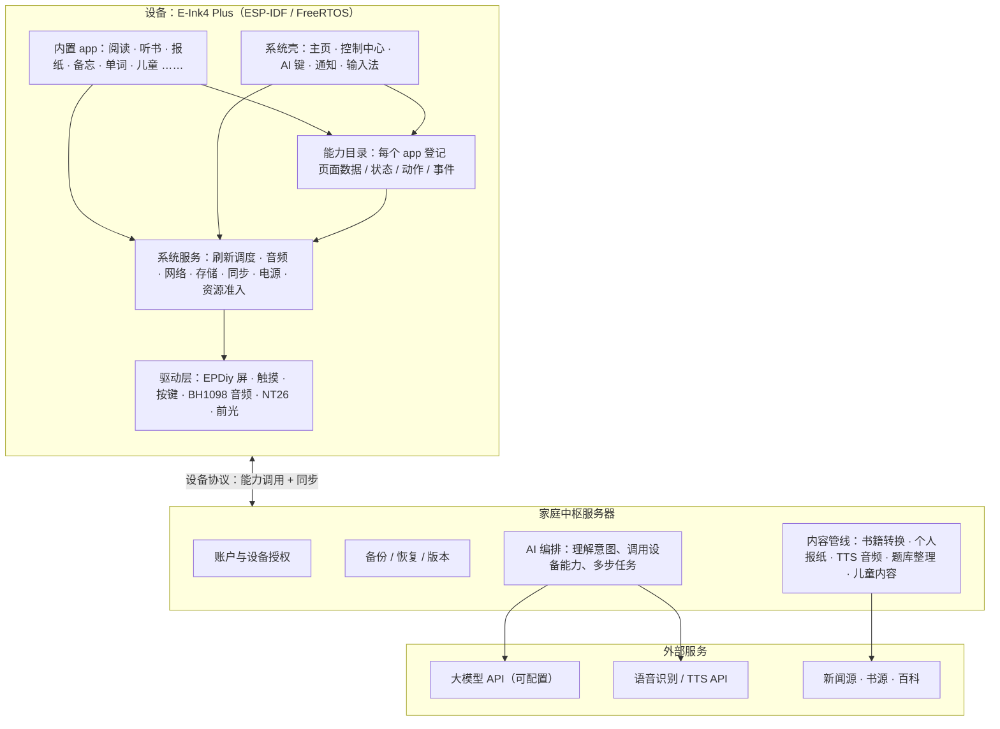

# 系统架构方案 v0.1

> 2026-11-01 更新：本文是第一轮的方向性方案，用户已按此完成 D-04～D-10 选择。深化后的设计（含竞品与平台研究依据）见 [v0.1 底座设计](foundation.md)，以后者为准。
>
> 2026-11-03：按用户的新要求（R-046：原子能力、软总线、AI 决策中枢、统一接口、资源管理与多任务）起草了[系统架构概要设计 v0.2](system-architecture.md)，待用户审核。

起草：2026-11-01。阶段：S3 架构与技术验证。依据：[硬件与源码](../research/cloudzao.md)、[调度专题](../research/system-scheduling-and-experience.md)、[AI 平台](../research/ai-native-platform.md)、[备份与账户](../research/data-backup-sync.md)、[墨水屏 UI](../research/eink-ui-interaction.md)。本文给出各项关键决策的方案对比与推荐；推荐方案在用户选择前标为“暂定”，可逆，见[决策记录](../decisions/README.md)。没有实机验证。

## 1. 先认清硬件的“体量”

| 资源 | 已知值（来源层次） | 对架构的含义 |
| --- | --- | --- |
| 主控 | ESP32-S31，双核 RISC-V 最高 320 MHz（官方规格） | 能跑实时系统和轻量应用；跑不了本地大模型、浏览器、安卓 |
| 内部内存 | 512 KB SRAM（官方），上游预留 64 KB 内部内存（sdkconfig） | 关键驱动、DMA、控制结构很紧张，必须做预算 |
| 外部内存 | Octal PSRAM 200 MHz，容量未确认（上游 README） | 帧缓冲、内容缓存放这里；4bpp 单帧约 406 KiB |
| 存储 | 16 MB Flash（上游 README）；TF 卡情况待核实 | 书、音频主要靠 TF 卡或按需下载 |
| 显示 | 4.7 英寸 1216×684 并行墨水屏，EPDiy 驱动，冷暖前光 | 刷新策略是体验核心；高刷需单独验证 |
| 通信 | Wi-Fi；NT26 4G（板级代码有接入，子型号与音频接线未确认） | 联网可行；短信通话有条件 |
| 音频 | BH1098 双向 I2S（代码依据） | 录音/播放可行，通话音频路径未知 |

**核心结论（推断）**：这块板子适合做“瘦而快的终端”。凡是吃算力、吃内存、要大上下文的工作——大模型推理、多步 AI 任务编排、书籍格式转换、新闻采编、TTS、题库整理——都应放在服务端；设备专注于显示、输入、音频、本地数据和执行动作。而账户与服务器备份本来就是已确认需求（R-022、R-023），所以“自建一台家庭中枢服务器”不是额外成本，而是顺势把它做成 AI 和内容的中枢。

## 2. 推荐的总体结构（暂定）



一次“在任意页面按 AI 键提问”的流程：设备录音并取当前页面的能力快照（内容片段、选区、状态）→ 发给中枢 → 中枢做识别、调用模型、必要时回调设备动作（如“加入单词本”）→ 设备执行并返回回执 → 中枢生成最终回答 → 设备分段显示/朗读。

## 3. 关键决策与方案对比

### D-04 AI 在哪里运行

| 方案 | 做法 | 优点 | 缺点 |
| --- | --- | --- | --- |
| A 设备直连模型 API | 设备自己拼提示词、调 API、跑多步工具调用 | 少一台服务器 | 512 KB 内存装不下长上下文与多步状态；API 密钥在设备上；儿童策略、预算控制都在固件里，改一次要刷机 |
| **B 经家庭中枢【推荐】** | 设备只发“意图 + 上下文快照”，中枢编排 | 设备轻；模型/提示词/儿童策略随时改；顺带复用账户与备份；可换模型供应商 | 多一个服务要维护；离线时 AI 不可用（本来也需要联网） |
| C 混合 | 简单指令（开灯、翻页、播放）设备本地规则处理，其余走中枢 | 常用操作不依赖网络，响应快 | 两套逻辑要保持一致 |

推荐 B，并在 v0.3 后按需加入 C 的本地快捷指令。

### D-06 设备系统底座

| 方案 | 做法 | 优点 | 缺点 |
| --- | --- | --- | --- |
| A 在上游固件上改 | fork CloudZao Plus 固件，逐步改 UI 与功能 | 最快点亮 | 上游架构偏“语音助手 + 若干页面”，与能力目录、资源准入的新架构冲突；R-005 要求重新构思 |
| B 全新 ESP-IDF 工程从零写 | 只看上游当参考 | 架构最干净 | 点亮屏幕、触摸、音频、4G 都要重做，前期很久看不到东西 |
| **C 新工程 + 移植驱动【推荐】** | 新建 ESP-IDF 工程，按固定提交把板级、EPDiy、触摸、音频、NT26 驱动移植进来，上层全部新写 | 驱动可复用、架构自主；R-005 原文就是“吸收原理及可复用驱动” | 需要先梳理驱动的最小依赖（引脚版本、供电、I2C 扩展器） |

### D-08 app 模型（“动态安装”怎么实现）

| 方案 | 做法 | 适合 |
| --- | --- | --- |
| **A 内置原生 app + 能力清单【推荐首版】** | app 用 C/C++ 编进固件，每个 app 附一份能力清单（页面数据、动作、事件） | 首版：最省资源、最可控，先把 G-002 的“能力目录”打通 |
| B 声明式页面 + 原生能力 | 中枢下发页面描述（卡片、列表、按钮、绑定的动作），设备通用渲染器显示 | AI 生成的临时页面、报纸、学习卡片；新增内容型 app 不用刷机 |
| C 脚本运行时 | Lua / Berry / WebAssembly（WAMR）运行可安装 app | 真正的“下载安装新 app”；需验证 S31 上的内存占用与性能（SP-08） |
| D 原生 ELF 动态加载 | ESP-IDF 的 ELF 加载器载入原生模块 | 性能最好，但隔离差、崩溃会拖垮系统 |

推荐路线：v0.1–v0.2 用 A，同时把能力清单格式设计成以后 B/C 也能用；v0.3 加入 B；v0.4 视 SP-08 结果选 C 实现动态安装（R-008）。

### D-10 UI 框架

| 方案 | 优点 | 缺点 |
| --- | --- | --- |
| **A LVGL 9 + 墨水屏适配层【推荐】** | 上游已用 LVGL 9.5，有控件、布局、字体、输入法基础；社区大 | 默认面向 LCD 的动画/刷新思路要关掉，需要自写“脏区合并 + 波形选择”适配层 |
| B 自研轻量渲染器 | 完全按墨水屏设计，内存可控 | 文字排版、控件、输入法都要自己做，工作量大 |

### D-07 模型与语音服务

可配置是已定需求（R-006）。推荐中枢内做“模型路由”：默认一个主力模型处理对话与工具调用，一个便宜模型做摘要/分类；ASR 与 TTS 各接一家云服务，儿童模式可单独指定。具体供应商与月预算待用户选（D-07）。

### D-09 服务器放哪里

| 方案 | 优点 | 缺点 |
| --- | --- | --- |
| **A 云服务器 VPS【推荐】** | 设备走 4G 也能直接访问；部署简单；月费低 | 数据在云上，需做好加密和备份 |
| B 家里的 NAS / 小主机 | 数据在家 | 需要内网穿透；家里断电断网时设备在外面就用不了 |
| C 托管后端服务（BaaS） | 账户、存储现成 | AI 编排和内容管线仍要自己的服务；被平台绑定 |

## 4. 设备内部的几个设计要点（来自调度专题，建议）

- **一个前台场景**：同一时间只有一个前台 app；后台只有系统登记过的音频、下载、备份。
- **资源准入**：耗资源的工作先申报内存/网络/IO 预算，系统批准才开始，队列有上限。
- **刷新调度器统一管屏**：app 只提交“哪块区域变了、要清晰还是要快”，由调度器合并、选波形、定时清残影。
- **四个时间点分开计**：接受输入 → 首次可见反馈 → 稳定可读 → 业务真正完成（含落盘）。指标见 [SRS](srs.md)。
- **能力目录与界面同源**：页面给人看的内容和给 AI 的数据来自同一个状态对象，避免“AI 看到的和屏幕上不一样”。

## 5. 代码组织（建议，D-09 决定仓库位置）

```
ink/                    ← 本仓库：产品与设计文档（现状）
ink-firmware/           ← 设备固件（ESP-IDF 工程）
  components/board_plus/   移植的板级与驱动
  components/eink_refresh/ 刷新调度器
  components/sys_*/        系统服务
  components/capability/   能力目录
  apps/                    内置 app
ink-hub/                ← 家庭中枢服务（账户、备份、AI 编排、内容管线）
```

也可以三者放在本仓库的不同目录（monorepo）；分仓更利于固件 CI 与服务端部署分开。
