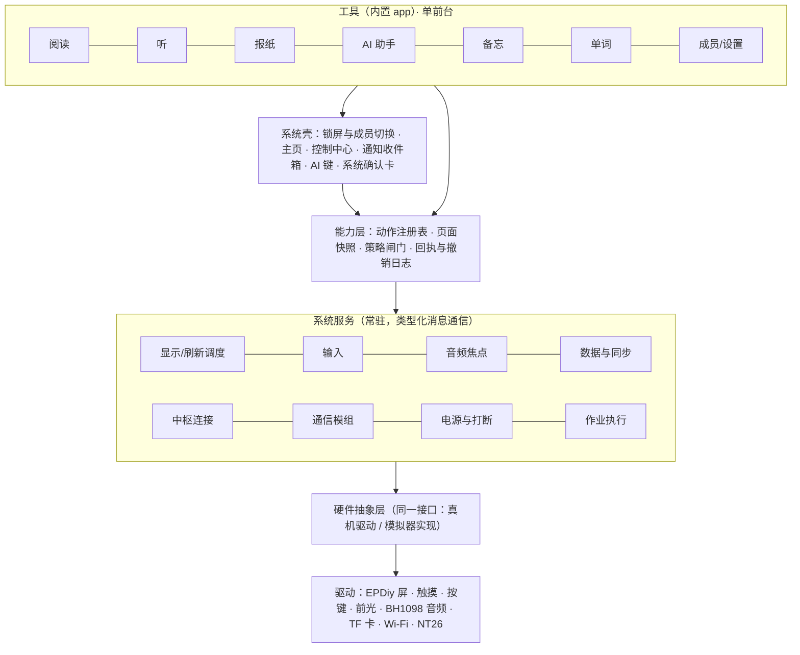

# v0.1 底座设计

版本：v1.1，2026-11-01（已按独立评审修订，见 §14）。阶段：S3 架构与技术验证（见[开发流程](../process.md)）。

依据：[需求深读](../product/needs-analysis.md)（F-01～F-14 底座要求）、[架构对标](../research/architecture-benchmarks.md)、[底座专题研究](../research/foundation/README.md)、首轮[决策](../decisions/README.md)。本文是助手的设计建议；用户已选定的方向（D-01～D-11）作为前提，不重新讨论。新的取舍列在文末“第二轮待决”。没有实机数据，所有数字是待校准的设计预算。

## 0. 一页结论

**底座是什么：** 以后所有功能都要站在上面、做错了要改动不止一个 app 才能修正的那部分。它要同时承接用户的七条主线：换掉“奶头乐”、AI 就是系统、一家人共用、它是一台手机、底层高效体验顺、数据不能丢、能长出新东西（[需求深读](../product/needs-analysis.md)）。

**八个关键设计（建议）：**

1. **薄设备、厚中枢。** 最接近的先例 Mudita Pure（基于 MCU 的墨水屏手机，约卖出 3000 台）系统代码约 35 万行（含厂商 BSP），更新日志里修复是新增的 9 倍，之后停更。本项目首版设备内置 7 个工具，扩展靠中枢下发的页面和以后的脚本 app；“永远不做”清单已由用户确认（D-21，2026-11-02）；转换、生成、AI 编排全部在中枢（§2）。
2. **中枢持有完整数据副本。** 设备是个人记录的权威写入者，中枢副本同时用于备份和 AI 的历史查询；“一切数据给 AI”由此在 512 KB 内部内存的设备上成立（§5.1）。
3. **按钮和 AI 调用同一个动作。** 每个可见操作登记为动作，带参数、副作用等级、确认策略与儿童策略；策略闸门在设备上执行，不靠提示词（§6）。
4. **MCP 形状的设备协议。** 目标板官方固件已是 xiaozhi 派生的 MCP 设备链路，但实际只向 AI 开放 2 个工具（设备状态、音量）。本项目沿用 JSON-RPC 与 MCP 的工具/结果结构，信封与版本自管，扩展页面快照、事件、确认与声明式页面（A2UI 格式），中枢对外再提供标准 MCP；连接方式另立决策（§6.5–6.6，D-12、D-24）。
5. **统一刷新调度器。** 6 种刷新类型、7 条调度规则、绘制与刷新分队列、页面代次防误触（借鉴 KOReader、Mudita、CrossPoint）；中文断行与字形缓存自研（§4）。
6. **单前台 + 少量服务 + 只用消息。** 启动可降级。内部 SRAM 自上而下列账后，按上限会超出 512 KB、按下限只剩约 80 KiB，所以压缩显示行队列与 DMA 预留是**设计前提**而不是“实测再说”；Flash 写入会暂停外部内存，写入策略单独设计（§3.2、§5.5.1）。
7. **数据层把“名字相同、结果不同”的坑填平。** 对象、语义定位器、完成规则、分层删除、通用作业框架；需要掉电安全的用户状态低频写内部 Flash，高频位置先在内存与 LP SRAM 合并，大体量事件日志写 TF 卡，设备上不用 SQLite；恢复以“每位成员回到正确内容与位置”验收（§5）。
8. **电话、成员与基础系统服务先留位。** 调制解调器服务、系统打断通道、音频优先级、可接听待机、时间服务、文本输入服务、崩溃安全模式从第一版就有；成员 ID 是所有个人记录的分区键，成人进入需 PIN（§4.8、§7、§8）。

**还没有被验证的：** 全部没有实机数据。最大的风险是内部 SRAM 余量、Flash 写入造成的停顿、ESP-IDF 对 S31 仍是预览支持、墨水屏真实刷新时序与残影、通话依赖 VoLTE 且没有回声消除、以及电脑模拟器高估真机性能（[风险](risks-and-spikes.md) RK-04、RK-19、RK-11、RK-02、RK-18、RK-13）。

**下一步：** 按用户要求，先调研并设计足够真实的模拟器（R-034），它和硬件抽象层、虚拟时钟、代价注入点一起定；然后按 §11 修订后的“一条纵切”推进。第二轮底座决策（§13）放在决策板上，其中几项需要用户裁定（单词是否进首版、部署地区与运营商、“永远不做”清单等）。

## 1. 底座是什么，不是什么

底座 = 以后所有功能都要站在上面、而且后期改动代价很高的那部分：

1. 硬件抽象与驱动（屏、触摸、按键、前光、音频、存储、电源、Wi-Fi、蜂窝模组）
2. 运行模型（服务、任务、消息、资源准入、取消）
3. 显示与输入管线（刷新调度、输入投递）
4. 音频焦点与系统打断
5. 数据底座（成员分区、对象与定位、变更日志、同步、备份恢复）
6. 能力底座（应用清单、动作、页面上下文、回执、设备与中枢协议）
7. 成员与策略
8. 中枢的对应部分（账户、副本、AI 编排、内容管线）
9. 开发方式（模拟器、协议代码生成、可观测性）

底座不包括：具体 app 的界面细节、报纸的选题算法、模型提示词。它们建在底座之上，可以随时改。

判断一件事是否属于底座的标准：**如果它做错了，是否需要改动不止一个 app 才能修正。**

## 2. 范围与分层：薄设备、厚中枢

**最大的风险是范围，不是技术。** Mudita Pure 是最接近的先例：基于 MCU（NXP i.MX RT1051 + FreeRTOS）的墨水屏手机，系统代码约 35 万行；从 1.0.1 到 1.12.0 的更新日志里修复 252 条、新增只有 28 条，至少 31 条是崩溃、卡死或内存泄漏；约卖出 3000 台后停更，下一代改用 AOSP（[架构对标](../research/architecture-benchmarks.md)）。ESP32-S31 没有改用 Android 这条退路，所以本项目只能走“薄设备、厚中枢”：

- 首版（v0.2）设备内置 7 个工具：阅读、听、报纸、AI 助手、备忘、单词、成员与设置（含备份）。每个工具做深做稳。单词进首版，做最小闭环（用户选择 D-20，2026-11-02）。以后的扩展走中枢下发的声明式页面（D-08 第二阶段）和脚本 app（第三阶段），不靠往固件里加工具。
- 凡是需要“Android 级软件栈”的事情全部放在中枢：网页抓取、格式转换（EPUB/PDF）、AI 编排、报纸生成、TTS。
- 写一份 `SCOPE.md`，列出设备**不做**的事（用户已确认 D-21）：通用浏览器、无限内容流、在设备上运行第三方原生代码、完整 EPUB/PDF 兼容、设备端通用大模型。CrossPoint Reader 用同样的方法守住了范围。注意它与用户已明确的“可安装动态应用”（R-008）、短信通话（R-013）、游戏模拟器（R-015）并不冲突：这些走中枢页面、脚本运行时或单独验证。
- 通信最后做，并收敛到唯一的调制解调器服务和一个状态机（Mudita 的蜂窝状态机、按场景切换信号查询频率、“仅短信”模式都可参考）。

### 2.1 设备内部分层

依赖只能向下；工具之间不直接调用，跨工具跳转一律走动作（“打开文档@位置”“就本页提问”“朗读本章”）。这与 KOReader 的 Dispatcher 和 Mudita 后期“让应用不再知道彼此名字”的提案一致。

### 2.2 从上游移植什么、重写什么（D-06 的具体化）

上游固件（CloudZao Plus，HEAD `690a023`，v2.0.71）基于 xiaozhi-esp32 v2.0.5 左右，手写代码约 13.3 万行，其中界面约 8 万行；7 天内改了 294 个文件，移植时必须固定提交并记录（[上游固件研究](../research/foundation/upstream-firmware.md)）。

| 部分 | 处理 | 理由 |
| --- | --- | --- |
| EPDiy 改写版、波形表、板级（TPS65185、TCA9555、引脚）、触摸、按键、前光 | **移植**（中等难度） | 基本是独立 C 代码；少量引用 SD 与 NT26 引脚，需要解耦 |
| 刷新任务 `epd_refresh`、LVGL 适配 `lv_adapter_epdiy` | **参考后重写** | 依赖 OTA 页面、前光、设置等全局对象，并与全部页面耦合；持 LVGL 锁轮询等待刷新（最长 10 s） |
| 上下电时序 `power_hw` | **按其 README 的顺序重写**（高难度） | 依赖 Application、NT26、待机页；共享电源与复位线必须由一个服务统一管理 |
| 音频（BH1098 编解码、I2S、Opus） | 移植（低到中） | 依赖电源与设置，接口清晰 |
| 4G：`uart_eth_modem`（Apache-2.0，几乎独立）、Wi-Fi 连接组件 | 移植；板级网络类参考后重写 | 上游切换 Wi-Fi/4G 需要重启，新系统要支持运行时切换 |
| TF 卡访问层 | 移植（低到中） | 含一个需手动打的 IDF 补丁 |
| xiaozhi 协议、MCP 服务、OTA 加锁思路、设置 | **直接复用并修补** | MCP 调用时补上权限检查；OTA 只接受中枢签名的固件 |
| A2UI-lite 渲染器、`.ebook`/字库工具链与格式规范、阅读器核心 | 复用或参考 | 与传输无关；声明式页面（D-08 第二阶段）可从它起步 |
| `application.cc`（2210 行状态机）、全部界面、三家云服务、MQTT（S31 上不可用）、摄像头 | **不移植** | 与新架构冲突或用不上 |

许可注意：上游主体为 MIT；EPDiy 原项目是 LGPL-3.0-or-later，上游内嵌的改写版没有附 LGPL 声明，本项目使用时需保留许可并履行 LGPL 义务（以后分发给朋友时尤其要注意）；`uart_eth_modem` 与 8 灰阶波形为 Apache-2.0；社区阅读固件 kiikoread 的新写代码禁止商用，不复制其代码；MiSans 字体许可未核实。

## 3. 运行模型（F-02，R-029）

| 规则 | 做法 | 依据 |
| --- | --- | --- |
| 单前台 | 同一时刻只有一个前台工具（Activity 栈）；后台只有系统服务登记过的工作（播放、下载、同步） | CrossPoint ActivityManager；Mudita ApplicationManager |
| 唯一渲染任务 | 只有一个任务持有 LVGL 并负责绘制；工具不建自己的线程 | CrossPoint 把“每个页面一个 8 KB 渲染任务”改成全局一个 |
| 少量常驻服务 | 显示、输入、音频、数据与同步、中枢连接、通信、电源、作业执行；每个服务独占自己的资源 | Mudita 服务模型 |
| 只用消息 | 服务之间只发类型化消息（单播、请求/响应、订阅），**禁止同步阻塞调用**；持锁时不等网络、不等刷新 | Mudita 文档：“除了总线消息，没有其他正确方式执行动作” |
| 启动可降级 | 服务清单声明依赖、资源需求与超时；某个服务启动失败（如 4G），其他功能照常（书仍能读） | Mudita 启动失败直接抛异常的反面教训 |
| 有界后台工作 | 耗时工作拆成可取消的小步骤，开始前做资源准入（内存、网络、IO），队列有上限 | [调度专题](../research/system-scheduling-and-experience.md) |
| 内存预算 | 内部 RAM 与 PSRAM 分开预算，并看最大连续块；栈上大对象禁止；长时间运行后的碎片有兜底（必要时“静默重启”并回到原界面） | CrossPoint 的规则与 SilentRestart |
| 断电安全写 | 所有状态文件用“写临时文件 + 改名”，不原地截断改写；写入时机与频率见 §5.5.1（写 Flash 会暂停外部内存） | CrossPoint #2275：原地写遇断电导致 FAT 簇链损坏 |

### 3.1 平台事实对运行模型的约束（[平台研究](../research/foundation/platform-runtime.md)）

| 事实 | 来源层次 | 对设计的要求 |
| --- | --- | --- |
| ESP32-S31 已于 2026-07-27 量产，但 ESP-IDF v6.1 仍把它列为预览目标（需 `--preview`），官方称 v6.1.1 起正式支持；芯片只有 v0.0 一个版本，已有勘误 | 官方 | 跟随上游用 v6.1，持续跟进补丁版本；工具链不成熟列为风险 RK-11 |
| 双核 RISC-V 320 MHz，但 128 位 SIMD（AI/DSP 扩展）**只有一个核有** | 官方 | 音频编解码等计算绑到有 SIMD 的核；界面与刷新任务放另一个核，实测后再定 |
| 内部 SRAM 512 KB；PSRAM 封装在芯片内，Plus 最可能是 16 MB（推断，到货后用 `esp_psram_get_size()` 确认） | 官方 + 推断 | **真正紧张的是内部 RAM**；PSRAM 足够放帧缓冲、页缓存、字形缓存与音频缓冲 |
| 上游显示子系统约占 120 KiB 内部 RAM（行队列 76 KiB、DMA bounce、LUT、静态波形表、显示任务栈）；另有 64 KiB 内部 DMA 预留池 | 代码 | 见 §3.2 自上而下列账：压缩行队列与 DMA 预留是设计前提 |
| Flash 写入期间缓存关闭，PSRAM 暂时不可访问 | 官方 | 写 Flash 的任务（设置、OTA、日志落盘）必须使用内部栈；上游用 `EpdFlashGuard` 让波形输出与 Flash 写入串行，新系统沿用 |
| 上游开启了电源管理但关闭了 tickless idle，自动浅睡实际不生效；它的 S31 浅睡还依赖在配置阶段修改 IDF 源码 | 代码 | 两项一起开启并实测唤醒延迟；所需的 IDF 改动以版本化补丁集维护、在 CI 中自动应用（而不是放弃浅睡，也不在配置阶段改源码），见 RK-17 |
| 上游没有通用消息总线：大量单例，按需创建任务约 132 处；界面在持 LVGL 锁时轮询等待刷新完成（最长 10 s），因此把任务看门狗放宽到 20 s | 代码 | 新系统禁止持界面锁等待刷新或 IO；看门狗恢复正常阈值；任务数量受控 |
| 唯一一条 I2C 总线（100 kHz）上挂着触摸、IO 扩展（按键与屏电源控制）、电量计、充电芯片、RTC、加速度计，且有固定加锁顺序 | 代码 | 输入时延会受总线争用影响：由一个总线服务排队访问，触摸优先；评估提速到 400 kHz（推断，需实测） |

### 3.2 内部 SRAM：自上而下列账（下限作为设计工况）

起点是芯片的 512 KB HP SRAM（另有 32 KB LP SRAM，见 §5.5.1）。按“谁先占”扣减，全部是估算：

| 占用 | 估计 | 依据 |
| --- | --- | --- |
| IRAM 代码（含 Wi-Fi、FreeRTOS、Flash 操作期间必须驻留的代码）+ 静态数据段 + IDF 自身 | 150–250 KiB | 估算（同类 ESP32 工程经验）；**无需实物，用 `idf.py --preview set-target esp32s31 build size` 即可得到静态部分，列为模拟器任务的第一步** |
| Wi-Fi/lwIP 运行时静态缓冲 | 40–80 KiB | 官方文档 + 估算 |
| 内部 DMA 预留池（上游设置） | 64 KiB | 代码 |
| 显示子系统（行队列、bounce、LUT、静态波形、显示任务栈） | 约 120 KiB（上游） | 代码 |
| I2S DMA | 约 15 KiB | 代码 |
| 4G 串口网卡任务与 UHCI DMA（4G 模式） | 10–20 KiB | 代码中的任务栈 + 估算 |
| TF 卡内部中转 | 4–8 KiB | 代码 |
| 必须在内部的任务栈（写 Flash、ISR 相关）、TLS 控制块 | 30–60 KiB | 估算 |
| **合计** | **433–632 KiB** | 上限已超过 512 KB；下限也只剩约 80 KiB |

因此以下是**设计前提**，不是“实测后再定”：

1. 显示行队列从 128 行压到 32 行以内（约 19 KiB），显示子系统目标 ≤ 50 KiB。
2. DMA 预留池按实际 DMA 需求重算（目标 ≤ 32 KiB），不照搬 64 KiB。
3. Wi-Fi/lwIP/TLS 的可移动部分全部放 PSRAM，同一时刻只保持 1 路 TLS，Wi-Fi 静态缓冲取下限。
4. IRAM 代码按 `idf.py size` 结果裁剪，非关键路径移出 IRAM。

目标是长期运行后内部堆余量 ≥ 50 KiB（SR-PL-04 的 32 KB 为底线）。如果静态占用实测接近上限，就回到这里重新取舍（例如 4G 与 Wi-Fi 不同时保持连接、播放时不做 TLS 握手）。每个服务在清单里声明内部 RAM 用量，资源准入以内部 RAM 为首要检查项。

### 3.3 PSRAM 预算（2026-11-03 实测为 16 MB；8 MB 降级预算保留作参考）

| 项目 | 16 MB 方案 | 8 MB 降级 |
| --- | --- | --- |
| EPDiy 前帧 + 后帧 + 差分帧（4bpp） | 约 1.6 MiB | 约 1.6 MiB |
| 刷新调度器的提交帧（上游 render/pending/effect 三帧约 1.68 MB，新设计按脏区提交、去掉过场动画帧） | ≤ 0.5 MiB | ≤ 0.5 MiB |
| 预渲染上一页/下一页（4bpp） | 0.8–1.2 MiB | 0.4 MiB（只预渲染下一页） |
| LVGL 绘制缓冲（1 位整屏约 100 KiB；8 位灰阶整屏约 0.8 MiB，上游用 8 位 64 行条带） | 0.1–0.8 MiB | 0.1–0.2 MiB（条带） |
| LVGL 对象、cJSON、zlib、FreeType 工作内存 | 0.5–1 MiB | 0.5 MiB |
| 音频解码与网络缓冲 | 0.35–0.65 MiB | 0.3 MiB |
| 正文字形缓存 | 0.3–0.5 MiB | 0.3 MiB |
| 当前章节与排版索引（设上限） | 0.5–2 MiB | 0.5 MiB |
| TLS（1 路） | 25–45 KiB | 25–45 KiB |
| **合计** | **约 4.7–8.3 MiB** | **约 4.2 MiB** |

16 MB 宽裕；若实物是 8 MB（模组另有 N16R8V 这种 8 MB 型号），按降级列也能放下。到货第一件事是读 `esp_psram_get_size()`。

## 4. 显示与输入（F-03）

### 4.1 统一刷新调度器

应用只提交“哪块区域变了 + 这是什么类型的刷新”，由唯一的刷新调度器决定何时刷、用什么波形、怎么合并，并独占 EPDiy。这是 KOReader UIManager 的模式，Mudita 与 CrossPoint 在 MCU 上做了简化版。

| 刷新类型 | 用途 | 默认波形（待实机标定） |
| --- | --- | --- |
| TEXT | 正文翻页、静态文字（计入残影计数） | GL16 |
| UI | 混合界面（拿不准就用它） | GC16 快速版或 GL16 |
| FAST | 按下反馈、高亮反色 | DU |
| A2 | 键盘、进度条、纯黑白动态区 | A2 / 自定义快刷 |
| FLASH_UI | 弹窗首次出现或关闭时防残影 | GC16 |
| FULL | 清残影、切换成员、唤醒后第一帧 | GC16 |

调度规则：

1. 相交的请求合并为外包矩形，取较高的类型。
2. 同一区域来了新帧，旧帧作废；屏幕忙时只保留最新的目标帧（过时画面可丢，**业务动作不能丢**）。
3. TEXT 每 N 次升级一次清理（KOReader 默认 6，CrossPoint 默认每 15 页半刷）；N 可按工具、成员配置，章节边界、切换成员时清理。
4. 连续交互（翻找、拖动）期间降为 FAST，停下后用 GL16 收尾（上游 Metalio 固件已有滚动停止后 GL16 收尾的逻辑）。
5. 刷新失败后下一次强制 FULL；深睡唤醒后屏幕上一帧状态不可信，第一帧 FULL（或把最后一帧落盘）。
6. 状态栏、时间、电量这类可变信息放在固定小区域并节流，避免“信号强度更新导致不必要刷新”（Mudita 更新日志中的真实问题）。
7. 每次刷新带温度参数；空闲时关屏幕电源。**上游没有温度补偿**：波形只有一个温度区间，温度固定按 25 °C 处理；冬天户外或暖气旁的显示质量需要实测，并寻找可用的温度来源（风险 RK-14）。
8. **动态区域租约：** 游戏、手写、高刷实验（R-011）可以向调度器申请一块独占的动态区域和刷新预算（例如只用 A2/DU 快刷），租约期间调度器不对该区域做合并与清理，租约结束后统一用 GL16/GC16 收尾。这为以后的模拟器、手写笔记和高刷研究留了口。

上游现有规则可作为调度器的初始参数：局刷累计 ≥ 24 次且距上次全刷 ≥ 60 s 时升级为 GC16；有灰阶变化、滚动收尾或翻页用 GL16，其余用 DU；波形 GC16 48 相、GL16 48 相、DU 20 相，另有裁剪到 36/37 相的“均衡”档和 30 相 8 灰阶的“极速”档。

### 4.2 与 LVGL 的衔接

LVGL 的渲染模式与色深按实测选择（上游用 PARTIAL 模式、单个绘制缓冲、默认 1 位色深，遇到灰阶内容切到 8 位条带），绘制缓冲放在 PSRAM；`flush_cb` 只登记脏区，到一帧最后一块时把脏区与控件声明的刷新类型一起交给调度器。**绘制和刷新分成两个队列**；`flush_ready` 只表示绘制缓冲可以复用，不表示屏幕已经显示完成。系统控件按状态自动带类型（按下 → FAST，弹窗出现 → FLASH_UI），工具无需关心波形。默认关闭 LVGL 动画。

### 4.3 实体按键与 AI 键

Plus 没有专门的 AI 键（上游代码）：实体键有 BOOT（直连 GPIO61）、电源、音量加、音量减（后三个经 IO 扩展芯片中断）；盖板上另有 HOME、上一页、下一页三个触摸虚拟键；上游用 BOOT 键或长按屏幕 500 ms 按住说话，用音量键翻页。建议（第二轮 D-19，已按评审修订）：**BOOT 键作为 AI 键**（直连 GPIO，响应最快），但要先核实它的物理位置，以及它是否是启动时的 strapping 引脚（若按住时恰好复位，设备可能进入下载模式）；有风险就改用长按 HOME 虚拟键。**翻页用盖板的上一页/下一页虚拟键，音量键只调音量**（孩子听书时不易误跳段）；电源键短按锁屏、长按关机。

### 4.4 输入与“页面代次”

每次页面替换，代次号加一；排队中的触摸带着产生时的代次，代次不符就丢弃，避免旧页面的点击落到新页面同坐标的按钮上。连按“下一页”按目标页处理，不会迟到地突然跳好几页。AI 的迟到结果用同一个代次号拒绝（6.4）。

### 4.5 首次反馈：先让人感觉到，再让人看到

DU 波形 20 相，按每相 10–16 ms 估算约 0.2–0.32 s，每帧还要给屏幕电源芯片上电；如果屏幕正在做 GC16 全刷（约 0.5–0.8 s），按调度规则只能等它结束，波形能否安全中止待实测。所以“按键 150 ms 内画面出现反馈”在墨水屏上不一定做得到。修订为：

- **首次可感知反馈 ≤ 150 ms**：振动（上游有振动驱动文件，硬件待核实）或提示音（需要音频电源已开启）。
- **首次可见反馈**：屏幕空闲时 ≤ 350 ms；正在全刷时 ≤ 1.2 s；从静止/待机唤醒另计。
- SR-UX-01 已据此拆分；具体数值在模拟器中按波形参数估算，到货后用 SP-01 标定。

### 4.6 字体与中文排版

- UI 字体：沿用上游做法，字库放在内部 Flash 的只读分区，内存映射使用，不占 RAM（上游 fontpack 约 4.75 MiB）。
- 正文字体：预渲染位图字库（上游 `.ef` 格式：6009 字，25 px 2bpp 约 0.9 MB），按页预热所需字形到 PSRAM；生僻字和临时字号由 FreeType 按需渲染并缓存。中枢可为每本书生成只含所用字形的子集，覆盖生僻字而不携带整个 GBK。
- 断行：LVGL 9.5 只把汉字当单字词处理，没有标点禁则；阅读器需要自写断行器，遵守行首行尾禁则与标点悬挂（W3C 中文排版需求）；中英混排按 UAX #14 处理，英文单词不拆开；单词与雅思内容需要的国际音标字形放进字库子集。正文由自己的排版引擎画进 LVGL 画布，界面其余部分用 LVGL 控件。
- 覆盖面：上游 `.ef` 基础正文字库只有 6009 字，少于 GB2312 的 6763 个汉字（SR-NF-05 要求覆盖 GB2312）。基础字库改为 GB2312 全集或《通用规范汉字表》一、二级（6500 字）；AI 回答与报纸里的缺字由中枢随文字下发字形（参考 xiaozhi 的 glyph_push），或由设备用 FreeType 现场渲染。

### 4.7 默认分页，内容有终点

首版列表与正文默认分页（上游与 CrossPoint 都不滚动）；连续滚动作为对照方案保留，到货后用任务完成时间、漏看与定位成本比较，不预先禁止（[墨水屏 UI 研究](../research/eink-ui-interaction.md) §5）。内容预先排版成页缓存，翻页就是读一块再贴图。页缓存的 key = 内容哈希 + 字体/字号/边距 + 格式版本，排版规则一改就整体重建（CrossPoint 的页缓存格式已到 v73，就是靠版本号强制重建）。中文禁则断行与（给孩子用的）拼音标注要尽早做。分页也让“报纸有终点”天然成立。

### 4.8 文本输入服务（F-14，R-026、R-027）

- **统一输入会话：** 搜索、备忘、设置、声明式页面里的 TextField，都通过同一个系统输入服务：获得焦点 → 组合中的文本 → 候选 → 提交或取消；输入框只接收提交结果。
- **墨水屏适配：** 候选区是固定位置的小区域，用 A2/FAST 刷新，组合串局部刷新；按键事件完整排队，不因刷新忙而丢键。
- **中文拼音：** 本地词库放 TF 卡（数 MB），索引常驻 PSRAM（目标 ≤ 1 MiB），用户词频按成员保存。首版做全拼与常用词，手写与双拼以后再说。
- **LLM 联想（R-027，v0.3）：** 默认关闭、按成员开关；发送前去掉号码、地址等敏感片段；离线时自动退回本地词库；儿童成员默认关闭。
- **首版以语音输入为主，但三处必须能打字：** Wi-Fi 配网、搜索、恢复时登录。
- **首次开机与配网：** 上游删除了热点配网与 SmartConfig。建议“手机扫码配对”：设备显示二维码 → 手机打开中枢网页 → 在手机上填 Wi-Fi 与家庭账户 → 经 ESP-IDF 配网组件（BLE 或临时热点，待验证）下发到设备；屏上键盘作兜底。恢复时登录同样走扫码配对，不在设备上输入账户密码。

## 5. 数据底座（F-06、F-10、F-13）

竞品资料库的 996 个任务反复说明一件事：**名字相同的动作，对象和结果常常不同**（保存、删除、恢复、同步、继续、完成都是如此）。所以数据底座的首要任务，是把对象、作用范围、所处阶段和执行回执显式化，让界面和 AI 读同一份真实状态。本节的对象清单与优先级来自[竞品库对底座的含义](../research/foundation/library-implications.md)。

### 5.1 谁是哪类数据的权威

| 类别 | 例子 | 权威方 | 设备上 | 中枢上 |
| --- | --- | --- | --- | --- |
| 成员个人记录 | 位置与进度、笔记书签、单词卡与复习日志、备忘提醒、偏好、行为事件 | **设备**（首版一台设备） | 断电安全地持久保存，写入即产生变更记录 | 完整副本 + 历史版本，供备份恢复和 AI 查询 |
| 家庭共享内容 | 转换后的书、有声书与 TTS 音频、报纸期号、生成的故事、题库 | **中枢**（内容管线生成） | 按需下载；分“固定保留”和“可淘汰缓存” | 原件与各个版本 |
| AI 持久状态 | 对话记忆、成员画像、偏好推断 | **中枢** | 不保存（必要时只缓存摘要） | 按成员保存，可查看可删除 |
| 凭据 | 设备令牌、成员 PIN 校验值、模型密钥 | 各自 | 设备令牌与 PIN 校验值 | 模型密钥只在中枢 |
| 可再生缓存 | 排版分页结果、字形缓存、音频缓冲 | 设备 | 随时可丢 | 不备份 |

这个划分带来一个关键简化：**AI 查历史数据（“上周读过的那篇”）走中枢副本，设备不需要复杂的查询引擎**；设备只负责可靠写入、变更记录和同步。

### 5.2 必须原生建模的对象

| 对象 | 关键字段与状态（首版） |
| --- | --- |
| 内容 content | content_id（独立于 app）、revision、来源与进入渠道、权益、renditions（重排文本、真人音频、TTS 音频）、文字—音频配对关系；AI 生成的故事保存已生成版本 |
| 定位器 locator | {content_id, revision, kind: text \| audio, value}；文字为“章/块/字符偏移”的语义锚点，页码只作显示；音频为毫秒，已对齐时附句子编号 |
| 位置 position | 每个“成员 × 内容”一组：最后位置、最远进度、书签列表、音频位置、暂停意图与原因、临时翻找的返回栈 |
| 批注 annotation | 锚定到具体 revision 的定位器；锚点失效可回落而不丢；建议查词与 AI 解释默认不落盘、显式“存为笔记”才保存（竞品做法，属建议） |
| 单词卡 card / 复习日志 review | 卡片状态：新卡、学习中、复习、暂埋、停用、删除；日志：评分、模式（正式/加练/仅回顾）、是否揭示答案、是否用提示、时间；语境：来源内容、原句、定位器 |
| 备忘 memo / 待办 todo / 提醒 reminder / 日程 event | 四类分开；状态：草稿→确认→已排程→已触发→已处理；source_ref 可跳回来源；created_by 区分人与 AI |
| 作业 job | 见 5.6 |
| 会话 session | 阅读、收听、学习、AI 对话；起止、暂停原因、终点 |
| 报纸期号 issue / 条目 item | 期号：日期与时区、生成时间、固定条目表、终点；条目：来源、发布/抓取/更新时间、更正、推荐理由 |
| 设置 setting | 期望值、实际生效值、待生效状态、作用范围（设备/成员/app/文档） |
| 行为事件 event | 只追加：页面进入/离开、打开、位置、读完、作答（首次/看提示后/订正后）、复习、收听、查词、搜索、设置变更、成员切换、AI 请求与动作；观察到的事实与推断分开存放 |
| 联系人 contact / 短信会话 sms_thread / 通话记录 call_log（v0.4 预留） | 结构先定：号码、名称、所属成员、儿童白名单标记；通话录音的同意记录字段（R-024 录音前需告知与同意） |
| 墓碑 tombstone | 删除后保留一段时间，防止旧副本在恢复或同步时复活 |

所有个人记录都以 member_id 为分区键；每条记录从第一天起带 updated_at（UTC，另存时区）、device_id、版本号，为以后多设备留口。时间来源见 §7.1。

### 5.3 完成要分层，并且写明规则

读完、理解、掌握是三件事。每类内容声明自己的完成规则（规则编号 + 版本），派生状态与原始事件分开保存。例：书“读完”= 最远进度到最后一块且有结束时间；“掌握”只能由独立证据（间隔复习通过）推出，不能由停留时长或打开次数推出。这也是 G-001 在数据层的保证：底座记录读完、答对、复习通过，而不把停留时长作为核心指标。

### 5.4 删除、归档、移除下载要分层

删除前由依赖图列出受影响对象（内容 ← 批注、位置、单词卡、队列）。分层动作：移除下载（内容仍在书库）、移出书库、永久删除、隐藏。卸载程序不等于删除数据。不可逆操作要求明确确认，AI 发起时同样如此。

### 5.5 本地存储实现（D-13 推荐方案）

平台研究对比了 FatFS、LittleFS、SPIFFS、NVS、FlashDB 与 SQLite：FatFS 没有掉电保护；LittleFS 自带掉电保护与磨损均衡；现有 ESP32 的 SQLite 移植基于 2018 年版本、关闭了刷盘（不掉电安全）、编译参数写死 Xtensa，在 RISC-V 上不能直接用。CrossPoint 的进度文件原地写在断电时损坏了 FAT。因此：

| 数据 | 位置 | 写入方式 |
| --- | --- | --- |
| 设备与系统配置（Wi-Fi、设备 ID、设备令牌） | 内部 Flash NVS | 低频 |
| 成员设置 | 内部 Flash LittleFS `/sys/m/<成员>/settings` | 写临时文件再改名（原子替换） |
| 阅读与收听位置 | 先在内存与 LP SRAM 合并，再写 LittleFS 每成员追加日志 | 暂停、停止、切换内容、低电量时立即落盘；播放与阅读中按固定间隔落盘（建议 60 s，待 SP-12 调整）；定期压缩为快照 |
| 笔记、备忘、提醒 | LittleFS 追加日志 + 快照 | 写入即落盘 |
| 单词卡 / 复习日志 | LittleFS：卡片定长记录 + 复习追加日志 | 每日压缩 |
| 用户数据变更日志（同步与备份依据） | LittleFS | 中枢确认后才压缩；长期离线时先压缩为快照并保留未同步的变更，**不覆盖**；占用超过 80% 提醒联网同步 |
| 行为事件（观察记录，体量大） | TF 卡有界日志 | 上传中枢后可覆盖最旧记录；TF 卡写入不需要关闭 CPU 缓存 |
| 书、音频、页缓存、字形缓存 | TF 卡 FAT32 | 全部可重建或重新下载 |
| 本地备份快照 | TF 卡 + 中枢 | 打包附校验和 |

**设备上不用 SQLite。** 历史查询走中枢副本（5.1），设备只需按成员、按对象 ID 读写；以后若本地查询需求增长，先在电脑上评估。需要掉电安全的用户状态放内部 Flash（TF 卡被拔出也不丢），内容与大体量日志放 TF 卡（可重建或已上传）。分区建议见 §10.1。

#### 5.5.1 写 Flash 的代价与写入策略

写或擦内部 Flash 时，CPU 缓存关闭：不在 IRAM 的代码和 PSRAM 都会暂停。典型 NOR 扇区擦除约 45–400 ms。板上 Flash 已查明是 PY25Q128HA，手册给典型 50 ms、最长 240 ms，见[第 0 步](../hardware/2026-11-03-phase0.md)，而上游 I2S DMA 只有 4×240 帧（约 60 ms）；上游还让 Flash 写入与刷新波形互斥。所以频繁写 Flash 会直接威胁“播放不断音”（SR-PL-02）、刷新时延和内存映射的 UI 字库渲染。对策（建议，SP-12 验证）：

1. 高频状态（阅读与播放位置）先在内存与 LP SRAM（32 KB）合并，按 5.5 表中的时机低频落盘；突然断电时最多丢失一个落盘间隔的位置。
2. 体量大、频繁追加的行为事件写 TF 卡；内部 Flash 只放需要掉电安全的用户状态。
3. 播放期间，I2S DMA 与解码输出缓冲放内部 RAM，I2S 改为 16 位采样以缩小体积，长度覆盖实测的最坏 Flash 操作时间；同时评估 S31 的 Flash 自动挂起与 PSRAM XiP（两者都改变 Flash 写入时的行为，需实测）。
4. 数据服务与刷新调度器协调，Flash 写入避开波形输出时段（沿用 EpdFlashGuard 的串行约束）。
5. 低电量时禁止非必要的 Flash 写入与 OTA。

#### 5.5.2 离线时的备忘与单词（R-032）

- **离线语音备忘：** 语音识别在中枢，断网时录音（Opus）存 TF 卡并生成“待转写”作业，联网后中枢转写并回填文字；在此之前备忘以“语音备忘”形式可听、可设提醒。屏上键盘可直接打字。
- **单词复习排程在设备上运行**，保证离线可复习；中枢使用同一版本的算法，只做统计与以后的多设备合并。（[墨水屏架构研究](../research/foundation/eink-architectures.md) L6 建议把排程放中枢，与 R-032 冲突，本设计不采用。）

### 5.6 通用的分阶段作业

下载、导入、同步、备份、AI 任务共用一套作业框架，避免“请求了就当完成了”：

- 阶段：已请求 → 传输中 → 已到达 → 已登记 → 已索引 → 可打开 → 可离线；任何阶段可失败或部分完成；可取消。
- 字段：触发者（用户/AI/预取）、幂等键（重试不重复导入）、受影响对象、是否有外部副作用、是否可撤销及期限。
- 回执：成功带结果，取消无输出，失败附原因与已完成部分；之后回读业务对象确认真实状态。
- 界面与 AI 读的是同一个阶段字段。

### 5.7 同步、备份与恢复

- 每次写入产生一条变更记录（序号、成员、集合、对象、操作、版本、schema 版本）；联网时分批上传，中枢确认后设备才压缩本地日志。
- 备份清单写明包含与排除的对象和 schema 版本；同步不等于备份，中枢保留历史版本。
- 恢复：登录 → 预览将覆盖/新增/冲突的对象 → 写入快照与变更 → 内容按需重新下载。不重放已执行的外部动作，不补跑已过期提醒。
- 验收：每位成员都能重新打开到正确的内容和位置，并列出未能恢复的项目（SR-DT-02 已据此修订）。
- 界面明确显示“本地已保存 / 等待上传 / 中枢已收到”。

## 6. 能力底座：让 AI 能看见、能读到、能执行（F-05、F-11）

G-002 要求“一切行为数据都可被 AI 控制与获取”。竞品研究把它拆成四层，每层都要有真实依据，不能互相替代：**看见页面 → 读到数据 → 调用动作 → 对象真的变了**。

### 6.1 一个原则：界面按钮和 AI 调用同一个动作

每个用户可见的操作都登记为一个“动作”（action），界面上的按钮只是这个动作的一个入口，AI 是另一个入口。这样“手动操作与 AI 操作得到相同结果”由结构保证，而不是靠两套代码碰巧一致。它也让每个动作天然有参数、权限、确认等级和回执，日后脚本 app 与声明式页面（D-08 第二、三阶段）都复用同一套动作。

### 6.2 能力清单（每个 app 一份）

清单在编译时生成静态表，同时可序列化为 JSON 发给中枢，所以以后可下载的 app 也能用同一格式。内容：

| 部分 | 说明 |
| --- | --- |
| 对象 entities | 本 app 拥有或使用的对象类型（引用 5.2 的通用对象，不另起炉灶） |
| 动作 actions | 编号、参数结构、返回结构、副作用等级、确认策略、儿童是否可用 |
| 页面 pages | 每类页面能给出的上下文字段及预算 |
| 事件 events | 本 app 产生的行为事件类型 |
| 版本 | 清单版本；app 更新时中枢能发现能力变化，避免调用已失效的动作 |

副作用等级与默认确认策略（由设备上的系统代码执行，不靠提示词）：

| 等级 | 例子 | 默认策略 |
| --- | --- | --- |
| 只读 read | 读取当前页、查书架 | 直接执行 |
| 导航 navigate | 打开某本书、跳到某段 | 直接执行，可“返回” |
| 本地可逆写 local_write | 加入单词本、记一条备忘 | 直接执行，回执里给“撤销”（限时） |
| 本地不可逆或批量 local_destructive | 删除、批量替换 | 设备屏幕上确认 |
| 外部副作用 external | 发短信、拨号、对外分享 | 必须在设备上由当前成员确认；儿童成员不设白名单限制（用户选择 D-25，2026-11-02） |
| 系统 system | 重启、升级、恢复出厂、改系统设置 | 设备上确认（需要时成人 PIN）；儿童成员禁止；AI 不能发起升级 |

2026-11-04 用户要求尽量少确认卡（D-105）：人亲口要求的对外动作和非高风险的设置都直接做，上表的确认等级要按[家庭中枢概要设计 §7.5](../hub/hub-architecture.md) 改。

确认等级取三种：无需确认、设备上确认、家长确认（成人 PIN）。副作用等级、确认等级与回执状态都在机器可读的 schema 里定义唯一枚举，设备、中枢、文档共用一份。

写前确认和写后撤销不能互相替代：先预览再提交的场景（AI 生成的笔记、待办）用草稿 → 确认；可逆的小动作用撤销。

### 6.3 页面上下文快照

用户在任意页面按 AI 键时，系统取一份快照（建议上限 8 KB，超出按优先级截断）。**任何页面都至少有一份系统从 LVGL 控件树生成的通用快照**（可见文字、按钮与状态，类似 Android 的视图树），保证 R-021“任意页面的数据都能给 AI”不因某个页面没写快照而落空；app 提供的语义快照是增强：

- 通用：当前成员与角色、儿童策略、网络与离线状态、进行中的作业、当前页面可用的动作及确认等级、页面代次号。
- 阅读页：content_id 与 revision、可见范围的定位器与文字、选区、附近批注、是否在播及播放位置、跟随还是分离。
- 听书页：内容、章节、毫秒位置、语速、计时器、队列、暂停原因。
- 报纸：期号与时区、条目及已读状态、来源、时间、推荐理由。
- 复习页：卡片、是否已揭示答案、模式、今日剩余量、最近可撤销动作。
- 设置：期望值、实际值、作用范围。

快照中的书、网页、新闻正文标记为“数据”，中枢在组织提示时与指令分开，防止内容里的文字被当成命令。用户选择所有页面对 AI 可见（D-23，2026-11-02），快照不按“私密页面”删减；凭据输入框掩码是助手建议，待确认。

### 6.4 回执与迟到结果

- 动作返回回执：状态（唯一枚举：完成 done、部分完成 partial、已排队 queued、待确认 pending_confirmation、被策略拒绝 rejected、状态已过期 stale、参数无效 invalid、失败 failed、已取消 cancelled、已撤销 undone）、受影响对象 ID、新的状态版本、可撤销期限。
- AI 回答完成前用户可能已翻页或切换成员：设备用页面代次号和成员 ID 校验，迟到的结果不覆盖新页面；作用于旧对象的动作被拒绝并返回原因。
- 意图有明确的默认目标（“记下来”默认写到哪里），回执写明实际写到了哪个对象。

### 6.5 设备与中枢之间的协议

研究结论（[AI 原生协议研究](../research/foundation/ai-native-protocols.md)）：

- 目标板的上游固件由 xiaozhi-esp32 派生：WebSocket 传输（MQTT+UDP 的代码保留着，但在 S31 上不可用），`hello` 握手，在 `type:"mcp"` 信封里走 JSON-RPC，设备充当 MCP server，且只有在助手页面打开时才连通。它实际只向 AI 开放 2 个工具（设备状态、音量；亮度工具在本板不注册），书库、进度、听书都没有开放；“仅用户”的工具（重启、从任意网址升级固件）在调用时并不检查，属于安全缺陷。
- MCP 最新稳定版是 2026-07-28，相对设备端常见的 2024-11-05 子集有多处破坏性修订（取消握手与会话、新增 `server/discover` 等）。设备固件不宜追着规范升级。
- 开源服务端 xiaozhi-esp32-server（MIT）可以作为语音链路的实验台，但它按设备而不是按家庭成员保存记忆，声纹只写进提示词、不用于授权，不能直接作为本项目的中枢。

**设计（建议，D-12 已按评审修订）：设备链路用 JSON-RPC 2.0 + MCP 的工具与结果结构（`tools/list`、`tools/call`、`resources/read`、structuredContent 回执），信封与版本自管；中枢对外再提供标准 MCP。** 是否兼容 xiaozhi 的信封，只影响能否拿开源服务端做早期时延测试，而中枢是自建的（D-14），兼容的价值有限，还要继承“JSON 套 JSON”和 `listen` 语义；所以信封自定，音频分帧沿用 Opus 16 kHz 60 ms 的做法。

| 层 | 做法 |
| --- | --- |
| 传输 | WSS（设备主动连出，适合 4G/NAT），文本帧传 JSON，二进制帧传 Opus 音频；内容下载与批量同步走 HTTPS（可续传）。**何时保持连接另立决策（D-24）**：常驻长连接推送及时但耗电，会话期连接省电但家长远程设置要等下次同步 |
| 握手 | `hello` 带：协议版本、固件版本、`manifest_hash`（能力清单哈希）、界面组件目录、当前成员与模式、网络类型 |
| 能力调用 | `tools/list`、`tools/call`、`resources/read` 及其结果结构；中枢按 `manifest_hash` 缓存目录，同一固件版本只拉一次 |
| 扩展方法 | `ink/context`（页面快照）、`ink/intent`（界面发起的请求，如选区菜单“解释”）、`ink/event`（行为与回执事件，带序号，中枢确认后设备才清理）、`ink/ui`（声明式页面）、`ink/confirm`（确认结果） |
| 版本 | 本项目自管协议版本；中枢负责把设备能力翻译成标准 MCP（2026-07-28）供外部 agent 或家长端使用 |

**一次 AI 键请求的顺序：**

1. 按下 AI 键：150 ms 内给出可感知反馈（振动或提示音），随后局部刷新显示“正在听”（见 §4.5）；同时预连 WSS 并发送 `ink/context`（快照带按键时刻的 `rev`）。快照传输与用户说话重叠进行。
2. 按住说话，Opus 流上行；松键结束（按键说话省去了判断说完的等待）。
3. 中枢流式识别 → 组装提示（稳定前缀 + 成员摘要 + 快照）→ 调用模型。
4. 模型调用设备动作：设备检查成员、儿童策略、`rev` 与确认等级后执行，返回回执；回执里附一句可直接播报的 `say`，常见情况可省掉第二次模型调用。
5. 中枢流式下发文字与 TTS 音频，设备按句上屏、播放。
6. 设备记录 `action.done` 事件到该成员的活动日志。

**回执状态：** 见 6.4 的唯一枚举（状态已过期时附新摘要，已排队时附作业句柄）。每次调用带请求 ID，断线重发不会重复执行。

**确认由设备决定，不由模型决定：** 需要确认时设备立即返回“待确认”结束本次调用，在屏幕上弹出系统确认卡（使用页面无法模仿的外框，防止生成的页面冒充系统对话框），确认结果以事件回报。发短信、打电话等必须在屏幕上点按确认，语音确认只用于低风险操作。

**渐进披露：** 每轮常驻的是 app 目录索引（≤1 KB）和当前 app 与系统常用动作的完整定义（≤15 个，固定顺序以利缓存）；其他能力通过 `find_capabilities` / `load_capabilities` 两个元工具按需加载；大块数据只给 URI，需要时 `resources/read`。快照里的 `affordances` 说明此刻哪些动作有效，工具集合本身保持稳定。

**估算时延（松键到听到第一个音）：** Wi-Fi 约 1.0–2.0 s，4G 约 1.1–2.4 s；每多一次设备动作往返再加 0.5–1.5 s，用回执中的 `say` 可压到 0.1–0.6 s。注意这组分段数据来自小型快速模型（作者自述测试不严谨），而 D-07 选择一线主模型，加上每轮最多 15 个工具定义和 8 KB 快照，首个 token 常在 1–3 s（经验值，需实测）。所以 SR-UX-06 拆成“首字上屏”和“首音”两项；主模型慢时，由快模型先给首句、主模型补全（中枢路由）。

### 6.6 中枢下发的声明式页面（D-08 第二阶段，格式现在定）

采用 Google A2UI v0.9 的消息格式（创建页面、更新组件、更新数据、删除页面），配本项目自定义的组件目录 `ink.eink/v0`（约 14 个：Column、Row、Card、List、Text、Image、Icon、Divider、Button、ChoicePicker、CheckBox、AudioPlayer、TextField、Progress）。舍弃视频、Tabs、滑杆、弹窗等不适合墨水屏的组件；默认溢出自动分页（与 §4.7 一致）；不做动画；图片由中枢预先抖动为设备灰阶。页面里的按钮只能触发已登记的动作，并且同样经过策略检查。LVGL 9.5 起运行时加载 XML 需要付费许可，所以不用 LVGL XML 作为下发格式。

首版的个人报纸可以先用“中枢生成结构化期号 + 设备原生报纸 app”实现，第二阶段再改用声明式页面，两者共用组件规范。上游已有一个与传输无关的 A2UI-lite 渲染器（C/LVGL），第二阶段可以从它起步，而不是从零写。

## 7. 音频焦点、系统打断与电源（F-04、F-09）

首版不做通话界面，但硬件含 4G、R-013 要求短信通话，所以“谁可以打断谁”必须是系统级规则，而不是各 app 自己抢扬声器。

| 优先级 | 音频会话 | 被更高优先级打断时 | 恢复 |
| --- | --- | --- | --- |
| 1 | 通话（v0.4） | — | — |
| 2 | 闹钟、提醒 | 不被打断（通话除外） | 用户处理后结束 |
| 3 | AI 语音回复 / 按键说话录音 | 暂停 | 通常不自动续播回复，保留文字 |
| 4 | 故事、有声书、TTS 朗读 | 暂停并记录暂停原因与暂停意图 | 打断结束后按原因决定是否自动续播，并回退少量上下文 |
| 5 | 提示音 | 丢弃 | — |

- 音频会话归属到“成员 × 内容”；切换成员时，前一成员的播放暂停并保存进度。
- 系统打断通道：来电、闹钟、低电量这类事件不经过前台 app 的事件队列，直接由系统服务处理并拉起系统界面；全屏清理或网络请求不能阻塞接听/停止。
- 电源状态（建议）：活跃 → 静止（屏幕保持画面，主控降频，等待输入）→ 待机（Wi-Fi 关闭或节能，4G 模组驻网等待短信/来电，主控浅睡，按键/模组信号/定时器可唤醒）→ 关机。闹钟与提醒在设备本地排程，不依赖网络推送。
- 模组待机能否在浅睡时可靠接收来电和短信，是到货后必须优先验证的事项（SP-06/07）。
- 实现状态（2026-11-02）：电源服务已在模拟器中实现（活跃 → 空闲降频 → 锁屏按片浅睡；电源键、AI 键唤醒；“需求”引用计数；进入睡眠前等界面、屏幕、Flash 安静），待机耗电估算与默认值见[平台与模拟器](platform-and-simulator.md) §4、§5.5 和决策 D-37～D-39。
- **共享电源与复位线（上游代码事实）：** 一路电源（IO 扩展 P1.4）同时给 4G 模组、BH1098 蓝牙音频芯片和功放供电；一条复位线（P1.2）同时接触摸、4G 模组和摄像头；复位音频芯片会连带重建 4G。上游待机时切断这路电源，所以待机时收不到来电和短信；它也没有深睡，待机累计到时长后硬关机，触摸不能唤醒。新系统的电源服务必须独占这些电源与复位线，按需求计数决定开关（借鉴上游 PowerNeed），并增加“可接听待机”状态：保持 4G 供电、关闭功放，实测待机电流（SP-10）。
- 上游电量显示按电压线性估算，没用板上的电量计（BQ27220）；新系统改用电量计。
- 上游在开机时决定用 Wi-Fi 还是 4G，切换需要重启；新系统的网络服务要能在运行中切换（两者都是 esp_netif 网卡，具备条件，需实测共享电源的影响）。
- 平台事实：NT26 全系为 LTE Cat.1 bis（下行峰值约 10 Mbps）；上游不用 PPP，而是自定义的“UART 以太网”帧协议，以太网帧与 AT 命令复用同一串口，模组开 NAT，ESP 上的 lwIP/TLS 与 Wi-Fi 下完全相同。按 2 Mbaud 估算实际约 1.2–1.5 Mbps，对听书与语音足够。模组空闲电流在合适的寻呼周期下可低到 0.2–0.3 mA（厂商资料）。
- **音频采样率约束：** 上游 I2S 作为从机由 BH1098 提供时钟，固定 16 kHz。语音、TTS、有声书够用，听音乐不理想；BH1098 能否运行 44.1/48 kHz 需到货后确认（风险 RK-12）。中枢生成的 TTS 与转码音频按 16 kHz 单声道输出，节省流量与解码负载。
- **待机耗电要按“可接听待机”重算：** 厂商资料里模组空闲 0.17–0.27 mA 对应较长的寻呼周期，较短周期时为 3.3–4.1 mA，而且只是模组本身；与 4G 同一路供电的 BH1098 也要算进去。SR-NF-01 的续航目标改为按可接听待机重定，等 SP-10 实测。
- **浅睡依赖 IDF 补丁：** 上游在配置阶段改 IDF 源码实现 S31 浅睡。本项目不放弃浅睡，而是把所需改动维护成版本化补丁集，在 CI 中自动应用并随 IDF 版本复核（RK-17）。

### 7.1 时间服务

提醒、TLS 证书校验、记录的 updated_at、儿童时长和报纸时区都依赖时钟。板上有 PCF8563 RTC，上游中枢应答里带服务器时间。

- 开机先读 RTC；联网后用 SNTP 或中枢授时校准，并回写 RTC；RTC 时间不可信时（例如电池耗尽），先向中枢取时间再做 TLS 证书校验。
- 计算时长、超时、计时器一律用单调时钟，不受改时间影响。
- 记录存 UTC 并另存时区；提醒按本地时间与时区规则排程。
- 儿童成员不能改系统时间（否则可绕过时长限制）。

### 7.2 通话的前提（R-013，到货后第一周就要核实）

- NT26 全系为 LTE Cat.1 bis，**没有 2G/3G 回落，打电话只能走 VoLTE**。厂商资料显示 KCN 系列（EC716E）不支持 VoLTE，FCN D 系列可选；运营商还可能不给未认证的终端开通 VoLTE。
- 上游没有启用回声消除（音频前端关闭，ESP-SR 只为 S3/P4 拉取），免提通话质量有风险。
- 使用地区为中国大陆（用户选择 D-22）；运营商与是否需要通话尚未告知，VoLTE 开通、频段与入网认证按中国大陆核查。
- 到货后用 AT 指令查模组子型号与固件、IMS 注册状态（SP-06），再决定通话是否可行；短信不依赖 VoLTE，可行性更高。
- 数据模型先预留联系人、短信会话、通话记录与录音同意字段（§5.2）。

### 7.3 稳定性兜底

- 任务看门狗恢复正常阈值（上游因持锁等待刷新放宽到 20 s）。
- 崩溃循环检测：短时间内连续重启 N 次就进入安全模式（最小界面、暂停自动联网动作，提供回滚到上一版本或从中枢恢复）。
- 每次启动记录复位原因；崩溃转储分区在下次联网时上传中枢。
- 上游“屏幕电源芯片连续 3 次上电失败就重启”可能形成重启循环，改为进入安全模式并提示。
- BOOT 键若是启动 strapping 引脚，用户按住 AI 键时恰好复位会进入下载模式，须到货核实（见 §4.3）。

### 7.4 其他系统状态

- **充电与 U 盘模式：** 经 USB 作为 U 盘给电脑访问 TF 卡时，设备必须先卸载 TF 卡，书与音频暂不可用并明确提示。
- **低电量：** 禁止非必要的 Flash 写入与 OTA，先保存状态再关机。
- **音频输出与儿童音量：** 扬声器与（BH1098 支持时的）蓝牙耳机输出由音频服务统一路由；儿童成员有音量上限，切换输出设备后仍然生效（竞品 Sony 的限制在蓝牙输出上失效，是反例）。
- **恢复出厂与转交：** 恢复出厂清除本地数据与设备令牌，并在中枢解除绑定；转交给朋友需要在中枢迁移或删除原家庭数据。

## 8. 成员与策略（F-08，R-030）

| 项目 | 设计（建议） |
| --- | --- |
| 身份 | 中枢上：家庭 → 成员（成人/儿童）→ 设备。设备上保存成员档案（ID、名字、头像、角色、PIN 校验值、儿童策略副本） |
| 切换 | 锁屏显示成员头像；儿童直接进入自己的空间；进入成人空间需要 PIN（孩子识字，只放一个按钮挡不住；声纹只作辅助线索，不作授权依据）。**成人空间闲置一段时间（建议 2 分钟）或设备进入静止时自动回到成员选择**，避免家长放下设备后孩子直接拿到成人会话；PIN 连续输错按次数递增等待；忘记 PIN 由成人在中枢重置 |
| 数据隔离 | 所有个人记录以 member_id 分区；家庭书库共享内容本身，进度与笔记各自记录；查询按成员过滤，儿童只看到儿童书架 |
| 儿童策略 | 白名单（app、内容来源、动作）、AI 回答策略、每日时长与静默时段（设备本地计时）、可退出路径；由设备上的策略闸门和中枢共同执行：开放给模型的动作 = 儿童白名单 ∩ 当前页面可用动作 |
| 默认禁止（儿童） | 系统设置、升级、删除、从任意网址导入内容；对外通信（以后的短信电话）不限制（用户选择 D-25），白名单字段保留供以后需要 |
| 透明 | 麦克风开启状态常显；儿童空间提示“家长可以查看记录” |
| AI 上下文 | 对话与记忆按成员保存；切换成员时，前一成员的 AI 会话结束，快照与回执不带入新成员 |
| 敏感页面 | 所有页面对 AI 可见（用户选择 D-23）；凭据输入框的字符在控件层掩码是助手建议，待确认 |

### 8.1 设备安全基线

上游现状（代码事实）：没有开启升级回滚、安全启动和 Flash 加密；MCP 的“仅用户”工具在调用时不检查，服务器能让设备从任意网址刷固件；Wi-Fi 密码以明文同步到 TF 卡。新系统首版做到：

- 固件只从中枢获取，校验签名后才写入；开启回滚，启动自检通过再确认新镜像。
- 所有动作调用都过策略闸门（§6），不存在“隐藏即安全”的工具。
- 凭据（Wi-Fi 密码、设备令牌）只存在 NVS，不写到 TF 卡；TF 卡上的用户内容不含凭据。
- 安全启动与 Flash 加密会**永久烧写芯片熔丝、不可逆**，首版不开启；到产品稳定、准备给朋友使用前作为单独决策提出。届时注意芯片勘误 ECDSA_DS-836（安全启动应改用 RSA 方案）。到货后先用 `espefuse summary` 记录熔丝的出厂状态。

**威胁模型（简版）：**

| 威胁 | 影响 | 首版对策 | 以后 |
| --- | --- | --- | --- |
| 设备丢失或被拿走，经下载模式读出 Flash | 设备令牌、Wi-Fi 密码、儿童数据可被读出；4 位 PIN 的校验值可离线穷举 | 设备上的秘密尽量少；设备令牌可在中枢一键吊销；PIN 用每台设备独立的盐与慢速密钥派生 | Flash 加密 + 安全启动（不可逆，单独决策） |
| 中枢被攻破 | 可推送恶意固件、读取家庭数据 | **固件签名私钥离线保存**，中枢只分发已签名镜像；中枢数据加密存储；每天加密异地备份中枢数据 | 硬件密钥、审计日志 |
| 网络中间人 | 窃听或篡改 | TLS 并固定中枢证书 | — |
| 内容里的恶意指令（书、网页、新闻） | 诱导 AI 执行动作 | 正文作为数据处理；动作必须过设备策略闸门 | 红队用例 |
| 模型服务商处理家庭数据 | 快照、转写、对话离开中枢 | 只发送当次需要的最小快照；保留期见下表 | 按地区选择服务商（与 D-07、D-22 相关） |

**数据保留（用户选择“更长”，D-26；具体期限按用户 2026-11-02 的 D-34 选择）：** 原始语音转写完成即删除（调试开关可临时保留 7 天）；转写文字保留 1 年（儿童 180 天）；页面快照只用于当次请求，不落盘保存；AI 对话摘要与记忆保留到成员或家长删除；运行追踪数据保留 180 天且不含正文内容；家长可查看、导出、删除儿童的记录。

## 9. 家庭中枢（D-04、D-07、D-09）

> 2026-11-04：更详细的设计见[家庭中枢概要设计 v0.7](../hub/hub-architecture.md)，待用户审核；审核通过后以它为准。

中枢是“编排者”，设备是“可信的执行者”。中枢模块：

| 模块 | 职责 | 首版范围 |
| --- | --- | --- |
| 账户与设备 | 家庭、成员、设备授权与令牌、成员 PIN 管理、儿童策略 | 单家庭，可邀请成员；为“朋友家庭”留多租户字段 |
| 数据副本与备份 | 接收设备变更日志，保存完整副本与历史版本；快照恢复；备份清单 | 每日自动 + 手动；恢复演练进验收 |
| 语音与 AI 编排 | 流式识别 → 模型 → 流式 TTS；工具目录缓存与渐进披露；成员记忆；儿童内容审核；成本控制 | 按键说话；质量优先的主模型 + 便宜模型做分类摘要（D-07）；每成员每日预算 |
| 内容管线 | 找书与转换为设备格式；生成个人报纸期号；TTS 预生成并带文字对齐；儿童内容 | 书（EPUB/TXT/PDF 文本型）、报纸、TTS 对齐 |
| 对外接口 | 标准 MCP 网关（按成员授权裁剪）、家长端网页 | 家长端网页可后做 |

几个设计要点：

- **语音默认用流式管线**（识别 → 模型 → TTS），而不是端到端语音模型：文字要上屏、儿童内容要在 TTS 之前过滤、模型要可换。端到端模型留作可选。
- **TTS 由中枢生成时同时保存句子与时间的对应**，这让读听切换和同步高亮几乎零成本（R-018）；真人录音的对齐另行处理。
- **成本控制**：稳定提示前缀与固定工具顺序提高缓存命中；翻页、音量、播放等本地快捷指令不经过模型；回执 `say` 省去第二次调用；报纸与故事的 TTS 在离峰预生成；只在按键说话期间上传音频。
- **起步方式**：可以先用开源的 xiaozhi-esp32-server（MIT）搭语音实验台测时延，再按本节结构自建中枢；技术栈建议 Python（语音、模型、文档转换生态最全），语音管线可借用 Pipecat 或 LiveKit Agents 这类开源框架，具体见第二轮决策。
- **中枢自身的备份**：中枢是家庭数据的副本所在，它自己也要每天加密异地备份，并定期演练恢复。

## 10. 开发方式与可观测性（F-01、F-12）

- **一套代码，两个目标。** 系统服务、能力层、工具与界面只依赖硬件抽象层；同一套代码编译到真机（ESP-IDF）和电脑上的模拟器。这是到货前就能开发、到货后无缝平移的前提。模拟器的真实度要求（R-034）作为单独任务设计（底座设计完成后开始，单独成文）。
- **模拟器必须看得见墨水屏。** Mudita 的 Linux 模拟器“看不到 E-Ink 刷新”，导致刷新问题只能在真机上发现。本项目的模拟器要显示每次刷新的类型、区域、闪烁与残影累计。
- **协议与数据格式先写成机器可读的定义**（能力清单、快照、回执、变更记录、磁盘格式都带版本号），由定义生成设备端 C 结构与中枢端代码，并配格式文档；所有磁盘格式带版本号，规则一变就升级版本。
- **测试：** 刷新合并、日志合并、定位器映射、策略闸门等纯逻辑在电脑上做单元测试；端到端用“UI 树导出 JSON + 注入输入”的方式（Mudita 的 pytest 做法），并用一个脚本化的假中枢驱动 AI 场景。
- **可观测性：** 设备内有固定大小的追踪缓冲，记录每次交互的四个时间点（接受输入、首次可见、稳定可读、业务完成）、两个核的任务占用、内部与外部内存的最小余量与最大连续块、栈高水位、音频与显示欠载；联网时上传到中枢，开发期可在网页查看分位数。追踪本身不在刷新关键路径上同步写日志。

### 10.1 固件升级与分区（16 MB Flash）

上游分区（代码确认）：两个 5 MB 应用槽、5 MB 字库（mmap 读取）、400 KB 资源分区、400 KB 模型分区（S31 上未使用）、16 KB NVS、64 KB 崩溃转储；TF 卡走 SDMMC 4 线、FAT 文件系统，可经 USB 作为 U 盘给电脑访问（U 盘模式下设备要先卸载）；**没有开启升级失败回滚**。建议（以 `idf.py size` 实测镜像大小为准）：去掉 S31 上不用的 400 KB 模型分区；两个 4.5 MB 应用槽、5 MB 字库、保留 400 KB 资源分区、64 KB 应用 NVS、64 KB 崩溃转储，余下约 1.3–1.4 MB 给 LittleFS 用户状态（计入引导程序与分区表约 36 KB、24 KB NVS、8 KB otadata、4 KB PHY；若应用镜像 ≤ 4 MB，两个应用槽各减 0.5 MB，用户状态可增至约 2.3 MB）。大体量的行为事件已移到 TF 卡（§5.5），用户状态这个容量够用；开启回滚，由系统在启动自检（屏、存储、网络）通过后确认新镜像有效。字库与资源分区没有空间做 A/B：先下载到 TF 卡、校验哈希，再在 `EpdFlashGuard` 保护下写入；应用镜像内置最小字库兜底。

### 10.2 到货前能在电脑上验证什么、不能验证什么

平台研究确认：QEMU 不支持 S31；ESP-IDF 的 linux 目标是协作式单核模拟，没有时序参考价值；上游自带一个可编译为 WebAssembly 或 SDL 的墨水屏阅读模拟器，与设备共用排版代码。因此电脑上可以验证逻辑、协议、数据与界面流程，**性能只能参数化建模，到货后用实测标定**。怎样让模拟器足够真实、避免过于乐观，是下一项任务（R-034）的核心。

### 10.3 升级、回滚与数据迁移规则

- 磁盘格式的迁移只在新镜像通过自检、被确认有效之后执行；确认之前，新固件只读旧格式，不改写。
- 迁移前保留旧格式副本（或保证迁移可逆），直到下一次成功同步到中枢；旧固件遇到更新格式的文件时拒绝写入，并提示从中枢恢复。
- 每种磁盘格式与协议消息都带版本号；设备—中枢协议保持 N/N-1 兼容：中枢同时支持当前与上一版设备协议；设备遇到不兼容的中枢时拒绝建立会话，继续离线工作。
- 中枢按设备记录其固件版本与数据格式版本。

## 11. 到货前四周与到货后第一周（修订：只做一条纵切）

独立评审指出原计划至少乐观 2–3 倍：四周内排了刷新调度、消息骨架、代码生成、中文排版与页缓存、书籍转换、TTS 对齐、流式语音、成员切换、报纸、备忘、单词与恢复演练，还没算系统壳、策略闸门、作业框架、VPS 与证书和模拟器调研。作为参照，CrossPoint 只做阅读，页缓存格式就迭代到了 v73。修订后的原则：**到货前只打通一条纵切——阅读 → 定位器 → 日志与恢复 → AI 键**，其余功能到货后再做。

| 时间 | 做什么 | 验收 | 落后时先砍 |
| --- | --- | --- | --- |
| 第 1 周（11/02–11/08） | 模拟器调研与设计（R-034）；硬件抽象层 + 操作系统抽象层（OSAL）+ 虚拟时钟 + 代价注入点（波形时长、Flash 停顿、I2C 争用、PSRAM 带宽）的接口规格；CI 中为 esp32s31 编译空工程与上游工程并记录 `idf.py size`；协议与数据格式的机器可读定义 v0 | 规格评审通过；拿到静态 IRAM/DRAM 数字并回填 §3.2 | 代码生成先手写 |
| 第 2 周（11/09–11/15） | 模拟器骨架（带时序与残影的虚拟墨水屏、内存上限）；中枢把书转换成扩展的 `.ebook`（稳定块编号）；设备排版、页缓存与定位器 | 一本中文书在模拟器里可读，刷新类型与耗时可视化 | 竖排、图片 |
| 第 3 周（11/16–11/22） | 每成员的日志与快照、变更日志；“杀进程”模拟断电；假中枢 → 最小真中枢的同步与恢复演练 | 删库重装后回到正确位置 | 恢复预览界面 |
| 第 4 周（11/23–11/29） | AI 键端到端：快照 → 中枢（识别 + 模型）→ 动作（如“加入单词本”“解释这句”）→ 回执；在模拟器里加网络时延条件测量 | 阅读页问“这句什么意思”能得到基于当前页的回答 | 动作调用（先只做问答） |
| 到货第 1 周（约 12/01 起） | 移植屏、触摸、按键、电源、音频、4G 驱动接入同一套系统；SP-00、SP-01、SP-02、SP-03、SP-06、SP-10、SP-12 | 点亮并回填实测数据，标定模拟器参数 | — |
| 到货后 2–8 周 | 听（读听切换、故事续播）、成员切换、报纸、备忘、单词最小闭环（D-20）、备份界面 | 首个可自用版本（PRD §8 的 6–8 周按到货起算） | 报纸、单词 |

这是单人借助 AI 编程工具的节奏估计，按每周验收调整；落后时按最后一列砍功能宽度，不砍底座。

## 12. 与 v0.1 草案相比改了什么

| 方面 | v0.1 草案（[architecture.md](architecture.md)） | 本设计 | 原因 |
| --- | --- | --- | --- |
| 电话 | 放到 v0.4 再说 | 首版底座就有调制解调器服务、系统打断通道、音频优先级与待机状态 | 项目定位是“AI 手机”，硬件已订购含 4G；Mudita 的教训是通信要收敛到一个服务与状态机 |
| AI 数据访问 | 设备给快照，中枢编排 | 加上“中枢持有完整数据副本，历史查询走副本” | 设备内存无法承载全量数据；备份本来就需要副本 |
| 动作 | 每个 app 有能力清单 | 界面按钮与 AI 调用同一个动作；副作用分级与确认由设备执行 | 保证手动与 AI 结果一致；上游“隐藏不等于禁止”的漏洞 |
| 协议 | 未定 | MCP 形状的私有协议，沿用 xiaozhi 信封；中枢对外标准 MCP | 上游固件已是这条链路；MCP 规范仍在破坏性修订 |
| 数据 | 成员分区、备份 | 12 类对象、语义定位器、完成规则、分层删除、通用作业框架、恢复以“回到正确位置”验收 | 65 组竞品研究的共同教训 |
| 刷新 | 统一调度器 | 6 种刷新类型与 7 条调度规则，绘制与刷新分队列，页面代次 | KOReader、Mudita、CrossPoint 的实现 |
| 范围 | 首版方案 A | 增加“永远不做”清单，设备固定 7 个工具 | Mudita 范围过大的教训 |
| 成员 | 推荐儿童模式 | 用户选定共用 + 登录切换：成员 ID 作为所有个人记录的分区键，成人 PIN | 用户选择 D-03 |
| 评审后修订 | — | 内部 SRAM 自上而下列账、Flash 写入策略、文本输入服务、时间服务、通话前提、稳定性兜底、威胁模型与数据保留、迁移规则、计划改为一条纵切；若干建议退回决策板 | 独立评审（§14） |

## 13. 第二轮待决（底座层面，已按评审修订）

以下事项有真实的替代方案，放到[决策板](../decisions/README.md)供选择。可逆事项未选时按推荐暂定；**需要用户裁定的范围类事项、花钱的事项不暂定**。

| 编号 | 决策 | 方案 | 推荐 | 未选时 |
| --- | --- | --- | --- | --- |
| D-12 | 设备—中枢协议 | A 自定信封 + JSON-RPC + MCP 工具/结果结构，版本自管 / B 沿用 xiaozhi 信封 / C 设备实现完整标准 MCP | A | 暂定 A |
| D-13 | 设备本地存储 | A 混合：掉电安全的用户状态低频写内部 Flash，高频位置先在内存/LP SRAM 合并，大体量事件写 TF 卡 / B 全部写内部 Flash 日志 / C 设备上用 SQLite | A（§5.5、§5.5.1） | 暂定 A |
| D-14 | 中枢起步方式 | A 自建 Python 中枢（语音管线可借用 Pipecat/LiveKit Agents），开源 xiaozhi 服务端只作时延实验台 / B 在 xiaozhi 服务端上改 / C TypeScript 自建 | A | 暂定 A |
| D-15 | 书籍格式 | A 中枢转换为扩展的上游 `.ebook` 格式（加稳定块编号、4bpp 图片），设备排版分页 / B 设备直接解析 EPUB / C 中枢按字号预分页 | A | 暂定 A |
| D-16 | 成员切换验证 | A 成人 PIN、儿童直接进入，成人空间闲置自动回到成员选择，PIN 错误递增等待 / B 都不验证 / C 都要 PIN | A | 暂定 A |
| D-17 | 唤醒方式（首版） | A 只用 AI 键按住说话 / B 加唤醒词 | A | 暂定 A |
| D-18 | 仓库历史瘦身 | A 暂不改写历史 / B 改写历史彻底移除原始素材（不可逆） | A | 不动 |
| D-19 | 实体键分工 | A BOOT 作 AI 键（先核实位置与 strapping 风险），盖板虚拟键翻页，音量键只调音量 / B 长按 HOME 虚拟键作 AI 键 / C 沿用上游：音量键翻页 | A | 暂定 A |
| D-20 | 单词是否进首版 | A 首版含“生词收集 + 离线复习”最小闭环 / B 单词放 v0.3，D-05 的离线要求到时生效 | A | **已定 A**（2026-11-02） |
| D-21 | 设备“不做”清单（SCOPE.md） | A 按 §2 建议（不做通用浏览器、无限内容流、设备上运行第三方原生代码、完整 EPUB/PDF 兼容、设备端大模型）/ B 修改清单 / C 不设清单 | A | **已定 A**（2026-11-02） |
| D-22 | 主要使用地区与运营商 | 用户告知国家/地区、运营商、是否需要通话 | — | **已定：中国大陆**（运营商待告知） |
| D-23 | 私密页面对 AI 的可见范围 | A PIN 等私密页面只给页头 / B 全部可见 / C 由成员设置 | A | **已定 B**（2026-11-02） |
| D-24 | 与中枢的连接方式 | A 活跃时长连接，静止/待机时断开，靠本地排程与定时同步 / B 常驻长连接 / C 只在会话期间连接 | A | 暂定 A |
| D-25 | 儿童对外通信（v0.4） | A 只允许家长设定的白名单联系人 / B 完全禁止 / C 不限制 | A | **已定 C**（2026-11-02） |
| D-26 | 数据保留默认值 | A 按 §8.1 建议（原始语音即删、转写 30 天/儿童 7 天、快照不落盘）/ B 更短 / C 更长 | A | **已定 C**（2026-11-02，期限暂定） |
| D-27 | 是否先买 ESP32-S31 开发板做性能标定 | A 买一块官方开发板，到货前在同一芯片上测 CPU、内存与 Flash 停顿 / B 不买，等整机 | 由模拟器调研给出建议 | **已定 B**（2026-11-02，“尽量模拟即可”） |

## 14. 独立评审与修订记录（2026-11-01）

设计完成后，由一个没有参与写作的评审代理对照需求、决策与五份研究报告做了独立评审，提出 29 条意见（高 8、中高 3、中 13、低 5 左右）。本版已修订：

- **事实：** 内部 SRAM 改为自上而下列账并统一显示子系统为约 120 KiB（§3.2）；补 8 MB PSRAM 降级预算（§3.3）；上游实际只开放 2 个 AI 工具、MQTT 在 S31 上不可用；Mudita 改为“最接近的先例”、35 万行注明含厂商 BSP；首次反馈改为“先感觉到（≤150 ms）再看到”（§4.5）；时延估算不再说“4 s 偏宽”，拆成首字与首音。
- **需求覆盖：** 新增文本输入服务与扫码配网（§4.8）、离线语音备忘与设备端复习排程（§5.5.2）、通话前提与风险（§7.2）、通用控件树快照兜底（§6.3）、补全事件类型、联系人与通话记录结构预留。
- **建议与定案分开：** “不滚动”改为默认分页、滚动作对照；“7 个工具 + 永远不做”改为首版内置工具，清单交用户确认（D-21）；儿童对外通信、私密页面、单词范围、连接方式退回决策板（D-20、D-23～D-25）。
- **内部矛盾：** 回执状态、副作用等级（补 system）、确认等级（补家长确认）统一为唯一枚举；PRD/SRS 中的“儿童模式”改为“儿童成员”；位置落盘间隔与续播精度、日志写满策略、分区表中的资源分区已对齐。
- **过度乐观：** 四周计划改为一条纵切并写明砍线（§11）；新增 Flash 写入 × 音频 × 刷新的分析与验证（§5.5.1、SP-12）；浅睡依赖 IDF 补丁、待机续航按可接听待机重算。
- **缺项：** 时间服务（§7.1）、稳定性兜底与安全模式（§7.3）、充电/U 盘/低电量/音量上限/恢复出厂（§7.4）、威胁模型与数据保留（§8.1）、迁移与回滚规则（§10.3）、中枢异地备份、字库覆盖 GB2312 与缺字补发、中英混排与音标（§4.6）。

仍未解决、需要实测或用户输入的：静态内存占用（下周用 `idf.py size` 取得）、Flash 停顿对音频的实际影响（SP-12）、BOOT 键是否为 strapping 引脚、VoLTE 与使用地区（D-22）、以及上表标为“待用户”的决策。
