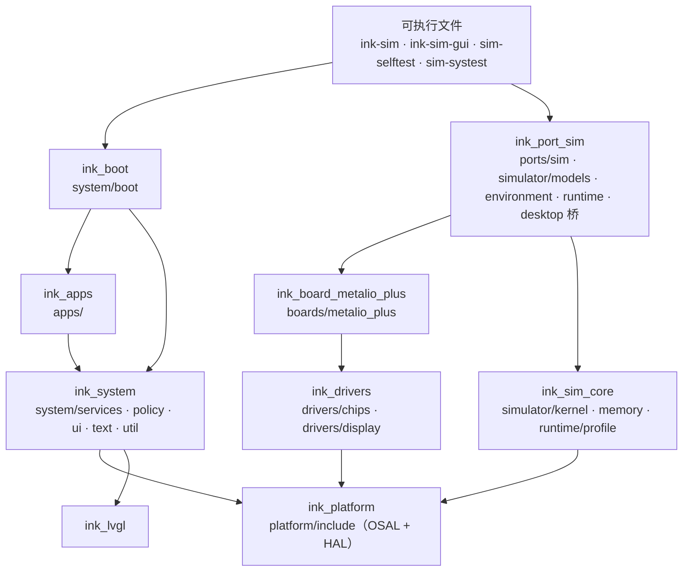

# 仓库结构

2026-11-03 按系统架构重组（用户要求；方案依据 Codex 审计 AUD2-024 与报告 I 节的建议，见[审计记录](../audits/README.md)）。这次只搬目录、拆构建目标，不改行为：重组前后 38 个测试运行的指标逐项相同。

## 目录

```text
ink/
├── apps/                    应用：主页 home/、阅读器 reader/
├── system/                  自研系统（真机与模拟器共用）
│   ├── boot/                组合根：ink_main() 启动服务和应用
│   ├── services/            系统服务：display、input、storage、power、audio、hub（与中枢的连接）、ai，
│   │                        data、file、time、notify、text、net、bt、comm、camera、res、update
│   ├── apps/                系统应用：remote/ 远程画面
│   ├── policy/              动作与权限：actions、members、system_actions
│   ├── ui/                  界面任务、应用注册、文本框、锁屏标记、LVGL 适配与配置；
│   │                        shell/ 系统壳（确认卡、键盘、密码、电源菜单等，现在是占位外观）
│   ├── text/                字体、断行、排版
│   ├── util/                通用实现（严格 JSON）
│   └── include/ink/sys/     系统接口（应用和服务之间）
├── hub/                     家庭中枢（Python）：网关、能力总线、假厂商、任务队列、安装脚本和测试
├── platform/include/ink/    平台接口：OSAL 与各 HAL（系统与端口之间的契约）
├── drivers/                 驱动（真机与模拟器共用）
│   ├── chips/               每颗芯片一个：tca9555 tps65185 ft6336u bq27220 cx25601n pcf8563 sc7a20h gc2145 bh1098g nt26
│   └── display/pqbn/        PQ-BN 直驱算法
├── boards/metalio_plus/     Metalio E-Ink4 Plus 的接法：IO 扩展芯片的唯一实例与锁、屏电源上电顺序、触摸坐标与盖板键、浅睡的板级步骤
├── ports/
│   └── sim/                 模拟器端口：osal/（OSAL 的模拟实现）、hal/（各 HAL 接到模型上，走真实驱动）
│                            真机端口 ports/esp32s31/ 待写
├── simulator/               模拟器本身（只在电脑上）
│   ├── kernel/vtk/          虚拟时间内核
│   ├── memory/              设备内存池（TLSF）
│   ├── models/              芯片与器件模型（寄存器、引脚、上电时序）
│   ├── environment/         外部环境：脚本化的中枢
│   ├── runtime/             运行器 sim_main、场景脚本、指标、跟踪、设备档案加载、图片输出
│   ├── desktop/             桌面模拟器：sim_gui（模拟线程与窗口之间的桥）、gui/（SDL2 + Dear ImGui、电脑摄像头）
│   ├── profiles/            设备档案（参数、估计值与出处）
│   └── sim.h                模拟器内部接口（端口、模型、运行器、测试之间）
├── tests/
│   ├── simulator/           模拟器与整板自检（selftest：内核、接线、4G）、确定性、桌面无界面测试
│   ├── integration/         系统服务检查（systest，直接链接系统服务）
│   ├── scenarios/           场景脚本与预算（整个产品在模拟设备上跑）
│   └── fixtures/            测试内容：content/（正常）、content-bad/（坏书）
├── tools/                   字体生成、报告、指令级模拟器、上机工具、尺寸统计、测试数据
├── third_party/             固定版本的第三方代码（tlsf、cjson、littlefs、jsmn、stb）
└── docs/                    需求、决策、调研、系统设计、实机记录、审计
```

## 分层与构建目标



| 目标 | 内容 | 公开的头文件 | 依赖 |
| --- | --- | --- | --- |
| `ink_platform` | 接口 | `platform/include` | — |
| `ink_drivers` | 芯片驱动、PQ-BN | `drivers/chips`、`drivers/display/pqbn` | `ink_platform` |
| `ink_board_metalio_plus` | 板级 | `boards`（`#include "metalio_plus/..."`） | `ink_drivers` |
| `ink_lvgl` | LVGL 与它的内存适配 | LVGL、`system/ui` | `ink_platform` |
| `ink_system` | 系统服务、策略、界面、文字、JSON | `system/include` | `ink_platform`、`ink_lvgl` |
| `ink_apps` | 应用 | — | `ink_system` |
| `ink_boot` | `ink_main()` | — | `ink_apps`、`ink_system` |
| `ink_sim_core` | 虚拟时间内核、内存池、档案 | 内核、内存、`simulator/runtime` | `ink_platform`、tlsf、cjson |
| `ink_port_sim` | 模拟端口、模型、环境、指标与跟踪、脚本、窗口桥 | `simulator`（`sim.h`）、`simulator/desktop` | 板级、驱动、`ink_sim_core`、littlefs、stb |

规则：

- **系统和应用只经平台接口访问硬件**。`ink_system` 不链接驱动、板级和模拟器，构建上就引用不到它们的头文件。
- **驱动和板级只依赖平台接口**，所以能原样放进 ESP-IDF 的组件；它们不知道模拟器存在。
- **模拟器只模拟硬件与环境**（R-043）：系统该做的流程（选网、切卡、按键判定、睡眠策略）不写进模型。
- **真机端口**（`ports/esp32s31/`，待写）实现同一套 `platform/include` 接口，链接同一份 `ink_drivers`、`ink_board_metalio_plus`、`ink_system`、`ink_apps`、`ink_boot`。

## 还没理清的

- **模型与模拟 HAL 互相调用**：例如扩展芯片的模型在 P14 断电时通知 4G 模组模型（在 `hal_net_sim.c` 里）和蓝牙芯片模型，`hal_input_sim.c` 里既有触摸芯片模型也有输入 HAL，`dev_camera.c` 里有摄像头模型也有 `hal_camera_capture`。所以端口、模型、运行器暂时在同一个库 `ink_port_sim` 里。要拆开，先让模型只通过总线和引脚与端口交互（审计建议按摄像头、输入、电源的顺序），再分成独立目标。
- **`sim.h` 是一个大头文件**：端口、模型、运行器、测试都用它。拆模型时一起拆成各自的私有头。
- **自检程序 `tests/simulator/selftest.c` 很大**：混着内核、接线、4G 的检查，可以按对象拆成几个程序。

## 旧路径对照

重组前的提交是 `4309087`。历史文档（审计报告、`docs/project.md` 的接续记录、研究归档、简报）保留当时的路径，只把它们的链接改到新位置；查旧路径时按下表换算。

| 原来 | 现在 |
| --- | --- |
| `system/main.c` | `system/boot/main.c` |
| `system/display/`、`input/`、`storage/`、`power/`、`audio/`、`ai/` | `system/services/<同名>/` |
| `system/net/` | `system/services/hub/` |
| `system/core/actions.c`、`members.c`、`system_actions.c` | `system/policy/` |
| `system/core/ink_json.c` | `system/util/ink_json.c` |
| `drivers/<芯片>/` | `drivers/chips/<芯片>/` |
| `drivers/epd/` | `drivers/display/pqbn/` |
| `drivers/board/`（`#include "board/..."`） | `boards/metalio_plus/`（`#include "metalio_plus/..."`） |
| `sim/vtk/`、`sim/mem/` | `simulator/kernel/vtk/`、`simulator/memory/` |
| `sim/profile.*` | `simulator/runtime/profile.*` |
| `profiles/` | `simulator/profiles/` |
| `ports/sim/osal_sim.c` | `ports/sim/osal/osal_sim.c` |
| `ports/sim/hal_*_sim.c` | `ports/sim/hal/` |
| `ports/sim/dev_*.c` | `simulator/models/` |
| `ports/sim/sim_hub.c` | `simulator/environment/sim_hub.c` |
| `ports/sim/sim_main.c`、`script.c`、`metrics.c`、`trace.c`、`stb_impl.c` | `simulator/runtime/` |
| `ports/sim/sim_gui.*`、`ports/sim/gui/` | `simulator/desktop/sim_gui.*`、`simulator/desktop/gui/` |
| `ports/sim/sim.h` | `simulator/sim.h` |
| `tests/sim/` | `tests/simulator/` |
| `tests/system/`（本次审计新加） | `tests/integration/` |
| `tests/content/`、`tests/content-bad/` | `tests/fixtures/content/`、`tests/fixtures/content-bad/` |
