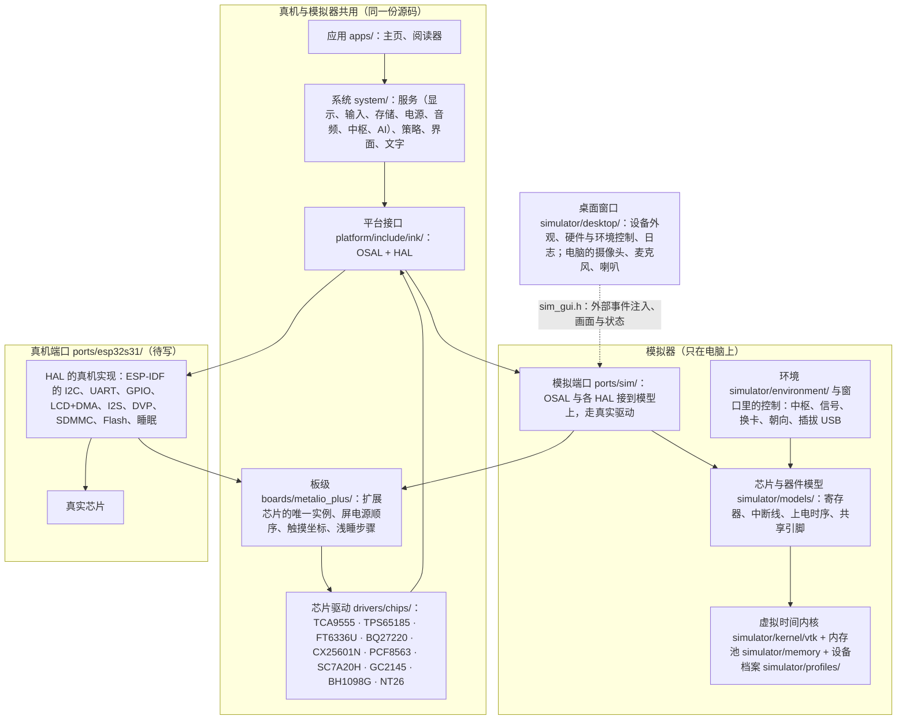

# 模拟系统总览

写于 2026-11-03，对应 main 上的模拟器（D-41 方案 A 第三步之后）。细节见[平台与模拟器](platform-and-simulator.md)，硬件逐项对照见[模拟器与官方硬件的对照](../research/simulator/hardware-parity.md)。

## 一句话

自研系统和应用照原样编译成电脑程序，跑在一台“虚拟的 Metalio E-Ink4 Plus”上。这台虚拟设备有 S31 的双核、时间和内存，屏幕、触摸、按键、电源、存储、网络、4G、音频、摄像头、传感器都按官方硬件的芯片、引脚和时序模拟；外设访问走我们自己写的驱动，换到真机时这些代码原样带过去，只换最底下一层（端口）。

对应的需求：R-034（硬件到货前就有足够真实的模拟环境）、R-042（类似 Android Studio / Xcode 的桌面模拟器）、R-043（模拟硬件与官方设计一致，只模拟硬件）、R-044（4G 在线切卡）、R-045（摄像头）。

## 分层

目录与构建目标的细节见[仓库结构](repo-layout.md)。

要点：

- **上面四层两边共用**：应用、系统、平台接口、驱动是同一份 C 源码，模拟器和真机各自编译。
- **下面一层不同**：模拟器端口把 HAL 接到模型上，真机端口把 HAL 接到 ESP-IDF 和真实芯片上。
- **模拟器只模拟硬件**：芯片对寄存器、AT 命令、引脚的反应，以及“环境”（周围的 Wi-Fi 与 4G 信号、来短信来电、设备朝向、插拔 USB、换卡）。怎么切卡、选哪条网络、按键长按做什么，都是系统的事，写在系统或驱动里。

## 组件

| 组件 | 目录 | 做什么 | 真机上 |
| --- | --- | --- | --- |
| 应用 | `apps/` | 主页、阅读器等界面 | 不变 |
| 系统 | `system/` | 服务（显示：刷新调度与波形选择；输入与手势；存储；电源策略；音频；与中枢的连接；AI）、动作与权限、界面框架（LVGL）、文字排版 | 不变 |
| 平台接口 | `platform/include/ink/` | OSAL（任务、队列、锁、定时器、内存）与各 HAL | 不变 |
| 芯片驱动 | `drivers/chips/`、`drivers/display/` | 每颗芯片一个驱动；PQ-BN 直驱算法 | 不变 |
| 板级 | `boards/metalio_plus/` | Plus 的接法：IO 扩展芯片的唯一实例与锁、屏电源上电顺序、触摸坐标与盖板键、浅睡的板级步骤、关机脉冲 | 不变 |
| 模拟端口 | `ports/sim/` | OSAL 的模拟实现（`osal/`），各 HAL 的模拟实现（`hal/`），经真实驱动访问模型 | 换成 `ports/esp32s31/` |
| 芯片与器件模型 | `simulator/models/` | 扩展芯片、屏电源芯片、电量计与充电芯片、时钟与加速度计、摄像头、蓝牙音频芯片的寄存器级模型（触摸、4G 模组的模型暂在对应 HAL 文件里） | — |
| 环境 | `simulator/environment/` | 脚本化的中枢；周围的信号、卡、朝向等由运行器和窗口注入 | 真实的世界 |
| 虚拟时间内核 | `simulator/kernel/vtk/` | 任务是真线程，但轮流执行，时间按模型推进：双核、固定优先级抢占、CPU 成本、Flash 操作冻结全部任务；可实时（窗口）或尽快（测试）；同样输入结果逐位一致 | — |
| 内存模型 | `simulator/memory/` | 内部 RAM、DMA、PSRAM 三个池，TLSF 分配器，碎片、低水位、栈估计 | — |
| 运行器 | `simulator/runtime/` | `ink-sim` 的入口、场景脚本、指标与预算、跟踪、设备档案加载 | — |
| 设备档案 | `simulator/profiles/*.json` | 每种设备的参数：核数与频率、内存分区、各类 CPU 成本、屏幕与波形、Flash 时序、电流、网络、SIM 卡 | — |
| 桌面窗口 | `simulator/desktop/` | SDL2 + Dear ImGui：设备外观、鼠标触摸、按键、硬件与环境控制、资源与日志；电脑的摄像头、麦克风、喇叭 | — |
| 指令级模拟器 | `tools/iss/` | RV32 指令级模拟，测热点代码的周期数，校准档案里的 CPU 成本；第 1 步已与实机核对 | — |
| 上机工具 | `tools/bringup/`、`tools/hw-probe/` | 只读识别与备份、测量固件 | 实机上用 |

## 接口（HAL）与两边的实现

| 接口 | 系统用它做什么 | 模拟器里 | 真机上 |
| --- | --- | --- | --- |
| OSAL `osal.h` | 任务、队列、锁、信号量、定时器、内存 | 虚拟时间内核 + 内存池 | FreeRTOS + heap_caps |
| `hal_display.h` | 提交区域与波形、等完成 | EPDiy 刷新管线模型（送行任务、行队列、每相时间、Flash 停顿造成的欠载、残影）+ 屏电源芯片模型 | EPDiy 端口：LCD 外设 + DMA，屏电源经 `boards/metalio_plus` |
| `hal_input.h` | 触摸点与按键事件 | FT6336U 与 IO 扩展芯片的模型，经驱动读 | 同一套驱动，GPIO5 / GPIO2 / GPIO61 中断 |
| `hal_power.h` | 电量、资源开关、CPU 提频、浅睡与唤醒、关机、前光、振动 | 电池与耗电模型；电量计 / 充电芯片模型；浅睡状态机 | esp_pm、浅睡、驱动 |
| `hal_storage.h` | 内部 Flash 文件系统、SD 卡 | LittleFS 跑在模拟 NOR 上（擦写时序、掉电撕裂）；SD 用电脑目录加时延模型 | LittleFS on Flash，FATFS on SDMMC |
| `hal_net.h` | 链路状态、选网 `hal_net_use`、WebSocket；4G 的 `hal_modem_at` / `hal_modem_at_payload` / `hal_modem_urc` | 链路模型（时延、带宽、断网）+ 环境（周围的信号）+ 4G 模组 AT 模型（卡槽、注册、短信、电话） | Wi-Fi 与 UART 网卡，AT 走同一条链路 |
| `hal_audio.h` / `hal_codec.h` | 喇叭、麦克风、Opus | I2S 环形缓冲与时序；声音可放到电脑上，麦克风可用电脑的 | I2S（从模式）+ 编解码 |
| `hal_camera.h` | 拍一张照片 | GC2145 寄存器模型，画面来自电脑摄像头 | DVP + `drivers/chips/gc2145` |
| `hal_uart.h` | 带行协议的外设 | 蓝牙音频芯片 BH1098G 模型 | UART1 |
| `hal_i2c.h` | 驱动访问 I2C 芯片 | 共享总线计时 + 按地址分发给芯片模型，可注入故障 | ESP-IDF i2c_master |
| `hal_device.h` | 设备信息、时钟、加速度计、日志 | PCF8563 / SC7A20H 模型 | 驱动 |
| `hal_assets.h` | 映射的资源（字体等） | 映射文件 + D-cache 模型 | esp_mmap_assets |

## 模拟是怎么搭起来的

1. **系统不为模拟器改代码**。只通过 OSAL/HAL 访问平台；模拟器提供另一套实现。
2. **时间是模型给的**。任务在电脑上真跑，但每段代码花多少 S31 时间，按档案里的成本类记账（指令级模拟器测，实机核对过）；调度按 FreeRTOS 的规则（双核、优先级、时间片、Flash 操作冻结）。所以模拟出的延迟、欠载、卡顿都是 S31 上的，而不是电脑的。
3. **内存按 S31 分区**：内部 RAM 两段、DMA 保留区、PSRAM；分配器、碎片、栈都按设备算，超了就报。
4. **外设到寄存器**：总线上每颗芯片都有寄存器级模型，系统经我们的驱动访问；引脚接法按官方 `config.h`，包括共享的 INT 线（GPIO2）、共享复位（P12）、共享电源（P14）、关机脉冲（P13），违反接法时告警。
5. **数值有出处**：每个参数注明来自官方代码、手册、实测还是估计；估计值在档案和模型文件开头列出，等实机测量替换。
6. **两种用法**：命令行 `ink-sim` 按场景脚本尽快跑完，用预算判断（CI 每次推送跑 42 项）；窗口 `ink-sim-gui` 实时运行，人来操作和体验。

## 开发完怎么平移到真机

1. **不变的部分**：`apps/`、`system/`、`platform/include/`、`drivers/`、`boards/metalio_plus/` 原样用 ESP-IDF 编译（构建上各是一个目标，见[仓库结构](repo-layout.md)）。驱动已在模拟器里对着芯片模型跑过：寄存器顺序、等待时间、错误重试都是驱动自己的。
2. **要写的部分**：`ports/esp32s31/`，即 OSAL 和每个 HAL 的真机实现。多数是把 ESP-IDF 的外设驱动包一层：I2C、UART、GPIO 中断、LCD+DMA（沿用 EPDiy 端口）、I2S、DVP、SDMMC、Flash 分区、浅睡；4G 的 AT 走 UART 网卡链路。
3. **板级初始化与模拟器一致**：IO 扩展芯片的方向和上电电平、充电电流、蓝牙模式、浅睡的板级步骤等，模拟器端口做的事，真机端口照做（都调用同一套驱动和板级代码）。
4. **用测量校准**：第 0、1 步的实测已写回档案；之后上机的每一步都对照模拟器的预测（屏幕时序、Flash 停顿、电流、待机），差得多的就改模型或档案。
5. **CI 里加 S31 编译**（D-41 A 的一项）：保证共用代码在 ESP-IDF 下一直能编过。
6. **先在模拟器里出问题**：资源超限、欠载、时序违规、接法违规、掉电恢复，模拟器里就会失败；上机主要验证模型没覆盖到的东西。

## 测试

42 项，CI（Linux 与 macOS）都跑：模拟器自检（4 个档案）、整块板接线自检（EPDiy 与 PQ-BN 两个显示档案；马达、共享复位与电源、时钟闹钟唤醒、加速度计、摄像头、蓝牙音频芯片、浅睡时各部件的状态与唤醒、关机脉冲）、4G 自检（在线切卡、短信、电话、环境与选网）、系统服务检查（存储缓存、扬声器打不开时的播放）、内存池记账、扩展芯片开机失败、麦克风打不开时的 AI 提问、确定性、主页与阅读器场景（悲观与预期两档）、AI 提问、工具调用与关闭面板、待机、掉电恢复、屏电源失败、刷新算法、I2C 故障、可移植性、指令级模拟器自检、桌面窗口无界面测试。

## 已知局限与假设

- **估计值**：电池内阻、充电曲线、充电芯片的复位值、摄像头帧率、Wi-Fi 入网时间、各类电流；等实机测量。
- **假设**：电源芯片在第几个关机脉冲动作、加速度计在板上的坐标轴方向、4G 模组主动上报的格式、蓝牙音频芯片的应答（没有手册）。
- **没模拟**：4G 通话的声音（通路不清楚）；双核同时从 PSRAM 送行的争用（待实测）。
