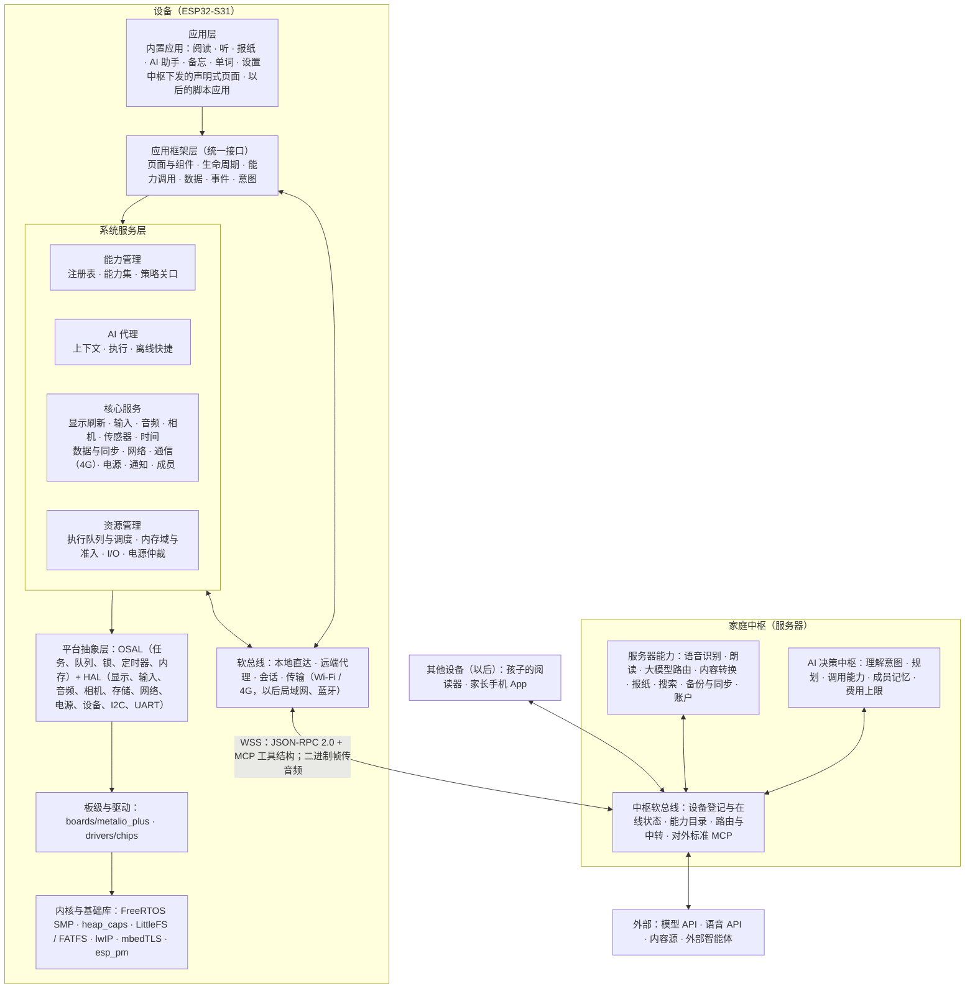
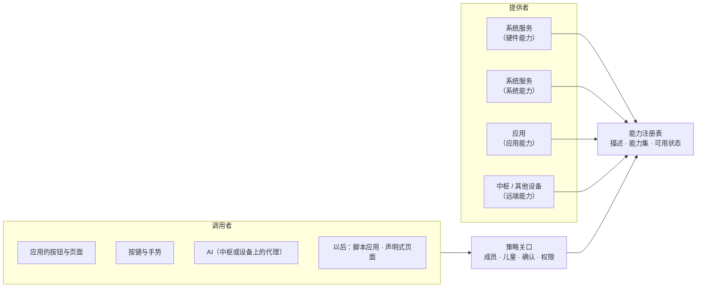
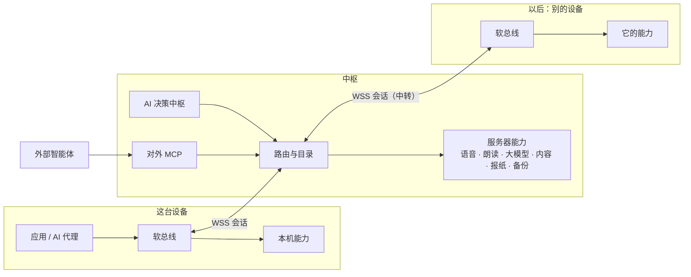
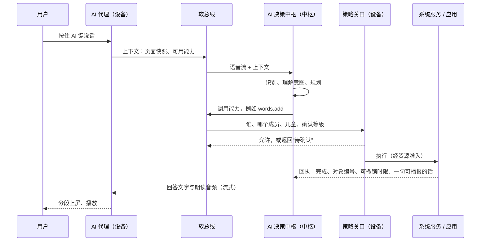
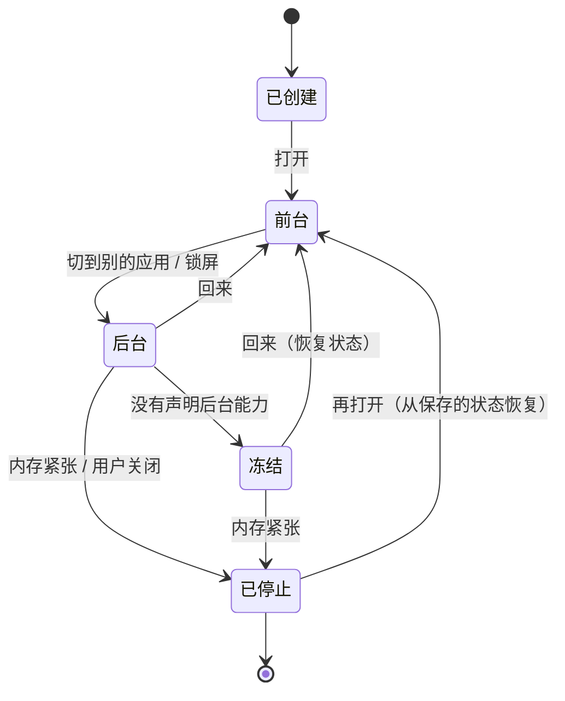

# 系统架构概要设计 v0.2（待用户审核）

起草：2026-11-03。状态：**草案，等用户审核确认**。依据：用户 2026-11-03 的要求（[R-046](../requirements.md)）、[底座设计 v1.1](foundation.md)、[架构方案 v0.1](architecture.md)、已定的决策（D-04、D-05、D-08、D-10、D-12、D-23、D-24、D-28 等，见[决策记录](../decisions/README.md)），以及 OpenHarmony / HarmonyOS、Android、iOS 的公开文档（链接见文末）。

本文是助手的设计建议，未经实机验证；涉及其他系统的部分是【文档】事实，标了来源；数字是估计。用户确认后，选定的方案记进决策记录，再展开成详细设计。

## 0. 一页结论

**一句话**：把设备上和服务器上的一切功能，都做成有统一描述的“原子能力”，挂在一条统一的“软总线”上；应用和 AI 只通过能力和应用框架做事，不碰硬件；AI 作为决定“做什么”的中枢，设备上的策略关口决定“能不能做”，系统服务和资源管理决定“怎么做、什么时候做、用多少资源”。

**七个关键设计（建议）**

1. **原子能力**：硬件（拍照、放音、录音、振动、前光、朝向、时钟、电量、短信电话、存储）、系统功能（通知、成员、设置、作业）、应用的动作（打开书、加生词）、服务器的功能（语音识别、朗读、大模型、内容转换、报纸）都登记成同一种“能力”，有编号、版本、输入输出格式、副作用等级、所需权限和资源。
2. **能力集**：设备声明自己支持哪些能力，应用声明自己需要哪些能力，运行时可以查询（借鉴 OpenHarmony 的 SysCap 与 `canIUse`）。应用看到的是“有没有拍照能力”，而不是“有没有 GC2145”。
3. **软总线**：一个能力地址、两条路径。能力在本机就直接投递给提供它的服务（不序列化）；在中枢或别的设备上，就经同一个接口走远端代理（JSON-RPC 2.0 + MCP 工具结构，沿用 D-12）。对调用者没有区别，只有时延和离线行为不同。
4. **AI 决策中枢**：大模型编排放在中枢（沿用 D-04），设备上有一个“AI 代理”负责上下文、执行和策略关口。能力描述本身就是 AI 的工具描述，按钮和 AI 调用同一个能力（沿用底座设计 §6.1）。
5. **统一的应用框架**：应用只依赖应用框架（页面、生命周期、能力、数据、事件），构建上就引用不到 HAL 和驱动；同一个应用可以跑在 Plus、别的墨水屏设备和桌面模拟器上。
6. **资源管理与多任务**：线程由系统统一持有，应用和作业按服务质量等级（QoS）提交到执行队列；内存分内部 RAM、DMA、PSRAM 三个域做预算和准入，缓存可回收，内存紧张时按级别收缩；单前台 + 系统浮层 + 声明过的后台能力 + 可恢复的作业。
7. **底层用成熟的，框架层自己写薄的**：内核与线程（FreeRTOS，ESP-IDF 自带）、内存分配（heap_caps）、文件系统（LittleFS、FATFS）、网络与加密（lwIP、mbedTLS、WebSocket）、界面（LVGL）都用现成的；能力注册表、软总线、应用框架、资源管理和 AI 代理没有适合这块单片机的现成方案，按本文自己写，保持很薄。

**需要你确认的决策**：D-45～D-51，共 7 项，见 §11。

## 1. 要求与约束

### 1.1 用户的要求（R-046，2026-11-03）

1. 系统层的构建参考鸿蒙的理念：把硬件都抽象为**原子能力**；有一个**统一的分布式软总线**；以后**服务器上的能力也可以被调用**。
2. **AI 可能作为整个决策的中枢**。
3. 构建应用时用的都是**统一的抽象接口或能力**，应用**不感知底层硬件差异**。
4. 适当参考现代移动设备操作系统的**抽象层次**。
5. **资源管理、内存、线程调度、多任务框架**必须有；评估是自己构建还是用成熟的三方机制或项目，在整体架构里写清楚。
6. 用户人工审核、确认这份设计是否满足要求。

### 1.2 必须遵守的约束（已有事实与已定决策）

| 约束 | 内容 | 来源 |
| --- | --- | --- |
| 芯片 | ESP32-S31：双核 RISC-V 320 MHz（只有一个核有向量扩展），内部 SRAM 512 KB，PSRAM 16 MB，Flash 16 MB | 官方规格；第 0 步实测 PSRAM |
| 内部 RAM 很紧 | 系统、驱动、网络栈占掉大部分，估计只剩约 80～150 KiB 给动态使用 | 底座设计 §3.2（估计） |
| 只有一个地址空间 | 单片机上没有进程和 MMU 隔离，所有代码共享内存 | 芯片事实 |
| 薄设备、厚中枢 | 大模型、内容转换、多步编排都在中枢 | D-04 |
| 离线必须能用 | 读和听已下载内容、备忘、单词复习 | D-05 |
| 设备—中枢协议 | 自定信封 + JSON-RPC + MCP 工具/结果结构 | D-12 |
| 连接方式 | 活跃时长连接，静止或待机时断开 | D-24 |
| 应用模型分阶段 | 内置 → 中枢下发的声明式页面 → 脚本应用 | D-08 |
| 界面框架 | LVGL 9 + 墨水屏适配层 | D-10 |
| AI 看得到所有页面 | 页面快照不按“私密”删减，凭据输入框掩码 | D-23、D-33 |
| 一家人共用 | 成员是一级概念，儿童有策略，成人进入要 PIN | D-03、D-16 |

## 2. 参考：现代移动系统怎么分层

| 层次 | Android | iOS | OpenHarmony / HarmonyOS | 本项目（建议） |
| --- | --- | --- | --- | --- |
| 应用 | Activity、Service | App、App Extension | 应用（UIAbility、ExtensionAbility）、元服务 | 内置应用、声明式页面、以后的脚本应用 |
| 应用框架 | Framework API、Intent | UIKit / SwiftUI 等框架 | ArkUI、Ability 框架 | 应用框架：页面、生命周期、能力、数据、事件 |
| 让 AI 调用应用 | AppFunctions（Android 16 起，官方称相当于 MCP 的工具） | App Intents（Siri、Apple Intelligence 用） | 意图框架 Intents Kit、智能体框架 HMAF | 能力描述即 MCP 工具；AI 中枢 |
| 系统服务 | 系统服务，经 Binder 调用 | 后台守护进程，经 XPC | 系统服务层：系统能力（SA）登记在 samgr；软总线、分布式数据、分布式任务调度 | 系统服务 + 能力注册表 + 软总线 |
| 设备内与跨设备调用 | Binder（设备内） | XPC（设备内）、Continuity（跨设备） | IPC 走 Binder（设备内），RPC 走软总线（跨设备），客户端按 SA 编号和设备编号拿代理 | 同一能力接口；本地直达，远端经软总线代理 |
| 硬件抽象 | HAL | IOKit、驱动 | 驱动框架 HDF、接口 HDI；内核抽象层 KAL | HAL（`platform/include/ink`）+ 板级 + 驱动 |
| 内核 | Linux | XNU | Linux 或 LiteOS（轻量系统面向 MCU，最小 128 KiB 内存） | FreeRTOS（ESP-IDF） |

**借鉴什么（建议）**

- **能力化的系统服务与能力集**：OpenHarmony 把每个相对独立的特性叫“系统能力”（SysCap），设备有“支持能力集”，应用有“要求能力集”，用 `canIUse` 查询；对应本文的原子能力与能力集（§4）。
- **注册表 + 代理**：OpenHarmony 的系统能力登记在 samgr，客户端按编号（跨设备时加设备编号）拿到代理再调用，设备内走 IPC、跨设备走软总线上的 RPC；对应本文的能力注册表和软总线的本地、远端两条路径（§5）。
- **软总线**：OpenHarmony 的分布式软总线“为设备间的无缝互联提供了统一的分布式通信能力”，分布式任务调度支持“远程启动、远程调用、绑定/解绑、以及迁移”，设备虚拟化“将周边设备作为手机能力的延伸”；对应本文软总线的远端能力与以后的多设备（§5）。
- **让 AI 调用应用**：三家都在做同一件事：应用在编译时声明自己的动作和数据（Android 的 AppFunctions、iOS 的 App Intents、鸿蒙的意图框架），系统把它们交给 AI。本项目的动作注册表已经是这个形状（每个动作有参数的 JSON Schema、副作用等级、回执），扩成能力后直接作为 MCP 工具（§6）。
- **硬件抽象与驱动分离**：HDF/HDI 把驱动和上层隔开；本项目已经有 HAL、板级和驱动三层，并在模拟器里验证过（[仓库结构](repo-layout.md)）。

**不照搬什么**

- **多进程与 Binder**：单片机只有一个地址空间，没有进程隔离；能力调用在本机就是投递消息，不需要跨进程序列化。
- **整套 OpenHarmony 轻量系统**：它的内核 LiteOS-M 面向 Cortex-M 和 RISC-V，但没有查到 ESP32-S31 的适配【推断】；换掉 ESP-IDF 会失去现成的 Wi-Fi、4G、屏驱和乐鑫的维护，代价远大于收益。只借鉴概念，不搬代码（§9）。
- **设备上的通用应用商店与 JS 界面引擎**：首版不做（D-21“不做”清单），脚本应用按 D-08 第三阶段另行验证（SP-08）。

## 3. 总体架构

| 层 | 做什么 | 现在的代码 | 真机与模拟器 |
| --- | --- | --- | --- |
| 应用层 | 用户看到的功能 | `apps/home`、`apps/reader` | 共用 |
| 应用框架层 | 应用唯一能用的接口：页面、生命周期、能力、数据、事件、意图 | `system/include/ink/sys/*.h`（要分出应用 SDK） | 共用 |
| 系统服务层 | 能力管理、AI 代理、核心服务、资源管理 | `system/services/*`、`system/policy/*` | 共用 |
| 软总线 | 能力调用的投递：本机直达，远端代理 | 本机：服务间消息；远端：`system/services/hub` | 共用 |
| 平台抽象层 | 系统与端口之间的契约 | `platform/include/ink` | 两边各实现 |
| 板级与驱动 | 芯片与接法 | `boards/metalio_plus`、`drivers/chips` | 共用 |
| 内核与基础库 | 线程、内存、文件、网络、加密 | 真机：ESP-IDF；模拟器：虚拟时间内核与内存池 | 各自 |

依赖只能向下或经软总线；应用之间不直接调用，跨应用一律走能力（“打开某书到某位置”“就本页提问”）。

## 4. 原子能力

### 4.1 什么是原子能力

**原子能力**是一个可以单独调用、有稳定约定的最小功能单位。它有四个来源，在注册表里是同一种东西：

| 来源 | 例子 | 提供者 |
| --- | --- | --- |
| 硬件能力 | 拍一张照片、放一段音频、录音、振动一下、设前光、读朝向、读时间与设闹钟、读电量、发短信、拨号 | 系统服务（对硬件做抽象） |
| 系统能力 | 发通知、当前成员、读写设置、提交作业、本地搜索、取页面快照 | 系统服务 |
| 应用能力 | 打开书到某位置、下一页、加生词、记备忘、朗读本章 | 应用（现在的动作注册表） |
| 远端能力 | 语音转文字、朗读、问大模型、导入一本书、今天的报纸、备份；以后别的设备上的能力 | 中枢；以后其他设备 |

本机的硬件能力一览（Plus，建议）：

| 能力 | 形态 | 提供者 | 下面的 HAL 与芯片 |
| --- | --- | --- | --- |
| `audio.play`、`audio.record` | 流 | 音频服务 | `hal_audio`、`hal_codec`：BH1098G、NS4150 |
| `camera.capture` | 调用 | 相机服务（新） | `hal_camera`：GC2145 |
| `haptic.pulse`、`light.set` | 调用 | 电源服务 | `hal_power`：TCA9555 P03、LEDC |
| `sensor.orientation`、`sensor.motion` | 状态、事件 | 传感器服务（新） | `hal_device`：SC7A20H |
| `time.now`、`alarm.set` | 调用、事件 | 时间服务 | `hal_device`：PCF8563 |
| `battery.state` | 状态、事件 | 电源服务 | `hal_power`：BQ27220、CX25601N |
| `net.link` | 状态、事件 | 网络服务 | `hal_net` |
| `modem.sms.send`、`modem.sms.inbox`、`modem.call.*` | 调用、事件 | 通信服务 | `hal_net`（AT 通道）：NT26 驱动 |
| `store.object.*`、`store.file.*` | 调用 | 数据服务 | `hal_storage`：LittleFS、TF 卡 |

屏幕和输入不作为普通能力给应用调用：应用通过应用框架的页面和组件画界面、收手势，由显示服务和输入服务适配具体的屏和触摸芯片。给 AI 用的是“取页面快照”“在页面上做某个动作”这类系统能力。

### 4.2 能力描述

每个能力有一份描述（现在动作注册表的扩展）。编译时是 C 的静态表，同时导出成 JSON 交给中枢（握手时按 `manifest_hash` 缓存，沿用 D-12）。

| 字段 | 说明 | 例子 |
| --- | --- | --- |
| 编号与版本 | `域.名称`，加版本号；改了约定就加版本 | `camera.capture` v1 |
| 形态 | 调用（一次请求一个回执）、流（连续的帧）、事件（订阅）、状态（读取与监视） | 调用 |
| 标题 | 给人和模型看的名字 | 拍一张照片 |
| 输入、输出 | JSON Schema（与 MCP 工具的 `inputSchema`、`outputSchema` 一致） | 输出：图片对象编号 |
| 副作用等级 | 只读、导航、本地可逆写、本地不可逆、外部副作用、系统（沿用底座设计 §6.2） | 只读 |
| 确认与儿童策略 | 无需确认 / 设备上确认 / 家长确认；儿童是否可用 | 无需确认，儿童可用 |
| 权限 | 调用方需要的权限（应用清单里声明） | `camera` |
| 资源 | 预计用到的内部 RAM、PSRAM、供电、网络、耗时等级 | PSRAM 约 600 KiB，P05 供电 |
| 服务质量 | 时延等级、超时、能否重试、离线时怎么办（失败 / 排队 / 换本地方案） | 交互级，3 s，离线可用 |
| 提供者 | 哪个服务、应用或远端节点 | 相机服务 |
| 开放范围 | 给应用、给 AI、给远端 | 应用、AI |

### 4.3 能力集与查询

- **设备支持能力集**：本机注册了哪些能力，加上中枢此刻可用的远端能力。随硬件和状态变化（摄像头断电、离线时远端能力不可用），变化时发事件。
- **应用要求能力集**：应用清单里列出必需和可选的能力；必需的缺了，应用不显示或给出原因。
- **运行时查询**：`ink_cap_available("camera.capture")`，与 OpenHarmony 的 `canIUse` 同一用途：先查后用。

### 4.4 应用为什么感知不到硬件差异

- 应用只看到能力编号和格式。没有摄像头的设备上 `camera.capture` 不存在，应用按“可选能力”处理；以后家长手机 App 可以把它的摄像头登记成远端能力，应用代码不改。
- 屏幕的分辨率、灰阶、刷新方式由应用框架和显示服务处理：应用提交“这块区域变了、要清楚还是要快”，不知道是墨水屏还是 LCD（模拟器已在 Plus、RK3566 类墨水屏、桌面 LCD 三个档案上跑同一套应用，R-035）。
- 音频芯片、4G 模组、存储介质的差别在服务和驱动里消化。

## 5. 软总线

### 5.1 一个地址，两条路径

能力地址写作 `[节点/]能力`：不写节点就是“哪里有就用哪里，本机优先”；`hub/tts.speak` 指定中枢；以后 `dev:孩子的阅读器/reader.open` 指定别的设备。

- **本机直达**：注册表查到提供者在本机，就把请求投递到提供者所在任务的队列，参数是 C 结构，不序列化；大块数据（图片、音频块）在 PSRAM 里传指针，不复制。回执投递回调用者的任务，所以应用不需要加锁。
- **远端代理**：提供者在中枢或别的设备上，代理把请求编码成 JSON-RPC 2.0 的 `tools/call`（能力编号就是工具名），经中枢连接发出；流用二进制帧（`[类型][流号][序号]`，现有的 Opus 上下行就是这样）。

调用者用同一个接口，只是远端能力的时延更长、可能离线；这由能力描述里的服务质量说明，框架统一处理。

### 5.2 分层

| 层 | 做什么 | 现在 |
| --- | --- | --- |
| 能力接口 | 调用、流、事件、状态四种形态；回执用同一套状态（完成、已排队、待确认、被拒绝、已过期……） | 动作注册表与回执（`ink/sys/actions.h`） |
| 路由与策略 | 解析地址；执行端做策略检查（谁、哪个成员、儿童、是否要确认）；请求号去重、超时、重试、离线策略 | 策略关口在动作注册表里 |
| 会话 | 与每个远端节点一条会话：握手（协议版本、能力清单哈希、成员与模式）、认证、保活、多路复用 | 中枢连接（`system/services/hub`），握手按 D-12 |
| 传输 | WSS（Wi-Fi 或 4G，设备主动连出，适合 NAT）；以后局域网直连（mDNS 发现 + WebSocket）、蓝牙 | 中枢连接 + 网络服务 |

### 5.3 中枢在总线上的角色

- **能力目录**：每台设备的能力清单（按哈希缓存）、服务器能力、各设备在线状态。设备只拿到它有权用的那部分。
- **路由与中转**：设备调用服务器能力，或经中枢调用别的设备（首版多设备一律经中枢中转，局域网直连以后再说）。
- **对外标准 MCP**：中枢把设备和服务器的能力翻译成标准 MCP，给外部智能体或家长端用（沿用 D-12）。
- **服务器能力也是能力**：语音识别、朗读、大模型、内容转换、报纸、搜索、备份，都按 §4.2 的格式描述，设备上的应用像调用本机能力一样调用它们，只是要联网。

### 5.4 可靠性与离线

- **请求号去重**：每次调用带请求号，断线重发不会重复执行（底座设计 §6.5 已定）。
- **离线策略**按能力定：失败并说明（问大模型）、排队到联网（备份、同步）、换本地方案（朗读可以退到本地提示音或文字）。读、听、备忘、单词复习不依赖远端能力（D-05）。
- **迟到的结果**：带页面代次和成员编号，过期的结果不覆盖新页面（底座设计 §6.4）。

### 5.5 安全

- 设备有自己的身份密钥，会话要认证；成员身份随每次调用传递。
- **策略检查在执行端做**：远端（包括 AI 和以后别的设备）调用本机能力，同样经过本机的策略关口；需要确认的在本机屏幕上确认。
- 固件升级只接受中枢签名的固件，签名用软件校验；不烧 eFuse、不开安全启动（用户的硬性规则）。

## 6. AI 决策中枢

### 6.1 两半

| 部分 | 在哪 | 做什么 |
| --- | --- | --- |
| AI 决策中枢（编排） | 中枢 | 理解意图（语音、文字、事件），规划步骤，选择并调用能力（设备的和服务器的），保存成员记忆，控制费用；用中枢上的完整数据副本回答历史问题（D-04） |
| AI 代理 | 设备 | 入口（AI 键按住说话 D-17、选区菜单“解释”、系统事件）；上下文（页面快照、设备状态、此刻可用的动作）；执行能力调用；策略关口；离线快捷意图；回执与撤销 |

### 6.2 一次决策的过程

### 6.3 边界：谁决定什么

| 问题 | 谁决定 | 为什么 |
| --- | --- | --- |
| 做什么（意图、计划、调哪些能力） | AI 决策中枢 | 这是 AI 擅长的，也是 G-002“AI 原生”的含义 |
| 能不能做（成员、儿童、权限、要不要确认） | 设备上的策略关口 | 不靠提示词；模型被诱导时也越不过去（底座设计 §6.2） |
| 怎么做、什么时候做、用多少资源 | 系统服务与资源管理 | 刷新、音频、电源、调度都有实时要求，不能等网络和模型 |

由此推出两条规则：**实时回路从不等 AI**（输入到画面、音频、睡眠唤醒）；**AI 的请求只是请求**，系统可以排队、降级或拒绝，并在回执里说明。

### 6.4 主动决策与离线

- **主动决策**：AI 可以订阅事件（新短信、读完一章、电量低、闹钟到），决定要不要做什么；它发起的动作同样过策略关口，结果进通知收件箱，用户看得见、能撤销。
- **离线快捷意图**：常用指令（“下一页”“朗读”“暂停”“加到生词本”）在设备上按规则直接映射到能力，不联网也能用（架构方案 v0.1 的 D-04 方案 C，按需加入）。

### 6.5 给 AI 的上下文

沿用底座设计 §6.3 与 §6.5：每个页面至少有一份系统生成的通用快照；应用可以给语义快照；能力目录渐进披露（常驻目录索引和当前应用的常用能力，其余按需加载）。快照里的正文标成“数据”，与指令分开。

## 7. 应用框架：统一接口

### 7.1 应用由什么组成

| 部分 | 说明 | 对照 |
| --- | --- | --- |
| 清单 | 编号、版本、要求的能力、提供的能力（动作）、页面、后台能力、内存配额 | 鸿蒙的应用配置与要求能力集；Android 的清单 |
| 页面 | 前台界面，同一时刻只有一个前台应用（单前台） | UIAbility / Activity |
| 后台能力 | 声明过类型的后台工作：播放、下载、同步 | ExtensionAbility / 前台服务 / iOS 后台模式 |
| 作业 | 可分步、可取消、可恢复的长任务，开始前做资源准入 | WorkManager / BGTaskScheduler |
| 卡片（以后） | 主页上的小块信息（今天的生词、报纸头条） | 服务卡片 / 小组件 |

声明式页面（中枢下发，A2UI 格式，底座设计 §6.6）和以后的脚本应用用同一份清单格式，只是代码换成页面描述或脚本。

### 7.2 生命周期

进入后台和冻结前，应用保存状态（当前书、位置、草稿）；系统在内存紧张或长时间运行后可以停掉它，下次打开从保存的状态恢复，用户感觉不到（底座设计 §3 的“静默重启”）。

### 7.3 统一接口一览

| 接口 | 内容 |
| --- | --- |
| `ink/app` | 生命周期回调、页面栈、意图（打开某对象、分享到某应用）、状态保存与恢复 |
| `ink/ui` | 页面与组件（LVGL 之上）、刷新提示（要清楚还是要快）、字体与排版 |
| `ink/cap` | 能力的查询、调用、流、事件、状态；回执 |
| `ink/data` | 成员分区的对象存储、变更日志与同步、文件；不直接碰文件系统 |
| `ink/event` | 系统事件订阅（电量、网络、成员切换、时间） |
| `ink/ai` | 给 AI 的语义快照、本应用开放的能力、AI 结果的回显 |

**规则**：应用只包含这些头文件；构建上应用只链接应用框架目标，引用不到 HAL、板级和驱动（现在 `ink_apps` 还能经 `ink_system` 看到平台接口，按 §10 第 5 步收紧）。应用不自己建线程，耗时工作提交到执行队列（§8.1）。

## 8. 资源管理与多任务

### 8.1 线程与调度

- **内核用 FreeRTOS**（ESP-IDF 自带的双核 SMP 版本）：固定优先级抢占、时间片，成熟，乐鑫维护。
- **线程只由系统持有**：数量固定、栈大小在清单里写明（内部 RAM 栈只给要写 Flash 或 ISR 相关的任务，D-30）。应用和作业不建线程，按服务质量等级把工作提交到系统的执行队列；同一个应用的界面代码都在界面任务里跑，像 Android 的主线程。

| 等级 | 例子 | 优先级（示意） | 放在哪个核 |
| --- | --- | --- | --- |
| 实时 | 屏幕送行、音频 DMA 补数据 | 最高 | 指定核 |
| 交互 | 输入、界面渲染、AI 键的首次反馈 | 高 | 界面核 |
| 媒体 | 音频编解码、朗读播放 | 中高 | 有向量扩展的核 |
| 网络 | 中枢会话、下载 | 中 | 任意 |
| 后台 | 同步、预取、建索引 | 低 | 任意 |

- **时间预算**：作业按小步执行，每步有时限，超时可以挂起或取消；看门狗不放宽（上游曾放宽到 20 s）。
- **频率**：空闲时降频，刷新、编解码、TLS 握手时临时升到满速（D-39，已在模拟器里实现）。

### 8.2 内存

- **三个域分开记账**：内部 RAM（最紧，只给驱动、DMA 和关键控制结构）、DMA 区、PSRAM（帧缓冲、页缓存、字形、音频缓冲、应用数据）。分配器用 ESP-IDF 的 heap_caps（TLSF 多堆），本项目在上面加按组件的标签和配额（模拟器已经按组件标签记账）。
- **预算写在清单里**：每个服务、每个应用声明内部 RAM 和 PSRAM 的用量上限；大块分配先经准入。
- **可回收缓存**：页缓存、字形缓存、预渲染页登记为可回收，带优先级。
- **压力分级**：正常 → 偏紧（收缩缓存）→ 紧张（暂停后台作业、冻结后台应用）→ 危急（停掉后台应用，必要时静默重启并回到原界面）。

### 8.3 多任务框架

- **单前台**：同一时刻一个前台应用。
- **系统浮层**：AI 面板、系统确认卡、通知、锁屏标记，由系统画在前台应用之上。
- **后台能力**：只允许声明过的类型（播放、下载、同步），声明时写明资源；内存紧张时按优先级暂停。
- **作业**：可分步、可取消、可恢复，开始前过资源准入，队列有上限（底座设计 §5.6）。
- **定时与唤醒**：闹钟和提醒经时间服务；浅睡中靠定时器、电源键、AI 键（和可用时的时钟中断、4G 来消息）唤醒（已在模拟器里按官方顺序实现）。
- **打断与音频焦点**：来电、闹钟、语音回答之间的优先级由系统规定（底座设计 §7）。

### 8.4 I/O、网络与电源仲裁

- **Flash**：任何 Flash 读写不与刷新波形重叠，小文件读缓存与预取（D-36，已实现）。
- **网络**：网络服务选链路（Wi-Fi 或 4G，系统决定，`hal_net_use`），中枢会话活跃时长连、静止时断开（D-24）。
- **电源**：资源按引用计数开关共享电源（4G、蓝牙音频、功放共用 P14），睡眠前所有外设空闲（已实现）。

## 9. 自研还是用现成

| 机制 | 选择（建议） | 理由 |
| --- | --- | --- |
| 内核、线程、同步原语 | **现成**：FreeRTOS SMP（ESP-IDF） | 成熟；S31 只有 ESP-IDF 支持；本项目的 OSAL 已在其上 |
| 内存分配 | **现成**：heap_caps（TLSF 多堆）+ 本项目的标签与配额 | 分配器不必自己写；预算与准入是本项目特有的 |
| 文件系统 | **现成**：LittleFS（内部 Flash）、FATFS（TF 卡） | 已用；掉电安全 |
| 设置存储 | **现成**：ESP-IDF NVS | 小键值足够 |
| 网络与加密 | **现成**：lwIP、mbedTLS、esp_websocket_client | ESP-IDF 自带 |
| 界面 | **现成**：LVGL 9（D-10）+ 自写墨水屏适配与中文排版（D-29） | 已定 |
| 局域网发现、蓝牙（以后） | **现成**：mDNS 组件、NimBLE | ESP-IDF 自带 |
| 能力注册表与能力集 | **自写（薄）** | 没有单片机上的现成实现；从现在的动作注册表扩展 |
| 软总线 | **自写（薄）**：本机投递在 OSAL 队列上，远端走 JSON-RPC 2.0 + MCP 结构 | ESP-IDF 的 esp_event 只有事件分发，没有能力描述、权限和远端透明；OpenHarmony 的软总线依赖它自己的系统框架；协议沿用 D-12 |
| 能力描述格式 | **现成标准**：JSON Schema（与 MCP 一致）+ 自写的小代码生成 | 一份描述同时用于本地 C 接口、远端调用和 AI 工具 |
| 应用框架与生命周期 | **自写（薄）** | 没有适合单片机的现成框架；借鉴 UIAbility、Activity、iOS 后台模式 |
| 资源管理（执行队列、准入、压力分级） | **自写（薄）** | 本项目特有；在 FreeRTOS 和 heap_caps 之上 |
| AI 代理（设备侧） | **自写** | 已有雏形（`system/services/ai`、动作注册表） |
| 中枢 | **自写 Python**（D-14），用 MCP 官方 SDK | 已定 |
| 声明式页面 | **现成格式**：A2UI v0.9 + 自写渲染器（可参考上游的 A2UI-lite） | 底座设计 §6.6 |
| 脚本应用（D-08 第三阶段） | **候选现成**：WAMR（WebAssembly；乐鑫有 ESP-IDF 组件，但它列出的目标芯片里还没有 S31；官方给的代码体积是在 Cortex-M4F 上量的：解释器约 56～59 KB，AOT 运行时约 29 KB），或 JerryScript、Berry、Lua | 要先验证 S31 上能否编译、内存与性能（SP-08） |
| OpenHarmony 轻量系统 | **不采用代码，借鉴概念** | 没有查到 ESP32-S31 的适配【推断】；会失去 ESP-IDF 的驱动生态；轻量系统的分布式能力也受限 |

**结论**：凡是“通用基础设施”都用成熟的；凡是“本项目的系统形状”（能力、总线、框架、资源策略、AI 代理）自己写，并且写薄：只做本文列出的，不做通用操作系统。Mudita Pure 的教训是范围失控（底座设计 §2），所以每一块都先在模拟器里用测试锁住行为再扩展。

## 10. 与现有代码的对应与演进步骤

| 新架构 | 现在已有 | 要做 |
| --- | --- | --- |
| 能力注册表 | 动作注册表 `system/policy/actions.c`（编号、参数 Schema、副作用、儿童、回执） | 扩成能力：加形态、版本、资源、服务质量、提供者、开放范围；能力集查询 |
| 硬件与系统能力 | 各系统服务 | 每个服务登记它提供的能力；新增相机服务、传感器服务 |
| 软总线（本机） | 服务间消息 | 统一的投递入口与回执投递 |
| 软总线（远端） | 中枢连接 `system/services/hub/hub_link.c` | 作为远端传输；中枢侧加目录与路由；服务器能力按同一格式描述 |
| AI 代理 | `system/services/ai`、策略关口 | 拆出上下文、执行、离线快捷意图；主动决策经通知收件箱 |
| 应用框架 | `system/include/ink/sys/*.h` | 分出应用 SDK 头文件与构建目标；应用只链接它 |
| 资源管理 | 电源服务、Flash 守卫、模拟器的内存标签 | 内存域配额与准入、执行队列与服务质量、压力分级 |

演进步骤（不推倒重来，每步都在模拟器里用测试验证）：

1. 定能力描述格式，动作注册表扩成能力注册表（现有动作原样迁移）。
2. 现有服务登记能力：音频、存储、网络、电源、时间、通信；新增相机、传感器服务。
3. 软总线本机部分：统一投递与回执；远端代理接到中枢连接。
4. 中枢：能力目录、路由、服务器能力（语音识别、朗读、大模型）按同一格式登记；对外 MCP。
5. 应用框架 SDK 与构建规则：应用只依赖 SDK；阅读器、主页改用能力接口。
6. 资源管理：执行队列与服务质量等级、内存域配额与准入、压力分级。
7. AI 代理：上下文与执行分离、离线快捷意图、主动决策。

## 11. 需要你确认的决策（D-45～D-51）

| 编号 | 决策 | 方案 | 推荐 |
| --- | --- | --- | --- |
| D-45 | 能力模型 | **A** 硬件、系统、应用、服务器功能统一成原子能力，有能力集与查询；**B** 只把应用动作做成能力（现状），硬件仍是各服务的私有接口 | A |
| D-46 | 软总线的投递方式 | **A** 本机直达（C 结构、不序列化）+ 远端代理（JSON-RPC + MCP）；**B** 本机也一律序列化成消息（统一，但慢、占内存） | A |
| D-47 | AI 决策中枢的边界 | **A** AI 决定做什么，设备策略关口决定能不能，系统决定怎么做与何时做；**B** AI 也直接调度资源（例如决定何时刷新、何时睡眠） | A |
| D-48 | 应用怎么接入 | **A** 应用只依赖应用框架 SDK，构建上看不到 HAL 与驱动；**B** 应用可以直接用 HAL（快，但换硬件要改应用） | A |
| D-49 | 底层机制 | **A** FreeRTOS / ESP-IDF 现成底层 + 自写的薄框架；**B** 改用 OpenHarmony 轻量系统；**C** 改用 Zephyr 或 NuttX | A |
| D-50 | 多任务模型 | **A** 单前台 + 系统浮层 + 声明过的后台能力 + 作业（延续底座设计）；**B** 允许多个应用同时前台（分屏） | A |
| D-51 | 多设备与远端能力 | **A** 首版远端能力只有中枢的；多设备经中枢中转，以后再做局域网直连；**B** 首版就做局域网发现与设备直连 | A |

## 12. 风险与要先验证的

| 风险 | 说明 | 怎么降低 |
| --- | --- | --- |
| 抽象的开销 | 能力投递、描述查找、回执在单片机上要花时间和内存 | 本机直达不序列化；描述编译成静态表；在模拟器里量投递时延与内存 |
| 做得太大 | 框架做成通用操作系统，迟迟出不了功能 | 只做本文列出的；每一块先有测试再扩展 |
| AI 依赖网络与模型 | 离线、模型慢时 AI 决策不可用或很慢 | 离线快捷意图；实时回路不等 AI；回执里的可播报句子减少往返 |
| 远端调用的安全 | AI 或别的设备调用本机能力 | 执行端策略关口；需要确认的在本机确认；会话认证 |
| 脚本应用的资源 | 运行时占内存、性能未知 | SP-08 先验证 WAMR 等候选 |
| 多设备复杂度 | 发现、认证、迁移都很复杂 | 首版经中枢中转（D-51） |

## 参考来源

- OpenHarmony 项目概述（分层、系统类型、分布式软总线、分布式任务调度、设备虚拟化）：[OpenHarmony-Overview_zh.md](https://gitee.com/openharmony/docs/blob/master/zh-cn/OpenHarmony-Overview_zh.md)
- OpenHarmony 系统能力 SysCap 与 `canIUse`：[syscap.md](https://gitcode.com/openharmony/docs/blob/OpenHarmony-5.1.0-Release/zh-cn/application-dev/reference/syscap.md)
- OpenHarmony IPC 与 RPC（samgr、代理与 Stub、设备内 Binder、跨设备软总线）：[IPC 与 RPC 开发指导](https://gitcode.com/openharmony/docs/blob/OpenHarmony-5.0.2-Release/en/application-dev/ipc/ipc-rpc-development-guideline.md)
- HarmonyOS 意图框架：[Intents Kit](https://developer.huawei.com/consumer/cn/sdk/intents-kit)
- 鸿蒙智能体框架 HMAF 的介绍（第三方文章，以华为官方文档为准）：[人人都是产品经理](https://www.woshipm.com/?p=6448748)
- Android AppFunctions：[Overview of AppFunctions](https://developer.android.com/ai/appfunctions)
- iOS App Intents：[App Intents](https://developer.apple.com/documentation/appintents)
- WAMR 的 ESP-IDF 组件：[espressif/wasm-micro-runtime](https://components.espressif.com/components/espressif/wasm-micro-runtime)
- OpenHarmony LiteOS-M 内核：[kernel_liteos_m](https://gitee.com/openharmony/kernel_liteos_m)
