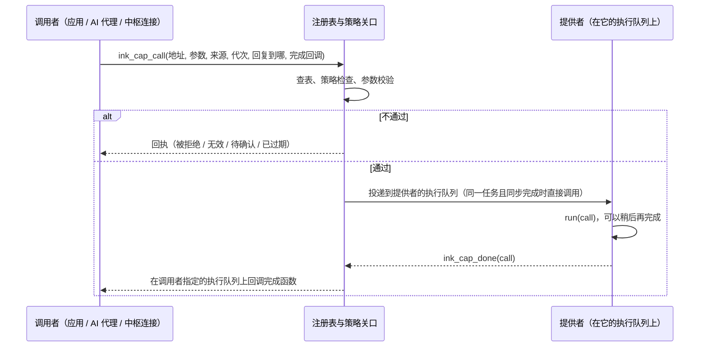
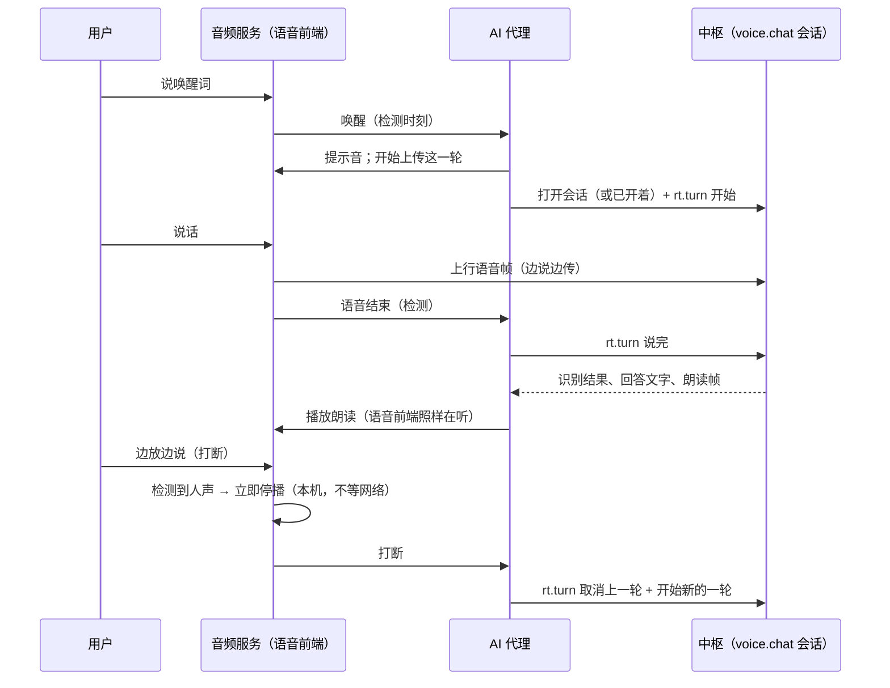

# 底层系统详细设计 v0.1

起草：2026-11-03。状态：草案，边实现边修订；每一步实现后在模拟器里验证，结果回填 §13。依据：[系统架构概要设计 v1.0](system-architecture.md)（已确认）、[底座设计 v1.1](foundation.md)、[仓库结构](repo-layout.md)，以及现有代码（`system/`、`apps/`、`platform/include/ink`、`simulator/environment/sim_hub.c`）。

证据边界：接口和数据结构是本文定的；时延、内存数字是估计或模拟器的数字，标明出处；真机（ESP-IDF 端口、ESP-SR、硬件 JPEG）未验证。

## 0. 范围与读法

- 本文把概要设计 §11 的十步展开到能写代码的程度：每一步写清**接口**（C 头文件草案）、**数据结构**、**跑在哪个任务**、**内存**、**失败时怎样**、**验收测试**。
- 设备侧全部在模拟器里实现和验证；服务器侧只在模拟中枢（`sim_hub`）里做够验证设备行为的原型，真实中枢（Python，D-14）以后照同一协议实现。
- 不在本文：ESP-IDF 端口、ESP-SR 与硬件 JPEG 的实机验证（列在 §12 的实机验证项里）。
- 现有代码不推倒：动作注册表、服务、中枢连接、AI 服务都是演进，不是重写；每一步完成时现有的场景测试要原样通过（同样的指标）。

## 1. 模块、文件与任务

### 1.1 新增和改动的模块

| 模块 | 位置 | 对应概要设计 | 步骤 |
| --- | --- | --- | --- |
| 能力注册表与策略关口 | `system/include/ink/sys/cap.h`、`system/policy/cap.c`（由 `actions.c` 演进） | §4.3、§5 | 1、2 |
| 能力参数 | `system/include/ink/sys/args.h`、`system/util/ink_args.c` | §5.1 本机直达 | 1 |
| 系统状态表 | `system/include/ink/sys/state.h`、`system/policy/state.c` | §4.4 | 1 |
| 设置表 | `system/include/ink/sys/settings.h`、`system/policy/settings.c` | §4.5 | 1 |
| 执行队列 | `system/include/ink/sys/exec.h`、`system/services/res/exec.c` | §8.1 | 2、4 |
| 软总线远端代理 | `system/policy/cap_remote.c` + `system/services/hub/hub_link.c` | §5.1、§5.3 | 2、8 |
| 相机服务 | `system/services/camera/camera_service.c` | §4.2 | 3 |
| 通信服务（短信、电话、切卡） | `system/services/comm/comm_service.c` + 新 HAL `hal_cellular.h` | §4.2、R-044 | 3 |
| 内存域、配额、压力分级、作业 | `system/include/ink/sys/res.h`、`system/services/res/{mem,job}.c` | §8.2、§8.3 | 4 |
| 实时会话 | `system/include/ink/sys/rt.h`、`system/services/hub/rt.c` | §9.2 | 5 |
| 语音前端与免按键 | `system/services/audio/afe.{h,c}`、新 HAL 钩子；模拟器模型在 `ports/sim/hal/hal_audio_sim.c` | §9.4 | 6 |
| 远程画面宿主 | `apps/remote/remote_host.c`（系统应用）、`system/util/lz4.c` | §9.5 | 7 |
| 中枢目录与服务器能力（模拟） | `simulator/environment/sim_hub.c` | §5.3 | 7、8 |
| 应用 SDK | `system/sdk/include/ink/*.h`，构建目标 `ink_sdk` | §7.3 | 9 |
| AI 代理 | `system/services/ai/`（拆成上下文、执行、语音、离线意图） | §6 | 10 |

### 1.2 任务（线程）

线程数量固定，由系统持有（概要设计 §8.1）。现有的任务不变；只新增两个执行任务。

| 任务 | 现有 / 新增 | 服务质量 | 优先级 | 核 | 栈 | 做什么 |
| --- | --- | --- | --- | --- | --- | --- |
| 显示服务 | 现有 | 实时 | 高 | 指定 | 内部 RAM | 送行、波形 |
| 音频服务 | 现有 | 实时 / 媒体 | 高 | 有向量扩展的核 | PSRAM（Opus 要约 26 KB） | 采集、编解码、播放、语音前端（第 6 步） |
| 界面任务 | 现有 | 交互 | 中高 | 界面核 | PSRAM | LVGL、应用代码、能力的界面类处理函数 |
| 输入服务 | 现有 | 交互 | 高 | 任意 | 内部 RAM | 触摸、按键 |
| 中枢连接 | 现有 | 网络 | 中 | 任意 | PSRAM | 会话、收发、实时会话的多路复用 |
| 存储服务 | 现有 | 后台（写 Flash 时最高） | 中 | 任意 | 内部 RAM（要调 Flash） | 原子写、读缓存 |
| 电源服务 | 现有 | 交互 | 中高 | 任意 | 内部 RAM | 状态、浅睡 |
| **媒体执行** `exec.media` | 新增 | 媒体 | 中高 | 有向量扩展的核 | PSRAM 8 KB | 远程画面解码、图片处理 |
| **后台执行** `exec.bg` | 新增 | 后台 | 低 | 任意 | PSRAM 6 KB | 作业、同步、预取、建索引 |

内部 RAM 的新增只有控制结构（注册表指针、状态与设置的值、队列句柄），估计 < 4 KiB；表的字符串都是常量（在 Flash 里），远端能力的描述放 PSRAM。

## 2. 第 1 步：能力描述、能力参数、系统状态表、设置表

### 2.1 能力描述（`ink/sys/cap.h`）

动作注册表的 `ink_action_t` 扩成 `ink_cap_t`。现有字段原样保留，含义不变；新增的字段都有默认值（0），所以现有的表只要改类型名就能迁移。

```c
typedef enum { INK_FORM_CALL = 0, INK_FORM_STREAM, INK_FORM_EVENT, INK_FORM_SESSION } ink_form_t;
typedef enum { INK_QOS_INTERACTIVE = 0, INK_QOS_REALTIME, INK_QOS_MEDIA, INK_QOS_NETWORK, INK_QOS_BACKGROUND } ink_qos_t;
typedef enum { INK_OFFLINE_FAIL = 0, INK_OFFLINE_QUEUE, INK_OFFLINE_LOCAL } ink_offline_t;
typedef enum { INK_EXEC_UI = 0, INK_EXEC_DIRECT, INK_EXEC_MEDIA, INK_EXEC_BG } ink_exec_t;
enum { INK_EXPOSE_APP = 1, INK_EXPOSE_AI = 2, INK_EXPOSE_REMOTE = 4 }; /* 0 = 全部 */

typedef struct ink_call ink_call_t;

typedef struct {
    const char *id;          /* "camera.capture"：按功能命名，不按芯片 */
    uint16_t version;        /* 0 当作 1 */
    ink_form_t form;
    const char *title;       /* 给人和模型看 */
    const char *input;       /* 输入的 JSON Schema（object），NULL = 没有参数 */
    const char *output;      /* 输出的 JSON Schema，NULL = 只有回执 */
    ink_effect_t effect;     /* 沿用：只读 … 系统 */
    bool child_ok;
    const char *permission;  /* 调用方要有的权限，NULL = 不需要 */
    ink_qos_t qos;
    uint32_t timeout_ms;     /* 0 = 按服务质量的默认值 */
    bool retry_ok;
    ink_offline_t offline;
    uint8_t expose;          /* INK_EXPOSE_*，0 = 全部 */
    const char *activity;    /* 只在这个界面在最上面时可用；NULL = 任何时候 */
    ink_exec_t exec;         /* 处理函数在哪跑：界面任务（默认）、直接、媒体、后台 */
    void (*run)(ink_call_t *call);
} ink_cap_t;
```

- 编号规则不变（`域.名称`）；`system.*`、`reader.*` 这些现有动作原样迁移成能力。
- **确认等级**仍由副作用等级推出（底座设计 §6.2，现有 `confirm_for`），描述里不另写，免得两处不一致。
- `exec = INK_EXEC_DIRECT` 的处理函数在调用者的任务里被调用，必须不阻塞：它把工作交给自己服务的任务，之后从那里完成（相机、短信都这样）。

### 2.2 能力参数：定长的类型化键值表（D-55 暂定 A）

本机调用不转成 JSON 文本（D-46）。参数放在一个定长的 C 结构里：

```c
typedef enum { INK_ARG_BOOL = 1, INK_ARG_INT, INK_ARG_STR, INK_ARG_BLOB, INK_ARG_JSON } ink_arg_type_t;
#define INK_ARGS_MAX 8
#define INK_ARGS_TEXT 384
typedef struct {
    uint8_t n;
    struct { const char *key; ink_arg_type_t type; int64_t i; uint16_t off, len; const void *blob; } a[INK_ARGS_MAX];
    char text[INK_ARGS_TEXT];   /* 键名与字符串值的副本 */
} ink_args_t;

void ink_args_init(ink_args_t *a);
int  ink_args_int(ink_args_t *a, const char *key, int64_t v);
int  ink_args_bool(ink_args_t *a, const char *key, bool v);
int  ink_args_str(ink_args_t *a, const char *key, const char *s);
int  ink_args_blob(ink_args_t *a, const char *key, const void *p, size_t n); /* 指针，不复制（PSRAM 里的大块数据） */
bool ink_args_get_int(const ink_args_t *a, const char *key, int64_t *out);
bool ink_args_get_bool(const ink_args_t *a, const char *key, bool *out);
int  ink_args_get_str(const ink_args_t *a, const char *key, char *out, size_t cap);
/* 边界上的互转：AI 与远端的 JSON 对象 <-> 键值表，并按 Schema 校验（类型、必填、最小最大、枚举） */
int  ink_args_from_json(ink_args_t *a, const char *json, size_t len, const char *schema, char *why, size_t why_cap);
int  ink_args_to_json(const ink_args_t *a, char *out, size_t cap);
```

- 一个能力的参数最多 8 项，够用（现有动作最多 2 项）；嵌套的对象或数组作为一段 JSON 文本（`INK_ARG_JSON`）原样交给处理函数。
- Schema 校验只做本项目用到的子集：`type`（object、integer、boolean、string）、`required`、`minimum`、`maximum`、`enum`、`maxLength`。不支持的关键字忽略，并在测试里列出（避免误以为校验过）。
- 能力描述表是唯一来源：给中枢的工具清单在运行时从表生成，不另写一份。

### 2.3 调用与回执

```c
struct ink_call {
    const ink_cap_t *cap;
    ink_args_t args;
    ink_source_t src;          /* 触摸、按键、AI、系统、应用、远端 */
    const char *caller;        /* 应用编号、"ai"、"hub" */
    uint32_t page_gen;         /* AI 与远端调用带上它看到的页面代次 */
    ink_receipt_t rc;          /* 处理函数填写 */
    /* 内部：完成回调、回调在哪跑、请求号、超时 */
};

/* 异步调用（任何任务）。done 在 reply_exec 上运行；返回 0 或 <0（参数太长、队列满）。 */
int ink_cap_call(const char *addr, const ink_args_t *args, ink_source_t src, uint32_t page_gen,
                 ink_exec_t reply_exec, void (*done)(void *ctx, const ink_receipt_t *rc), void *ctx);
/* 同步调用（只在界面任务）：提供者在界面任务、同步完成时直接得到回执，与现在的 ink_action_invoke 一样；
 * 否则返回 INK_RC_QUEUED，回执以后经通知到达。 */
ink_rc_t ink_cap_invoke(const char *addr, const ink_args_t *args, ink_source_t src, uint32_t page_gen, ink_receipt_t *rc);
/* 提供者完成一次调用（任何任务，恰好一次）。 */
void ink_cap_done(ink_call_t *call);
bool ink_cap_available(const char *addr);
```

- 调用对象从一个固定的池里分（16 个，PSRAM），用完归还；池满时 `ink_cap_call` 返回错误，回执状态“失败：忙”，不阻塞调用者。
- 回执的状态、`say`、`object`、`undo_ms` 沿用现有的 `ink_receipt_t`（底座设计 §6.4）。
- 现有的 `ink_action_invoke(id, args_json, …)` 保留为兼容入口（把 JSON 转成键值表再走 `ink_cap_invoke`），迁移完调用点后删掉。

### 2.4 策略关口（执行端，沿用并补齐）

调用到达提供者之前，按顺序检查，任何一项不过就直接回执，不调用处理函数：

1. 能力存在，且此刻可用（页面绑定的能力只在它的界面在最上面时可用）→ 否则“无效”。
2. 开放范围：AI 调用要求 `INK_EXPOSE_AI`，远端要求 `INK_EXPOSE_REMOTE`，应用要求 `INK_EXPOSE_APP` → 否则“无效：此处不提供”。
3. 成员：儿童不能用系统级能力；儿童的白名单（现有）→ 否则“被拒绝”。
4. 权限：调用方应用的清单里有这个权限（第 9 步有清单之前，内置应用视为都有）→ 否则“被拒绝”。
5. AI 不能发起升级（现有规则）。
6. 页面代次：AI 与远端的页面绑定调用，代次不对 → “已过期”（现有）。
7. 确认：按副作用等级与来源（现有 `confirm_for`）→ “待确认”。系统确认卡片做好之前仍然只回“待确认”。
8. 参数：按 Schema 校验 → “无效：参数……”。

### 2.5 系统状态表（`ink/sys/state.h`）

```c
typedef enum { INK_ST_BOOL = 1, INK_ST_INT, INK_ST_STR } ink_st_type_t;
typedef struct {
    const char *id;            /* "battery.level" */
    ink_st_type_t type;
    const char *title;
    uint8_t expose;            /* 给应用 / AI / 中枢 */
    uint16_t min_interval_ms;  /* 通知的最小间隔（合并中间值），0 = 每次都通知 */
} ink_state_def_t;

int  ink_state_define(const ink_state_def_t *def);         /* 返回句柄（>= 0），只有定义它的服务能写 */
void ink_state_set_int(int h, int64_t v);                   /* 任何任务；值没变不通知 */
void ink_state_set_bool(int h, bool v);
void ink_state_set_str(int h, const char *s);               /* 最长 31 字节 */
int  ink_state_find(const char *id);
bool ink_state_get_int(int h, int64_t *out);
int  ink_state_get_str(int h, char *out, size_t cap);
typedef void (*ink_state_fn)(void *ctx, int h, const char *id);
int  ink_state_watch(const char *prefix, ink_state_fn fn, void *ctx, ink_exec_t exec); /* 最多 16 个 */
int  ink_state_json(char *out, size_t cap, uint8_t expose); /* 快照：给 AI 上下文和中枢 */
```

- 最多 48 项，值存在一张静态表里（内部 RAM，每项约 48 字节）；一把锁保护值，通知在锁外发。
- **单一来源**：句柄只交给定义它的服务；别人只能读。
- 通知合并：同一项在 `min_interval_ms` 内变了多次，只通知一次，读到的是最新值（电量这类不刷屏）。
- 首批状态项见 §4（第 3 步各服务登记）。

### 2.6 设置表（`ink/sys/settings.h`）

```c
typedef enum { INK_SET_BOOL = 1, INK_SET_INT, INK_SET_ENUM } ink_set_type_t;
typedef struct {
    const char *id;                 /* "audio.volume" */
    const char *title;
    ink_set_type_t type;
    int64_t min, max, def;          /* 枚举：值是 choices 的下标 */
    const char *const *choices;     /* 枚举的取值名，NULL 结尾 */
    bool child_may_change;
    bool system;                    /* 系统级：AI 改要在设备上确认，成人才能改 */
    void (*apply)(void *ctx, int64_t v);  /* 由负责的服务执行 */
    void *ctx;
    ink_exec_t apply_exec;
} ink_setting_def_t;

int     ink_settings_define(const ink_setting_def_t *defs, int n);
int64_t ink_setting_get(const char *id);                        /* 任何任务 */
ink_rc_t ink_setting_set(const char *id, int64_t v, ink_source_t src, ink_receipt_t *rc); /* 过策略 */
int     ink_settings_watch(const char *prefix, ink_state_fn fn, void *ctx, ink_exec_t exec);
int     ink_settings_json(char *out, size_t cap);               /* 设置应用和 AI 用 */
```

- **持久化（D-57 暂定 A）**：经存储服务写一个小文件 `/sys/settings`（JSON），改动后合并 1 秒再写，减少写 Flash；开机时存储服务起来后读回，再逐项调用 `apply`。存储服务已经负责与刷新错开（D-36）、原子写和掉电安全，不再另开一条写 Flash 的路（概要设计 §10 原写 NVS，改为这样）。
- AI 只通过 `settings.set`（参数 `id`、`value`）改；普通设置是“本地可逆写”，系统级设置按“系统”等级走确认。`settings.get` 是只读能力。
- 现有的 `system.set_volume` 保留，内部改为 `ink_setting_set("audio.volume", …)`。

### 2.7 第 1 步的验收

| 检查 | 方法 |
| --- | --- |
| 现有动作原样迁移 | 现有场景（`ai_tools`、`ai_ask`、`reader_*`、`home_basic`）全部通过，指标与迁移前一致 |
| 策略关口每一条 | 集成测试（`sim-systest` 新增检查）：儿童 + 系统级 → 被拒绝；AI + 不开放给 AI → 无效；AI + 升级 → 被拒绝；旧代次 → 已过期；外部副作用 + AI → 待确认；参数越界 → 无效 |
| 参数互转与校验 | 集成测试：整数越界、缺必填、类型不对、枚举不在列表里、字符串太长都被拒，并给出原因 |
| 工具清单 | 集成测试：清单是合法 JSON，每项有 name、inputSchema；按开放范围过滤；哈希稳定 |
| 状态表 | 集成测试：只有定义者能写；值不变不通知；合并间隔内只通知一次且读到最新值；通知在指定的执行队列上运行 |
| 设置表 | 集成测试：越界被拒；儿童改不能改的被拒；系统级设置经 AI → 待确认；改后 1 秒内只写一次；“重启”（重新读文件）后值还在 |

## 3. 第 2 步：软总线（本机投递、远端代理）与执行队列

### 3.1 执行队列（`ink/sys/exec.h`，D-56 暂定 A）

```c
int ink_exec_init(void);                                   /* 建 exec.media、exec.bg 两个任务 */
int ink_exec_post(ink_exec_t e, void (*fn)(void *), void *arg); /* UI → ink_ui_post；DIRECT → 立即调用 */
bool ink_exec_is_current(ink_exec_t e);                    /* 当前任务是不是这个执行队列 */
```

- 队列长度：媒体 16、后台 32；满了返回错误，不阻塞（调用者决定丢弃或重试）。
- 后台执行任务每次只跑一小步（作业的步骤，第 4 步），所以不会长时间占住它。

### 3.2 本机投递



- 调用者和提供者都在界面任务时直接调用，不经队列（与现在的动作完全一样，翻页这类不多一次排队）。
- 超时：每次调用有截止时间（描述里的 `timeout_ms`，没写就按服务质量：交互 3 s、媒体 10 s、网络 30 s、后台 120 s）；到时还没完成，回执“失败：超时”，之后提供者再完成的结果丢弃（并计数）。

### 3.3 远端代理（设备调用中枢的能力）

- 地址 `hub/能力` 或者本机没有、中枢目录里有的能力，走远端代理：编码成 JSON-RPC 请求 `tools/call`，`params = {name, arguments, _meta: {page_gen, member, request_id}}`，经 `ink_hub_call` 发出；中枢的回答（MCP 的 `CallToolResult`，`structuredContent` 里是回执）转成 `ink_receipt_t`。
- 离线：按描述的 `offline`：失败（回执“失败：离线”）、排队（放进后台作业，联网后发，回执“已排队”）、本地方案（调用描述里指定的本地能力）。
- 请求号：每次远端调用带 `request_id`（设备启动序号 + 递增计数）；断线重发用同一个号，中枢据此去重（底座设计 §6.5）。

### 3.4 中枢调用设备的能力（现有，改走总线）

- 中枢发来的 `tools/call` 由中枢连接收到，转成 `ink_cap_call(…, INK_SRC_AI 或远端, …, INK_EXEC_DIRECT, 回复中枢)`。
- 入站请求号去重：最近 32 个请求号和它们的回执留在一个环里；同一个号再来，直接回同一张回执，不再执行。

### 3.5 第 2 步的验收

| 检查 | 方法 |
| --- | --- |
| 本机投递的开销 | 集成测试量“调用到完成”的时延：同任务直接调用 p99 < 0.2 ms，跨任务投递 p99 < 2 ms（模拟器虚拟时间） |
| 回调在指定的执行队列上 | 集成测试：在后台执行任务里发起调用，完成回调在后台任务上运行 |
| 超时与迟到 | 集成测试：故意不完成的能力 → 到时回执“超时”；之后再完成被丢弃，计数 +1 |
| 远端代理 | 模拟中枢加一个回声能力 `hub/echo`：参数原样回来；离线时按“失败 / 排队”各验一次 |
| 入站去重 | 场景：中枢对同一请求号发两次 `tools/call`，翻页只发生一次，两次回执相同 |

## 4. 第 3 步：各服务登记能力、状态和设置；相机与通信服务

### 4.1 首批登记表

| 服务 | 能力 | 系统状态 | 设置 |
| --- | --- | --- | --- |
| 电源 | `system.shutdown`、`system.reboot`（系统级，确认） | `power.state`（活跃 / 空闲 / 锁屏）、`battery.level`、`battery.charging` | `power.lock_after_s`（D-38）、`power.saver` |
| 音频 | `audio.record`（录一段，回执给出对象编号） | `audio.now_playing`、`audio.listening` | `audio.volume`、`voice.handsfree`（亮屏时 / 一直 / 关，默认亮屏时，D-52） |
| 显示 | — | — | `display.light`、`display.warmth` |
| 网络 | — | `net.online`、`net.type`、`net.signal` | `net.prefer`（自动 / Wi-Fi / 4G） |
| 通信（新） | `message.send`、`message.list`、`call.dial`、`call.answer`、`call.hangup`；事件 `message.received`、`call.incoming` | `cell.registered`、`cell.sim` | `cell.sim_slot`（外置卡 / 内置卡，R-044 在线切卡） |
| 相机（新） | `camera.capture` | — | — |
| 存储 | — | `storage.free` | — |
| 成员 | `system.switch_member`（现有） | `member.current` | — |
| 时间 | —（闹钟、提醒等时间服务做好再加） | `time.zone` | `time.zone` |

内部机制不登记：电源轨、浅睡、降频、模组上电与 AT 命令、切卡的步骤、刷新调度、音频焦点、Flash 守卫。

### 4.2 相机服务

- `camera.capture`：`exec = DIRECT`，处理函数把请求交给相机服务的任务（PSRAM 栈），任务里调 `hal_camera_capture`，把图存成对象（`/user/media/photo-<序号>`），回执的 `object` 是 `photo:<序号>`；忙时第二个请求回执“失败：忙”。
- 相机的供电、初始化、超时由 HAL 和板级负责（现有）。

### 4.3 通信服务与 `hal_cellular.h`

系统层不直接调驱动（分层规则），所以给 4G 加一个 HAL：

```c
int  hal_cell_status(hal_cell_status_t *out);        /* 注册与否、信号、当前卡槽 */
int  hal_cell_select_sim(int slot, uint32_t timeout_ms); /* 在线切卡（R-044），步骤在驱动里 */
int  hal_cell_sms_send(const char *number, const char *utf8, uint32_t timeout_ms);
int  hal_cell_sms_read(int index, char *number, int ncap, char *utf8, int tcap);
int  hal_cell_dial(const char *number);
int  hal_cell_answer(void);
int  hal_cell_hangup(void);
void hal_cell_set_event_callback(void (*cb)(void *ctx, int ev, int arg), void *ctx); /* 来短信、来电 */
```

模拟器端口用现有的 `drivers/chips/nt26` 实现它（模组仍只模拟 AT 命令层，D-41）。`message.send` 是“外部副作用”，AI 调用要在设备上确认（现有规则）；成人、儿童同样（D-25）。

### 4.4 第 3 步的验收

| 检查 | 方法 |
| --- | --- |
| 状态项都在且会变 | 场景 `standby`：`power.state` 经过活跃 → 空闲 → 锁屏；电量随模拟电池下降；`net.online` 随模拟网络断开而变 |
| 设置生效 | 集成测试：`audio.volume` 改了以后音频服务的增益变了；`net.prefer` 改了以后 `hal_net_use` 被调用 |
| 相机 | 集成测试：`camera.capture` 回执“完成”且对象存在；连按两次第二次“忙” |
| 短信 | 集成测试：`message.send` 由触摸发起 → 模组模型收到发短信的 AT 命令；由 AI 发起 → 待确认 |
| 切卡 | 集成测试：`cell.sim_slot` 改为内置卡 → 驱动按在线切卡步骤执行，`cell.sim` 变化 |
| 内部机制不可见 | 集成测试：工具清单与状态快照里没有电源轨、AT、刷新调度这类条目 |

## 5. 第 4 步：资源管理

### 5.1 内存域、配额与准入（`ink/sys/res.h`）

```c
typedef enum { INK_MEM_INTERNAL = 0, INK_MEM_DMA, INK_MEM_PSRAM } ink_mem_domain_t;
typedef enum { INK_PRESSURE_NORMAL = 0, INK_PRESSURE_TIGHT, INK_PRESSURE_LOW, INK_PRESSURE_CRITICAL } ink_pressure_t;

int   ink_mem_budget(const char *component, ink_mem_domain_t d, size_t bytes);  /* 开机时登记配额 */
void *ink_mem_alloc(const char *component, ink_mem_domain_t d, size_t n);       /* 超配额或不准入返回 NULL */
void  ink_mem_free(void *p);
bool  ink_mem_admit(ink_mem_domain_t d, size_t n);       /* 大块（>= 16 KiB）分配前问一次 */
int   ink_mem_reclaimer(const char *name, int prio, size_t (*reclaim)(void *ctx, size_t want), void *ctx);
ink_pressure_t ink_mem_pressure(void);
```

- 按组件记账：`ink_mem_alloc` 在块前放一个小头（组件序号、大小），所以真机和模拟器都能按组件统计；模拟器的内存池按任务与标签记账照旧。
- **压力分级**按每个域的剩余量算（阈值随档案配置，Plus 的初值：PSRAM 剩 < 2 MiB 偏紧、< 1 MiB 紧张、< 256 KiB 危急；内部 RAM 剩 < 24 KiB 偏紧、< 12 KiB 紧张、< 6 KiB 危急，估计，待实机校准）。
- 级别变化时：偏紧 → 按优先级调用回收函数（存储读缓存、阅读器的预渲染页、字形缓存）；紧张 → 再暂停后台作业、冻结后台应用；危急 → 停后台应用，必要时静默重启（第一版只到“停后台作业 + 回收”，静默重启另做）。
- 压力级别是内部机制，不进系统状态表（应用只会收到“被冻结 / 被停止”的生命周期回调，第 9 步）。

### 5.2 作业

```c
typedef enum { INK_JOB_MORE = 0, INK_JOB_DONE, INK_JOB_FAILED } ink_job_step_t;
typedef struct {
    const char *name;
    ink_job_step_t (*step)(void *ctx);   /* 一小步，不超过 step_budget_ms */
    void (*finish)(void *ctx, ink_job_step_t how, bool cancelled);
    void *ctx;
    uint32_t step_budget_ms;             /* 0 = 20 ms */
    bool needs_net;                      /* 联网才跑 */
    size_t psram_bytes;                  /* 开始前准入 */
} ink_job_t;
int  ink_job_submit(const ink_job_t *job);   /* 返回作业号；队列上限 16 */
void ink_job_cancel(int id);
```

- 作业在后台执行任务上一步一步跑；每步超过预算计数并告警（不强杀）；压力“紧张”及以上时暂停，回到“正常 / 偏紧”后继续；需要联网的作业在离线时等待。
- 实时会话期间后台作业自动暂停（§6.4）。

### 5.3 第 4 步的验收

| 检查 | 方法 |
| --- | --- |
| 配额 | 集成测试：超过配额的分配返回 NULL，计数 +1；释放后可以再分 |
| 压力分级 | 集成测试：分配大块把 PSRAM 推到偏紧 → 回收函数被调用、读缓存清空；推到紧张 → 后台作业暂停；释放后恢复 |
| 作业 | 集成测试：三步的作业按顺序跑完；取消后不再跑；离线时需要联网的作业不跑，联网后跑 |
| 不影响现有 | 全部场景通过，指标不变 |

## 6. 第 5 步：实时会话

### 6.1 二进制帧（第 2 版帧头）

一个 WebSocket 二进制消息 = 一帧（消息边界就是长度）。帧头 10 字节，小端：

| 字节 | 字段 | 说明 |
| --- | --- | --- |
| 0 | `kind` | 1 上行语音、2 下行语音、3 画面区域、4 输入事件、5 画面配额（设备拉取） |
| 1 | `sid` | 会话号（1..255，由 `rt.open` 分配） |
| 2..3 | `seq` | 每个会话每种帧各自递增 |
| 4..7 | `t_ms` | 发送方的时间（毫秒），用来量时延和对齐 |
| 8 | `flags` | 位 0：一个单元的最后一帧（一次画面更新、一句话）；位 1：完整画面；位 2：可丢弃 |
| 9 | `rsv` | 0 |

握手（`hello`）里设备声明 `frame_v: 2`；现有的第 1 版帧头（4 字节）在迁移完成后去掉，模拟中枢同步改。

### 6.2 会话控制（JSON-RPC，量小）

| 方法 | 方向 | 内容 |
| --- | --- | --- |
| `rt.open`（请求） | 设备 → 中枢 | `{cap, streams, params}`，例如 `{cap: "voice.chat"}`、`{cap: "browser.session", params: {w, h, dpi, gray: 16, url}}`；回答 `{sid}` |
| `rt.turn`（通知） | 双向 | 语音的一轮：开始、说完、取消（打断） |
| `rt.nav`（通知） | 设备 → 中枢 | 远程画面的后退、刷新、改地址 |
| `rt.close`（通知） | 双向 | 结束会话，带原因 |

### 6.3 设备侧接口（`ink/sys/rt.h`）

```c
typedef struct {
    void (*on_frame)(void *ctx, uint8_t kind, const uint8_t *payload, size_t len, uint16_t seq, uint32_t t_ms, uint8_t flags);
    void (*on_control)(void *ctx, const char *method, const ink_json_t *msg, int params);
    void (*on_closed)(void *ctx, int reason);
    void *ctx;
} ink_rt_handler_t;   /* 回调在中枢连接任务里：短小，把工作交出去 */

int  ink_rt_open(const char *cap, const char *params_json, const ink_rt_handler_t *h); /* 异步；返回本地句柄 */
int  ink_rt_send(int s, uint8_t kind, const void *payload, size_t len, uint8_t flags); /* 按帧类型排优先级 */
int  ink_rt_control(int s, const char *method, const char *params_json);
void ink_rt_close(int s);
```

- 会话最多 4 个同时打开（语音一个、远程画面一个，留余量）。
- 打开会话时**一次性预留**：语音上行缓冲（约 30 s 的帧，现有）、下行抖动缓冲、画面解码缓冲（整屏 8 位灰度约 812 KiB，PSRAM），会话期间热路径不再分配。

### 6.4 发送调度

中枢连接的发送队列按类别分五档，总是先发高的：语音 > 输入 > 画面配额与区域 > JSON（控制与能力调用）> 后台（同步、下载）。

- 有会话打开时：后台作业暂停（§5.2），存储服务推迟写 Flash（现有的“会话期间可暂停写入”接到会话的开合上）。
- 语音帧在发送队列里等太久（> 300 ms）就丢掉最老的，计数；画面区域可以被同一区域更新的帧替换（只发最新的）。

### 6.5 迁移现有的语音

- `ai.listen` 变成 `voice.chat` 会话里的一轮：按 AI 键（或唤醒）时打开会话（已开着就直接开始一轮），上行语音帧带会话号；中枢的 `ai.stt`、`ai.delta`、`ai.tts.end` 不变，下行朗读帧改用第 2 版帧头。
- 迁移只改传输，不改体验：现有场景 `ai_ask`、`ai_tools`、`ai_dismiss`、`ai_dismiss_held` 的时延指标与迁移前一致（允许 ±1 帧）。

### 6.6 第 5 步的验收

| 检查 | 方法 |
| --- | --- |
| 迁移不变 | 现有 AI 场景全部通过，时延指标与迁移前一致 |
| 优先级 | 集成测试：后台在发大块数据时开始说话 → 语音帧的排队时延 p99 < 20 ms（模拟器） |
| 热路径不分配 | 会话打开后，音频与中枢连接任务的分配次数增量为 0（模拟器按任务记账） |
| 断线 | 场景：说话时断网 → 这一轮作废并提示；会话关闭；重连后可以开始新的一轮 |

## 7. 第 6 步：语音前端、免按键与打断

### 7.1 语音前端（内部机制）

```c
typedef struct { bool speech; bool wake; uint8_t wake_word; int16_t level_db; } ink_afe_out_t;
int  ink_afe_start(void);      /* 开麦克风与回采声道，加载唤醒词模型 */
void ink_afe_stop(void);
/* 音频任务里每 10 ms 处理一块：麦克风两声道（含回采）进，干净的单声道 + 检测结果出 */
void ink_afe_process(const int16_t *mic_ref, size_t frames, int16_t *clean, ink_afe_out_t *out);
```

- 真机：包一层 ESP-SR（音频前端 AFE：回声消除、降噪、语音检测；唤醒词 WakeNet）。
- 模拟器：行为模型，不做真实信号处理。场景脚本给出“说唤醒词”“说话”“边放边说”这些事件；模型按事件给出唤醒、语音检测的结果，并模拟误差：唤醒延迟（默认 250 ms）、语音检测的起止延迟（默认 60 ms / 300 ms）、回声消除后残留的误检（播放时每分钟误报若干次，档案里可调）；CPU 成本按 ESP-SR 公开数字的估计计入有向量扩展的核。

### 7.2 什么时候在听（D-52 已定 C）

| 设置 `voice.handsfree` | 亮屏未锁屏 | 锁屏 |
| --- | --- | --- |
| 亮屏时（默认） | 在听 | 不听；按电源键或 AI 键唤醒后恢复 |
| 一直 | 在听 | 在听（芯片不能浅睡） |
| 关 | 不听（AI 键按住说话照样可用） | 不听 |

- 在听时音频服务持有 `INK_NEED_AUDIO`（芯片不浅睡），系统状态 `audio.listening` = 真，系统浮层显示“在听”标记。
- 电源服务锁屏时（默认设置下）先停语音前端再允许浅睡。

### 7.3 一轮免按键对话与打断



- 打断时本机停播的目标 ≤ 200 ms（检测到人声到最后一个样本播出），在音频任务里完成，不经界面任务和网络。
- 回声消除后的残留误检：同一轮里两次误打断之间至少隔 1 s；误打断可以由中枢的识别结果撤回（识别为空就继续播）。这是本文的设计，效果要实机验证。

### 7.4 第 6 步的验收

| 检查 | 方法 |
| --- | --- |
| 唤醒到提示音 | 场景 `voice_handsfree`：唤醒 → 提示音 ≤ 150 ms（模拟器，含唤醒检测延迟之后） |
| 免按键一轮 | 同一场景：说完 → 第一句回答上屏 ≤ 3 s、听到第一个音 ≤ 4 s |
| 打断 | 场景 `voice_barge_in`：朗读中说话 → 停播 ≤ 200 ms；中枢收到取消；新的一轮开始 |
| 设置 | 集成测试：设为“关”不在听；默认设置下锁屏后不在听，芯片可以浅睡（电源指标）；设为“一直”锁屏也在听 |
| 隐私 | 场景：没唤醒之前不上传任何语音帧（上行帧计数为 0） |

## 8. 第 7 步：远程画面

### 8.1 画面区域帧（`kind = 3`）的负载

| 字节 | 字段 |
| --- | --- |
| 0..1、2..3、4..5、6..7 | `x`、`y`、`w`、`h`（逻辑坐标，竖屏） |
| 8 | 编码：0 原始 4 位灰度、1 4 位灰度 + LZ4、2 灰度 JPEG |
| 9 | 刷新提示：0 要快、1 要清楚、2 整屏刷新 |
| 10.. | 数据 |

- 一次更新是若干区域帧，最后一帧带“单元结束”标志；设备收到单元结束才把这次更新交给显示（避免半个画面）。
- **配额帧**（`kind = 5`，设备 → 中枢）：负载 `[credits u8][max_bytes u32]`；中枢每发一个单元用掉一个配额，没有配额就合并变化、只留最新的。设备在显示服务刷完上一屏后才补配额（拉取式控流）。
- **输入帧**（`kind = 4`，设备 → 中枢）：`[type u8]`，1 点按 `[x u16][y u16]`、2 长按、3 翻页 `[dir i8]`、4 按键 `[key u8]`、5 提交文字 `[utf8…]`。

### 8.2 设备侧：远程画面宿主（系统应用）

- 一个界面（activity）：打开时 `ink_rt_open("browser.session", {w, h, dpi, gray: 16, url})`，先给 2 个配额。
- 收到区域：在媒体执行任务上解码（LZ4：本项目自写的块格式解码器；JPEG：HAL `hal_jpeg_decode`，真机是硬件解码，模拟器是替身格式，只模拟耗时与数据量）→ 写进 PSRAM 里的 8 位灰度画布 → 单元结束时在界面任务里把变化区域标脏，并带上刷新提示（`ink_ui_hint_area`）。
- 点按：本地立即反显被点的位置（≤ 350 ms，SR-UX-01b），同时发输入帧；远程结果到了再按区域刷新。
- 打字：本机输入法（以后的文本输入服务，底座设计 §4.8）在本地回显，只发提交的文字；第一版先只支持点按和翻页。
- 切到后台：关会话前保留最后一帧；回来时重新打开会话并要一帧完整画面。离线：显示最后一帧和“离线”标记。

### 8.3 模拟中枢里的渲染能力原型

- `browser.session`：不跑真浏览器。用测试资料里的若干张 4 位灰度“网页”图（`tests/fixtures/remote/`）和一张链接表（区域 → 目标页）代替；按渲染时间模型（默认 80 ms）出新画面，和上一屏比较找出变化的矩形（按 16 像素块合并），文字区域用 LZ4 编码，标成照片的区域用替身 JPEG。
- 这只验证设备侧的管线、控流和时延预算；真实的无头浏览器在 Python 中枢里做（以后）。

### 8.4 第 7 步的验收

| 检查 | 方法 |
| --- | --- |
| 打开就有画面 | 场景 `remote_browse`：打开宿主 → 第一帧完整画面显示（时间计入指标） |
| 点一下到看到变化 | 同一场景：点链接 → 变化可见 ≤ 0.8 s（Wi-Fi 档，模拟器），本地反显 ≤ 350 ms |
| 控流 | 同一场景：中枢连续变化 10 次而屏幕刷不过来 → 设备只收到配额允许的单元，最后显示的是最新画面 |
| 流量 | 指标：每次局部更新的字节数；整屏文字页 < 60 KB（估计值的上限） |
| LZ4 | 集成测试：编解码往返一致；坏数据不越界（解码器拒绝） |
| 离线与后台 | 场景：断网 → 保留最后一帧并提示；回来 → 重新要完整画面 |

## 9. 第 8 步：中枢目录、路由与服务器能力

- 握手之后设备发 `caps/list`；中枢回它此刻提供的服务器能力（与 §2.1 同样的描述，JSON）：`asr.transcribe`、`tts.speak`、`llm.ask`、`voice.chat`（会话）、`browser.session`（会话）、`echo`（测试用）。
- 设备把它们登记成远端能力（描述放 PSRAM），`ink_cap_available("tts.speak")` 在线时为真、离线时为假；中枢目录变化（`caps/changed` 通知）时重新拉取。
- 设备的清单在握手时按 `manifest_hash` 交给中枢（D-12，现有的 `tools/list` 改成从能力表生成）。
- 对外标准 MCP、多设备中转在真实中枢里做；模拟中枢只做目录和路由，够验证设备侧。

验收：场景里中枢上线 → `tts.speak` 可用；断网 → 不可用，调用按离线策略回执；中枢发 `caps/changed` 后新能力出现。

## 10. 第 9 步：应用 SDK 与构建规则

- 新目录 `system/sdk/include/ink/`：`app.h`、`ui.h`、`media.h`、`data.h`、`state.h`、`settings.h`、`cap.h`、`ai.h`。SDK 头文件自成一体：按键、刷新提示这类类型在 SDK 里定义，不再包含 `ink/hal_*.h`。
- 构建目标 `ink_sdk`（只有 SDK 和 LVGL 的头文件路径）；`ink_apps` 只链接 `ink_sdk`，不再经 `ink_system` 看到平台接口；实现仍在 `ink_system` 里，在最终链接时解析。
- 规则检查（测试 `sdk-boundary`）：应用源码只包含 SDK 与 LVGL 的头文件；用只有这两个路径的编译选项单独编译一遍应用，编译通过。
- 生命周期回调（前台、后台、冻结、停止）与状态保存加进 `ink/app.h`；阅读器、主页改用能力与状态接口。

## 11. 第 10 步：AI 代理

- 拆分 `system/services/ai/ai_service.c`：**上下文**（页面快照 + 常用状态 + 此刻可用的能力）、**执行**（中枢的工具调用经总线，回执）、**语音**（按住说话与免按键的一轮、打断，第 6 步）、**离线快捷意图**、**面板**（界面）。
- **离线快捷意图**：常用指令（“下一页”“上一页”“朗读”“暂停”“加到生词本”）由本机命令词识别（真机：ESP-SR 的 MultiNet 命令词，待验证；模拟器：场景给出识别结果）直接映射到能力，不联网也能用。映射表是一张静态表（命令 → 能力编号 + 参数）。
- **主动决策**：AI 代理订阅事件（`message.received`、电量低），把中枢的建议写进通知收件箱（以后的系统浮层）；第一版只做事件到中枢的转发与回执。

验收：场景 `ai_offline_intent`：断网时说“下一页”→ 翻页，回执“完成”；联网时同样的话由中枢理解，结果一致。

## 12. 决策（暂定，可逆）

详细设计里新出现的取舍都是可逆的技术选择，按推荐暂定，实现中如有问题再提。

| 编号 | 决策 | 方案 | 推荐 | 状态 |
| --- | --- | --- | --- | --- |
| D-55 | 本机能力参数怎么传 | **A** 定长的类型化键值表（最多 8 项），描述表是唯一来源，清单运行时生成；**B** 每个能力生成一个 C 结构体与编解码（代码生成） | A | 暂定 A |
| D-56 | 执行队列 | **A** 少量固定的执行任务（界面、媒体、后台）+ 各服务自己的任务，能力描述写明在哪跑；**B** 每个服务质量等级一个线程池 | A | 暂定 A |
| D-57 | 设置存在哪 | **A** 经存储服务写一个小文件，合并 1 秒再写；**B** ESP-IDF NVS（另一条写 Flash 的路，要再做一遍与刷新错开的守卫） | A | 暂定 A |

实机验证项（新增，到实机阶段做）：ESP-SR 在 S31 上的唤醒率、误唤醒、回声消除、CPU、内存、耗电；硬件 JPEG 解码区域的实际耗时；实时会话在 4G 上的语音抖动（决定要不要加 UDP，D-54）。

## 13. 实现与验证记录

每一步完成后在这里记：提交、测试、指标，与本文不一致的地方。

| 步骤 | 状态 | 提交 | 测试与指标 |
| --- | --- | --- | --- |
| 1 能力、参数、状态、设置 | 完成（模拟器） | 见 `claude/os-architecture` 分支“step 1”提交 | `sim-systest` 新增 57 项检查（共 70 项）全过；42 项测试全过。动作、回执、策略的计数与迁移前逐项相同；时延类指标有毫秒级变化，原因是开机多读一次设置文件，后面的时间整体错开 |
| 2 软总线与执行队列 | 完成（模拟器） | 见 `claude/system-layer` 分支“step 2”提交 | `sim-systest` 新增 13 项检查（共 83 项）全过：同任务直接调用 < 0.2 ms、跨任务 < 2 ms，回执回到指定的执行队列，重复请求号只执行一次，超时回“失败：超时”且迟到的完成被丢弃，经模拟中枢的 `hub/echo` 走通远端代理；42 项测试全过。最紧场景（PQ-BN、AI 提问）的内部 RAM 最低余量 34216 字节，第 1、2 步合计多用约 0.6 KiB |
| 3 服务登记、相机、通信 | 大部分完成（模拟器），缺项见下 | 见 `claude/system-layer` 分支“step 3”提交 | `sim-systest` 共 102 项检查全过（新增 19 项）：状态项与设置都在且会变；内部机制不在能力清单与状态里；`camera.capture` 拍到两张；AI 要发短信先待确认，触摸发出后模组收到；脚本送来的短信变成一个 `message.received` 事件；`cell.sim_slot` 改成内置卡后模组在线切卡、`cell.sim` 跟着变。42 项测试全过；待机耗电与浅睡占比不变；最紧场景内部 RAM 最低余量 33744 字节 |
| 4 资源管理 | 完成（模拟器） | 见 `claude/system-layer` 分支“step 4”提交 | `sim-systest` 共 120 项检查全过（新增 15 项）：超配额拿不到、释放后又能拿；会让 PSRAM 偏紧的大块不准入；偏紧时先让缓存交出内存（存储读缓存、相机最近一张照片、测试缓存），交完回到正常；交不出、到“紧张”时后台作业暂停，释放后继续；三步作业在后台执行任务上跑完，取消、整体暂停都对。42 项测试全过；最紧场景内部 RAM 最低余量 33640 字节 |
| 5 实时会话 | 大部分完成（模拟器），缺项见下 | 见 `claude/system-layer` 分支“step 5”提交 | `sim-systest` 共 130 项检查全过（新增 10 项）：会话打开时连上中枢并由中枢确认，帧经中枢原样回来；后台先排 16 个 2 KB 的大块、语音帧最后排进去，语音帧第一个发出；会话期间后台作业等待，关掉后继续；关掉的会话发不出帧。AI 语音已改走 `voice.chat` 会话（第 2 版帧头），AI 场景的时延与改动前一致（提示音 52 ms、上传完成 29 ms，首句、首音略快）。42 项测试全过；最紧场景内部 RAM 最低余量 33536 字节 |
| 6 语音前端、免按键、打断 | 未开始 | | |
| 7 远程画面 | 未开始 | | |
| 8 中枢目录 | 未开始 | | |
| 9 应用 SDK | 未开始 | | |
| 10 AI 代理 | 未开始 | | |

与本文不一致、实现时改的地方（第 1 步）：

- 处理函数改为 `run(ink_call_t *call)`，参数在 `call->args`，回执在 `call->rc`；第 1 步里所有能力仍在调用者的任务里同步完成，`exec` 字段到第 2 步才起作用。
- 执行队列的头文件和实现在第 1 步就加了（状态和设置的通知要用），两个新任务 `exec.media`、`exec.bg` 第 2 步才启动。
- 设置文件放在 `/user/settings.json`（存储服务只管 `/user`）。
- 两个执行任务改为第一次有活时才建（第 2 步）：一开始就建要多占约 1.7 KiB 内部 RAM（任务控制块和队列），PQ-BN 档的 AI 场景会跌破 32 KiB 的底线（SR-PL-04）；队列也缩短为媒体 8、后台 16。状态表、设置表的通知与各自的表共用一把锁。
- 处理函数可以 `ink_cap_defer` 之后再 `ink_cap_done`；同步的 `ink_cap_invoke` 遇到这种能力（或者在媒体、后台执行的能力）回答“已排队”。
- 远端调用的超时由中枢连接负责（30 s），不走调用池的计时器。
- 第 3 步：能力有了“事件”形态（`ink_cap_subscribe` / `ink_cap_emit`），`message.received`、`call.incoming`、`call.ended` 是事件。
- 第 3 步：相机连拍两次时，第二次在媒体执行队列里排在第一次后面，两次都成功（原写“第二次回忙”）。照片先只留最近一张在 PSRAM 里，存到卡上等媒体存储一起做。
- 第 3 步：电量在使用状态变化时读，不按定时器读：锁屏时定时读会打断浅睡。
- 第 4 步：压力等级只在大块（≥ 4 KiB）分配、释放和准入时重算，不另开定时器（锁屏时定时器会打断浅睡）。“危急”时停后台应用、静默重启还没做：要等第 9 步的应用生命周期。作业“离线时不跑、联网后跑”已实现（看 `net.online`），这一条还没有专门的测试。
- 第 5 步：会话号由设备选，但帧要等中枢确认这条会话（`ink_rt_ready`）之后才发，调用方先缓存；断线重连后设备自动把还开着的会话再登记一遍。原因：测试里发现重连时帧可能比 `rt.open` 先到中枢。
- 第 5 步：发送分五档，但只有在自己的队列里排得起来时才有用；平台的发送缓冲是先进先出的，所以有会话时后台消息每 20 ms 最多交一条给平台，语音才能真正插队。会话期间中枢连接一直保持（`ink_hub_keep`）。网络接口改成可以有多个“网络变化”回调（原来只有一个，网络服务和中枢连接会互相顶掉）。
- 第 5 步还没做：语音帧排队超过 300 ms 丢最老的；“说话时断网，这一轮作废”的场景测试；热路径不分配内存只做到上行（中枢连接的帧池），AI 服务的发送前缓存和下行朗读帧仍按帧分配，计数检查也还没加。
- 第 3 步还没做、留到后面的：`storage.free`（HAL 还没有查剩余空间的接口）、`time.zone` 与闹钟提醒（等时间服务）、`audio.record`（与第 6 步的语音前端一起做）、`system.reboot`（HAL 还没有重启接口；`system.shutdown` 已有）。
- 迁移时发现模拟器里原有的一个时序问题：蓝牙音频芯片开机时第一条命令偶尔落空（改动前已有 8 个场景出现），已转给审计会话，不影响模式设置结果。

## 修订记录

- v0.1（2026-11-03）：初稿，按概要设计 v1.0 展开十步；新增 D-55～D-57（暂定）。
