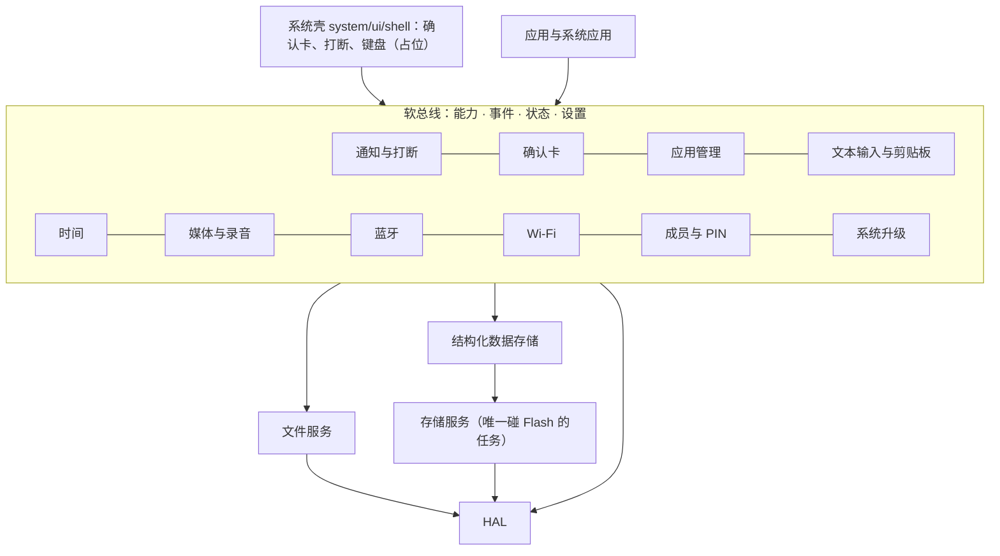
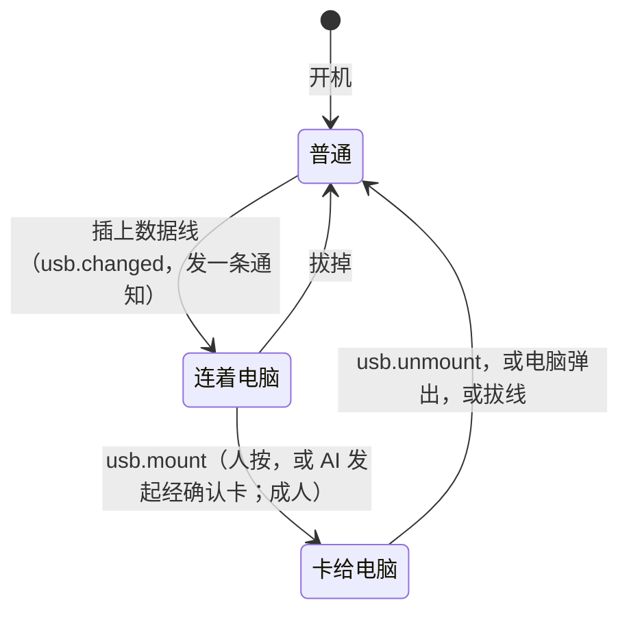
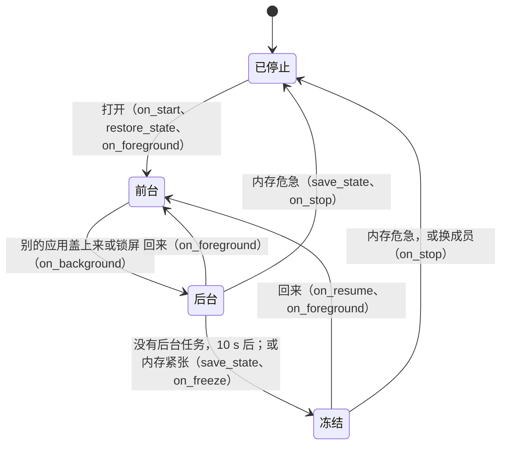
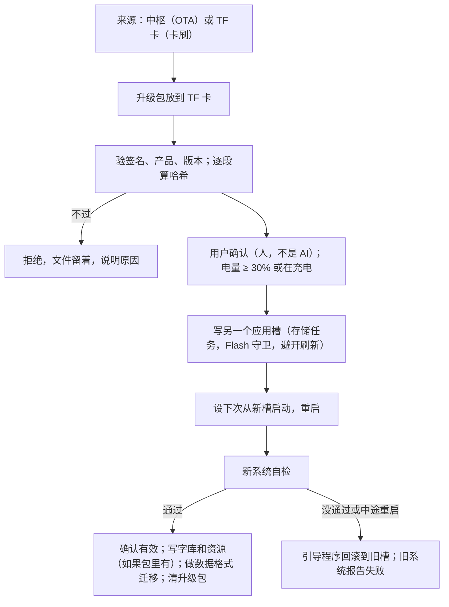

# 系统服务详细设计：系统应用和界面依赖的底层能力

起草：2026-11-04。状态：草案，边实现边修订，结果回填 §15。依据：用户要求 R-052～R-058，[底层依赖](ui-dependencies.md)（范围和顺序），[系统架构 v1.0](system-architecture.md)，[底座设计](foundation.md) §4.8、§5.5、§7、§7.1、§8、§10，[底层系统详细设计](system-detailed-design.md) §13 的缺项。

证据边界：接口、数据格式和数字都是本文定的设计，只在模拟器里验证；时延、内存来自模拟器的悲观档；实机没有验证，只有实机能回答的列在 §14。设计里的取舍是助手的建议，新决定记为 D-66～D-72、D-100（§14），都可逆，按推荐暂定。

## 0. 这份文档管什么

| 阶段 | 内容 | 章节 |
| --- | --- | --- |
| 先定 | 审视原则和能力总表（R-061）；数据区和系统区（R-057） | §1、§2 |
| 第 1 阶段 | 结构化数据存储和文件服务；时间服务；通知和打断通道；确认卡；应用注册和生命周期 | §3～§8 |
| 第 2 阶段 | 文本输入和剪贴板；音频（焦点、媒体播放、录音、路由、蓝牙耳机模型）；Wi-Fi 管理、成员和 PIN；系统升级（OTA、卡刷，R-062）；其余缺项 | §9～§13 |

不做：界面视觉（用最简单的占位）、真实中枢、写设备。

## 1. 审视原则：划分、AI 原生、能力开放（R-061）

### 1.1 划分规则

每个新子系统都按同一个形状做，别的子系统只能经这些入口碰它：

| 部分 | 放哪 | 说明 |
| --- | --- | --- |
| 机制 | `system/services/<名字>/`，头文件 `ink/sys/<名字>.h` | 不包含 LVGL，不知道界面长什么样（测试 `layering` 检查） |
| 能力、状态、设置、事件 | 这个服务自己登记，一张静态表 | 按钮和 AI 走同一个能力；这是 AI 唯一的入口 |
| 界面占位 | `system/ui/shell/*.c`（系统壳） | 只调用服务的接口，经“呈现者”回调拿到要显示的东西；以后换成正式界面不用动服务 |
| 硬件 | `platform/include/ink/hal_*.h` + 端口 | 服务只经 HAL |

依赖只向下或经软总线。服务之间能用事件的就用事件：比如来电，通信服务发 `call.incoming`，通知服务订阅后拉起打断，通信服务不知道通知服务存在。



### 1.2 AI 原生的七条规则

1. **同一条路径**：用户按按钮和 AI 调用走同一个能力，不写两套。C 接口是给服务和应用用的快捷方式，做的事必须和能力相同。
2. **结构化结果**：读类能力在回执里带 `result`（JSON，和 `outputSchema` 一致），不只有一句话。回执只在回调期间有效；只读调用不去重，重发就重新读一次。
3. **事件到 AI**：能力登记的事件（新短信、闹钟响、文件变了）在中枢任务里转发给中枢（JSON-RPC 通知 `device/event {event, at_s, args}`），只发开放给 AI 的；断网时留最近 8 条，连上再发。
4. **AI 看得到现在的一切**：每次提问带页面快照和系统状态快照（`state`，开放给 AI 的状态项）；有系统浮层（确认卡、打断、输入框）时页面快照就是浮层上的字；`state.list`、`settings.list` 可以直接问。
5. **渐进披露**：能力多了以后整张清单太大。`tools/list` 分页（`cursor`、`nextCursor`），`caps.domains` 给目录索引，`caps.find` 按关键词查（底座设计 §6.5）。
6. **来源和撤销**：记录都带“谁写的”（人还是 AI）；可逆的写操作回执里给 `undo_ms`，`system.undo` 按对象撤销。
7. **AI 的请求只是请求**：外部副作用、不可逆、系统级都过策略关口，停在确认卡；确认由人在设备上做，AI 不能确认。确认的结果以事件告诉 AI。

### 1.3 能力总表

“AI 可调”是经 `tools/call` 能直接用的（有副作用的按等级走确认卡）；“AI 不可调”写明原因。测试 `integration-ai-surface` 启动完整系统，用和中枢一样的路径拉工具清单，逐项核对测试源码中的能力、状态、设置和事件清单：多了、少了、缺标题都不通过；每个能力必须给的参数也列在测试的表里，和中枢实际收到的 `inputSchema` 逐项比（缺了不通过，这一条第十四轮审计 AUD15-009 之后才成立）；不给 AI 的能力必须在测试的例外表里写明原因。`services-mid-capability-doc` 另行解析本节，核对这些清单中属于本表系统服务范围的条目及其列；阅读、通信、相机和远程应用不在本表范围。两项检查合起来覆盖文档与运行时，尚未从代码自动生成文档。

| 子系统 | AI 可调的能力 | AI 不可调（原因） | 状态 | 设置 | 事件 | 内部机制（不开放） |
| --- | --- | --- | --- | --- | --- | --- |
| 数据 | `data.collections`、`data.list`、`data.get`、`data.put`、`data.delete`、`data.status`（集合自己声明开放） | 没声明开放的集合（凭据、PIN 校验值） | `storage.user_free` | — | `data.write_failed` | 日志格式、快照、压缩、存储任务 |
| 后台任务 | `job.list`、`job.cancel` | — | `job.running` | — | `job.finished` | 执行器、内部任务调度 |
| 文件 | `file.list`、`file.stat`、`file.read`、`file.write`、`file.mkdir`、`file.copy`、`file.move`、`file.delete`（确认）、`file.free`、`file.index`、`file.lookup`；`usb.status`、`usb.mount`（系统级，确认）、`usb.unmount` | — | `storage.free`、`storage.card`、`storage.mode`、`usb.connected`、`file.index_state` | — | `file.changed`、`file.job_done`、`usb.changed` | 路径映射、临时文件、U 盘模式互斥、USB 协议 |
| 时间 | `time.now`、`time.lunar`、`alarm.set`、`alarm.update`（按原 ID 编辑、启停自己的闹钟）、`alarm.list`、`alarm.cancel`、`alarm.snooze`、`alarm.dismiss`、`reminder.add`、`reminder.list`、`reminder.cancel`、`reminder.update`（按原 ID 改时间、内容、重复）；提醒编辑页 `reminder.new`、`reminder.open`、`reminder.time`、`reminder.focus`、`reminder.draft`、`reminder.save`；`time.set`（系统级，确认） | — | `time.synced`、`time.zone`、`time.minute`、`alarm.ringing` | `time.zone`、`time.auto`、`time.zone_auto` | `alarm.fired`、`reminder.fired`、`time.changed` | RTC 寄存器、唤醒定时 |
| 通知 | `notify.post`、`notify.list`、`notify.read`、`notify.dismiss`、`notify.clear`、`notify.channels`、`notify.set_channel`；`interrupt.list`、`interrupt.ack`（关闭低电量提示） | — | `notify.unread`、`interrupt.active` | `notify.dnd` | `notify.posted` | 打断通道本身（来电、闹钟、低电量由系统拉起，AI 不能假装来电） |
| 确认卡 | `confirm.list`、`confirm.status`（当前成员的持久结果）、`confirm.withdraw`（撤回自己发起的） | `confirm.accept`、`confirm.reject`（只有人在设备上能按）；`confirm.page`（必读说明只能由人在设备上翻阅） | `confirm.pending` | — | `confirm.result` | — |
| AI 面板 | `ai.panel.hide`（收起）、`ai.panel.listen`（继续问）、`ai.panel.next`、`ai.panel.prev`（答案翻页）；`ai.pages.close`、`ai.pages.retry`（离线、超时、额度页：继续读、重新问）、`ai.pages.next`、`ai.pages.prev`（AI 做过的事翻页） | — | — | — | — | 分页排版、补灰刷新 |
| 应用 | `app.list`、`app.open`、`app.close`、`app.cards` | — | `app.foreground`、`app.cards_rev` | — | `app.state` | 冻结、停止、状态保存的时机 |
| 文本输入 | `text.state`、`text.insert`、`text.select`、`text.undo`、`text.redo`、`text.submit`；长文编辑页的 `text.page`（翻文字页）、选区的 `text.ask_ai`（问 AI）和 `text.add_word`（加入单词）；`text.voice_start`（开麦克风，确认）、`text.voice_finish`、`text.voice_cancel`；`clipboard.write`；`clipboard.read`（设置打开才行，默认不读） | 敏感内容（`clipboard.read` 不给）；密码框内容（掩码，也不能听写） | `text.focused`、`text.voice` | `ai.read_clipboard` | `text.voice_ended` | 拼音引擎、词库、候选、停顿判断 |
| 音频 | `media.play`、`media.pause`、`media.resume`、`media.seek`、`media.stop`、`media.status`、`audio.record`、`audio.record_stop`、`audio.record_cancel`、`audio.transcribe` | — | `audio.now_playing`、`audio.mic`、`audio.route`、`audio.listening`、`audio.recording`、`media.state` | `audio.volume`、`audio.child_max`、`voice.handsfree` | `media.finished`、`audio.record_done` | 焦点、功放、I2S、模式切换 |
| 蓝牙 | `bt.scan`、`bt.list`、`bt.pair`、`bt.connect`、`bt.disconnect`、`bt.forget` | — | `bt.connected`、`bt.device`、`bt.available` | — | `bt.changed` | 芯片命令（协议未知） |
| Wi-Fi | `wifi.scan`、`wifi.list`、`wifi.connect`（系统级，确认）、`wifi.forget`（确认） | — | `wifi.state`、`wifi.ssid` | `net.prefer` | `wifi.changed` | 选网、入网步骤 |
| 成员 | `member.list`、`system.switch_member`（孩子到成人仍要 PIN）、`member.rename`（改称呼，孩子不能调）；`member.add`、`member.remove`（系统级，确认） | `member.unlock`、`member.set_pin`（PIN 只在设备上输入） | `member.current`、`member.authed` | `member.idle_return_s` | `member.changed` | PIN 校验值、盐 |
| 升级 | `update.status`、`update.check`、`update.download`（移动数据下要人来） | `system.upgrade`、`system.upgrade_from_card`（底座设计 §6.2：AI 不能发起升级，安装时设备几分钟不能用；清单里也没有） | `update.state`、`update.version`、`update.progress` | `update.auto_download` | `update.available`、`update.result` | 写槽、回滚、自检 |
| 系统 | `state.list`、`settings.list`、`settings.get`、`settings.set`、`caps.domains`、`caps.find`、`system.undo`、`system.home`、`system.full_refresh`、`system.set_volume`；`power.set_saving`（最多 60 秒锁屏，不改原设置，重启后保留）；`net.set_airplane`（飞行模式：关 4G、Wi-Fi、蓝牙，之后可单独再开 Wi-Fi、蓝牙，重启后保留）；`wifi.set_enabled`（开关 Wi-Fi；AI 关时先回执再断网；`settings.set` 改 `net.airplane`、`wifi.enabled` 时转给这两个能力）；`system.reboot`、`system.shutdown`、`system.factory_reset`（系统级，确认） | — | `power.state`、`power.saving`、`battery.level`、`battery.charging`、`battery.low` | `power.lock_after_s`、`power.saving`、`net.airplane`、`wifi.enabled` | `battery.low` | 电源轨、睡眠 |
| 文件缩略图 | `file.thumb`（参数 id；返回宽、高与按行排列的 `gray4` 灰阶；每个十六进制字符对应一个像素） | — | — | — | — | 文件编号与内容版本接线，复用有界缩略图缓存 |
| 儿童用时策略（kid-2 任务） | `member.time_get`（读孩子的每日时长、今日加时与用时；孩子只读自己）；`member.time_set`（每日分钟数，0 表示不限）、`member.time_add`（今天加几分钟），修改和加时均需家长密码 | 密码内容（仅设备本地输入） | `member.time_up` | —（存成员记录，不按孩子新增设置） | — | 单调时钟计使用时长、锁屏暂停、本地零点清零、成员记录检查点 |
| 后台建索引 | —（自动进行，`file.index` 照常可调） | — | `file.index_state`：`organizing`／`ready`／`unavailable`／`changed` | — | 建好时对各家人发 `file.changed`（kind `indexed`） | 开机、插拔卡（HAL `hal_fs_set_card_callback`）、出现新路径（新建、复制、电脑归还后的 rescan、恢复）时开始，改名、删除、覆盖写不重扫；每批 32 个文件，存储忙或后台执行器有活时退让 500 ms，建好就停，不轮询。上限 1024 条；整卡建好的标记存在 `file.index_ready`，同一张卡重启不重扫。卡身份文件只在确认不存在时才新建（HAL `hal_fs_new_card_id`），一次打不开返回 IO 错误（file-index-3） |
| 存储统计与清理 | `file.usage`（当前成员与全机的四类字节数）、`file.cleanup_preview`（临时文件、缓存、未传完文件的可释放字节与 revision）、`file.cache_clear`（可重建缓存，免确认）、`file.cleanup`（含不可恢复残留，人确认；两种清理均必填 revision） | — | 复用 `file.index_state`、`storage.free` | — | 复用 `file.changed` | 复用文件索引、编辑锁及卡租约；完成版本标记；按保留后缀筛选，不删用户原文件、数据库和备份 |

自动检查之外，每轮审计人工对照这张表和代码（[审计任务说明 K 节](../audits/codex-audit-prompt.md)）。

## 2. 数据区和系统区（R-057）

### 2.1 一张总表

先分清**谁的数据**，再定放哪、什么时候清。“系统应用”和普通应用的区别只有两点：随系统提供，卸载不掉；可以在清单里声明访问别的应用数据的能力。它们的数据放在一样的地方。

| 区 | 位置 | 内容 | 谁能写 | 系统升级 | 卸载应用 | 切换成员 | 恢复出厂 | 备份到中枢 |
| --- | --- | --- | --- | --- | --- | --- | --- | --- |
| **系统区** | Flash 应用槽 `ota_0`、`ota_1` | 系统、驱动、内置的系统应用和应用的代码（现在是一个镜像，D-08 第一阶段） | 只有升级服务 | 换另一个槽，失败回滚 | 不相关 | 不相关 | 不动 | 不备份 |
| **系统资源区** | Flash `font_data`、`resources` | 字库、图标、提示音 | 只有升级服务 | 自检通过后才写（§12） | 不相关 | 不相关 | 不动 | 不备份 |
| **引导区** | `bootloader`、分区表、`otadata` | 启动 | 只有 `otadata` 能改（切槽） | 不动 | 不相关 | 不相关 | 不动 | 不备份 |
| **设备数据区** | `/user/sys/`（LittleFS） | 设置、成员表、已知 Wi-Fi、闹钟表、升级状态 | 系统服务 | 保留 | 不相关 | 保留 | 清空 | 除凭据外备份 |
| **成员数据区** | `/user/m/<成员>/`（LittleFS） | 这位成员的小而要紧的数据：系统服务的（通知）、系统应用和应用的（备忘、位置、状态） | 这位成员的服务和应用 | 保留 | 清掉该应用前缀的文件 | 隔离，换人看不到 | 清空 | 备份 |
| **成员文件区** | TF `/content/.m/<成员>/` | 这位成员的文件：录音、照片、导入；应用的大文件在 `apps/<应用>/` 下 | 成员自己；成人可看孩子的 | 保留 | 清掉 `apps/<应用>/` | 隔离 | 清空（要确认） | 按清单 |
| **家庭内容区** | TF `/content/`（除 `.m`、`.update`） | 书、音频：全家共用、可重新下载 | 成人；孩子只读 | 保留 | 不动 | 共用 | 保留（可选清空） | 不备份，从中枢重新下载 |
| **缓存区** | TF `/cache/sys/`、`/cache/<应用>/` | 页缓存、字形缓存，随时可丢 | 系统和对应应用 | 可清 | 清 | 不隔离（不放个人内容） | 清空 | 不备份 |
| **升级暂存区** | TF `/content/.update/`、`/content/update/` | 下载的升级包；用户拷进来的升级包 | 升级服务；用户经 U 盘 | 成功后清 | 不相关 | 不相关 | 清空 | 不备份 |

### 2.2 Flash 分区（D-100）

现在设备上是出厂分区表，没有 LittleFS 用户分区。沿用底座设计 §10.1 的建议：

| 分区 | 出厂 | 建议 | 说明 |
| --- | --- | --- | --- |
| `bootloader` + 分区表 | 0x2000、0x8000 | 不变 | 换引导程序才能开回滚（§12.5），只能经 USB 一次写好，要用户同意 |
| `nvs` | 16 KiB | 不变 | 只给 ESP-IDF 自己（射频校准、Wi-Fi 库）；我们的设置走 `/user/sys`（D-57） |
| `otadata`、`phy_init` | 8 KiB、4 KiB | 不变 | |
| `model` | 400 KiB | **去掉** | S31 上不用 |
| `ota_0`、`ota_1` | 各 5 MiB | 各 4.5 MiB | 以 `idf.py size` 为准，镜像 ≤ 4 MiB 还能各减 0.5 MiB |
| `resources` | 400 KiB | 不变 | |
| `font_data` | 5 MiB | 不变 | |
| `user`（新） | 无 | 约 1.4 MiB，LittleFS | 模拟器现在就是 1408 KiB |
| `coredump` | 64 KiB | 不变 | |

改分区表要写设备：现在只写进设计，等上机时由用户同意（§14）。系统不认识分区表细节，只经 HAL 看“有一个可写的另一槽”和 `/user`。

### 2.3 `/user` 的目录规则

LittleFS 每个目录至少占两个擦除块（8 KiB），`/user` 只有 1.4 MiB，所以**目录要少，靠文件名前缀分**（实测见 §15）：

```text
/user/sys/settings.json            设置
/user/sys/<集合>.snap              设备数据区的集合（快照）
/user/sys/<集合>.<代>.log          及其追加日志
/user/m/<成员>/<集合>.snap         成员数据区的集合
/user/m/<成员>/<集合>.<代>.log
/user/m/<成员>/<应用>.<名字>       应用的小文件（状态、阅读位置）
```

集合名和文件名都以主人开头：系统服务用自己的域（`notify.inbox`），应用用应用编号（`reader.words`）。所有路径只由 `ink/sys/layout.h` 里的函数拼，别处不写字符串；成员编号只允许 `[a-z0-9_-]`，1～15 字节。

原来的 `/user/settings.json`、`/user/apps/reader-<成员>-<书>.pos` 迁到新位置。设备上还没有用户数据，所以不做迁移代码。

### 2.4 隔离到什么程度

单片机只有一个地址空间，内置应用是同一个镜像里的 C 代码，**它们要越界，技术上挡不住**。这里的隔离是接口约束：

- 应用经 `ink_app_db_open`、`/app/...` 只拿得到自己的；成员隔离在服务里判断，不靠应用自觉。
- 以后的脚本应用（D-08 第三阶段）跑在沙箱里，只能经同样的接口，那时这才是真隔离。
- 跨应用一律走能力。`sdk-boundary` 测试检查应用不碰 HAL 和 OSAL。

### 2.5 格式和版本

- 所有磁盘格式带版本号（底座设计 §10.3）。旧固件遇到更新的格式：拒绝写，读不了就报错，不覆盖。
- 格式迁移只在新固件通过自检、确认有效之后做（§12）。

## 3. 存储服务的扩展和结构化数据存储

### 3.1 存储服务：多几种作业

存储服务仍然是唯一碰 `/user` 的任务（内部 RAM 栈，刷新时不碰 Flash）。作业从“原子替换”扩成几种，按提交次序执行，失败告诉提交者：

```c
typedef void (*ink_storage_done_fn)(void *ctx, int result); /* 存储任务里运行，要短 */
int ink_storage_write_atomic2(const char *path, const void *data, size_t len, ink_storage_done_fn done, void *ctx);
int ink_storage_append(const char *path, const void *data, size_t len, ink_storage_done_fn done, void *ctx);
int ink_storage_remove(const char *path, ink_storage_done_fn done, void *ctx);
int ink_storage_load(const char *path, void **out, size_t *len, const char *tag); /* 整个文件读进 PSRAM，分块，块之间让出 Flash 守卫 */
int ink_storage_list(const char *dir, ink_storage_dirent_fn fn, void *ctx);
int ink_storage_volume(hal_fs_volume_info_t *out);                                 /* /user 的总量和剩余，遍历文件系统，慢 */
int ink_storage_run(void (*fn)(void *ctx), void *ctx);                             /* 在存储任务里、Flash 守卫内运行（升级写槽用） */
```

- 目录不在就建（只建缺的一层；`/user/m`、`/user/m/<成员>`、`/user/sys`）。
- 同一路径上的次序不乱：写作业只合并进“这个路径最后一个作业”，追加和删除不合并。
- 读看得到排队的替换和删除；看不到排队的追加（数据存储自己有内存里的副本，不读自己的日志）。

### 3.2 数据存储：模型

一个**集合**是一组记录，每条记录：

| 字段 | 说明 |
| --- | --- |
| `id` | 32 位，集合内唯一，不给就自动分配 |
| `sort` | 64 位排序键（通常是时间），分页按它 |
| `ver` | 最后一次改动的序号（集合内递增） |
| `updated_s` | 最后改动的 UTC 秒（时钟未知时为 0） |
| `src` | 谁写的（人、AI、系统、远端） |
| `schema` | 这条记录内容的版本 |
| 内容 | 字节串，上限 8 KiB；声明为 JSON 的集合才能经 `data.*` 给 AI |

**打开的集合整份放在 PSRAM**（D-66）：`/user` 总共 1.4 MiB，全部放下也不多，而分页不碰 Flash，界面翻列表不用等刷新；没人打开、已经落盘的集合在内存紧张时让出来（登记为可回收缓存）。

```c
typedef struct { const char *name, *title; ink_db_scope_t scope; uint8_t schema; bool json, ai_read, ai_write;
                 uint32_t max_records; size_t max_bytes; bool drop_oldest; } ink_db_def_t;
ink_db_t *ink_db_open(const ink_db_def_t *def, const char *member); /* member NULL = 现在的成员；设备级集合忽略 */
void ink_db_close(ink_db_t *db);
int  ink_db_put(ink_db_t *db, const ink_db_write_t *w, uint32_t *out_id);
int  ink_db_del(ink_db_t *db, uint32_t id, ink_source_t src);
int  ink_db_get(ink_db_t *db, uint32_t id, ink_rec_t *out, void *buf, size_t cap);
int  ink_db_next(ink_db_t *db, ink_db_cursor_t *c, ink_rec_t *out, void *buf, size_t cap); /* 分页：游标是键，插入删除都不乱 */
int  ink_db_count(ink_db_t *db);
int  ink_db_changes(ink_db_t *db, uint32_t since_ver, ink_db_cursor_t *c, ink_rec_t *out, void *buf, size_t cap); /* 给同步用，含墓碑 */
void ink_db_ack(ink_db_t *db, uint32_t ver);                 /* 中枢确认到这里：更早的墓碑可以扔 */
uint32_t ink_db_last_ver(ink_db_t *db);
uint32_t ink_db_durable_ver(ink_db_t *db);                   /* 已经落盘到哪 */
int  ink_db_flush(ink_db_t *db);                             /* 现在就交给存储服务 */
int  ink_db_wait(ink_db_t *db, uint32_t ver, int64_t timeout_us); /* 等落盘（不在界面任务里用） */
int  ink_db_error(ink_db_t *db);                             /* 最近一次写失败的原因，0 = 没有 */
void ink_db_flush_all(void);                                 /* 锁屏、关机、低电量 */
```

任务归属：`put`、`del`、读都在调用者的任务里，只碰内存（一把锁，不等 Flash）；`open` 第一次要读文件，会等（可能等一次刷新结束），所以界面应用尽量在 `create` 之外打开，或者接受这一次等待。落盘在存储任务；压缩在后台执行队列。

### 3.3 磁盘格式

```text
<集合>.snap     快照：一次写好（临时文件 + 改名）
  头 32 字节：magic "IDB1"、format(1)、schema、记录数、last_ver、next_id、log_gen、CRC
  记录帧 × n（含墓碑）
<集合>.<代>.log 追加日志：记录帧 × n

记录帧（小端）：
  u16 sync(0xA55A) u8 op(1 写, 2 删) u8 src u32 ver u32 id i64 sort i64 updated_s u16 len u8 schema u8 rsv
  内容[len]  u32 crc32（前面全部）
```

### 3.4 写入、压缩和断电

- **写**：改内存，帧追加到这个集合的待写缓冲。`INK_DB_NOW`（默认，备忘、提醒）马上交给存储服务；`INK_DB_LAZY`（阅读、播放位置）最多攒 60 s，锁屏、切换内容、低电量时立刻写。同一时刻每个集合只有一个追加作业在途，攒下的下一批一起写（LittleFS 一次追加至少重写尾块，批量省擦除）。
- **落盘回报**：追加成功后 `durable_ver` 前进。失败（比如 `/user` 满了）：这批留着，5 s 起翻倍最多 5 分钟重试；`ink_db_error` 报原因，发一次 `data.write_failed`，通知服务据此提醒。内存里的改动不丢，但重启就没了，这一点如实告诉调用者：`put` 成功只表示“已接受”。
- **待写缓冲满**（1 MiB 总额，或这个集合的 `max_bytes`）：`put` 直接失败，不悄悄丢。
- **压缩**：日志超过 `max(8 KiB, 快照的一半)` 时排一个后台作业：在锁内把全部记录序列化到 PSRAM，`write_atomic` 写快照。**代**的规则保证任何时刻断电都不丢（D-66）：
  - 快照记着 `log_gen = G`。加载：读快照，按序回放 `G` 代和 `G+1` 代日志，序号 ≤ `last_ver` 的跳过，再顺手删 `G-1` 代。
  - 压缩时如果在用的代就是 `G`，先换到 `G+1`（之后的追加写新文件），新快照写 `log_gen = 当前代`；快照写成功之后才删旧日志；失败什么都不删。所以最多只有两代。
- **坏帧**：LittleFS 的同步是原子的，正常不会有半帧。真遇到（CRC 不对、sync 不对、长度越界）：逐字节往后找下一个好帧，坏帧后面追加的还算数，计数 `data.log_bad`，马上压缩一次把坏的部分丢掉。快照坏了：计数 `data.snapshot_bad`，只从日志恢复。
- **读不出来不等于没有**：`ink_storage_load` 区分“没有这个文件”和“有，但这会儿读不出来”（内存不够、读错）。后者集合打不开（`ink_db_open` 返回空，计数 `data.load_error`），下次再试；如果当成空集合打开，新写的版本号从头算，下次加载会被当成旧帧跳过（AUD15-001）。
- **墓碑**：删除留一条只有头的记录，给同步用；每个集合最多留 256 条，最老的先扔，`ink_db_ack` 之后的可以提前扔。

### 3.5 内存和预算

每条记录在 PSRAM 占 48 字节头 + 内容 + 分配器开销，排序表每条 4 字节。整个数据存储配额 2 MiB（`ink_mem_budget("data", PSRAM, …)`）。内部 RAM：一把锁 96 字节；集合表放 PSRAM。

### 3.6 给 AI 的能力

`data.collections`（当前成员能看的集合：名字、标题、条数）、`data.list {collection, limit, cursor}`、`data.get {collection, id}`、`data.put {collection, id?, sort?, value}`（`value` 是 JSON 文本，可撤销）、`data.delete {collection, id}`（不可逆，走确认）、`data.status {collection, id 或 revision}`（保存到哪一步：`saving`、`on_device`、`at_hub`、`failed`）。只对声明了 `ai_read`、`ai_write` 且内容是 JSON 的集合；成员永远是当前成员，没有办法指定别人。应用和服务也用这组能力跨应用读数据。

## 4. 文件服务

### 4.1 统一路径

应用和 AI 只看到虚拟路径，物理路径只在 `file_service.c` 和 `layout.h` 里：

| 虚拟路径 | 物理路径 | 谁能读 | 谁能写 |
| --- | --- | --- | --- |
| `/me/...` | `/content/.m/<当前成员>/...` | 自己 | 自己 |
| `/family/...` | `/content/...`（不含点开头的） | 所有人 | 成人 |
| `/members/<成员>/...` | `/content/.m/<成员>/...` | 成人（家长可查看，底座设计 §8） | 成人 |
| `/app/...` | `/content/.m/<当前成员>/apps/<调用的应用>/...` | 这个应用 | 这个应用 |
| `/` | 虚拟目录：`me`、`family`，成人多一个 `members` | | |

路径校验（在任何文件操作之前）：UTF-8 合法、不超过 128 字节、不含 `..`、`.`、空段、反斜杠、控制字符和 FAT 不允许的字符、段不以点开头；`/user` 这种物理路径一律拒绝。

### 4.2 接口

```c
int ink_fs_open(const char *path, int mode, ink_fs_file_t **out);  /* INK_FS_READ / WRITE / APPEND / CREATE / EXCL */
int64_t ink_fs_read(ink_fs_file_t *f, void *buf, size_t n);
int64_t ink_fs_write(ink_fs_file_t *f, const void *buf, size_t n);
int ink_fs_seek(ink_fs_file_t *f, int64_t off, int whence);
int64_t ink_fs_tell(ink_fs_file_t *f);
int ink_fs_sync(ink_fs_file_t *f);
int ink_fs_close(ink_fs_file_t *f);
int ink_fs_stat(const char *path, ink_fs_stat_t *out);
int ink_fs_dir_open(const char *path, ink_fs_dir_t **out);  /* 拉取式，隐藏文件不出现 */
int ink_fs_dir_next(ink_fs_dir_t *d, ink_fs_stat_t *out);
void ink_fs_dir_close(ink_fs_dir_t *d);
int ink_fs_mkdir(const char *path);                         /* 缺的上级一起建 */
int ink_fs_remove(const char *path);
int ink_fs_move(const char *from, const char *to);
int ink_fs_write_atomic(const char *path, const void *data, size_t n); /* 临时文件 + 改名 */
int ink_fs_free(uint64_t *free_bytes, uint64_t *total_bytes);
int ink_fs_exclusive(bool on);                              /* U 盘模式：有文件开着就失败；进去之后所有操作返回“忙” */
int ink_fs_copy_start(const char *from, const char *to);     /* 后台作业，§4.3 */
int ink_fs_delete_start(const char *path);
int ink_fs_job_status(int id, ink_fs_job_status_t *out);
void ink_fs_job_cancel(int id);
```

- 任务：TF 卡写不关 CPU 缓存，可以在调用者的任务里做（阻塞几毫秒到几百毫秒，所以大块读写放后台，不放界面任务）。现有的 `ink_file_*` 只读接口保留给阅读器。
- 错误码：路径不对、没权限、不存在、已存在、没插卡、U 盘模式中、空间满、读写错。没插卡时 `storage.card` 变假，界面据此提示。
- 变化通知：写、建、删、移都发事件 `file.changed {path, kind}`，走软总线，应用和 AI 用同一个订阅；退出 U 盘模式发一次 `kind: rescan`。
- 同时最多开 8 个文件（表在 PSRAM）；进 U 盘模式前要全关（媒体播放、录音会被通知先停）。
- `storage.free` 等状态：开机、卡插拔、写操作之后（最多一分钟一次）在后台刷新，`f_getfree` 在大卡上慢，不放界面任务。

模拟器：加 TF 卡的物理动作（脚本 `sd remove|insert|full`），HAL 没卡时返回失败。真机的卡检测有没有引脚**不知道**（§14），所以系统不依赖插拔中断：操作失败时和解锁时查一次。

### 4.3 拷贝、移动、删除

- `ink_fs_move`：同一张卡上就是改名，马上完成，可撤销。目标已存在就失败，不覆盖。
- `ink_fs_copy_start(from, to)`、`ink_fs_delete_start(path)`：目录连里面的内容一起，单个大文件也可能要几分钟（卡的写速度约 1 MB/s），所以是**后台作业**：每步 64 KiB 或一个目录项，能取消（`ink_fs_job_cancel`），能查进度（`ink_fs_job_status`：已处理的字节和文件数、总量、状态），结束发事件 `file.job_done {id, ok, why}`。同一时刻一个，别的回“忙”。
- 拷贝先写 `<目标>.part`，写完才改名，断电留下的 `.part` 不算文件（列表不显示；开机不去翻卡，下次拷到同一个目标时覆盖，整个目录删除时一起删；U 盘模式下电脑能看到）；空间不够提前拒绝（先算总量）；中途失败或取消，已经完整拷完的留着，正在拷的删掉，并报告。
- 删除目录：先删里面的，再删目录；中途失败报告还剩什么。删除不可撤销（这一轮没有回收站），AI 发起要确认卡；人在设备上按的，确认由界面做。
- `/me`、`/family`、`/members/<成员>` 这些谁都看得到的地方本身不能删、不能移（`INK_FS_ERR_DENIED`），里面的可以。`/family` 对应卡的 `/content`，成员的私有目录 `.m` 和升级目录 `.update` 就在它下面，列表和路径都看不到，但递归删除会碰到（AUD15-002）。删成员走 `ink_fs_forget_member`，卡被借给电脑时不能删成员（`member.remove` 失败）；卡不在时删了成员，回执说卡上的文件还留着。
- 系统自己放在卡上的东西（升级包、词库）不走路径。用它们时持有卡（`ink_fs_card_hold` / `ink_fs_card_release`），和打开文件一样算数：持有期间卡不会借给电脑。

### 4.4 U 盘模式（R-058，D-72）



- **开放什么**：只有 TF 卡。U 盘是块设备，电脑看到整个卡的 FAT，单个目录挡不住，所以卡上的 `.m/`（各成员的私人文件）也看得到。系统区、`/user`（设置、PIN 校验值、Wi-Fi 密码、个人数据）在内部 Flash，**永远不开放**。卡上不放凭据（底座设计 §8.1）。
- **谁能开**：系统级能力：成人才行，孩子被拒绝；成人解过 PIN；AI 发起走确认卡。
- **进入**：先发事件让持有文件的停下（媒体暂停并存位置，录音收尾），`ink_fs_exclusive(true)` 要求没有打开的文件和后台作业，否则回“忙”并说明谁占着；然后 `hal_usb_msc_start()`。这期间文件服务所有操作回“U 盘模式中”，`storage.mode` = `usb`。持有“别自动锁屏、别睡”。
- **退出**：`hal_usb_msc_stop()`，重新挂载，查卡是否还好；`storage.mode` = `normal`，发 `file.changed {kind: rescan}`，刷新 `storage.free`，查一下有没有新的升级包（§12.4）。电脑弹出和拔线一样处理；拔线没弹出可能留下脏的 FAT：挂载失败就 `storage.card` 变假并发通知，不自动格式化。
- **HAL**：`hal_usb.h`：`hal_usb_host_connected()`、回调、`hal_usb_msc_start/stop`。真机是 TinyUSB MSC（上游配置启用，**本项目没有实测**）。S31 的 USB 口平时是串口/JTAG，切 TinyUSB 对下载和串口日志的影响待测（§14）。
- **模拟器**：脚本 `usb plug|unplug|eject|copy-in <host 文件> <卡上路径>`：模拟“电脑”往卡上拷文件；U 盘模式中系统访问卡的 HAL 调用全部失败，能查出没停干净的地方。

### 4.5 给 AI 的能力

`file.list {path, cursor, limit}`、`file.stat`、`file.read {path, offset, max_bytes}`（只读文本，最多 2 KiB，不是合法 UTF-8 就说明是二进制）、`file.write {path, text, append}`（已有文件不覆盖，除非 `append`）、`file.mkdir`、`file.copy`、`file.move`（可撤销）、`file.delete`（不可逆，走确认）、`file.free`、`usb.status`、`usb.mount`、`usb.unmount`。跑在后台执行队列（卡慢，不占界面）。大文件的拷贝回执“已排队”，对象是作业，结束有事件。

## 5. 时间服务

### 5.1 时钟

- 开机读 RTC。有效：墙钟 = RTC，`time.synced` 假（还没和中枢对过）。无效（电池没了）：墙钟未知，`ink_time_valid()` 假，依赖时钟的闹钟等到知道时间。
- 校时：中枢在 `hello` 的回答里带 `now_ms`（不多一个来回），连接建立时取一次，用往返时间的一半补偿。差超过 2 s 才跳，写回 RTC。真机还可以加 SNTP，同一个入口。
- 手动设时间：能力 `time.set`，系统级；孩子不能改（底座设计 §7.1）。设置 `time.auto` 关掉就不听中枢的。
- 时长、超时一律用单调时钟，不受改时间影响。墙钟跳了：闹钟重新排。

### 5.2 时区

设置 `time.zone`：一张小表（`Asia/Shanghai` 默认、`UTC`、`Asia/Tokyo`、`Asia/Hong_Kong`、`Asia/Singapore`、`Europe/London`、`Europe/Paris`、`America/New_York`、`America/Los_Angeles`），带标准偏移和夏令时规则（美国、欧盟两种）。记录存 UTC，显示和闹钟按本地。夏令时开始那一小时不存在的本地时间：往后推到存在的时刻；结束时重复的一小时：取第一次，不响两次。

```c
int64_t ink_time_now_s(void); bool ink_time_valid(void);
void ink_time_to_local(int64_t utc_s, ink_tm_t *out);
int64_t ink_time_from_local(const ink_tm_t *tm);
```

### 5.3 农历

公历和农历互转，1900～2100，一张紧凑的年表（每年一个数，放 Flash）。接口：`ink_lunar_from_solar`、`ink_lunar_to_solar`、月名、日名（正月、初一、闰四月）、生肖、干支。年表和苹果系统的中国历法逐日比对过（方法和结果见 §15）。节气先不做（要天文计算或另一张表，§13）。

### 5.4 闹钟和提醒

存在设备级集合 `time.alarms`，每条带主人（成员）：闹钟不分谁在用都要响。

| 类型 | 时间怎么定 | 重复 |
| --- | --- | --- |
| 闹钟 | 本地时分（换时区仍是这个时分） | 只响一次，或按星期几 |
| 提醒 | UTC 时刻（另存当时的时区）或本地日期时分 | 不重复、每天、每周、每月、每年、**农历每年**（生日） |

排程：一张内存表，算出每项下次响的时刻，取最早的，设：

1. 一个单调时钟的定时（共用服务定时器，§6.5），
2. **电源服务的唤醒时刻** `ink_power_wake_at()`：锁屏睡眠的每一片不超过它，到点没处理完不再睡（最多等 5 s），
3. **RTC 闹钟**（分钟精度，向下取整）：RTC 中断能唤醒就早一点醒，然后再睡到点；中断线不可用（出厂日志里 P16 一直低，`power.rtc_wake_unavailable`）时靠第 2 条，一样准时。

到点：闹钟经打断通道（§6.3）响铃，`alarm.ringing`，等 `alarm.dismiss` 或 `alarm.snooze`（默认 9 分钟），响 2 分钟没人管就自己停、记一条“错过”通知；提醒发高优先级通知。迟到的处理：晚 60 s 内照常响；更晚的（关机了、时钟跳了）不补响，发“错过”通知（底座设计 §5.7“不补跑”）。重复的闹钟算下一次。

低电量也要响。关机后能不能靠 RTC 开机**不知道**（§14）。

时钟或时区一变（`clock_moved`），前面的闹钟重新算下一次并写回；开机时对还没到的闹钟也按当前规则和时区再算一遍，所以改了时区后断电也不会按旧时区响（AUD15-008）。小睡（`snooze_until`）算在内。

## 6. 通知和系统打断通道

### 6.1 通知

```c
typedef enum { INK_NOTIFY_LOW = 0, INK_NOTIFY_NORMAL, INK_NOTIFY_HIGH } ink_notify_prio_t;
typedef struct { const char *channel, *title, *body, *group, *tag, *action, *action_args; ink_notify_prio_t prio;
                 const char *member; ink_source_t src; } ink_notify_t;
int  ink_notify_post(const ink_notify_t *n, uint32_t *out_id); /* 任何任务，不等 Flash；同 tag 替换旧的 */
int  ink_notify_cancel(uint32_t id);
int  ink_notify_cancel_tag(const char *tag);
int  ink_notify_mark_read(uint32_t id);
int  ink_notify_next(ink_db_cursor_t *c, ink_notify_view_t *out);
int  ink_notify_channel_define(const ink_notify_channel_t *ch);
```

- 存在成员集合 `notify.inbox`（JSON，最多 200 条，满了扔最老的），按成员隔离；给不在用的成员的通知进他们自己的收件箱，不打扰现在的人。
- 渠道：`system`、`message`、`call`、`alarm`、`reminder`、`download`、`ai`，每个有默认优先级；用户可以按渠道关（`notify.set_channel`，存在成员集合）。
- 分组：同 `group` 的归成一组，列表能折叠，计数按组。
- 勿扰 `notify.dnd`：关、开。开着时普通和高优先级都只进收件箱，没声音没振动。
- 墨水屏规则：通知不弹横幅。`notify.unread` 变了只改状态栏小图标（界面框架做）；高优先级且不在勿扰时加一声提示音和一次振动。

### 6.2 打断通道：不经过前台应用

来电、闹钟、低电量这类事不能等前台应用，也不能被一次慢刷新或网络请求挡住（底座设计 §7）。所以：

```c
/* ink/sys/interrupt.h：只给系统用，应用只有通知（sdk-boundary 测试拦着） */
typedef struct { const char *label, *cap; char args[64]; } ink_int_action_t;
typedef struct { int id; ink_int_kind_t kind; uint32_t ref; bool ringing; char title[48], body[96];
                 ink_int_action_t actions[3]; int nactions; uint64_t raised_us; } ink_interrupt_t;
int  ink_interrupt_raise(const ink_interrupt_t *it);              /* 任何任务（包括定时器任务），不阻塞；返回编号，满了（4 个）返回 -1 */
void ink_interrupt_end(int id);
void ink_interrupt_update(int id, const char *body, const ink_int_action_t *a, int n, bool ringing); /* 响铃 -> 通话中 */
int  ink_interrupt_action(int id, int index, uint8_t src);        /* 执行按钮对应的能力 */
void ink_interrupt_set_presenter(const ink_int_presenter_t *p);   /* 系统壳登记 */
```

`raise` 在调用者的任务里直接做三件事，不排队等界面任务：

1. **电源**：亮屏（锁屏时临时解开，页面被全屏浮层盖住），持有“别睡”；结束后恢复锁屏。
2. **声音**：按类型拿音频焦点响铃（§10.1），在音频任务里，界面卡住也响。
3. **界面**：把“显示”投递到界面任务（节点是打断表自己的，不会丢）。这时前台应用的 `on_key`、`on_swipe` 不再收到输入：系统浮层（`ink_ui_overlay_add`，画在 `lv_layer_sys`）先收，全屏控件挡住触摸。浮层出现或消失时，手指已经按着的那次触摸整个作废，否则它接下来一动就按到新出现的按钮，抬手就成了一次点击（比如正好落在“挂断”上）。AI 看到的页面内容变成浮层上的字，只在原页面有效的能力这时不可用。

电源键（`ink_input_set_power_key_hook`）：来电时静音，只静音不挂断；闹钟时稍后再响；低电量时关掉；没有打断时照常锁屏。

锁着时被打断：屏亮，设备“底下还锁着”，最后一个打断结束后重新锁上。打断期间有人（能力、竞争）锁屏：电源服务的订阅里立刻解开，并记下结束后要锁（`interrupt.lock_undone`）。

事件在哪个任务里处理：来电和闹钟在发出事件的任务里直接处理（通信任务、定时器任务），前面不排队；定时器任务栈小，所以闹钟这条路径不发通知、不占大栈。其余（短信、错过、提醒、低电量、写入失败、USB）走后台执行器：电源任务和存储任务的栈是内部 RAM，很小，不能在上面跑这些。

优先级：来电 > 闹钟 > 低电量。高的来了，低的留在表里，等高的结束再显示。AI 面板、确认卡都让路。

### 6.3 三种打断的来源

| 类型 | 谁拉起 | 按钮 | 结束 |
| --- | --- | --- | --- |
| 来电 | 通知服务订阅 `call.incoming` | 接听（`call.answer`）、挂断（`call.hangup`） | `call.ended`；没接就发“未接来电”通知。接听后切成“通话中”浮层 |
| 闹钟 | 时间服务 | 关闭（`alarm.dismiss`）、稍后（`alarm.snooze`） | 按钮，或响够 2 分钟 |
| 低电量 | 电源服务 | 知道了（`interrupt.ack`） | 按钮，或开始充电 |

勿扰（D-68）：闹钟照响；来电不响铃，但全屏显示；低电量照常。

短信：通知服务订阅 `message.received`，发普通通知（渠道 `message`）。

### 6.4 低电量

电源服务在状态变化和锁屏每一片醒来时读电量（不另开定时器，不打断睡眠），亮屏时每分钟读一次。事件 `battery.low`（参数 `level`：1 低，2 很低，3 马上关机，0 充上电了）：≤ 15% 发通知；≤ 5% 打断；≤ 2% 且没在充电：`ink_db_flush_all`、等写完（最多 5 秒）、关机（底座设计 §7.4“先保存状态再关机”）。每一档只说一次，开始充电复位；启动完成后才开始判断（`ink_power_battery_policy_start`），这样开机时已经低电的情况也有人听。低电量时不压缩、不下载升级。

### 6.5 共用的锁和定时器

内部 RAM 很紧（最紧的场景只比 32 KiB 底线多几百字节，§15），每把锁、每个定时器都占 96 字节。所以小服务共用：

- `ink_svc_lock()`：文件、时间、通知、确认卡、应用、剪贴板、Wi-Fi、成员的表共用一把叶子锁：持锁时只改自己的表，不调别的服务，不等任何东西。
- `ink_svc_at(node, t_us, fn, ctx)`：共用一个 `osal_timer`，节点由调用者持有（和执行队列一样，不会满）；回调在定时器任务里，不能阻塞。

## 7. 系统确认卡

确认规则按 D-105、R-063：非高风险设置直接执行；人亲口要求的对外动作由中枢在 `tools/call` 的 `_meta.asked:true` 标明，设备直接执行并回结果。只接受信封里的布尔值，参数里的同名字段和字符串 `"true"` 不算授权。AI 自己提出、网页或收到的消息里的文字不能自行升级为人的请求；没有该标记的对外动作仍等人确认。这个标记依赖中枢正确区分来源，不是设备自行证明人说过什么，也不代表设备端已完成真实配对协议。

高风险能力显式标 `ask_by_hand`，有请求标记也要人确认：不可恢复的文件/记录删除、忘记已存 Wi-Fi 凭据、批量清通知、加删家人、清空设备、USB 全卡分享及安装升级。设置表也按项声明 `ask_by_hand`：`ai.read_clipboard`（数据权限）、`audio.child_max`（儿童规则）、`member.idle_return_s`（身份保护）绑定具体 id/value 等人确认，直接 C 设置入口也不能绕过。需要家长 PIN 的规则照旧。可撤销的动作在回执带 `object` 和 `undo_ms`；`system.undo {object, revision?}` 检查成员、对象、可选的操作版本与有效期，不给版本时选最新记录。设置的逆操作还在修改锁内核对当前版本，避免覆盖后来改动；非高风险设置和校时保存旧值作为逆操作。

策略关口要确认时，不再只回“待确认”：

```c
typedef struct { uint32_t token; char cap[48], title[48], detail[160]; uint8_t src; uint64_t expires_us; bool parent; } ink_confirm_view_t;
ink_rc_t ink_confirm_hold(const ink_cap_t *c, const ink_args_t *args, ink_source_t src, uint32_t page_gen, ink_receipt_t *rc); /* 关口，或自己才知道要确认的处理函数 */
int  ink_confirm_list(ink_confirm_view_t *out, int max);
int  ink_confirm_decide(uint32_t token, bool accept, ink_source_t src); /* 只收触摸和按键 */
int  ink_confirm_withdraw(uint32_t token, ink_source_t src);
void ink_confirm_set_presenter(const ink_confirm_presenter_t *p);
```

1. 关口发现要确认：先查参数（不合法的当场回“无效”，不弹卡），再把调用（能力、参数、来源、内容版本、成员）存进待确认表（最多 4 条，放 PSRAM），回执“待确认”，`object` 是 `confirm:<token>`，`detail` 说明在等什么。满了回“被拒绝：确认队列满”。参数里带调用者缓冲区的（`BLOB`）不能等，直接拒绝。重发同一个请求号拿到同一个回执（现有的去重）。
2. 呈现者显示卡片（系统占位）：能力标题、一句话（能力的 `.ask`，比如 `"发短信给 {to}：{text}"`；没写就是参数列表；密码类参数显示 `***`，给 AI 看的列表也一样）、确认、取消。外框由系统画，页面无法模仿（底座设计 §6.5）。设备锁着时等解锁再显示；有打断时让路，打断结束回来。
3. 用户确认：用来源 `INK_SRC_CONFIRMED` 重新走一遍调用：关口再查一次（成员还是不是那个人、儿童限制、页面版本、页面还在不在，看的是卡片底下的页面），只是不再要确认。结果发事件 `confirm.result {token, cap, decision, status, detail, say, object}`，事件经 AI 代理转给中枢（§1.2 第 3 条）。
4. 取消、过期（60 s）、换成员、AI 撤回（`confirm.withdraw`）：调用作废，同样发 `confirm.result`。主页键、返回键等于取消。
5. 只有 `INK_SRC_TOUCH`、`INK_SRC_KEY` 能确认。`confirm.accept`、`confirm.reject` 标 `INK_EXPOSE_OWNER`：不开放给 AI、远端和应用，也不在工具清单里；C 接口也查来源。同一个 token 只能决定一次。撤回只有发起的来源或人能做。
6. 要家长确认的（`parent_pin`：删成员、恢复出厂，有 PIN 才要）：卡片是数字键盘，`ink_confirm_accept_with_pin`，普通的“确认”不算（§11.3）。
7. 确认过的调用绑定当时的成员（`ink_call_opts_t.member`）。它可能要排一会儿队，开始之前换了人就不执行，结果是“过时”（AUD15-007）。
8. 人自己按一般不用确认（界面就是确认）；标了 `ask_by_hand` 的能力人也要确认，不因 `_meta.asked` 绕过。只有系统内部登记的撤销可以执行已绑定的逆操作。设置逆操作保留撤销者的来源，仍按设置项判断风险；AI 撤销真人关闭权限的操作，也必须等人确认。

`settings.set` 不再仅因是系统设置就弹卡；成员、儿童、应用权限检查保留。AI、远端、应用不能提供 Wi-Fi 明文密码，真人可在设备上输入，AI 可重连已存网络。

`activity.list {cursor?, limit?}` 查询当前成员的 AI/远端副作用回执，默认 20 条、最多 100 条，返回 `items` 和可选 `next`。本地成员集合记录能力名、结果、对象、版本、撤销窗口、时间和请求标记，不写参数、自由文本回执或密码。每位成员最多占 16 个 PSRAM 待记槽；存储暂时拥堵时重试，该成员的槽满则先拒绝新的 AI/远端/确认后副作用，其他成员保留自己的容量。每人集合上限仍为 128 KiB，满额使用数据服务的 `drop_oldest` 回收最旧记录并继续写入，避免永久占住待记槽。成人查询窗口最多 365 天、儿童 180 天，容量先满会更早回收；尚无中枢归档。写入是异步的，不能把动作回执当作活动记录已持久化的证明。

## 8. 应用注册和生命周期

### 8.1 应用目录

```c
typedef struct {
    const char *id, *title, *icon;          /* "reader"，"阅读"，图标编号（视觉另定） */
    const struct ink_activity *entry;       /* 入口页面 */
    bool system_app, child_ok;
    bool keep;                              /* 内存紧张也不停（主页） */
    uint32_t background;                    /* 声明的后台类型：INK_BG_PLAYBACK / DOWNLOAD / SYNC */
    const char *const *needs;               /* 必需的能力（NULL 结尾），缺了不显示 */
    const char *const *permissions;         /* 这个应用可以用的权限 */
    const ink_app_ops_t *ops;               /* 生命周期回调，都在界面任务 */
    int (*card)(int index, ink_card_t *out);/* 服务卡片 */
} ink_app_def_t;
int  ink_app_register(const ink_app_def_t *def);                     /* 启动时，界面开始之前 */
int  ink_app_count(void); const ink_app_def_t *ink_app_at(int i);
bool ink_app_visible(const ink_app_def_t *def);                      /* 这位成员能不能看到，这台设备有没有它要的能力 */
ink_app_state_t ink_app_state_of(const char *id);
int  ink_app_open(const char *id, void *from, void *arg);            /* from：被点的控件，先给反馈；已经开着就把它的页面提上来 */
int  ink_app_close(const char *id);
int  ink_app_background(const char *id, uint32_t kind, bool on);     /* 只收声明过的类型 */
ink_db_t *ink_app_db_open(const char *app, const ink_db_def_t *def); /* 自己的集合：名字要以“应用编号.”开头 */
```

前台跟着界面的页面栈走：不管是按钮、AI 还是按键把页面放到最上面，都是同一套转换，在页面建出来之前做完（`ink_ui_set_top_hook`）。一个应用翻到自己的下一页不算变化；上面是不属于任何应用的系统页面时，没有前台应用。占位的主页按目录列按钮，配额（`psram_quota`）留到有第三方应用时再做。

`ink_activity_t` 多一个 `app` 字段（属于哪个应用）。权限检查（详细设计 §2.4 第 4 条）真正生效：来源是应用时，能力要求的权限必须在当前前台应用的清单里。

### 8.2 生命周期



- 应用没有线程，“冻结”的含义是：它答应不再做事（停定时器、放掉缓存）；执行队列的工作由它自己收住。
- 交不出去（存储队列满，等约 400 ms 还是满）时唯一的一份还在应用里：`ink_app_close` 返回 -2、`app.close` 失败，应用留在后台；冻结下次再试；只有内存危急时才不管存没存上（计数 `app.state_not_saved`，AUD15-010）。
- 状态保存：`save_state(buf, cap)` 最多 1 KiB，写到成员数据区 `/user/m/<成员>/<应用>.state`；停止后再打开时 `restore_state`，用户感觉不到。冻结时已经存过，从冻结到停止不再存。
- 内存压力接 `ink_mem_on_pressure`：紧张（LOW）冻结所有后台的（播放除外）；危急（CRITICAL）从最久没用的开始停，播放的最后停，主页和前台不停，停到不再危急为止。
- 换成员：全部保存、停止，回主页，文件和数据都换成新成员的。

### 8.3 服务卡片

```c
typedef struct { char id[16], title[32], text[96], action[40]; int64_t value; bool has_value; uint32_t rev; } ink_card_t;
```

应用提供 `card(index, out)`：便宜、不依赖应用是否开着。`ink_app_card_changed(id)` 让状态 `app.cards_rev` 加一，主页据此重读。**主页和 AI 读同一份**：能力 `app.cards`。

## 9. 文本输入和剪贴板

### 9.1 输入会话

```c
typedef struct { ink_text_type_t type; ink_text_enter_t enter; const char *initial, *hint; size_t max; bool ai_hidden; } ink_text_cfg_t;
int  ink_text_focus(const ink_text_cfg_t *cfg, const ink_text_client_t *client, void *ctx); /* 界面任务 */
void ink_text_blur(int session);
/* 键盘（或测试）喂进来 */
void ink_text_key(char c); void ink_text_backspace(void); void ink_text_pick(int index); void ink_text_enter(void); void ink_text_commit_utf8(const char *s);
/* 读 */
const char *ink_text_value(void), *ink_text_composing(void); int ink_text_candidates(int first, ink_text_cand_t *out, int max);
```

- 一个时刻一个会话。类型：普通、数字、电话、密码（不进候选、不学词、对 AI 掩码、不能复制）。
- 流程：字母进组合串 → 查候选 → 选中提交一部分，剩下的继续组合。回车键的动作由类型决定（完成、发送、搜索、下一个）。
- 文本框控件 `ink_textfield_create()`（`system/ui/textfield.c`，LVGL 占位）：焦点、组合串、光标、长按菜单（复制、粘贴、问 AI）；键盘面板 `system/ui/shell/keyboard.c` 是系统浮层，候选条用快刷（底座设计 §4.8）。
- 按键完整排队，不因为刷新忙丢键。

### 9.2 拼音引擎

- 全拼（首版）。词库是一个文件 `/content/.system/ime/base.ikd`：头 + 按拼音排序的键表 + 词表（词、频率），第一次开键盘时读进 PSRAM（目标 ≤ 1 MiB），登记为可回收；没卡时退到内置的很小的单字表。
- 查询：取组合串，从最长的前缀往短找完全匹配的键，同长度按“用户频率 + 词库频率”排。选中一个候选消耗对应的字母。不做拼音切分：数据本身决定（`xian` 既是“先”也是“西安”）。
- 用户词频：成员集合 `text.user_freq`，选中时 `INK_DB_LAZY` 更新；密码框不学。
- 词库来源（D-70）：工具 `tools/imedict` 从制表文本生成；仓库里放一份测试和模拟器够用的小词表，正式词库的来源和许可等决定。
- AI 联想（R-027）：不在这一轮做，接口也没留（等要做时按软总线能力加）。

### 9.3 剪贴板

```c
int ink_clip_set(const char *text, bool sensitive, uint8_t src);
int ink_clip_get(char *out, size_t cap, uint8_t src, bool *sensitive);
void ink_clip_clear(void);
```

一条文本（最多 4 KiB，PSRAM），不落盘；换成员清空；敏感内容 60 s 后自动清。AI 读要过策略：设置 `ai.read_clipboard` 默认关，关着就“被拒绝”；敏感内容永远不给 AI。

### 9.4 给 AI 的能力

`text.state`（有没有焦点、类型、内容；密码掩码）、`text.insert {text}`（往焦点框里写，等于替用户打字）、`text.submit`（等于按回车）；`clipboard.read`、`clipboard.write`。这样“帮我把这段填到搜索框”不用模拟按键。语音输入见 §9.5。

### 9.4.1 编辑：光标、选区、撤销（界面规范 `ImeEdit`）

都按字符算（一个汉字算一个），标签和 AI 也是这么数的。

```c
size_t ink_text_cursor(void);
void ink_text_selection(size_t *start, size_t *end); /* start == end：没选中 */
void ink_text_set_cursor(size_t at);                 /* 超过末尾就是末尾 */
void ink_text_select(size_t start, size_t end);
void ink_text_select_word(size_t at);
void ink_text_move(int chars, bool end);             /* 没选中：移光标；选中了：移选区的尾或头 */
int  ink_text_selected(char *out, size_t cap);       /* 密码回 -1 */
bool ink_text_undo(void);
bool ink_text_redo(void);
```

- **键盘、候选、语音、粘贴都写在光标处**，选中的被替换；退格删光标前一个字或者选中的全部。动光标时正在拼的字母先按原样进去。
- **电子纸上不拖动**：点一下放光标，长按选一个词，◀ ▶ 调（占位外观：`system/ui/textfield.c` 长按出菜单，选区用方括号、光标用竖线标在文字里，光标在末尾时不标；长文字从光标往前 30 个字开始显示）。
- **什么算一个词**：连在一起的字母和数字；中文现在只是两个字（最常见的词长），没有分词表。要准得等词库能反查。
- **撤销**：记整段文字的快照，最近 16 步，PSRAM，随输入会话走。连着打的键算一步（中间停 3 s、动过光标就算新的一步）；提交的一段文字（语音、粘贴、AI 写的）单独一步；退格连着算一步。撤销后再改就不能重做。**密码不留历史**，选中的内容也拿不出来。结束会话时擦掉。
- **给 AI**：`text.select {start, end?}`（不给 `end` 就是放光标）、`text.undo`、`text.redo`；`text.state` 带 `cursor`、`selection_start`、`selection_end`、`can_undo`、`can_redo`。`ai_hidden` 的框和密码框 AI 碰不到。

### 9.5 语音输入（听写，R-056、D-65）

文字来自中枢（`asr.stream`，[中枢协议 §3.11](../hub/device-protocol.md)）：设备自己只有命令词识别，没有中枢就没有听写，这一点要告诉用户。代码在 `system/services/text/voice_input.c`，面板在 `system/ui/shell/keyboard.c`。

```c
typedef enum { INK_VOICE_IDLE, INK_VOICE_CONNECTING, INK_VOICE_LISTENING, INK_VOICE_FINISHING } ink_voice_state_t;
bool ink_text_voice_possible(void);      /* 有话筒键吗 */
int  ink_text_voice_start(void);         /* 0；-1 时 ink_text_voice_notice() 说为什么 */
void ink_text_voice_finish(void);        /* 说完了 */
void ink_text_voice_cancel(void);        /* 用键盘：什么都不写进去 */
const char *ink_text_voice_heard(void);  /* 听到的末尾，给面板的固定小区域 */
```

- **界面**：候选条右端黑色话筒键；点了键盘区换成同样大小的语音面板（占位外观）：一行状态、固定一小块显示听到的字（快速黑白刷新，中枢按 `interim_ms` 800 节流）、“说完了”“用键盘”。字说完才进输入框，之后和打的字一样能改。键上的提示留到下一次按键。
- **有没有话筒键**：不是密码框、有麦克风；联网时还要中枢目录里有 `asr.stream`（`ink_cap_available`，这位成员不允许就没有键）。没网时键还在，点了才说为什么。
- **一路流程**：点键：取音频焦点（语音档，媒体暂停、朗读停）、预连中枢、开实时会话、开麦克风，**从这时起就开始听**，会话没确认前的帧先留着（最多 3 s），确认后一起发。结果（`rt.asr`，同一个 `seg` 后来的替换前面的）只进面板。说完（停顿或点“说完了”）：关麦克风，等采集结束的回调再发 `rt.turn end`，等 `rt.asr.done` 才把定稿的字写进输入框，关会话。一路最长由中枢定（120 s）。
- **停顿怎么判断**：看每帧的音量（`ink_audio_capture_level`，每帧取 240 个样本的平均绝对值），高于 300 算有声音；有过声音后 1.5 s 没声音就算说完；一直没声音 8 s 也结束，中枢回 0 句，提示“没听清”。阈值是估计，要实机校准（§14.2）。没有用语音前端，因为现在没有档案声明有它（详细设计 §13 第 6 步）；吵的环境可能一直不结束，这时靠“说完了”或中枢的 120 s。
- **结束和字的去向**（界面规范 §7.5、§8：半句不丢，通话声音不进听写。这比最初的说法改了：来电、闹钟和 AI 键原来是丢弃）：

| 情况 | 字 | 提示 |
| --- | --- | --- |
| 说完，中枢 `rt.asr.done` | 听到的进输入框 | 一句都没有：“没听清” |
| 来电、闹钟、按 AI 键 | 麦克风立刻停，已经说的还发给中枢，回来的字进输入框，半句也留着 | “接着说”（话筒键在，点了接着说，字接在后面）；事件 `how` 是 `interrupted` |
| 点“用键盘”、切页面（输入会话结束）、锁屏、换成员 | **都丢掉**，`rt.close` 等于告诉中枢取消。这几种是人自己要走或者换人了 | — |
| 中枢 `rt.asr.error`（`budget`、`not_allowed`、`too_long`、`vendor`、`timeout`） | 听到的留下，半句也留着 | “今天的额度用完了，用键盘吧”等 |
| 中枢拒绝或关掉会话 | 同上 | “语音输入暂时用不了” |
| 断线、6 s 连不上 | 同上 | “现在连不上，用键盘吧” |
| 说完后 8 s 没有结果 | 同上 | “语音输入暂时用不了” |

- **断线**：不续传。发现断线（200 ms 看一次，或者同一路第二次收到“会话确认”，那说明已经是新连接）就关会话退回键盘。设备发现之前如果又连上了，`on_online` 会把会话重新登记一次，第二次确认就是用来发现这种情况的。
- **麦克风只有一个**：录音时不能听写（“正在录音，先停了再说”）；AI 正在听时不能听写；听写时录音失败；听写时**免按键的唤醒词和打断都不生效**（`listen_job` 查状态）；按 AI 键：听写算被打断（上表），等麦克风空出来（最多 200 ms），AI 这一轮照常。AI 键仍然只叫 AI。
- **数字框**：`kind` 发 `number`，写进去之前只留数字框收的字符。**密码框**：没有话筒键，`ink_text_voice_start` 和 `text.voice_start` 都拒绝。
- **孩子**：可以用（中枢设计 §5.3.1：它只是打字；D-25 不限制通信），家长要关就在中枢那边，目录里没有就没有键。
- **给 AI**：`text.voice_start`（副作用按外部算，走确认卡，声音会发给中枢）、`text.voice_finish`、`text.voice_cancel`；`text.state` 带 `voice`、`voice_possible`、`heard`（`ai_hidden` 的框不给）；状态 `text.voice`；事件 `text.voice_ended {how, why}`。标了 `ai_hidden` 的框 AI 不能开。
- **没做的**：麦克风开着时状态栏的标记归系统壳（状态 `audio.mic`，§10.3）；口语整理（中枢以后做）。

## 10. 音频

### 10.1 五档焦点和续播（底座设计 §7）

| 档 | 谁 | 被更高的打断时 | 高的结束后 |
| --- | --- | --- | --- |
| 1 通话 | 来电、去电 | — | — |
| 2 闹钟、提醒 | 响铃 | 不被打断（通话除外：先静音，通话结束后如果还在响的时间内继续） | 用户处理后结束 |
| 3 AI 回答、录音 | AI 朗读、`audio.record` | 朗读：停，不续（文字还在）；录音：停并存好，`audio.record_done` 带原因 | 不自动恢复 |
| 4 媒体 | 听书、播放 | 暂停，记位置、记原因 | 用户没手动暂停、中断不超过 30 分钟：自动续播，回退 3 s |
| 5 提示音 | 按键音、通知音 | 通话、闹钟时丢弃；其他时候插在两帧之间 | — |

```c
typedef void (*ink_focus_fn)(void *ctx, ink_focus_event_t ev, ink_audio_prio_t by); /* 丢了、暂时丢了、又拿到 */
int  ink_audio_focus_acquire(ink_audio_prio_t prio, ink_focus_fn fn, void *ctx, ink_exec_t exec);
void ink_audio_focus_release(int token);
```

焦点是内部机制，不是能力。现有的 `ink_audio_stream_open` 不变，内部多一条：同档替换，高的盖低的；被盖的持有者收到回调。响铃：`ink_audio_ring(on)`，音频任务里循环生成，不依赖文件，它自己持有闹钟档。来电和去电由通信服务持有通话档。AI 一轮从按键开始持有第 3 档，到回答播完（或 3 s 内没有语音）为止，所以听书的人问一句，书等这一轮结束；AI 按键时如果正在录音，不抢，提示“正在录音”。第 3 档的录音和 AI 互不打断：谁先开始谁用，后来的回“忙”。

### 10.2 媒体播放（`ink/sys/media.h`）

格式（D-67）：**Ogg Opus（RFC 7845），16 kHz 单声道，60 ms 一帧**。标准格式，用户拷到电脑上能播，中枢也容易转；设备上没有 MP3 解码，别的格式由中枢转换。容器解析和写入都自己写（很小）；模拟器里包的是替身 Opus 帧。

```c
int  ink_media_play(const char *path, uint32_t start_ms);
void ink_media_pause(void); void ink_media_resume(void); int ink_media_seek(uint32_t ms); void ink_media_stop(void);
void ink_media_status(ink_media_status_t *out); /* 路径、位置、总长、状态、暂停原因 */
```

- 一个播放会话，属于“成员 × 内容”，切换成员时暂停并保存。
- 任务：媒体执行队列按需读文件、往音频服务推帧，保持约 2 s 提前量；不占界面任务。卡被拔、读错：会话结束，事件带原因。
- 跳转：用 Ogg 页的颗粒位置二分查找（只读几页）。
- **记位置**：暂停、停止、跳转、换内容、低电量时写成员集合 `media.positions`（Flash）；播放中每 30 s 写 TF 卡上的 `/cache/sys/media-pos`（写 Flash 会打断声音，TF 卡不会，底座设计 §5.5.1）；下次打开取两者较新的。
- 后台：会话属于系统服务，应用切走、锁屏都继续（`INK_NEED_AUDIO`）。声明了 `INK_BG_PLAYBACK` 的应用保持后台状态。
- 断网无关；AI 朗读仍走实时会话。

### 10.3 录成文件

`audio.record {path?, max_seconds?}`：默认存 `/me/recordings/<时间>.opus`，回执的对象是文件路径。别人（AI、中枢、应用）要开麦克风，走确认卡（副作用按外部算，用户的隐私）；人自己按不用。和 AI 共用一个麦克风：`ink_audio_capture_begin` 只有一个主人，录音时按 AI 键提示“正在录音”，免按键的唤醒词不触发；反过来 AI 这一轮进行时录音回“忙”。来电打断录音（焦点）。帧先进 PSRAM 环，媒体执行队列写文件，1 s 一页，5 s 同步一次；空间不够或到时长自动停并报原因。断电：Ogg 页自带边界，最多丢最后几秒，文件仍可播放（没有结束页也按文件尾结束）。

录音的结束不占队列的位置（AUD17-005）：卡慢的时候队列会满，帧可以丢，结束不能丢，否则录音永远结束不了。

**麦克风在做什么**（状态 `audio.mic`，界面规范 §3.6）：`off` 关着；`local` 只在设备上等人叫名字；`sending` 声音在送出去（AI 这一轮、听写）；`recording` 在录音。谁用麦克风都要经音频服务开（`ink_audio_capture_begin`，留在设备上的用 `ink_audio_capture_begin_local`），所以这个状态不用各服务自觉上报，也不会漏。只在音频任务里发布，最后一次说的就是真的。

### 10.4 路由和蓝牙耳机

**不知道的（§14）**：BH1098G 没有手册；官方只写“模式 2 经蓝牙耳机通话”；扫描、配对、连接的串口协议没有拿到；音质未知；回采声道在模式 2 下有没有未知。所以：

- HAL 只定接口（`hal_bt.h`、`hal_audio_route_*`），**不假设协议**。真机端口在协议弄清之前 `hal_bt_available()` 返回假，系统照常用外放。
- 模拟器的耳机是行为模型，在 HAL 这一层（不编 AT 命令）：脚本 `headset add|on|off|in|out`；连上后声音算到耳机上（指标 `audio.bt.played_ms`），功放关，麦克风来自耳机且没有回采；切模式只调用已知的 `bh1098g_set_mode`（700 ms，官方代码），不动 P14；通话中也可以切（phone-2 起，切的那 700 ms 没有声音）。
- 系统：蓝牙服务（扫描、配对、连接、忘记，已配对的存设备集合 `bt.devices`），连上自动切到耳机（`audio.route` = `bt_headset`，接口 `ink_audio_set_route`），断开退回外放（`speaker`）；通话中可以在通话页切耳机或喇叭（`call.route`，phone-2），通话页的静音、拨号音（`call.mute`、`call.dtmf`）按 TS 27.007 的 `AT+CMUT`、`AT+VTS` 实现，目标模组固件是否支持还没有核实；通话录音（`call.record`）在证实通话声音经过本机音频芯片之前不可用；耳机断开时**媒体暂停**（不让声音突然外放，D-68 里一起记）。
- 儿童音量上限 `audio.child_max` 在所有路由上都生效（底座设计 §7.4，Sony 的反例）。

采样率仍固定 16 kHz（RK-12）；S31 自带蓝牙不在这一轮（D-63）。

## 11. Wi-Fi、成员和 PIN

### 11.1 Wi-Fi 管理

HAL 加：

```c
int  hal_wifi_scan(hal_wifi_ap_t *out, int max, uint32_t timeout_ms);  /* 任务，阻塞几秒 */
int  hal_wifi_connect(const char *ssid, const char *password, uint32_t timeout_ms); /* 0、鉴权失败、找不到、超时 */
void hal_wifi_set_known(const hal_wifi_known_t *list, int n);          /* 自动选网时平台从这些里连信号好的 */
```

- 服务（`system/services/net/wifi.c`）：`wifi.scan`、`wifi.list`、`wifi.connect`、`wifi.forget`；状态 `wifi.state`（idle、scanning、joining、connected、failed）、`wifi.ssid`。
- 已知网络存设备集合 `net.wifi`（内容不开放给 AI，不进任何快照和日志，密码只进不出）。凭据放 `/user/sys`（D-57 的理由），设备丢失时能被读出，属于底座设计 §8.1 已知的风险。
- 连接新网络是系统级（AI 发起走确认卡，卡片只显示网络名）。
- 选网逻辑（D-58）不变：`hal_net_available(WIFI)` = 已知网络有一个在范围内。
- 模拟器：脚本 `ap add <名字> <信号> [密码]`、`ap del <名字>`；现有的 `wifi on|off|broken` 保留（等于一个已知网络）。
- 回执里连失败的原因（`wrong password`、`not found`）都只说原因，不带密码；密码错了不记住。

### 11.2 成员表

设备集合 `member.table`（成员编号、名字、角色、盐、PIN 校验值、失败次数、下次可试时间、白名单）。内置的两位成员（`owner`、`kid`）是第一次开机的默认值，表从第一次改动起才写；以后由中枢同步。槽位固定，别处可以长期留着指针。接口：`ink_members_init`（内置表）、`ink_members_start`（数据存储起来之后读表）、`ink_member_at`、`ink_member_switch`（目标有 PIN 时返回 -2）。能力 `member.list`、`member.add`、`member.remove`（系统级）。删除成员：清它的成员数据区和成员文件区（不可逆，家长确认）。

表在但读不出来（AUD16-001）和第一次开机是两回事：没人知道谁有 PIN，所以当作每位成人都有。空间关着，切不到成人，“有没有 PIN”回答“有”，`save_all` 不写（内存里只有默认值，不能盖掉表）。每次输 PIN 先再看一次表能不能读，看的时候什么都不改（读进一份临时的）：还读不到，回 `INK_PIN_WAIT`（等 10 s）；读到了就**重启**，刚才输的不算。不在运行中换表，因为到这时为止启动的东西都是按默认值起的，AUD17-003 就出在原地换表的半路上。孩子不受影响，孩子本来就没有 PIN，也进不了成人的东西。**一直读不出来（Flash 坏了）现在没有出路**：清空设备要家长 PIN，PIN 校验要这张表。这是产品决定，等用户定（§14.3）。

### 11.3 PIN

- PBKDF2-HMAC-SHA256，每台设备独立的盐（底座设计 §8.1），现在迭代 3000 次，目标是 S31 上大约 100 ms（D-69，待实机校准），在后台执行队列算，不占界面任务：`ink_member_unlock`、`ink_member_set_pin`、`ink_member_check_parent` 都是异步的，结果 `INK_PIN_OK/WRONG/WAIT/NO_MEMBER/BAD_FORM`。
- 校验值存表里，明文不落盘、不进日志、不进参数 JSON；`member.unlock`、`member.set_pin` 不开放给 AI 和远端。
- 输错递增等待：3 次之后 30 s，再错翻倍，最多 15 分钟；次数落盘，重启不清零。忘了 PIN 由中枢重置（以后）。

### 11.4 成人空间锁屏后的验证（D-16、D-95）

**按 D-95 推荐方案暂定实现，时长尚未由用户最终确认。** 阅读时不因闲置退出成人空间；闲置仍只由电源服务决定何时自动锁屏（D-38，默认 10 分钟）。

`member.authed`：成人通过 PIN 后空间开着。锁屏时开始计算免密码返回时长；保留设置 id `member.idle_return_s`（兼容已保存的设置），现在表示**锁屏后的免密码秒数**。默认值只在 `members.c` 的 `IDLE_RETURN_S` 一处定义，暂为 120 s，可通过现有设置能力调整（30～3600 s，须人在设备上确认）。锁屏不足该时长，电源键或 AI 键唤醒直接回原页；达到该时长后空间关闭，唤醒进入 `MembersBack`（现有占位成员门 `member_gate`），选成员、输入 PIN。密码错误仍留在门内，正确后撤去覆盖层，回到同一页、同一位置；页面栈和内容版本不因同一成员重新认证而重建。唤醒键本次按下和松开均被消费，不额外启动 AI。短暂唤醒取消本轮计时，再锁屏重新计时。

截止时间由成员服务的定时机制处理；访问检查同时核对截止时间，唤醒时也检查，后台执行队列繁忙不能延长免密码时段。空间关着时应用保持后台，成员门拦截页面输入；策略关口只放行标了 `while_locked` 的人工能力（`member.*`、`alarm.dismiss`、`alarm.snooze`、`call.answer`、`call.hangup`），AI 一律拒绝。孩子没有 PIN，不受影响。没设过 PIN 的成人也不受影响（第一次开机）。重启不保留成人认证。

切换成员时：剪贴板清空、AI 这一轮结束、媒体暂停存位置、录音结束（§10.3）、应用全停、通知换收件箱、输入法换用户词频、确认卡作废。

成人空间关上（锁屏达到免密码时长）时：AI 这一轮结束，麦克风不再送到中枢（AUD16-008）。录音不结束：同一个人的本地文件，界面的麦克风标记要一直显示它。

发给 AI 的事件都归一个人（AUD16-007、AUD17-004）：事件自己说是谁的（`member`：通知、录音、闹钟提醒的主人、任务、文件作业、确认结果、播放结束），不说就算事情发生时在用设备的人。发出前最后看一次，不是这位在用就丢掉，不告诉下一位的 AI；断网时排着的也一样。发出去的 `device/event` 带 `member`。收件箱里的通知不受影响。设备端的订阅者不受这条限制，它们是系统自己，但也能知道事件是谁的（`member`，没说的算发生时在用设备的人）：通知服务把提醒和短信放进那个人的收件箱。

### 11.5 清空这台设备（`system.factory_reset`，AUD16-006）

清 `/user`、`/content/.m`、`/content/.update`、`/cache`。不动系统区、资源区、家庭内容区、`/user/sys/update.json`（说的是设备，不是谁：哪个版本没通过、字库写到哪）。

- **能力本身只写一个记号然后重启。** 下一次开机在任何服务启动之前清：没有谁还在写，也没有谁读过该清的东西。不用分别去停录音、下载和待写的数据。
- **断电**：记号最后才动，下一次开机从头再清一遍。测试在清空过程的每一次 Flash 写入处断一次电（现在 8 处），下一次开机都清干净。
- **顺序**：先 Flash（留着记号），记号改名成 `reset.card`，再清卡，清完删记号。
- **卡借给电脑时**：拒绝，告诉人先收回，什么也不做。
- **卡不在时**：回执说“存储卡不在，下次插上时再清卡上的”。Flash 照清。卡这一半等：下一次带卡开机时在服务启动前清；或者设备用着时每 5 s 看一次（没有已知的卡检测线，§14.2），看到就清，发一条通知。锁屏时不看，解锁再看。
- **清不掉就不算清了**：删不掉（卡只读、坏了），记号留着，下次接着试（AUD17-002）；再深的目录也清得到，一次删一个，不递归。
- **风险**：等着的时候插进来的是**任何一张卡**，它上面本产品的那几个文件夹都会被清，分不清是不是原来那张。卡插进来到看到之间最多 5 s，这期间文件能被读到。
- 写不了记号（Flash 满了）：先清 Flash 再写一次；还写不了，回执报失败，不重启。


浮层分四层（`ink_ui_overlay_t.level`，高的在上面）：确认卡 1，谁可以用设备（成员门）2，来电、闹钟、低电量 3，安装进度 4。

## 12. 系统升级（R-062）

### 12.1 总流程



OTA 和卡刷只有第一步不同，后面完全一样：同一种包、同一个校验、同一个安装流程。

### 12.2 升级包 `.inkfw`（D-69）

```text
头（小端，4 KiB 以内）：
  magic "INKFW1"、format、product（"metalio-e-ink4-plus"）、version（字符串）、version_code（递增整数）、
  min_from_code（能从多老的版本升）、flags（允许降级）、段表 × n {kind: app|font|resources, offset, size, sha256}
  签名：ECDSA P-256 over 头（除签名外）；key_id
段数据
```

- 公钥编进固件；私钥离线保存（底座设计 §8.1），中枢只分发。签名只防“有人塞别的固件”，不依赖安全启动和 eFuse（不烧，硬性规则）。
- HAL `hal_crypto_verify_fw(hash, sig, key_id)`：真机用 mbedTLS；**模拟器是替身**（带密钥的 SHA-256），只验证系统逻辑：坏包、改过的包、错的产品、降级都被拒绝。SHA-256 本身是真的。
- 版本：`version_code` 不能比现在小，除非包里带“允许降级”（也在签名范围内）。

### 12.3 下载（OTA）

`update.check`：向中枢要最新版本（`update/check` → `{version, version_code, size}`）；有新版本发 `update.available` 和一条通知。上线时它自己也看一眼，最多一天一次，没有新版本就什么都不做（不启动后台执行队列）。`update.download`：后台作业，分块从中枢取（`update/fetch {offset, len}`，每块最多 12 KiB，后台优先级，实时会话时让路），写到 TF 卡 `/content/.update/<版本>.inkfw.part`，能续传；每写一块才持有一下卡，所以中途可以借给电脑，回来接着下；完了校验、改名。没卡不能 OTA（Flash 放不下暂存，也不想边下边写）。断网、电量低于 15% 时等着。**现在是 JSON 里放 base64**（模拟中枢的实现），比设计的二进制帧多三分之一流量，定中枢协议时再改。设置 `update.auto_download` 默认关，打开也只在 Wi-Fi 下自己下；移动数据要花钱：AI 不能开始下载，人可以。

下载的一块归还拿着它的人（AUD17-001）：停下下载时可能还有一块在路上，回答写进它自己那块内存，然后发现下载已经不是这次的了，就当没收到。

`update/check` 的回答带 `blob`（包的标识，中枢协议 §3.10），`update/fetch` 每次都带上它，整个下载固定这一个包。真要被换掉了（中枢说不认），下载失败；留下的 `.part` 如果拼出来不对，下载完的校验会发现并删掉。

### 12.4 卡刷

用户经 U 盘模式把 `.inkfw` 放到 TF 卡的 `content/update/` 目录（系统里就是 `/family/update/`）。系统在开机、退出 U 盘模式、卡插上时看一眼（卡插上要等文件服务发现，`storage.card` 变真；有没有卡检测引脚不知道，§14）；只有文件夹在才看，不为此启动后台执行队列。发现比现在新、段哈希也对的包：发通知“发现系统更新”（同一个版本这次开机只说一次），点开确认后安装。能力 `system.upgrade_from_card`。这条路不需要网，所以中枢坏了、Wi-Fi 配不上也能救。

### 12.5 安装、自检和回滚

- HAL `hal_ota.h`：`hal_ota_info`、`hal_ota_begin`、`hal_ota_write`、`hal_ota_end`、`hal_ota_set_boot`、`hal_ota_mark_valid`、`hal_ota_write_resource`；`hal_power_reboot`。真机对应 `esp_ota_*`。没有“回滚”接口：没说“这个好”就重启，引导程序自己回去，所以卡死时不用再碰 Flash。凡是碰 Flash 的都在存储任务里跑，后台执行队列的栈在 PSRAM 上。
- 写槽在存储任务里，每次一块（擦 4 KiB + 写），每块都有 Flash 守卫，块之间让路给刷新和读（整个槽约 1100 块，每块 60～90 ms 停顿，约 1～2 分钟，界面明显变慢，所以安装时显示进度、不让用别的）。通话、录音、播放中不开始；开始后不被打断，来电照样响但等写完这一块。
- 断电：新槽写一半没有关系，旧槽没动；开机看到 `/user/sys/update.json` 说“在写”就清状态，包还在卡上，重新来。
- 新系统第一次启动（`pending_verify`）：`ink_update_boot_check()`：所有服务起来了、屏刷过一次（`ink_display_commits`）、`/user` 能读写，加上别的服务用 `ink_update_self_check_add` 登记的检查；通过后 `hal_ota_mark_valid`。自检之前不做数据格式迁移（底座设计 §10.3）。崩溃或 60 s 内没通过：重启，引导程序回滚。旧系统启动后看到“上次在试新版本”，发通知说明失败，并记下这个版本不再自动提示。
- **回滚要新引导程序**：出厂的没开回滚（底座设计 §10.1），第一次装我们的系统要经 USB 写引导程序、分区表和系统，要用户同意（§14）。在那之前的真机上这一节不能完全生效。
- 字库和资源没有 A/B：新系统确认有效之后再写；写的时候断电，开机发现资源标记没完成：用内置最小字库兜底，接着写。
- 写资源前再验一遍（AUD16-004）：重启之后卡可能换了、文件可能改了。验头部和签名、产品、版本号等于正在跑的版本、全部段的哈希，边写边再算一次写进去的。任何一步不对（AUD16-005，也包括 HAL 写失败）：什么都不算完成，状态、段标记和包都留着，发通知“系统更新还差一点”，下次开机再试。包已经没了（下载的包被清掉、卡丢了）就一直差着，只能等下一个版本带上完整的资源。

### 12.6 升级和数据

系统升级不碰 `/user` 和 TF 卡（§2.1）。格式变了由新系统迁移，迁移前留旧格式副本到下一次同步（底座设计 §10.3）。恢复出厂见 §11.5。

### 12.7 给 AI 的能力

`update.status`、`update.check`、`update.download` 给 AI（它可以提醒“有新版本”“我帮你下好了”）；`system.upgrade`、`system.upgrade_from_card` 不给：标了 `INK_EXPOSE_OWNER`，清单里没有；策略关口还有一条规则，名字带 upgrade 的 AI 一律拒绝（底座设计 §6.2）。人来也要过确认卡（`ask_by_hand`）。

## 13. 其余缺项

详细设计 §13 里和这些相关的：

| 缺项 | 处理 |
| --- | --- |
| `storage.free` | §4 |
| `time.zone`、闹钟提醒 | §5 |
| `audio.record` | §10.3 |
| `system.reboot` | HAL 加 `hal_power_reboot`，能力系统级 |
| “一直在听”没有专门测试 | `integration-listening`：三种设置；锁屏听的时候不睡；唤醒词过不了确认卡，也进不了锁着的空间 |
| 作业“离线不跑、联网后跑”没有专门测试 | `systest-services` 里加了 |
| 生命周期回调和状态保存 | §8 |
| 权限检查 | §8.1 |
| 给 AI 的上下文带系统状态；事件转发（主动决策的第一步） | §1.2 第 3、4 条 |
| 工具清单只有 6 KiB 缓冲，能力多了放不下 | 分页（§1.2 第 5 条） |
| `MAX_CAPS` 96、事件订阅 16、状态 48、设置 32、`on_online` 2 | 都要加大，放 PSRAM |
| `SDK 头文件自成一体` | 这轮不做，界面框架会动这些头文件，记在 §15 |

另外加大了：状态和设置的监听 24 个（`WATCH_MAX`），`on_online` 6 个。

界面审计（`claude/system-layer` 的[设计审计 §5](../audits/2026-11-04-codex-ui/report.md)）提到的电源键：**长按 1.5 s 是电源菜单**（`system/ui/shell/power_menu.c`，占位外观，关机、重启、取消，按钮走 `system.shutdown`、`system.reboot`）。短按还是锁屏；锁定时长按先唤醒再出菜单；来电和闹钟不响应长按，松开也不算短按；HOME 关菜单；锁屏时菜单收起。谁拿着设备谁能关机：孩子、关着的成人空间都能按，AI 替孩子不行。关机和重启都先写完在等的东西。锁屏标记改成“按电源键或 AI 键唤醒”（D-38）。

**音量键**（D-19，音量键只调音量）：之前按了没有任何反应，这次补上。一次 10，走 `system.set_volume`，和 AI 同一条路。不交给应用，不唤醒设备。**锁屏时**只有正在放声音才有用（界面规范 `LockPlaying`，规范里写的是建议）：放声音时能调，不解锁，不打开成人空间；什么都没放就什么也不发生。`system.set_volume` 因此标了 `while_locked`，AI 在空间关着时仍然被关口拒绝。

**关机图**（界面规范 §7.12，`system/ui/shell/off_picture.c`，占位外观）：电子纸断电后画面还在，所以关机前要写清楚已关机。`ink_power_set_off_picture` 登记，关机和没电都走它：先把要写的写完，再画，等屏幕刷完（最多 6 s），才断电。没电时写“没电了，东西都存好了”。如果有应用的卡片标了 `bookmark`（现在是阅读的“在读”），留一行读到哪儿；**空间关着时不留**，电子纸上的字谁都能看。

明确不做的（以后）：媒体索引、节气、成员级设置（现在设置表是设备级的，音量等都全家一个）、AI 联想、S31 自带蓝牙、配对（首次开机）、无线传输。

### 13.1 任务列表（`ink/sys/task.h`，界面规范 §7.7）

用户能看到的“后台在做什么”。干活的还是原来那些（`ink_job_*`、文件作业、下载），这里只是一张它们自己报上来的表：标题、做到百分之几、一个阶段词（界面拿去合成自己的几步，`ImportJob` 用）、能不能停、怎么结束的、结果一句话、做出来的东西。

```c
int  ink_task_begin(const char *kind, const char *title, bool for_everyone, void (*cancel)(void *ctx), void *ctx);
void ink_task_progress(int id, int percent, const char *stage);
void ink_task_end(int id, ink_task_state_t how, const char *result, const char *object);
```

- **能力**：`job.list`（正在做的在前，然后是结束的，都是新的在前）、`job.cancel {id}`、事件 `job.finished`、状态 `job.running`。按钮和 AI 是同一条路。
- **谁能看、谁能停**：默认是开始它的那位家人自己的，别人看不到也停不了，结束事件也只在这位还在时才发。`for_everyone`（系统更新下载）大家都看得到，只有大人能停。
- **现在接上的**：文件拷贝和删除、系统更新下载。停下更新下载后 `.part` 留着，下次接着下。
- **只在内存里**：16 条，结束的按时间让位给新的；重启后是空的。下载重启后要重新开始才会再出现。
- **`file.copy` 的回执**不变（小文件等结果，大的回 `queued`），多了能查进度的地方。

## 14. 决定、实机问题

### 14.1 决定（都可逆，按推荐暂定）

| 编号 | 决定 | 方案 | 推荐 |
| --- | --- | --- | --- |
| D-100 | Flash 分区和 `/user` 目录（R-057） | **A** 去掉 `model`，两个 4.5 MiB 应用槽，约 1.4 MiB 给 LittleFS，第一次经 USB 写；`/user` 目录少、靠前缀分；**B** 不改分区表，只拿 `model` 的 400 KiB 当 `/user`（不用写表，但太小）；**C** 每个应用一个目录（清楚，但每个目录至少 8 KiB） | A |
| D-66 | 结构化数据放哪、怎么写 | **A** 打开的集合整份放 PSRAM，追加日志加快照，两代日志；**B** 只放索引，内容按需读（省内存，但界面翻列表要等 Flash）；**C** SQLite（底座设计已否） | A |
| D-67 | 本地音频文件格式 | **A** Ogg Opus（标准、电脑能播，16 kHz 单声道）；**B** 自定义帧格式（更简单，但别的软件播不了）；**C** 加 MP3 解码（要新解码器和内存） | A |
| D-68 | 勿扰和耳机断开 | **A** 勿扰时闹钟照响、来电不响但全屏；耳机断开时媒体暂停；**B** 勿扰时全部静音（闹钟不响有风险）；**C** 耳机断开继续外放 | A |
| D-69 | 升级包和 PIN 的密码学 | **A** 包头签名 ECDSA P-256，PIN 用 PBKDF2-HMAC-SHA256；**B** 只靠 TLS 下载不签名（卡刷没有保护）；**C** 开安全启动（不可逆，硬性规则不做） | A |
| D-70 | 拼音词库来源 | **A** 开源词表（MIT 或类似）生成，放 TF 卡，由中枢或卡刷下发；**B** 只内置常用字（打字慢）；**C** 全放中枢（断网不能打字） | A，具体词表要核许可 |
| D-71 | 升级包放哪 | **A** 先完整下载到 TF 卡，校验后再写槽；**B** 边下边写槽（不需要卡，但网断了要重来、写之前不能验） | A |
| D-72 | U 盘模式开放什么 | **A** 整张 TF 卡（上游也是这样，简单；电脑能看到所有成员的卡上文件，所以要成人确认，孩子不能开），系统区和 `/user` 永远不开放；**B** 卡上分两个分区，只开放公共的（要重新分区）；**C** MTP（能按文件开放，但 ESP-IDF 上没有现成的） | A |

### 14.2 只有实机能回答的问题（不写设备，交给用户决定）

| 问题 | 影响 | 怎么测 |
| --- | --- | --- |
| 第一次装系统：写引导程序、分区表、系统 | 回滚和 `/user` 都依赖它 | 要整片备份和用户同意（已有备份） |
| P16 一直低（RTC 中断线） | RTC 唤醒能不能用；不能用也靠定时器准时，只是不省电 | 测量固件读 P16、设 RTC 闹钟 |
| 关机后 RTC 闹钟能不能开机 | 关机闹钟 | 同上，加实际关机 |
| TF 卡有没有卡检测引脚、拔卡时 HAL 怎么报错 | 卡状态的及时性；清空设备时卡不在，现在靠每 5 s 看一次（§11.5） | 看原理图或实测 |
| 关机图：断电前整屏刷新要多久，等 6 s 够不够；断电后画面是否完整保留 | 关机图（§13） | 测量固件，要写设备 |
| U 盘模式：S31 的 USB 口平时是串口/JTAG，切 TinyUSB MSC 后下载和串口日志怎样；出厂固件的做法 | R-058，上机调试方式 | 用出厂固件试一次（电脑挂载可能写卡，要用户同意） |
| 电脑和充电器怎么区分（USB 数据线插上的判断） | 什么时候提示 U 盘模式 | 同上 |
| FAT 上改名覆盖已有文件 | `ink_fs_write_atomic` 在真机上要先删后改（ESP-IDF 的 FATFS 不允许覆盖），有一小段窗口 | 端口实现时处理，实测 |
| BH1098G 模式 2：扫描、配对、连接的协议，音质，回采 | 蓝牙耳机（D-63） | 底层依赖 §6 |
| 通话声音怎么走 | 通话焦点只占位，不出声 | RK-07、SP-06、SP-07，打电话要花钱，用户选 |
| `lfs_fs_size` 和 `f_getfree` 的实际耗时 | `storage.free` 刷新频率 | 测量固件 |
| PBKDF2 迭代次数 | PIN 解锁时长 | 测量固件 |
| 升级时写槽对音频、触摸的影响 | 安装体验 | 用户同意后试一次 |
| 听写的停顿阈值（音量 300） | 说完要不要等太久，吵的时候结不结束 | 真麦克风录几段，要写设备 |
| `esp_ota_begin` 擦除要多久、能不能边写边擦 | 存储任务一次不能占太久 | 端口实现时测，要写设备 |
| 出厂引导程序没开回滚 | 真机上“新系统不行就回去”要等第一次经 USB 装我们的引导程序 | 同第一行 |
| PQ-BN 下一帧什么时候算“屏刷过一次” | 自检用提交帧数和 `ink_display_busy`，没测过真屏 | 第一次装系统时看 |

### 14.3 等用户定的产品决定

| 问题 | 现在 | 选项 |
| --- | --- | --- |
| 成员表一直读不出来（Flash 坏）怎么恢复 | 成人进不去，孩子能用，只能等读好（§11.2） | 允许在设备上不要 PIN 清空设备（别人拿到也能清，但数据也一起没了）；或者用中枢重置（要中枢做完）；或者只能送修 |

## 15. 验证记录

每项完成后回填：提交、测试、指标、与本文不一致的地方。

### 15.1 预算

基线（`claude/system-layer` 1fbf510，模拟器悲观档）：内部 + DMA 最低余量，AI 场景 PQ-BN 档 33504 字节（底线 32768），EPDiy 档 36168 字节。这轮新增的内部 RAM 目标 ≤ 300 字节（两把锁、一个定时器）。

结果（第 1 阶段结束，a23c5cf 之后）：AI 场景 PQ-BN 档 33192 字节，比基线少 312 字节，比目标多 12 字节，离底线还有 424 字节；干净启动没有新任务；新增两把锁（共用的一把，数据存储自己一把）和一个共用定时器。`exec.bg` 第一次有后台作业才建，闹钟表非空时启动过程里也可能建，所以“启动没有新任务”只对干净启动成立。普通构建和内存检查构建都是 72/72（本机 macOS；Linux CI 见提交记录）。

第 2 阶段和升级之后，这个数字没变（33192）：它们的状态都在 PSRAM，没有新任务。
普通构建和内存检查构建都是 85/85（本机 macOS）。

| 项 | 状态 | 提交 | 测试 | 反向对照（撤掉修复后，测试确实失败） |
| --- | --- | --- | --- | --- |
| 结构化数据存储 | 完成 | 970a65f | `integration-data`、`integration-data-powercut`（断电点 1～720，步长 3） | 先删旧日志再写快照：第 217 个断电点丢数据；回放时对快照帧也查版本：折叠后丢记录 |
| 文件服务、U 盘模式 | 完成 | 2089461 | `integration-files` | 路径段检查、孩子写家庭目录、孩子看别的成员、借出时拒绝、`.part` 不显示：各自的检查失败 |
| 时间、时区、农历、闹钟 | 完成 | 7bc57cb | `integration-time-*`、`unit-lunar`（两份来源对照 1900～2100） | 单次闹钟不再重复、只有在响才发结束、太晚算错过（跨重启）：各自的检查失败 |
| 通知、打断通道 | 完成 | 21d0887 | `integration-notify`、`integration-notify-lowbat` | 响铃放到界面任务（界面卡住就不响）；手指按着时卡片出现（抬手误按“挂断”）；打断期间被锁屏不解开；结束后不恢复锁屏；按键漏给前台；换成员期间发的通知不计数：各自的检查失败 |
| 确认卡 | 完成 | e54314f | `integration-confirm` | 确认不查来源；`confirm.accept` 开放给 AI；看不到卡片底下的页面；页面变了照样执行；已确认还要确认；密码上屏；换成员不作废；锁屏也显示；打断时不让路；系统设置不进队列：各自的检查失败 |
| 应用目录、生命周期 | 完成 | 4fda09f | `integration-apps` | 先建页面再通知；后台任务也冻结；没声明的后台类型；不查权限；锁屏不算进后台；状态存错成员；换成员不全停；播放的不是最后停；播放的也冻结；主页能关；孩子看到成人应用；卡片版本不变：各自的检查失败 |
| 事件到 AI、状态快照、`state.list`、`settings.list` | 完成 | 0c2716e | `integration-ai-surface` | 新能力不在表里；开放的能力被藏起来；`confirm.accept` 进工具清单；离线不留事件；提问不带状态；开机不量空间：各自的检查失败 |
| 模块划分 | 完成 | 0c2716e | `layering`、`sdk-boundary` | 例外写在测试里：AI 面板还画在 AI 服务里（等系统壳），执行器只调用 `ink_ui_kick` |
| 低电量不压缩 | 完成 | 0c2716e | `integration-notify` | 撤掉后压缩照做 6 次，检查失败 |

顺带发现并修掉的：

- 中枢的“上线”回调收 4 个但上下文只有 2 格（加时间服务时引入），内存检查构建发现，实时会话断网后回不来（`scenario-remote_reconnect`）。
- 语音预缓冲 180 ms 在悲观 LTE 档上有时不够：30 个随机种子里 1～2 个听得出断；改成 300 ms，100 个种子都没有，首音 p95 约 2.7 s，仍在 4 s 预算内。两个坏种子留作测试。
- `integration-files` 里“锁屏不让 U 盘睡”的检查读的是只在运行结束才写的指标，永远通过；改用实时计数。

和本文不一致的地方都已改文档：`.part` 不在开机清理（§4.3），打断接口不返回写参数（§6.2），确认队列的细节（§7），应用定义去掉了配额（§8.1）。

### 15.2 第十四轮审计

第 1 阶段的 Codex 审计（[报告](../audits/2026-11-04-codex-services/report.md)）：严重 0、高 5、中 6，都修了（42f1f22，[处理记录](../audits/README.md)）。修复各自的反向对照：

| 问题 | 撤掉修复后 |
| --- | --- |
| AUD15-001 读不出来当没有 | 日志和快照各一次，“不开成空的”失败 |
| AUD15-002 删根 | 能删：`/me cannot be deleted` 等；能移：`nor moved` |
| AUD15-003 中文只读一页 | `page by page, all of it (2046 of 7998)` |
| AUD15-004 大记录截断 | `whole, as JSON`；经中枢：`the hub gets all of it` |
| AUD15-005 通知进错收件箱 | 进了新成员的收件箱；另有一条告诉新成员 AI 的 |
| AUD15-006 打断竞争 | `the ringing has stopped`、`everything says it is over` |
| AUD15-007 确认后换人 | `the child's file of that name is still there` |
| AUD15-008 时区和闹钟 | 不写回：`that is what is kept`；开机不重算：`what was not written is worked out again` |
| AUD15-009 缺 Schema | 删掉 `data.get` 的 Schema，`takes something: it says what` 等 4 条（审计那个对照现在失败了） |
| AUD15-010 状态存不上 | 关闭：`closing says it could not`；冻结：`nor is it frozen` |
| AUD15-011 锁屏不看电量 | `it notices`、`says how much` |

### 15.3 第 2 阶段

| 项 | 状态 | 提交 | 测试 | 反向对照（撤掉修复后，测试确实失败） |
| --- | --- | --- | --- | --- |
| 文本输入、拼音、剪贴板 | 完成 | a894ac5 | `integration-text-main`、`-nocard`、`-baddict`（全产品） | 候选顺序；密码进组合串；密码给 AI 看；按半个字符退格；换成员不结束会话；AI 读剪贴板不看设置；敏感内容给 AI；敏感内容不过期；换成员不清；词库偏移越界；词库校验和；词库不还内存；长按后又算点击：各自的检查失败 |
| 音频焦点、媒体、录音、路由、耳机模型 | 完成 | 2f11ca1 | `integration-media`（全产品） | 媒体不让更高的；朗读不让路（它该停）；闹钟时提示音还响；朗读不为闹钟停；续播不回退 3 s；半小时后还续；人自己暂停也续；记不住位置；播放时写 Flash；换成员不停；耳机断了不暂停；Ogg 页校验；通话中切路由；儿童音量上限；录音被电话吞掉；AI 一轮不持有焦点；提问打断录音：各自的检查失败 |
| Wi-Fi、成员、PIN、闲置退回、恢复出厂 | 完成 | 3c1bddb、f2cbc57 | `integration-people`、`integration-people-reset`（重启两次）、`unit-sha256` | 错 PIN 不等；空间关着放行；关着也给 AI；锁屏不关（f2cbc57 之前没测出来：闲置先关了）；闲置不关；PIN 给中枢；切换不要 PIN；旧 PIN 错也改；普通“确认”代替 PIN；删人不清 Flash（f2cbc57 之前没测出来：只查了集合）；不清卡；密码错也记住；Wi-Fi 集合开放给 AI：各自的检查失败 |
| 系统升级 | 完成 | 4e556d1、7721632 | `integration-update`（17 轮开机，同一个镜像和卡） | 不验签名、产品、版本、最低版本、大小、段哈希；提示前不校验；失败的版本又提示；自检不过还继续；一分钟没超时；从不说好；人不用确认；AI 能看到；移动数据下 AI 能下、自动下；设置不起作用；每次上线都看；写被借出的卡；不持卡安装；通话、低电量不挡；断电没发现；回滚不说；字库重写；断电后资源不接着写；下载的包不清；不续传；没有安装卡：各自的检查或阶段失败 |
| “一直在听” | 完成 | 7721632、f41d3cc | `integration-listening` | 唤醒词过确认卡；进锁着的空间；“一直”不算锁屏；“关”不关；默认锁屏也听；听的时候不持有唤醒：各自的检查失败 |
| 语音输入 | 完成 | 23d8a74 | `integration-dictation`、`integration-dictation-handsfree` | 密码框有键、能开、能经能力开；字随时进框；取消还留字；失败丢定稿；不告诉中枢说完；停顿不结束、停一下就结束、一直不说不结束、不提示；断线发现不了；重连后第二次确认发现不了；一直连不上；一直等结果；连接时说的丢了；来电、锁屏、切页面不结束；不取焦点；录音时也能开；数字框收别的字、发错类型；AI 键不取消、不等麦克风；AI 不用确认、能开隐藏框、看到隐藏框的字；不看目录；面板大小变；听写时唤醒词生效：各自的检查失败 |
| 麦克风状态、保存阶段、音量键、关机图 | 完成 | fc24ed2 | `integration-media`、`integration-listening`、`integration-dictation`、`integration-data`、`integration-power-menu`（加了 `battery`、`battery_after`） | 录音不算录音；不说在送出去（AI、听写）；不说在等名字；从不更新。全算已存；不看中枢；不按记录看（更新的一条在写时旧的一条也说在写）。键没反应；锁屏没放声音也调；锁屏被关口拒绝；超过 100；按了就解锁。没有关机图（关机、没电）；不等屏幕刷完（`test.off_picture_drawn` 在要求断电那一刻检查）；没有书签；空间关着也留；没电不说；图比写数据先：各自的检查失败 |
| 任务列表 | 完成 | 2950091、7f86503 | `integration-files`、`integration-update`（`resume2`） | 所有人都看得到；孩子能停更新下载；没有进度；数不减；没有事件；没有结果和产物；顺序反了；文件作业不进列表；停下的说失败；文件作业停不了；下载不进列表；下载算某位家人的：各自的检查失败 |
| `update/fetch` 带包的标识 | 完成 | 2950091 | `integration-update`（模拟中枢不认没带标识的请求） | 不带：下载失败 |
| 文字编辑（光标、选区、撤销） | 完成 | b48f098 | `integration-text-main`（`editing`、`field_editing`） | 总写在末尾；退格只删末尾；退格不管选中；限长时切半个字；动光标丢正在拼的；按字节算；词只算一个字；中文只一个字；标点算中文；选区尾越过头；每个键算一步；停顿不分步；动光标不分步；撤销不回光标；新改动后还能重做；密码有历史；密码能拿出来；换框还能撤销；不止 16 步；AI 能动隐藏的框；点不放光标；长按不选；标记算一个字；长文字不移窗口：各自的检查失败 |
| 电源键长按、电源菜单 | 完成 | 4173abe、002df94 | `integration-power-menu`（一个镜像 7 轮） | 松开还锁屏；0.5 s 就算长按；没有长按；来电时也出菜单；HOME 不关；锁屏不收；孩子不能关机；AI 能替孩子关；关着的空间不能关；关机前不写；标记文字：各自的检查失败 |
| 作业和网络 | 完成 | 7721632、f41d3cc | `systest-services` | 离线也跑（`it has not run (3, 0)`）；联网不启动：测试不通过 |
| 模块划分、AI 能看到什么 | 完成 | 4e556d1 | `layering`、`integration-ai-surface` | 见 §15.2 AUD15-009 |

顺带发现并修掉的：

- 模拟麦克风的“安静”其实是满幅噪声（64 位相乘没有截到 32 位，`hal_audio_sim.c`）：语音前端的模型只看音源的名字，没人看过样本，写听写的停顿判断时才发现。
- 唤醒词绕过了确认卡，也能进锁着的成人空间（`listen_job` 直接调 `ink_ai_key`，按键那条路有这两道门），写“一直在听”的测试时发现。
- 坏的升级包只要头部对就被提示，还盖掉“升级失败”那条通知：提示前先算段哈希，两条通知分开。
- 模拟中枢只记前 32 条事件，测试后半段检查不到任何事件：改成记最近 32 条。
- 空集合 `evict_one` 返回 0 被当成“没释放”（3c1bddb）。
- GCC 的 `-Wformat-truncation` 只在 Linux CI 上报，测试程序的检查消息也算；测试目标关掉这一项，产品代码不关。

和设计不一致、已改文档的：`ink_text_cfg_t.ai_hidden`；AI 联想接口没留；`ink_media_play` 没有选项参数；升级的下载现在是 JSON 里放 base64；没有 `hal_ota_rollback`。

### 15.3.1 第十五轮审计（第 2 阶段，审计中途被切断）

审计对象 88f107c。服务方的内容分类器中途切断了运行，报告不完整（§3、§4 没写完），但复现的 8 条都是真问题（[报告](../audits/2026-11-04-codex-services-s2/report.md)）。第十四轮修复的核查和架构审视放到下一轮完整审计。

| 编号 | 级别 | 问题 | 处理 | 测试 | 反向对照（撤掉后失败的检查） |
| --- | --- | --- | --- | --- | --- |
| AUD16-001 | 高 | 成员表读不出来就退回无 PIN 的默认成人，空间开放，AI 能读 `/me` | §11.2 | `integration-people-reset` e 链（表读失败两次、再读好、再开机一次） | 当作第一次开机；空间照开；经孩子切回成人；不再读第二次；“有没有 PIN”答没有 |
| AUD16-002 | 中 | 暂停后停止，位置被写回这段流的起点 | `heard_ms` 没有流时用暂停记下的位置 | `integration-media` | 撤掉：`(19200, 23280)` |
| AUD16-003 | 高 | 换人后录音继续，下一位的声音进上一位的文件 | 录音记成员；换人时结束（原因 `member_changed`），音频任务里发现换人就不再收帧；事件带成员 | `integration-media`（媒体执行队列故意忙 1 s，这 1 s 的帧也不进文件） | 不结束：`it ends`；还收帧：`what was said before, no more (2820 ms)` |
| AUD16-004 | 高 | 重启后写资源只验头部，改过的段照写，还清了恢复标记 | §12.5 | `integration-update` `rbad`、`rother`、`rgood`、`rdone` | 不验段：写进 409600 字节；不看版本：同样 |
| AUD16-005 | 高 | 资源 HAL 写失败被忽略，当成完成，删包 | §12.5 | `integration-update` `rfail1`、`rfail2`（写到 8 KiB 开始失败，字库不重写） | 不看返回；失败也清状态；不通知 |
| AUD16-006 | 高 | 卡借给电脑时恢复出厂跳过卡，仍报成功，下一位看到上一位的文件；断电留半成品 | §11.5 | `integration-people-reset` a、断电循环、c（插卡时）、d（下一次开机） | 不看借出；不写记号；记号一起清；开机不清；卡这一半被忘；`update.json` 被清；不找卡；开机不清卡；记号不删 |
| AUD16-007 | 高 | 通知的最后一次成员检查之后换人，标题仍发给新成员的 AI | 事件带 `member`，发出前再看（§11.4） | `integration-races`：在一条通知路上的每个放锁处都换一次人，最后一轮确认没人插进来时 AI 听得到 | 不看成员、事件不带成员：`and not told to their AI (4)`（第五个放锁处，就是审计复现的那个） |
| AUD16-008 | 高 | 成人空间关上后语音会话继续，麦克风还在上传（2.2 s 里 6812 字节） | AI 监听 `member.authed`，空间关上就结束这一轮（§11.4） | `integration-listening` | 撤掉：`the turn is over`、`nothing more goes out (5636 bytes)` |

同时修的：

- **听写的停顿判断**（Linux CI 上 `integration-dictation` 失败）：用“现在减上次有声音的时间”，音频任务在两次读取之间更新了时间，减出负数，被当成静了很久。改成音频任务数安静的帧。
- **模拟网络的释放后使用**（macOS 内存检查发现）：`hal_net_sim.c` 把消息交给事件之后又读了它的长度。

### 15.3.2 第十六轮审计（又被切断）

审计对象 7f86503。跑了 18 分钟又被服务方的内容分类器切断，切断时它正在重跑第十五轮留下的一个和密码尝试次数有关的实验。写进报告的 3 条，加上它的实验里能看出来的 2 条，都是真问题（[报告](../audits/2026-11-05-codex-services-s3/report.md)）。下一轮分成几个小范围。

| 编号 | 级别 | 问题 | 处理 | 测试 | 反向对照（撤掉后失败的检查） |
| --- | --- | --- | --- | --- | --- |
| AUD17-001 | 高 | 停下下载时有一块在路上，回答写进已经释放的缓冲，崩溃 | §12.3 | `integration-update` `resume2`：在途时停下两次，第二次马上重新开始，最后包是完整的 | 写进下载现在的缓冲：崩溃；旧回答算数：`and it finishes (failed)`；回答不持有引用（内存检查构建）：失败 |
| AUD17-002 | 高 | 清个人文件到深度 8 就跳过，错误也不管，照样说清完了，记号也删了 | §11.5 | `integration-people-reset`：10 层深的文件；f 链（卡上的目录只读：不算完，记号留着，改回来再开机就清了） | 只清到一定深度；删不掉算删了；总说清完了 |
| AUD17-003 | 高 | 表读不出来时，重读的半路上标记已经清了，内存里还是无 PIN 的默认表，空间短暂开放 | §11.2：不原地换表，读到了就重启 | `integration-people-reset` e 链（等重启的整段时间每 10 ms 看一次，什么都没开、没判断） | 当作第一次开机；不再看第二次 |
| AUD17-004 | 高（审计的实验 `events_probe`，没来得及写进报告） | 断网时排着的事件，换人后发给下一位的 AI，内容带上一位的文件路径 | §11.4 | `integration-races`（`events_stay_with_who_they_are_about`：断网排队、跨换人的拷贝、没答复的确认卡、主人的提醒）、`integration-media`（换人时停止播放） | 不说是谁的就没归属；不看成员；拷贝、拷贝结束、确认结果、提醒、播放结束各自不带成员 |
| AUD17-005 | 高（审计的实验 `record_end_probe`，同上；它没跑完，我复现并修的） | 卡慢、队列满时录音的结束标记丢了，录音永远结束不了，第二次停也没用 | §10.3 | `integration-media`（媒体执行队列忙 9 s） | 结束标记要占队列位置 |

写测试时自己发现的：文件作业的“谁开始的”写在清零之前，等于没写（`integration-races` 抓到）。

第十七轮 C 路（架构和家人隔离）跑了 9 分钟也被切断，正在写复现程序，没出报告。它的日志和实验里有 3 个疑点，我自己复现后都修了（后台正忙时换人，`integration-races` 的 `someone_else_while_the_background_is_busy`）：

| 问题 | 处理 | 反向对照 |
| --- | --- | --- |
| 通知服务在后台执行队列上跟着换人，后台忙的时候下一位读到上一位的收件箱，还能删 | 还没跟上时当作没有收件箱；渠道设置也不改（§11.4） | 撤掉：`the next one does not see it`、`nor can take it away` |
| 排队的调用不绑成员，换人后替下一位执行（比如写进下一位的 `/me`） | 每个调用接受时记下是谁的，轮到时不是这位就回 `stale`（§8） | 撤掉：`it does not run for them (done)` |
| 事件的订阅者不知道事件是谁的，短信在后台忙时换人就进了下一位的收件箱 | 没说是谁的，发给订阅者时带上当时的成员（§11.4） | 不带：`it does not go in their inbox`；通知服务不看：同样 |

### 15.4 和界面约定的对照

界面审计提的跨服务约定（[设计审计 §5.2](../audits/2026-11-04-codex-ui/report.md)），现在做到哪了。缺的保留在表中；本轮补充见 §15.5。

| 约定 | 现在有 | 还缺 |
| --- | --- | --- |
| 保存回执（写进队列不等于已保存；分清本地保存、等待上传、中枢收到） | C 接口：`ink_db_durable_ver`、`ink_db_acked_ver`、`ink_db_wait`、`ink_db_error`，事件 `data.write_failed`。能力 `data.put` 回 `revision`，`data.status {collection, id 或 revision}` 回 `saving`、`on_device`、`at_hub`、`failed` | “等待上传”这一步要等同步（中枢协议 §3.9）：现在还没有上传队列，`on_device` 也包括了它 |
| 后台作业（能查进度和结果，界面能显示） | §13.1：`job.list`、`job.cancel`、`job.finished`、`job.running`；文件作业、系统更新下载 | 中枢那边的作业（放书进来的七个阶段）要等中枢协议接上；`ink_job_*` 里别的后台活（阅读预渲染这种）不算用户关心的，不进列表 |
| 系统手势仲裁（保留起点，系统先判边缘带；键盘、滑杆、文字选择按下后输入归它们） | 输入事件有 `x`、`y`、`dx`、`dy` 和方向，浮层独占输入，一个已按下的手指不能按到新出现的东西 | 起点没有传给前台，边缘带和“按下后归谁”都没有。归界面框架，和手势一起做 |
| 编辑会话 | 类型、组合串、候选分页、提交和取消、成员清空、语音输入、光标、选区、撤销（§9.4.1）；AI 编辑绑定 `text.state` 的会话和版本；输入面板与页面组合快照保留目标和版本，凭据掩码（AUD18-402） | 长文本翻页（`ImeLong`，现在上限 4 KiB）；草稿自动存归页面 |
| 成员、确认事务 | §7、§11 | 确认结果落盘（中枢协议要求，见下） |
| 应用状态恢复（D-95 暂定，“回到原页和原位置”） | `save_state`、`restore_state` 存到 `/user/m/<成员>/`；成人空间关闭时页面栈不动，成员门盖在上面，解锁就回到原页 | §11.4 已改为锁屏后计算可调整的免密码时长；`integration-member-wake` 在真实阅读器第 4 页核对页面栈、内容版本、文本和页码，切换成员仍重建页面 |

中枢协议 v0.2 要设备改的（[hub-architecture §13](../hub/hub-architecture.md)，服务器设计说还没到做的阶段，先记着）：`device/event` 加 `seq`、`boot`、`member`；`confirm/request`；`ink/member`；块传输（kind 6、7，`update/fetch` 固定包标识，现在是 JSON 里放 base64）；`hub_link` 的配对状态；确认结果落盘、`confirm.status`；同步的快照安装。

确认规则 D-105、R-063 的初次实现曾漏掉具体权限设置、活动满额和连续撤销；第 1 轮独立复查不通过。修复和正反例见[收尾报告](../tasks/services-finish/REPORT.md)，不能只据能力表中有入口推断安全。中枢应如何判断请求来源仍按[服务器设计概要 §7.5、§13](../hub/hub-architecture.md)和协议 §3.3 实现；尚未存在的花钱、移除设备、退出家庭、备份恢复等能力不算已交付。

还没做、也不属于这一轮的：中枢真正的 `update/*` 协议；正式词库；`ports/esp32s31` 上这些 HAL 全部没有实现（§14.2）；应用权限按前台应用查（第十四轮报告的架构节）。事件信封：带 `member` 的事件已经按成员发（§11.4），`seq`、`boot` 还没有。

### 15.5 系统服务收尾（第十七轮 A、B、C2 与家人隔离补查）

逐条结论、命令、反向对照和最终测试结果见[收尾报告](../tasks/services-finish/REPORT.md)及[本轮处理表](../audits/README.md)。A/B/C2 的 11 条高问题、10 条中问题已在初次收尾及后续复查修复。AUD18-106、206、207、402 已有相应实现与专项回归，原先“未改”的记录更新为当前状态。低级 AUD18-404 的 §1.3 漏项和文档检查已在 [services-mid](../tasks/services-mid/REPORT.md) 补齐，既有审计原文保留。

- 文本能力以 `text.state` 的 `session`、`revision` 绑定编辑目标；AI/远端/应用缺失或过期目标回 `stale`，不落到当前的新字段。光标、选区、组合串及内容变化推进版本；触摸和按键仍使用当前会话。密码与隐藏字段继续拒绝 AI 编辑和提交。
- 文件清理不把无法打开的根当作已清空，短操作及目录也持卡；文件任务发布前登记。升级先持久保存试运行状态再切槽，保留失败资源恢复事务，核对包表与固定下载身份。数据集合遗忘前取消共享计时节点。
- 音频任务不依赖 UI/媒体执行器完成高优先级抢占、成员交接的停止采集；AI/听写同时作废旧帧与迟到结果。本地录音仅在同一成员锁屏时继续，换人仍结束。设备发送缓冲的旧成员事件在交接或空间关闭时取消，迟到生产者的事件也重新校验；同一连接的 RPC 回答可证明此前事件已送达，避免打断正常的 AI 切换回执。这不是协议 v0.2 或真实中枢验证。
- 关机等待采集结束和本地数据完成；普通关机没存好回失败，低电量有界等待超时传 `battery_unsaved`，关机图和快照都明确有内容没保存。关机图已绑定具体显示帧的成功回执，提交失败不会冒报已显示（AUD18-206）。
- `ai.listen` 和 `ai.ask` 的真实能力表按长度在 PSRAM 分配，不再受 768 字节限制。未增加内部 RAM 缓冲或常驻任务，预算上限不改。

文档真实性边界：`integration-ai-surface` 校验测试源码清单与运行时，`services-mid-capability-doc` 校验本表与测试清单，范围见 §1.3。`ui-dependencies.md` §7 的“先存再写”应结合低电量超时分支理解，不能作为全部已保存的保证。长文本翻页、应用调用者身份、远端 `needs`、事件必达及中枢同步仍有原边界。

第 6 轮复查修复（2026-11-06）：数据与时间能力固定总线接受时的成员和代次；时间新增/取消在修改锁内登记原成员写者，角色权限取原成员。通知宣告、闹钟/提醒事件及派生通知沿用生产者的原代次，成员删除复用后不重新绑定。入口仍由原服务实现，按钮与 AI 走共同能力；代次入口仅供内部调用，不开放给 AI 选择身份。

第 1 轮复查修复（2026-11-05）：升级以 `committing` 区分自检通过与有效槽提交，开机按实际运行版本收敛回滚记录；成员交接直接清空旧播放流和预缓冲，音频任务丢弃在途输出，不等 UI/媒体队列。删除成员先持久保存待清理标记；缓存仍占用、Flash/卡清理失败时返回失败，保留编号并禁止切换和解锁。重启可查询 `member.list` 的 `removing` 并重试删除，全部清理且身份删除持久完成后才能复用编号。旧记录格式不变，角色字节的高位保存标记。六项回归、反向对照和全量验证以收尾报告为准。

## 修订记录

- v0.5（2026-11-05）：第十五、十六轮审计的问题修完（§15.3.1、§15.3.2）；语音输入被打断时留字（§9.5）；加文字编辑（§9.4.1）、麦克风状态（§10.3）、恢复出厂的做法（§11.5）、任务列表（§13.1）、音量键、关机图（§13）、`data.status`；记下确认规则要改（§15.4）。
- v0.4（2026-11-04）：加语音输入（§9.5）、电源菜单、和界面约定的对照（§15.4）；和其他分支重号的编号改掉。
- v0.3（2026-11-04）：第 2 阶段和升级完成，第十四轮审计的问题修完；§3、§4、§5、§7～§13 按实际接口改。
- v0.2（2026-11-04）：第 1 阶段完成，回填验证记录和实现中改的接口。
- v0.1（2026-11-04）：初稿，含用户补充的 R-057、R-058、R-061、R-062。
