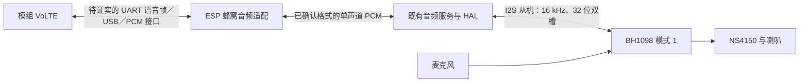

# 4G 通话与音频路径调研

日期：2026-11-11。基线：`343ce09e9cc78002138d15b75a1982d114b8a1a3`。

## 验收表

| 编号 | 结论 | 证据 | 命令／定位 |
| --- | --- | --- | --- |
| 1：路径、试验步骤、批准项 | 调研交付已完成，待文件检查；实机结论未验证 | 路径表、A～D 步骤、独立批准／恢复表；AI801 私有命令缺口明确保留 | 下文 S1～S7、V1～V5、P1～P4 |
| 2：范围与隐私 | 进行中 | 开工工作区干净，HEAD 与任务基线一致；只新增本任务目录 | `git status --short --branch`；`git rev-parse HEAD` |

## 当前结论与证据边界

- **呼叫控制有条件可行；这块板的双向声音仍是信息不足。**【实测·任务书转述】模组为 `EC718PM`，固件 `XJ_EC718PM_Modem_AI801_V0101.001.b05`；外置卡已有 EPS、IMS 注册，值得先做一次受控通话。注册和拨号返回 `OK` 均不等于已接通或双向有声。
- **已经找到的音频链只有 ESP ↔ BH1098 ↔ 本机麦克风／功放。**【实现】原厂和当前端口均没有把蜂窝通话 PCM 接入这条链；切 BH1098 的耳机 SCO 模式只建立蓝牙音频，补不上模组到 ESP 的一段（V1～V5、P1～P4）。
- **不能据公开资料断言 AI801 能经现有串口或 USB 给主控送语音。**【资料】同芯片 NT26 有 PCM/I2S 和可选 VoLTE，但它是模组及固件能力，不能直接当作本机连接或 AI801 帧协议（S1、S2）。
- 本次只有本机源码／文档检查和公开资料核对，没有新增设备实测。先做只读识别，再分开验收“呼叫建立、下行声音、上行声音”；没有原理图也能缩小范围，但一次无声不能证明没有隐藏连线。

## 通话音频的可能路径

可信度分别评价“资料中的能力”和“本板实际可用”，不把两者合并。

| 路径 | 出处与证据类型 | 可信度与成立条件 | 本次结论 |
| --- | --- | --- | --- |
| 模组 PCM/I2S ↔ 外部 Codec／BH1098 的另一路数字接口 ↔ 麦克风、喇叭 | 【资料】S1 数字音频、S2 I2S/PCM；【实现】V1 只列 ESP 的一组 I2S，V2 没定义第二路 | 芯片能力高；本板低。须确认 BH 固件有第二路接口、实际连线及主从时钟 | 有条件可行，未找到接通证据；不能把两路主机的输出并接 |
| 模组模拟音频 ↔ BH1098 模拟输入／音频切换器 ↔ 功放与麦克风 | 【资料】S1 的模拟音频随子型号不同；S4 的 Air780EVT 内置 ES8311 后才有 MIC/SPK 脚 | 其他模组高；本板低。PWM 播放不等于双向模拟通话，BH 模拟输入也未确认 | 信息不足；不能给 EC718PM 芯片名称直接添一对模拟通话脚 |
| 模组语音 PCM ↔ UART2 私有帧 ↔ ESP ↔ 既有 BH I2S | 【实现】V3、P1 帧 type 仅实现 0/1；【资料】未找到 AI801 的音频帧定义 | UART 联网和 AT 高；音频低。须取得语音启停、上下行帧、编码和时钟定义 | 当前没有软件接通；type 2/3 未使用不代表已预留给语音 |
| 模组语音 ↔ USB PCM／UAC ↔ ESP USB Host ↔ BH I2S | 【资料】S2 的 USB 是 Device；【实现】V1、V3 的主控接入是 UART，未见模组 USB 音频接线或驱动 | USB 外设能力高；通话 PCM、USB 连线和本板可用性低 | 信息不足；USB 串口／网卡不等于 USB 声卡 |
| 模组语音 ↔ 私有 IP 数据流或 type 1 二进制流 ↔ ESP ↔ BH I2S | 【估算】现有 type 0 承载以太网，type 1 用作 AT（V3） | 低；只有 AI801 专用协议或可辨认的流能确认 | 保留为观察分支；不能因没看到 type 2/3 就排除全部主机语音 |
| ESP ↔ BH1098 I2S ↔ NS4150／麦克风；或 BH ↔ 蓝牙耳机 SCO | 【实现】V1、V2、V4、P2、P3 | 对已有实现高；蜂窝连接仍未知 | 这是已实现的本机音频末段，不是完整蜂窝通话链 |

【估算】最保守的板上工作假设是：蜂窝模块目前只通过 UART 给 ESP 提供网络和 AT，本机声音由 BH1098 独立负责；模组的通话声音尚未进入该链。源码没有第二路 PCM 定义或音频切换器控制，支持先采用此假设；源码看不到的模组—BH 硬连线仍可能推翻它。

【实现】BH 是 I2S 主、ESP 是从，GPIO42/43/44/45 分别为 BCLK/WS/DOUT/DIN，16 kHz、32 位双槽；模组到 ESP 已声明的只有 GPIO58/59/60/3 的 UART 与握手。`PowerNeed::PhoneCall` 在原厂固定提交仅出现三处：枚举及两处策略判断，没有业务持有者。它表达电源意图，不能证明音频接线（V1、V5）。

## 公开资料与源码出处

全部查阅于 2026-11-11。以下说明均为转述，不摘录手册正文；AT 命令按原语法列出。

| 编号 | 原厂资料、版本和定位 | 能证明什么／不能证明什么 |
| --- | --- | --- |
| S1 | [利尔达 EC71X 产品介绍](https://opendocs.lierda.com/docs/CAT.1_Doc_Protal/zh_CN/)，§二、§三；[底包表](https://opendocs.lierda.com/docs/CAT.1_Doc_Protal/zh_CN/general/index.html)，F7B_A/F7D_A | EC718PM 有带 VoLTE 的 NT26 底包；PCM/I2S、模拟输出和 VoLTE 随子型号而异；本机准确料号和 AI801 不在表内确认 |
| S2 | [系统资源开发介绍 Rev1.0](https://opendocs.lierda.com/docs/CAT.1_Doc_Protal/zh_CN/general/resource-information.html)，§2；[API 入口 Rev1.0](https://opendocs.lierda.com/docs/CAT.1_Doc_Protal/zh_CN/software/api-overview.html)，Audio／VoLTE | 芯片支持 I2S/PCM 主从和 USB Device；API 在模组内部执行，不是能直接链接进 ESP 的语音库 |
| S3 | [合宙 Air780EP AT 手册入口](https://docs.openluat.com/air780ep/at/app/at_command/)；[产品说明](https://docs.openluat.com/air780ep/product/) §简介；[EC718P 旧系列说明](https://wiki.luatos.com/chips/air780ep/mcu.html) | 普通 EP 与语音变体的能力不同；旧系列页仅 EPV 标注 VoLTE。通用手册有音频章节不代表每个固件都支持，更不证明 AI801 支持 |
| S4 | [合宙硬件手册 V1.4](https://docs.openluat.com/atmozu/product/file/Air700ECT%26Air780EPT%26EHT%26EVT%26EVT-1.8V%26EG2%26EGT%E7%A1%AC%E4%BB%B6%E6%89%8B%E5%86%8CV1.4.pdf)，§3.3／§3.6，PDF 第 9／12 页 | EVT 的 MIC± 为脚 3/4、SPK± 为脚 5/6；证明带 Codec 模组的模拟通路，不能移植其管脚号到本板。该文件含旧 V1.3 页眉，页脚 11/14 与 PDF 页序不同，故同时给章节和 PDF 页序 |
| S5 | [合宙 AT 手册 V1.0.14](https://docs.openluat.com/atmozu/product/file/Air780EHT%26EGT%26EVT%26Air700ECT%26Air780EPT%26EG2%26EX2T_AT%E6%8C%87%E4%BB%A4%E6%89%8B%E5%86%8CV1.0.14.pdf)，2026-08-30；§6.1～6.4（PDF 第 95～98 页）、§17.1～17.5（第 261～266 页） | TTS、播放配置／Codec、音量和呼叫控制的参考语法；语音章节限定 EVT。`CTTS` 的 PCM 参数描述 TTS 输出，不是蜂窝通话 PCM 接口 |
| S6 | [合宙语音指令说明](https://docs.openluat.com/atmozu/product/command/audio/)，§6.5、§6.6、§7.7 | `CLVL` 的平台差异、持久化和查询限制；`CRSL` 是本地播放音量。它补充的 `CLVL` 在 S5 中未检出，采用时需探测，不当作 AI801 保证 |
| S7 | [3GPP TS 27.007 V11.5.0／ETSI TS 127 007](https://www.etsi.org/deliver/etsi_ts/127000_127099/127007/11.05.00_60/ts_127007v110500p.pdf)，§7.18、§8.23/8.24、§8.37、§8.71 | 标准 `CLCC`、`CLVL`、`CMUT`、`CLAC`、`CIREG` 的语法；采用固定历史版本核对基础语义，不代表定制固件全部实现 |

### 原厂源码与当前实现

上游统一固定在 `874538eb54f7f7eb593cd40cd1ba6dc8497226e7`；本机原厂克隆 HEAD 仍为 `690a023c66862af103a3187464373ee7c5efcd14`，未移动。行号用最新导出核对，全文搜索用只读 `git grep … 874538e -- main docs` 补齐。

| 编号 | 出处（文件／行号） | 核对结果【实现】 |
| --- | --- | --- |
| V1 | [config.h](https://github.com/CloudZao/Metalio-E-INK4-Plus/blob/874538eb54f7f7eb593cd40cd1ba6dc8497226e7/main/boards/metalio-e-ink4-plus/config.h#L143-L162)，143～162 | BH I2S、独立控制串口和模组 UART；PA_EN 是 TCA9555 P0.4，不是模组自己的 GPIO |
| V2 | [BH1098 协议](https://github.com/CloudZao/Metalio-E-INK4-Plus/blob/874538eb54f7f7eb593cd40cd1ba6dc8497226e7/docs/bh1098-audio-protocol.md#L23-L61)，23～61、98～143 | 模式 1 是本机音频；SCO 是蓝牙耳机链；没有蜂窝 PCM 第二口的定义；模式 6 讲的是 BH 到电脑，不能充当模组 USB 音频证据 |
| V3 | [uart_eth_modem.h](https://github.com/CloudZao/Metalio-E-INK4-Plus/blob/874538eb54f7f7eb593cd40cd1ba6dc8497226e7/main/boards/common/board/uart_eth_modem.h#L195-L206)，195～206；[对应 .cc](https://github.com/CloudZao/Metalio-E-INK4-Plus/blob/874538eb54f7f7eb593cd40cd1ba6dc8497226e7/main/boards/common/board/uart_eth_modem.cc#L1384-L1397)，1384～1397 | 四字节头 type 两位，枚举及收包仅 0/1；2/3 静默忽略，不是音频实现 |
| V4 | [metalio_audio.cc](https://github.com/CloudZao/Metalio-E-INK4-Plus/blob/874538eb54f7f7eb593cd40cd1ba6dc8497226e7/main/boards/metalio-e-ink4-plus/periph/metalio_audio.cc#L76-L126)，76～126；[bt_audio_codec.cc](https://github.com/CloudZao/Metalio-E-INK4-Plus/blob/874538eb54f7f7eb593cd40cd1ba6dc8497226e7/main/boards/common/audio/bt_audio_codec.cc#L61-L110)，61～110、140～186 | 模式 1 初始化、I2S 从机及 PCM 槽位转换；没有模组音频读写 |
| V5 | [power_policy.h](https://github.com/CloudZao/Metalio-E-INK4-Plus/blob/874538eb54f7f7eb593cd40cd1ba6dc8497226e7/main/boards/common/power_policy/power_policy.h#L26)，26；同目录 `power_policy.cc` 76、723；[README](https://github.com/CloudZao/Metalio-E-INK4-Plus/blob/874538eb54f7f7eb593cd40cd1ba6dc8497226e7/main/boards/common/power_policy/README.md#L26-L28)，26～28、114～140 | PhoneCall 无持有者；P14 共享供电，复位 BH 会影响蜂窝模块，试验期间不能拿复位蓝牙当排查捷径 |
| P1 | [s31_modem.c](../../../ports/esp32s31/s31_modem.c)，50～74、130～160 | 有限 AT 允许列表；只处理 type 0/1，新增只读命令与原始帧计数需要另做有限诊断入口 |
| P2 | [hal_cellular_s31.c](../../../ports/esp32s31/hal_cellular_s31.c)，93～102；[hal_bt_s31.c](../../../ports/esp32s31/hal_bt_s31.c)，117～150 | 拨号／接听成功后调用 BH 通话标记；仅有已连耳机时才切 SCO，没有搬运蜂窝音频 |
| P3 | [hal_audio_s31.c](../../../ports/esp32s31/hal_audio_s31.c)，54～75；[hal_audio.h](../../../platform/include/ink/hal_audio.h) | 已有 16 kHz 单声道 PCM HAL 与 BH 的 32 位双槽转换，可作为未来主机语音桥的末段 |
| P4 | [nt26.c](../../../drivers/chips/nt26/nt26.c)，404～429 | 当前拨号保留语音分号，静音是模组 `CMUT`；这些控制命令不能替代音频传输 |

### AI801、PCM 和 USB 的资料缺口

【资料】精确检索 `XJ_EC718PM`、`AI801 EC718PM`、`芯讯 EC718`、`XJCFG`，没有取得与当前固件对应的公开原厂手册或语音帧协议；不能从 `XJ` 前缀确认厂商身份。也没有找到能证明 AI801 支持通话 PCM 经 UART/USB 传输的资料。结论是“未查到”，不是“不支持”。

【资料】[利尔达 SDK](https://github.com/lierda-iot/cat1_sdk/tree/59f1250c4b8caad4bbf4f74167b7b39c79097f8c) 的 `liot_volte.h` 180～205 提供 Codec 类型和音量，`liot_voice_call.h` 177～197 提供通话音频开关和事件回调；`demo_volte.c` 124～125 使用外置 ES8311。它们在模组内部运行，不能直接拿到 ESP 上用，更不能证明 AI801 暴露了对应 AT。SDK 根许可证 Apache-2.0；VoLTE 库是预编译库，复用前还须核对对应库的授权，不能只看根许可证。

**缺少的明确项**：AI801 的通话通道查询、PCM/I2S 配置查询、AEC 查询及 USB/UART 通话音频启停命令。本次不编造这些命令，也不把其他品牌的私有命令后面添 `?` 就发给设备。可先用标准 `AT+CLAC` 发现公开命令名；即使列出名字，也须拿到该固件的参数和恢复说明后才能写配置。

## 上机试验步骤

**以下均未执行，仅供主会话操作。** 顺序为 A（无呼叫、只读）→ B（本机音频检查，不发起蜂窝通信）→ C（可能收费的真实呼叫）→ D（获批后才写音频配置）。预期回复来自标准／其他厂商固件，只是判读规则，不伪造本机回显。

### A. 只读查询：先跑现有入口允许的命令

通过现有 UART2 帧协议的 type 1 发送，每条以 CR 结束；BH 的 UART1 是另一条控制口。不能在裸串口里直接输入 AT 代替四字节模组封装，也不能同时启动第二个串口读写者。等前一条命令结束才发下一条；超时先停，不能把半条回复配给后一个查询。

| 步骤 | AT 命令原文 | 预期回复／分支 | 下一步 |
| --- | --- | --- | --- |
| A1 复核固件 | `AT` → `AT+CGMM` → `AT+CGMR` | 各有 `OK`；后两者应仍是上述 EC718PM／AI801 版本。无回复是通道问题，版本改变则本报告的兼容性边界需重核 | 正常才 A2；不发 `ATI`，避免附带身份字段 |
| A2 卡和无线状态 | `AT+CPIN?` → `AT+CFUN?` → `AT+CEREG?` → `AT+CSQ` | `+CPIN: READY`、`+CFUN: 1`、EPS 的 `<stat>=1/5`；CSQ 99 表示未知。PIN 未就绪、射频非全功能、未注册时先停止通话试验，不自动输入密码或改配置 | 正常才 A3；位置字段从记录中移除 |
| A3 IMS | `AT+CIREG?`（必要时只测试 `AT+CIREG=?`） | 参考 `+CIREG: 2,1,5`：注册位 1；扩展位 5 按 S7 §8.71 是语音和 IMS 短信。注册位 0 不具备这次 VoLTE 试验前提；`ERROR` 仅表示此查询未被接受 | 外置卡已注册才继续；不为内置卡改 IMS／APN 设置 |
| A4 初始呼叫 | `AT+CLCC` | 只有 `OK` 为无当前呼叫；有 `+CLCC: <id>,<dir>,<stat>,<mode>,<mpty>…` 表示已有呼叫，不再叠加拨号。`ERROR` 或回复截断是未知 | 无呼叫才 A5；保留状态字段，丢弃目标和姓名字段 |
| A5 麦克风静音 | `AT+CMUT?` | `+CMUT: 0/1` 和 `OK`；把原值记为 `m0`。值 1 可解释上行无声；`ERROR` 不能推断为未静音 | 只记录，不在只读阶段发送 `CMUT=0` |

上述命令均在 P1 允许列表内。`CPIN?` 的错误只作状态，不查询或记录卡身份。

### A6. 可选的只读能力发现与音频查询

**前置缺口**：【实现】P1 尚不放行以下命令；主会话必须先有经审阅的有限诊断入口，确认命令确实到模组，不能把主控拒绝当作模组 `ERROR`。本次未改允许列表，也不提供绕过方法。若回复超过现有回复缓冲，要先解决截断再解释结果。

| 目的 | 只读 AT 原文 | 预期回复与解释 | 下一步／边界 |
| --- | --- | --- | --- |
| 公开命令列表 | `AT+CLAC` | 多行 `AT…` 后 `OK`（S7 §8.37）；不支持则 `ERROR`／`+CME ERROR`。有无列表均不能证明隐藏命令存在与否 | 只摘 AUDIO／PCM／I2S／VOICE／USB／AEC 相关命令名，向对应固件原厂核对语法；不能枚举猜参数 |
| 通话输出音量 | `AT+CLVL?` | `+CLVL: <level>` 后 `OK`；不支持也可能 `ERROR`。S6 的 `CLVL=?` 未实现，所以不把该测试式失败当成查询式不支持 | 保存原值；它不告诉声音实际连到哪里；更不能套用别家音量范围 |
| 本地播放音量 | `AT+CRSL?`，需要范围时 `AT+CRSL=?` | `+CRSL: <level>`／支持范围后 `OK`，或 `ERROR`。S5 §6.4 管本地播放；S7 §8.21 的标准语义是铃声音量，故须按 AI801 定义判读 | 不能靠此值证明蜂窝通话音量 |
| 播放通道／Codec 的参考配置 | `AT+CTTSPARAM?` | 若兼容 S5 §6.2，返回 `+CTTSPARAM: <volume>,<mode>,<pitch>,<speed>,<channel>,<codec>,…` 后 `OK`；否则记录不支持 | 只显示 TTS 配置线索：S5 codec 0/1/2/3 是 ES7149/TM8211/内置模拟输出/ES8311；**不是当前通话路由或 PCM 时序查询** |
| 通话 PCM/I2S 参数、音频通道、AEC／USB 语音 | **未找到经 AI801 原厂确认的查询命令** | `CLAC` 即使有候选命令名，也缺参数和返回字段说明；无可诚实填写的确定回显 | 该项记“待厂商资料”，不中断 A1～A5 或默认配置的一次呼叫；不捏造私有 AT |

### B. 不发起蜂窝通信的本机音频对照

1. 使用已有系统入口查看当前输出路由与 BH 模式，先做本机提示音和录音回放对照，随后退出测试、释放音频占用。若已有日志不能显示 BH 模式，应记“未确认”，不要默认模式 1。这里只验证喇叭、麦克风、BH 和 PA；回放正常也不证明模组音频正常。
2. 若主会话需要切回本机模式，应在获准改变音频路由后经既有 HAL 执行原厂流程：**发给 BH UART1** `AT+RX=2` → 等 700 ms → `AT+MODE=1`，等待 `SET MODE 1`（V2、V4）；这不是模组 AT，也不是只读。不能用共享 P14 断电“顺便复位”。此前若连耳机会断开，恢复原路由时按既有系统流程重新连接，不能承诺配对状态原样保留。
3. 确认 PA 已由现有音频／电源路径请求打开，否则模式 1 下无声无法区分 PA 未开与模组未送声音。P0.4 是功放控制，P14 是共享供电；本次不建议手动写 IO 扩展器。保持本机音量温和，避免把无参考的最大音量作为试验条件。

### C. 真实呼叫：要用户点头，先保持模组原音频设置

前提：A1～A5 完成；用户批准一个由本人控制、已约定接听的普通目标和本次费用；不用紧急、收费服务或未知目标。所有目标均在执行时私下填入，以下尖括号是占位符，不能原样发送。不自动重拨；同一通尽量完成观察，达到已批准时长就挂断。

| 步骤 | AT 原文／观察动作 | 预期、不同结果的含义 | 下一步 |
| --- | --- | --- | --- |
| C0 建立观察基线 | `AT+CLCC`；无呼叫时先记一段 UART 帧计数与 BH 状态 | 留下 type 0/1/2/3 的数量、长度分布和相对时间；不保留号码或完整网络负载 | 没有帧观察入口就明确记缺测，不能写 type 2/3 为零 |
| C1 呼出一次 | `ATD<目标>;` | 常见 `OK` 为命令接受；`ERROR`／`+CME ERROR` 为拒绝；`NO CARRIER`／`BUSY`／`NO ANSWER` 为失败／结束。当前项目要求分号，不因别家例子省略而去掉 | 接受后 C2；失败即收尾并记原始错误类别，不改音频配置重试 |
| C2 呼叫状态 | `AT+CLCC`；每次完整返回后，间隔约 1 s 再查 | 呼出 `dir=0`，`stat=2 → 3 → 0` 表示拨号／对端振铃／激活；采样可能跳过中间态。`mode=0` 是语音。只有 `OK` 表示已无呼叫；一直 2/3 是尚未接听 | 只有 `stat=0` 且对端确认接听，才做双向声音判断；否则 C5 |
| C3 下行／上行分开听 | 激活时再查 `AT+CMUT?`；保持 BH 模式 1、PA 开；双方轮流说无个人内容的短词，再同时说话 | 对端声音到本机是下行通过；本机声音到对端是上行通过；只听见本地铃声／回铃不算。分别记有声、无声、失真／断续及回声 | 单向或双向无声都先记结果，不立即猜 PCM 参数；原值静音为 1 时，上行结论记“受静音限制” |
| C4 同步观察 | 同一通中继续记 `CLCC`、全部新 URC 名称、四类有效帧和 BH 回复／音频状态 | 关注 `RING`、`+CLIP`、`+CLCC`、`NO CARRIER`、`+CIREG`／`+CIREGU` 及未知 URC；S5 还列 `^MODE`、`+CGEV` 等参考，但 AI801 不保证相同 | 将 URC 和帧计数按拨号、激活、双方说话、挂断对齐；网络 URC 不能单独证明接通 |
| C5 无论成败都收尾 | `AT+CHUP` → `AT+CLCC` → `AT+CIREG?` | 挂断应 `OK`，之后无 `+CLCC` 行；检查 IMS 是否还注册。若挂断失败／查询未知，请对端先挂断，再核对空闲；不自动复位模组 | 归还音频占用，恢复 B 改过的本机路由；所有被批准修改的值都查询核对恢复 |
| C6 可选呼入对照 | 用户另行同意后，让受控对端呼入；`AT+CLCC` → `ATA` → `AT+CLCC`；最后 `AT+CHUP` | `RING`／`dir=1,stat=4` 为来电；接听后应 `stat=0`；仅有 `OK` 仍需状态和对端确认。`ATA` 无来电可回 `NO CARRIER` | 重复 C3～C5；呼入也可能产生费用，不能当作免费查询 |

状态定义见 S7 §7.18；同平台例子见 S5 §17.5。`id` 不一定是固定编号，不依赖 URC 顺序或所有中间态都可见。

**帧观察的具体边界**：【实现】现有 P1 的 `ink_feed` 168～187 在完整长度／头校验成立后才调用 `ink_dispatch`，应在该分派入口记录 `type=(header[2]>>2)&3`，不能把 UART DMA 每批字节当一帧。现有分派会忽略 2/3，普通应用日志看不到它们；原厂 V3 也一样。本次没有新增计数代码或设备采集。

**结果怎么解释**：【估算】激活后新出现稳定 type 2/3、挂断后停止，只能判“候选语音流”，仍须确认编码、方向、帧头及与对端音频的对应关系；也可能是诊断流。没有 2/3，只能说这次默认设置下未观测到，语音还可能经 type 0 私有 IP、type 1 二进制、未启用的接口或板上直连。若模式 1 下双向有声、ESP 没有语音桥，则优先核对隐藏硬连线／BH 固件内路由；若无声，也不能排除 PA、静音或未启用的音频出口。

### D. 要用户点头：写音频设置及恢复

**先读原值、一次只改一项、查回、试验后用原语法写回并复查；读不到全部原值就不做该修改。** 这里的尖括号是待执行者填写的参数，不是能原样运行的指令。

| 修改项 | 参考 AT 原文与批准条件 | 预期／恢复原值 |
| --- | --- | --- |
| 解除模组上行静音 | 已由 `AT+CMUT?` 读到 `m0`，获准后 `AT+CMUT=0`；可选静音对照 `AT+CMUT=1`（S7 §8.24、P4） | 每次 `OK` 后查 `AT+CMUT?`；结束用 `AT+CMUT=<m0>`，再查回原值。返回错误即停止，不以复位替代恢复 |
| 通话音量 | **只有拿到 AI801 对应说明后才执行。** 标准 S7 是 `AT+CLVL=<试验值>`；S6 合宙版本是 `AT+CLVL=0,<试验值>`，两者不可混用 | 先读 `AT+CLVL?` 得 `v0`，用对应原语法写回 `v0` 并查询。S6 空闲只读设备 0，故不能据此改设备 1/2/3 后声称能恢复；未核实本机范围前不设默认值 |
| TTS 的通道／Codec／PA 引脚 | 参考 S5：`AT+CTTSPARAM=<volume>,<mode>,<pitch>,<speed>[,<channel>][,<codec>][,<papin>][,<codecstart>][,<pa_open>][,<codec_pa_close>][,<def_pa_out>,<codecend>]` | 这是播放配置，不能充当通话修复。S5 的查询表缺最后 `codecend` 字段，不能保证完整恢复，**本轮不列为可执行试验**；须取得 AI801 全字段读回及恢复说明后另批 |
| 模组 PCM/I2S 路由、采样率、主从、AEC、UART/USB PCM | **AI801 具体命令未查到，不给猜测的设置值。** 用户点头也不能替代协议和原值资料 | 暂无可靠回显或恢复命令；在原厂提供完整查询／设置／恢复方法前不执行，不发保存配置、恢复出厂或重启命令试探 |

因此，**当前可先试默认配置的一次真实呼叫；若无声，不能保证靠几条已知 AT 就修好。** 未通过 C1/C2 时先解决呼叫控制／注册；C2 通过但无声时再沿音频出口排查。

## 送到主控后的最小软件路径（条件方案）

本次结论尚不是“AI801 已能把声音送到主控”。以下仅在厂商协议或后续实测确认**双向语音**出口后成立，不实施、不替用户选择新机制。

| 段 | 最少要补／可复用的内容【估算】 | 证据与限制 |
| --- | --- | --- |
| 模组 → ESP、ESP → 模组 | 在现有集中收帧点接原厂语音帧分支；按协议启停、读写 PCM、处理流控。若是物理 PCM，先确认已接到可用 ESP 管脚和时钟；若只有 USB，先确认板上已接线 | V3 可复用封装及握手；AI801 音频协议代码未获得，不自创 type 2/3 定义。需要改模组固件时另开任务、另获批准，不能刷成合宙固件代替 |
| ESP ↔ BH | 复用 P3 的播放／采集 HAL 和 V4 的有效位、左右槽转换；8 kHz 出口需复用已核实的重采样，16 kHz 可按现有格式接入 | 不能把收到的任意帧直接当 16 位 PCM；上行用麦克风槽，不能误送回声参考槽。BH 与模组的独立时钟频偏也须测 |
| 通话生命周期 | 接入既有音频焦点和电源占用，激活后才开桥，挂断／失败先停桥、归还资源再对外报告结束；保持数据联网协议 | `comm` 管呼叫控制，音频服务管双向音频，HAL 管芯片；按钮和 AI 仍走已有拨号／接听／挂断能力，诊断原始 AT 不开放给 AI（R-061） |
| 原厂／开源复用 | BH、I2S、模组帧和供电流程优先直接复用 V1～V5（MIT，保留版权和来源提交）；利尔达示例仅作模组侧参考 | 当前没有可直接复制来打通 AI801 主机音频的原厂文件；不能把模组内部二进制 VoLTE 库当跨处理器音频桥，也不引入许可未核对的库 |

【估算】假定出口为 16 kHz、单声道、16 位 PCM：每方向 32 kB/s，UART 8N1 加起止位约 320 kbit/s；相对 2 Mbit/s 是每方向约 16%，未计帧头、握手、联网竞争和停顿。8 kHz 为其一半；BH 自身 16 kHz × 32 位 × 2 槽的 I2S 位时钟为 1.024 MHz。带宽看起来够不等于定制固件已提供出口，也不等于连续通话不会断音。

【估算】有完整双向帧协议、无需改线或改模组固件时，最小可听样机约 2～4 人日，状态／回声／联网并发核查另约 1～3 人日；没有协议则不能承诺工期。如果本来是模组直连 BH，所需可能仅是经原厂确认的路由和电源控制，不应先写软件搬音频。

## 要用户定的

- **推荐**：主会话先补有限只读诊断和有效帧统计，再请求批准 C 的一次受控呼叫；先保持模组音频原值。备选是先取得 AI801 原厂音频协议再拨号，能减少无声时的歧义，但时间未知。这只是试验建议，未升级为需求。
- **须单独获准**：C 的呼出／呼入及费用，B 的音频路由变化，D 的静音和音量写入；PCM/I2S／AEC／USB 路由等须先有完整语法与可恢复原值。取得资料和用户同意之前不执行。
- 若最后需要换模组固件、改线或增硬件，重新立项和征求明确选择；本次没有实施或默认批准。

## 没做到的

- 按任务书不碰设备，不改产品代码、测试或构建文件，不运行全量测试、ASan、S31 构建和 gcccheck；本次产品代码改动 0 行。
- 没有实际呼出、呼入、听音、采集帧或测 USB 描述符；主会话提供的注册结果按转述标记。
- 没有查到 AI801 的通话音频通道、PCM 时序、AEC、主机语音流命令及恢复说明；因此不能填写确定的专用查询或设置命令。未取得的资料不以同芯片的其他固件替代。
- 未确认 BH1098 第二音频口或模组到 BH 的隐藏连线，不能回答现有接线一定能／不能完成双向通话。普通日志也无法排除 type 2/3。
- 合宙 EPVZ 老硬件 PDF 下载被拒绝，未据其搜索摘要断言管脚；另已取得并逐页定位 S4、S5。没有为本次研究升级依赖或安装工具链。

## 和设计不一致的

- 本次没有更改设计、驱动或原厂流程，也没有选择偏离原厂的硬件参数。
- 【实现】R-013 的双向通话尚缺设备证据；现有拨号／接听到 BH SCO 的控制不构成完整通话音频实现。此处记录既有实现的证据缺口，不据此删去通话要求。
- S4 自身存在版本页眉／页码混杂，S5 的 TTS 参数表存在查询字段少于设置字段的问题，已在来源和 D 中保留，未猜补。

## 改过的已有测试

无；任务书明确豁免构建、全量测试和内存检查，反向对照不适用。

## 新增的机制

无新增任务／线程、状态机、文件格式、配置项、产品能力或诊断代码；条件方案仅为后续估算。

## 要改的文档

- 主会话在取得 C 的证据后，更新通信／音频设计的“通话控制”和“双向音频”验证边界；有协议才给语音桥安排实现任务。
- 将有限查询入口、type 0～3 有效帧观测和 AI801 协议缺口纳入后续任务；不把本次建议自动写成已确认需求。本次不动共享需求、决策、任务总表或既有研究文档。

## 顺手发现

- 【实现】AT 允许列表和当前回复容量是研究步骤的实际前置条件；未经主控放行、被截断或丢弃的回复不能当作模组不支持。
- 【资料】TTS 的 PCM 输出、网络连接 URC、BH 的 USB 模式和耳机 SCO 都容易与蜂窝主机语音混淆；本报告分别限定，未据名称补实现。

## 交付检查

文件／链接、差异范围和隐私检查进行中；按里程碑本地提交，不 push。未把下载的 PDF、渲染图、设计稿或设备数据纳入交付。
