# 设计语言改前改后

每张图左为基线、右为修改后；保留完整画布，不画调试框。默认字号 100%，最大字号 120%。原始 PNG、控件树与运行日志保留在构建目录，可按报告命令复现。

## 默认字号

- [主屏](Main-1.png)

- [今日](Today-1.png)

- [全部](Apps-1.png)

- [控制中心](Control-1.png)

- [锁屏](Lock-1.png)

- [设置](Settings-1.png)

- [显示和亮度](SetDisplay-1.png)

- [声音](SetSound-1.png)

- [网络](SetNetwork-1.png)

- [备忘和键盘](ImePinyin-1.png)

- [AI面板](Ai-1.png)

- [确认卡](Confirm-1.png)

- [电源菜单](PowerMenu-1.png)

- [关于](SetAbout-1.png)

- [短信列表](Sms-1.png)

- [短信对话](SmsThread-1.png)

- [拨号](Phone-1.png)

- [最近通话](PhoneRecents-1.png)

- [通话](PhoneCall-1.png)

- [联系人](Contacts-1.png)

- [备忘编辑](MemoEdit-1.png)

- [闹钟](Clock-1.png)

- [计时](ClockTimer-1.png)

- [秒表](ClockStopwatch-1.png)

- [计算器](Calculator-1.png)

- [日历](Calendar-1.png)

- [天气](Weather-1.png)

- [相册](Gallery-1.png)

- [相机](Camera-1.png)

- [文件](Files-1.png)

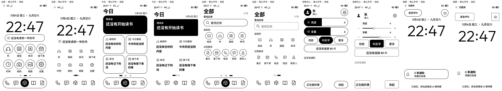

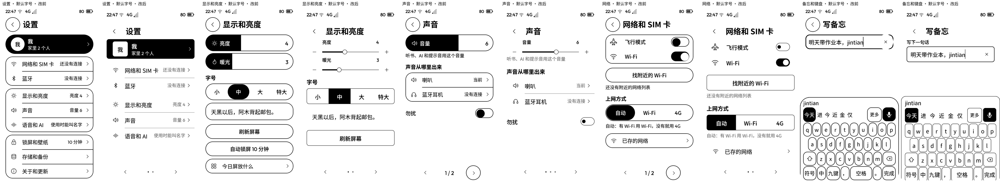

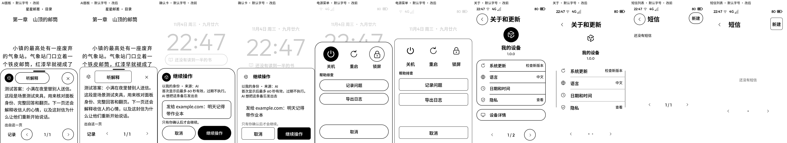

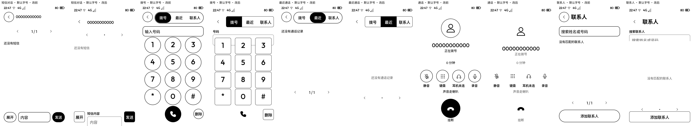

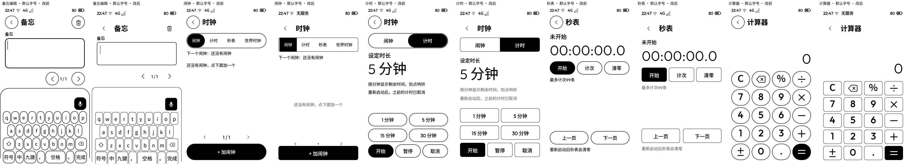

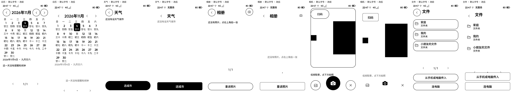

## 最大字号

- [主屏](Main-3.png)

- [今日](Today-3.png)

- [全部](Apps-3.png)

- [控制中心](Control-3.png)

- [锁屏](Lock-3.png)

- [设置](Settings-3.png)

- [显示和亮度](SetDisplay-3.png)

- [声音](SetSound-3.png)

- [网络](SetNetwork-3.png)

- [备忘和键盘](ImePinyin-3.png)

- [AI面板](Ai-3.png)

- [确认卡](Confirm-3.png)

- [电源菜单](PowerMenu-3.png)

- [关于](SetAbout-3.png)

- [短信列表](Sms-3.png)

- [短信对话](SmsThread-3.png)

- [拨号](Phone-3.png)

- [最近通话](PhoneRecents-3.png)

- [通话](PhoneCall-3.png)

- [联系人](Contacts-3.png)

- [备忘编辑](MemoEdit-3.png)

- [闹钟](Clock-3.png)

- [计时](ClockTimer-3.png)

- [秒表](ClockStopwatch-3.png)

- [计算器](Calculator-3.png)

- [日历](Calendar-3.png)

- [天气](Weather-3.png)

- [相册](Gallery-3.png)

- [相机](Camera-3.png)

- [文件](Files-3.png)

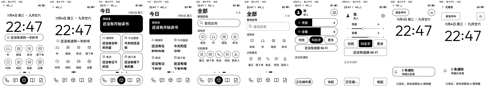

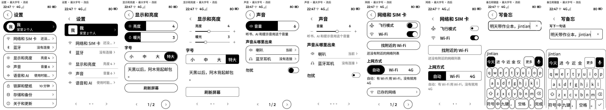

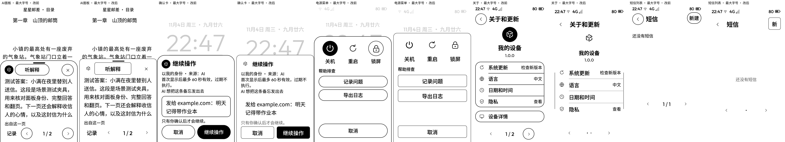

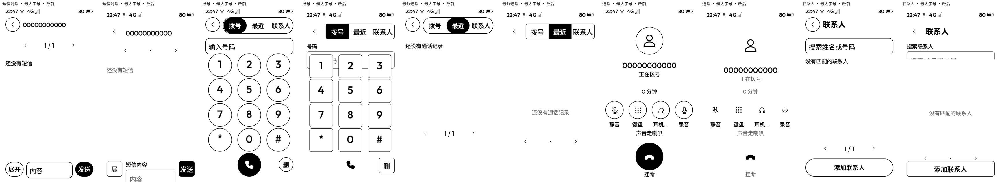

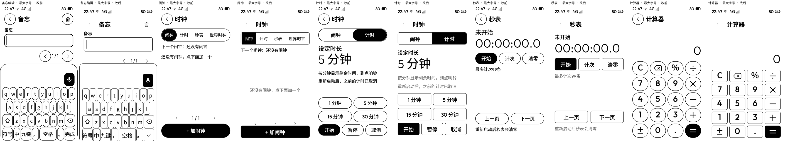

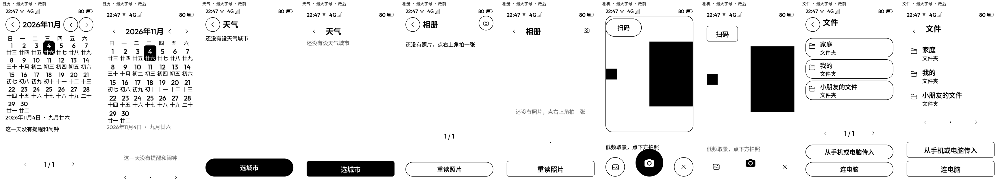
