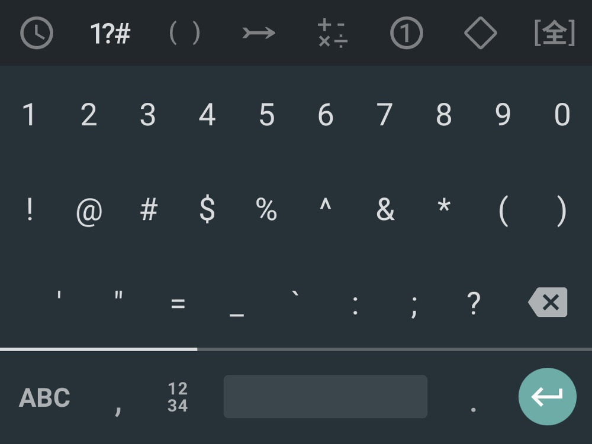
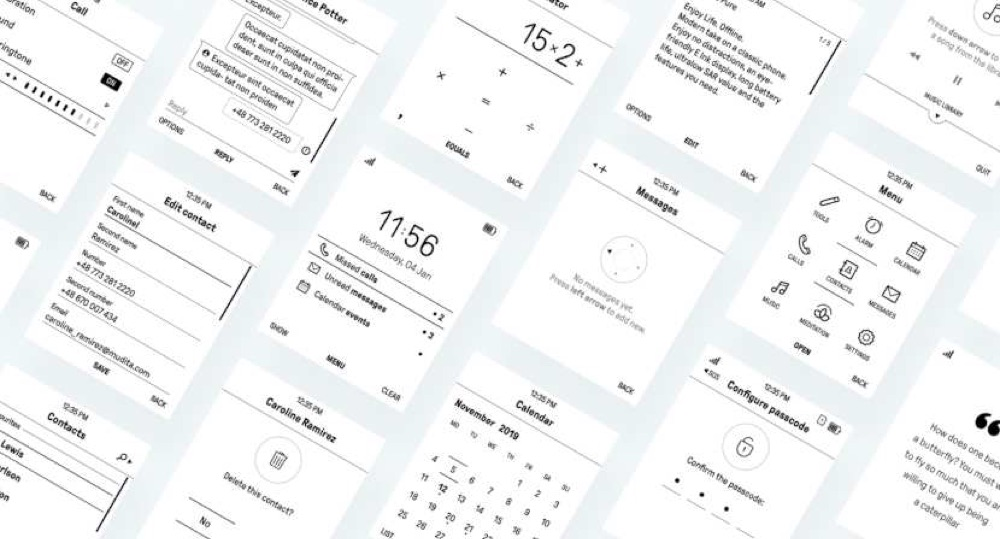
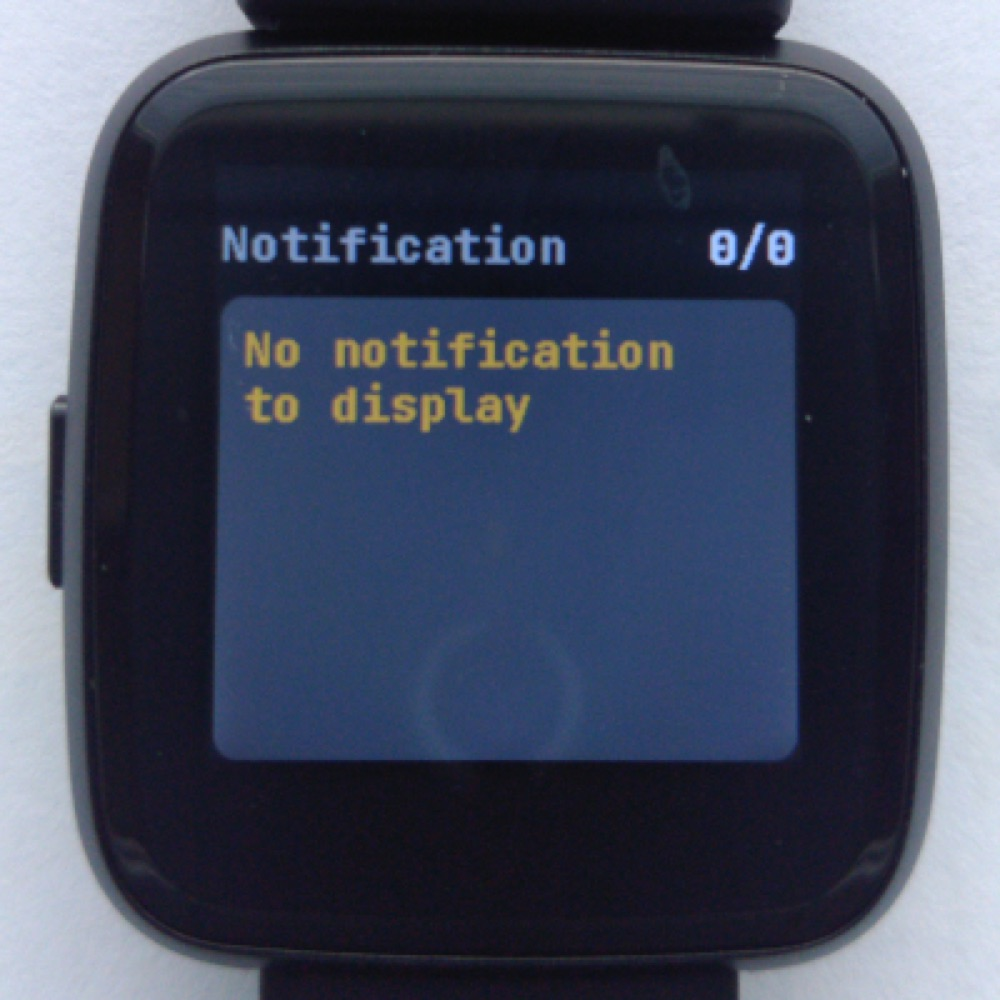
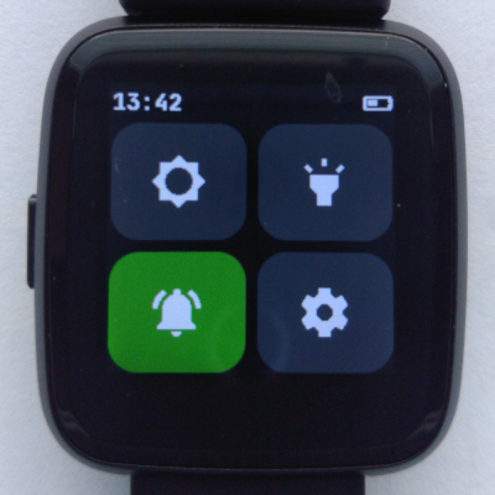
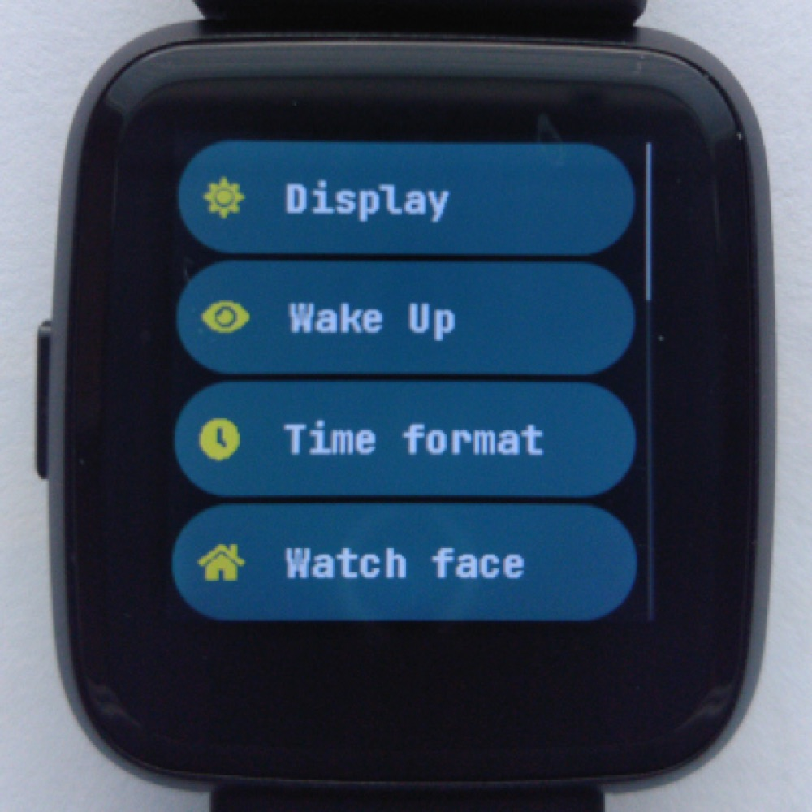
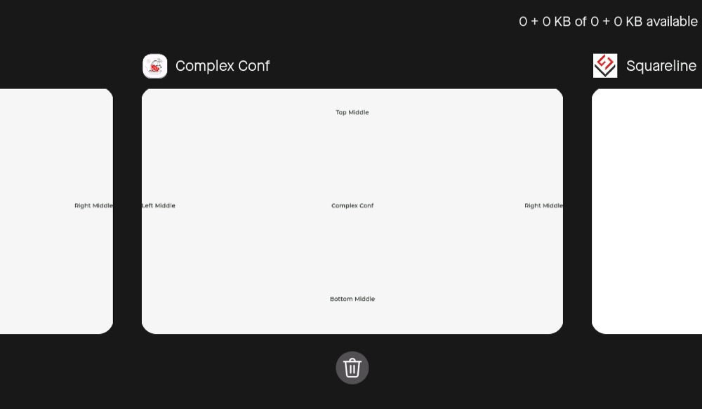

# 上游参考图

这些是上游公开截图/照片或官方界面拼图，供本次比较和后续预览参考；不是本项目运行截图，也不是本次拍摄。图片已经逐张查看。未另画示意图充当上游截图。

原图来源在下表，原图/派生图的 SHA-256 和字节数见 [images.json](images.json)。统一用 macOS `sips` 转 JPEG，最长边 1000 px、质量 78；不裁剪、不改页面内容。每张小于 300 KB；重新编码会改变文件哈希。

| 文件 | 字节数 | 内容 | 上游来源 |
| --- | --- | --- | --- |
| [fcitx-pinyin.jpg](images/fcitx-pinyin.jpg) | 88,732 | 拼音：组合串、候选、QWERTY 与语言入口 | [原图](https://github.com/fcitx5-android/fcitx5-android/assets/13914967/bd429247-62d9-4c78-bab8-70ef3ce47588) |
| [fcitx-symbols.jpg](images/fcitx-symbols.jpg) | 50,935 | 符号：分类、符号键与返回字母布局 | [原图](https://user-images.githubusercontent.com/13914967/202181861-dd253439-1d5e-4f5f-9535-934f28796a6b.png) |
| [mudita-overview.jpg](images/mudita-overview.jpg) | 111,219 | Pure 官方界面拼图：状态栏、通知、菜单和密码等；含上游演示内容 | [原图](https://raw.githubusercontent.com/mudita/MuditaOS/2cd0e4721405c0bf263f311f27d38aadae6ac89f/doc/Images/readme_header.jpg) |
| [infinitime-notifications.jpg](images/infinitime-notifications.jpg) | 141,368 | 通知空状态；不能据此推导通知操作或分组 | [原图](https://raw.githubusercontent.com/InfiniTimeOrg/InfiniTime/9ad16304f5fd526b781a760cf1313813d232645e/doc/gettingStarted/ui/notifications.jpg) |
| [infinitime-quicksettings.jpg](images/infinitime-quicksettings.jpg) | 138,484 | 四键快捷区：亮度、手电、通知、设置 | [原图](https://raw.githubusercontent.com/InfiniTimeOrg/InfiniTime/9ad16304f5fd526b781a760cf1313813d232645e/doc/gettingStarted/ui/quicksettings.jpg) |
| [infinitime-settings.jpg](images/infinitime-settings.jpg) | 143,545 | 列表设置：显示、唤醒、时间格式 | [原图](https://raw.githubusercontent.com/InfiniTimeOrg/InfiniTime/9ad16304f5fd526b781a760cf1313813d232645e/doc/gettingStarted/ui/settings.jpg) |
| [brookesia-statusbar-v042.jpg](images/brookesia-statusbar-v042.jpg) | 7,297 | v0.4.2 状态图标，不是通知列表 | [原图](https://raw.githubusercontent.com/espressif/esp-brookesia/2c0c83fad95b81c81ee560ba8af684ff32a402f4/docs/_static/readme/status_bar_demo.png) |
| [brookesia-recents-v042.jpg](images/brookesia-recents-v042.jpg) | 31,348 | v0.4.2 最近任务，不是通知中心 | [原图](https://raw.githubusercontent.com/espressif/esp-brookesia/2c0c83fad95b81c81ee560ba8af684ff32a402f4/docs/_static/readme/recents_screen_demo.png) |

fcitx 两图由固定版 README 引用：`fcitx5-android/fcitx5-android@eb5b50216e70484a009933d9519db76005f1faf3:README.md:66–72`；附件 URL 自身没有 Git 提交，因此同时记录原图哈希。其余六图 URL 已含固定提交。图的拍摄/制作时间不确定，固定的是本次查阅内容；不能假定图与当前代码每个细节都一致。

归属：fcitx5-android 项目及其截图作者、Mudita、InfiniTime 项目及其照片作者、Espressif。代码许可分别按各自仓库 LICENSE（fcitx5-android 为 LGPL-2.1，InfiniTime/MuditaOS 为 GPL-3.0，Brookesia 为 Apache-2.0）查阅；截图独立许可未逐一确认，不据代码许可推断每张图的额外授权，也不把许可作为本轮候选排名门槛。本轮未把上游代码或素材写入产品资源。

查看入口：

