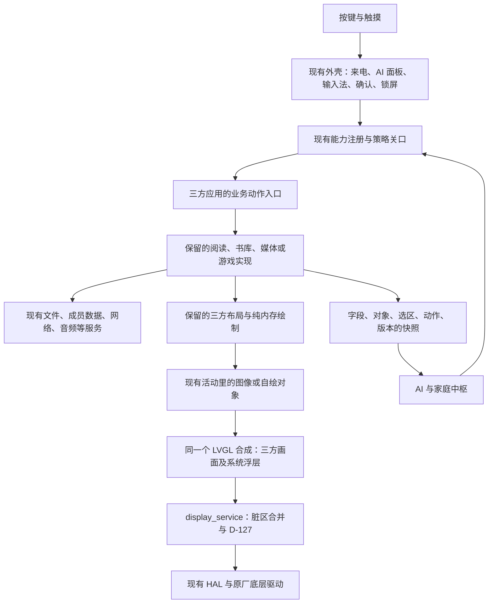

# replan-arch：三方应用整合架构评估

日期：2026-11-12。基线：`d09b79195e2dc57908e33219216048e529e082c6`。本任务只改本目录，产品代码 **0 行**；没有接设备、运行固件、主工程构建、推送或 PR。

## 结论

**【估算／建议】推荐“保留现有平台，应用按类别接入”：阅读等完整交互优先乙；系统外壳、安全入口和跨应用服务继续使用现有平台契约；适合独立复用的业务内核走甲。丙有条件可行，但当前不推荐作为整机底座。** 排序依据是能否保留成熟功能、排版与操作体验，并同时满足来电打断、AI 操作、成员隔离和最少刷新。适配行数只作为辅助信息，协议不作候选过滤条件。

乙不是“屏幕 HAL 加几个函数，其他原样运行”。CrossPoint 的直接适配面已点名 **77 个方法**；kiikoread 抽样接缝为 **60 个名字**，两者还没算完整文件、字体、网络和业务闭包。可保留的是应用的布局、绘制、排版、命中与业务算法；运行循环、显示提交、全局存储、硬件副作用和动作入口必须适配。接口清单与行数假设见 [INTERFACES.md](INTERFACES.md)，所有源码编号见 [SOURCES.md](SOURCES.md)。

**【实测】乙的最小源码编译验证成功，整套应用可运行尚未证明。** kiikoread 的四栏导航 `ui_nav.c` **258 行原文不改**，使用 **55 行兼容声明**编译成宿主机对象；撤掉网络状态声明后编译失败。对象仍有未解析服务符号，没有链接、像素输出、功能运行或真机体验证据。不能将它写成“阅读器移植通过”。见 [原始命令与输出](probe-result.json)。

**【估算】5 MiB 分区目前不能给任何完整替换方案发“空间足够”的结论。** 按任务书剩约 8% 计算，只有约 **410 KiB** 增量空间；乙需要通过“替换旧实现、共用依赖、复用资源”控制净增量，而不是把两套完整固件叠起来。PSRAM 的画面缓冲在数量级上可容纳，内部 RAM、峰值、最终固件链接大小仍未测。详见资源表。

## 验收表

| 编号 | 结论 | 证据 | 命令 |
| --- | --- | --- | --- |
| A1 甲乙丙、接口与行数 | 完成评估；总闭包未知处明确列出 | 下表、INTERFACES；O01–O12、C01–C13、K01–K14、F01–F03 | `rg -n` / `nl -ba`；`git show <固定提交>:<文件>`；C2 |
| A2 刷新、多语言、字号 | 完成处理方案；没有实机通过结论 | 刷新与文字表；O07–O10、O13，C04–C10，K03–K05、K12–K14 | 同 A1；C2 |
| A3 AI 与成员隔离 | 完成接线和缺口分析 | 统一动作图、能力分类表；O03–O06、O24，C12–C14、F01/F02、K04/K07/K08 | 同 A1；C2 |
| A4 内存、5 MiB 应用槽 | 给出条件与算式，不能判足够 | 资源表；O14–O22，C04/C05，K09/K10 | `taskpolicy -c utility python3 docs/tasks/replan-arch/verify_report.py`（C2） |
| A5 最小兼容验证 | 编译通过，缺接口对照按预期失败 | probe-result：退出码 **1 / 0 / 1 / 0**；源码哈希与未解析符号 | C1 |
| A6 推荐架构、应用类别 | 给出建议及选择条件；未替用户定案 | 本节与应用分类表；C12–C14、K04/K13、M01/M02、X01/X02 | 源码核对；C2 |
| A7 范围、链接、隐私与提交 | 检查结果见 verification.txt | 仅本任务目录；产品代码 0 行；已有测试未变 | C2、C3 |

## 三种做法逐项评估

【实现】我们的接入合同不是只有 LVGL：`ink_activity_t` 有创建/销毁、按键/滑动、快照和批次末绘制；`ink_app_def_t` 有生命周期、权限、儿童准入、后台工作与成员状态保存；`ink_cap_t` 有动作描述、来源、执行器、策略与结构化回执；页面描述 `ink_ui_page_spec_t` 共用字段/动作和快照（O01:36–52、O02:25–99、O03:64–138,155–195、O04:10–56）。安装包当前读取 JSON 页面，不会加载任意三方 C/C++ ELF（O11:122–153）；三种方案的原生代码均需链接进应用镜像。

| 项目 | 甲：业务移入我们的 LVGL 页 | 乙：保留三方界面，适配下面与动作边界 | 丙：kiikoread 当整机底座 |
| --- | --- | --- | --- |
| 可行性 | **有依据可行**的是现有接入模式；完整成熟体验仍有条件 | **有条件可行**；本次证明一个 UI 单元能编译 | **有条件可行**；同芯片解决部分板级匹配，不能解决平台整合 |
| 功能与体验 | 能统一外壳；重写容易漏掉三方目录、分页、选区、图片、排版和异常流程，必须逐项对照原应用 | 最能保留已有阅读布局、字体、命中和操作细节；平台边界适配也会改变行为，需要功能等价验证 | 原生阅读流程保留最多；接入现有电话/AI/成员后，整机打断、恢复和安全体验没有证据 |
| 主循环与外壳 | 继续用现有 UI 活动栈和 LVGL | 三方成为一个或一组现有活动；不启动第二个 UI 主循环 | 必须把现有平台嵌入原生循环，或重写原生循环；两套各自拥有前台不可接受 |
| 接口与适配量 | 共用平台 20 契约；六页样本约 **2,400–4,200 行** | CrossPoint 已列 77 方法；kiikoread 已列 60 名字，另加平台/数据；一条阅读链约 **2,060–4,020 / 2,250–4,600 行** | 可点名下界 43 契约，另有 6 组平台装配域；约 **3,500–6,900 行**，闭包未定 |
| 刷新 | 现有 LVGL → display_service → HAL | 三方只提供最终像素和脏区，经 LVGL 合成后提交；原有强刷、预览/精修等需收口 | 必须改原生 `app_present` **及页面自定义 present**，否则绕过 D-127 |
| 多语言/字号 | 用系统语言/字体设置，同时保留阅读专用排版 | CrossPoint 可映射语言、字体和主题；kiikoread 还有硬编码文案和固定布局，需要改源级接线 | 同乙；换底座不会自动增加中文/英文切换或统一字号 |
| AI/成员 | 现有机制直接用；新增业务动作仍需登记 | 需要业务动作桥和结构化快照，不能只转点按或 OCR；文件与全局偏好都要分成员 | 需要把同样的能力/隔离机制全面带入；原生 PIN 不等于家庭成员隔离 |
| 资源结论 | 有条件可控，不能以重写必然更小作承诺 | 单前台画面可估算；保留完整字体/网络闭包可能超 Flash，未验证 | 未证明足够；原生 5 MiB 应用也不能证明加上我们的平台后仍装得下 |

以上行数全部是【估算】，只含适配新增/修改，不包含保留的上游原文，不代表开发任务预算获批。C03:40–70 创建渲染任务；K04:3868–3889 创建 12 KiB 预绘任务；K03:482–515 允许页面自己推屏。它们说明乙、丙不能只替换一个低层显示函数，也不能靠加入更多常驻任务解决。

甲不等于重写成熟内核：K13:18–102 已把分页、偏移、绘制与推屏分开，这些原文可以保留。甲的主要体验风险是把已经完整的 UI/业务流程拆碎后重新拼接；已有 72 项清单里“有 17、部分 18、没有 37”是此前状态快照（O25:1–8），不是本次运行验收，更不是取消剩余功能的理由。

## 推荐接入方式

下面是【建议】，本任务没有实施新运行时或兼容框架。



【实现】现有远程页已有灰度画面、局部失效和系统浮层共存的例子（O16:17–20,157–205,540–555）；LVGL 最终按条带转成显示服务原生灰度缓冲（O07:190–225,913–922）。【估算】乙可沿用这种承载方式，每次只挂一个前台三方应用的画面；不需要把整个三方固件变成容器。应用经系统框架接入，平台内部桥接才碰 display_service，应用直接调用屏幕 HAL 不符合 O19:1–32 与 O20:303–325 的分层合同。

CrossPoint 不只有传统 GfxRenderer：本次新核实固定 FreeInk SDK 的 `DrawTarget` 有 **11 个方法**，`FreeInkApp` 已有动作注册/派发和交互表（F01:709–746,1013–1038，F02:875–985）；现有网络模式页已使用它（C12:66–88）。【估算】可以保留这类屏幕描述，以更窄的绘图适配接现有画面；正文、字体和旧活动仍需原来的接线。它的 `ActionId/value` 不是带 Schema、成员和版本的 AI 能力，不能直接当我们的能力表。

### 刷新、语言和字号分别怎么办

| 约束 | 甲 | 乙 | 丙 |
| --- | --- | --- | --- |
| D-127 少刷新 | 继续用活动的 `settle` 合并输入，仅使变化区失效 | `clearScreen` 只清内存；普通 `FULL/PAGE/FAST` 是应用绘制意图，不能直接触发 GC16。收集这一轮最终灰度后只提交一次；灰阶原有多轮扫描要合成到同一画面。显式“清残影”才保留清屏含义 | 同乙，并替换原生主循环和页面自绘旁路的刷新所有权 |
| 系统浮层 | 现有来电、确认卡、AI 面板遮挡/截获输入 | 通过同一个 LVGL 合成。浮层关闭后从三方画面恢复覆盖区，不能让三方另写 native framebuffer 覆盖浮层 | 保留 LVGL 外壳时仍需同样合成；改用原生外壳则成为另一个产品设计决策 |
| 多语言 | 界面文案接 `TR`，正文保留原文 | CrossPoint `I18N` 映射 `system.language`；kiikoread 的“首页/书架/文件管理/设置”和“图书 Books”等硬编码需接系统词表；用户书名/正文不翻译 | 同乙，不能靠启用英文/日文 README 证明运行时界面覆盖 |
| 字号与布局 | 系统角色字体与阅读设置分开 | CrossPoint 用实时宽高、字体度量和 ThemeMetrics 重排；kiikoread 684×1216 与目标逻辑尺寸相符，但固定行高和热区仍须随字号重排。测量、绘制和命中用同一几何，不能只把最终位图拉大 | 同乙；原生“系统文字 1.2 倍”开关不等于我们的全部字号档位 |

【实现】D-127 当前实现按约 10 整屏面积累计，在下一次换页顺带 GC16，正常换页不闪（O08:94–158、O09:12–16）；它不是每个应用自己数十页。CrossPoint 有异步等待和灰阶分平面合同（C04:235–275、C05:1772–1795,2420–2480）；kiikoread 有 `APP_REDRAW_DONE` 与自定义 `present`（K01:35–51,154–180，K03:482–515），不能只包 `app_present` 就宣布旁路消失。

【估算】这是乙的关键可行性门槛：不能在唯一 UI 任务里等待物理刷新完成，也不能把 `waitRefreshComplete` 改为空函数。需要核对调用方是否只等待绘制完成、是否仍会修改借出的缓冲，并把耗时/等待接到现有执行器。如果必须大改阅读流程才能做到，乙的“几乎原样”程度要重新评估。本次编译探针没有覆盖它。CrossPoint 的 BW 加 LSB/MSB 路径只有四档原生灰阶（C04:35–37、C06:105–115）；映射到 gray8 不会凭空变成 16 档，不能以黑白图片替代原有灰阶体验完成验收。

【实现】系统语言入口见 O13:2–23，CrossPoint 语言入口见 C09:18–40；其字体还有 CJK fallback、缩放表和原生度量（C04:64–83,103–127,173–223）。kiikoread 运行时固定文案见 K12:109,162、K04:8449–8461；固定尺寸/行高及 1.2 倍系统字说明见 K05:25–67,108–117，阅读可按字号重排、原文偏移定位见 K13:18–102。**保留成熟阅读字体能力优先于为了统一外观削成现有几档字号。** 新引擎能支持的字号和排版应通过能力参数完整暴露，现有能力 Schema 的扩展需后续实现与核验，不在本任务改合同。

### AI、成员和软总线

【建议】触摸先选中具体对象，然后调用注册动作；AI 调同一个动作；动作通过关口后进入同一业务实现。不能让本地按键先直接改三方状态，再给 AI 补一个功能相似的入口。现有阅读按钮已通过能力调用（O12:994–1014），三方 `activateIndex` 等入口则须加桥（C12:57–64）；这个源级改动是乙的必要部分。

| 类别 | 应该放什么 | AI/成员处理 | 证据与差距 |
| --- | --- | --- | --- |
| 能力 | 打开书、翻页、跳章节、查目录、改排版、书签、书摘、书架分类、播放/定位、导入 | UI/AI 共享注册、参数、执行器、回执；新增动作逐项登记，保留真实错误 | O03；O12:601–624 已有 14 项正文能力，其他功能仍须补齐 |
| 页面/业务状态 | 当前书、稳定原文位置、章/页、可见正文、选区、菜单、任务进度、可用动作 | 快照带对象、版本和可用状态；密码/验证码仅说明存在，不提供值 | O01:46–51、O04:16–56；原始像素本身没有这些语义 |
| 设置 | 系统语言/字号、阅读主题/排版、个人偏好 | `settings.set` 和 per-member 数据；设备级亮度/网络仍由平台管理 | O13、K05/K08；不能保留两份相互不一致的全局设置 |
| 事件 | 页码/书签/下载/播放变化 | 保留最初请求的成员身份；换人后的迟到结果不进入新成员画面 | O03:155–195、O06:35–64、O07:440–454 |
| 内部机制 | 像素转换、波形、预绘、缓存淘汰、文件句柄 | 不做“任意写硬件/内存”能力；AI 用人的业务动作 | O10、C04/C05、K04:3868–3889 |
| 认证/高风险 | 解锁、身份权限、系统确认、凭据 | 留在现有安全外壳；AI 不能代输密码或替人确认 | O04:42–49、O24:86–145 |

【实现】我们的文件服务有 `/me`、`/family`、成员及应用路径，延后任务可用原成员打开文件（O05:1–14,74–102），身份包含 epoch（O06:35–53）。CrossPoint 原样使用书籍缓存里的 `progress.bin`（C13:257–300）；kiikoread 用全局 `mt_books` 及收藏/书签 NVS 命名空间（K07:25–33、K04:1890–1910），`settings.c` 直接初始化 NVS（K08:216–218）。**这些不能只改一个根目录字符串便宣称隔离完成。**

【建议】共享书籍内容可只读，阅读进度、书签、书摘、统计、偏好、缓存键与网络会话都绑定成员；后台任务捕获 member/epoch；换人先退出三方页、停止/收尾其工作、关闭句柄、清除全局与像素上下文，再打开新成员。复用 O02 生命周期、O05/O06 服务，不另造账号或文件系统。适配器与原生代码在同一地址空间，**它不是安全沙箱**；不受信任的任意原生插件仍不能靠这条路线获得隔离保证。

丙也必须做这套隔离。原生 PIN 锁与我们的大人/孩子空间是不同职责，不能凭同一硬件和已有锁屏将它们等同。kiikoread 的全局状态、页面工作线程、独立设置和主循环的媒体/电源处理仍在（K03、K04、K07/K08）；通话中断和恢复是待验证风险，本次没有运行它来证明会失败或会成功。

## 内存和应用分区

【实现】面板 native 像素契约为 8 位灰度（O10、O07:190–225）；系统显示服务已有 PSRAM framebuffer（O17:210–225），LVGL 用 128 行绘图条带（O07:913–922、`system/ui/ui_task.c:37`）。以下【估算】按 1216×684 = **831,744 像素**，单个前台三方画面计算；不包含原有驱动缓冲、字体、图片解码、章节、网络、音频和任务栈。

| 项目 | 字节 / KiB | 是否额外 |
| --- | ---: | --- |
| 现有 native gray8 帧缓冲 | 831,744 / 812.25 | 现有基线，不重复算新增 |
| 现有 LVGL 684×128 条带 | 87,552 / 85.5 | 现有条带模型；按每行 684 字节估算，不额外计对齐填充 |
| 建议三方承载画面的 gray8 缓冲 | 831,744 / 812.25 | 保守算新增，供 LVGL 和浮层合成 |
| CrossPoint 一张 BW 1bpp | 103,968 / 101.53 | 新增；不能沿用 X4 的约 48 KiB 常量 |
| CrossPoint 两张灰阶位平面 | 207,936 / 203.06 | 若路径需要，全屏保守计算；分带路径可减少 |
| CrossPoint 可选 BW 保存副本 | 103,968 / 101.53 | 原路径需要时计入 |
| kiikoread 一张 packed 4bpp | 415,872 / 406.125 | 新增；不能把 packed 指针当 gray8 指针 |
| kiikoread 预绘下一页副本 | 415,872 / 406.125 | 保留预绘路径时额外计入 |

【估算】乙在以上保守模型中，CrossPoint 加画面承载约 **1.09–1.19 MiB**；kiikoread 加承载约 **1.19–1.59 MiB**。它们分别算，不把两套阅读器同时常驻。甲若直接向现有控件/条带绘制，可不加整张三方画布；若保留上游独立位图，同样要付缓冲成本。丙用原生 4bpp 可少一份转换，但只要保留现有 LVGL 外壳及浮层，合成成本仍在，不能直接记为零。

【实现】16 MiB PSRAM 是已有硬件记录，模拟器档案将运行时池设为 15,872 KiB；内部堆 96 KiB、DMA 64 KiB 是保守模拟参数，**不是本次实机余量**（O18:30–42）。上游字体缓存/整表也占 PSRAM（K14:5–14），CrossPoint 字体与 BW 副本会动态分配（C04:64–83，C05:2483–2556）。【估算】画布本身有条件容纳，但全部服务并发时峰值不确定；默认 C++ `new/malloc`、预绘栈和内部 DMA 竞争必须测。不能把“有 16 MiB”换成“应用一定够用”。

| Flash 问题 | 结论与证据 |
| --- | --- |
| 可用上限 | 当前应用槽 `0x500000` = **5,242,880 B**（O14:6–7）；任务给定剩约 8% ⇒ 约 **419,430 B / 409.6 KiB**，是条件计算，非本次测量 |
| 历史数值 | O21:9,24,48 曾记录另一个基线瘦身后 4,514,976 B、余 727,904 B；不是本任务基线，不能取较宽数字代替任务约束。本次没有复建 d09b7919 |
| 甲是否够 | 不确定；内核替换可能净减少，重复解析器/字库也可能增加。必须比较最终链接后的净增量，而非源文件行数 |
| 乙是否够 | 不确定；保留原 UI 代码不必然大，但完整 GfxRenderer/字体/FreeInkUI/网络依赖叠加有超限风险。共用现有 miniz、解码、网络、资源；不能同时带入两套完整 TLS/字体资源 |
| 丙是否够 | 不确定；K09 的两个 5 MiB 是分区容量，未提供“原生镜像加 ink 全平台”的链接结果，不能相加源代码或沿用固件大小作证明 |
| 可以挪资源吗 | 不能默认挪。font_data 前 4.5 MiB 放资源、后 512 KiB 是日志；既有资源方案只余 726 B（O15:14–19、O22:5–18）。存储卡可以放内容/可选字体，但现有 JSON 安装器不能把原生代码移出应用槽（O11） |
| 能否套 kiikoread 分区 | **不能直接套**：K09 是 ota_0 `0x10000`、ota_1 `0x510000`、storage `0xa10000`；我们是 `0x80000`、`0x580000` 和独立 model/resources/font_data（O14）。会破坏现有布局与回退约定，本任务不改分区 |

【建议】下一轮只做一个阅读纵切，保留同一输入书、字体和功能对照。记录最终镜像净增量、内部堆最低水位、PSRAM 峰值、翻页可见延迟/刷新次数；同时验证长章节/图片、字号重排、返回菜单、来电/AI 打断及换人恢复。若镜像超限，先查重复依赖和被替换的旧实现；不能删用户功能、降低字体/图片质量、占用日志或修改分区来把验收变绿。这里是后续验证条件，本任务没有运行这些项目。

## 每类应用采用什么做法

这是【建议】，不把建议改成需求，也不以代码量少决定排名。没有功能运行和盲测，本任务不能给“所有项目中最好”的实测名次。

| 应用类别 | 推荐 | 成熟度/体验理由与证据边界 |
| --- | --- | --- |
| 中文 TXT/EPUB、书架、目录、书签、书摘、统计 | **乙，优先验证 kiikoread S31 的完整阅读链**；保留 CrossPoint 作为功能/排版对照 | kiikoread 有字号重排、字距缩进、竖排、图片定位及完整书架/阅读页合同（K13:18–102、K04:8449–8461），比把这些逐项缩成现有 UI 更能保存行为。优先级来自可核对的中文阅读功能，不把同芯片当体验证明；长书、图片和异常恢复未实测 |
| 拉丁文字、多语言/双向文字、CrossPoint 特有完整阅读功能 | **乙，保留其 GfxRenderer/字体与相应活动链** | C04 的 Bidi、字体缩放/回退，C09 的语言表和 C13 的完整正文活动可核查；成熟文本能力不应只摘菜单而丢弃。没有将它的设备适配或网页截图等同 Plus 实机效果 |
| Wi-Fi/热点传书、网页文件管理、OPDS 等书源 | **网页前端/协议业务保留，后端按甲接平台能力；设备上的完整三方流程可走乙** | CrossPoint 已有浏览器文件管理、WebDAV/上传等契约（C14）；前端成熟交互可以复用，后端路径必须落到成员文件服务。不能沿用默认根目录或全局会话，也不默认原厂传书 |
| 锁屏、桌面、小组件、日历/黄历样式 | **甲保留系统所有权，复用三方纯绘制；完整 face 可局部乙** | CrossMux `StandbyFace` 已有 `tick/render/secondsUntilNextWake` 等接缝（M01:18–59）。成熟样式可以直接接，锁屏身份、电话待机及分钟事件仍由平台管；不运行另一个待机循环 |
| 本地音乐、听书、录音、网络音频 | **甲接成熟解码/标签/章节内核；有证据更成熟的完整播放界面再用乙** | xiugai 标签解析可独立复用（X02:5–35），其播放核心自带任务和 384 KiB 环（X01:5–17），不能原样复制第二个音频拥有者。M4A 标签不等于 AAC 解码或 M4B 章节跳转，完整有声书来源/体验仍不确定 |
| 五子棋及其他小游戏 | **规则/AI 内核保留；成熟完整游戏界面优先乙，系统菜单和保存接平台** | CrossMux `GomokuBoard` 的落子、悔棋、棋局/序列化接缝清楚（M02:9–50）；不能仅为共用 LVGL 重写成熟规则。其他游戏逐个核源码；未替用户决定取消任何游戏 |
| 电话短信、成员、AI/家庭中枢、输入法、系统设置与安全外壳 | **保留平台契约；第三方成熟内核走甲，候选完整 UI 须经同等能力/隔离验证** | 这是任务要求保留的平台范围。O01–O06、O24 定义现有接入合同；本次没有取得覆盖这些合同、体验更好的整套候选实现，不能宣布当前 UI 最好或不需更换 |
| 浏览器/重负载及原生应用安装 | **保留现有中枢/远程画面路线；来源与运行时另验** | O16 证明灰度远程画面已有承载；O11 只证明 JSON 页面安装。乙不是桌面应用容器，也不承诺任意固件、APK 或 ELF 可加载；未取消设备端浏览器/动态应用需求 |

### 闭源产品的开源来源追查

本次没有按协议排除 CrossPoint、kiikoread 或其衍生；许可证与版权通知继续记来源，不能因此推断“拿不到源码”。也没有将闭源特有功能认作其上游已有。网址、HTTP 状态、哈希和公开入口见 [web-evidence.json](web-evidence.json)。

- 【实测／原文】Mogo 官网当前入口及主脚本可读取；页脚文本为“Mogo 固件基于 kiikoread 开发，感谢原项目作者及贡献者。”，其中 kiikoread 链到 [read-pico-reader](https://github.com/wegooo-cell/read-pico-reader)。已找到其**公开声明的上游**，这修正了旧报告“官网 403”所能提供的证据范围。没有找到 Mogo 自身固件修改源码入口；不能把上游的 UI 代码当成 Mogo 最新实现。[官网](https://mogo.mantake.shop)、[本次主脚本](https://mogo.mantake.shop/assets/index-CZ3RRlK6.js)。
- 【实测／原文】PageRest 首页描述有“TXT/EPUB 阅读、六封面书架、阅读手帐、个人摘录锁屏、BLE 翻页器”；首页与主脚本可读取，主脚本没有检出 GitHub/Gitee 源码链接或 kiikoread/CrossPoint 标识。本次**未确认其固件代码来源**，不能由功能相似推出血缘；仅作体验参照。[官网](https://pagerest.gofree.kdns.fr)、[本次主脚本](https://pagerest.gofree.kdns.fr/assets/index-BAmR7mhW.js)。
- 【实现／既有证据】CrossLink 官网发布仓库与公开旧 GitHub 树已追到，但公开旧树不等于 CrossLink2/Pixel 当前功能源码，见 O26:94–98。未因许可或闭源标签放弃上游；当前专属功能仍不确定，不能纳入“可原样保留”的实现承诺。

本任务不是 52 个固件的重新排名；完整应用体验评测仍缺运行证据。kiikoread [官网](https://kiikoread.com/)声明可调整字体排版、封面书架和多种传书方式，与源码方向相符；本次仅用固定提交判断接口，未把官网当前二进制版本与该树强行对应。

## 最小验证与复现

**C1【实测】** 先设置用户给定的 `INK_DEPS`，运行：

```bash
taskpolicy -c utility python3 docs/tasks/replan-arch/probe/run.py
```

脚本只向忽略的 `work/replan-arch/nav-probe/` 复制固定提交的 3 个文本文件及 Apache 原文，逐字节与 `git show` 比较；不改只读副本。兼容头只给声明、简化类型/常量，不实现原生 ABI、绘图、NVS、PMU 或网络。编译时选择 S31 分支。`probe-result.json` 保留命令、Apple clang 17.0.0、源码 SHA-256 和输出。

| 步骤 | 原话/结果 | 能证明什么 |
| --- | --- | --- |
| 原源码加其 app 头目录，无兼容头 | 退出 1，`fatal error: 'cst836u.h' file not found` | 原页面合同带板级类型依赖，直接拿到宿主机不能编译 |
| 相同源码 + 55 行声明 | 退出 0，`-std=c11 -Wall -Wextra -Werror`，诊断为空 | 该翻译单元可与一组有限声明解耦；无放宽警告 |
| 撤掉网络接口声明 | 退出 1，`call to undeclared function 'read_pico_transfer_get_status'`，原源码第 199 行 | 反向对照确实检测到缺失的契约 |
| `nm -u ui_nav.o` | 退出 0，保留 34 个未解析符号（含 C 库/栈保护）；其中 25 个为探针声明的适配操作 | **还没有服务实现和链接结果**，不能作为可运行适配器 |

没有撤掉产品修复的反向测试：本任务没有产品修复；上述对照仅验证隔离编译探针。没有测试重试、sleep、改断言或提高资源上限。

**C2【实测】** `taskpolicy -c utility python3 docs/tasks/replan-arch/verify_report.py`：检查源码哈希/提交、引用行号、API 数量、报告本地链接、探针正反输出、文档写集、单文件大小和隐私。输出见 [verification.txt](verification.txt)。探针仅在 macOS 本机编译；Linux GCC、主工程普通全量、ASan/UBSan、S31、`gcccheck.py` **均未运行**，本任务明确免除主工程构建/测试，不报告它们通过。

首次复核如没有任务 SDK 克隆，先运行下面这条只读取公开源码的准备命令，再跑 C2；已有目录不重复克隆：

```bash
taskpolicy -c utility git clone --filter=blob:none --no-checkout --no-tags https://github.com/Free-Ink/freeink-sdk.git work/replan-arch/freeink-sdk
```

文档自检初稿将现有正文能力表手工计成 15 项，检查退出 1；逐项核对 `.id` 后确认为 **14 项**，已纠正报告及本任务新建的计数检查。没有修改已有产品测试或能力表，最终 C2 通过。

**C3【实测】** 对指定基线执行 `git diff --check`、`git diff --stat` 和隐私模式扫描；脚本使用与总规则等价的模式，并同时扫描未提交的本任务文件。命令/计数记录在 verification.txt。所有固定只读副本 HEAD 与核查时一致，源码哈希未变。新 SDK 仅在任务 `work/` 创建无检出的过滤克隆，按 CrossPoint 固定子模块提交读取文本，未下载/执行固件或资源包。

## 没做到的

- 整套 CrossPoint/kiikoread 的编译、链接和运行；没有模拟器截图或真机手感结论。探针只覆盖导航翻译单元，不覆盖正文、字体、网络、成员和系统浮层。
- 全部传递依赖与精确适配总行数、最终 5 MiB 镜像大小、内部 RAM/PSRAM 峰值、通话/AI 打断延迟、D-127 的实际残影效果：不确定，原因和后续验证条件已逐项列明。
- 主工程全量测试、内存检查、S31 构建、gcccheck：按任务豁免未运行。没有以宿主对象大小估计设备固件大小。
- Mogo 当前改动源码、PageRest 固件来源及 CrossLink 当前树：未取得；未下载二进制推测实现。完整功能未宣布“不需要”或“首版不做”。
- 交互决策板的集合内容未读到：公开 artifact 在浏览工具中不可访问；本任务按任务书禁止修改共享决策文件，也未写入或推断新选择。

## 和设计不一致的

本任务没有改变产品实现或设计合同。后续若选乙，原生绘制由 LVGL 画面承载，需要补充 D-10/D-111 的适配边界；若选丙并替换现有外壳，则涉及它们及 D-06 的重新确认，不能在移植任务里默默改掉。原生强刷/独立渲染任务、全局 NVS、直接硬件与默认文件根路径不符合 D-127、R-061 和成员边界，必须改接，不以迁就代码修改需求。

底层仍沿用现有 HAL 与原厂来源（O23:1–7），不选择三方固件的屏幕、电源、睡眠或 4G 驱动替换原厂流程。本次没有新增硬件参数或偏离原厂的实现。

## 改过的已有测试

无。产品、测试、主工程配置均未改；探针是本任务新建的编译证据，不注册进 ctest。

## 要用户定的

- 整合方向：推荐 **乙接完整阅读体验 + 甲接平台服务/独立内核**；备选是全部甲或丙重做整机装配。本报告只给建议，没有实施，不能把保留现有 UI 当作已证明它最好。
- 阅读候选与可接受的变化：推荐先验证 kiikoread 中文阅读完整链，并以 CrossPoint 为排版/多语言对照；选择要依据功能与实际使用。若原三方动画/多阶段灰阶与 D-127 冲突，保留功能、由系统统一提交最终画面；效果必须再验。
- 若实测超 5 MiB：是另做资源布局/外置资源方案，还是先消除重复实现。推荐先在现有布局做净增量核验；本任务不改分区、不削功能和资源预算。

## 顺手发现

- 任务起步资料提到 `registry-research-1/source-evidence.json`，基线实际文件名是 `source-audit.json`；`reuse-crosspoint-1/source-evidence.json` 则存在。本任务分别读取，没有改其他任务目录。
- 旧报告对 Mogo/PageRest 的“官网 403”不是本次状态；带明确研究 User-Agent 的只读请求本次为 200，无 User-Agent 的一次请求仍为 403。没有绕过登录；新证据只说明公开文本可读，不能推出固件源码已公开。
- 固定 kiikoread 树的 README、固件注册表与官网版本标签不能直接等同；本报告用提交哈希限定结论，不追着版本号猜接口。

## 新增的机制

无产品任务、线程、状态机、持久格式、配置项或抽象层。报告中的兼容桥/DrawTarget 是任务明确要求评估的候选，尚未实现。新增探针只产生忽略目录中的文本副本和宿主对象；不含可运行的固件、下载器或设备操作。

## 要改的文档

若用户选定方案，由主会话更新应用框架设计、UI 承载/语义接缝、能力清单和后续任务验收；本任务没有改 requirements、ideas、decisions、backlog、ui-dependencies 或生成的 capabilities。不能把此前按许可/移植量排序的建议继续当作本次成熟度/体验排序。

## 过程记录

- M0：建立报告并提交；开工 HEAD 等于用户基线，独立任务分支，工作区干净。
- M1：核查平台/上游 UI 框架，完成 kiikoread 导航原文编译、缺接口反向对照并提交。
- M2：完成三方案、接口、刷新/语义/隔离、资源与应用分类结论，补充公开来源追查、文档/隐私检查并提交。本次只本地交付，没有远端写入。
