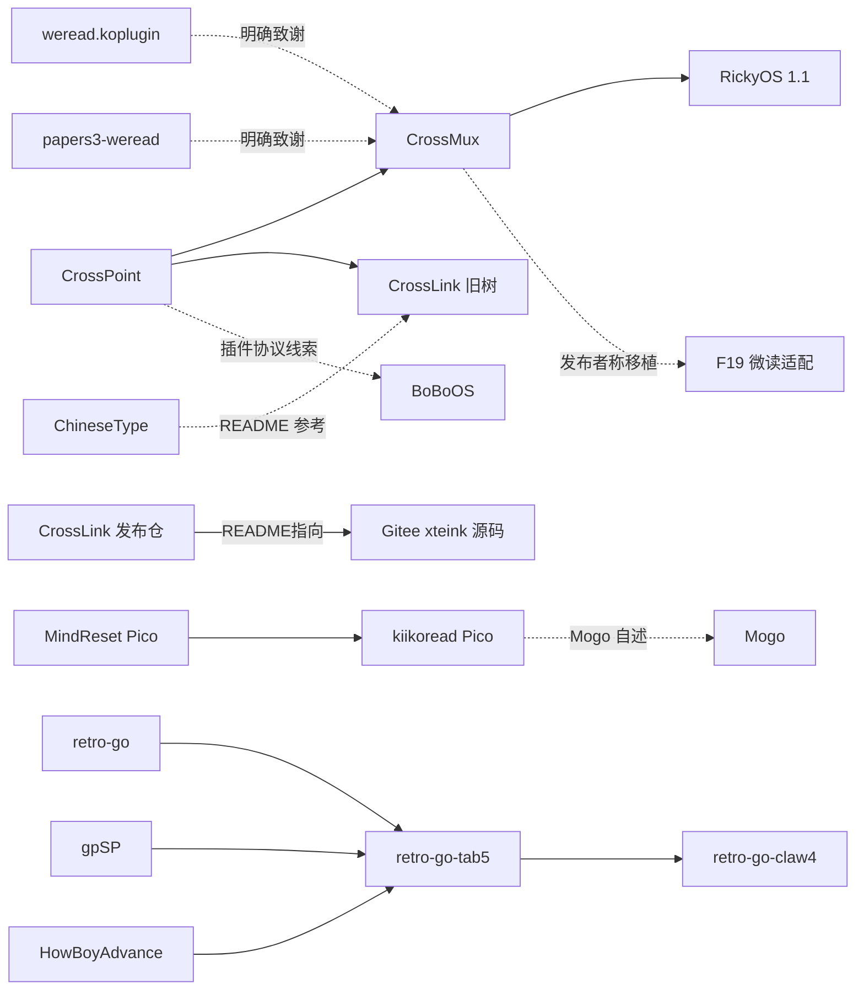

# 闭源固件追源与开源替代调研

查阅日期：2026-11-12。基线：`d09b79195e2dc57908e33219216048e529e082c6`。分支：`claude/codex-replan-lineage`。仅本地提交，不 push。

**结论：有依据可行，不能把“当前固件没给源码”直接等同“没有代码可以复用”。** 最重要的新发现是经 Gitee API 取到的 CrossLink 旧版源码，含坚果云／数据胶囊客户端和风眼主题；其次是 RickyOS 旧版应用源码、两个微读参考实现，以及独立 Claw4 游戏分叉和 GBA 动态重编译来源。其余不能确认的固件保留“不确定”，不凭名称、界面相似或同一芯片认定血缘。

- **CrossLink 真正源码仓已找到**：发布仓中文 README 指到 `daixinchun/xteink`。网页404，但 API 返回540项的完整树，取回8份源码并逐份核对 Git blob；坚果云浏览／下载／进度同步、数据胶囊和风眼主题都有实现。构建版本为20260424、X3/X4 C3目标，仍不是当前 Plus／Pixel 版本证明。[S26](SOURCES.md#s26)
- **RickyOS 要按版本拆开**：官网明确说 1.2.0 起不公开源码，但 1.1.x 仍公开；本次匿名取得了旧版应用、库和构建配置。[官网原文](https://rickyaistudio.com/licenses.html)：“1.1.x 及更早的版本以 MIT 许可公开源代码”。[S07](SOURCES.md#s07)
- **旧版和当前版仍须分开**：Gitee `crosslink` 是仅有三份文件的发布仓，真正代码在 S26；GitHub S05 是另一公开旧树，仍为 C3／CrossPoint 1.2.0。ChineseType 也明确说公开展示版缺少后续 TXT、图片等代码。这些都不能自动补全当前 Metalio／Pixel 功能。[S05](SOURCES.md#s05)、[S06](SOURCES.md#s06)
- **微读与游戏有实际可读的实现链**：`weread.koplugin`、`papers3-weread` 是 CrossMux 明确致谢的参考；`retro-go-tab5` 明确指出 retro-go、gpSP、HowBoyAdvance，另有真正带 Claw4 目标的 `retro-go-claw4`。F26 署名不同，尚不能认定它就是该固件源码。[S02](SOURCES.md#s02)、[S09～S15](SOURCES.md#s09)
- **不能假报找到源码**：ThingsOS 的同名作者仓库及全部三次历史提交只有说明、许可和图片；PageRest 留下了源码仓库地址，但当前匿名访问为 404；BoBo 开发文档提供了协议线索，未找到其固件代码。开哥仓库有口袋源码包和亮证合规包入口，不能外推其所有应用都已公开。

本次不按许可证筛掉 GPL、AGPL 或个人学习许可项目；不默认原厂。优先看功能闭环、错误恢复、内容兼容和交互证据，移植工作量只作同等体验下的参考。**没有运行任何固件，下面不是同机体验排名，也不是移植完成证明。**

## 验收表

| 编号 | 结论 | 证据 | 命令 |
| --- | --- | --- | --- |
| A1 自身源码 | 已逐项追查；31组覆盖任务涉及的39条原注册记录。已取得、只有旧版、只有部分材料、未找到分别列出 | T01～T31；[请求与源码清单](evidence.json) | C1、C2 |
| A2 开源来源 | 已区分代码核查、作者自述、协议线索与功能替代；跨站检索未命中不当作“绝无源码” | 下表、来源图、[检索记录](SEARCH.md) | C1、C2 |
| A3 功能组件 | 26组可定位来源；每组有固定提交、具体文件和行号，未把框架当成完整应用 | [SOURCES.md](SOURCES.md) | C2 |
| A4 置信度与新增价值 | 每组均有置信度；新增高价值来源与原已知来源分开 | T01～T31、“最有价值的增量” | C2、C3 |
| A5 范围与隐私 | 检查结果见 C4；产品代码0行，仅本任务目录文档及证据 | C4；[证据](evidence.json) | C3、C4 |
| A6 构建和测试 | 本任务书明确豁免；未运行主工程全量、ASan/UBSan、S31构建或 gcccheck，不报告为通过 | “验证与复现” | 不适用 |

## 怎么读证据

【实测】指本次匿名 GET、Git refs／树及本地检查的结果；【实现】指读取源码得到的事实；【文档】指作者或设备厂商的说法；【推断】指仍未证实的关系。源码可读不等于与注册表中的二进制对应。

“高”表示代码或明确出处支持这一判断；“中”表示作者自述或多条对应线索，尚无版本对应证据；“低／不确定”表示只找到功能相似的候选或没有来源线索。置信度评的是**血缘判断**，不是证明全网不存在源码。表中的“未找到”只覆盖 [SEARCH.md](SEARCH.md) 记载的匿名公开检索。

原 F 编号沿用 `registry-research-1`，不按本次线上排序重编。表中的 [注册说明](https://admin.metalio.world/xiaozhi/api/firmwares?page=1&limit=100&sourceType=all) 是作者公开提交的记录；必要短摘录及固定 F 编号保存在 [evidence.json](evidence.json)。本次接口多出一个测试条目，仍按任务指定的旧清单追查。

## 逐项结论

| 编号／固件；原记录 | 自身源码、公开原文与追查结果 | 来源、可复用代码和置信度 |
| --- | --- | --- |
| T01 CrossLink Pixel；F02/F10 | 当前 Pixel 对应版本未找到，但家族源码已取到：S26 有风眼主题、阅读器、云盘客户端；S05另有GitHub旧树。[注册说明](https://admin.metalio.world/xiaozhi/api/firmwares?page=1&limit=100&sourceType=all)称“像素风格主题固件” | 家族来源**高**：发布仓明确指向S26，S05团队列出风眼；当前4.3.0T版本对应**不确定**。S26可读主题／云盘，不据此认领当前联网元数据补全与Plus移植 |
| T02 Crosslink2；F08/F09 | **找到家族实际源码** S26；[Gitee发布仓README](https://gitee.com/api/v5/repos/daixinchun/crosslink/git/blobs/51556ad86b5b0e7249b74f9755a1b74cf21dd906)原文指向 `daixinchun/xteink`。已读坚果云、数据胶囊和同步代码；当前Metalio两版本未对应 | 来源仓身份**高**；当前4.2.9／1.2.10对应**不确定**。S26构建版本20260424、目标X3/X4 C3；S05及5个GitHub fork也未给出当前Metalio版本证据。不能继续称这些云盘功能只有闭源说明 |
| T03 Crossslink_2.0；F05 | 未找到周默转发适配的补丁；[注册说明](https://admin.metalio.world/xiaozhi/api/firmwares?page=1&limit=100&sourceType=all)原文点名“Whimco开发”。家族旧源码见 S05/S26 | **中偏低**：转述支持属于CrossLink系，公开源码能用于比较；仍不能证明周默的S3适配改动已公开 |
| T04 Mogo；F04 | 官网可读，未找到 Mogo 自身仓库或源码附件；[官网](https://mogo.mantake.shop)页脚原文：“Mogo 固件基于 kiikoread 开发”并链接 Pico 仓库 | **中**：作者明确指向 S03，S03 README 又承认源于 S21；可取实际书籍／章节／排版实现。Mogo 的新书架、手帐和锁屏增量仍未知；不能说等同 S04 |
| T05 PageRest；F18 | [官网](https://pagerest.gofree.kdns.fr)有“第三方组件许可与声明”，实际只覆盖 React、网页烧录等网站依赖；[设备厂商文档](https://dot.mindreset.tech/docs/read_0/start/pagerest)留下 `fengcheng01/read_pico_firmware`，本次 404，Git 退出128。换作者显示名地址也不可读 | **不确定**：同名仓库与 Pico 官方基础代码是线索，未证实来自 kiikoread；S03/S04/S21 只是功能替代来源。网站还明说“Metalio 版本仍需真机测试”，不能由版本号认定 Plus 已成熟 |
| T06 ThingOS；F11 | 找到同名作者 [flowflic/ThingsOS](https://github.com/flowflic/ThingsOS)，当前及三次历史只有说明、许可和图片，无应用源码。README 原文为“独立阅读系统”；[组件声明](https://thingsos.scholarcn.com/THIRD_PARTY_NOTICES.txt)公开 FreeType、zlib、stb_image、cJSON、TinyUSB、拼音词典和 Pico BSP 来源（具体上游文件见 [S25](SOURCES.md#s25)） | **中**：作者与品牌对应，但仓库说明主指 Pico，未对上 F11 Plus 版本。基础组件来源有作者声明；微读具体来源**不确定**，不能硬归到 CrossMux。功能替代用 S02/S14/S15，不把这些候选写成血缘 |
| T07 ModernClassicOS；F30 | GitHub/Gitee 名称、作者、主页及跨站检索未找到代码；[注册说明](https://admin.metalio.world/xiaozhi/api/firmwares?page=1&limit=100&sourceType=all)突出“复古转盘操作” | **低／不确定**：没有声称基于 Rockbox、ESP-ADF 或某 iPod 项目。可比较 S23 音频格式与定位、S18/S19 服务；转盘 UI、M4B 章节／索引和该固件自身续播逻辑仍未取得 |
| T08 lnkboot；F12 | 未找到代码；同时检索 `lnkboot` 与易混淆的 `Inkboot`。作者 `wenbos058` 同名 GitHub/Gitee 查询404，不能由此断定作者没有别的账号；[注册说明](https://admin.metalio.world/xiaozhi/api/firmwares?page=1&limit=100&sourceType=all)只称“多固件切换启动器” | **低／不确定**：S17 Launcher、S22 口袋是同类代码／材料候选；没有出处支持它与 Moji、M5Launcher 同源 |
| T09 布丁；F22 | `paouke` 同名 GitHub/Gitee 公开仓库列表均为空；未取得源码链接。[注册说明](https://admin.metalio.world/xiaozhi/api/firmwares?page=1&limit=100&sourceType=all)自称“轻量系统”，且明确短信发送仍在诊断 | **低／不确定**：S23 本地／网络音频、S18 录音、S19 系统界面是可用零件候选，不能猜它基于 Brookesia。完整后台播放、电话与阅读协同未取得实现 |
| T10 墨集 Moji；F15 | 自身代码未找到；[注册说明](https://admin.metalio.world/xiaozhi/api/firmwares?page=1&limit=100&sourceType=all)明确“Fork 自 Launcher项目”，但无作者、地址或提交 | “有 Launcher 上游”的自述**中**；“就是 bmorcelli/Launcher”**低**。S17 有成熟的固件安装／目录代码，可列候选，不能把通用名字当成已追到唯一来源 |
| T11 Eink4Boy；F24 | 自身代码未找到；[注册说明](https://admin.metalio.world/xiaozhi/api/firmwares?page=1&limit=100&sourceType=all)明确“不支持 GBC 专用游戏” | **低**：与 S12 Peanut-GB 的 DMG 限制相容，但不能排除 S09 的 gnuboy 被裁剪等实现。先按兼容、存档、声音、输入体验比较两者，不因 Peanut 小而默认它最佳 |
| T12 ardmos；F37 | 自身代码未找到；[注册说明](https://admin.metalio.world/xiaozhi/api/firmwares?page=1&limit=100&sourceType=all)明确是“Arduboy 游戏模拟器”，有独立版和 Moji 版 | **低／不确定**：S13 Ardens 有实际 AVR、声音、HEX/FX 装载源码，可作为替代；没证据说它是 ardmos 的核心。不能用“重新编译 Arduboy 游戏源码的库”替代任意游戏模拟功能 |
| T13 开哥录音机；F35 | 项目集、规范、作者相关链接及源码检索均未找到该应用实现；[注册说明](https://admin.metalio.world/xiaozhi/api/firmwares?page=1&limit=100&sourceType=all)称“支持锁屏录音” | **低／不确定**：口袋兼容自述不是代码继承关系。S18 录音帧服务可复用，S23 可比较回放；两者都不自动补上锁屏和后台录音的产品流程 |
| T14 开哥浏览器；F38/F41 | 未取得应用源码；[注册说明](https://admin.metalio.world/xiaozhi/api/firmwares?page=1&limit=100&sourceType=all)只有“网上冲浪”等短说明，没有 HTML／JS 兼容范围 | **不确定**：不能猜是 Chromium、LVGL 或某代理浏览器；未识别可信的浏览器引擎来源。本次只保留设计参照，S20 不是浏览器 |
| T15 开哥天气；F34/F42 | 未取得代码；[注册说明](https://admin.metalio.world/xiaozhi/api/firmwares?page=1&limit=100&sourceType=all)称“根据 IP 查询天气” | **不确定**：不知道调用哪个服务／SDK；不能因 Mogo 用和风就认定它相同。S22 只提供接入规范，不能算天气客户端实现 |
| T16 开哥五子棋；F29/F43 | 未取得代码；[注册说明](https://admin.metalio.world/xiaozhi/api/firmwares?page=1&limit=100&sourceType=all)称“人机和双人对战” | **低**：S02 的 GomokuBoard／GomokuAI／GameActivity 有实际规则和搜索，是功能替代候选；没有复用关系证据，不能将相同棋盘 UI 当作复制证明 |
| T17 开哥贪吃蛇；F36 | 项目集树与中英文／跨站检索未取得该应用源码；[注册说明](https://admin.metalio.world/xiaozhi/api/firmwares?page=1&limit=100&sourceType=all)原文“小游戏” | **不确定**：未识别专用核心，不指定某个随手找到的 Snake 教程为上游；保留设计参照，不宣称已有与其体验相当的代码 |
| T18 开哥记事本；F32/F49 | 未取得代码；[注册说明](https://admin.metalio.world/xiaozhi/api/firmwares?page=1&limit=100&sourceType=all)明确“txt记事本” | **低**：S20 的 textarea 可承担编辑输入，S08 有带实现的笔记系统参照；保存、中文输入和文件管理不是文本控件自带。没有证据认定其用了这些来源 |
| T19 开哥点读机；F45 | 未取得代码；[注册说明](https://admin.metalio.world/xiaozhi/api/firmwares?page=1&limit=100&sourceType=all)标为“开发示范” | **不确定**：没给 OCR、点字坐标或内容包机制；不能把“点读”推成某个 OCR/TTS 库。仅保留设计参照 |
| T20 开哥亮证；F40 | [项目集](https://github.com/Changkai9888/CloudZao-Projects/tree/90150a24d1ed4ebde7389ddfd30e9e5e7b1235b8/%E4%BA%AE%E8%AF%81)有 public-compliance.zip；[注册说明](https://admin.metalio.world/xiaozhi/api/firmwares?page=1&limit=100&sourceType=all)明确公开“驱动源码、重新链接材料” | 驱动材料入口**高**；完整亮证应用是否包含其中**不确定**，本次没有下载整包。S20 有二维码显示实现，但不包含凭证核销业务。不能从 LGPL 驱动交付反推整个应用开源 |
| T21 开哥黑猩猩测试；F27 | 未取得代码；[注册说明](https://admin.metalio.world/xiaozhi/api/firmwares?page=1&limit=100&sourceType=all)自身注明介绍为“艺术化处理” | **不确定**：数字记忆玩法不识别具体引擎／来源；不认定来自 Human Benchmark，不将小游戏说明当成学习效果证据 |
| T22 开哥森林里的朋友；F28/F51 | 未取得代码或关卡资源源码；[注册说明](https://admin.metalio.world/xiaozhi/api/firmwares?page=1&limit=100&sourceType=all)分类“知识通关，兴趣冒险，电子宠物” | **不确定**：没有证据对应某个宠物引擎或课程。口袋只是兼容运行入口，不能用其它 pet demo 当成这款应用的完整开源替代 |
| T23 BoBoOS；F23/F25 | 官网及[开发文档](https://bobo.sh.creativone.cn/developer/docs)可读，未找到固件仓库／SDK 下载。原文给出 `/.crosspoint/plugins/<应用 ID>/`、`manifest.json`、`device.json`、`plugin.js`，另有 `app.json`、MCP 和 ELF 包 | **中（协议线索）**：与 S01 的 `docs/sd-plugins.md:9–29` 精确对应，不只是外观相似；具体是 CrossPoint、CrossMux 还是再衍生仍**不确定**。其新增原生应用／商店／AI 后端代码未取得，不能以协议同源替代源码同源 |
| T24 RickyOS；F06 | **找到旧版源码** S07；官网明确区分 1.1.x 开源与 1.2 起不公开。公开树与 Release 仍在1.1线，不能冒充 F06 的 v1.2.14 | **高**：README:4 明确基于 S02；旧版主页、阅读库、待机源码可读。当前狗狗伴读、竖排等是否都在旧版有实现需逐功能核对，不能把官网1.2图片套给1.1 |
| T25 小智畅享版；F31 | 未取得这个改版的代码或可确认作者账号；不反查已脱敏数字昵称。[注册说明](https://admin.metalio.world/xiaozhi/api/firmwares?page=1&limit=100&sourceType=all)自称“小智固件”，主打日历／壁纸／U盘 | 小智家族线索**中偏低**；直接基底是 S24 `xiaozhi-esp32` 还是 Metalio 改版**不确定**。S24 有对话／工具实现，S20 有日历控件；均不能证明它的壁纸与 USB 增量已公开 |
| T26 微信读书适配版；F19 | 自身移植代码未找到；[注册说明](https://admin.metalio.world/xiaozhi/api/firmwares?page=1&limit=100&sourceType=all)明确“移植自 CrossMux（原作者 0x1abin）”，另称以官方固件为底 | **中**：上游与功能路径明确，S02/S16 能定位微读与 OPDS，S14/S15 可再向上追；尚未核对作者的适配提交和对应固件 |
| T27 Metalio-WhiteAI；F20 | **已有公开实现** S08，前次报告已经找到；不应继续归成无源码，也不计为本次新增。README 原文：“不编译也不链接 LVGL” | **高（代码可得）**；当前源码与列表旧 v2.0.51 仍未对应。可以比较 AI 状态、笔记和录音的代码，不能拿它支持“所有固件都来自 LVGL”的猜测 |
| T28 CrossMux 倾斜版；F14 | 未找到 Eric 的增强补丁／fork；[注册说明](https://admin.metalio.world/xiaozhi/api/firmwares?page=1&limit=100&sourceType=all)明确承认 CrossPoint 阅读体验与 CrossMux 名称 | **中**：CrossMux→CrossPoint 的上游链为高置信，Eric 的倾斜检测／去抖／方向映射未知。S02 可复用阅读器，不宣称包含这份增强 |
| T29 CrossPoint 非官方 Plus；F39 | 自用移植改动未找到；[注册说明](https://admin.metalio.world/xiaozhi/api/firmwares?page=1&limit=100&sourceType=all)作者自称“纯crosspoint”，还说明无支持、网页刷写未测 | **中**：S01 上游可读；Plus 移植本身和稳定性**不确定**。不要把上游支持 S3 Metalio E-Ink4 当成这份 S31 端口已公开或成熟 |
| T30 Claw4 GBA版；F26 | 署名 zuochen.luo 的自身修改未找到；[注册说明](https://admin.metalio.world/xiaozhi/api/firmwares?page=1&limit=100&sourceType=all)只称“优化后的GBA 模拟器”。另找到 S10 的独立开源 Claw4 版本 | F26→S10 血缘**低／未证实**；S10 自身是 Claw4 适配的证据**高**，可直接纳入体验候选。S09/S11 提供 gpSP 和 JIT 实现链；P4 的彩屏性能不外推 Plus |
| T31 retro-go-gba；F33 | **已有源码链接** S09，前次报告已有；当前完整核到 GBA／gnuboy 代码与上游说明，不能继续按闭源排除 | **高（发布者直接链接）**：S09 README:295–298 指向 retro-go／gpSP／HowBoyAdvance。另有 S10 Claw4 分叉；仍无二进制一致性测试。此前“GPL全部排除”的筛选不适用于本任务 |

## 已有证据支持的来源图

实线表示代码／作者明说的关系；虚线只表示参考、协议线索或未证实的候选。注册表当前固件与任何树之间都没有二进制对应验证。



## 最有价值的增量

下面优先级按**有用功能及体验链的覆盖证据**，不是按移植便宜、许可证宽松或星数；均为调研建议，未更改产品决定。

| 次序 | 新找到或新补实的来源 | 为什么值得先比较；边界 |
| --- | --- | --- |
| 1 | [CrossLink Gitee源码仓](https://gitee.com/daixinchun/xteink)，S26 | 本次沿发布仓中文README追到的关键增量：坚果云浏览／下载／阅读进度、数据胶囊和风眼主题都有代码。比只有组件名更接近云盘传书与阅读交互；仍是旧C3版，当前Plus／Pixel专属增量未对应，不虚构体验胜出 |
| 2 | [RickyOS 1.1 源码](https://github.com/chinoryunqin/RickyOS)，S07 | 从此前只知官网推进到可读的定制主页、书库、待机、阅读与微读。对评估成套交互最直接；不是官网1.2体验的源码。其 README 也保留字体内存、刷新、功耗尚需验收的限制 |
| 3 | [weread.koplugin](https://github.com/finlater/weread.koplugin)、[papers3-weread](https://github.com/nasonliu/papers3-weread)，S14/S15 | 沿 CrossMux 致谢追到实际登录、缓存、续读、进度与批注相关实现，能比较完整阅读闭环。KOReader 插件不是 MCU 整机固件；公开版并不具备作者闭源版的全部互动，CrossMux 固定版本还不上传本地阅读时长 |
| 4 | [retro-go-claw4](https://github.com/andjiang0083/retro-go-claw4)、[HowBoyAdvance](https://github.com/Irak4t0n/HowBoyAdvance)，S10/S11 | 找到实际 Claw4 配置、触摸布局、存档与 GBA 运行链，而非只知道“有一个 GBA 核心”。应比较兼容、声音、存档和输入；不是 F26 身份证明，不保证 Plus 上满速 |
| 5 | [Ardens](https://github.com/tiberiusbrown/Ardens)，S13 | 对 ardmos 的需求，真正有既有游戏加载、AVR 执行、FX、显示和声音的候选比游戏源码编译库更对题；当前没有 S31 资源／速度证据，不能直接选为成品最佳 |
| 6 | [ESP32-audioI2S](https://github.com/schreibfaul1/ESP32-audioI2S)，S23 | 有本地文件、多音频格式、M4A 容器和时间定位，比底层 I2S 更接近 ModernClassicOS／布丁的功能；音乐库、章节和断点产品体验仍要另核。ESP-ADF、Brookesia 是框架补充，不能凭名气排在完整应用前面 |

**复查后应重新纳入的已知来源**：ChineseType、CrossLink 旧树、retro-go／gpSP、kiikoread 各许可范围都保留候选，不再因前次许可筛选直接淘汰。它们不是本次新发现；其中 ChineseType 的后续代码缺失也不能因允许 AGPL 就自动消失。WhiteAI、FreeInk OPDS、Peanut-GB 亦是此前已知，只补定位与边界。

**真正还缺的实现**：当前 Pixel／CrossLink 的专属增量、PageRest／Mogo 自身新界面、ThingOS 的录音上传 ima、BoBo 原生应用 SDK 和服务器、ModernClassicOS 的 M4B 章节／索引，以及开哥浏览器与儿童内容等，没有取得可核代码。找到库不表示这些功能已经完成。

## 没做到的

- 没有证明“某固件在任何地方都没有源码”。匿名检索覆盖 GitHub、Gitee、GitLab、作者站点、公开发布材料，以及任务列出的中文社区索引；登录后内容、未索引帖子、私有群和私有仓库不在可核范围。失败、限流和同名误命中见 SEARCH.md。
- 没有下载固件、ROM、ELF、WASM 或游戏文件；新仓库用过滤 blob 且不检出的克隆，只读取树和选定文本。开哥整包未下载：范围请求返回501，无法在不取得包内二进制的情况下继续，未猜包内文件。已取得的源码包入口单独列出。
- 没有运行第三方源码、模拟器、登录阅读服务、调用付费接口或比较真实设备体验；不承诺刷新、续航、准确进度或游戏性能。没有把兼容 API 或相似界面当作二进制血缘证明。
- 主工程全量测试结果原话：**未运行（本任务书明确豁免）**。内存检查：**未运行**。S31：**未编译**。`gcccheck.py`：**未运行，没有 C/C++ 改动**。本任务无产品修复，不适用撤回修复的反向测试。

## 和设计不一致的

- 【实现】Launcher、口袋／Moji／lnkboot 的整机镜像切换，与本项目 R-008 的应用安装不是同一机制；BoBo 的 ELF、MCP、网页插件也不能混叫成一种应用。本任务不更改 R-037、D-111 或应用框架契约。
- 【实现／文档】CrossPoint 系、kiikoread、WhiteAI 和 Brookesia 的绘图／服务／运行时不同；不能为了“复用”统一改造成一个未经选择的新框架。以后若采用，用户动作与 AI 仍须走同一原子能力，按成员提供数据和页面快照；本次不添加服务旁路。
- 【实现】微读候选的账号状态、缓存、进度上报和传输边界不同于 ink 的成员／中枢契约。这里只识别代码来源，不将上游“有功能”写成本项目已验证或可直接合入。

## 改过的已有测试

无。没有修改断言、预算或测试期望。

## 要用户定的

本任务没有需要先拍板才能继续的事项。后续由主会话依据并行阅读／系统应用／媒体调研，决定逐项复用哪个完整体验和哪些代码；本报告未替用户选基底、取消功能或批准新的运行时。

## 顺手发现

- 任务书所称 `registry-research-1/source-evidence.json` 实际是 `source-audit.json`；按真实文件读取，未修改旧报告。
- 本次注册接口返回53条，旧快照52条；新增的是测试条目，不扩大本任务。WhiteAI 与 retro-go-gba 本来已有源码，不能按题目列举就重新认定它们闭源。
- PageRest 官方文档保留了失效源码入口；ThingsOS 有 Apache 声明却没有应用代码；RickyOS README 仍写私有，但匿名源码实际可读。说明、许可、链接、可取代码、具体发布版本必须分别核实。
- ESP-ADF 当前所查已是 v3.0，不能套旧版路径；CrossMux 的 OPDS 解析器已在 FreeInk SDK，不在应用仓旧目录。均已按实际文件定位。

## 新增的机制

无。产品代码、配置、线程、状态机、持久文件格式、构建与测试改动均为0；本目录 JSON 仅是调研证据清单。

## 要改的文档

- `docs/tasks/picks-status.md`、`docs/tasks/backlog.md`：主会话复核后补 CrossLink Gitee 的坚果云／数据胶囊实际来源、RickyOS 旧版、微读参考链、游戏来源与仍缺的当前增量；旧的“仅因 GPL／AGPL 排除”不能继续作为这次重排依据。
- 并行 `replan-reader`、`replan-media`、`replan-arch`：交叉使用 S07、S10～S15、S17、S23 和 BoBo 协议证据，避免重复克隆或把旧源码当当前固件。
- 需求、想法、决策、UI 依赖与生成能力表均不修改；调研来源不自动升级为需求或已实现能力。

## 验证与复现

### C1 公开追查

请求地址、HTTP 状态、文本哈希、所查 Git refs、树与逐固件 F 对应在 [evidence.json](evidence.json)；中英文关键词及跨站边界在 [SEARCH.md](SEARCH.md)。只做匿名读取，不使用密钥或登录。重查注册表仍使用：

```bash
taskpolicy -c utility python3 - <<'PY'
import json, urllib.request
url = 'https://admin.metalio.world/xiaozhi/api/firmwares?page=1&limit=100&sourceType=all'
with urllib.request.urlopen(url, timeout=30) as response:
    data = json.load(response)
assert data['code'] == 0
print('public firmware count:', data['data']['total'])
PY
```

网页会变，数量与404／限流都是本次观察，不声称未来恒定。GitHub API 限流后未认证重试，改用标准公开 Git 元数据和固定 raw 文本；没有绕过登录。

### C2 固定源码复核

下列命令只读取已核清单中的固定文本，不获取发布附件；网络失败应报告失败，不能当作哈希通过。【实测】104份GitHub固定raw文本再次取回，哈希与行数全部相符；8份Gitee源码由固定Git blob API再次读取，解码哈希与固定树全部相符。共112份文本，76份还逐一匹配所读Git树的blob SHA-1；其余按固定提交／标签和文本哈希核对。结果记录在 evidence.json。

```bash
taskpolicy -c utility python3 - <<'PY'
import base64, hashlib, json, urllib.request
from pathlib import Path
items = json.loads(Path('docs/tasks/replan-lineage/evidence.json').read_text())['source_files']
for item in items:
    url = item.get('blob_api_url') or item['raw_url']
    with urllib.request.urlopen(url, timeout=30) as response:
        payload = response.read(5 * 1024 * 1024 + 1)
    raw = base64.b64decode(json.loads(payload)['content']) if 'blob_api_url' in item else payload
    assert len(raw) == item['bytes'], item['path']
    assert hashlib.sha256(raw).hexdigest() == item['sha256'], item['path']
    assert len(raw.decode('utf-8').splitlines()) == item['lines'], item['path']
print('fixed source text hashes matched:', len(items))
PY
```

### C3 文档检查

```bash
taskpolicy -c utility python3 -m json.tool docs/tasks/replan-lineage/evidence.json >/dev/null
git diff --check d09b79195e2dc57908e33219216048e529e082c6
```

另核对：31个 T 编号无重漏、39个 F 编号覆盖、26个 S 组均有文件行锚点；本地链接与锚点存在，所有固定源码链接对应本次取得的文本且行号有效，单文件小于5MB。最终检查数量和退出状态记在 evidence.json。

### C4 范围、隐私与提交

```bash
git diff --stat d09b79195e2dc57908e33219216048e529e082c6..HEAD
git diff --name-only d09b79195e2dc57908e33219216048e529e082c6..HEAD
git diff d09b79195e2dc57908e33219216048e529e082c6..HEAD | grep -nE '/Us''ers/|/private/''tmp|[0-9A-Fa-f]{2}(:[0-9A-Fa-f]{2}){5}'
```

【实测】文档本地链接18处、固定源码文件／行号链接124处全部有效；JSON和差异空白检查退出0。112份固定源码文本再次读取检查均相符；13个新过滤克隆的Git包中blob对象合计0。隐私与提交范围按下列收尾记录核对。

## 里程碑

- M0：核对分支、基线与干净工作树，建立报告；本地提交 `0c2379ee`。
- M1：记录已核的旧版、来源链与源码缺口；本地提交 `95b4a196`。
- M2：31组／39条记录、26组来源、112份文本与124处行号证据整理完成；CrossLink新来源已补入并复核。
