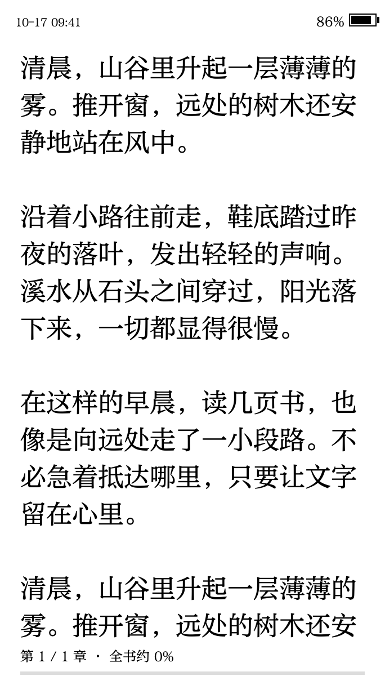
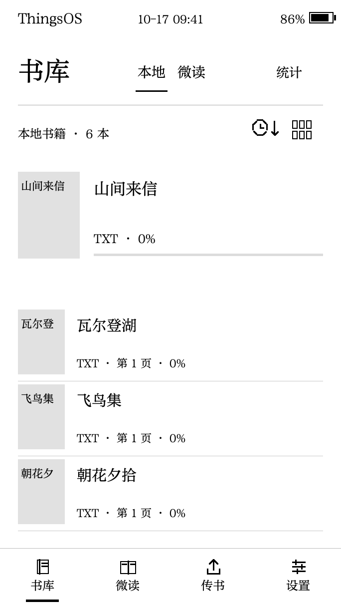
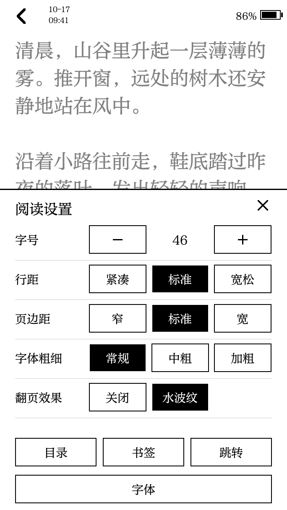
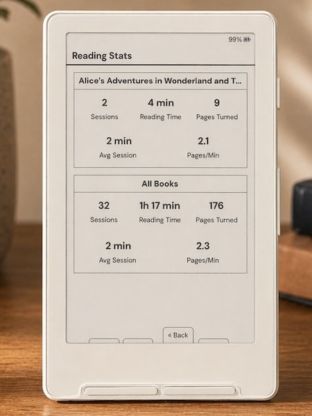
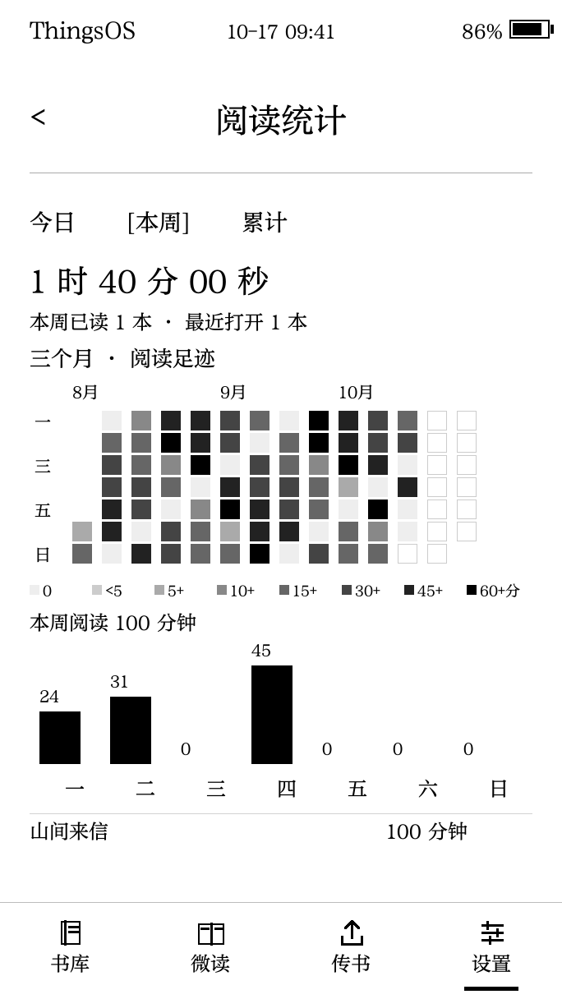
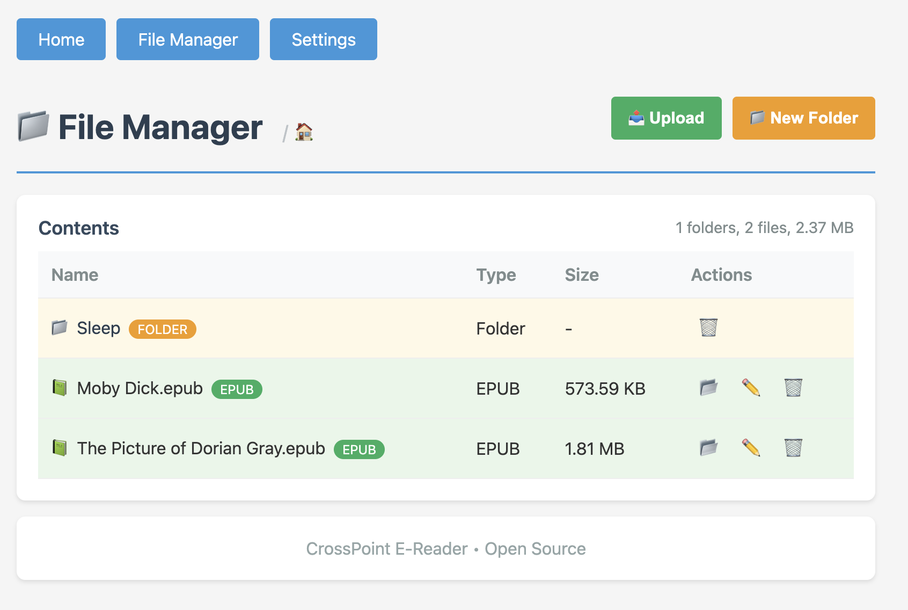

# 界面并排参照

**以下全部是上游已有图片，不是本次运行截图。** 本次没有成功启动完整模拟器；原因见 [BUILD.md](BUILD.md)。ThingsOS 图是作者注明的固件渲染预览，使用示例数据，目标为 Read Pico；CrossInk 为文档中的实物照片或历史网页截图。图片不统一版本、设备、书籍与字号，只用于看界面安排，不能比较翻页速度、残影、实际触摸命中或中文排版正确率。

## 阅读页

| CrossInk：西文阅读照片 | ThingsOS：中文阅读预览 |
| --- | --- |
|  |  |
| 字体、插图和页脚同时可见；照片不是统一条件的字形测量。 | 正文占据主要区域，章进度留底部；这张单页不能证明禁则或表格支持。 |

## 书库与阅读设置

| ThingsOS：书库预览 | ThingsOS：阅读设置预览 |
| --- | --- |
|  |  |
| 本地、微读、统计放在同一入口；列表行里可见格式和进度。 | 正文上叠加设置面板，字号、行距、边距与目录等入口集中。 |

## 统计

| CrossInk：统计照片 | ThingsOS：统计预览 |
| --- | --- |
|  |  |
| 本书与全部图书分区，指标直接显示。 | 日历热力图和时长趋势，适合回顾阅读习惯；数据是示例。 |

## 传书

这张上游历史截图显示目录、文件大小、上传与管理入口。CrossInk 和 CrossMux 仓库中的这张文件图 SHA-256 相同，不能算两个项目独立截图，更不能当成当前 `FilesPage.html` 已运行。kiikoread 改版的目录生成和批量文件操作以实际源码、离线函数检查为准，本次未取得其运行画面。

逐图固定来源、大小、哈希及性质见 [图片清单](reference-images/manifest.json)。图片原样复制，单张小于 300,000 字节，没有用重绘或生成图补截图。版权与许可见 [图片说明](reference-images/README.md)。
