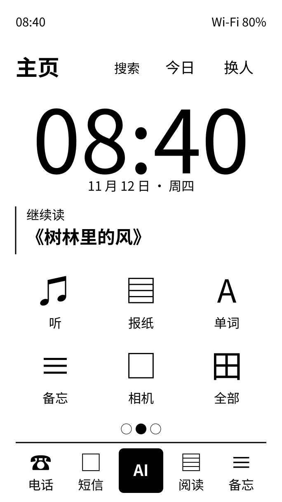
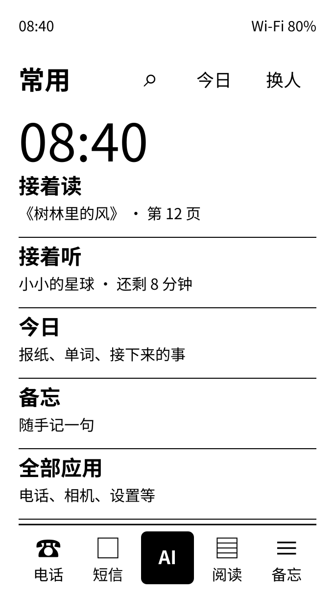
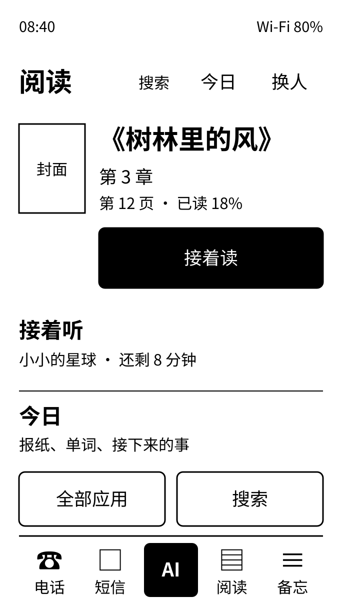
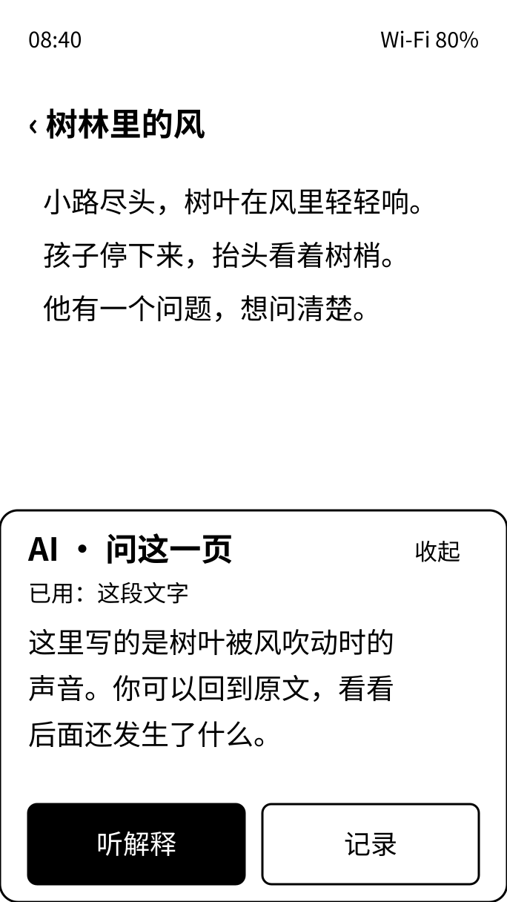

# 外壳建议：先统一控件，再重排信息

**有依据可行**：成熟手机系统的控件语义、墨水屏产品的内容组织，可以用于自研外壳。成立条件是保留大字、至少约 9 mm 的命中范围、分页与原子能力，并按墨水屏去掉动画和持续装饰刷新。**不能承诺照图就会更快、更省电**；这些需要下一任务的模拟器和真屏证据。

主基准建议用 **iOS HIG / Material 3 的控件与导航语义**，版式参考 reMarkable、Light 的排版层次，主页参考 BOOX 的网格与内容入口。这里不是另造手势或控件。没有一套已核查的现成系统同时覆盖本项目的家人隔离、AI 原子能力和 Plus 约束；不能为了“整套搬”把这些要求删掉。全部竞品、官方资料和范围限制见 [SOURCES.md](SOURCES.md)，全部源码接点见 [REUSE.md](REUSE.md)。

全文数值均为 **【估算／建议】**，适用于默认成人字号的 **684×1216** 面板，不是竞品原始像素、实机可读性结论或已经确认的需求。只写本任务范围；输入法、通知列表、控制中心和设置的功能设计交给 frameworks-research-1，双方共用这里待确认的令牌和容器语义。

## 1. 设计语言

### 1.1 采用哪些成熟做法

| 对象 | 推荐做法与来源 | 迁到黑白墨水屏后的具体规则 |
| --- | --- | --- |
| 字体与层次 | HIG Typography、reMarkable 的内容主导排版；S05/S11 | 白底黑字；正文 Regular，行标题 Medium，页面标题 Bold；不用细字、浅灰字区分主次。每屏主要层级最多三档，系统字体和现有字重不换；长内容翻页，不缩字塞下 |
| 分组 | reMarkable 文件层级、Light 工具排版；S05/S08 | 先用 38/58 px 空白、标题和对齐；同组行只画 2 px 分隔线，不给每行套卡片。独立的可编辑字段、模态边界才用完整 3 px 轮廓；不把所有静态表面都画框 |
| 按钮 | HIG/M3 的主要、次要、文字动作；S11/S12 | 主要：黑底白字、圆角 12、高 120；次要：白底黑字、3 px 边、高 108；文字/图标动作：无外框、命中区至少 108×108。每个任务区域一个主要动作；不可逆动作写清“删除这份备忘”等动词，不能仅靠颜色示警 |
| 输入框 | HIG Text fields、M3 字段语义；S11/S12 | 短字段同宽、单行高 108、内边距 19、圆角 12；标签在上方 31/43，间隔 10，不只靠输入后消失的占位字。焦点把同一轮廓从 3 加到 4 px，不再叠套一圈。多行初始 3 行，默认高 `3×62+2×19=224`；长文用编辑页。密码仍只给人输入 |
| 开关 | M3 开关的二值语义；S12 | 行高至少 108；右侧轨道 88×48、圆钮 40；开为黑轨白钮且在右，关为白轨黑边且在左。状态同时用“开/关”或明确行文，不能只看灰度。开关命中框 108×108，图形可小于命中区 |
| 滑杆 | 标准滑杆的值、轨道、滑块；S11/S12 | 整行高至少 108；标签 31/43，轨道 6、滑块直径 54，活动段黑色；命中高度 108。松手确认位置，不做跟手动画；需要细调时同一行两端用 108×108 的减/加，不能放四五个小圆按钮。设置值在确认位置后提交，不为拖动反复刷写存储 |
| 分段选择 | M3/HIG 的互斥选择语义；S11/S12 | 整组高 108、圆角 12、只一圈 3 px 外框；选中段黑底白字，其余无各自外框。通常 2–3 段，默认文字 36；每段宽至少 108。更多选项进入列表，保留全部选项，不横向挤成小字 |
| 卡片 | Kobo/BOOX 的真实内容对象；S02/S04 | 一张只承载一件内容，标题 43 或 53，摘要 31/43；优先无边框，必要时用一圈 3 px、圆角 16、内边距 24。不把正常状态、数量和空值全做成卡片；书封面与图像仍可灰阶 |
| 页码与分页 | 阅读器的稳定页位置、Pebble 分页信息；S01/S04/S09 | 主屏三点只作指示，保持现行不能点的语义，直径 12，中心距 38，选中黑、其余空心；不伸缩动画。应用用“上一页 1/3 下一页”，两端各 108×108，不把 12 px 小点当点击目标 |
| 图标 | 同一图标系统，标准熟悉符号；S09/S11 | 保留现有线形图标和 34/43/53/77/106 尺度；默认 3 px 笔画，不给每个图标额外加圆。选中可用现有实心版本；图形与命中区分开。D-109 的 AI 编织立方体不更换 |
| 空状态 | HIG 少打断、Kobo 内容入口；S04/S11 | 没有通知就不画通知区；没有进行任务就不画活动条；空书库留一行“添加书籍”入口。确实打开空列表时保留标题、一句事实和可做的动作。搜索无结果写“没有找到，换个词试试”，加载/失败不能冒充空内容 |
| 按下反馈 | 保留 D-31，用结果反馈；S09/S11 作一般依据 | 本地操作直接变值或到目标页，不额外反色再反回来；耗时动作仅让被点控件进入“正在……”状态。没有涟漪、跳动、加载转圈、呼吸或频闪光标的新机制。不把没有完成的动作先写成成功 |

建议是“减少框的数量”，不是单纯把所有线变细。基线 `theme.c:141–153` 会自动给外层 `INK_SURFACE_STATIC` 画框，必须在后续任务明确静态表面与交互边界的画法；否则只改 `INK_STROKE`，粗框仍会遍布全系统。【实现】代码证据见 REUSE。

### 1.2 字号保留，触控和形状统一

本机按任务提供的 297 dpi 估算，`9 mm×297/25.4=105.24 px`，向上取整至少 106；建议统一 **108**，约 9.24 mm。现有 101 约 8.64 mm；这是几何估算，不是触摸精度测试。图标可以只有 43 px，外面的点击范围仍须达到 108。

基线 [ui_theme.h](../../../system/ui/ink/ui_theme.h) 的建议差异如下。**本任务一项都没有修改。**

| 令牌或使用规则 | 现值 → 建议值 | 原因 |
| --- | --- | --- |
| `INK_CANVAS_W/H` | 684/1216 → 保留 | 固定面板，不随控件比例改 |
| `INK_FONT_*`、`INK_LINE_*` | 状态 29/38、注记 31/43、列表 36/53、正文 38/62、小标题 43/58、标题 53/72、大标题 72/86、数字 106/120、时钟 211/223 → **全部保留** | 用户已经看过放大版；不以“简洁”为由把字缩回去。阅读正文 44、阅读边距 58 也保留 |
| `INK_STATUS_BAR` | 62 → 108 | 本方案让整条状态栏可点，预留完整 9 mm；若保留视觉高 62，应另提供至少 108 高的明确入口，不能与下面按钮的命中区重叠。推荐 108，不暗中叠透明热区 |
| `INK_CONTROL`、`INK_FIELD_HEIGHT` | 101 → 108 | 普通按钮和单行输入统一物理尺寸 |
| `INK_PRIMARY` | 125 → 120 | 与 108 普通按钮形成一档主要动作；仍大于 9 mm |
| `INK_ROW_DOUBLE` | 134 → 144 | 默认两行 `53+43+2×24=144`；放大后按实测文本行高增长 |
| `INK_FIELD_RADIUS`、`INK_RADIUS_KEY` | 29 → 12 | 输入框与小按钮同一圆角，不再万物胶囊；键盘不在本任务修改范围，键盘专有令牌由并行任务处理 |
| `INK_FIELD_PAD`、`INK_FIELD_LABEL_GAP`、`INK_FIELD_LINES` | 19 / 10 / 3 → 保留 | 输入用途不同，但字号、横向对齐、内边距一致；多行高按实际行高算 |
| `INK_FIELD_CLEAR` | 106 → 108 | 清除按钮命中区与普通按钮一致 |
| `INK_FIELD_ICON`、`INK_FIELD_SEARCH_ICON`、字段字号/行高 | 34 / 53、38/62、31/43 → 保留 | 不重做图标、字体体系 |
| `INK_FIELD_STROKE`、`INK_FIELD_FOCUS_GAP` | 3 / 5 → 3 / 0 | 同一路径加粗焦点，避免双框；焦点宽建议单独用命名常量 4 |
| `INK_SEGMENT`、`INK_SLIDER` | 115 → 108 | 统一普通控件基准；文字放大时整体增高，不能硬裁在 108 |
| `INK_DOCK` | 149 → 144 | 53 px 图标、31/43 标签及留白能放下，整个单元至少 108 高 |
| `INK_ICON_*` | 34/43/53/77/106 → 保留 | 固定视觉语言，不添加另一套图标 |
| `INK_CIRCLE_*` | 数值先保留；取消默认圆底的使用 | 它们不再是所有图标的容器；仍使用圆形的可点击控件外部命中至少 108。77 px 装饰圆不能直接当按钮 |
| `INK_RADIUS_CARD/PANEL` | 48 / 67 → 16 / 24 | 卡片和面板仍有区分，减少大圆角造成的内容挤压 |
| `INK_MARGIN`、`INK_READING_MARGIN`、全部间距/块间距 | 38 / 58；5/10/14/19/29/38/58/77/115 → 保留 | 不是全局重排间距刻度；取已有层级，组内约 19、组间 38、章节间 58 |
| `INK_STROKE` | 3 → 保留 | 完整交互边界仍清楚；分组分隔线另建议命名常量 2，不靠减少字号和全局极细线换密度 |
| `INK_KEY`、`INK_DIGIT`、所有 `INK_KB_*` | 保留本任务基线值 | 输入法由 frameworks-research-1 统筹，不能这里又定义一套按键 |

若采用，2 px 分隔线、4 px 焦点、108 px 命中范围、24 px 卡片内边距等应进入集中主题常量，不能散在页面。这些是未来样式常量建议，不新增持久设置或主题选择框架。

所有矩形坐标都是默认字号的排版标尺。孩子 110%、成人设置 90%–120% 与既有 `ink_ui_text_height`/行高计算保留，字体和关联控件、间距按项目现行规则协调放大；放不下时减少本页行数、翻页，绝不缩字或裁按钮。键盘接入和中英长标签需要后续逐状态截图核查，本次没有声称 120% 的全页布局已经验证。

## 2. 主屏、今日、全部应用、Dock：三种方案

**推荐 A。** 它保留大时钟和熟悉的通信/AI 入口，同时让网格摆得规整、内容确实能接着做。B 更适合愿意靠字找功能的大人；C 对阅读目标最直接，但电话、日常工具的可发现性较弱。评判来自结构与目标适配，**没有做家庭用户测试或性能排名**；不以移植工作量、许可或组件数量决定优劣。

| 方案 | 成熟参考与截图出处 | 本项目结构 | 对这家人的好处 | 代价与缺点 |
| --- | --- | --- | --- | --- |
| A 三屏网格，保留大时钟 | [BOOX 官方图](https://booxsupport.zendesk.com/hc/article_attachments/10725493990676)，`work/refs/boox-tab-home.jpg`；S02；手机式固定网格与 Dock | 今日／主页／全部三屏不变；主页 211 大钟、一条真实续读、3×2 常用入口；全部按用途分组并提供搜索；固定五格 Dock。图标不再套圆 | 老人、孩子可认位置与图标；大时钟符合 D-106；打开书、电话、短信、AI 都是一个动作 | 从 8 个常用入口改为 6 个，其余仍在全部；比列表占空间；三个横向屏仍需理解，今日与全部必须有文字入口 |
| B 一屏常用列表 | [Mudita 产品照片](https://mudita.com/products/phones/mudita-kompakt/)，`work/refs/mudita-kompakt-home.jpg` 是“大钟＋少入口”的参考；列表结构来自 [Light Toolbox](https://support.thelightphone.com/hc/en-us/articles/360039578512-Toolbox-Menu)与 MuditaOS 菜单代码，**不是声称 Kompakt 原样就是这张列表** | 106 时钟；接着读、接着听、今日、备忘、全部应用五行；今日与全部点进去，不再左右三屏；Dock 保留 | 中文短语直接说明用途，点击区宽；常用行位置固定，大字不拥挤 | 孩子和不熟识字的老人靠词辨认；功能多会有较多分页；改了 D-60 和 D-106，须重选 |
| C 阅读内容优先 | [Kobo 官方主页及截图出处](https://help.kobo.com/hc/en-us/articles/360017640133-Kobo-eReader-Home-screen)、Kindle 最近内容与书库、reMarkable My files；S01/S04/S05 | 主体为书名、进度和接着读；下面接着听、今日，再到全部应用/搜索；不放第二个巨型时钟；Dock 保留 | 拿起来就接续内容；5–6 岁孩子可凭封面定位；成人读听路径短 | 把综合家庭手机偏向阅读器；工具通常多一步；空书库需要一个真实导入入口，不能又变成大空卡。改了 D-106，须重选 |

三份**本项目原创结构示意**，不是竞品截图或已经完成的产品页面：

| A 推荐 | B 列表 | C 阅读 |
| --- | --- | --- |
|  |  |  |

图中图标仅为占位符号，最终用现有图标资产，包括 D-109 AI 图标；不能把示意字符当成已定的新图标设计。

### 2.1 A 的默认坐标与命中范围

坐标为 `(x,y,w,h)`，左上为原点；左右内容边界 38 和 646，内容宽 608。

| 区域 | 坐标/规格 |
| --- | --- |
| 状态栏 | `(0,0,684,108)`；时间左 38，电量靠右 646，中间给正在录音等必要状态；整条点开控制中心，不加另一套顶栏手势 |
| 主页标题与入口 | y=108–216；标题 x=38、53/72；搜索 `(254,108,108,108)`，今日 `(374,108,126,108)`，换人 `(512,108,134,108)`，没有互相覆盖的热区 |
| 大钟、日期 | `(38,216,608,240)` 内 211/223 大钟；日期下一行 31/43；图中日期基线 462，之后到续读区留空白 |
| 继续读 | `(38,488,608,144)`；一行用途、一行真实书名；无内容时同位置给“添加书籍”文字动作，不出现“还没有读到一半的书”的大胶囊。后台进行中的通话/音频按现行优先级占活动位，完整书名仍在今日/书库 |
| 常用网格 | 3 列、2 行；x=38/246/454，y=652/834，每格 192×172，列距 16、行距 10；77 图标、31/43 名称，按整格点击。实际图标顺序按家人既有配置与允许名单，不按推荐算法乱换 |
| 三屏指示 | 中心 y=1042，只指示，不可点；“今日”和“全部”都有明确文字入口，不把手势当唯一办法 |
| Dock | `(38,1072,608,144)`，五个等宽单元约 121.6；每个命中高度至少 108。电话、短信、AI、阅读、备忘不变；只留上方分隔线，取消外层大胶囊和四个重复底圆 |

上表与示意按默认字号核对；标题/应用名变长时先换行再分页，详情保留完整标题。Dock 不随主页换屏反复重建，但成员变化必须换成该成员可见数据，不能以“固定不重画”留下上一人的内容。

### 2.2 今日与全部怎么收敛

今日保留原有可编辑内容，不删报纸、单词、天气或提醒能力。续读、续听显示实际对象；有待办才出现接下来；没有数据的区块不做五张“还没有……”卡。全部都空时用一行“从书库开始”，同时保留编辑入口。孩子现行“爸爸妈妈可以看到你的记录”说明保留。

全部：顶部明确“搜索应用”，与主页放大镜的“搜索全部内容”区分；按读和听、记和联系、工具分组。统一 144 高两行列表或与主页同形的网格，先推荐分组列表便于显示完整名称；这不是第四个混合控件。没有频次自动排序、拖拽动画、文件夹新机制。每人常用顺序和孩子允许名单继续沿用现有能力。

从主页起的建议路径：继续读、电话、短信、AI、全局搜索、今日、全部各 **一次点击或一次实体键动作**可到入口；换人是打开名单、点家人，再按原规则验证；不把输入密码计作可省略的多余步骤。

## 3. 状态栏、锁屏、待机

参考 Kindle/Kobo 的固定状态与内容区、Kompakt 的安静锁屏、AOSP 的受限紧急入口（S01/S04/S06、REUSE）。

| 项目 | 建议布局与行为 | 本项目保留的边界 |
| --- | --- | --- |
| 状态栏 | 左时间，右网络与电量；中间只有正在录音、通话等真正需要注意的状态。主屏大钟存在时不重复小时间，借 MuditaOS 做法；只画实际连接/故障，不把所有“未开启”图标排满 | 默认高度建议 108、字 29/38、图标 34；网络变值只更新相应区域。通知/控制中心的具体项目由另一任务统一 |
| 时钟锁屏 | 日期约 y=168，211/223 时钟约 y=240–463；通知区从 y=576，最多两个 144 高摘要行，更多用数量入口。通知为零整区留白，不写“0 条通知” | 不增加秒钟、闪冒号、轮播或动效。时钟按现有分钟更新、只有变值才刷新；待机耗电未测，不承诺无成本 |
| 锁屏通知 | 默认只说“有新通知”或数量，不露短信正文、联系人、书名或大人的待办；通知归成员 | 触摸锁定时不打开通知；验证后才进入相应成员内容。通知列表样式仍由 frameworks-research-1 定 |
| 紧急呼叫 | 唤醒后验证前的受限入口页，下方 `(38,1070,292,108)`，清楚写“紧急呼叫” | 保留 D-119；不能要求先进大人空间，也不能显示普通通话记录。进入拨号器与实际拨出分开，沿用现有紧急流程 |
| 相机 | 同页 `(354,1070,292,108)`；图标加“相机”文字 | 保留 D-121：只拍、只看本次，旧照片和 AI 操作不开放；不会因为借 iOS 的相机捷径便绕过家人空间 |
| 深睡/锁定 | 保持当前 D-38 的物理键唤醒路径，锁定时不画看似能点的相机/电话按钮；电源键或 AI 键唤醒后，才出现上述受限入口或进入原有验证流 | 不改唤醒源、休眠驱动或电源时序；“画面仍在”与“CPU 正在运行”“身份已解锁”是三件不同的事 |
| 关机/电量耗尽 | 静态文字明确“已关机”或“请充电”，不留下一个看起来还会走的时钟 | 不把锁屏表盘当作后台状态证明；已有壁纸/关机图和表盘选择仍保留 |

**现行合同的隐私取舍需单列**：D-38 默认锁屏保留上一页，D-95 暂定两分钟内直接回。这会保留已经画在屏幕上的大人内容，接口隔离不能消除旁观。建议给用户比较“继续保留这一页”与“大人锁屏统一遮住内容、显示时钟或静态锁定页”，推荐后者，但本次不替用户改 D-38/D-95，也不宣称已解决。保留家人隔离、密码框不进快照和 AI 不代验证，仍是硬边界。

D-127 的不闪换页和累计清残影策略继续遵守；本次不提出新的全刷周期、不估刷新延迟或续航，也不把 OLED、Pebble 或大屏阅读器的表现算成 Plus 的实机结果。

## 4. 返回、主页、多任务、搜索、换人、电源、首次开机

参考 iOS 的返回/关闭分工、Android 的多用户和 AOSP 动作列表、Light 的明确工具入口、Kompakt 的分步设置。与基线逐项对照见 REUSE。

| 功能 | 成熟系统的可取做法与本项目建议 | 基线已有 / 缺口 |
| --- | --- | --- |
| 返回 | 子页面左上 108×108 的无圆底返回箭头；只退一层，回到原位置。应用标题从 x=158 开始，末端最多一个 108 操作。浮层用“收起/关闭/取消”，不用返回箭头冒充关闭 | 已有 `shell.back` 和栈。缺统一视觉与逐场景恢复核查；本次不重写导航栈 |
| 主页 | HOME 一次：有浮层按现行规则先处理浮层；否则回主屏。应用与后台任务保留，不把回主页解释为 stop 或清后台 | 已有 `system.home`；Brookesia 回主页可能 stop app 的实现不能直接照搬 |
| 正在做的事／多任务 | 手机的“最近打开”与“正在执行”是两种信息。建议同页两个清楚分区：最近应用按应用名＋最后位置的文字行回去；正在执行列通话、音频、下载和 AI，分别提供回去、暂停或取消。无截图轮播、无“清理内存”按钮 | 已有 `shell.tasks`、通话/音频与 job.list；**没有据此证明已有最近应用切换器**。缺最近列表与恢复动作的完整对接。建议未来给 HOME 长按入口，同时保留屏幕上的任务入口，映射待用户定 |
| 搜索 | 主页放大镜一次打开全局搜索；结果按应用/设置/联系人/备忘/文件分组，点结果到对象。搜索字串和分页返回后保留 | 后端和页面已存在；主屏缺明显入口。不要把全部应用页的过滤框当全局搜索，不另建索引/缓存机制 |
| 换家人 | 借 Android 的明确用户选择：主页右上显示换人入口，名单显示当前是谁，选大人再验证，完成后恢复该人的位置。孩子页面也能找到换人 | 已有 gate、分页、密码与语义动作。改入口与排版；不把姓名改一下当作切换成功，旧面板/搜索/音频须按已有成员切换流程收尾 |
| 电源菜单 | 主操作固定关机、重启、锁屏；记录问题/导出日志作为单独的次要分组保留，底部取消；无自动倒数，无二次成功页 | 都已有，缺层次统一。人明确选择这些普通动作不再加一张泛化确认卡；高风险仍交 D-105 现有策略 |
| 首次开机 | 一页只做一步：语言和开始→连接/加入家庭→按家庭/家人恢复→直接进入内容并可跳过示例。离线“先用起来”始终明确可达，AI 未连服务器如实说明 | 已有离线入口、配对、恢复、示例，不报告成全缺。教程就地问 AI 与恢复原位置的连贯体验本次未跑；不增加指纹或手机账号绑定机制 |

“正在做的事”没有任务时不占主页中央；有通话/录音则保留明确状态和回去的入口。来电、闹钟、低电量的现有优先级不能为了简洁被藏掉。关闭 AI 面板不等于停止 AI，回主页不等于结束通话，切家人按既有流程暂停并保存；这些语义须在后续验收中分别检查。

## 5. 对话框、确认卡、底部面板、提示条与 AI

### 5.1 HIG / Material 3 怎么迁

S11/S12 支持容器的角色与按钮层级。本项目把颜色差异换成黑白、字重和清楚文案，把拖拽弹簧换成离散出现/收起；**不把 iOS pt、Android dp 直接当面板 px**。

| 容器 | 用于什么 | 684×1216 建议与退出语义 |
| --- | --- | --- |
| 警告/对话框 | 真正要立刻知道并作决定的问题；不承载正常成功结果 | 内容宽 608，左右 38，内边距 24，圆角 16，边 3；标题 43/58，正文 38/62，按钮高 120。优先短标题和一个具体动作加取消；长标签改纵排，不缩字。沿用现行模态背景淡化，不新增玻璃或点阵遮罩 |
| 高风险确认卡 | 只承载 D-105 范围内的高风险请求 | 沿用底部系统卡，不为 AI 新造一套警告窗。标题具体说发生什么，正文写对象、收件人、数据范围或不可逆后果；按钮用“取消”和具体动词。不可把关键内容三行截断后默认确认，放不下用完整的核对页面。HOME/返回按既有确认服务规则取消，AI 无权替人确认 |
| 动作菜单 | 人主动点“更多”后的可选操作 | 底部白面板，圆角 24，内容宽 608；每行至少 108，标题 36/53；取消独立一行。模态时遮住后面点按，正常选择不额外生成确认卡；破坏性项目用明确文字说明，不靠红色 |
| 普通底部面板 | 与当前页相关的一次短任务，如挑选方式 | 参考 HIG sheet 和 M3 standard/modal 的职责划分，固定展开/收起位置；有明确关闭，不只留细拖拽条。打开时保存原处，关闭恢复；复杂表单转完整页面，避免三层面板叠放 |
| 提示条/就地回执 | 操作结果或可撤销动作 | 优先在原按钮/原行变成“已保存”“已发送”及可用的撤销；必要时在 Dock/键盘上方占 108 高的一行，短文 31/43、动作命中 108。参考 M3 snackbar，但不机械搬“几秒后消失”；沿用项目已有回执和撤销有效期，不新增自动消失计时器。无法确定则写“结果待核对”，不能诱导重复发送 |

高风险清单仍是花钱、密码证件、不可恢复删除、身份权限、把未提到的家庭资料发出去、不是人要求的对外动作；人亲口要求和非高风险设置直接执行。排版统一不能把 D-105 扩成“每个动作先弹确认”，也不能去掉本来需要的确认。

当前 D-97 的背景淡化会使模态出现/撤销涉及更大刷新范围。保守建议本次保留；另一个可选方案是不淡背景、只清楚画出不透明面板。是否重选须让用户比较真屏遮挡和刷新代价，本次不凭静态图宣称后者更好。

### 5.2 AI 面板：在原页问，回原处继续

豆包取随处唤起，Gemini 取当前屏幕/文件的明确上下文入口，Siri 取动作和内容实体的语义关联（S13）。豆包底部面板的具体视觉本次未充分取得，**没有把它写成已逐帧验证的移植模板**。

建议默认高 **528**（43.4%，顶部 y=688），展开约 **660**（54.3%，顶部 y=556），延续当前约 43%/54% 的结构。不是固定两种不随字变的高度：保留基线 `PANEL_HEIGHT` 按行高计算的方式；大字、长答案需要分页或进完整对话页。面板边 3、顶部圆角 24、内容 x=38–646；头部至少 108，43/58 标题，正文 38/62 约三行，底部操作至少 108。展开用明确操作，禁止手指拖到哪儿刷到哪儿。

| 状态/操作 | 建议呈现与语义 |
| --- | --- |
| 唤起 | AI 实体键与 Dock 仍同一入口。上方原页和阅读位置保持，不淡化；底页保留可见上下文，但按现有浮层规则接管输入，不能让点按穿透 |
| 上下文 | 小字标明“这一页／选中的这段／这份备忘”，可查看所引用对象；能调用全部许可能力不等于每次把所有数据上传。快照包含对象版本、来源和可用动作，正文未取得时如实说明，密码和验证内容不进入 |
| 在听 | 简短文字“在听”，现有“说完了”或 AI 键释放按原语音语义收尾；不画连续波形。触屏入口保留文字输入，不能只有按住说话 |
| 等回答/做事 | 写真实阶段，取消是明确动作；“收起”始终只是收起。收到文字按现有显示节奏呈现稳定内容，不为打字机效果新增逐字刷新 |
| 回答 | 答案占主位，上下文只一行，不重复问题和“回答完成”。长答案有明确 1/n 与前后页；“听解释”“记录”等按真实能力出现，不把未接通的按钮摆上去 |
| 失败/离线 | 原位说明还能做什么，如“家庭服务器未连接，可以先记下问题”；不伪造回答、排队或自动重试完成。只有后端确实能保存草稿才显示保存动作 |
| 代执行 | 人要求的低风险动作直接做，结果就地回执；高风险交系统确认卡，确认卡出现时 AI 不并排争主操作。来电/闹钟照既有优先级接管，过期请求按服务结果收尾 |
| 关闭/切人/锁屏 | 收起回原页；停止回答或停止朗读用独立按钮。成员切换和锁屏使旧内容失去可见/操作资格，不能把前一人的面板和上下文带到下一人 |

本次没有选择新的模型厂商、语音供应商或远端数据协议，也没有调用 AI 付费服务。建议继续复用 `ai_panel.c`、`ui_semantics`、确认服务和中枢能力，不搬各家客户端或新造屏幕自动点击链。

## 6. 必须保留的边界与架构审视

各项改动都应满足以下对照；它们是既有边界的验收建议，不是新服务设计。

| 类别 | 归属与本任务建议 | AI 能否碰 |
| --- | --- | --- |
| 能力 | 打开应用、续读/听、搜索、回主页、返回、任务动作均用现有能力；缺最近应用动作时在相应服务补，UI 不直接改服务结构体 | 经同一策略关口调用；换人、输入密码、人的确认不代做 |
| 状态 | 当前家人、内容位置、录音/通话、任务进度、确认对象版本来自各自服务 | 按当前成员与披露范围读结构化状态，不能从图标猜执行成功 |
| 设置 | 字号、现有锁屏模式、孩子允许名单和既有个人排序归原设置/成员服务 | 非高风险设置按 D-105；权限与凭据仍保护，不新增第二份 UI 配置 |
| 事件 | 内容/任务/身份改变只刷新受影响的可见部分；只在结果变化时更新 | 同样能收到真实结果；不为重绘复制一条事件链 |
| 内部机制 | 排版、命中区域、焦点、分页和刷新区域归 UI；生命周期/电源/成员切换归已有机制 | 不暴露内部 LVGL 指针、缓存或密码；AI 读语义快照并调用动作，不直接改画面 |

结论：现有“软总线＋原子能力”边界值得保留。借上游时只接布局和交互，不能把其应用启动器的 `stop_app`、计时器、用户系统或另一套消息总线整个塞进来；源码可用不代表边界合适。新布局和每种空/忙/错/浮层状态都要有同源快照，不能 UI 能按而 AI 调不到，或 UI 已关闭而 AI 仍使用旧页面对象。

## 7. 建议改动顺序与后续验收

以下是下一轮工作的建议，不表示本任务已授权实施或已经完成。

| 顺序 | 一次做成什么 | 为什么先做、如何核验 |
| --- | --- | --- |
| P0 | 公共按钮、字段、分组、返回、圆角、命中区与模态容器统一 | 全系统收益最大；集中 theme/textfield/topbar 改，先选主页、设置行、短信输入、确认卡、AI 面板五类代表图核对。与 frameworks-research-1 先对齐令牌，避免两套控件 |
| P1 | 主屏/今日/全部按用户选的 A/B/C 重排，清掉正常空值的大卡和多余圆底 | 决定第一眼与路径；有内容、全空、长书名、孩子名单各一组。继续读、电话、短信、AI、搜索入口一步到达；真实点击范围至少 108 |
| P2 | 返回/关闭与最近应用、任务、换人的入口统一 | 最容易出现“外观对了，流程还怪”；核回到同页同位置、HOME 不取消工作、任务取消不同于收起，换人后没有旧内容。最近应用目前是缺口，不能只做个空页面交差 |
| P3 | 锁屏与唤醒后受限入口，电源菜单，首次开机 | 区分睡眠、认证、相机与紧急权限；成人内容是否遮住等用户定后再改。首次设置跳过后直接读示例，离线不声称 AI 可用，恢复后回正确家人位置 |
| P4 | AI 面板内容层次、上下文、分页和结果回执 | 验阅读/备忘/电话三类原页，短答/长答/离线/收起/停止/来电/切人；按钮与 AI 同一能力、对象版本、确认和回执，原页不丢位置 |

只有实施涉及产品代码的后续任务才跑对应场景、全量、内存与 S31 检查。本任务只检查文档、链接、图的结构与变更范围，不把任何交互、内存或实机指标写成已经通过。
