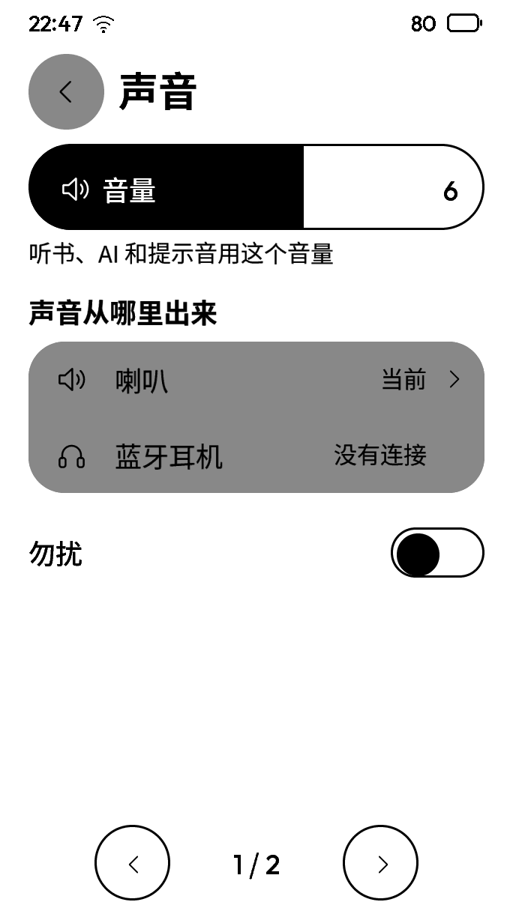
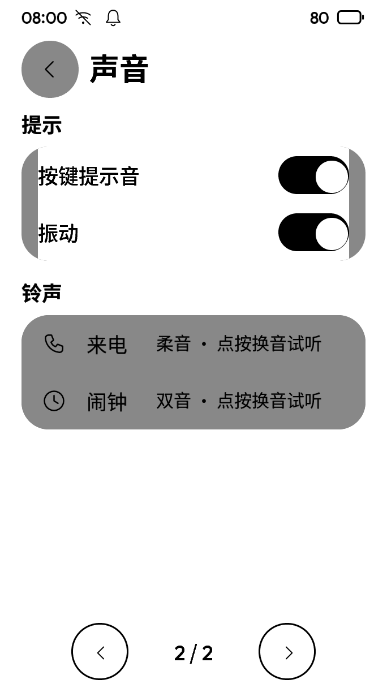
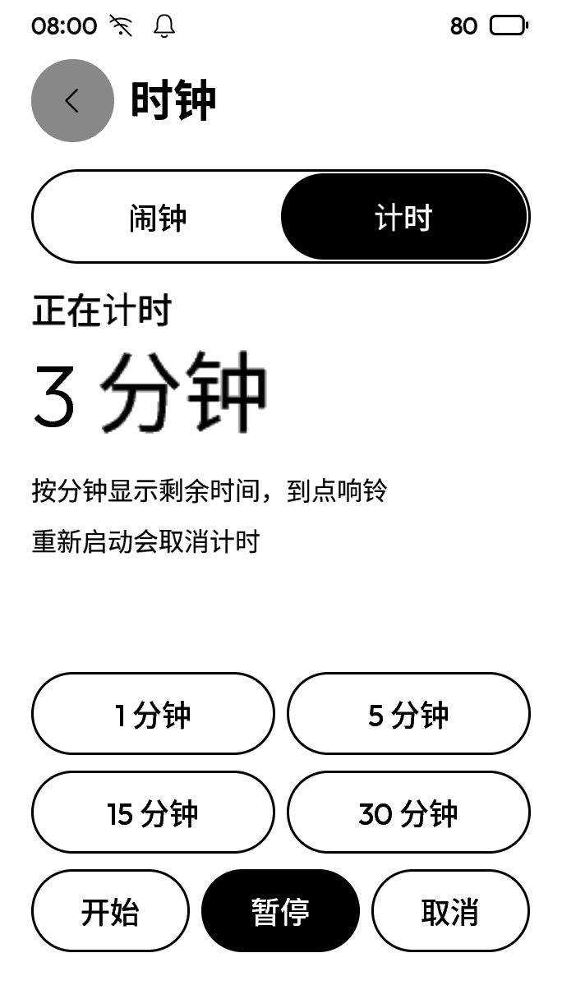
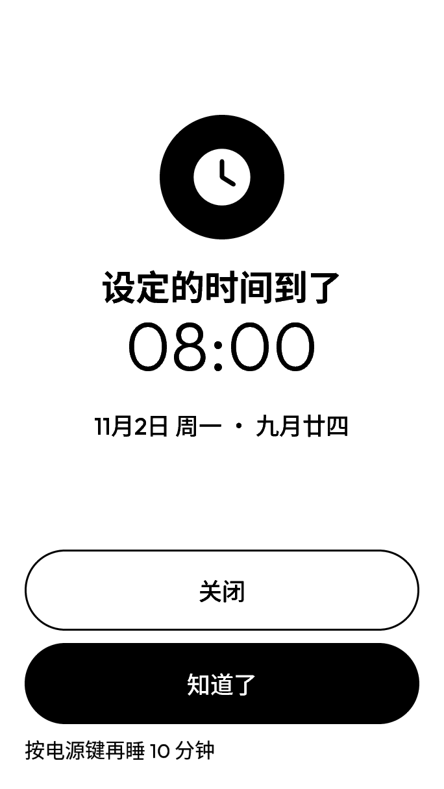
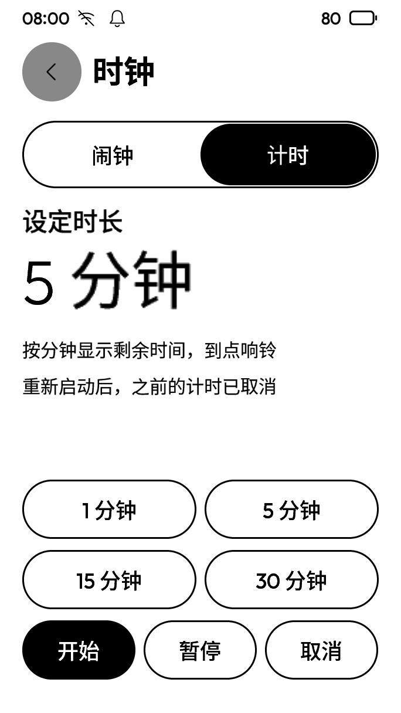

# sound-clock 执行报告

基线：`62b0e83da1d34f50629b5e576807db1381b26078`。分支：`claude/codex-sound-clock`。日期：2026-11-10。

## 验收表

| 编号 | 结论 | 证据 | 命令 |
| --- | --- | --- | --- |
| 1 设置、声音、振动 | 【实测】专项通过；最终复验待完成 | 人和 AI 更改四项设置；两个实体键、两次触摸各恰好两声；高优先级通知、来电、闹钟各一震；来电选柔音、闹钟选双音；进程重启后四项保留 | C1 |
| 2 倒计时 | 【实测】专项通过；最终复验待完成 | 触摸及 AI 开始、暂停、继续、取消、到点响铃和关闭；成人、孩子分别计时；分钟更新，2 秒内没有额外刷新；重启明确取消 | C1 |
| 3 声音页对照、计时截图 | 【实测】46.001/255，超过 12；基线也是 46.001 | 原有字号、灰度、分页造成首屏与画板不同；新开关和铃声在第二页。计时截图见下，**没有画板，待用户看** | C2 |
| 4 全量及内存检查 | 进行中，不能报通过 | 第一轮发现文档过期、响铃钩子、AI 清单和 AI 页面版本场景四项失败；前两处代码/测试接线已修并定向通过，最后两项处理边界见下 | C3、C4 |

复现命令（依赖位置使用任务指定的环境变量，先按总规则配置并构建）：

```bash
# C1：真实页面、音频、振动、成员隔离、进程重启
INK_KEEP_EVIDENCE=1 taskpolicy -c utility "$INK_DEPS/build-deps/pyenv/bin/ctest" --test-dir build --output-on-failure -j2 -R '^(sound-clock|clock-alarm|integration-races|integration-ai-surface)$'
# C2：与外部画板比较；外部画板未入库
taskpolicy -c utility "$INK_DEPS/build-deps/pyenv/bin/python" tools/ui_compare.py --build build --design "$INK_DESIGN" --out work/ui-compare --scenes SetSound
# C3 / C4：完整检查，保留实际失败，不跳过断言
taskpolicy -c utility "$INK_DEPS/build-deps/pyenv/bin/ctest" --test-dir build --output-on-failure -j2
taskpolicy -c utility "$INK_DEPS/build-deps/pyenv/bin/ctest" --test-dir build-asan --output-on-failure -j2
# C5：撤掉关键实现，要求测试确实失败
taskpolicy -c utility "$INK_DEPS/build-deps/pyenv/bin/python" tests/sound_clock_negative.py --build build
# C6：仅将 clock.c 换为基线对象，重链现有测试，核对 AI 页面版本回归
taskpolicy -c utility "$INK_DEPS/build-deps/pyenv/bin/python" tests/sound_clock_negative.py --build build --baseline-clock
# C7：在临时目录生成并核对能力表，遵守共享文档不改的边界
taskpolicy -c utility "$INK_DEPS/build-deps/pyenv/bin/python" tools/capabilities.py --output work/capabilities.md
taskpolicy -c utility "$INK_DEPS/build-deps/pyenv/bin/python" tools/capabilities.py --output work/capabilities.md --check
```

【实测】七个反向对照均失败且跑到 `test.finished=1`：按键开关、振动开关、铃声选择、设置保存值读取、暂停保留时长、到点响铃、成员隔离。只编译临时替换对象，不修改检出源码、不改断言。

【实现】设置沿用 `settings.set` 及原有保存文件；短音和试听沿用音频任务，铃声在同一任务生成。触摸在 LVGL 的输入设备确认点击处统一接入；实体键在输入服务统一接入。振动沿用 `hal_haptic_pulse`，未加 HAL、模型或线程。板级依据为 `boards/metalio_plus/metalio_board.h` 的 P03、50 ms，以及 `docs/research/simulator/hardware-parity.md` 第 9 项（查阅于 2026-11-10）。通知继续遵守原有优先级和勿扰规则，普通静默通知不强行提示。

【实现】倒计时使用单调时间、既有共享服务定时器和打断卡；运行期间持有已有的保持唤醒引用。各成员分别持有倒计时，按钮和 AI 使用同一组 `clock.timer*` 能力。页面用语义快照开放当前状态和动作。重启选择“明确取消”：省去新持久格式及墙钟调整语义，并在计时页明确写明。

【实现】声音在 `system/services/audio/audio_service.c` 程序生成，无下载素材、无第三方音源；音色基频为 880、660、330 Hz，按键为 1100 Hz，许可见 [SOUNDS-LICENSE.txt](SOUNDS-LICENSE.txt)。

产品代码规模待最终统计。为什么不能更小：现有时间服务是持久的墙钟闹钟，不能直接表达可暂停的单调倒计时；已检查复用其记录的方案，会混入闹钟列表并改变重启语义。采用应用内倒计时数据及现有定时节点，四个设置、两处输入接线、振动和选音均复用现有服务。

## 截图

声音首屏及实际可操作的第二页：





计时页：**没有画板，待用户看**。








## 没做到的

- 全量还不能报通过。`capability-table-doc` 检出新增六项能力、四项设置尚未汇入共享生成文档；总规则第 7 节禁止改该文件，留给合并主会话，C7 的临时生成/核对通过（428 项定义）。
- AI 页面版本场景仍失败：【实测】当前版本工具结果为 done=5、缺少 stale；仅恢复基线 `clock.c` 后 done=4、stale=1、退出 0。19.5 秒的 80 毫秒翻页键，当前版底层送达计量为 6 次（只含三次 AI 键的按下/松开），基线计量为 8 次。具体丢键原因未确定，不能说是基线就有的失败；没有拉长脚本按键、加等待或放宽预算。
- 未接触设备，未做真机听感、振动或续航测试；未在 Linux 上实际运行。

## 和设计不一致的

- 声音页分数超标。原有 D-107 的 1.2 倍字号及分页、已选的深灰底、图标与行结构和旧画板不同；本次改动在第二页，标准工具截的首屏与基线分数完全相同。
- 计时只按分钟向上取整显示，最后一分钟不跳秒；人可选四档常用时长，AI 能通过 `seconds` 设置 1～86400 秒。
- 共用闹钟打断卡原来固定显示“按电源键再睡 10 分钟”；计时的电源键实际关闭这次计时。受“时钟只改应用及其测试”边界限制，未改共用卡片，该文案需合并主会话处理。

## 改过的已有测试

- `tests/integration/ai_surface.c`：给严格的 AI 能力清单新增六项计时能力，`timer_set` 必需参数为 `seconds`，`timer_dismiss` 为 `id`；保留全部原断言。未修改其余已有测试期望。

## 要用户定的

- 查看无画板的计时页，确认常用时长及布局；本次保守采用“重启明确取消”。

## 顺手发现

- 原列表组件只接受 2～3 个固定动作。保持原有三动作，在时钟快照另列 `clock.timer`，避免扩展公共列表框架。

## 新增的机制

- 四个设置项：按键提示音、振动、来电铃声、闹钟铃声，均由任务书第 1、2 项要求；复用既有设置文件。
- 倒计时运行、暂停和取消状态及每成员定时节点：任务书第 3 项要求；复用现有共享定时器、UI 执行器、唤醒引用与打断卡。
- 无新增常驻任务、线程、文件格式、后台重试、缓存、队列或通用抽象层。

## 要改的文档

- 合并主会话生成 `docs/system/capabilities.md`，纳入六项 `clock.timer*` 能力及四项 `audio.*` 设置。
- `docs/system/ui-dependencies.md` 更新声音设置与计时的实现状态。
- 未改共享需求、想法、决策、任务总表，也未改已有调研、简报、审计资料。

## 最终检查

待完成最终全量、内存检查、截图复核、隐私扫描及提交。
