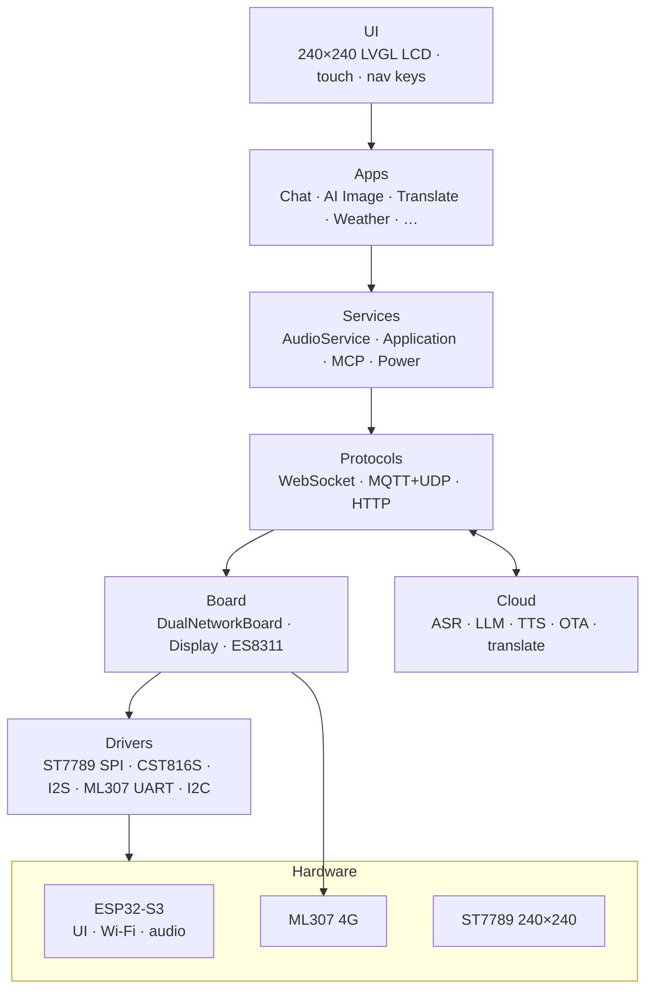
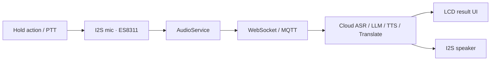
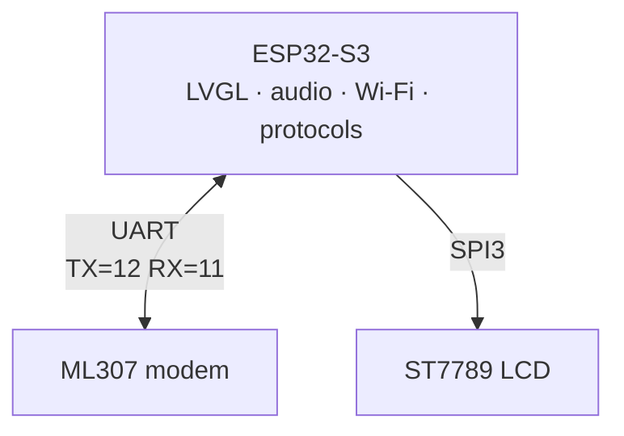

# Metalio-Claw-1.54

<p align="center">
  
</p>

[中文](README_zn.md) | **English**

**Quick links**

- ESP-IDF docs: [ESP32-S3 Get Started v5.5.4](https://docs.espressif.com/projects/esp-idf/en/v5.5.4/esp32s3/get-started/index.html)

---

## Contents

1. [Product overview](#1-product-overview)
2. [Core features](#2-core-features)
3. [Use cases](#3-use-cases)
4. [System architecture](#4-system-architecture)
5. [Hardware specs](#5-hardware-specs)
6. [Network architecture](#6-network-architecture)
7. [Peripherals and pins](#7-peripherals-and-pins)
8. [Software architecture](#8-software-architecture)
9. [Built-in apps](#9-built-in-apps)
10. [Protocols](#10-protocols)
11. [Development environment](#11-development-environment)
12. [Build and flash](#12-build-and-flash)
13. [Debug and FAQ](#13-debug-and-faq)

---

## 1. Product overview

**Metalio-Claw-1.54** is a compact AI companion device built around a **1.54″ 240×240** color LCD (ST7789), CST816S capacitive touch with cover-glass navigation keys, ES8311 I²S audio codec, on-board Wi‑Fi, and an **ML307** cellular modem (default 4G, Wi‑Fi switchable). Firmware supports voice chat with cloud AI, realtime translation, AI image generation, weather, and other home apps.

| Attribute | Description |
|:---|:---|
| **Product name** | Metalio-Claw-1.54 |
| **Board id** | `metalio-claw-1.54` (`BOARD_NAME` / `BOARD_TYPE`) |
| **MCU** | ESP32-S3 (Xtensa LX7; Flash **16 MB**, Octal PSRAM 8 MB) |
| **Display** | 1.54" SPI LCD, 240×240, ST7789; CST816S touch |

Board code: [`main/boards/metalio-claw-1.54/`](main/boards/metalio-claw-1.54/). This repository targets **this board only**.

---

## 2. Core features

### 2.1 AI voice

- **Streaming ASR / LLM / TTS** via WebSocket or MQTT+UDP
- **Wake word** support (AFE / Wakenet when enabled in `sdkconfig`)
- **Chat** home app for conversational AI

### 2.2 Built-in apps

- **Translate**: hold-to-talk streaming ASR + translation (Sinicloud service)
- **AI image generation**, **weather**, **calculator**, **2048**

Weather, translation, and AI image generation require external services. Their private endpoints are omitted from the open-source configuration and must be configured before use. Calculator and 2048 work offline.

### 2.3 Connectivity

- **4G (default)**: ML307 UART modem (`DualNetworkBoard`)
- **Wi‑Fi**: ESP32-S3 2.4 GHz; switch under **Settings → Network**

### 2.4 Power and UI

- **Power key** (GPIO47): short / long press handled by `PwrKey`
- **USB charge detect** (GPIO1) + battery ADC
- **Idle power policy** on home / standby
- **Themes**, brightness, volume, OTA from Settings

---

## 3. Use cases

Home apps (`home_screen.cc` → `kApps[]`):

| App | Typical use |
|:---|:---|
| **Chat** | Voice conversation with text display |
| **AI image gen** | Cloud image generation |
| **Translate** | Hold-to-talk realtime translation |
| **Weather** | Weather lookup |
| **Calculator** | Local calculator |
| **2048** | Local game |
| **Settings** | Network, theme, volume, backlight, OTA, about |

---

## 4. System architecture



### 4.1 Voice / translate path (sketch)



---

## 5. Hardware specs

| Category | Spec |
|:---|:---|
| **MCU** | ESP32-S3; Flash 16 MB; Octal PSRAM @ 80 MHz |
| **Display** | ST7789, 240×240, SPI3, ~40 MHz; backlight GPIO13 |
| **Touch** | CST816S (I2C 0x15, 400 kHz); cover nav ◁ ○ ▷ |
| **Audio** | ES8311; I²S 24 kHz in/out; PA enable GPIO21 |
| **Network** | On-chip Wi‑Fi + ML307 4G (UART TX=12 / RX=11) |
| **Power** | USB detect GPIO1; hold GPIO48; key GPIO47; battery / USB ADC |
| **Buttons** | BOOT (GPIO0); power key (GPIO47) |

---

## 6. Network architecture

The board class is **`DualNetworkBoard`**: ML307 is the default uplink; Wi‑Fi can be selected in Settings.



| Unit | Role | Interface | Duties |
|:---|:---|:---|:---|
| **ESP32-S3** | Host | — | UI, audio, Wi‑Fi, protocols, MCP |
| **ML307** | Cellular | UART | Default 4G data path |

> Switch network under **Settings → Network**. Reboot may be required after changing type.

---

## 7. Peripherals and pins

Source of truth: [`main/boards/metalio-claw-1.54/config.h`](main/boards/metalio-claw-1.54/config.h).

### 7.1 ESP32-S3 GPIO (excerpt)

| Function | GPIO | Notes |
|:---|:---|:---|
| I2C SDA | 41 | ES8311, CST816S |
| I2C SCL | 42 | |
| I2S MCLK | 5 | |
| I2S BCLK | 6 | |
| I2S WS | 4 | |
| I2S DOUT | 15 | Speaker |
| I2S DIN | 17 | Mic |
| Codec PA | 21 | Shared with modem power sense macro |
| LCD MOSI (SDA) | 10 | SPI3 |
| LCD SCLK | 9 | |
| LCD DC | 8 | |
| LCD CS | 14 | |
| LCD RES | 18 | |
| Backlight | 13 | |
| ML307 TX | 12 | Host → modem |
| ML307 RX | 11 | Modem → host |
| BOOT | 0 | |
| Power key | 47 | `Power_Dec` / PwrKey |
| Power hold | 48 | `Power_Control` |
| USB detect | 1 | |

### 7.2 Cover navigation keys (touch)

Virtual keys below the panel (`NAV_KEY_*` in `config.h`), typical mapping: **PREV / HOME / NEXT** (◁ ○ ▷).

### 7.3 I2C addresses

| Device | 7-bit addr | Notes |
|:---|:---|:---|
| CST816S | 0x15 | Touch |
| ES8311 | default codec addr | Audio |

---

## 8. Software architecture

Firmware targets the `metalio-claw-1.54` board. CMake project name `Metalio-Claw-1.54` (version in root `CMakeLists.txt`, e.g. `2.0.51`).

### 8.1 Layers

| Layer | Path / module | Role |
|:---|:---|:---|
| **Entry** | `main/main.cc`, `main/application.cc` | Boot, state machine |
| **Board** | `boards/metalio-claw-1.54/` | HW init, pins, LCD/touch |
| **Display** | `display/screen/*`, LVGL adapter | Apps, status UI |
| **Audio** | `audio/` | Codec, record / play |
| **Protocols** | `protocols/` | WebSocket, MQTT+UDP |
| **MCP** | `mcp_server.cc` | On-device tools |
| **Common** | `boards/common/` | Dual network, power helpers |

### 8.2 Tree (excerpt)

```
main/
├── application.cc
├── boards/metalio-claw-1.54/   # config.h, ST7789, CST816, power
├── boards/common/               # DualNetworkBoard, ML307, Wi-Fi
├── display/screen/              # home, chat, translate, settings, …
├── audio/
└── protocols/

partitions/v1/16m.csv            # 16MB table (OTA 5MB ×2, resources 5MB)
```

### 8.3 Flash partitions (`partitions/v1/16m.csv`)

| Partition | ~Size | Use |
|:---|:---|:---|
| nvs / otadata / phy_init | 24K / 8K / 4K | NVS, OTA meta, PHY |
| model | 896K | SR models (SPIFFS) |
| ota_0 / ota_1 | 5MB each | Dual OTA apps |
| resources | 5MB | UI assets (SPIFFS / mmap) |

> `sdkconfig.defaults` enables a custom partition table for this board. Prefer the checked-in CSV under `partitions/v1/` for the partition layout.

---

## 9. Built-in apps

### 9.0 Home apps

| App | Description |
|:---|:---|
| **Chat** | Voice conversation interface |
| **AI image gen** | Cloud image generation UI |
| **Translate** | Hold-to-talk ASR + translation |
| **Weather** | Weather screen |
| **Calculator** | Local calculator |
| **2048** | Local game |
| **Settings** | See §9.1 |

System pages (no home icon): boot, standby / idle power, OTA progress, etc.

### 9.1 Settings

| Entry | Content |
|:---|:---|
| **Network** | Wi‑Fi / 4G (ML307) selection and provisioning |
| **Theme** | Home icon theme |
| **Volume** | Speaker volume |
| **Backlight** | Brightness |
| **OTA** | Firmware upgrade |
| **About / Info** | Model, chip, FW version, memory |

---

## 10. Protocols

| Protocol | Use |
|:---|:---|
| **WebSocket** | Streaming voice / translate uplink |
| **MQTT + UDP** | Alternate voice transport |
| **HTTP** | OTA, tokens, weather, image APIs |
| **MCP** | Expose device tools to LLMs |

---

## 11. Development environment

### 11.1 Requirements

| Item | Requirement |
|:---|:---|
| **ESP-IDF** | **v5.5.4** recommended and validated; dependencies require ≥ v5.5.2 |
| **Target** | ESP32-S3 |
| **Board** | Metalio-Claw-1.54 (`main/boards/metalio-claw-1.54/`) |
| **OS** | Linux / macOS / Windows; examples below use Bash |
| **Python** | Use the Python environment installed by ESP-IDF |

### 11.2 Install ESP-IDF (example)

```bash
git clone -b v5.5.4 --recursive https://github.com/espressif/esp-idf.git
cd esp-idf
./install.sh esp32s3
. ./export.sh
idf.py --version
cd ..
```

The installation example above uses Linux / macOS commands. On Windows, use the ESP-IDF installer and run subsequent commands in the ESP-IDF PowerShell environment.

### 11.3 Get the source

```bash
git clone https://github.com/CloudZao/Metalio-Claw-1.54.git metalio-claw-1.54
cd metalio-claw-1.54
```

Board type is fixed to `BOARD_TYPE_METALIO_CLAW_1_54` in `sdkconfig.defaults`.

---

## 12. Build and flash

### 12.1 Build

```bash
. ../esp-idf/export.sh   # adjust to your ESP-IDF installation

idf.py build
```

### 12.2 About sdkconfig

`sdkconfig` contains board-specific PSRAM, partition, and LVGL settings. Adjust it with `idf.py menuconfig`. Defaults are provided by `sdkconfig.defaults`; board `config.json` is consumed by `scripts/release.py`, and its overlays are not automatically applied by `idf.py build`.

### 12.3 Service endpoint configuration

Configure service URLs and paths in `main/cloudzao_endpoints.c`; declarations are in `main/cloudzao_endpoints.h`. Weather, translation, and AI image generation require their respective services. Empty URLs or paths return a service-not-configured error. Local apps such as Calculator and 2048 do not depend on these endpoints.

For releases without private services, leave `cloudzao_*` addresses and paths empty and retain the official OTA address and activation path. Run `python tests/test_empty_urls.py` to validate configuration (GCC/G++ required).

### 12.4 Flash and monitor

```bash
# Change port for your machine (often /dev/ttyACM0 or /dev/ttyUSB0 on Linux)
idf.py -p /dev/ttyACM0 flash monitor
```

---

## 13. Debug and FAQ

### 13.1 Common log tags

| Tag | Module |
|:---|:---|
| `METALIO_CLAW_1_54` / Board | Board init |
| `TranslateScreen` | Translate app |
| `ChatScreen` | Chat |
| `Ml307Http` / `Ml307Tcp` | 4G HTTP / TCP |
| `HomeScreen` | Home launcher |
| `LVAdapterDisplay` | LCD / LVGL |

### 13.2 FAQ

**Q: ESP-IDF version mismatch**

Use the validated **v5.5.4** release and activate the ESP-IDF environment before running `idf.py`.

**Q: Display blank / garbled**

1. Confirm ST7789 SPI pins in `config.h`
2. Check backlight GPIO13 and power rails
3. Avoid breaking SPI / LVGL buffer settings in `sdkconfig`

**Q: Touch dead**

CST816S must respond at I2C `0x15`. Check bus 41/42 and coordinate mirror flags in `config.h`.

**Q: No network on 4G**

Confirm ML307 UART (TX=12, RX=11), modem power, and that Settings → Network is set to cellular. Watch `Ml307*` logs.

**Q: Wi‑Fi provisioning**

Settings → Network → switch to Wi‑Fi, then scan and connect using the device UI. BluFi is not enabled in the default firmware.

**Q: Translate stuck on “Stopping…” on 4G**

Check cellular signal, service endpoint configuration, and `TranslateScreen` logs. Releasing the key stops recording and ends audio transmission.

---

_This document tracks the Metalio-Claw-1.54 firmware. Prefer source (`config.h`, board `.cc`) when docs and hardware disagree; open an Issue if you find a mismatch._
